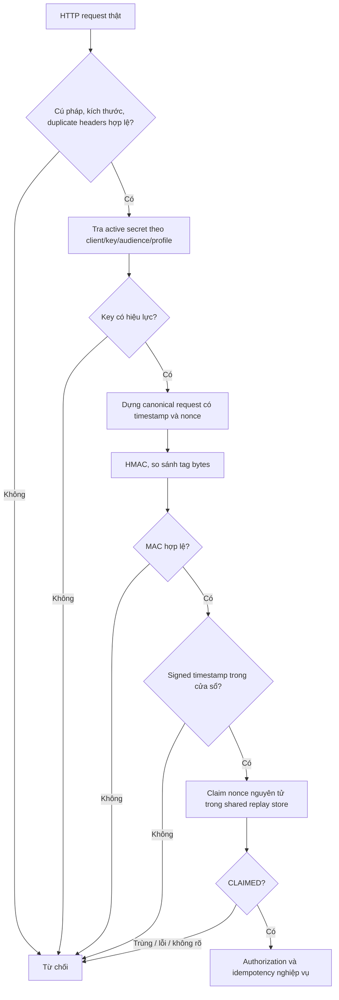

# Nonce randomness: độ ngẫu nhiên của nonce trong HMAC request authentication

> **Chương:** Nonce  
> **Bài học:** Nonce randomness — lựa chọn, sinh, đánh giá và sử dụng nonce ngẫu nhiên khi ký và xác minh HTTP request bằng HMAC.  
> **Bối cảnh:** Module `SECURITY_AUTHENTICATION_HMAC_REQUEST_AUTHENTICATION` xây dựng cơ chế xác thực bằng shared secret và canonical request (method, URI, signed headers, body). Nonce phải phối hợp với timestamp, key rotation, proxy/gateway và các bước xác thực, chống replay, phân quyền riêng biệt.

## 1. Vì sao độ ngẫu nhiên của nonce đáng quan tâm?

Giả sử một đối tác gọi API tạo giao dịch bằng HTTP:

```http
POST /v1/transfers?mode=commit HTTP/1.1
Host: payments.example.test
Content-Type: application/json
X-Client-Id: partner-01
X-Key-Id: partner-key-2026-11
X-Timestamp: 1795800000
X-Nonce: I9vQpq0g6PTm2djVvKuKGw
X-Idempotency-Key: transfer-101
X-Signature: <base64url-hmac-sha256>

{"transferId":"transfer-101","amountMinorUnits":100000}
```

Trong thiết kế HMAC, `X-Nonce` là giá trị dùng một lần do client sinh **trước khi tạo chữ ký**. Client đưa nonce vào canonical request và tính HMAC; server dựng lại canonical bytes, xác minh tag rồi kiểm tra nonce chưa từng được sử dụng.

Tại sao không đặt `X-Nonce: 1`, sau đó `2`, `3`?

- Một bộ đếm thiếu cơ chế phối hợp có thể **lặp lại khi restart hoặc trên nhiều instance**.
- Nonce dự đoán được không mang lại lớp phòng thủ bổ sung trước một số loại tấn công, và làm việc tiền chiếm nonce dễ hơn nếu server sai thứ tự xác minh.
- Với hệ thống phân tán, rất khó bảo đảm một bộ đếm được cấp phát duy nhất trên mọi client instance, khu vực và lần khôi phục dữ liệu.
- Một nguồn ngẫu nhiên chất lượng cao giảm xác suất hai request hợp lệ tự sinh cùng nonce, không cần một coordinator phía client.

**Tính chất cốt lõi của nonce chống replay là “không được tái sử dụng trong phạm vi bảo vệ”; tính khó dự đoán là lớp bảo vệ đáng giá, nhưng không thay thế HMAC hay replay store.** Dùng bộ sinh mật mã thích hợp như `SecureRandom` để đạt cả hai yêu cầu trong một profile đơn giản.

### 1.1 Ba câu hỏi bảo mật khác nhau

| Câu hỏi | Cơ chế | Nếu không có |
| --- | --- | --- |
| Request có thực sự do bên giữ shared secret ký? | HMAC trên canonical request | Attacker có thể sửa nội dung và một nonce tự khai mà không bị phát hiện |
| Nonce có mới và khó trùng/khó đoán? | Sinh 128-bit từ CSPRNG | Dễ trùng giữa request, restart, nhiều process; khó đảm bảo uniqueness |
| Nonce đã từng được dùng? | Replay store kiểm tra và claim nguyên tử | Request đã ký vẫn có thể phát lại nguyên vẹn, dù nonce được sinh rất tốt |

**Randomness không bằng replay prevention.** Một nonce hoàn toàn ngẫu nhiên vẫn có thể bị attacker sao chép từ request hợp lệ. Nếu server không lưu dấu đã dùng, lần replay vẫn có MAC đúng và nonce hợp lệ về hình thức.

### 1.2 Mục tiêu học tập

Sau bài này, người học có thể:

1. Giải thích **entropy**, độ dài nonce, độ khó dự đoán và xác suất va chạm.
2. So sánh `SecureRandom` với các bộ sinh không dùng cho mật mã.
3. Sinh nonce 16 byte/128 bit trên Java 17, encode Base64URL không padding.
4. Đánh giá rủi ro nguồn RNG yếu, seed lặp, restart, snapshot, concurrency và multi-region.
5. Thiết kế test về format, uniqueness, concurrency và khả năng phát hiện RNG cấu hình sai mà **không ngộ nhận test thống kê chứng minh CSPRNG an toàn**.
6. Đưa nonce đã sinh vào signed canonical request, kiểm tra atomic replay claim và xử lý retry/idempotency đúng.

## 2. Entropy, độ dài và sự không trùng lặp

### 2.1 Entropy là gì?

Nói đơn giản, entropy trong bối cảnh này phản ánh mức độ **không chắc chắn của attacker** về giá trị nonce trước khi nó được sinh.

Nếu nonce là 16 byte được chọn **đồng đều và độc lập** từ một bộ sinh ngẫu nhiên mật mã đúng, không gian có:

```text
16 bytes × 8 bits/byte = 128 bits

Số khả năng = 2^128
≈ 3,40 × 10^38 giá trị
```

Nhưng một chuỗi hiển thị dài **không đồng nghĩa** với entropy cao:

```text
"00000000000000000000000000000000"
"20261128-090000-0001"
"random-1", "random-2", "random-3"
```

Những chuỗi này có thể dài nhưng gần như hoàn toàn dự đoán được. **Độ dài biểu diễn** và **độ ngẫu nhiên thực sự** phải được đánh giá riêng.

### 2.2 Xác suất va chạm theo bài toán sinh nhật

Với một không gian `2^b` giá trị được chọn đồng đều, khi sinh `n` nonce độc lập, xác suất xảy ra ít nhất một va chạm được xấp xỉ (khi xác suất nhỏ):

\[
P(\text{collision}) \approx \frac{n(n-1)}{2^{b+1}}.
\]

Đối với `b = 128`:

| Số nonce được sinh | Xác suất va chạm xấp xỉ |
| ---: | ---: |
| 1.000 | 1,47 × 10⁻³³ |
| 1.000.000 | 1,47 × 10⁻²⁷ |
| 1.000.000.000 | 1,47 × 10⁻²¹ |
| 1.000.000.000.000 | 1,47 × 10⁻¹⁵ |

Các số này giả định **128 bit thực sự đồng đều, các lần sinh độc lập**. Nếu RNG chỉ có 32 bit trạng thái, seed bị lặp hoặc nhiều VM được khôi phục từ cùng trạng thái nội bộ, công thức 128-bit không còn mô tả thực tế.

Xấp xỉ này nói về **va chạm ngẫu nhiên** giữa những nonce được sinh; nó không chứng minh rằng attacker không thể đoán nguồn RNG.

### 2.3 Khi nonce vô tình bị trùng sẽ xảy ra gì?

Giả sử hai request **hợp lệ và khác nội dung** của cùng client cùng sinh ra một nonce. Server kiểm tra HMAC cho cả hai request, nhưng replay store chỉ cho phép claim nonce lần đầu.

```text
Request A: nonce=N, MAC_A hợp lệ -> CLAIMED -> xử lý
Request B: nonce=N, MAC_B hợp lệ -> ALREADY_USED -> từ chối
```

Request B bị từ chối để giữ quy tắc “nonce một lần”, dù nội dung và tag khác request A. Ứng dụng có thể ký một **attempt mới với nonce mới** theo retry policy, nhưng không được miễn replay check chỉ vì MAC khác.

Đây là lý do nonce collision ảnh hưởng đến **availability**, còn việc server bỏ qua duplicate nonce có thể gây lỗ hổng replay.

## 3. Chọn độ dài nonce và encoding

Profile minh họa của bài chọn:

```text
nonceRaw       = 16 bytes từ CSPRNG
nonceHeader    = BASE64URL_NO_PADDING(nonceRaw)
nonceLength    = 22 ký tự ASCII
nonceAlphabet  = A-Z a-z 0-9 - _
```

Ví dụ một nonce hợp lệ theo format:

```text
I9vQpq0g6PTm2djVvKuKGw
```

Nonce được gửi công khai trong header; **không phải khóa bí mật** và không cần mã hóa để che giấu. Điều cần bảo vệ là shared secret dùng tính HMAC.

### 3.1 Vì sao 16 byte thành 22 ký tự?

Base64 phân chia dữ liệu theo nhóm 6 bit. Với 128 bit:

```text
128 / 6 = 21 nhóm đầy đủ + 2 bit dư
=> 22 ký tự Base64URL khi bỏ padding
```

Đối với 16 bytes, Base64 thường có 24 ký tự gồm hai dấu `=` padding; Base64URL không padding còn **22 ký tự**.

Độ dài 22 ký tự là **độ dài biểu diễn**, không có nghĩa nonce có 22 × 6 = 132 bit entropy. Bốn bit cuối ở ký tự cuối chỉ là bit đệm, không chứa entropy mới.

### 3.2 Kiểm tra Base64URL canonical

Không phải mọi chuỗi 22 ký tự thuộc alphabet Base64URL đều là encoding canonical của 16 bytes. Server nên:

1. Kiểm tra độ dài và alphabet.
2. Decode Base64URL.
3. Kiểm tra kết quả có **đúng 16 bytes**.
4. Encode lại bằng Base64URL không padding và so sánh với chuỗi đầu vào.

Nhờ bước encode lại, các biến thể có pad bits không canonical bị từ chối. Không chỉ dựa vào regex rồi mặc định nonce an toàn.

### 3.3 Các format khác có thể dùng nhưng cần hợp đồng riêng

| Format | Nhận xét | Điểm cần chú ý |
| --- | --- | --- |
| 16 random bytes + Base64URL | Profile bài học, gọn và URL/header-safe | 22 ký tự, strict decode |
| 16 random bytes + hex | Rõ ràng, dễ debug | 32 ký tự hex; thống nhất lowercase/uppercase |
| UUID phiên bản 4 | Thường có 122 bit được sinh ngẫu nhiên theo bố trí UUID | Không có 128 bit entropy đầy đủ vì version/variant bits; chỉ dùng khi profile cho phép |
| UUID theo thời gian | Có thành phần thời gian/định danh | Không mặc định có entropy 128-bit |
| ULID | Có phần timestamp và 80 bit random theo format chuẩn | Không thay thế tự động 128 random bits theo profile |
| Bộ đếm toàn cục | Có thể bảo đảm duy nhất nếu cấp phát nguyên tử, bền vững | Dễ sai với restart, multi-region; không khó đoán |
| Timestamp hoặc `System.nanoTime()` | Thường đoán được, dễ trùng | Không đạt yêu cầu nonce ngẫu nhiên trong profile |
| Hash từ time/process ID | Kết quả trông ngẫu nhiên | Hash **không bổ sung entropy** cho dữ liệu đầu vào có thể đoán |

Không chọn format chỉ vì nó “trông ngẫu nhiên”. Phải xác định entropy thực, giới hạn collision, cú pháp và ngữ nghĩa server.

## 4. CSPRNG trong Java 17: `SecureRandom`

Java cung cấp `java.security.SecureRandom` để sinh bytes ngẫu nhiên dùng cho nhu cầu bảo mật.

### 4.1 Mẫu tối thiểu

```java
import java.security.SecureRandom;
import java.util.Base64;

public final class StrongNonce {
    private static final SecureRandom RNG = new SecureRandom();

    private StrongNonce() {}

    public static String nextNonce() {
        byte[] nonceBytes = new byte[16];
        RNG.nextBytes(nonceBytes);

        return Base64.getUrlEncoder()
                .withoutPadding()
                .encodeToString(nonceBytes);
    }

    public static void main(String[] args) {
        String nonce = nextNonce();
        System.out.println(nonce);          // Giá trị thay đổi mỗi lần.
        System.out.println(nonce.length()); // 22.
    }
}
```

Những chi tiết quan trọng:

- `new SecureRandom()` chọn provider/thuật toán mặc định của môi trường Java, sử dụng nguồn seed theo cấu hình bảo mật của runtime.
- `nextBytes` yêu cầu 16 bytes ngẫu nhiên để dùng làm nonce.
- Một instance `SecureRandom` có thể được tái sử dụng; không cần tạo mới bằng `new SecureRandom()` cho **mỗi request**.
- Không tự truyền seed từ timestamp, PID hoặc một hằng số “cho dễ tái lập” trong production.
- Kiểm tra thời gian khởi tạo, mức độ sẵn sàng của entropy source và chính sách provider trong môi trường triển khai thật.

`SecureRandom.getInstanceStrong()` có thể chọn một thuật toán/provider khác theo cấu hình runtime và **có thể có hành vi chờ tài nguyên ngẫu nhiên**. Không thay `new SecureRandom()` bằng `getInstanceStrong()` một cách máy móc trong HTTP hot path; cần đánh giá môi trường, độ trễ và yêu cầu mật mã cụ thể.

### 4.2 Những API không nên dùng

```java
import java.util.Random;

// KHÔNG phù hợp cho nonce chống replay theo profile ngẫu nhiên.
Random weak = new Random();
byte[] nonce = new byte[16];
weak.nextBytes(nonce);

// Càng không nên lấy Math.random() nhân với một số rồi coi là nonce.
double value = Math.random();
```

`java.util.Random` không được thiết kế để bảo vệ đầu ra trước đối thủ muốn dự đoán trạng thái. `Math.random()` phục vụ các trường hợp thống kê/mô phỏng thông thường, không phải CSPRNG.

Cũng không nên dùng:

```java
// Các cách nhìn "có vẻ khác nhau" nhưng thiếu đảm bảo bảo mật:
String.valueOf(System.currentTimeMillis());
String.valueOf(System.nanoTime());
Long.toHexString(Thread.currentThread().getId());
String.valueOf(sequenceNumber++);
```

Những giá trị đó có thể được dùng cho tracing/correlation dưới điều kiện riêng, **không đáp ứng yêu cầu 128-bit CSPRNG nonce** của signing profile này.

### 4.3 Không tự seed bằng thời gian

Một lỗi dễ mắc:

```java
// SAI: seed dễ đoán, dễ lặp khi restart/snapshot.
SecureRandom random = new SecureRandom();
random.setSeed(System.currentTimeMillis());
```

`setSeed` của một provider chuẩn có thể **bổ sung seed vào trạng thái** chứ không có nghĩa luôn ghi đè trạng thái một cách trực tiếp. Vì vậy, không nên khẳng định đoạn trên nhất thiết làm `SecureRandom` mất an toàn trên mọi provider. Tuy nhiên, dữ liệu time/PID **không làm tăng entropy bí mật** và việc tự quản lý seed bằng vật liệu dự đoán được là một thực hành không nên dùng.

Càng nguy hiểm là các provider hoặc cấu hình custom **khởi tạo hoàn toàn từ một seed hằng** để làm đầu ra tái lập:

```text
seed = "test-fixed-seed"
nonce #1 = ...
nonce #2 = ...
restart process with same seed
nonce #1 = ...  (lặp lại)
```

**Seed cố định** chỉ có thể chấp nhận trong test có kiểm soát, dùng generator giả lập **không bao giờ được chọn trong cấu hình production**.

## 5. Đoán được nonce có lập tức phá HMAC không?

Không. Đây là điểm rất dễ nói quá.

**Nếu HMAC được triển khai đúng, key không lộ, nonce nằm trong canonical bytes và server chỉ claim nonce sau khi MAC đã hợp lệ**, attacker chỉ đoán trước nonce vẫn không thể tự tạo chữ ký cho một request mới. Không nên nói rằng “đoán nonce = giả mạo request” mà không xét shared secret.

Tuy nhiên, randomness yếu vẫn không nên được chấp nhận vì:

1. Nonce có thể **bị trùng**, dẫn đến từ chối request hợp lệ.
2. Nếu server **claim nonce trước HMAC**, attacker có thể đoán/đặt nonce để chiếm trước hoặc làm đầy store (*nonce poisoning*).
3. Trong những hệ thống có luồng uỷ quyền, ký lại, upstream tin cậy hay lỗi parser, khả năng dự đoán có thể làm tăng phạm vi tấn công.
4. Tính duy nhất giữa nhiều process/khu vực khó bảo đảm khi dựa trên bộ đếm hoặc clock không được phối hợp.
5. Một signing profile yêu cầu **16 bytes CSPRNG** cần tuân thủ chính xác để tương thích và kiểm toán.

Ngược lại, **ngẫu nhiên hoàn hảo không cứu một verifier thiếu replay store**, hoặc một hệ thống đã lộ shared secret. Nonce là thành phần của phòng vệ tổng hợp, không phải vật thay thế cho xác thực.

### 5.1 Thứ tự xác minh đúng



Chỉ khi HMAC hợp lệ và timestamp được chấp nhận, server mới có cơ sở tin nonce là trường **đã được chứng thực** và thực hiện claim. Nonce phải xuất hiện trong thông điệp ký, không được là một header phụ có thể thay đổi độc lập với signature.

## 6. Cách đưa nonce ngẫu nhiên vào canonical HTTP request

Hợp đồng minh họa `hmac-random-nonce-v1` sử dụng:

| Dòng ký | Ví dụ | Ý nghĩa |
| --- | --- | --- |
| Signing profile | `hmac-random-nonce-v1` | Phiên bản giao thức |
| Audience | `payments-api-prod` | Ràng buộc API/môi trường |
| Method | `POST` | Phương thức thực nhận |
| Raw target | `/v1/transfers?mode=commit` | URI theo hợp đồng |
| Content-Type | `application/json` | Diễn giải body đã ký |
| Client ID | `partner-01` | Map identity sau khi xác thực |
| Key ID | `partner-key-2026-11` | Secret còn hiệu lực |
| Timestamp | Epoch seconds, ASCII decimal | Giới hạn thời gian hợp lệ |
| Nonce | Base64URL của 16 random bytes | Dấu một lần |
| Idempotency key | `transfer-101` | Định danh nghiệp vụ khi retry |
| Body hash | SHA-256 hex chữ thường | Ràng buộc raw body bytes |

Canonical request được xây:

```text
hmac-random-nonce-v1
payments-api-prod
POST
/v1/transfers?mode=commit
application/json
partner-01
partner-key-2026-11
<signed-epoch-seconds>
<random-nonce-base64url>
transfer-101
<sha256-hex-of-raw-body>
```

Quy tắc bytes:

1. Client serialize raw body một lần thành bytes và tính SHA-256 trên **đúng bytes được gửi**.
2. Client sinh timestamp và nonce mới cho **mỗi HTTP attempt được ký**.
3. Các trường ghép bằng một byte LF `0x0A`; encode UTF-8, **không LF cuối, không BOM**.
4. Tính `HMAC_SHA256(sharedSecret, canonicalBytes)`.
5. Encode tag 32 bytes bằng Base64URL không padding thành 43 ký tự ASCII trong header signature.
6. Server không tin một canonical string do client khai; phải dựng lại từ request thật.

```text
bodyHash = lowercase_hex(SHA256(rawBodyBytes))
canonicalBytes = UTF8(joinWithLF(
    version, audience, method, rawTarget, contentType,
    clientId, keyId, timestamp, nonce, idempotencyKey, bodyHash))
signature = BASE64URL_NO_PADDING(HMAC_SHA256(secret, canonicalBytes))
```

Nếu ứng dụng dựa vào Host, tenant, header về Content-Encoding hoặc yếu tố khác để thực hiện nghiệp vụ, chúng cũng phải được ký hoặc bị cố định/ràng buộc bởi một trust boundary tin cậy. Ví dụ này chỉ minh họa các trường đã nêu, **không tự xưng là chuẩn HTTP signature phổ quát**.

### 6.1 Nonce phải được gắn vào request trước khi ký

Sai:

```text
canonical = method + LF + uri + LF + bodyHash
tag = HMAC(secret, canonical)
headers["X-Nonce"] = randomNonce()   // Không được bảo vệ bởi MAC.
```

Đúng:

```text
nonce = randomNonce()
canonical = ... + LF + timestamp + LF + nonce + LF + bodyHash
tag = HMAC(secret, canonical)
headers["X-Nonce"] = nonce          // Cùng giá trị nằm trong MAC.
```

Nếu attacker thay `X-Nonce` mà giữ signature cũ, server phải dựng canonical mới và từ chối ở bước HMAC.

### 6.2 Thêm idempotency key vì sao?

Nonce nhận diện **một HTTP attempt được ký**. Idempotency key nhận diện **một thao tác nghiệp vụ**. Khi gửi lại yêu cầu do mất response:

```text
Attempt #1:
  businessOperation=transfer-101
  idempotencyKey=transfer-101
  nonce=N1
  timestamp=T1
  signature=HMAC(...N1,T1,transfer-101...)

Attempt #2:
  businessOperation=transfer-101
  idempotencyKey=transfer-101  (giữ nguyên)
  nonce=N2                    (mới)
  timestamp=T2                (mới hoặc cùng giây)
  signature=HMAC(...N2,T2,transfer-101...)
```

Server có thể xác thực attempt #2 vì nonce mới, đồng thời tầng idempotency trả kết quả cũ nếu giao dịch đã thành công, không chuyển tiền hai lần.

Không dùng nonce làm idempotency key nếu mục tiêu là gom nhiều network attempts vào một operation.

## 7. Thực hành Java 17: random nonce, kiểm tra format và concurrency

Ví dụ đầu tiên là công cụ tự kiểm tra một bộ sinh nonce. Nó minh họa:

- Dùng một `SecureRandom` tái sử dụng để sinh bytes mới.
- Encode đúng Base64URL không padding.
- Validate form canonical bằng decode rồi re-encode.
- Sinh nhiều nonce cùng lúc ở các thread và đếm số trùng.
- Thử phát hiện một nguồn sinh giả lập cố ý trả nonce cố định.

**Cảnh báo:** “Không có trùng trong 20.000 mẫu” **không chứng minh** RNG có entropy 128 bit. Test này chỉ là smoke test và regression check để phát hiện lỗi rõ ràng. Cần review nguồn RNG và configuration riêng.

Lưu thành `NonceRandomnessLab.java`:

```java
import java.security.SecureRandom;
import java.util.Base64;
import java.util.HashSet;
import java.util.Set;
import java.util.concurrent.ConcurrentHashMap;
import java.util.concurrent.ExecutorService;
import java.util.concurrent.Executors;
import java.util.concurrent.Future;
import java.util.concurrent.atomic.AtomicInteger;
import java.util.ArrayList;
import java.util.List;

public final class NonceRandomnessLab {
    private static final int NONCE_BYTES = 16;
    private static final int THREADS = 8;
    private static final int PER_THREAD = 2_500;

    private NonceRandomnessLab() {}

    interface NonceSource {
        String next();
    }

    static final class SecureNonceSource implements NonceSource {
        private final SecureRandom rng = new SecureRandom();

        @Override
        public String next() {
            byte[] bytes = new byte[NONCE_BYTES];
            rng.nextBytes(bytes);
            return Base64.getUrlEncoder()
                    .withoutPadding()
                    .encodeToString(bytes);
        }
    }

    static boolean validFormat(String nonce) {
        if (nonce == null
                || !nonce.matches("[A-Za-z0-9_-]{22}")) {
            return false;
        }
        try {
            byte[] bytes = Base64.getUrlDecoder().decode(nonce);
            return bytes.length == NONCE_BYTES
                    && Base64.getUrlEncoder()
                            .withoutPadding()
                            .encodeToString(bytes)
                            .equals(nonce);
        } catch (IllegalArgumentException invalidBase64) {
            return false;
        }
    }

    static int countDuplicates(
            NonceSource source, int numberOfSamples) {
        Set<String> observed = new HashSet<>();
        int duplicates = 0;
        for (int i = 0; i < numberOfSamples; i++) {
            String value = source.next();
            if (!validFormat(value)) {
                throw new IllegalArgumentException("Bad nonce format");
            }
            if (!observed.add(value)) {
                duplicates++;
            }
        }
        return duplicates;
    }

    static int concurrentDuplicates(
            NonceSource source) throws Exception {

        Set<String> observed =
                ConcurrentHashMap.newKeySet();
        AtomicInteger duplicateCount = new AtomicInteger();
        ExecutorService pool =
                Executors.newFixedThreadPool(THREADS);
        List<Future<?>> jobs = new ArrayList<>();

        try {
            for (int thread = 0; thread < THREADS; thread++) {
                jobs.add(pool.submit(() -> {
                    for (int j = 0; j < PER_THREAD; j++) {
                        String value = source.next();
                        if (!validFormat(value)) {
                            throw new IllegalArgumentException(
                                    "Bad nonce format");
                        }
                        if (!observed.add(value)) {
                            duplicateCount.incrementAndGet();
                        }
                    }
                }));
            }
            for (Future<?> job : jobs) {
                job.get(); // Lan truyền lỗi từ worker thread.
            }
            return duplicateCount.get();
        } finally {
            pool.shutdown();
        }
    }

    public static void main(String[] args) throws Exception {
        NonceSource secure = new SecureNonceSource();

        String first = secure.next();
        System.out.println("Nonce length: " + first.length());
        System.out.println("Nonce format valid: "
                + validFormat(first));

        System.out.println("Serial duplicates (10000): "
                + countDuplicates(secure, 10_000));

        System.out.println("Concurrent duplicates (20000): "
                + concurrentDuplicates(secure));

        // Negative control: bộ sinh bị lỗi trả một nonce cố định.
        String fixed = secure.next();
        NonceSource broken = () -> fixed;
        System.out.println("Broken source duplicates (10): "
                + countDuplicates(broken, 10));

        System.out.println(
                "No collisions does not prove CSPRNG security.");
    }
}
```

Biên dịch và chạy với JDK 17:

```bash
javac -encoding UTF-8 NonceRandomnessLab.java
java NonceRandomnessLab
```

Kết quả **thường gặp**:

```text
Nonce length: 22
Nonce format valid: true
Serial duplicates (10000): 0
Concurrent duplicates (20000): 0
Broken source duplicates (10): 9
No collisions does not prove CSPRNG security.
```

Về mặt toán học, nguồn 128-bit chất lượng cao vẫn **có xác suất va chạm khác 0**, nên không coi “0 duplicate” là một invariant mật mã tuyệt đối. Câu `Broken source duplicates: 9` minh họa bộ sinh cố định có lỗi nghiêm trọng và được smoke test phát hiện.

### 7.1 Giải thích các giới hạn của bài test

- Mỗi `String` nonce là một biểu diễn Base64URL có format hợp lệ; format **không xác nhận entropy**.
- `HashSet`/`ConcurrentHashMap.newKeySet` chỉ dùng trong **test tính trùng**, không phải kho chống replay của backend.
- Bộ sinh tốt có thể tạo nonce khác nhau hàng triệu lần; khả năng không trùng là tính chất **xác suất**, không có bảo đảm tuyệt đối.
- Bộ sinh rất yếu cũng có thể không tạo trùng trong một mẫu nhỏ.
- Test concurrency phải được lặp ở nhiều process/restart và môi trường triển khai để phát hiện lỗi state sharing, nhưng vẫn không chứng minh trạng thái RNG bí mật.
- Việc sử dụng `SecureRandom` của provider đúng mục đích và cấu hình an toàn quan trọng hơn một kiểm định “ngẫu nhiên” dựa trên chuỗi đầu ra.

### 7.2 Tạo test vector deterministic nhưng không làm yếu production

Một test HMAC cần nonce cố định để tạo exact canonical bytes và tag kỳ vọng. Không nên ép `SecureRandom` production luôn sinh dãy cố định. Thay vào đó, inject một interface:

```java
@FunctionalInterface
interface NonceSource {
    String next();
}

// Production:
NonceSource secure = new SecureNonceSource();

// Unit test:
NonceSource fixedForTest =
        () -> "I9vQpq0g6PTm2djVvKuKGw";
```

Dùng test-only source qua dependency injection và kiểm tra cấu hình triển khai **không bao giờ** chọn fixed source. Trong test vector, nonce cố định **không phải** một lỗi vì test chỉ xác minh output; production mới yêu cầu nguồn ngẫu nhiên thực.

## 8. Tích hợp Java 17 với HMAC và replay store

Bây giờ ghép nonce CSPRNG vào một ví dụ signing/verifying.

Mã minh họa sau dùng:

- `SecureRandom.nextBytes` cho nonce.
- `Mac.getInstance("HmacSHA256")` và `SecretKeySpec` cho HMAC.
- Body digest `SHA-256` trên raw body bytes.
- `MessageDigest.isEqual` để so sánh tag decoded.
- `Clock` để kiểm tra signed timestamp, không lấy time client làm hiện tại.
- Một replay store **mô phỏng trong JVM** chỉ để chứng minh first-use và exact replay.

Trong production, hãy thay replay store mô phỏng bằng kho chia sẻ có atomic claim, TTL, durability theo yêu cầu; và thay secret demo bằng key resolver theo client ID, key ID, audience và profile.

Lưu thành `NonceHmacDemo.java`:

```java
import java.nio.charset.StandardCharsets;
import java.security.GeneralSecurityException;
import java.security.MessageDigest;
import java.security.SecureRandom;
import java.time.Clock;
import java.time.Instant;
import java.time.ZoneOffset;
import java.util.Base64;
import java.util.HexFormat;
import java.util.Set;
import java.util.concurrent.ConcurrentHashMap;

import javax.crypto.Mac;
import javax.crypto.spec.SecretKeySpec;

public final class NonceHmacDemo {
    private static final String VERSION = "hmac-random-nonce-v1";
    private static final String AUDIENCE = "payments-api-prod";
    private static final String METHOD = "POST";
    private static final String TARGET =
            "/v1/transfers?mode=commit";
    private static final String CONTENT_TYPE = "application/json";
    private static final String CLIENT_ID = "partner-01";
    private static final String KEY_ID = "partner-key-2026-11";
    private static final String OPERATION_ID = "transfer-101";

    private NonceHmacDemo() {}

    public record SignedRequest(
            String timestamp,
            String nonce,
            byte[] rawBody,
            String signature) {
        public SignedRequest {
            rawBody = rawBody == null ? null : rawBody.clone();
        }
        @Override
        public byte[] rawBody() {
            return rawBody == null ? null : rawBody.clone();
        }
    }

    interface ReplayStore {
        boolean claimOnce(String namespace, String nonce);
    }

    static final class DemoStore implements ReplayStore {
        private final Set<String> used =
                ConcurrentHashMap.newKeySet();

        @Override
        public boolean claimOnce(String namespace, String nonce) {
            return used.add(namespace + ":" + nonce);
        }
    }

    static String newNonce(SecureRandom random) {
        byte[] bytes = new byte[16];
        random.nextBytes(bytes);
        return Base64.getUrlEncoder()
                .withoutPadding()
                .encodeToString(bytes);
    }

    static boolean validNonce(String value) {
        if (value == null ||
                !value.matches("[A-Za-z0-9_-]{22}")) {
            return false;
        }
        try {
            byte[] decoded = Base64.getUrlDecoder().decode(value);
            return decoded.length == 16
                    && Base64.getUrlEncoder().withoutPadding()
                            .encodeToString(decoded).equals(value);
        } catch (IllegalArgumentException invalid) {
            return false;
        }
    }

    static boolean validTimestamp(String timestamp) {
        return timestamp != null
                && timestamp.matches("[1-9][0-9]{9,11}");
    }

    static byte[] canonicalBytes(SignedRequest request)
            throws GeneralSecurityException {
        if (request == null
                || !validTimestamp(request.timestamp())
                || !validNonce(request.nonce())
                || request.rawBody() == null
                || request.rawBody().length > 1_048_576) {
            throw new IllegalArgumentException("Invalid request fields");
        }

        String bodyHash = HexFormat.of().formatHex(
                MessageDigest.getInstance("SHA-256")
                        .digest(request.rawBody()));

        String canonical = String.join("\n",
                VERSION,
                AUDIENCE,
                METHOD,
                TARGET,
                CONTENT_TYPE,
                CLIENT_ID,
                KEY_ID,
                request.timestamp(),
                request.nonce(),
                OPERATION_ID,
                bodyHash);
        return canonical.getBytes(StandardCharsets.UTF_8);
    }

    static byte[] hmac(byte[] secret, byte[] message)
            throws GeneralSecurityException {
        Mac mac = Mac.getInstance("HmacSHA256");
        mac.init(new SecretKeySpec(secret, "HmacSHA256"));
        return mac.doFinal(message);
    }

    static SignedRequest sign(
            SecureRandom rng, byte[] secret, Clock clock,
            byte[] body) throws GeneralSecurityException {

        if (secret == null || secret.length < 32
                || body == null) {
            throw new IllegalArgumentException("Invalid demo input");
        }

        String timestamp =
                Long.toString(clock.instant().getEpochSecond());
        String nonce = newNonce(rng);
        SignedRequest unsigned =
                new SignedRequest(timestamp, nonce, body, "");

        String signature = Base64.getUrlEncoder()
                .withoutPadding()
                .encodeToString(hmac(secret, canonicalBytes(unsigned)));

        return new SignedRequest(timestamp, nonce, body, signature);
    }

    static boolean verifyAndClaim(
            byte[] secret, SignedRequest request,
            Clock clock, ReplayStore store)
            throws GeneralSecurityException {

        if (secret == null || secret.length < 32
                || request == null || clock == null || store == null
                || request.signature() == null
                || !request.signature()
                        .matches("[A-Za-z0-9_-]{43}")) {
            return false;
        }

        final byte[] supplied;
        try {
            supplied = Base64.getUrlDecoder()
                    .decode(request.signature());
        } catch (IllegalArgumentException malformed) {
            return false;
        }
        if (supplied.length != 32
                || !Base64.getUrlEncoder()
                        .withoutPadding()
                        .encodeToString(supplied)
                        .equals(request.signature())) {
            return false;
        }

        final byte[] expected;
        try {
            expected = hmac(secret, canonicalBytes(request));
        } catch (IllegalArgumentException invalid) {
            return false;
        }

        if (!MessageDigest.isEqual(expected, supplied)) {
            return false;
        }

        long signedAt = Long.parseLong(request.timestamp());
        long now = clock.instant().getEpochSecond();
        if (signedAt < now - 300L || signedAt > now + 60L) {
            return false;
        }

        // Demo chỉ có một namespace client/audience cố định.
        // Production phải dùng shared replay store có TTL,
        // atomic insert-if-absent và fail-closed khi lỗi.
        return store.claimOnce(
                AUDIENCE + ":" + CLIENT_ID, request.nonce());
    }

    public static void main(String[] args)
            throws GeneralSecurityException {

        SecureRandom rng = new SecureRandom();
        byte[] demoSecret = new byte[32];
        rng.nextBytes(demoSecret);

        Clock clock = Clock.fixed(
                Instant.parse("2026-11-28T02:00:00Z"),
                ZoneOffset.UTC);

        byte[] body = (
                "{\"transferId\":\"transfer-101\","
                + "\"amountMinorUnits\":100000}"
        ).getBytes(StandardCharsets.UTF_8);

        DemoStore store = new DemoStore();

        SignedRequest first = sign(
                rng, demoSecret, clock, body);
        SignedRequest retry = sign(
                rng, demoSecret, clock, body);

        System.out.println("Nonce format valid: "
                + validNonce(first.nonce()));
        System.out.println("New nonce for retry: "
                + !first.nonce().equals(retry.nonce()));
        System.out.println("First request: "
                + verifyAndClaim(demoSecret, first, clock, store));
        System.out.println("Exact replay: "
                + verifyAndClaim(demoSecret, first, clock, store));
        System.out.println("New signed attempt: "
                + verifyAndClaim(demoSecret, retry, clock, store));

        SignedRequest tampered = new SignedRequest(
                first.timestamp(), retry.nonce(),
                first.rawBody(), first.signature());
        System.out.println("Changed nonce with old signature: "
                + verifyAndClaim(demoSecret, tampered, clock, store));
    }
}
```

Biên dịch và chạy bằng JDK 17:

```bash
javac -encoding UTF-8 NonceHmacDemo.java
java NonceHmacDemo
```

Kết quả thường gặp:

```text
Nonce format valid: true
New nonce for retry: true
First request: true
Exact replay: false
New signed attempt: true
Changed nonce with old signature: false
```

Trong demo, `true` không có nghĩa request đã được **ủy quyền nghiệp vụ**. Mã cố định client ID, key ID, method, target, audience và operation ID để tập trung vào randomness của nonce; nó **không thực sự parse HTTP request**, không kiểm tra schema JSON, không có key store production và không có replay store bền vững.

### 8.1 Vì sao vẫn cần kiểm tra nonce đã dùng?

Xét hai lần gửi **cùng một signed request**:

```text
Client ký:
  timestamp=T
  nonce=N
  signature=HMAC(secret, ..., T, N, ...)

Server nhận lần 1:
  HMAC đúng, time đúng, N chưa dùng -> CLAIMED

Attacker phát lại byte-for-byte:
  HMAC vẫn đúng, time có thể vẫn đúng,
  N đã dùng -> ALREADY_USED -> từ chối
```

Nguồn `SecureRandom` có mạnh đến đâu cũng không giúp lần replay thứ hai tạo giá trị khác: attacker sao chép **chính nonce đã ký**. Vì vậy, replay store là bước không thể thiếu nếu yêu cầu chống phát lại.

### 8.2 So sánh tag và validation format

Trong mã ví dụ:

- Nonce dùng `Base64.getUrlDecoder` và re-encode canonical để loại định dạng không hợp lệ.
- Tag HMAC dùng Base64URL không padding, 43 ký tự, decode thành 32 bytes.
- `MessageDigest.isEqual(expected, supplied)` so sánh tag bytes theo primitive được khuyến nghị; không so text signature bằng `String.equals` như một primitive bảo mật.
- HMAC được xác minh **trước** timestamp và nonce claim.
- Ngay cả khi nonce format hợp lệ, không thể từ đó khẳng định nonce được sinh từ `SecureRandom`; bên ký phải bảo đảm nguồn sinh.

## 9. Test randomness: đo được gì và không đo được gì?

Randomness là thuộc tính khó “chứng nhận” chỉ bằng vài kiểm thử đầu ra. Cần phân biệt **kiểm tra bug triển khai** với **đánh giá một CSPRNG mật mã**.

### 9.1 Kiểm tra uniqueness

Sinh nhiều nonce và thống kê:

```text
generated = 100000
unique = 100000
duplicates = 0
```

Kết quả này **phù hợp** với nguồn ngẫu nhiên tốt nhưng không chứng minh RNG tốt. Một counter duy nhất cũng có thể cho 100.000 giá trị khác nhau, dù toàn bộ đều đoán được.

Nên kết hợp:

- Unit test format và chiều dài.
- Concurrency test từ nhiều threads/processes.
- Restart/redeploy test để xem state có bị lặp do seed cố định.
- Kiểm thử CI đảm bảo test source không thể lọt vào production config.
- Review cấu hình `SecureRandom` provider và các điều kiện VM snapshot/container.

### 9.2 Phân phối ký tự Base64URL không phải là chứng minh entropy

Có thể đếm tần suất ký tự hoặc bit ở 16-byte nonce để phát hiện lỗi rõ như “tất cả byte bằng 0”. Nhưng:

- Do pad bits, **ký tự Base64URL cuối của nonce 16 bytes chỉ có một tập khả năng hạn chế**, không thể đòi mỗi vị trí đều phân phối đều trên 64 ký tự.
- Mẫu nhỏ luôn có dao động thống kê.
- Bộ sinh giả ngẫu nhiên không an toàn vẫn có thể vượt qua các phép test tần suất.
- Test tần suất **không đo được khả năng attacker suy trạng thái**.

Vì vậy, đừng viết một assert sai kiểu “mọi vị trí Base64URL đều phải phân bố đều trên 64 ký tự” rồi kết luận `SecureRandom` không tốt.

### 9.3 Chi-square, runs, autocorrelation và test suites

Những kiểm định thống kê như frequency/chi-square, runs, autocorrelation hoặc các bộ kiểm thử bitstream có thể giúp phát hiện một số kiểu thiên lệch. Nhưng một dãy đầu ra **trông ngẫu nhiên** không chứng minh tính **khó dự đoán bằng tính toán**.

Lý do: một thuật toán PRNG không dùng cho mật mã có thể cho phân phối đầu ra rất đẹp nhưng bị dự đoán khi attacker biết đủ trạng thái hoặc đầu ra trước đó.

Một kế hoạch kiểm thử hợp lý:

| Nhóm | Ví dụ | Kết luận được phép |
| --- | --- | --- |
| Format | 22 Base64URL chars, decode 16 bytes | Đúng định dạng |
| Repeatability regression | Tránh seed/test source lặp qua restart | Phát hiện một số lỗi triển khai |
| Concurrency | Nhiều thread sinh đồng thời | Tìm lỗi chia sẻ trạng thái hoặc duplicate rõ ràng |
| Distribution smoke test | Bit count/tần suất | Phát hiện thiên lệch lớn |
| Source review | `SecureRandom` provider, seed policy, entropy lifecycle | Đánh giá cơ sở an toàn của RNG |
| Replay integration | HMAC + timestamp + atomic nonce claim | Kiểm tra hệ thống chống phát lại |
| Statistical battery | Nhiều phép thống kê theo mẫu đủ lớn | Bằng chứng thống kê có giới hạn, không phải chứng nhận CSPRNG |

### 9.4 Đừng dùng một mẫu phân phối để “chữa” RNG

Không nên sinh nonce từ `Random` rồi thử mãi đến khi có phân phối vừa ý, cũng không hash timestamp/PID để “tăng entropy”. Một phép băm mật mã **không tạo thêm độ không chắc chắn** so với nguồn đầu vào ban đầu.

Nếu môi trường không có entropy source phù hợp hoặc CSPRNG bị lỗi, hãy **ngừng phát hành signed request theo chính sách fail-closed** và sửa nguồn RNG/cấu hình. Không fallback sang `Math.random()` để “giữ dịch vụ chạy”.

## 10. Nhiều process, khởi động lại và snapshot/restore

Bài toán nonce randomness không chỉ là gọi `nextBytes` đúng trong một process.

### 10.1 Multi-thread

Nếu nhiều thread trong cùng JVM dùng chung `SecureRandom`, cần hiểu provider/runtime và khả năng đồng bộ. Bộ sinh `SecureRandom` được JDK quản lý với các bảo đảm phù hợp cho việc gọi trong môi trường đa luồng; hiệu năng và cách provider xử lý synchronization vẫn cần được đánh giá khi tải cao.

Không tự chuyển sang `ThreadLocalRandom` vì nhanh hơn: API đó **không phải CSPRNG**. Nếu throughput là vấn đề, đo và tối ưu dựa trên provider/kiến trúc được phép, đừng giảm mức bảo mật của nguồn nonce.

### 10.2 Nhiều instance client

Giả sử 20 pods cùng ký request cho cùng client identity. Dùng `SecureRandom` độc lập với nguồn seed đúng giúp xác suất nonce trùng cực thấp mà không cần cấp phát dải counter.

Ngược lại, nếu 20 pods khởi tạo một PRNG từ cùng seed cố định, chúng có thể sinh **cùng dãy nonce**, gây lỗi hàng loạt. Một chuỗi “ngẫu nhiên” không còn an toàn chỉ vì mỗi pod chạy độc lập.

### 10.3 Snapshot, VM clone và khôi phục trạng thái

Một số môi trường cho phép snapshot/restore JVM, máy ảo hoặc container tại trạng thái đang chạy. Nếu trạng thái bộ sinh ngẫu nhiên bị sao chép và phục hồi y nguyên, các bản sao có thể phát cùng dãy nonce sau restore, tùy provider và cơ chế phục hồi.

Các bước cần đánh giá:

1. Runtime/provider CSPRNG có lấy lại entropy/reseed khi restore/fork theo cơ chế nền tảng không?
2. Quá trình deployment có clone live process sau khi RNG đã được khởi tạo không?
3. Có cơ chế khởi tạo lại nguồn ngẫu nhiên an toàn khi resume không?
4. Có kiểm thử trùng nonce qua restore/redeploy và giám sát lỗi replay bất thường không?
5. Nếu hệ thống dùng VM snapshot có yêu cầu mật mã cao, có hướng dẫn của platform/JDK provider về reseeding và restore hook không?

Không tự khẳng định `new SecureRandom()` luôn miễn nhiễm với mọi snapshot/fork model; đó là vấn đề lifecycle của runtime và hệ điều hành.

## 11. Server phải claim nonce nguyên tử và giữ đủ lâu

### 11.1 Namespace replay

Profile minh họa:

```text
hmac-replay:v1:<audience>:<authenticated-client-id>:<nonce>
```

Đây là **một cách định namespace**; tổ chức cần xác định rõ scope uniqueness theo client/audience/endpoint và phiên bản. Không dùng raw `X-Client-Id` chưa xác minh làm danh tính đáng tin. Nếu sử dụng nonce trong key, cần kiểm tra format chặt để tránh thao túng key hoặc tài nguyên.

**Cân nhắc key rotation:** Không tự thêm `keyId` vào replay key nếu chính sách yêu cầu nonce chỉ được dùng một lần trên toàn client trong giai đoạn chuyển key. Nếu tách theo key ID, một nonce có thể được chấp nhận lại ở key khác trong phạm vi mà giao thức định nghĩa là một.

### 11.2 Redis `SET NX EX`

Một lựa chọn phổ biến trên một primary:

```redis
SET hmac-replay:v1:payments-api-prod:partner-01:<nonce> 1 NX EX 420
```

Ý nghĩa:

- `NX`: ghi **chỉ nếu key chưa tồn tại**, nên claim là nguyên tử trên primary.
- `EX 420`: đánh dấu nonce trong 420 giây, ví dụ với cửa sổ chấp nhận **300 giây quá khứ + 60 giây tương lai + 60 giây margin**.
- Kết quả `OK`: claim thành công.
- Kết quả nil: nonce đã có, từ chối replay.
- Timeout/exception/kết quả không chắc chắn: **fail closed**, không xử lý nghiệp vụ.

TTL phải bao phủ toàn bộ thời gian timestamp có thể hợp lệ kể từ lần chấp nhận sớm nhất. Với past allowance `P` và future allowance `F`, thời gian tối đa là `P + F`, cộng margin phù hợp. Nếu hai giới hạn đều là 300 giây thì không thể lấy TTL chỉ 300 giây; khoảng tối đa đã là **600 giây**.

**Không dùng `GET` rồi `SET` làm hai bước.** Hai request đồng thời có cùng nonce có thể cùng thấy “chưa có” trước khi ghi. Hệ thống nhiều instance phải có quyết định claim dùng chung.

### 11.3 Durability và failover

Redis `SET NX EX` bảo đảm atomic operation trên primary nhưng không tự đảm bảo bản ghi vừa xác nhận luôn tồn tại qua replication/failover bất đồng bộ. Một số rủi ro:

- Primary ACK nhưng replica chưa nhận bản ghi trước failover.
- Memory eviction xóa replay key trước TTL.
- Multi-region có nhiều primary độc lập cho phép hai claim xảy ra ở hai nơi.
- Store timeout làm trạng thái claim không xác định.

Với nghiệp vụ nhạy cảm, cần thiết kế consistency/durability phù hợp; có thể yêu cầu unique constraint bền vững ở database hoặc dùng hệ thống claim có tính nhất quán cao. **Idempotency transaction** vẫn cần cho thao tác chuyển tiền/thanh toán.

### 11.4 Khi nonce bị trùng do RNG

Một request hợp lệ bị từ chối vì collision là tín hiệu vận hành cần điều tra, không phải lý do bỏ bypass replay check.

Có thể áp dụng retry an toàn:

```text
Business operation giữ nguyên idempotency key.
HTTP attempt mới:
    serialize/cố định cùng nghiệp vụ
    timestamp mới
    nonce mới từ CSPRNG
    HMAC mới
    gửi lại theo policy đã kiểm soát
```

Không retry vô hạn và không tạo idempotency key mới cho cùng một thao tác nếu đã có kết quả chưa chắc chắn.

## 12. Gateway/proxy: randomness tốt vẫn có thể bị vô hiệu hóa

Một request HMAC thường đi qua HTTP client, CDN, API gateway, reverse proxy, filter và backend Java.

| Tình huống | Hậu quả | Biện pháp |
| --- | --- | --- |
| Gateway xóa `X-Nonce` | Canonical server thiếu trường đã ký | Từ chối, cấu hình giữ header |
| Gateway tự thay `X-Nonce` | Tag cũ không khớp | Không sửa nonce đã ký, trừ giao thức ký lại riêng |
| Duplicate `X-Nonce` | Parser A chọn đầu, parser B chọn cuối | Reject trước khi mất thông tin, case-insensitive name |
| Proxy chuẩn hóa URI | Client ký path/query khác server | Chốt trust boundary và canonicalization |
| JSON body re-serialize | Body digest thay đổi | Hash đúng raw body bytes, dùng body bất biến |
| HTTP/2 → HTTP/1.1 | Method/:path chuyển dạng, header names khác case | Test cùng canonical semantics đã định |
| Retry tự động giữ nguyên nonce | Replay store chặn attempt thứ hai nếu lần trước đã claim | Kiểm soát signer tại mỗi attempt |
| Client dùng RNG seed cố định | Restart/pods sinh cùng nonce | CSPRNG lifecycle an toàn, không test source ở production |
| Replay cache riêng từng node | Gửi lại vào node khác vẫn qua | Shared atomic store |
| Store mất bản ghi khi failover | Request cũ có thể được nhận lại | Đánh giá durability/consistency |
| Key ID bị đổi | Có thể chọn sai secret hoặc tạo downgrade | Signed key ID và key policy |

### 12.1 Trường hợp gateway tự retry

Một gateway có thể gửi lại cùng HTTP request sau connection reset mà client không hề biết. Nếu attempt đầu đã được server claim nonce thì attempt tiếp theo phải bị từ chối replay.

Điều này **không có nghĩa nonce generator sai**. Đây là sự khác biệt giữa:

- **Replay cùng signed attempt**, và
- **Ứng dụng tạo một signed attempt mới** có nonce/timestamp/tag mới.

Nếu gateway cần làm tác nhân retry có quyền ký lại, nó phải được thiết kế như một signing principal có trust boundary, key và cơ chế idempotency được đánh giá rõ; không được chỉ thay header nonce trên request đã ký.

## 13. Key rotation, xác thực và phân quyền

### 13.1 Key rotation không tự thay nguồn nonce

Khi client chuyển shared secret:

```text
client ID = partner-01
old key ID = partner-key-2026-10
new key ID = partner-key-2026-11
```

Client vẫn sinh nonce mới bằng CSPRNG cho từng attempt. Nonce không cần được tính từ secret. Đặc biệt, **không hash shared secret + counter thành nonce** chỉ để làm output khó đọc; việc đó không tự giải quyết lifecycle và uniqueness.

Server phải kiểm tra key ID thuộc đúng client/audience/profile, nằm trong thời gian cho phép và chưa bị thu hồi. Attacker có được shared secret có thể ký nonce mới; **nonce randomness không cứu key đã bị lộ**.

### 13.2 HMAC đúng và nonce mới chưa phải phân quyền

Một client có thể ký hợp lệ một request muốn chuyển tiền từ tài khoản của tenant khác. Verifier xác nhận identity bằng secret và kiểm tra nonce, nhưng **authorization** vẫn phải xác nhận quyền theo action/resource/tenant.

Bên cạnh đó, một client hợp lệ có thể gửi hai signed requests khác nhau, mỗi request có nonce mới, cùng yêu cầu chuyển tiền. Nonce không giải quyết exactly-once. Cần idempotency key gắn với nội dung nghiệp vụ được ký và cơ chế giao dịch phù hợp.

## 14. Ma trận kiểm thử cho nonce randomness

| Ca kiểm thử | Input/thao tác | Kỳ vọng |
| --- | --- | --- |
| Sinh nonce chuẩn | 16 random bytes, Base64URL no padding | 22 ASCII chars, decode 16 bytes |
| Re-encode canonical | Chuỗi có pad bits sai hoặc padding | Từ chối |
| Giá trị rỗng | `X-Nonce:` | Từ chối format |
| Base64 thường | Có `+`, `/` hoặc `=` | Từ chối trong profile Base64URL no padding |
| Mẫu nonce cố định | Generator luôn trả cùng chuỗi | Smoke test phát hiện duplicates |
| Mẫu 10.000/20.000 | `SecureRandom` bình thường | Thường không có collision; không chứng minh CSPRNG |
| Multi-thread | Nhiều thread sinh đồng thời | Format hợp lệ, kiểm tra duplicates |
| Restart | Process mới dùng source production | Không cấu hình deterministic seed |
| Snapshot/restore | Clone RNG state | Kiểm tra lifecycle/reseed, phát hiện lặp nếu có |
| RNG không sẵn sàng | Provider lỗi hoặc entropy unavailable | Không fallback sang `Random` |
| Timestamp làm nonce | Hai requests cùng giây | Từ chối lựa chọn generator không đạt profile |
| Counter cục bộ | Nhiều pods/restart | Không đạt yêu cầu random/unpredictability |
| UUID v4 | Chuỗi UUID v4 theo đúng specification | Chỉ dùng nếu protocol cho phép format/entropy tương ứng |
| ULID | Timestamp + random thành phần riêng | Không nhầm là 128 random bits |
| Thay nonce sau khi ký | Giữ signature cũ | HMAC không khớp |
| Exact replay | Giữ nguyên nonce + timestamp + tag | HMAC có thể khớp; replay store từ chối |
| Hai requests cùng nonce nhưng tag khác | Cùng scope replay | Request thứ hai bị từ chối |
| Hai request song song | Hai nodes claim cùng nonce | Chỉ một claim thành công |
| Replay store down | Timeout/unknown | Fail closed |
| Key rotation | Key cũ/new trong overlap | Nonce vẫn được bảo vệ theo policy |
| Gateway duplicate header | Hai `X-Nonce` khác case | Từ chối |
| Đổi method/query/body | Giữ signature cũ | MAC sai |
| Authorization | HMAC và nonce đúng, resource sai quyền | Từ chối quyền |
| Retry | Giữ idempotency key, sinh nonce mới | Không nhân đôi side effect |

### 14.1 Golden vectors và test chéo ngôn ngữ

Dùng một bộ dữ liệu **test cố định** để kiểm chứng canonicalization/HMAC, không dùng nonce cố định trong production:

```text
profile: hmac-random-nonce-v1
mac: HmacSHA256
test_secret_hex: <32-byte-test-key>
method: POST
raw_target: /v1/transfers?mode=commit
content_type: application/json
client_id: partner-01
key_id: partner-key-2026-11
timestamp: <fixed-test-epoch-seconds>
nonce: <fixed-22-char-base64url>
idempotency_key: transfer-101
raw_body_utf8_hex: <exact-body-bytes>
body_sha256_hex: <64-lowercase-hex>
canonical_utf8_hex: <exact-byte-sequence>
tag_hmac_hex: <64-lowercase-hex>
signature_base64url: <43-char-ascii>
```

Các placeholder là **mô tả trường**, không phải vector đã tính. Khi xây bộ test thực, điền bytes, digest và tag được tính bằng implementation độc lập, so sánh giữa Java/Go/Node/Python. Tách **test determinism của HMAC** khỏi **test non-determinism của nonce generator**.

### 14.2 Quan sát vận hành

Có thể theo dõi:

- Tỷ lệ request bị từ chối do nonce format.
- Tỷ lệ replay store trả `ALREADY_USED` theo client/audience.
- Bất thường tăng cao của nonce collision trong lưu lượng hợp lệ.
- Tỷ lệ lỗi claim, TTL eviction, failover và khác biệt giữa regions.
- Lỗi entropy source/provider/reseed sau deploy hoặc resume.
- Tỷ lệ retry/idempotency của cùng một operation.

Không log shared secret, expected HMAC hoặc toàn bộ canonical payload nhạy cảm. Nonce không phải secret, nhưng vẫn là một phần thông tin xác thực của request; hạn chế log full nonce/signature và dùng correlation ID, mã lỗi, thống kê tổng hợp khi có thể.

## 15. Bài tập thực hành

**Bài 1 — Sinh nonce bằng Java 17:** Dùng `SecureRandom.nextBytes` sinh 16 bytes và Base64URL không padding. Giải thích tại sao chuỗi có 22 ký tự chứ không có 128 ký tự, và tại sao 22 ký tự không đồng nghĩa 132 bit entropy.

**Bài 2 — Birthday bound:** Tính xác suất va chạm xấp xỉ của 128-bit nonce khi hệ thống sinh một triệu và một tỷ nonce. Liệt kê giả định của công thức và trường hợp seed trùng khiến nó không còn đúng.

**Bài 3 — Negative control:** Thay `NonceSource` bằng bộ sinh luôn trả một giá trị cố định. Chứng minh smoke test phát hiện duplicate, sau đó giải thích vì sao 0 duplicate không chứng minh nguồn CSPRNG an toàn.

**Bài 4 — Multi-thread:** Chạy `NonceRandomnessLab` với số thread khác nhau. Đo throughput và phát hiện lỗi format/trùng; trình bày vì sao không đổi sang `ThreadLocalRandom` chỉ vì nhanh hơn.

**Bài 5 — Snapshot/restore:** Thiết kế test có hai JVM được restore từ cùng trạng thái (nếu platform hỗ trợ) và so chuỗi nonce đầu tiên của mỗi bản. Nếu trùng, hãy xác định trách nhiệm của RNG provider, lifecycle và reseed.

**Bài 6 — HMAC binding:** Ký request chứa nonce `N1`. Sửa thành `N2` sau khi ký nhưng giữ tag cũ. Giải thích vì sao bị từ chối trước khi claim nonce.

**Bài 7 — Replay store:** Tạo hai requests có cùng nonce đến hai instance cùng lúc. Implement thao tác atomic insert-if-absent và thử tình huống store timeout; không cho nghiệp vụ chạy nếu trạng thái không chắc chắn.

**Bài 8 — Retry/idempotency:** Mô phỏng một giao dịch đã commit nhưng response bị mất. Retry bằng nonce/timestamp/signature mới, giữ idempotency key và chứng minh chỉ có một side effect.

**Bài 9 — Rotation:** Cho phép key A và B trong giai đoạn chuyển tiếp. Chọn namespace replay phù hợp để nonce không được dùng lại theo cách vi phạm hợp đồng; thử key bị thu hồi.

**Bài 10 — Gateway:** Gửi request ký qua HTTP/2 → HTTP/1.1, kiểm tra giữ nguyên signed nonce, xử lý duplicate `X-Nonce`, URI rewrite và body raw bytes. Chỉ ra hop có quyền ký lại nếu gateway thay request.

## 16. Câu hỏi tự kiểm tra

1. Nonce ngẫu nhiên giúp giải quyết vấn đề nào và **không** tự giải quyết vấn đề nào?
2. Tại sao nonce 128-bit chất lượng cao ít trùng, nhưng không bảo đảm trùng là bất khả thi?
3. 16 random bytes biểu diễn Base64URL không padding dài bao nhiêu ký tự? Vì sao?
4. Phân biệt entropy thực của nonce với độ dài chuỗi hiển thị.
5. Vì sao `SecureRandom` phù hợp hơn `Random` hoặc `Math.random()`?
6. `setSeed(System.currentTimeMillis())` có bắt buộc ghi đè CSPRNG của mọi provider không? Tại sao vẫn không nên dùng làm seed bảo mật?
7. Tại sao UUID v4 và ULID không tự động đáp ứng profile “16 random bytes”?
8. Đo tần suất ký tự Base64URL có thể chứng minh CSPRNG khó đoán không?
9. Vì sao ký tự Base64URL cuối của 16-byte nonce không được yêu cầu phân phối đều trên cả 64 ký tự?
10. Khi hai requests hợp lệ sinh cùng nonce, server nên xử lý như thế nào?
11. Tại sao server phải kiểm tra HMAC trước khi claim nonce?
12. Nếu attacker biết trước nonce nhưng không có shared secret, có tự ký request hợp lệ được không?
13. Nếu CSPRNG rất tốt nhưng replay store bị tắt, request có thể bị phát lại không?
14. Vì sao snapshot/restore hoặc deterministic test generator có thể gây dãy nonce trùng trên nhiều process?
15. Với cửa sổ timestamp 300 giây quá khứ và 60 giây tương lai, TTL replay key tối thiểu cần cân nhắc là bao lâu?
16. Key rotation có thay thế việc sinh nonce mới hoặc kiểm tra phân quyền không?
17. Sự khác biệt giữa nonce và idempotency key khi retry sau mất response là gì?

**Ghi nhớ:** *Nonce randomness* không phải là việc tạo một chuỗi trông khó đọc, mà là **sinh giá trị có entropy thực, xác suất trùng cực thấp và lifecycle không lặp lại**. Với profile của bài, Java 17 dùng `SecureRandom` sinh **16 bytes ngẫu nhiên**, encode Base64URL không padding thành **22 ký tự**, đặt nonce vào canonical HTTP request **trước khi tính HMAC**. Server không tin nonce chỉ vì format hợp lệ: phải xác minh MAC/timestamp, **claim nonce nguyên tử trong replay store**, fail closed khi store lỗi và tiếp tục phân quyền/idempotency. Kiểm thử format, uniqueness hay phân phối chỉ giúp tìm lỗi; chúng **không phải chứng nhận tuyệt đối** về tính bảo mật của RNG.
