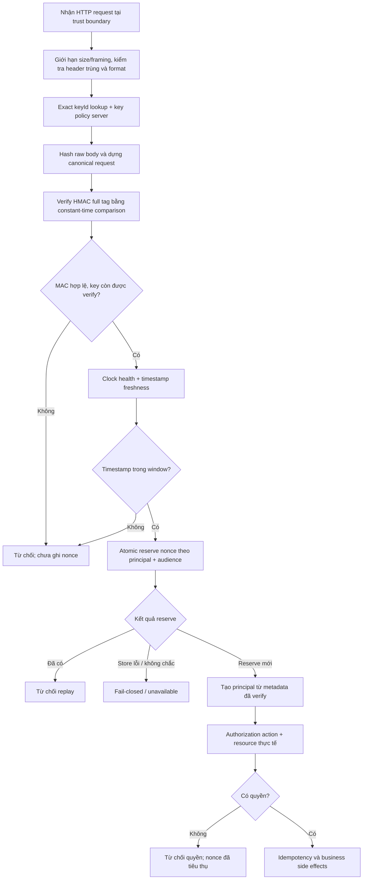

# Nonce trùng lặp trong xác thực HTTP request bằng HMAC

## 1. Vì sao cùng một nonce là tín hiệu cần kiểm tra?

Trong module `SECURITY_AUTHENTICATION_HMAC_REQUEST_AUTHENTICATION`, HTTP client và server dùng **shared secret** để ký và xác minh một **canonical request**: phương thức HTTP, raw URI/query, signed headers và/hoặc SHA-256 của raw body theo hợp đồng. Các trường `X-HMAC-Timestamp` và `X-HMAC-Nonce` được đặt trong thông điệp HMAC để chống việc sửa chúng khi truyền. Server xác minh chữ ký, kiểm tra freshness, ngăn replay, rồi mới xác định principal và áp dụng **authorization** với action, tenant và tài nguyên thực tế.

**Nonce** (thường hiểu là *number used once*) là một giá trị mới cho **mỗi signing attempt**. Trong một phạm vi xác định, nếu cùng nonce đã được **chấp nhận sử dụng** mà xuất hiện lần nữa, server cần xem đó là **duplicate nonce / khả năng replay** và không thực thi lại request. Đây là đề bài **“Nonce trùng lặp”**, thuộc chương **“Nonce”**.

Hãy xét một request giả định:

```http
POST /v1/tenants/t-42/transfers HTTP/1.1
Host: api.example.test
Content-Type: application/json
X-HMAC-Key-Id: partner-17:v6
X-HMAC-Timestamp: 1767268800
X-HMAC-Nonce: 7d46b2dd65d618a32ba74de99da88d80
X-HMAC-Signature: <base64-cua-mac-day-du>

{"amountMinor":125000,"beneficiaryId":"b-7"}
```

Nếu kẻ nghe lén hoặc một thành phần trung gian lấy được **nguyên request đã ký** và gửi lại, HMAC vẫn đúng vì method, URI, headers và body không đổi. Timestamp giới hạn thời gian phát lại, nhưng **không phân biệt lần gửi đầu tiên với lần thứ hai bên trong cửa sổ đó**. Server cần ghi dấu “nonce này đã dùng” bằng một thao tác **nguyên tử**, tồn tại đủ lâu để timestamp không còn hợp lệ.

```text
Lần 1: MAC đúng, timestamp mới, nonce chưa có -> reserve nonce -> có thể tiếp tục
Lần 2: MAC đúng, timestamp còn mới, nonce đã có -> reject replay
Lần 3: MAC đúng, nonce vừa hết TTL nhưng timestamp vẫn hợp lệ -> LỖ HỔNG nếu TTL quá ngắn
```

> **Thông điệp chính:** HMAC chứng minh request gắn với secret hợp lệ; timestamp xác định khoảng chấp nhận; **nonce được lưu trong kho dùng chung và kiểm tra nguyên tử** ngăn một signed attempt được chấp nhận lặp. Nonce không phải quyền truy cập, không phải bí mật HMAC, không phải bằng chứng một nghiệp vụ đã hoàn tất và **không thay thế idempotency**.

Trong bài có phân biệt ba tình huống dễ bị gom nhầm:

- **Replay thật:** gửi lại request đã ký **với đúng nonce**, có thể nhằm lặp side effect.
- **Nonce collision:** hai attempt độc lập nhưng sinh **cùng nonce** do xác suất ngẫu nhiên rất nhỏ hoặc lỗi RNG/SDK; server vẫn phải từ chối attempt thứ hai trong cùng replay domain.
- **Business duplicate:** hai request **nonce khác nhau**, chữ ký hợp lệ nhưng cùng ý định tạo thanh toán/đơn hàng; anti-replay bằng nonce **không** tự ngăn nghiệp vụ trùng.

### Kết quả cần đạt

Sau bài này, bạn có thể:

1. Xác định **replay domain** để đánh giá nonce trùng theo principal/audience và các key versions.
2. Sinh nonce mới bằng `SecureRandom`, đặt format/độ dài/entropy rõ ràng, không nhầm nonce với timestamp.
3. Giải thích vì sao `GET` rồi `SET` riêng biệt, bộ nhớ từng replica và cache không đồng bộ gây race.
4. Dùng **atomic reservation** (ví dụ Redis `SET ... NX EX`) và TTL đủ phủ toàn thời gian một timestamp có thể được chấp nhận.
5. Định nghĩa thứ tự **HMAC verification → freshness → nonce reservation → authorization → business**, fail-closed khi kho nonce không sẵn sàng.
6. Hiểu quan hệ giữa **duplicate nonce, retries, idempotency, key rotation, gateway/proxy và multi-region**.
7. Viết Java 17+ cho nonce generator và replay guard, mô phỏng test concurrent request.
8. Kiểm thử nonce trùng ngay lập tức, tại biên TTL, ở nhiều replica và khi có lỗi đồng hồ/hạ tầng.

## 2. Nonce là thành phần gì trong request đã ký?

Một signing attempt dùng:

```text
key ID        = partner-17:v6
timestamp     = 1767268800                 (Unix epoch seconds)
nonce         = 7d46b2dd65d618a32ba74de99da88d80
canonical     = version || method || URI || headers || SHA256(body)
HMAC tag      = HMAC_SHA256(sharedSecret, canonical)
```

Ở đây **nonce phải được đưa vào canonical** trước khi tính HMAC. Nếu nonce nằm ngoài chữ ký, một người giữ request hợp lệ có thể **thay nonce khác rồi gửi lại** mà không đổi MAC; kho replay sẽ coi đó là attempt mới.

### 2.1 Nonce không cần bí mật, nhưng phải đủ khó trùng

Trong giao thức minh họa của bài, mỗi nonce gồm **16 byte ngẫu nhiên mật mã (128 bit)** và biểu diễn thành **32 ký tự hex lowercase**. Nonce xuất hiện trong HTTP header, nên không nên coi nó là thông tin bí mật hay credential. Độ mạnh chủ yếu nhằm:

- Giảm xác suất **collision** giữa hai attempt độc lập.
- Tránh client lặp nonce do dùng counter reset hoặc thời gian có độ phân giải thấp.
- Làm khó việc dự đoán trước nonce trong các protocol khác có bước reservation/challenge; **dự đoán được nonce không tự cho phép giả mạo HMAC** khi attacker không có shared secret.

Ví dụ:

| Cách tạo nonce | Nhận xét |
| --- | --- |
| `SecureRandom.nextBytes(new byte[16])` | Phù hợp với hợp đồng 128-bit random; phải dùng RNG an toàn. |
| `UUID.randomUUID()` | Có thể dùng khi **hợp đồng định nghĩa đúng UUID version/format** và chấp nhận entropy/encoding của nó; không tự trộn định dạng UUID với 32 hex. |
| `System.currentTimeMillis()` | **Không** đủ duy nhất/entropy ở tải cao hoặc nhiều instance. |
| `new Random().nextLong()` | Không phải RNG mật mã; dễ lặp/dự đoán và chỉ 64 bit. |
| Counter mỗi process | Có thể trùng sau restart hoặc giữa instance nếu không có namespace/state bền vững. |
| Hash body làm nonce | Hai lần gửi cùng body tạo cùng nonce; phá mô hình **mỗi signing attempt**. |
| Timestamp nối với key ID | Hai request cùng giây có thể trùng; timestamp không thay nonce. |

**Chấp nhận được** không đồng nghĩa “đảm bảo toán học không bao giờ trùng”. Server phải đối xử với **mọi nonce duplicate** như replay/vi phạm uniqueness, bất kể nguyên nhân là replay hay collision vô tình. Phân biệt nguyên nhân thực tế cần thêm logs/tracing có kiểm soát và phân tích SDK, không cho bypass vì client nói “tôi bị collision”.

### 2.2 Xác suất collision với 128 bit

Nếu sinh ngẫu nhiên độc lập trong không gian `2^128`, xấp xỉ birthday bound khi `n` chưa quá lớn:

```text
P(at least one collision) ≈ n * (n - 1) / (2 * 2^128)
```

Với **một tỷ (10^9) nonce** trong cùng replay domain, xấp xỉ:

```text
P ≈ 1.47 × 10^-21
```

Đây là xác suất trong mô hình **RNG độc lập và đều trên 128 bit**, không phải ước tính tần suất lỗi của triển khai thực tế. Các lỗi phổ biến hơn gồm: nhân bản trạng thái RNG của VM/snapshot, SDK cache nonce rồi tái dùng, retry giữ nguyên request, concurrency race, hoặc nhiều instance dùng counter giống nhau.

Nếu thiết bị không có entropy bảo đảm sau boot/clone, cần xử lý tại nguồn RNG/identity và kiểm thử; không tăng `maxFutureSkew` hay bỏ replay check để che lỗi.

## 3. Nonce duplicate được đánh giá trong phạm vi nào?

Dòng chữ “nonce đã dùng” vẫn còn thiếu một điều quan trọng: **đã dùng đối với ai và API nào?**

### 3.1 Replay domain

Một thiết kế thường dùng là khóa replay store theo:

```text
audience + authenticatedPrincipalId + nonce
```

Ví dụ:

```text
audience            = transfers-api/prod
principalId         = partner-17
nonce               = 7d46b2dd65d618a32ba74de99da88d80

logical replay key  = (transfers-api/prod, partner-17,
                       7d46b2dd65d618a32ba74de99da88d80)
```

Phạm vi này được chọn để:

1. Nonce trùng của **hai principal khác nhau** không chặn lẫn nhau.
2. Nonce dùng lại giữa hai signing keys trong **cùng principal** khi key rotation vẫn bị xem là trùng trong **cùng audience**.
3. Các environment/API đích có audience riêng, ngăn trùng chéo không có ý nghĩa và hỗ trợ domain separation.
4. Giá trị principal/audience đến từ **metadata server sau khi HMAC hợp lệ**, không dựa vào header `X-Tenant-Id` hay `X-Principal` mà client tự khai.

**Đây là lựa chọn thiết kế cho NONCE-V1**, không phải quy tắc bắt buộc cho mọi HMAC protocol. Có giao thức định nghĩa unique per **key ID**, per client account hoặc per session. Phải chọn scope đúng với mô hình threat, rotation và routing rồi giữ **bất biến theo version/policy**.

### 3.2 Vì sao không nên khóa theo toàn bộ body hash?

Sai ý tưởng:

```text
nonce-key = (principal, nonce, SHA256(body))
```

Nếu một client hoặc attacker có secret hợp lệ tạo request mới với **cùng nonce nhưng body khác**, hai replay keys sẽ khác nhau; hệ thống vô tình chấp nhận nonce “used once” nhiều lần trong cùng domain. Một nonce uniqueness policy thường nên chặn **mọi request có cùng nonce trong scope**, không chỉ những request có cùng body.

Cũng không nên dùng **full signature text** làm khóa chống replay: chữ ký có thể khác do canonical fields/version, và chính sách cần dựa vào **nonce đã ký cùng principal**. Nếu protocol chỉ muốn chống phát lại exact message digest, đó là cơ chế dedup khác, cần định nghĩa riêng.

### 3.3 Nonce namespace và key rotation

| Thiết kế scope | Hành vi khi rotate key | Trade-off |
| --- | --- | --- |
| `(keyId, nonce)` | Key cũ và key mới có kho nonce tách nhau | Đơn giản, nhưng một nonce có thể được chấp nhận hai lần nếu client dùng hai signing keys cùng principal; có thể phù hợp nếu đó là policy chủ ý. |
| `(principalId, audience, nonce)` | Cùng nonce bị chặn xuyên key versions của một principal/audience | Giảm lỗ hổng cross-version replay, yêu cầu principal mapping đúng và scope được định nghĩa server-side. |
| `(tenantId từ query, nonce)` | Client có thể tự chọn tenant để phân mảnh replay store | **Nguy hiểm** nếu tenant query chưa được xác thực/không trùng resource thật; không dùng raw claim làm identity. |
| `(IP, nonce)` | Proxy/NAT/multi-homed client có thể đổi IP | Không bền vững; IP không phải danh tính HMAC. |
| `(processId, nonce)` | Mỗi replica dùng kho riêng | Không chặn replay khi request chuyển replica. |

Bài chọn **`(principalId, audience, nonce)`**; ngay cả khi một key ID mới được cấp trong quá trình rotation, principal vẫn được ánh xạ từ metadata đáng tin sau MAC verify. Nếu có nhiều identity cùng dùng chung secret, đó là lỗi provisioning cần sửa; nonce scope không thay thế ràng buộc principal với key.

## 4. Nonce phải nằm trong thông điệp HMAC, không chỉ trong header

Một request mẫu có nonce:

```http
POST /v1/tenants/t-42/transfers HTTP/1.1
Host: api.example.test
Content-Type: application/json
X-HMAC-Key-Id: partner-17:v6
X-HMAC-Timestamp: 1767268800
X-HMAC-Nonce: 7d46b2dd65d618a32ba74de99da88d80
X-HMAC-Signature: <base64-full-hmac-sha256>

{"amountMinor":125000,"beneficiaryId":"b-7"}
```

Tài liệu dùng **hợp đồng giảng dạy** `HMAC-REQUEST/NONCE-V1`; đây không phải chuẩn ngầm định của các nền tảng HMAC khác. Các quyết định:

| Trường | Quy tắc NONCE-V1 |
| --- | --- |
| Method | `POST`; method thực tế được ký. |
| Raw target | `/v1/tenants/t-42/transfers` theo HTTP origin-form; nếu có query phải giữ nguyên theo raw-target contract. |
| Audience | `transfers-api/prod` lấy từ metadata key server. |
| Signed headers | `Content-Type`, `X-HMAC-Key-Id`, `X-HMAC-Timestamp`, `X-HMAC-Nonce` đều singleton; reject duplicate. |
| Timestamp | Unix epoch seconds ASCII canonical, được ký. |
| Nonce | 16 byte ngẫu nhiên, 32 hex lowercase, được ký. |
| Body | Raw application body bytes sau HTTP framing và trước các content transforms; demo cấm `Content-Encoding`. |
| Digest | Hex lowercase SHA-256(raw body bytes), không reserialize JSON. |
| HMAC | HmacSHA256 với shared secret được tra theo key ID, full MAC tag 32 byte. |
| Transport | `X-HMAC-Signature` có Base64 chuẩn có padding, 44 ký tự. |
| Canonical format | 10 dòng UTF-8, phân cách LF, không có LF cuối; domain/version rõ ràng. |
| Freshness | Chấp nhận timestamp trong khoảng `[-300s, +30s]` so với server clock ở thời điểm verify xong. |
| Nonce uniqueness | Mỗi nonce chỉ được reserve một lần trong `(principalId, audience)` trong suốt thời gian timestamp còn có thể hợp lệ. |

Canonical request minh họa:

```text
HMAC-REQUEST/NONCE-V1
HMAC-SHA256
POST
/v1/tenants/t-42/transfers
audience:transfers-api/prod
content-type:application/json
x-hmac-key-id:partner-17:v6
x-hmac-timestamp:1767268800
x-hmac-nonce:7d46b2dd65d618a32ba74de99da88d80
body-sha256:<sha256-lowercase-hex-cua-chinh-raw-body>
```

Dòng `body-sha256` là placeholder mô tả, phải thay bằng SHA-256 hex **đủ 64 ký tự** của body thực gửi trước khi tạo HMAC. Timestamp `1767268800` tương ứng fixture `2026-01-01T12:00:00Z`, không phải thời gian để sử dụng trong production hiện tại.

Nếu attacker thay header nonce từ `7d...d80` thành một chuỗi mới mà giữ nguyên signature, canonical bytes server dựng lại sẽ đổi và **HMAC mismatch**. Nếu client **biết secret** cố tình dùng lại nonce nhưng **ký lại request khác**, HMAC có thể vẫn đúng; replay policy sẽ **từ chối nonce trùng** trong cùng domain. Điều đó không ngăn một principal có secret ký **nonce mới** cho một thao tác trái quyền: đó là nhiệm vụ của authorization.

### 4.1 Header nonce không có quyền lựa chọn thuật toán hoặc scope

Server không nên chấp nhận các header kiểu:

```http
X-HMAC-Nonce-Scope: only-this-request
X-HMAC-Disable-Replay-Check: true
X-HMAC-Nonce-TTL: 1
X-HMAC-Algorithm: HmacSHA1
```

NONCE-V1 **không cho** client đặt lại policy. Key metadata phía server ghim secret, algorithm, canonical version, audience, principal, trạng thái key và phạm vi replay. Nếu muốn bổ sung một trường ảnh hưởng đến xác thực, phải sửa contract có version và ký/ràng buộc nó, không dùng input tự khai để thay cấu hình server.

## 5. Tại sao check-then-set không chống được nonce trùng khi đồng thời?

Một lỗi kinh điển là:

```text
if (!store.contains(nonceKey)) {
    store.put(nonceKey, "used", ttl);
    processRequest();
}
```

Giữa lệnh kiểm tra và lệnh ghi tồn tại một **race condition**. Hai replica có thể cùng quan sát nonce chưa tồn tại:

```text
                Replica A                Replica B
             ----------------        ----------------
t1            GET nonce -> nil
t2                                     GET nonce -> nil
t3            SET nonce = used
t4                                     SET nonce = used
t5            ACCEPT                  ACCEPT  (REPLAY lọt)
```

Ngay cả khi mỗi lệnh `GET`/`SET` riêng lẻ là atomic, **chuỗi hai lệnh không atomic**. Khóa `synchronized` trong một JVM cũng không bảo vệ request đang chạy ở replica B/JVM khác.

### 5.1 Cần “reserve nếu chưa tồn tại” trong một thao tác

Ví dụ Redis:

```redis
SET hmac:nonce:v1:<hashed-replay-domain-key> 1 NX EX 360
```

- `NX`: chỉ ghi khi key **chưa tồn tại**.
- `EX 360`: đặt TTL 360 giây trong **cùng thao tác**, không có khoảng hở giữa `SET` và `EXPIRE`.
- **Reply thành công** (ví dụ `OK`) → nonce vừa được reserve.
- **Reply cho biết key đã tồn tại** (ví dụ nil/null theo client Redis) → nonce duplicate, từ chối replay.
- **Timeout, mất kết nối, Redis error, response không rõ** → **fail-closed**; tuyệt đối không coi là “chưa có nonce”.

Tên khóa trên là placeholder: application cần dựng namespace/key thật bằng cách bảo toàn uniqueness của `(audience, principalId, nonce)`. Không gửi literal `<hashed-replay-domain-key>` tới Redis.

### 5.2 Tại sao phải dùng một kho chung?

| Cấu hình | Kết quả đối với hai request trùng nonce |
| --- | --- |
| Một Redis primary có atomic `SET NX EX`, mọi replica cùng dùng cùng namespace | Trong điều kiện store hoạt động với consistency yêu cầu, chỉ một request reserve thành công. |
| `ConcurrentHashMap` riêng ở từng JVM | A/B đều không thấy nonce của nhau và đều có thể chấp nhận. |
| Hai Redis độc lập ở hai region, không có ràng buộc routing/consistency | Cả hai region có thể reserve cùng nonce và xử lý hai lần. |
| Asynchronous replication với failover mất bản ghi mới | Nonce đã reserve có thể “biến mất” sau failover, cho phép replay trong cửa sổ. |
| Redis cache có eviction trước TTL do áp lực memory | Nonce đã dùng có thể bị xóa sớm, làm mất anti-replay guarantee. |
| DB có unique constraint + TTL/expiration được thiết kế chặt | Có thể đáp ứng nếu insert/transaction, isolation, cleanup và failover bảo đảm uniqueness đến hết window. |

**Atomic trên một server Redis không tự đồng nghĩa exactly-once toàn hệ thống.** Nếu multi-region active-active, asynchronous replication hoặc failover mất dữ liệu, bạn phải xác định mức đảm bảo cần thiết. Có thể dùng backend hỗ trợ tính duy nhất tuyến tính, một vùng chủ có failover kiểm soát, hoặc **consistent routing theo replay domain** với cơ chế chuyển vùng an toàn. Không được chấp nhận hai bản ghi “tạm” rồi hòa giải sau khi cả hai đã tạo side effect.

### 5.3 Từ chối replay khi kết quả ghi không rõ

Giả sử server gọi Redis `SET NX EX` và bị timeout ngay sau khi Redis đã ghi thành công. Server **không biết** nonce đã được reserve hay chưa. Cách xử lý an toàn cho authentication:

- Không cho request đi tiếp như đã reserve thành công.
- Có thể trả lỗi “tạm thời không khả dụng”/retry policy theo thiết kế; không khẳng định request **đã** được xử lý.
- Khi client retry cùng signed attempt, nonce có thể đã tồn tại và bị từ chối — đây là trade-off **availability vs at-most-once admission**.
- Muốn xử lý outcome phức tạp hơn, cần state machine/reservation token hoặc idempotency protocol riêng, không tự coi timeout là thành công.

Cơ chế nonce chủ yếu tạo **at-most-once admission trong một window dưới các giả định nhất định**, không bảo đảm giao dịch kinh doanh chính xác một lần.

## 6. Thời gian lưu nonce: phải phủ toàn bộ freshness window

Một sai sót phổ biến là timestamp cho phép quá khứ 5 phút thì đặt nonce TTL **đúng 5 phút**. Cách này quên phần cho phép timestamp **ở tương lai**.

Với chính sách mẫu:

```text
maxPastAge     = 300 seconds
maxFutureSkew  = 30 seconds

Accepted if:
  serverNow - 300 <= signedTimestamp <= serverNow + 30
```

Đối với một timestamp `T` cố định, bất đẳng thức trở thành:

```text
T - 30 <= serverNow <= T + 300
```

Vì vậy tổng thời gian một request có timestamp `T` có thể được nhận là **330 giây** nếu clock chính xác, hai biên đều được chấp nhận.

### 6.1 Vì sao TTL 300 giây có thể làm replay lọt?

```text
Signed timestamp T = 12:00:00

Request đầu tiên:
  serverNow = 11:59:30  (T ở tương lai +30s, vẫn hợp lệ)
  Redis ghi nonce với TTL 300s -> hết hạn 12:04:30

Replay:
  serverNow = 12:04:31  (T đã cũ 271s, vẫn hợp lệ)
  Nonce đã bị xóa -> reserve thành công lần nữa -> replay lọt
```

Đây là một **lỗ hổng cấu hình TTL** dù HMAC, timestamp parser và `SET NX` đều hoạt động đúng. Nonce TTL không được chọn theo trực giác “timestamp ± vài phút” mà phải dựa vào toàn **acceptance lifetime**.

### 6.2 Công thức TTL với sai số đồng hồ server

Nếu nhiều replica có thể sai số tới `±maxClockError` so với thời gian tham chiếu đáng tin, một biên bảo thủ:

```text
minimumNonceTtlSeconds
    >= maxPastAge
     + maxFutureSkew
     + 2 * maxServerClockError
     + operationalSafetyMargin
```

Ví dụ:

```text
maxPastAge             = 300s
maxFutureSkew          = 30s
maxServerClockError    =   5s
operationalMargin      =  20s

required TTL           = 300 + 30 + 2*5 + 20 = 360s
```

Đây là **mô hình dự phòng dưới các giả định xác định**, không phải công thức chứng minh cho mọi hệ phân tán. Còn cần xét latency, clock của store, cơ chế replication/failover, thời điểm reserve, garbage collection/eviction và chính sách kết thúc request. Nếu clock vượt sai số cho phép, node phải chuyển unhealthy/fail-closed; **TTL 360 giây không chữa được clock lùi 15 phút không phát hiện**.

### 6.3 “Đặt TTL theo timestamp còn lại” có được không?

Một phương án phức tạp hơn là tính `expireAt = signedTimestamp + maxPastAge + margin` theo mốc thời gian đáng tin; nó có thể giảm retention khi request được nhận gần cuối window. Nhưng để đúng, cần:

- Giải quyết clock skew giữa application và Redis/storage;
- Chốt semantics của `EXAT`/epoch và biên inclusive;
- Bảo đảm không xóa sớm do clock correction/failover;
- Giữ atomic insert-if-absent với expiry;
- Chứng minh toàn bộ acceptance window đã được bao phủ.

Đối với hợp đồng bài học, chọn **TTL cố định bảo thủ** và health check rõ ràng giúp audit/triển khai dễ hơn. Không nên tùy tiện tối ưu TTL tới sát biên khi chưa có test cross-region.

## 7. Thứ tự xác minh đúng: đừng để người không biết secret “chiếm nonce”

Một pipeline đáng tin cậy:



### 7.1 Vì sao không reserve nonce trước HMAC?

Một attacker không biết secret có thể biết hoặc đoán key ID, tạo request với một nonce bất kỳ và chữ ký giả. Nếu server ghi nonce **trước** khi xác minh MAC, attacker có thể:

- Làm đầy replay store bằng hàng loạt nonce vô nghĩa.
- Gửi trước một nonce biết được của request hợp lệ để làm **nonce poisoning**, khiến request sau bị từ chối.
- Tạo workload và tăng tỷ lệ lỗi authentication không cần thiết.

Do đó thông lệ của hợp đồng NONCE-V1 là **chỉ reserve sau khi HMAC hợp lệ và timestamp được chấp nhận**. Trước đó, có thể kiểm tra **format** nonce và timestamp để reject sớm nhưng **không** ghi nonce, không tạo principal và không cho phép side effect.

Lưu ý: Nếu attacker thực sự **biết shared secret**, họ có thể tự tạo request HMAC hợp lệ và tiêu thụ nonce của principal. Đó là rủi ro **compromised key/authorized actor**, cần key revocation, rate limits, auditing và authorization; nonce store không tự ngăn người có secret tạo request hợp lệ.

### 7.2 Tại sao có thể reserve trước authorization?

Sau HMAC, principal đã được xác định theo metadata đáng tin, nhưng chúng ta chưa quyết định principal có quyền trên resource cụ thể. Một mô hình hợp lý là reserve nonce **trước authorization**, nhằm đảm bảo cùng signed attempt không được thử nhiều lần dù authorization hiện từ chối.

Nếu authorization từ chối, nonce có thể đã bị tiêu thụ. Điều đó là **chính sách cố ý**, cần trả lỗi và hướng dẫn retry rõ ràng. Một hệ thống có thể chọn thứ tự khác (authorization trước reserve) để tối ưu UX, nhưng phải chứng minh **không có side effect và không cho replay gây sai phạm** trước khi reservation thành công.

### 7.3 Đừng nhầm nonce với header Idempotency-Key

| Thuộc tính | Nonce | Idempotency key |
| --- | --- | --- |
| Mục tiêu | Ngăn một **signed attempt** được chấp nhận lặp | Tránh thực thi **cùng ý định nghiệp vụ** nhiều lần. |
| Sinh mới khi retry? | Thường **có** nếu tạo signing attempt mới | Thường **không** cho cùng operation/intent. |
| Có trong canonical HMAC? | **Có**, bắt buộc theo NONCE-V1 | Nếu client cung cấp và ảnh hưởng hành vi thì **phải ký hoặc ràng buộc an toàn**. |
| Storage | Replay store TTL theo freshness window | Durable idempotency record theo nghiệp vụ, có trạng thái/result/quyền truy cập. |
| Sau reserve đã chắc xử lý business? | **Không** | Có thể trả lại kết quả cũ theo state machine đã thiết kế. |
| Ví dụ | `7d46...8d80` | `payment-intent-2026-00017` |

Nonce duplicate không chứng minh request đang phát lại là ác ý; nó có thể là retry do timeout hoặc client gửi lại vì không biết server đã nhận hay chưa. Nhưng **server không được chấp nhận lại cùng nonce để “giúp retry”**. Client/API nên có giao thức idempotency riêng, nhất là với thanh toán/chuyển tiền.

## 8. Java 17+: client tạo nonce mới cho mỗi signing attempt

Với hợp đồng 128-bit random, Java 17 dùng `SecureRandom` và `HexFormat`:

```java
import java.security.SecureRandom;
import java.time.Clock;
import java.util.HexFormat;
import java.util.Objects;

public final class NonceAttemptV1 {
    private static final SecureRandom RNG = new SecureRandom();

    private NonceAttemptV1() {}

    public record FreshFields(String timestampSeconds, String nonceHex) {}

    public static FreshFields create(Clock clientClock) {
        Objects.requireNonNull(clientClock);
        byte[] nonce = new byte[16];
        RNG.nextBytes(nonce);

        return new FreshFields(
                Long.toString(clientClock.instant().getEpochSecond()),
                HexFormat.of().formatHex(nonce)); // 32 lowercase hex
    }
}
```

Ví dụ mỗi lần retry cần tạo một signing snapshot mới:

```java
NonceAttemptV1.FreshFields first =
        NonceAttemptV1.create(Clock.systemUTC());

// bodyBytes và rawTarget phải được đóng băng.
// Client đưa first.timestampSeconds() và first.nonceHex()
// vào canonicalBytes rồi mới tính HmacSHA256.
//
// Nếu một attempt mới được ký sau timeout:
NonceAttemptV1.FreshFields retry =
        NonceAttemptV1.create(Clock.systemUTC());

if (first.nonceHex().equals(retry.nonceHex())) {
    // Với 128-bit random điều này gần như không xảy ra.
    // Test có thể dùng RNG giả để xác minh hành vi collision.
    throw new IllegalStateException("Unexpected nonce collision");
}
```

**Lưu ý:** Kiểm tra hai nonce trong một ví dụ không biến uniqueness thành đảm bảo tuyệt đối trong môi trường nhiều client/instance. **Server vẫn phải reserve nguyên tử** vì không thể chứng minh mọi client đều dùng RNG đúng, và một request hợp lệ có thể bị phát lại nguyên bản.

### 8.1 Khi nào sinh nonce trong pipeline client?

```text
serialize/freeze raw body bytes
  -> freeze raw method + URI + signed headers
  -> generate current timestamp + fresh nonce
  -> insert timestamp/nonce into canonical
  -> HMAC(secret, canonicalBytes)
  -> send EXACT snapshot
```

Đừng tạo nonce một lần rồi cache trong singleton SDK dùng lại cho nhiều requests. Đừng tạo nonce trong constructor của HTTP client rồi dùng cho mọi method call. Không dùng nonce phụ thuộc body (hai requests cùng body phải có nonce khác nhau).

Nếu request bị queue quá lâu và timestamp hết hạn, ký lại một **attempt mới**; bảo đảm body/action vẫn là cùng ý định đã được kiểm soát và dùng idempotency khi nghiệp vụ yêu cầu.

## 9. Java 17+: replay guard với scope, thời gian và atomic store

Mục này cài đặt phần **ra quyết định nonce duplicate** mà không phụ thuộc cụ thể vào Redis SDK. Một interface `AtomicNonceStore` mô tả thao tác **reserve-if-absent có TTL nguyên tử**. Adapter Redis/DB production phải thực sự đáp ứng hợp đồng đó.

**Ranh giới quan trọng:** `VerifiedMacContext` dưới đây là một **data carrier** được tạo bởi lớp verifier **sau khi HMAC hợp lệ**. Tên type **không tự bảo đảm** caller đã xác minh; ứng dụng cần thiết kế API/visibility để ngăn code nghiệp vụ tự tạo context giả rồi gọi guard.

### 9.1 Bộ kiểm tra replay `NonceReplayGuardV1`

```java
import java.nio.charset.StandardCharsets;
import java.security.MessageDigest;
import java.security.NoSuchAlgorithmException;
import java.time.Clock;
import java.time.Duration;
import java.time.Instant;
import java.util.HexFormat;
import java.util.Objects;
import java.util.regex.Pattern;

public final class NonceReplayGuardV1 {
    private static final Pattern NONCE =
            Pattern.compile("[0-9a-f]{32}");
    private static final Pattern ID =
            Pattern.compile("[A-Za-z0-9._:-]{1,100}");
    private static final Pattern AUDIENCE =
            Pattern.compile("[A-Za-z0-9._:/-]{1,100}");
    private static final Pattern TIMESTAMP =
            Pattern.compile("(0|[1-9][0-9]{0,11})");

    public enum ReserveResult {
        INSERTED, ALREADY_PRESENT
    }

    public enum Verdict {
        ACCEPTED, DUPLICATE, BAD_FORMAT,
        TOO_OLD, TOO_FAR_IN_FUTURE
    }

    public interface AtomicNonceStore {
        // MUST be atomic across all verifier replicas for this domain.
        // Timeout/unknown response -> throw, NEVER return INSERTED.
        ReserveResult reserveIfAbsent(
                String storageKey, Duration ttl);
    }

    public interface ClockHealth {
        boolean isHealthy();
    }

    public static class ReplayInfrastructureException
            extends RuntimeException {
        public ReplayInfrastructureException(String message) {
            super(message);
        }
    }

    public record VerifiedMacContext(
            String principalId,
            String audience,
            String signedEpochSeconds,
            String nonceHex) {}

    private final Clock clock;
    private final ClockHealth clockHealth;
    private final AtomicNonceStore store;
    private final long maxPastSeconds;
    private final long maxFutureSeconds;
    private final Duration retention;

    public NonceReplayGuardV1(
            Clock clock,
            ClockHealth clockHealth,
            AtomicNonceStore store,
            long maxPastSeconds,
            long maxFutureSeconds,
            long maxServerClockErrorSeconds,
            long safetyMarginSeconds,
            long nonceTtlSeconds) {

        this.clock = Objects.requireNonNull(clock);
        this.clockHealth = Objects.requireNonNull(clockHealth);
        this.store = Objects.requireNonNull(store);

        if (maxPastSeconds < 0 || maxFutureSeconds < 0
                || maxServerClockErrorSeconds < 0
                || safetyMarginSeconds < 0 || nonceTtlSeconds <= 0) {
            throw new IllegalArgumentException("Invalid replay policy");
        }

        // Overflow-safe TTL bound, per the documented error model.
        long required = Math.addExact(
                Math.addExact(maxPastSeconds, maxFutureSeconds),
                Math.addExact(
                    Math.multiplyExact(2, maxServerClockErrorSeconds),
                    safetyMarginSeconds));

        if (nonceTtlSeconds < required) {
            throw new IllegalArgumentException(
                    "Nonce TTL shorter than replay window");
        }

        this.maxPastSeconds = maxPastSeconds;
        this.maxFutureSeconds = maxFutureSeconds;
        this.retention = Duration.ofSeconds(nonceTtlSeconds);
    }

    /**
     * Call ONLY after full HMAC success and key-status validation.
     * Caller still must authorize actual operation/resource.
     */
    public Verdict checkAndReserve(VerifiedMacContext verified) {
        Objects.requireNonNull(verified);

        if (!clockHealth.isHealthy()) {
            // Fail-closed: caller maps to unavailable/appropriate error.
            throw new ReplayInfrastructureException(
                    "Verifier clock not reliable");
        }
        if (verified.principalId() == null
                || !ID.matcher(verified.principalId()).matches()
                || verified.audience() == null
                || !AUDIENCE.matcher(verified.audience()).matches()
                || verified.nonceHex() == null
                || !NONCE.matcher(verified.nonceHex()).matches()
                || verified.signedEpochSeconds() == null
                || !TIMESTAMP.matcher(
                    verified.signedEpochSeconds()).matches()) {
            return Verdict.BAD_FORMAT;
        }

        final Instant signed;
        try {
            signed = Instant.ofEpochSecond(
                    Long.parseLong(verified.signedEpochSeconds()));
        } catch (RuntimeException malformed) {
            return Verdict.BAD_FORMAT;
        }

        // Protocol measures freshness in whole epoch seconds.
        Instant serverNow = Instant.ofEpochSecond(
                clock.instant().getEpochSecond());

        try {
            if (signed.isBefore(serverNow.minusSeconds(maxPastSeconds))) {
                return Verdict.TOO_OLD;
            }
            if (signed.isAfter(serverNow.plusSeconds(maxFutureSeconds))) {
                return Verdict.TOO_FAR_IN_FUTURE;
            }
        } catch (RuntimeException invalidClockOrPolicy) {
            throw new ReplayInfrastructureException(
                    "Cannot evaluate timestamp window");
        }

        String replayKey = storageKey(
                verified.audience(),
                verified.principalId(),
                verified.nonceHex());

        // Adapter MUST distinguish duplicate from infrastructure failure.
        ReserveResult result = store.reserveIfAbsent(
                replayKey, retention);

        if (result == ReserveResult.INSERTED) {
            return Verdict.ACCEPTED;
        }
        if (result == ReserveResult.ALREADY_PRESENT) {
            return Verdict.DUPLICATE;
        }
        throw new ReplayInfrastructureException(
                "Unexpected nonce store result");
    }

    private static String storageKey(
            String audience, String principalId, String nonceHex) {

        // IDs đã qua allowlist nên không chứa LF; encoding không mơ hồ.
        String raw = audience + "\n" + principalId + "\n" + nonceHex;

        try {
            byte[] digest = MessageDigest.getInstance("SHA-256")
                    .digest(raw.getBytes(StandardCharsets.UTF_8));
            // Hash không thay HMAC. Chỉ làm storage key ASCII, fixed-size,
            // tránh lộ plain principal trong key Redis.
            return "hmac:replay:nonce-v1:"
                    + HexFormat.of().formatHex(digest);
        } catch (NoSuchAlgorithmException ex) {
            throw new ReplayInfrastructureException(
                    "SHA-256 unavailable");
        }
    }
}
```

**Điểm cần hiểu trong ví dụ:**

1. `VerifiedMacContext.principalId` và `audience` lấy từ **metadata key đã xác thực**, không lấy raw `X-Principal` hay `X-Tenant-Id` do client gửi. Trước khi pass HMAC, chỉ có **key ID chưa tin cậy**.
2. Format nonce là **đúng 32 ký tự lowercase hex**; `nonce.toLowerCase()` khi nhận input chưa hợp lệ không phải cách sửa lỗi an toàn nếu contract yêu cầu một biểu diễn duy nhất.
3. `storageKey` băm ba trường đã phân định bằng LF thành một Redis key có độ dài cố định. SHA-256 ở đây **không phải MAC hoặc secret**; nó phục vụ namespace, giảm độ dài và tránh lộ trực tiếp principal ID qua key name. Muốn giảm rủi ro lộ danh tính trong telemetry, vẫn cần hạn chế log/storage access.
4. Constructor dùng `Math.addExact`/`Math.multiplyExact` để không vô tình overflow làm `required TTL` thành số âm. Đây là kiểm tra policy, không phải thay thế clock health.
5. `Clock`/`ClockHealth` được inject, để test lệch đồng hồ bằng `Clock.fixed`/`Clock.offset` và fail-closed nếu time source không đáng tin.
6. `AtomicNonceStore` **không có implementation Redis** trong JDK; adapter phải map chính xác `INSERTED` / `ALREADY_PRESENT` / exception.
7. TTL `Duration` được giữ cố định theo policy; nếu chấp nhận nhiều freshness policies, cần chứng minh mọi tổ hợp version/key/endpoint đều có TTL đủ dài hoặc tách store policy an toàn.
8. Hàm trả `ACCEPTED` chỉ nói **nonce đã được reserve mới**. Chưa đồng nghĩa request đã được authorization hoặc nghiệp vụ đã commit.

**Giới hạn cần thiết:** Trong production phải giám sát độ chính xác giữa thời điểm kiểm tra clock và reserve nonce; config thay đổi đồng bộ; bảo vệ clock, trạng thái key và nonce store trong thời gian request dài; và dùng một trust boundary rõ ràng cho request mà server đã kiểm tra HMAC. Mã không chứng minh correctness của Redis replication hay failover.

### 9.2 Adapter Redis: phân biệt duplicate với outage

Pseudocode ở tầng adapter, không phải API JDK:

```text
function reserveIfAbsent(storageKey, ttl):
    assert ttl > 0
    try:
        reply = redis.SET(
            key=storageKey,
            value="1",
            NX=true,
            EX=ttl.totalSeconds
        )
        if reply == "OK":
            return INSERTED
        if reply == NIL_KEY_ALREADY_EXISTS:
            return ALREADY_PRESENT
        raise StoreProtocolError("unexpected reply")
    catch TimeoutOrConnectionOrRedisError:
        raise ReplayInfrastructureException("nonce store unavailable")
```

Điều kiện phải được kiểm chứng với **Redis client thực tế**: một số SDK trả `null` cho NX failure, một số trả enum/result type. Không được coi một `null` do timeout hoặc client wrapper nuốt exception là “key chưa tồn tại”. Và nếu store có cấu hình **eviction/replication làm mất key trước hạn**, adapter đúng cú pháp vẫn không tạo anti-replay guarantee.

### 9.3 Đoạn fake store chỉ dành cho unit test

Một fake store giúp test **atomic race** trong cùng JVM:

```java
import java.time.Duration;
import java.util.concurrent.ConcurrentHashMap;

final class InMemoryAtomicNonceStore
        implements NonceReplayGuardV1.AtomicNonceStore {

    private final ConcurrentHashMap<String, Boolean> used =
            new ConcurrentHashMap<>();

    @Override
    public NonceReplayGuardV1.ReserveResult reserveIfAbsent(
            String key, Duration ttl) {

        return used.putIfAbsent(key, Boolean.TRUE) == null
                ? NonceReplayGuardV1.ReserveResult.INSERTED
                : NonceReplayGuardV1.ReserveResult.ALREADY_PRESENT;
    }
}
```

**Đây không phải production store**: nó không thực hiện TTL, không bền vững khi restart, không chia sẻ qua replica và có thể giữ memory vô hạn. Chỉ dùng để thử logic “một key, hai lời gọi đồng thời thì một thắng”. Integration test phải dùng backend storage thật và mô phỏng failover/latency/partition.

## 10. Test race: hai request cùng nonce đi tới hai thread

Giả sử hai HTTP requests có chữ ký cùng hợp lệ và cùng `(principal, audience, nonce)`. Trong một JVM unit test, có thể dùng `CountDownLatch` để bắt đầu hai lời gọi gần như đồng thời. Khi dùng fake `InMemoryAtomicNonceStore` ở mục 9.3, **chỉ một lời gọi** được `ACCEPTED`.

```java
import java.time.Clock;
import java.time.Duration;
import java.time.Instant;
import java.time.ZoneOffset;
import java.util.ArrayList;
import java.util.List;
import java.util.concurrent.Callable;
import java.util.concurrent.CountDownLatch;
import java.util.concurrent.ExecutorService;
import java.util.concurrent.Executors;
import java.util.concurrent.Future;

Clock fixed = Clock.fixed(
        Instant.parse("2026-01-01T12:00:00Z"),
        ZoneOffset.UTC);

InMemoryAtomicNonceStore store =
        new InMemoryAtomicNonceStore();

NonceReplayGuardV1 guard = new NonceReplayGuardV1(
        fixed,
        () -> true,  // fake ClockHealth
        store,
        300, 30, 5, 20, 360);

NonceReplayGuardV1.VerifiedMacContext verified =
        new NonceReplayGuardV1.VerifiedMacContext(
                "partner-17",
                "transfers-api/prod",
                "1767268800",
                "7d46b2dd65d618a32ba74de99da88d80");

CountDownLatch start = new CountDownLatch(1);
Callable<NonceReplayGuardV1.Verdict> call = () -> {
    start.await();
    return guard.checkAndReserve(verified);
};

ExecutorService pool = Executors.newFixedThreadPool(2);
try {
    List<Future<NonceReplayGuardV1.Verdict>> futures =
            new ArrayList<>();
    futures.add(pool.submit(call));
    futures.add(pool.submit(call));

    start.countDown();

    int accepted = 0, duplicate = 0;
    for (Future<NonceReplayGuardV1.Verdict> future : futures) {
        var verdict = future.get();
        if (verdict == NonceReplayGuardV1.Verdict.ACCEPTED) {
            accepted++;
        } else if (verdict
                == NonceReplayGuardV1.Verdict.DUPLICATE) {
            duplicate++;
        }
    }
    if (accepted != 1 || duplicate != 1) {
        throw new AssertionError("Atomic reserve contract violated");
    }
} finally {
    pool.shutdownNow();
}
```

Chữ ký HMAC **không được tính** trong ví dụ race này: test đang nhận `VerifiedMacContext` như một giả lập cho context **đã pass MAC**. Để kiểm thử bảo mật đầy đủ, cần một integration test đi qua HTTP ingress, HMAC verifier, secret store và nonce store thật, với tất cả key/tenant/side effect được xác minh.

### 10.1 Vì sao unit test concurrency chưa chứng minh multi-region an toàn?

`ConcurrentHashMap.putIfAbsent` là nguyên tử **trong một process**. Một request tới instance khác sẽ dùng `ConcurrentHashMap` khác. Với Redis đa region, việc replicate state bất đồng bộ cũng có thể cho phép cả hai ghi. Vì vậy “hai thread test pass” chỉ là kiểm tra API logic, không phải bằng chứng atomic toàn tuyến.

Để chứng minh tính chất cần cho production, kiểm thử cả:

- Hai replica gửi `SET NX EX` cùng key tới **cùng logical store**;
- Failover ngay sau reserve thành công;
- Hai region chủ động nhận cùng nonce;
- Storage timeout trước/sau commit;
- Eviction, TTL và downtime;
- Chỉ một side effect khi cùng signed attempt tới đồng thời, nếu business layer được thiết kế phù hợp.

## 11. Fail-closed khi kho nonce không tin cậy

Nonce store là **thành phần an ninh**, không chỉ là cache tăng hiệu năng. Một hệ thống có thể chấp nhận mất một ít availability khi kho nonce không sẵn sàng, nhưng không được bỏ qua chống replay mà vẫn cho request tạo side effect.

### 11.1 Phân loại outcome rõ ràng

| Outcome của replay store | Ý nghĩa | Phản ứng |
| --- | --- | --- |
| `INSERTED` | Nonce chưa được ghi và vừa reserve thành công | Có thể tiếp tục **authorization**, chưa thực thi side effect trước bước đó. |
| `ALREADY_PRESENT` | Nonce tồn tại trong replay window | Từ chối attempt, thường là replay/duplicate. |
| Timeout trước khi biết kết quả | Không rõ nonce đã được ghi chưa | **Fail-closed**; không coi là mới. |
| Connection error / unavailable | Không thể bảo đảm uniqueness | **Fail-closed**, có thể response 503 theo policy. |
| Redis failover mất reservation | Có thể mở cửa replay đã chặn trước đó | Phải có durability/consistency policy; quan sát và xử lý sự cố. |
| TTL/eviction sớm | Nonce chưa hết freshness window nhưng mất dấu | Cấu hình không đạt anti-replay, cần sửa/không accept trên domain bị ảnh hưởng. |
| Key format trùng giữa hai domain | Hai principal chặn lẫn nhau hoặc replay bỏ lọt | Dùng namespace rõ ràng, kiểm thử encoding và scope. |

Không nên dùng `Map` local làm fallback khi Redis lỗi: nếu request có thể rơi vào nhiều node, việc fallback đó **giảm mức bảo vệ**. Cũng không “bỏ qua nonce vì HMAC đã đúng”, bởi HMAC không phân biệt bản sao của một request đã ký.

### 11.2 Khả năng hoàn tác nonce reservation

Sau khi nonce được reserve, downstream authorization có thể fail, database có thể timeout hoặc process crash. Có nên xóa nonce để cho retry cùng signed request?

**Thông thường không nên tự động xóa**. Nếu xóa nonce sau lỗi mơ hồ, request đã có thể thực hiện side effect nhưng server không biết, cho phép attacker/client gửi lại cùng signed request và tạo double effect.

Khi cần UX retry tốt hơn, thiết kế **idempotency/state machine** có record theo intent, có trạng thái `IN_PROGRESS`, `SUCCEEDED`, `FAILED`/kết quả được phép trả về và transaction/outbox phù hợp. Không lấy trạng thái “nonce đã dùng” làm trạng thái commit của giao dịch.

### 11.3 Availability và trường hợp kết quả reserve mơ hồ

Một số thư viện client tự retry Redis request khi network lỗi. Với `SET NX`, retry cùng key có thể nhận “đã tồn tại” vì **lần gọi đầu thực ra đã reserve**. Nếu middleware coi đó là “replay attacker” thì có thể đánh nhầm lỗi nội bộ, nhưng **không nên cho request đi tiếp** chỉ vì client nghi lần trước thành công. Trường hợp cần phân biệt chính xác phải có reservation token/state đã xác thực và thiết kế giao thức cụ thể.

**Không cung cấp kết quả HMAC hay trạng thái nonce chi tiết cho caller chưa được xác thực**. Phân loại nội bộ có thể gồm `INVALID_SIGNATURE`, `REPLAY`, `STORE_UNAVAILABLE` nhưng response bên ngoài phải cân nhắc chống enumeration, bảo mật và quy ước API.

## 12. Nonce trùng dưới key rotation, proxy/gateway và nhiều dịch vụ

### 12.1 Key rotation

Một đối tác có thể dùng key cũ `partner-17:v5` đang `VERIFY_ONLY` và key mới `partner-17:v6` đang `ACTIVE` trong giai đoạn chuyển đổi. Với scope NONCE-V1 là `(principalId, audience, nonce)`:

```text
Request A: keyId=v5, principal=partner-17, audience=transfers-api/prod,
           nonce=N -> INSERTED

Request B: keyId=v6, principal=partner-17, audience=transfers-api/prod,
           nonce=N -> ALREADY_PRESENT
```

Cả hai request vẫn phải được ký bằng **secret tương ứng với key ID** và kiểm tra key status hiện tại. Việc dùng chung replay namespace **không** cho phép thử mọi secret để tìm HMAC khớp; verifier chọn **đúng một key ID/secret/algorithm/version** từ metadata server.

Khi key bị `REVOKED` hoặc hết `verifyUntil`, phải từ chối dù MAC tính với secret cũ đúng. Không dùng timestamp do client ký để “quay lại” trạng thái key ở quá khứ. Nếu hai keys thuộc **hai principal khác nhau**, cùng nonce có thể được chấp nhận độc lập vì replay domain khác; authorization vẫn kiểm soát quyền.

### 12.2 Proxy và API gateway

Nonce có thể bị xử lý sai ở HTTP ingress khi:

- Hai header `X-HMAC-Nonce` xuất hiện (kể cả khác case), proxy giữ giá trị đầu còn backend lấy giá trị cuối.
- Gateway trim hoặc lowercase **giá trị** nonce khác với canonical header contract; hợp đồng mẫu yêu cầu lowercase hex đã chuẩn từ client, không sửa giá trị tùy ý.
- HTTP/2 → HTTP/1.1 chuyển header, đổi `:path`, raw query hoặc body; HMAC mismatch nhưng lỗi bị chẩn đoán nhầm là duplicate nonce.
- Gateway verify HMAC rồi truyền principal/nonce đến backend qua header có thể bị client giả mạo.
- Gateway chỉ kiểm tra nonce ở local cache, backend lại có một kho replay khác hoặc không có kho chung.

**Biện pháp:** xác minh tại một trust boundary rõ ràng; reject duplicate security headers trước khi tạo canonical; strip/overwrite forwarded identity ở gateway; bảo vệ kênh gateway–backend; dùng cùng replay domain/atomic store cho mọi đường ingress có thể tiếp nhận một request.

### 12.3 Chặn replay cùng signed request khác với chặn lạm dụng của client hợp lệ

Nếu client `partner-17` biết secret, họ có thể ký:

```text
A: POST transfer amount=125000, nonce=N1
B: POST transfer amount=125000, nonce=N2
```

Cả hai chữ ký có thể hợp lệ và cả hai nonce mới; **nonce replay guard không nên** tự tuyên bố B là replay chỉ vì body/beneficiary giống nhau. Đây là bài toán **idempotency hoặc business policy**, ví dụ yêu cầu idempotency key ổn định cho một payment intent, giới hạn giao dịch và transaction semantics.

Ngược lại, nếu cùng signed request A được gửi lại với nonce N1, phải từ chối theo replay policy ngay cả khi lần đầu gặp lỗi nghiệp vụ, trừ khi giao thức có cơ chế retry/idempotency khác được xác định rõ.

## 13. Theo dõi và xử lý sự cố nonce duplicate

Một hệ thống production nên ghi số liệu an toàn thay vì lưu raw headers/signatures trong log.

| Metric / tín hiệu | Ý nghĩa | Cẩn trọng |
| --- | --- | --- |
| `hmac_nonce_duplicate_total` | Nonce đã được reserve trước đó | Phân tách theo endpoint/region/category có cardinality hữu hạn. |
| `hmac_nonce_reserve_latency` | Độ trễ atomic store | Quan sát p95/p99 và failover behavior. |
| `hmac_nonce_store_unavailable_total` | Mất khả năng chứng minh uniqueness | Fail-closed, alert và runbook. |
| `hmac_nonce_ttl_policy_violation` | TTL cấu hình ngắn hơn freshness lifetime | Fail deployment/config trước khi accept traffic. |
| `hmac_nonce_cross_region_replay` | Cùng nonce xuất hiện đa ingress | Không log full nonce nếu không có chính sách bảo vệ. |
| `hmac_client_nonce_reuse_pattern` | SDK/cache/RNG tạo nonce lặp với key hợp lệ | Chỉ phân tích sau MAC pass để không bị attacker bơm metric giả. |
| `hmac_clock_health_failure` | Đồng hồ không thể bảo đảm freshness | Không nới window; route away/fail-closed. |
| `hmac_key_revoked_or_expired` | Key không còn hợp lệ | Phân biệt lỗi key status với duplicate nonce nội bộ. |
| `hmac_authorization_denied` | HMAC/replay pass nhưng thiếu quyền | Không coi signed tenant là grant. |
| `business_idempotency_conflict` | Hai signing attempts mới trùng intent | Điều tra workflow retry/transaction riêng. |

### 13.1 Khi duplicate nonce tăng đột ngột

1. Phân tách **HMAC pass** khỏi các request MAC sai: không để attacker bơm duplicate metric bằng nonce chưa xác thực.
2. Kiểm tra SDK có reuse nonce giữa retry, queue, multi-thread hoặc process snapshot/restore không.
3. Đối chiếu TTL/replay domain, key rotation và namespace có thay đổi giữa deploy không.
4. Xem clock skew, time sync, freshness window và những request bị retry do upload timeout.
5. Kiểm tra số request thật tới hai ingress, log gateway access đã redacted và kho nonce có đồng bộ giữa region không.
6. Xác định có Redis outage/failover, eviction hoặc data loss trước TTL không; không cho phép fallback local không bảo đảm.
7. Tách **replay attack** khỏi **business retry** bằng correlation ID/idempotency records được kiểm soát.
8. Không đưa secret, expected HMAC, full signature, raw body hoặc URL chứa PII/token vào log; nếu cần fingerprint nonce, dùng cách ghi đã được phê duyệt và có thời hạn lưu.

### 13.2 Khi một nonce có vẻ “tự biến mất”

Nếu request A đã reserve thành công nhưng ngay sau đó request B cùng nonce lại được chấp nhận, cần điều tra:

- Có **hai kho Redis độc lập** hoặc namespaces khác nhau không?
- Có **eviction** trước TTL do `maxmemory-policy` không?
- Có failover với **asynchronous replication** mất write không?
- Nonce key có dùng `keyId` ở nơi này nhưng `principalId` ở nơi khác không?
- Có thay đổi case/encoding nonce hoặc principal giữa các node không?
- TTL có quá ngắn so với window trong một replica clock lệch không?
- Store có cho phép application xóa nonce sau lỗi nghiệp vụ không?

Không kết luận thuật toán HMAC bị phá chỉ vì duplicate được chấp nhận. HMAC có thể đã được triển khai hoàn toàn đúng nhưng **lớp state chống replay** vẫn sai.

## 14. Ma trận kiểm thử Nonce trùng lặp

Kiểm thử **ba tầng**: unit test format/unique policy, integration test atomic store và end-to-end test HTTP/secret/clock/authorization. Test nên dùng `Clock.fixed`, một key thử nghiệm, test nonce store có thể chặn/lỗi và fixture canonical bytes từ triển khai độc lập.

| Case | Tình huống | Kết quả mong đợi |
| --- | --- | --- |
| N01 | Request MAC hợp lệ, timestamp trong window, nonce lần đầu. | Reserve `INSERTED`, tiếp tục authorization. |
| N02 | Gửi lại **nguyên signed request** trong window. | `ALREADY_PRESENT` → từ chối replay. |
| N03 | Cùng nonce và principal/audience nhưng body khác, có MAC mới hợp lệ. | Từ chối duplicate theo uniqueness policy. |
| N04 | Cùng nonce nhưng **principal khác** trong cùng audience. | Có thể được accept độc lập vì scope khác. |
| N05 | Cùng nonce và principal nhưng **audience khác**. | Namespace riêng; phải có key policy/audience hợp lệ ở mỗi service. |
| N06 | Key cũ và mới cùng principal trong giai đoạn rotation, cùng nonce. | Chặn duplicate xuyên key versions theo NONCE-V1. |
| N07 | Key cũ đã `REVOKED` dù nonce mới, MAC đúng với secret cũ. | Từ chối trước reserve, không dùng timestamp quá khứ để hồi tố. |
| N08 | Nonce sai định dạng 31 hoặc 33 ký tự. | Reject `BAD_FORMAT`. |
| N09 | Nonce uppercase hex hoặc chứa dấu `-`/`+`. | Reject theo format 32 lowercase hex. |
| N10 | Nonce tất cả ký tự `0`, đúng format nhưng dễ dự đoán. | Parser cho qua format; production cần RNG policy/client audit, server vẫn reserve uniqueness. |
| N11 | Client dùng timestamp làm nonce, hai request một giây. | Dễ collision → request thứ hai bị chặn; phải sửa SDK. |
| N12 | Client dùng 16 byte `SecureRandom`, một tỷ attempts. | Đánh giá birthday bound, không hứa không bao giờ collision. |
| N13 | Timestamp bị sửa sau khi ký, nonce giữ nguyên. | HMAC mismatch; không reserve. |
| N14 | Nonce bị sửa sau khi ký, timestamp giữ nguyên. | HMAC mismatch; không reserve. |
| N15 | MAC sai nhưng dùng nonce của một request hợp lệ khác. | Không ghi nonce, không cho nonce poisoning. |
| N16 | HMAC pass nhưng timestamp đã quá cũ. | Không reserve, reject freshness. |
| N17 | HMAC pass nhưng timestamp quá xa tương lai. | Không reserve, reject freshness. |
| N18 | Hai thread cùng nonce vào fake `putIfAbsent`. | Chính xác 1 `ACCEPTED`, 1 `DUPLICATE`. |
| N19 | Hai replica cùng nonce đến một Redis primary có atomic NX. | Tối đa một reservation thành công khi store khỏe và consistency đúng. |
| N20 | Code cũ dùng `GET` + `SET` riêng biệt, hai request race. | Test phát hiện cả hai có thể accept; không dùng thiết kế đó. |
| N21 | Redis trả nil cho `SET NX` vì key đã tồn tại. | Map thành `ALREADY_PRESENT`, không thành unavailable. |
| N22 | Redis timeout **sau khi đã thực tế ghi** reservation. | Không tự accept request; fail-closed, outcome có thể mơ hồ. |
| N23 | Redis chưa ghi và connection mất. | Fail-closed, không fallback local. |
| N24 | Redis error/unknown reply type. | Fail-closed và alert, không map thành nonce mới. |
| N25 | TTL 300s với freshness [-300,+30]. | Test tái hiện replay lọt sau TTL khi timestamp còn hợp lệ. |
| N26 | TTL 360s với clock error ±5s/margin 20s theo mô hình. | Cấu hình đạt biên tính toán, test giờ biên + failover separately. |
| N27 | Replica clock nhảy lùi 15 phút. | Clock health fail-closed; TTL bình thường không cứu được. |
| N28 | Nonce store bị eviction trước TTL. | Test nhận diện rủi ro mất replay state; không coi là cache “best effort”. |
| N29 | Redis failover mất write mới replicate. | Có thể gây replay; cần durability/consistency đáp ứng threat model. |
| N30 | Region A/B có hai Redis độc lập; cùng nonce gửi cả hai. | Test phát hiện double accept, cần thống nhất replay domain/store. |
| N31 | Key scope không nhất quán `keyId` vs `principalId`. | Golden namespace test bắt mismatch, không để bypass khi rotate. |
| N32 | Gateway gộp hai `X-HMAC-Nonce` khác case. | Ingress reject duplicate trước HMAC. |
| N33 | HTTP/2 gateway rewrite signed path/query/body. | MAC mismatch hoặc reject theo canonical policy; không gán nhầm thành nonce duplicate. |
| N34 | Gateway tự tin `X-Verified-Principal` do client gửi. | Strip/overwrite tại ingress, principal lấy từ metadata đã verify. |
| N35 | HMAC/nonce pass nhưng principal không có quyền tenant `t-99`. | Authorization từ chối, không side effect. |
| N36 | Một request authz fail **sau** nonce reserve rồi gửi lại y nguyên. | Nonce đã consumed, replay bị từ chối; client cần attempt/idempotency policy. |
| N37 | Server crash sau reserve nhưng trước DB commit. | Same attempt bị từ chối khi retry; không tuyên bố đã commit. |
| N38 | Hai attempts nonce khác nhau nhưng cùng payment intent. | Anti-replay đều có thể pass; business idempotency bảo vệ double charge. |
| N39 | Retry HMAC hợp lệ với nonce mới, `Idempotency-Key` không ký. | Thiết kế không được tin header đó để trả thông tin/bỏ bước quyền. |
| N40 | Thay nonce TTL khi chỉnh freshness window. | Startup/config check chặn TTL thấp hơn lifetime mới. |
| N41 | Request body 500 MiB, EOF mất 10 phút. | Verify-time freshness và nonce reserve đúng thứ tự; không side effect trước MAC. |
| N42 | Key revoked giữa lúc streaming body. | Recheck key status trước accept; không reserve/commit với revoked key. |
| N43 | Store có reservation N nhưng ứng dụng xóa N sau 500. | Test phát hiện replay vulnerability; không auto-delete ambiguous reservation. |
| N44 | Cùng fixture Java/Go/Node qua gateway và nonce store thật. | MAC/canonical đúng; replay domain, TTL, verdict và side effect thống nhất. |

### 14.1 Golden vectors cho replay testing

Một golden test fixture nên chứa:

- `canonicalVersion`, method/raw origin-form URI, signed header values và raw body bytes.
- Key ID, metadata principal/audience và secret **chỉ dành cho test**.
- Nonce ASCII 32 lowercase hex, signed epoch seconds, clock fixture (ví dụ `2026-01-01T12:00:00Z`).
- Canonical bytes UTF-8/LF, body digest, expected full HMAC-SHA256 bytes và Base64 chữ ký.
- Replay namespace do server dựng, **không** từ header chưa xác thực.
- Freshness window quá khứ/tương lai, biên inclusive và TTL tính với clock-error allowance.
- Nonce store ban đầu có/không có key, đã expired/chưa expired, kết quả `INSERTED`/`ALREADY_PRESENT`/outage.
- Authorization verdict và kiểm tra **không có side effect** khi MAC/freshness/replay/quyền thất bại.

Không chỉ test “client ký rồi chính server ký lại thấy khớp”: cùng một bug canonicalization có thể xuất hiện ở cả hai phía. Dùng golden vector độc lập và test HTTP thực sự qua proxy/gateway để đối chiếu bytes/headers/route.

## 15. Tình huống thực hành: cùng một request bị nhận ở hai region

Một hệ thống chuyển tiền triển khai HMAC-SHA256 với nonce 128 bit và timestamp trong cửa sổ `[-300,+30]`. Mỗi region có một Redis riêng, chỉ đồng bộ bất đồng bộ. Đối tác `partner-17` ký:

```http
POST /v1/tenants/t-42/transfers HTTP/1.1
Content-Type: application/json
X-HMAC-Key-Id: partner-17:v6
X-HMAC-Timestamp: 1767268800
X-HMAC-Nonce: 7d46b2dd65d618a32ba74de99da88d80
X-HMAC-Signature: <tag-dung>

{"amountMinor":125000,"beneficiaryId":"b-7"}
```

Request thứ nhất tới region A lúc 12:00:01 và được chấp nhận. Một người có bản sao request gửi lại tới region B lúc 12:00:02. Region B chưa nhận replication của nonce từ A. `SET NX EX` ở cả hai nơi đều trả thành công. Hai region tạo hai lệnh chuyển tiền. Để “sửa nhanh”, team đề nghị chỉ cần tăng độ dài nonce từ 128 lên 256 bit và thêm header `X-Request-ID`.

**Phân tích:**

1. Đây là **replay của chính signed request**, không phải **collision ngẫu nhiên**. Tăng entropy từ 128 lên 256 bit **không** giúp: bản sao cố tình mang **cùng nonce**.
2. `SET NX EX` chỉ atomic trong **phạm vi store/consistency** mà nó điều khiển. Hai Redis độc lập có thể cùng reserve thành công; cần một **replay domain có quyết định uniqueness nhất quán** trước side effect.
3. `X-Request-ID` mới nếu không được ký/không có uniqueness semantics bền vững sẽ không thay thế nonce đã ký và atomic storage. Kể cả được ký, vẫn cần state và thiết kế chống replay.
4. Nếu client có secret và tự ký hai attempts **nonce mới**, anti-replay hợp lệ cho cả hai; giao dịch vẫn cần **idempotency** theo intent và database transaction/outbox.
5. Cần review TTL: với `maxPastAge=300` và `maxFutureSkew=30`, TTL 300 giây là thiếu ngay cả trên một store. Cần retention bao phủ **ít nhất 330 giây**, cộng server clock error/margin theo policy.
6. Nếu failover làm mất reservation đã ghi, phải đánh giá durability; không tự bỏ qua nonce khi store unavailable.
7. Key `partner-17:v6` có thể hợp lệ về mặt authentication nhưng chưa chắc có quyền chuyển tiền từ `tenant=t-42` tới beneficiary `b-7`. Authorization kiểm tra principal, action, tenant/resource và các quy tắc hạn mức.
8. Khi gateway xác minh HMAC, phải strip header identity client tự gửi và chuyển principal đã verify qua kênh nội bộ được bảo vệ; backend không tự tin một header forwarded chưa xác thực.
9. Kiểm thử sửa lỗi cần gửi **cùng request** đồng thời tới A/B, failover ngay sau reserve, body/URI rewrite, nonce expired tại biên, đồng hồ các node lệch và crash trước DB commit. Tiêu chí nghiệp vụ: không có double transfer, không có side effect nếu MAC/replay/quyền fail.

### Câu hỏi tự kiểm tra

1. Nonce trùng lặp khác collision ngẫu nhiên và khác business duplicate ở điểm nào?
2. Vì sao HMAC tag đúng vẫn không chặn replay trong time window?
3. Trong NONCE-V1, nonce cần có định dạng và entropy nào?
4. Vì sao random nonce không bảo đảm server không bao giờ thấy cùng nonce hai lần?
5. Replay key theo `(principalId, audience, nonce)` khác `(keyId, nonce)` thế nào khi rotate key?
6. Vì sao không nên dùng `tenantId` lấy trực tiếp từ query để phân chia replay namespace?
7. Nếu client sửa nonce sau khi ký, verifier phải xử lý thế nào?
8. Vì sao phải reserve nonce sau MAC verify, thay vì chỉ sau format check?
9. Vì sao hai lệnh Redis `GET` + `SET` không chống race?
10. Ý nghĩa `NX` và `EX` trong cùng lệnh `SET` là gì?
11. Redis đã ghi nonce nhưng connection timeout, server có nên cho request đi tiếp không?
12. Với `[-300,+30]`, vì sao TTL 300 giây là thiếu?
13. Server clock có thể sai `±5` giây, margin 20 giây thì TTL bảo thủ là bao nhiêu?
14. Vì sao kho nonce per-region không đồng bộ có thể chấp nhận cùng request hai lần?
15. Khi nonce store không hoạt động, tại sao local in-memory fallback không an toàn ở multi-replica?
16. Sau khi nonce được reserve nhưng authorization từ chối, có nên xóa nonce ngay để client retry cùng chữ ký không?
17. Vì sao retry với nonce mới vẫn cần idempotency khi tạo thanh toán?
18. Khi key cũ bị REVOKED trong key rotation, timestamp cũ nhưng hợp lệ có cho phép verify không?
19. Tại sao nonce không phải bằng chứng principal có quyền trên tenant/resource?
20. Cần những integration tests nào để chứng minh pipeline không thực thi side effect khi gặp duplicate nonce?

**Ghi nhớ:** **Nonce trùng lặp** phải được chặn bằng **định danh duy nhất theo replay domain**, đặt nonce trong canonical HMAC, **reserve nguyên tử sau khi MAC và timestamp hợp lệ**, giữ reservation suốt toàn bộ time window, và **fail-closed** nếu kho nonce không đáng tin cậy. Nonce đủ entropy làm collision hiếm nhưng **không chặn replay có chủ đích nếu storage sai**. Multi-region cần consistency đúng, key rotation cần namespace nhất quán, gateway cần bảo vệ request/identity context, và **authorization cùng business idempotency** vẫn là các kiểm soát riêng.

