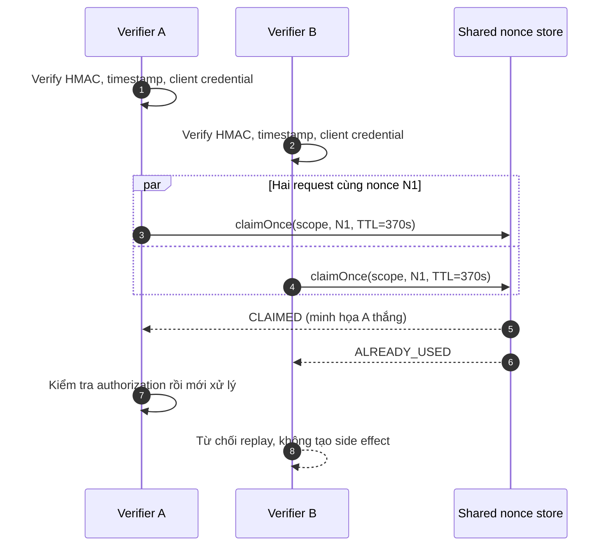
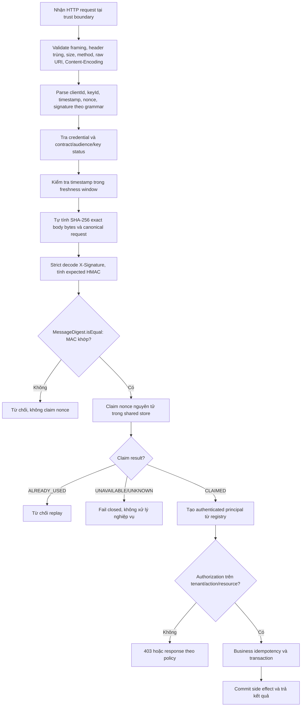

# Nonce phân tán trong xác thực HTTP request bằng HMAC

## Mục tiêu học tập

Trong chương **Nonce**, bài **Nonce phân tán** tập trung vào một câu hỏi bảo mật: **làm thế nào để nhiều API gateway, HMAC verifier hoặc server instance cùng phát hiện một HTTP request đã được sử dụng?** Khi hệ thống chạy nhiều pod, nhiều node hoặc nhiều region, lưu nonce trong `HashSet` riêng của từng tiến trình không thể đảm bảo rằng request đã qua node A sẽ bị từ chối ở node B.

Bài thuộc module `SECURITY_AUTHENTICATION_HMAC_REQUEST_AUTHENTICATION`: thiết kế xác thực HTTP request bằng HMAC với **shared secret** và **canonical request** bao gồm method, URI, header hoặc body theo hợp đồng ký; xác minh chữ ký, chống replay bằng timestamp/nonce, quản lý key rotation, kiểm thử proxy/gateway và phân biệt **authentication** với **authorization**.

Học xong bài, bạn có thể:

- Giải thích **nonce**, replay attack và vì sao timestamp/HMAC hợp lệ **không tự loại trừ** một request cũ còn hạn.
- Xác định **phạm vi nonce** dựa trên audience và authenticated client/principal; tránh xung đột chéo client hoặc lỗ hổng qua key rotation.
- Thiết kế thao tác **claim-once nguyên tử** với TTL, phân biệt nó với mẫu lỗi `GET` rồi `SET`.
- Tính TTL replay store theo **cả phía quá khứ và tương lai** của cửa sổ timestamp, đồng thời xem xét clock skew và độ trễ.
- Phân tích các chế độ hỏng: node restart, autoscaling, cache eviction, Redis primary failover, replication bất đồng bộ, network partition và multi-region.
- Viết ví dụ **Java 17** mô phỏng hai verifier cùng một kho nonce, chạy đồng thời và chứng minh **tối đa một lần claim thành công**.
- Kết nối nonce phân tán với bước xác minh HMAC, retry/ký lại, Idempotency-Key, key rotation, gateway và phân quyền.

## 1. Vì sao phải có nonce phân tán?

### 1.1. Timestamp và HMAC không ghi nhớ request cũ

Giả sử client ký request:

```http
POST /v1/payouts?tenant=merchant-42 HTTP/1.1
Host: payments.example.test
Content-Type: application/json
X-Client-Id: payout-worker-prod
X-Key-Id: key-2026-11
X-Timestamp: 1700000000
X-Nonce: <22-char-base64url-nonce>
Idempotency-Key: <22-char-business-operation-id>
X-Content-SHA256: <sha256-body-base64url>
X-Signature: <hmac-sha256-base64url>

{"amount":120000,"currency":"VND"}
```

Các chuỗi trong dấu `<...>` và timestamp `1700000000` chỉ là dữ liệu minh họa. Request thực cần timestamp hiện tại, nonce ngẫu nhiên và MAC tính bằng shared secret hợp lệ.

Nếu kẻ tấn công có bản sao **nguyên request đã ký** (ví dụ bị lộ qua một log hoặc đường truyền/thiết bị không an toàn), việc gửi lại bản sao trong cửa sổ thời gian có thể vẫn cho:

```text
HMAC(SERVER_SECRET, CANONICAL_REQUEST) = MAC được gửi
signedTimestamp nằm trong freshness window
```

Đó là **replay**: chữ ký toán học vẫn đúng vì toàn bộ dữ liệu đã ký được phát lại y nguyên. HMAC kiểm tra **tính toàn vẹn và quyền sở hữu secret của bên ký**, không có cơ chế tự ghi nhớ những request đã xử lý.

**Nonce** (*number used once*) là một giá trị có entropy cao, được ký cùng request, mà verifier phải đánh dấu **đã sử dụng**. Khi một giá trị thuộc cùng phạm vi được gửi lại trong thời gian request còn có thể hợp lệ, verifier từ chối dù MAC đúng.

### 1.2. Vấn đề của `Set` trong từng pod

```text
                      Load balancer
                       /          \
                      v            v
              Verifier A        Verifier B
              seen={N1}         seen={}
                   |                |
  Attempt lần 1 --+                |
  Replay lần 2 --------------------+
```

Node A đã xử lý `N1` và lưu nó trong RAM cục bộ. Khi request cũ được load balancer chuyển sang node B, node B không biết `N1` đã từng dùng; nếu B chỉ kiểm tra HMAC và timestamp, replay có thể được chấp nhận.

Những giải pháp **không đủ**:

- Một `ConcurrentHashMap` hay `HashSet` riêng trong mỗi JVM.
- `static synchronized` hoặc `synchronized` trên một node: chỉ đồng bộ các thread **cùng tiến trình**.
- Sticky session dựa trên cookie/IP: client có thể thay IP, node có thể restart, load balancer có thể failover.
- Cache trong mỗi pod được cập nhật qua message bất đồng bộ mà không có quy tắc atomicity: hai node có thể nhận request trước khi đồng bộ xong.

**Yêu cầu cốt lõi:** Mọi verifier có thể xác thực **cùng một credential/audience** phải tham gia vào một cơ chế chống replay có **quyết định claim duy nhất, nguyên tử và nhất quán đủ mạnh**.

### 1.3. Bất biến bảo mật

Với một `replayKey` trong giai đoạn còn hiệu lực, ta muốn:

```text
acceptedClaims(replayKey, validTimeHorizon) <= 1
```

Bất biến này nói về **số lần được phép vượt qua bước claim nonce** trong phạm vi cửa sổ hợp lệ. Nó **không** nói rằng sẽ chỉ có một lần gọi hàm, chỉ có một TCP connection hay chỉ có một lần thử HTTP: rất nhiều request có thể **thử** cùng nonce, nhưng tối đa một request được claim thành công.

Nếu HMAC sai hoặc timestamp không hợp lệ, hệ thống không được coi request đó là một claim nonce hợp lệ. Nếu kho nonce không thể đưa ra quyết định chắc chắn vì sự cố, hệ thống có thể từ chối theo nguyên tắc **fail closed** để giữ invariant.

## 2. Sinh nonce và ký nonce như thế nào?

### 2.1. Nonce phải khó đoán và được sinh riêng cho từng signed attempt

Với API M2M, một lựa chọn thực tế là **16 byte ngẫu nhiên từ CSPRNG (128 bit)**, mã hóa thành Base64URL không padding (**22 ký tự ASCII**):

```java
import java.security.SecureRandom;
import java.util.Base64;

SecureRandom secureRandom = new SecureRandom();
byte[] nonceBytes = new byte[16];
secureRandom.nextBytes(nonceBytes);

String nonce = Base64.getUrlEncoder()
        .withoutPadding().encodeToString(nonceBytes);
// Mỗi signed attempt phải sinh nonce riêng.
```

128 bit ngẫu nhiên có không gian `2^128` khả năng; xác suất trùng do birthday effect rất thấp với tải thông thường, nhưng **không bằng 0**. Việc sinh ngẫu nhiên mạnh **không thay** yêu cầu kiểm tra trùng nonce ở server.

Tránh dùng:

- `System.currentTimeMillis()` làm nonce: dễ đoán, dễ trùng khi nhiều request cùng millisecond.
- Counter trong RAM riêng mỗi JVM: restart và scale-out có thể sinh trùng; không có phân vùng đảm bảo uniqueness.
- `java.util.Random` cho nonce bảo mật: không được thiết kế làm CSPRNG.
- Request ID chỉ có timestamp/sequence hoặc prefix cố định: nếu entropy thấp, attacker có thể đoán và thử gây xung đột.
- Reuse nonce khi client tự động retry cùng request: nonce đã claim có thể bị từ chối.

**Phân biệt:** Một `Idempotency-Key` có thể được giữ nguyên cho **một thao tác nghiệp vụ logic** qua nhiều retry; **nonce lại phải mới** ở mỗi signed attempt. Cả hai có thể dùng 16 byte CSPRNG nhưng đóng vai trò khác nhau.

### 2.2. Nonce phải nằm trong canonical request

Nếu client gửi `X-Nonce` nhưng không đưa nó vào dữ liệu được ký:

```text
MAC = HMAC(secret, method + rawTarget + bodyHash + timestamp)
X-Nonce: N1                  # KHÔNG nằm trong MAC!
```

Một bên nắm bản sao request cũ có thể thử thay `X-Nonce: N1` bằng `X-Nonce: N2` rồi phát lại **với MAC không đổi**. Replay store sẽ thấy nonce mới dù thao tác và chữ ký gốc không thay.

Hợp đồng đúng phải ký cả nonce:

```text
canonical = join(LF,
    algorithm, version, audience, clientId, keyId,
    method, rawTarget, contentType, bodyHash,
    idempotencyKey, timestamp, nonce
)

MAC = HMAC-SHA256(secretBytes, UTF8(canonical))
```

Thay nonce mà giữ signature cũ phải làm MAC không khớp. Client hợp lệ muốn retry phải tự **tạo nonce mới và ký lại** bằng secret đang hoạt động.

### 2.3. Định dạng nonce cần được kiểm tra chặt

Hợp đồng minh họa chọn:

```text
^[A-Za-z0-9_-]{22}$
```

Sau khi regex đạt, server phải:

1. Base64URL-decode; kết quả **đúng 16 byte**.
2. Encode lại bằng Base64URL không padding; text phải **khớp hoàn toàn** để loại dạng noncanonical/pad bits sai.
3. Không `trim()`, lowercase, percent-decode hay chấp nhận Base64 chuẩn `+`/`/`/`=` ngoài contract.
4. Giới hạn kích thước header, reject duplicate `X-Nonce`; không tự ghép hai nonce từ nhiều header.

Kiểm tra text và độ dài là **syntax validation**. Một nonce có định dạng hợp lệ chưa được chứng minh **do client hợp lệ ký** cho đến khi HMAC được xác minh.

## 3. Phạm vi khóa chống replay: theo ai, theo đâu?

### 3.1. `replayKey` phải có phạm vi định danh rõ ràng

Một thiết kế hợp lý cho API này:

```text
replayKey = (audience, authenticatedClientId, nonce)
```

Trong đó:

- **`audience`:** dịch vụ/hệ thống đích, ví dụ `payments-api-prod`, không phải một giá trị tùy ý do client ghi trong header rồi tin luôn.
- **`authenticatedClientId`:** principal từ credential registry sau khi HMAC và key status được kiểm chứng; không phải chỉ text `X-Client-Id` chưa được xác thực.
- **`nonce`:** giá trị duy nhất đã kiểm tra cú pháp và nằm trong HMAC.

Với hệ thống lưu trữ, có thể tạo tên key kiểu:

```text
hmac:nonce:v1:payments-api-prod:payout-worker-prod:BVLOV3evw9S3Zewpz5JgYQ
```

Đây chỉ là cách biểu diễn. Production nên **encode/serialize từng thành phần không nhập nhằng**, hạn chế độ dài và có thể băm/HMAC tên key nếu metadata nhạy cảm. Không nối chuỗi bằng dấu phân cách nếu các field cho phép chứa chính dấu đó.

### 3.2. Vì sao không scope theo `nonce` toàn cục?

Nếu chỉ dùng `nonce`, hai client độc lập vô tình sinh trùng nonce sẽ ảnh hưởng lẫn nhau, có thể gây false reject hoặc tạo điểm tấn công DoS. Scope theo authenticated client/audience tách những không gian độc lập.

Có hệ thống chọn nonce uniqueness **toàn bộ API** để tối giản; đó có thể là chính sách hợp lệ nếu chấp nhận các trade-off. Quan trọng là scope phải **được công bố, kiểm thử và nhất quán giữa mọi verifier**.

### 3.3. Vì sao cẩn trọng khi đưa `keyId` vào khóa replay?

Nếu dùng:

```text
replayKey = (audience, clientId, keyId, nonce)
```

thì khi client chuyển từ key cũ sang key mới, một nonce trùng có thể được xem như một không gian mới. Nếu mỗi request chứa keyId đã được ký, attacker không thể tùy ý thay keyId mà vẫn giữ MAC cũ; nhưng **client có nhiều key hợp lệ** vẫn có thể tái sử dụng nonce cho nhiều signed attempts, và hợp đồng có thể không muốn như vậy.

Một chính sách dễ lý giải hơn là **nonce duy nhất theo principal ổn định**, không chỉ theo key material của từng vòng rotation. Với credential nhiều tenant/scope, phải xác định principal và audience từ registry để tránh chồng hoặc tách không gian không mong muốn.

Nếu có **cùng một client ID trong nhiều môi trường** (dev/staging/prod), cần tách audience/environment sao cho nonce claim của môi trường này không làm hỏng request ở môi trường khác, và canonical/HMAC cũng phải ràng buộc đúng audience.

### 3.4. Nonce không phải Idempotency-Key

| Đặc điểm | Nonce chống replay | Idempotency-Key nghiệp vụ |
| --- | --- | --- |
| Phạm vi | Signed attempt đã xác thực | Một logical operation/business action |
| Sinh khi nào? | **Mỗi lần ký request** | Một lần cho operation, giữ nguyên qua retry |
| Có trong HMAC? | **Có** | **Nên có nếu tác động đến semantics** |
| Khóa lưu | Audience + principal + nonce | Audience + principal + operation key |
| Giá trị khi gặp lại | **Từ chối replay** | Trả kết quả cũ / `IN_PROGRESS` / conflict theo fingerprint |
| Thời gian lưu | Phủ cửa sổ chấp nhận timestamp | Phủ **retry horizon và yêu cầu nghiệp vụ**, thường dài hơn |
| Mục tiêu | Không cho một signed attempt được chấp nhận lại | Không thực hiện side effect logic trùng dù các attempt có nonce mới |

Một POST thanh toán **có thể** được ký hai lần với timestamp/nonce khác và đều vượt bước chống replay. Chỉ idempotency store/transaction mới ngăn được hai khoản chuyển tiền cùng một logical operation.

## 4. Cửa sổ timestamp quyết định thời hạn lưu nonce

### 4.1. Công thức tổng quát

Giả sử policy xác thực chỉ nhận timestamp `t` nếu:

```text
now - P <= t <= now + F
```

Trong đó:

- `P`: cho phép timestamp **quá khứ** bao nhiêu giây.
- `F`: cho phép timestamp **tương lai** bao nhiêu giây.
- Biên **inclusive** theo hợp đồng.
- `now`: Unix epoch seconds từ clock verifier đáng tin, lấy tại thời điểm kiểm tra được quy định.

Biến đổi bất đẳng thức:

```text
t - F <= now <= t + P
```

Nghĩa là một request có timestamp `t` có thể được chấp nhận từ thời điểm `t-F` đến `t+P`. Nếu server claim nonce lúc **sớm nhất** (`t-F`), nonce phải được nhớ cho tới **muộn nhất** (`t+P`).

Vì thế:

```text
minimumReplayHorizonSeconds = P + F
nonceTTLSeconds >= P + F + safetyMargin
```

Ví dụ chọn `P = 300s`, `F = 60s`, `safetyMargin = 10s`:

```text
nonceTTL = 300 + 60 + 10 = 370 seconds
```

Nếu dùng cửa sổ đối xứng **±300 giây**, TTL từ lúc claim sớm nhất nên tối thiểu:

```text
nonceTTL = 300 + 300 + 10 = 610 seconds
```

Các số là **ví dụ**, không phải chuẩn bắt buộc. Safety margin phải cân nhắc độ phân giải giây, clock skew giữa node, store TTL, mạng và queue. Nếu clock máy chạy sai nghiêm trọng, tăng TTL một vài giây **không thay** việc sửa đồng bộ thời gian.

### 4.2. Sai lầm: TTL chỉ bằng số giây “quá khứ”

```text
Freshness window = [-300s, +300s]
Nonce store TTL = 300s   # Không đủ để chặn replay ở toàn bộ window.
```

Một request được claim khi timestamp ở **tương lai 300 giây** so với server. Sau 300 giây, nonce hết hạn, nhưng timestamp khi đó có thể vẫn còn hợp lệ **thêm gần 300 giây nữa**. Replay request cũ có thể vượt qua lần claim mới nếu nonce đã bị quên.

Cách phát hiện lỗi này bằng test: claim nonce tại thời điểm `now=t-F`, sau đó thử phát lại **cùng signed request** tại `now=t+P`, khi timestamp vẫn đúng biên. Replay phải tiếp tục bị từ chối.

### 4.3. TTL động theo thời điểm hết hạn của timestamp

Thay vì luôn dùng TTL cố định `P+F+margin` từ lúc claim, có thể tính gần đúng từ **thời điểm cuối mà timestamp `t` còn hợp lệ**:

```text
expiresAt = signedTimestamp + P + safetyMargin
ttlAtClaim = max(1, expiresAt - serverNow)
```

Ví dụ request chỉ được nhận lần đầu khi timestamp đã rất cũ thì thời gian còn lại có thể ngắn hơn `P+F`. Để sử dụng TTL động an toàn:

- Chỉ tính sau khi **timestamp grammar/window và MAC đều hợp lệ**.
- Tránh overflow bằng phép toán có kiểm tra và giới hạn input.
- Làm rõ sai số giữa clock verifier và clock của datastore; làm tròn TTL **hướng lên**.
- Đặt biên an toàn cho timestamp ở đúng điểm inclusive và cho thao tác claim trước khi time tick.
- Nếu nhiều region có clock skew đáng kể, expire-at từ clock của một node không mặc nhiên an toàn cho node khác.

**Hợp đồng thực hành ở bài này dùng TTL cố định 370 giây**, đơn giản cho hệ thống có độ lệch clock được giám sát; TTL động là tối ưu tùy chọn cần đánh giá riêng.

### 4.4. Bảo đảm TTL thật sự được áp dụng

Không chỉ cần lưu nonce: các mục cần **hết hạn** để tránh bùng nổ dung lượng. Với tần suất `R` request hợp lệ/giây, số nonce tồn tại gần:

```text
entriesApprox = R * TTLseconds
```

Ví dụ `R=5,000 request/s` và `TTL=370s`:

```text
entriesApprox = 5000 * 370 = 1,850,000 nonce entries
```

Con số chỉ ước lượng để chọn capacity; RAM thực dùng còn phụ thuộc key length, overhead của datastore, replica, allocator, hashing, shard và TTL bookkeeping. Nếu lưu nonce vô hạn hoặc TTL bị vô hiệu, bộ nhớ tăng theo tổng số request thay vì tốc độ trong một cửa sổ hữu hạn.

**Đừng dùng chính sách cache eviction tùy ý** để giải phóng nonce còn hiệu lực: nếu bản ghi nonce bị evict trước replay horizon, request cũ có thể được claim lại.

## 5. Atomic claim-once: điểm quyết định của hệ thống phân tán

### 5.1. Vì sao `GET` rồi `SET` không đủ?

Mẫu lỗi:

```text
Request N arrives at verifier A and verifier B at the same time.

A: GET nonceKey -> not found
B: GET nonceKey -> not found
A: SET nonceKey
B: SET nonceKey
A: accept
B: accept

=> Hai request cùng nonce đều đi qua anti-replay.
```

Kiểm tra “chưa tồn tại” rồi ghi là **hai thao tác**, nên có khoảng race. Lock Java tại A không khóa được B. Độ trễ mạng nhỏ hoặc lưu trữ nhanh chỉ làm cửa sổ race ngắn hơn, không xóa nó.

Bất biến cần là **một thao tác nguyên tử**:

```text
claimOnce(key, ttl):
    if key does not exist:
        write key and its expiry atomically
        return CLAIMED
    else:
        return ALREADY_USED
```

Tất cả verifier phải thống nhất rằng chỉ trạng thái `CLAIMED` mới được phép đi tiếp; `ALREADY_USED` hoặc `UNKNOWN/ERROR` đều không được thực thi operation nhạy cảm.

### 5.2. Mẫu Redis `SET ... NX EX ...`

Ví dụ:

```redis
SET hmac:nonce:v1:payments-api-prod:payout-worker-prod:nonce123 1 NX EX 370
```

Theo semantics của lệnh này:

- `NX`: chỉ set khi key **chưa tồn tại**.
- `EX 370`: gán thời hạn 370 giây **cùng thao tác set**.
- Kết quả `OK`: claim thành công.
- Kết quả null/Nil khi key đã tồn tại: request bị xem là replay.
- Lỗi timeout, kết nối, role/cluster hoặc trạng thái không chắc chắn: **không coi là OK**.

**Không** thay bằng:

```redis
GET key
SET key 1
EXPIRE key 370
```

Vì check-then-write có race, đồng thời `SET` và `EXPIRE` tách rời có nguy cơ key không có TTL nếu process ngắt giữa chừng.

Pseudo Java với client Redis bất kỳ:

```java
// API cụ thể của Redis client có thể khác; đây là pseudocode.
ClaimOutcome claimOnce(String replayKey, int ttlSeconds) {
    RedisResult result = redis.set(replayKey, "1",
            options().nx().ex(ttlSeconds));
    if (result == OK) return CLAIMED;
    if (result == NOT_SET) return ALREADY_USED;
    return UNAVAILABLE; // Không tự coi lỗi là success.
}
```

### 5.3. Một primary atomic không đồng nghĩa bảo đảm xuyên failover

Redis `SET NX EX` có tính nguyên tử trên instance chủ xử lý lệnh trong điều kiện hoạt động phù hợp. Nhưng **replication bất đồng bộ** và một số kịch bản **failover** có thể làm mất lần ghi vừa được primary xác nhận nếu replica chưa nhận bản ghi trước khi được nâng thành primary.

Kịch bản:

```text
T1: Primary P nhận SET NX EX, trả OK cho verifier A.
T2: A coi nonce đã claim và xử lý request.
T3: P chết trước khi bản ghi được replicate.
T4: Replica R lên primary nhưng không có nonce đó.
T5: Replay đến verifier B -> SET NX EX nhận OK lần nữa.
```

Lệnh atomic **không loại trừ** lỗ hổng do replication/failover mất dữ liệu. Nếu threat model đòi **at-most-once mạnh** ngay cả khi primary crash/network partition, cần cơ chế với cam kết consistency/durability rõ: ví dụ **transactional unique constraint trong database có leader/quorum phù hợp**, hoặc một linearizable key-value service. Cần kiểm tra kỹ guarantee của datastore, không suy rằng Redis `WAIT`, replica count hoặc “cache có HA” tự động cho **strong consistency** trong mọi failover.

### 5.4. Cơ sở dữ liệu và unique constraint

Trong một số hệ thống, có thể dùng bảng nonce:

```sql
CREATE TABLE used_hmac_nonce (
    audience       VARCHAR(80)  NOT NULL,
    principal_id   VARCHAR(128) NOT NULL,
    nonce          VARCHAR(32)  NOT NULL,
    expires_at     TIMESTAMP WITH TIME ZONE NOT NULL,
    PRIMARY KEY (audience, principal_id, nonce)
);
```

Một claim minh họa với SQL dialect hỗ trợ:

```sql
INSERT INTO used_hmac_nonce
    (audience, principal_id, nonce, expires_at)
VALUES
    (:audience, :principal_id, :nonce, :expires_at)
ON CONFLICT DO NOTHING;
```

**Một row được thêm:** claim thành công; **không row nào được thêm vì khóa đã tồn tại:** replay. Unique constraint giải quyết race **trên cùng database/consistency domain** khi transaction commit thành công. Cần bắt lỗi database, timeout, rollback và trạng thái commit không chắc chắn; không diễn giải lỗi thành “nonce mới”.

**Lưu ý về expiry:** Không thể xóa một row đã hết hạn rồi insert lại **tùy tiện trong cùng replay horizon**. Worker cleanup chỉ xóa row khi hết hạn theo chính sách và clock đáng tin; transaction xóa/insert trên nhiều node phải tuân quy tắc consistency. Một dữ liệu nonce đã thật sự hết cửa sổ có thể được xóa an toàn, nhưng cơ chế cleanup không được chạy quá sớm.

### 5.5. Hash replay key và giới hạn dữ liệu lưu

Nonce nên là dữ liệu có entropy cao, nhưng replay-key namespace có thể chứa client ID hoặc audience nhạy cảm. Có thể lưu:

```text
storageKey = prefix + HEX(SHA256(
    lengthPrefixed(audience, authenticatedPrincipal, nonce)))
```

Mục tiêu là giới hạn chiều dài/tạo key cố định và tránh lỗi nối string nhập nhằng. Không cần gửi giá trị hash này cho client. Nếu dùng SHA-256 trên một key tổng hợp hợp lệ, rủi ro hash collision được xem là cực thấp trong thiết kế thông thường; nhưng mọi quyết định về key scope/collision phải được review theo threat model.

**Không đưa raw shared HMAC secret** vào tên key Redis/database hoặc log. Nonce có thể hiển thị ở header đã ký, nhưng cũng không cần log toàn bộ nonce trong hệ thống sản xuất nếu không có lý do vận hành rõ.

## 6. Những rủi ro thật sự khi triển khai nonce store phân tán

### 6.1. Một request qua hai node cùng lúc



Mục tiêu không phải luôn để node A thắng, mà là **không thể có hai bên cùng thắng** đối với một replay key trong cùng consistency domain và thời gian còn hợp lệ. Test phải chạy đồng thời có rào bắt đầu (`CountDownLatch`/barrier), không chỉ gửi tuần tự.

### 6.2. Timeout khi ghi nonce: không thể tự đoán kết quả

Client/Verifier gọi kho:

```text
SET key 1 NX EX 370
              |
              v
        [Network timeout]
```

Có thể:

1. Lệnh **chưa** đến store.
2. Store **đã claim**, nhưng response bị mất.
3. Store lỗi giữa chừng và outcome không chắc chắn.

Trong cả ba trường hợp, verifier **không được suy ra** rằng claim thành công và cho business handler chạy. Theo chính sách fail closed, đánh dấu `STORE_UNAVAILABLE`/`INDETERMINATE` và từ chối/không thực thi. Nếu bên nhận retry lại **cùng nonce**, có thể gặp `ALREADY_USED` vì claim trước đó thành công; đó là **false reject chấp nhận được về mặt bảo mật** trong tình huống mạng hỏng, không phải lý do bỏ qua replay protection.

Việc client tạo **signed attempt mới** với nonce mới để retry cần tuân hợp đồng và cơ chế idempotency nghiệp vụ; đừng âm thầm tạo nonce mới **tại verifier** thay cho client, vì chữ ký cũ không còn bảo vệ nó.

### 6.3. Cache eviction, restart và failover

| Sự cố | Điều có thể xảy ra | Cách kiểm soát |
| --- | --- | --- |
| API pod restart | `Set` nonce trong JVM mất. | Dùng shared store, không dựa vào pod lifetime. |
| Autoscaling/hệ thống cân bằng tải | Request replay đi tới instance chưa từng thấy nonce. | Tất cả verifier cùng consistency domain cần dùng cùng claim service. |
| Redis eviction `allkeys-lru` hoặc memory pressure | Nonce còn hạn bị xóa sớm. | Capacity planning, kiểm soát `maxmemory-policy`, cảnh báo và fail closed; không dùng cache eviction làm TTL. |
| Redis primary crash trước replication | Ghi đã ACK có thể biến mất khi failover. | Phân tích guarantee HA; dùng store có consistency/durability phù hợp threat model. |
| Network partition | Hai phía có thể phục vụ độc lập và mỗi bên claim cùng nonce. | Không cho phép cả hai split-brain leaders chấp nhận write; quorum/linearizability hoặc fail closed ở partition. |
| Nonce store timeout | Outcome claim không rõ. | Không chấp nhận request; điều tra và retry client có kiểm soát. |
| Store bị xóa dữ liệu/restore backup cũ | Nonce từng claim bị quên. | Bảo vệ data integrity, retention/restore và chọn consistency guarantee phù hợp. |
| Clock verifier lệch mạnh | Nonce expire quá sớm hoặc request hết hạn khác nhau. | Sync clock, giám sát skew, tính TTL phù hợp. |

Mỗi giải pháp storage cần được đánh giá dựa trên câu hỏi thực tế: “Sau khi **CLAIMED** được trả về, có kịch bản failover được hỗ trợ nào khiến **chính replay key đó lại claim thành công** trước khi request hết cửa sổ không?” Nếu có, hệ thống **chưa** đạt at-most-once mạnh trong kịch bản đó.

### 6.4. Multi-region và active-active

Với hai vùng độc lập:

```text
Client -> Region VN -> nonce-store-VN
Replay -> Region SG -> nonce-store-SG

Cùng nonce N1, hai kho không chia sẻ claim:
  VN: CLAIMED
  SG: CLAIMED     <-- nguy cơ replay xuyên region
```

Để chống replay xuyên region, có thể:

- Dùng **một kho claim có consistency guarantee được kiểm chứng** (quorum/linearizable) phục vụ mọi verifier, chấp nhận độ trễ và chi phí xuyên vùng.
- Định tuyến replay key tới **một chủ sở hữu duy nhất**, đồng thời ràng buộc quyền sở hữu trong cả failover; không chỉ dùng sticky session theo IP hoặc route URL dễ bị attacker thao túng.
- Bắt buộc tất cả region chỉ xử lý claim qua **cùng authority**; khi authority không khả dụng, những region còn lại không được tự mở một kho riêng để “đảm bảo uptime” nếu điều đó phá invariant.
- Nếu nghiệp vụ đã có transactional unique constraint theo operation ID, có thể dùng nó làm **lớp phòng vệ bổ sung**, nhưng không coi nó là thay thế nonce anti-replay cho mọi endpoint.

**Chọn trade-off có chủ đích:** Với yêu cầu an toàn mạnh, hệ thống có thể phải hy sinh một phần availability khi partition xảy ra. Nếu đặt khả dụng lên trên tính nhất quán và vẫn nhận request ở mỗi region độc lập, cần nhận thức nguy cơ replay và không tuyên bố “mỗi nonce chỉ được chấp nhận một lần trên toàn hệ thống”.

### 6.5. Chọn vị trí đặt replay check

Một số hệ thống xác minh HMAC ngay ở API gateway, một số tại backend:

```text
Client signed HTTP request
      |
      v
Gateway (thay/giữ method, raw URI, header, body)
      |
      v
HMAC verifier [verify signature + timestamp + atomic claim]
      |
      v
Authenticated principal + immutable verified operation
      |
      v
Business authorization and side effects
```

**Verify ở gateway:** Gateway phải loại header principal do client internet tự khai, xác minh ở đúng raw request boundary, claim nonce, rồi truyền principal và operation đã xác minh qua kênh nội bộ có xác thực/toàn vẹn. Backend không được tự tin header `X-Authenticated-User` do client bên ngoài gửi.

**Verify ở backend:** Gateway phải bảo toàn các trường được ký hoặc cung cấp thông tin gốc qua một kênh nội bộ chống giả mạo. Nếu gateway rewrite path, sắp query hoặc biến đổi body trước khi backend dựng canonical, expected MAC sẽ khác. Không sửa bằng cách bỏ ký URI hoặc bỏ luôn bước nonce.

**Chỉ claim khi HMAC đạt:** Một đối thủ không có secret có thể đoán nonce text và spam request MAC sai. Nếu verifier claim trước khi MAC, hắn có thể **đầu độc nonce store** và vô tình chặn request hợp lệ mang nonce đó; thứ tự đúng là kiểm tra cấu trúc/credential/freshness, **xác minh MAC**, rồi mới claim.

## 7. Java 17: hai verifier cạnh tranh một nonce

Ví dụ sau là **một chương trình Java 17 hoàn chỉnh**, mô phỏng hai node có **chung một đối tượng `SharedNonceStore` trong cùng JVM**. Đây là cách kiểm tra race condition bằng `ConcurrentHashMap.compute` và hai thread. Nó **không tự trở thành distributed store qua hai máy**; trong production, thay abstraction đó bằng Redis/DB/linearizable storage có guarantee tương ứng.

Chương trình minh họa:

1. Sinh secret 32 byte, nonce 16 byte và Idempotency-Key 16 byte với `SecureRandom`.
2. Ký `POST /v1/payouts?tenant=merchant-42` bằng HMAC-SHA256 trên canonical request **12 dòng**, bao gồm nonce và Idempotency-Key.
3. Hai `ServerNode` chạy đồng thời; mỗi node tự xác minh body hash, timestamp và MAC.
4. Cả hai gọi `claimOnce` cùng replay key và TTL `370 giây`; **chỉ một `ACCEPTED`**, node còn lại `REPLAYED`.
5. Phát lại nguyên attempt, đổi nonce mà **không ký lại**, rồi tạo signed attempt mới cùng Idempotency-Key.
6. Giả lập nonce store bị lỗi và chứng minh verifier **không coi lỗi là claim thành công**.

### 7.1. Hợp đồng canonical `nonce-cluster-v1`

Request minh họa:

```http
POST /v1/payouts?tenant=merchant-42 HTTP/1.1
Host: payments.example.test
Content-Type: application/json
X-Client-Id: payout-worker-prod
X-Key-Id: key-2026-11
Idempotency-Key: <22-char-operation-id>
X-Timestamp: <epoch-seconds>
X-Nonce: <22-char-nonce>
X-Content-SHA256: <43-char-body-hash>
X-Signature: <43-char-hmac-sha256>

{"amount":120000,"currency":"VND"}
```

Hợp đồng quy định **12 dòng** UTF-8 nối bằng LF (`\n`), **không có LF cuối**:

```text
HMAC-SHA256
nonce-cluster-v1
payments-api-prod
payout-worker-prod
key-2026-11
POST
/v1/payouts?tenant=merchant-42
application/json
<base64url-SHA256-exact-body>
<idempotency-key-22-chars>
<timestamp-epoch-seconds>
<nonce-22-chars>
```

| Dòng | Dữ liệu | Vai trò |
| --- | --- | --- |
| 1–3 | Thuật toán, version, audience | Chốt đúng contract/đích, tránh nhầm service. |
| 4–5 | Client ID, key ID | Tra registry và ràng buộc MAC với credential. |
| 6–7 | Method, raw path/query | Ràng buộc thao tác và tenant đích. |
| 8–9 | Content-Type và SHA-256 body bytes | Ràng buộc representation và payload đúng byte. |
| 10 | Idempotency-Key | Định danh **logical operation**, giữ nguyên qua retry. |
| 11 | Timestamp | Chặn request quá cũ/đi trước vượt chính sách. |
| 12 | Nonce | Chặn dùng lại cùng signed attempt ở mọi node. |

Mọi trường ngoài phạm vi cho phép đều bị reject: method phải là `POST`, target đúng grammar `/v1/payouts?tenant=[A-Za-z0-9_-]{1,64}`, Content-Type `application/json`, Content-Encoding vắng mặt hoặc `identity`, body không quá 1 MiB, client/key ID theo allowlist, timestamp là epoch seconds decimal canonical, nonce và operation ID phải đúng Base64URL của 16 byte. HTTP adapter thực tế phải kiểm tra **header trùng** và framing trước khi đưa dữ liệu vào signer/verifier.

### 7.2. Mã nguồn đầy đủ

```java
import java.nio.charset.StandardCharsets;
import java.security.GeneralSecurityException;
import java.security.MessageDigest;
import java.security.SecureRandom;
import java.time.Clock;
import java.time.Instant;
import java.time.ZoneOffset;
import java.util.Arrays;
import java.util.Base64;
import java.util.Objects;
import java.util.concurrent.ConcurrentHashMap;
import java.util.concurrent.ConcurrentMap;
import java.util.concurrent.CountDownLatch;
import java.util.concurrent.ExecutorService;
import java.util.concurrent.Executors;
import java.util.concurrent.Future;
import java.util.concurrent.atomic.AtomicBoolean;
import java.util.regex.Pattern;
import javax.crypto.Mac;
import javax.crypto.spec.SecretKeySpec;

public final class DistributedNonceHmacDemo {
    private static final long PAST_SECONDS = 300;
    private static final long FUTURE_SECONDS = 60;
    private static final long NONCE_TTL_SECONDS =
            PAST_SECONDS + FUTURE_SECONDS + 10;

    private static final String AUDIENCE = "payments-api-prod";
    private static final String CLIENT_ID = "payout-worker-prod";
    private static final String KEY_ID = "key-2026-11";

    private static final Pattern TARGET = Pattern.compile(
            "/v1/payouts\\?tenant=[A-Za-z0-9_-]{1,64}");
    private static final Pattern ID = Pattern.compile(
            "[A-Za-z0-9_-]{1,64}");
    private static final Pattern TIME = Pattern.compile(
            "[1-9][0-9]{0,11}");

    private static final Base64.Encoder B64 =
            Base64.getUrlEncoder().withoutPadding();
    private static final Base64.Decoder B64_DECODER =
            Base64.getUrlDecoder();

    private DistributedNonceHmacDemo() {}

    record Operation(
            String clientId, String keyId, String method,
            String rawTarget, String contentType, byte[] body,
            String idempotencyKey) {
        Operation {
            body = Objects.requireNonNull(body, "body").clone();
        }

        @Override public byte[] body() {
            return body.clone(); // Giữ snapshot bất biến cho demo.
        }
    }

    record SignedAttempt(
            Operation operation, String timestamp, String nonce,
            String bodyHash, String signature) {}

    enum Verdict {
        ACCEPTED, REPLAYED, OUTSIDE_WINDOW, BAD_MAC,
        INVALID_INPUT, INVALID_CREDENTIAL, STORE_UNAVAILABLE
    }

    enum ClaimResult {
        CLAIMED, ALREADY_USED, UNAVAILABLE
    }

    static final class SharedNonceStore {
        private final ConcurrentMap<String, Long> expiration =
                new ConcurrentHashMap<>();
        private volatile boolean unavailable;

        void setUnavailable(boolean unavailable) {
            this.unavailable = unavailable;
        }

        ClaimResult claimOnce(String key, long now, long ttl) {
            if (unavailable) {
                return ClaimResult.UNAVAILABLE;
            }
            AtomicBoolean created = new AtomicBoolean(false);
            expiration.compute(key, (ignored, expiresAt) -> {
                if (expiresAt == null || expiresAt <= now) {
                    created.set(true);
                    return Math.addExact(now, ttl);
                }
                return expiresAt;
            });
            return created.get()
                    ? ClaimResult.CLAIMED
                    : ClaimResult.ALREADY_USED;
        }
        // Demo không xóa entry đã hết TTL để tiết kiệm code.
        // Production phải expire/cleanup theo policy thật.
    }

    static byte[] strictDecode(
            String text, int textLength, int byteLength) {
        if (text == null || text.length() != textLength ||
                !text.matches("[A-Za-z0-9_-]+")) {
            throw new IllegalArgumentException("Invalid Base64URL syntax");
        }
        byte[] result = B64_DECODER.decode(text);
        if (result.length != byteLength ||
                !B64.encodeToString(result).equals(text)) {
            throw new IllegalArgumentException("Noncanonical Base64URL");
        }
        return result;
    }

    static String newToken(SecureRandom random) {
        byte[] bytes = new byte[16];
        random.nextBytes(bytes);
        return B64.encodeToString(bytes);
    }

    static void validate(SignedAttempt request) {
        if (request == null || request.operation() == null) {
            throw new IllegalArgumentException("Missing request");
        }
        Operation op = request.operation();
        if (!"POST".equals(op.method()) ||
                !"application/json".equals(op.contentType()) ||
                op.rawTarget() == null ||
                !TARGET.matcher(op.rawTarget()).matches()) {
            throw new IllegalArgumentException("Invalid method/target/type");
        }
        if (op.clientId() == null ||
                !ID.matcher(op.clientId()).matches() ||
                op.keyId() == null ||
                !ID.matcher(op.keyId()).matches()) {
            throw new IllegalArgumentException("Invalid client/key ID");
        }
        if (op.body().length == 0 || op.body().length > 1_048_576) {
            throw new IllegalArgumentException("Invalid body length");
        }
        strictDecode(op.idempotencyKey(), 22, 16);
        if (request.timestamp() == null ||
                !TIME.matcher(request.timestamp()).matches()) {
            throw new IllegalArgumentException("Invalid epoch seconds");
        }
        strictDecode(request.nonce(), 22, 16);
    }

    static byte[] sha256(byte[] body) throws GeneralSecurityException {
        return MessageDigest.getInstance("SHA-256").digest(body);
    }

    static String canonical(SignedAttempt request, String bodyHash) {
        validate(request);
        Operation op = request.operation();
        return String.join("\n",
                "HMAC-SHA256", "nonce-cluster-v1", AUDIENCE,
                op.clientId(), op.keyId(), op.method(), op.rawTarget(),
                op.contentType(), bodyHash, op.idempotencyKey(),
                request.timestamp(), request.nonce());
        // 12 dòng UTF-8, LF, không có LF cuối.
    }

    static byte[] hmac(byte[] secret, String canonical)
            throws GeneralSecurityException {
        Mac mac = Mac.getInstance("HmacSHA256");
        mac.init(new SecretKeySpec(secret, "HmacSHA256"));
        return mac.doFinal(canonical.getBytes(StandardCharsets.UTF_8));
    }

    static SignedAttempt sign(
            Operation operation, String timestamp, String nonce,
            byte[] secret) throws GeneralSecurityException {
        String hash = B64.encodeToString(sha256(operation.body()));
        SignedAttempt unsigned = new SignedAttempt(
                operation, timestamp, nonce, hash, "");
        String mac = B64.encodeToString(
                hmac(secret, canonical(unsigned, hash)));
        return new SignedAttempt(operation, timestamp, nonce, hash, mac);
    }

    static final class ServerNode {
        private final byte[] registeredSecret;
        private final Clock serverClock;
        private final SharedNonceStore store;

        ServerNode(byte[] secret, Clock clock, SharedNonceStore store) {
            this.registeredSecret = secret.clone();
            this.serverClock = clock;
            this.store = store;
        }

        Verdict verifyAndClaim(SignedAttempt received)
                throws GeneralSecurityException {
            try {
                validate(received);
                Operation op = received.operation();

                // Mô phỏng registry có đúng một key ACTIVE.
                if (!CLIENT_ID.equals(op.clientId()) ||
                        !KEY_ID.equals(op.keyId())) {
                    return Verdict.INVALID_CREDENTIAL;
                }

                long now =
                        Instant.now(serverClock).getEpochSecond();
                long signedTime =
                        Long.parseLong(received.timestamp());
                if (signedTime < Math.subtractExact(now, PAST_SECONDS)
                        || signedTime > Math.addExact(now, FUTURE_SECONDS)) {
                    return Verdict.OUTSIDE_WINDOW;
                }

                byte[] actualBodyHash = sha256(op.body());
                byte[] receivedBodyHash =
                        strictDecode(received.bodyHash(), 43, 32);
                if (!MessageDigest.isEqual(
                        actualBodyHash, receivedBodyHash)) {
                    return Verdict.BAD_MAC;
                }

                byte[] supplied =
                        strictDecode(received.signature(), 43, 32);
                String bodyHash = B64.encodeToString(actualBodyHash);
                byte[] expected = hmac(
                        registeredSecret, canonical(received, bodyHash));
                if (!MessageDigest.isEqual(expected, supplied)) {
                    return Verdict.BAD_MAC;
                }

                // Principal của client chỉ đáng tin sau khi MAC đạt.
                // Không thêm keyId để nonce không đổi scope qua rotation.
                String key = AUDIENCE + "|" + CLIENT_ID + "|"
                        + received.nonce();
                ClaimResult result = store.claimOnce(
                        key, now, NONCE_TTL_SECONDS);
                return switch (result) {
                    case CLAIMED -> Verdict.ACCEPTED;
                    case ALREADY_USED -> Verdict.REPLAYED;
                    case UNAVAILABLE -> Verdict.STORE_UNAVAILABLE;
                };
            } catch (IllegalArgumentException | ArithmeticException ex) {
                return Verdict.INVALID_INPUT;
            }
        }
    }

    public static void main(String[] args) throws Exception {
        long fixedNow = 1_700_000_000L; // Test fixture.
        Clock clock = Clock.fixed(
                Instant.ofEpochSecond(fixedNow), ZoneOffset.UTC);
        SecureRandom random = new SecureRandom();

        byte[] secret = new byte[32];
        random.nextBytes(secret);
        Operation operation = new Operation(
                CLIENT_ID, KEY_ID, "POST",
                "/v1/payouts?tenant=merchant-42",
                "application/json",
                "{\"amount\":120000,\"currency\":\"VND\"}"
                        .getBytes(StandardCharsets.UTF_8),
                newToken(random));

        SignedAttempt first = sign(
                operation, Long.toString(fixedNow),
                newToken(random), secret);

        SharedNonceStore shared = new SharedNonceStore();
        ServerNode nodeA = new ServerNode(secret, clock, shared);
        ServerNode nodeB = new ServerNode(secret, clock, shared);

        ExecutorService pool = Executors.newFixedThreadPool(2);
        CountDownLatch ready = new CountDownLatch(2);
        CountDownLatch start = new CountDownLatch(1);
        try {
            Future<Verdict> resultA = pool.submit(() -> {
                ready.countDown();
                start.await();
                return nodeA.verifyAndClaim(first);
            });
            Future<Verdict> resultB = pool.submit(() -> {
                ready.countDown();
                start.await();
                return nodeB.verifyAndClaim(first);
            });

            ready.await(); // Cả hai node đã sẵn sàng.
            start.countDown();
            Verdict a = resultA.get();
            Verdict b = resultB.get();
            int accepted = (a == Verdict.ACCEPTED ? 1 : 0)
                    + (b == Verdict.ACCEPTED ? 1 : 0);
            int replayed = (a == Verdict.REPLAYED ? 1 : 0)
                    + (b == Verdict.REPLAYED ? 1 : 0);

            System.out.println("Concurrent accepted: " + accepted);
            System.out.println("Concurrent replay rejected: " + replayed);
        } finally {
            pool.shutdownNow();
        }

        // Gửi lại đúng signed attempt, dù đến node nào cũng reject.
        System.out.println("Replay on another node: "
                + nodeB.verifyAndClaim(first));

        // Đổi nonce sau khi ký mà GIỮ chữ ký cũ -> MAC sai.
        String forgedNonce = newToken(random);
        SignedAttempt changedNonceWithoutSigning = new SignedAttempt(
                operation, first.timestamp(), forgedNonce,
                first.bodyHash(), first.signature());
        System.out.println("Changed nonce, old signature: "
                + nodeA.verifyAndClaim(changedNonceWithoutSigning));

        // MAC sai không được đầu độc nonce store. Với cùng nonce mới,
        // bên có secret thực sự ký lại thì có thể claim được.
        SignedAttempt freshlySigned = sign(
                operation, first.timestamp(), forgedNonce, secret);
        System.out.println("Correctly re-signed attempt: "
                + nodeB.verifyAndClaim(freshlySigned));
        System.out.println("Same Idempotency-Key on retry: "
                + operation.idempotencyKey().equals(
                    freshlySigned.operation().idempotencyKey()));

        // Store không khả dụng => verifier KHÔNG cho request qua.
        shared.setUnavailable(true);
        SignedAttempt duringOutage = sign(
                operation, first.timestamp(), newToken(random), secret);
        System.out.println("Nonce store unavailable: "
                + nodeA.verifyAndClaim(duringOutage));
        shared.setUnavailable(false);

        // Hết cửa sổ theo thời gian dù MAC vẫn tính đúng.
        SignedAttempt tooOld = sign(
                operation, Long.toString(fixedNow - PAST_SECONDS - 1),
                newToken(random), secret);
        System.out.println("Timestamp too old: "
                + nodeA.verifyAndClaim(tooOld));

        Arrays.fill(secret, (byte) 0);
    }
}
```

Kết quả kỳ vọng (thứ tự node A/B thắng có thể đổi):

```text
Concurrent accepted: 1
Concurrent replay rejected: 1
Replay on another node: REPLAYED
Changed nonce, old signature: BAD_MAC
Correctly re-signed attempt: ACCEPTED
Same Idempotency-Key on retry: true
Nonce store unavailable: STORE_UNAVAILABLE
Timestamp too old: OUTSIDE_WINDOW
```

### 7.3. Vì sao bộ nhớ chung trong demo vẫn hữu ích?

`ConcurrentHashMap.compute(key, ...)` thực hiện thao tác cập nhật nguyên tử **trên một key trong một map cụ thể**, nên hai thread cạnh tranh đúng cùng key không đồng thời “chiến thắng”. `CountDownLatch` buộc hai thread đi vào cuộc đua ở gần cùng thời điểm, giúp test tình huống race thay vì chỉ thử tuần tự.

Tuy nhiên:

- Hai JVM khác máy có **hai map khác nhau**; `compute` trong JVM A không khóa map JVM B.
- Map demo không có dịch vụ expiry/cleanup, persistence hay failover; method chỉ **cho phép tái claim sau thời điểm expiry** khi được gọi, còn entry vẫn tồn tại trong bộ nhớ.
- `volatile unavailable` chỉ mô phỏng kho bị lỗi; không biểu diễn network timeout sau commit, partition hay cơ chế recovery.
- `Clock.fixed` dùng test một thời điểm, giúp kết quả deterministic; production phải lấy clock hệ thống đáng tin và có time sync.
- Hai node mock có cùng raw secret. Production chỉ cho credential service hoặc HMAC verifier được phép truy cập key, dùng key rotation và secret manager phù hợp.

Để chuyển sang triển khai thật, giữ interface `claimOnce(scope, nonce, expiryPolicy)` nhưng cài adapter Redis/DB/service phù hợp. Sau đó chạy **integration test nhiều process/node**, fault injection và failover test trên chính kiến trúc lưu trữ sẽ vận hành.

### 7.4. Điều demo chưa làm

`Verdict.ACCEPTED` trong mã minh họa nghĩa là **HMAC + cửa sổ + nonce claim đều đạt**. Nó **không** có nghĩa client được phép thực hiện payout.

Một HTTP server thật vẫn cần: kiểm tra header trùng và malformed HTTP framing, Content-Encoding, strict routing, trạng thái registry/key/audience, quota/rate limit, **phân quyền theo tenant và scope**, lưu kết quả idempotency/transaction, quy trình xử lý request body lớn và bảo vệ toàn bộ trust boundary giữa gateway với backend. Đừng đưa code này lên production như một dịch vụ thanh toán hoàn chỉnh.

## 8. Đặt nonce phân tán vào quy trình xác thực hoàn chỉnh

### 8.1. Thứ tự xử lý đề xuất

Với HTTP request dùng HMAC, một verifier production cần những bước kiểm soát rõ:



Bất biến được đảm bảo ở từng bước:

1. **Bảo vệ framing/size/parser:** không nhận request mơ hồ hoặc payload quá mức trước khi triển khai công việc tốn tài nguyên.
2. **Credential:** `clientId`/`keyId` chỉ là chỉ dẫn tra registry cho đến khi MAC được xác minh; không tin scopes/roles do client tự gửi.
3. **Timestamp:** có chữ ký, được kiểm tra trong cửa sổ từ clock server đáng tin. Kiểm tra sớm để tiết kiệm tài nguyên không biến timestamp thành dữ liệu đã xác thực.
4. **HMAC:** server tự hash body và dựng canonical, không dùng một `X-Canonical-Request` do client tự khai.
5. **Nonce:** chỉ claim khi đã biết MAC khớp, với phạm vi theo principal thật; store lỗi phải fail closed.
6. **Authorization:** ngay cả khi request đã claim nonce thành công, vẫn phải xác định client có quyền trên tenant/resource/action được yêu cầu.
7. **Business idempotency:** với thao tác có side effect, tránh thực thi hai lần qua retry có nonce mới; không lấy nonce làm operation ID.

### 8.2. Vì sao claim trước authorization có thể chấp nhận được?

Một request MAC đúng nhưng không có quyền vẫn có thể **tiêu thụ nonce** trước khi authorization trả `403`. Đây là quyết định thiết kế thường hợp lý: nó chặn việc phát lại một signed attempt **sau khi quyền của client thay đổi**, đồng thời bảo đảm request đã được nhìn thấy ở authentication boundary.

Nếu hệ thống chọn authorize trước claim để giảm tải nonce store, cần đánh giá khả năng lộ thông tin hoặc xử lý khác biệt khi cùng signed attempt được phát lại, và không được có side effect trước atomic claim. Trong ví dụ, thứ tự **MAC → nonce → authorization** là chính sách cố định, dễ kiểm thử.

### 8.3. Crash sau claim nhưng trước side effect

Kịch bản:

```text
1. Verifier claim nonce N -> CLAIMED.
2. Process crash trước khi business operation commit.
3. Client gửi lại nguyên request -> REPLAYED.
```

Kết quả là một lần **false reject của request cũ**, không phải tính toàn vẹn bị phá. Client có thể **ký attempt mới với nonce mới** nếu hợp đồng API cho phép, giữ cùng Idempotency-Key và body/operation. Để không tạo trạng thái business mơ hồ, backend phải ghi operation/idempotency state theo transaction hoặc dùng cơ chế recover/reconcile đã thiết kế.

Không được vì muốn “khôi phục tính sẵn sàng” mà xóa nonce ngay sau process crash để cho phép request đã ký cũ dùng lại, vì một phần side effect có thể đã xảy ra trước crash và attacker cũng có thể replay.

### 8.4. Không tự động retry một claim có kết quả không chắc chắn

Nếu datastore trả timeout sau khi có thể đã commit `claimOnce`, verifier **không nên** tự gọi lại claim như thể nó là một phép đọc vô hại và rồi kết luận request phải được xử lý. Lệnh thứ hai có thể trả `ALREADY_USED` vì lệnh đầu đã thành công. Tùy thiết kế, hệ thống có thể phản hồi lỗi retryable, nhưng không diễn giải `ALREADY_USED` thành `CLAIMED`.

Nếu cần xử lý outcome bất định một cách chặt chẽ, có thể định nghĩa **request attempt ID** và cơ chế xác nhận quyền sở hữu claim, nhưng đó là giao thức phức tạp hơn: phải bảo đảm không cho hai verifier có cùng nonce cùng tin rằng mình đã sở hữu claim. Hợp đồng tối giản của bài này chọn **fail closed**.

## 9. Retry, key rotation và phân quyền trong hệ thống nhiều node

### 9.1. Ký lại đúng cách khi retry

```text
Logical business operation:
  Idempotency-Key = K (giữ nguyên)

Signed attempt 1:
  timestamp = T1
  nonce = N1
  signature = HMAC(secretA, canonical(K, T1, N1, ...))

HTTP timeout: không biết server đã commit hay chưa.

Signed attempt 2:
  timestamp = T2 (thời điểm hiện tại; có thể vẫn cùng giây T1)
  nonce = N2 (mới)
  signature = HMAC(secretA, canonical(K, T2, N2, ...))

Nonce store:
  N1 đã dùng -> không được dùng lại
  N2 mới -> có thể được claim

Business idempotency store:
  K đã hoàn thành -> trả kết quả đã lưu, không tạo payout thứ hai
```

Hai request với nonce khác nhau **không** phải một replay ở tầng MAC/nonces, dù chúng có cùng effect nghiệp vụ. Không cho phép mỗi retry tự sinh Idempotency-Key mới nếu operation có thể được xử lý trùng. Nếu API không hỗ trợ idempotency, **không mặc định retry POST** sau timeout không rõ kết quả; dùng API tra cứu trạng thái hoặc reconciliation.

### 9.2. Key rotation và nonce scope ổn định

```text
Attempt A: clientId=C, keyId=old, nonce=N1, MAC1
Attempt B: clientId=C, keyId=new, nonce=N2, MAC2
```

Server phải xác minh mỗi attempt bằng **đúng key ID** thuộc client và đúng audience/algorithm. Khi rotation:

- Key mới được tạo từ secret mới độc lập, không chỉ đổi `keyId`.
- Có thể cho overlap hữu hạn giữa `ACTIVE` và `RETIRING`; key `REVOKED` không được dùng dù MAC toán học khớp.
- Scope nonce nên dùng **authenticated principal ổn định**, không dựa riêng vào key ID, để chính sách không bị chia nhỏ tùy vòng khóa.
- Scope của business idempotency cũng nên gắn với principal/audience, không chỉ key ID, tránh double operation khi retry sau rotation.
- Nếu principal thực sự thay đổi, phải kiểm tra lại quyền; không dùng một nonce/Idempotency-Key để chuyển quyền truy cập dữ liệu giữa danh tính khác nhau.

Chữ ký còn đúng với key cũ **không** có nghĩa hệ thống phải tiếp tục chấp nhận nó sau khi key đã bị thu hồi.

### 9.3. Phân quyền không đến từ kho nonce

Bảng phân biệt:

| Trạng thái | Xác thực HMAC | Claim nonce | Authorization | Kết quả |
| --- | --- | --- | --- | --- |
| Client hợp lệ, nonce mới, đúng tenant | Đạt | CLAIMED | Có quyền | Có thể tiếp tục nghiệp vụ. |
| Client hợp lệ, nonce mới, tenant khác quyền | Đạt | CLAIMED | Không quyền | Từ chối thao tác; thường `403`. |
| Client hợp lệ, nonce đã dùng | MAC có thể đạt | ALREADY_USED | Không cần xét | Từ chối replay. |
| Key bị `REVOKED` | Không hợp lệ theo registry | Không claim | Không xét | Từ chối credential. |
| MAC bị giả mạo | Sai | **Không claim** | Không xét | Từ chối xác thực. |
| Shared store không sẵn sàng | MAC có thể đạt | UNAVAILABLE | Không xử lý | Fail closed theo contract. |

Nonce chỉ chứng minh rằng **một signed attempt chưa được claim thành công trong phạm vi lưu trữ đáng tin**. Nó không chứng minh client được quyền trên `merchant-99`, không chứng minh payload không chứa mã độc, không thay thế business validation và không tự chống SQL injection.

## 10. Capacity planning, telemetry và vận hành

### 10.1. Dự toán bộ nhớ và throughput

Nếu hệ thống nhận trung bình `R` authenticated requests/s, mỗi request dùng nonce mới và thời gian giữ nonce là `TTL` giây:

```text
activeNonceCountApprox ≈ R × TTL
```

Ví dụ đã nêu: `R=5000/s`, `TTL=370s` → khoảng **1,85 triệu nonce entries** trong trạng thái ổn định. Nếu có peak gấp 4 lần, cần sizing cho peak, shard, replication, network overhead, expiry backlog và capacity dự phòng, không chỉ dùng số trung bình.

Khóa có thể dài vài chục đến hàng trăm byte; overhead thực của Redis, DB, index, replication và allocator thường lớn hơn nhiều so với kích thước raw 16 byte nonce. Cần benchmark trên **cấu hình và key schema thật**, theo dõi p99 latency và memory pressure.

Nếu hệ thống xử lý 5.000 RPS nhưng mỗi request được ký rồi retry 3 lần, lưu lượng **claim attempts** có thể lớn hơn số operation logic. Rate limit và retry budget cần được tính vào capacity.

### 10.2. Các metric hữu ích

| Metric | Ý nghĩa |
| --- | --- |
| `hmac_nonce_claim_success_total` | Số nonce được claim thành công. |
| `hmac_nonce_replay_rejected_total` | Số attempt bị từ chối do nonce đã có. |
| `hmac_nonce_store_unavailable_total` | Lỗi datastore/timeout/partition; phải gắn alert. |
| `hmac_nonce_claim_latency_seconds` | p50/p95/p99 của claim service. |
| `hmac_nonce_store_memory_bytes` / key count | Theo dõi capacity, evictions và tình trạng TTL. |
| `hmac_timestamp_rejected_total` | Theo dõi window quá cũ/quá tương lai; phát hiện clock skew. |
| `hmac_signature_invalid_total` | Phân biệt MAC sai với nonce replay trong telemetry nội bộ. |
| `hmac_key_revoked_rejected_total` | Phát hiện credential bị thu hồi vẫn được sử dụng. |
| `hmac_idempotency_conflict_total` | Cùng operation key với fingerprint khác, tránh xử lý trùng. |

Không công bố chi tiết key tồn tại, secret, expected MAC hoặc dữ liệu định danh nhạy cảm trong response. Logs nên có correlation ID, route, kết quả claim và mã lỗi nội bộ thích hợp; không cần lưu raw secret hay toàn bộ body để chẩn đoán replay.

### 10.3. Alert và quy trình xử lý sự cố

Một số kịch bản cần cảnh báo vận hành:

- **Evictions khác 0** trên namespace nonce còn hiệu lực: điều tra ngay vì có thể mở replay gap.
- Tăng `STORE_UNAVAILABLE` hoặc timeout sau failover: không lặng lẽ cho request qua.
- Tăng `REPLAYED` bất thường từ một client: kiểm tra SDK tự retry nguyên request đã ký, mạng/proxy tự phát lại, hoặc dấu hiệu lạm dụng.
- Clock drift giữa verifier nodes vượt ngưỡng: kiểm tra time sync; không chỉnh TTL tùy tiện cho từng pod.
- Thay đổi routing giữa regions: xác minh mọi region đều đi qua **cùng replay authority** và fault injection không tạo split-brain.
- Tăng mạnh số nonce sống: xem request rate, retry storm, cleanup, quota và độ dài key.

Quy trình khi nonce store gặp sự cố:

1. Giữ nguyên nguyên tắc **không chấp nhận request khi claim không chắc chắn**.
2. Kiểm tra datastore health, replication, clock, evictions, memory và network partition.
3. Kiểm tra có nguy cơ mất claim đã ACK trong failover/restore không; nếu có, xem xét biện pháp cô lập tạm thời các credential/route nhạy cảm.
4. Khôi phục store theo cơ chế đã kiểm chứng, không tự xóa tất cả nonce còn hiệu lực.
5. Hướng dẫn client retry có kiểm soát với nonce/HMAC mới và **cùng business idempotency key** khi API hỗ trợ.

## 11. Ma trận kiểm thử nonce phân tán

Một unit test riêng của `ConcurrentHashMap` là hữu ích, nhưng **không đủ** chứng minh kiến trúc thật. Hãy chạy cả integration test trên **hai server process thật**, shared datastore và bộ thử fault injection.

| Test case | Điều kiện | Kết quả mong đợi |
| --- | --- | --- |
| Một request HMAC hợp lệ | Nonce mới, timestamp đúng | Claim thành công, đi tiếp đến authorization. |
| Gửi lại nguyên request tới cùng node | Nonce/MAC không đổi | REPLAYED. |
| Replay sang node khác | Node A đã claim, node B cùng shared store | REPLAYED, không có lần chấp nhận thứ hai. |
| Hai node nhận đồng thời | Cùng `(audience, principal, nonce)` | **Đúng một CLAIMED**, bên còn lại ALREADY_USED. |
| Nhiều nonce khác nhau | Cùng client, timestamp giống | Các claim có thể cùng thành công. |
| Client khác dùng cùng nonce | Principal khác, signature riêng hợp lệ | Độc lập theo scope, không xung đột chéo nếu contract cho phép. |
| Cùng nonce nhưng đổi key ID | Key mới hợp lệ của **cùng principal** | Scope ổn định nhận ra nonce đã dùng; không tạo lần claim mới. |
| Sửa nonce sau ký | Header nonce khác nhưng MAC cũ | BAD_MAC, không ghi vào replay store. |
| MAC không hợp lệ với nonce đoán được | Request giả mạo | Reject trước claim; nonce không bị đầu độc. |
| Timestamp quá cũ | Ngoài `now-P` | Reject; không claim. |
| Timestamp quá tương lai | Ngoài `now+F` | Reject; không claim. |
| Claim ở biên sớm nhất | `now=t-F` | CLAIMED; nonce phải sống đến sau `t+P`. |
| Replay tại biên muộn nhất | `now=t+P` | ALREADY_USED nếu từng claim trong window. |
| TTL chỉ bằng `P` khi `F>0` | Nonce có thể expire trước cuối window | Test **phải phát hiện lỗ hổng**; không dùng cấu hình này. |
| Replay sau khi timestamp đã hết cửa sổ | Nonce có thể đã được dọn | Dù không còn nonce, freshness vẫn reject. |
| Redis `GET` rồi `SET` | Hai claim cạnh tranh | Test cho thấy race; không dùng thiết kế này. |
| Redis `SET NX EX` trên một authority | Hai claim cùng key | Một claim theo atomic key, một rejected. |
| Redis primary failover trước replication | ACK nonce mất ở replica mới | Fault injection phát hiện khả năng replay; thiết kế phải có guarantee phù hợp. |
| Network partition giữa regions | Hai store độc lập | Test phát hiện double-claim; dùng global authority hoặc fail closed. |
| Store timeout sau khi ghi | Outcome không rõ | Không cho phép xử lý như CLAIMED; theo policy fail closed. |
| Eviction trước TTL | Store xóa nonce sớm | Test phát hiện replay risk; chỉnh capacity/eviction policy. |
| Node restart | Cùng request gửi sau restart | Shared store vẫn reject. |
| SDK retry cùng nonce | Phát lại signed attempt cũ | REPLAYED; client phải ký lại. |
| SDK retry với nonce mới | Cùng operation/Idempotency-Key | Có thể claim mới; idempotency ngăn double side effect. |
| Key `REVOKED` | MAC toán học đúng với secret cũ | Reject trước claim. |
| Tenant không có quyền | MAC/nonce hợp lệ | Authorization từ chối, không xử lý nghiệp vụ. |
| Gateway rewrite body/URI | Expected MAC không khớp | Reject, không “bỏ ký” trường để chữa. |

### 11.1. Kiểm thử nhất quán xuyên region

Một tình huống đáng thử là gửi **cùng signed attempt** tới hai endpoint thuộc hai region cùng lúc qua một môi trường test cô lập. Nếu cả hai có thể trả `CLAIMED`, architecture chưa có quyết định atomic toàn cục. Thử lặp lại trong điều kiện:

- Không có sự cố.
- Có network latency cao giữa regions.
- Primary datastore restart sau ACK.
- Mất kết nối giữa region và nonce authority.
- Resharding/failover/restore khi nonce đang sống.

Không tạo dữ liệu nhạy cảm hoặc giao dịch thật trong bài thử; dùng môi trường cô lập và một business operation giả lập. Đối với production, chọn rõ ưu tiên consistency/availability và khả năng hồi phục.

## 12. Bài thực hành

Xây dựng một hệ thống HMAC request authentication có **hai verifier** và kho nonce dùng chung.

1. **Định nghĩa contract `nonce-cluster-v1`:** method, raw URI, Content-Type, exact body hash, client/key ID, Idempotency-Key, timestamp và nonce đều được ký. Cố định UTF-8, LF, không LF cuối.
2. **Tạo signer Java:** sử dụng `SecureRandom` sinh secret 32 byte, nonce và operation key mỗi loại 16 byte; `Mac.getInstance("HmacSHA256")` với `SecretKeySpec`, signature Base64URL không padding.
3. **Viết verifier:** validate HTTP framing/header trùng, nonce syntax, timestamp window `P=300,F=60`, body hash và HMAC; không claim nonce trước khi MAC đạt.
4. **Chạy chương trình Java 17:** quan sát hai thread cạnh tranh và kết quả **1 ACCEPTED, 1 REPLAYED**. Sau đó thay memory store bằng adapter Redis/DB và chạy **hai JVM** thật.
5. **Thiết kế replayKey:** `(audience, authenticatedClientId, nonce)`, có schema namespace/encoding rõ. Không scope tùy tiện theo raw user header.
6. **Chọn TTL:** với `P=300,F=60` và margin 10s, dùng tối thiểu `370s` cho claim ở biên sớm nhất. Viết test cho `t-F` và `t+P`.
7. **Triển khai atomic claim:** Redis `SET key 1 NX EX 370` hoặc unique constraint/transaction với guarantee phù hợp. Không viết `GET` rồi `SET`.
8. **Kiểm thử race:** hai server process cùng gửi một replay key vào store tại cùng thời điểm. Assert **không có hai CLAIMED**.
9. **Kiểm thử fail closed:** timeout, store lỗi, eviction, node restart, primary failover; kết quả bất định không được dẫn tới thực thi operation.
10. **Kiểm thử multi-region:** cố tình chuyển request replay sang region khác, xác minh cơ chế consistency/authority toàn cục chặn nó.
11. **Thêm retry/idempotency:** response attempt đầu bị mất; ký attempt mới với nonce và MAC mới nhưng cùng Idempotency-Key. Đảm bảo business transaction không tạo payout thứ hai.
12. **Thêm rotation và authorization:** key cũ/mới có cùng principal, revoked key bị từ chối; client có MAC đúng nhưng không được tenant phải bị chặn ở tầng authorization.
13. **Đánh giá capacity:** thử `R=5000 request/s`, `TTL=370s`, lập bảng RAM/replica/expiry/latency p99; giám sát eviction và failover replay gap.

**Câu hỏi tự đánh giá:**

- Vì sao mỗi pod có `ConcurrentHashMap` riêng không đủ chống replay xuyên node?
- Redis `SET NX EX` khác gì `GET` rồi `SET`, và tại sao atomicity trên primary chưa chứng minh khả năng chống replay sau failover?
- Nếu cửa sổ `now-P <= t <= now+F`, tại sao nonce TTL cần xét cả `P` và `F`?
- Việc phát lại một request đã ký tại region khác có thể được chấp nhận như thế nào nếu hai region có nonce store riêng?
- Vì sao không claim nonce trước khi xác minh HMAC?
- Cùng một client chuyển từ key cũ sang key mới, nên scope nonce theo key ID hay principal? Trade-off là gì?
- Vì sao nonce phải mới khi retry nhưng Idempotency-Key phải ổn định cho cùng operation?
- Nếu store timeout sau khi có thể đã nhận write, server có thể tự cho request qua để tránh downtime không?
- Một request đã claim nonce thành công có chứng minh client có quyền ghi vào tenant khác không?
- Vì sao cần fault injection và integration test nhiều process thay vì chỉ unit test một `HashMap`?

## 13. Tài liệu tham khảo

- **RFC 2104 — HMAC: Keyed-Hashing for Message Authentication:** cơ sở dùng shared secret để tính HMAC.
- **RFC 4648 — The Base16, Base32, and Base64 Data Encodings:** Base64URL dùng cho nonce, body digest và signature.
- **RFC 9110 — HTTP Semantics:** method, request target, HTTP fields và ngữ nghĩa HTTP.
- **RFC 5905 — Network Time Protocol Version 4:** tài liệu nền tảng về đồng bộ thời gian trong hệ thống phân tán.
- **Redis Commands Documentation — `SET`, `NX`, `EX`, replication/failover:** cách gán TTL nguyên tử và các giới hạn consistency cần kiểm chứng theo bản triển khai thực tế.
- **PostgreSQL Documentation — Unique Constraints, `INSERT ... ON CONFLICT`, transaction isolation:** tham khảo cơ chế claim thông qua unique key và transaction.
- **Java SE API — `java.security.SecureRandom`, `java.security.MessageDigest`, `javax.crypto.Mac`, `javax.crypto.spec.SecretKeySpec`, `java.time.Clock`, `java.util.concurrent.ConcurrentHashMap`:** nonce, HMAC và mô phỏng cạnh tranh trong Java 17.

**Kết luận:** Nonce chỉ có ý nghĩa chống replay khi **mọi verifier có thể chấp nhận cùng request chia sẻ một quyết định claim nguyên tử và đủ nhất quán**, đồng thời bản ghi nonce còn sống **suốt cửa sổ timestamp có thể hợp lệ**. HMAC xác thực byte request và nonce được ký; timestamp giới hạn thời gian; datastore phân tán ghi nhớ những nonce đã dùng; idempotency tránh side effect trùng khi retry; authorization quyết định client có quyền thực thi hay không. Một hệ thống an toàn phải xử lý cả race, failover, region, clock skew và sự cố store, thay vì chỉ thêm `X-Nonce` vào HTTP header rồi coi như đã chống replay.


