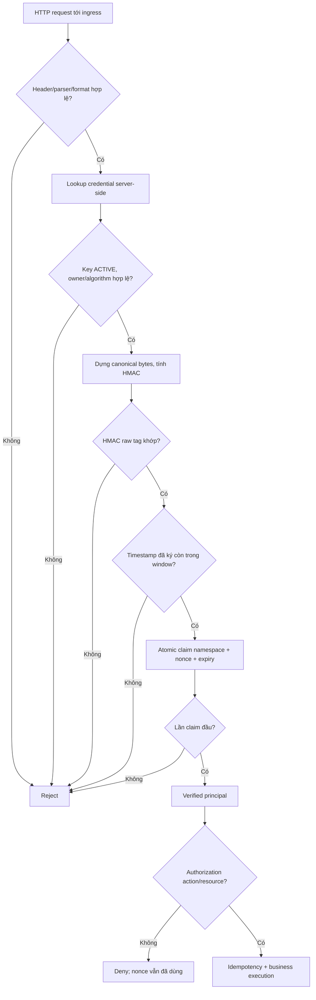
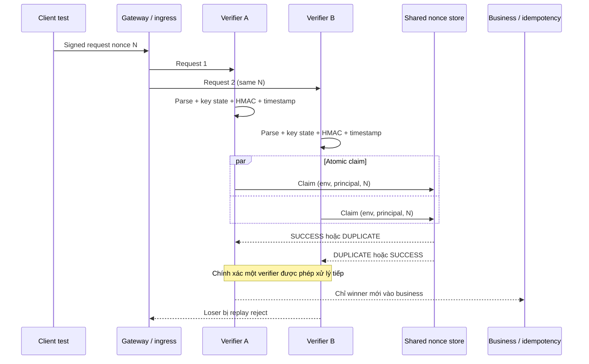

# Kiểm thử nonce

## 1. Kiểm thử nonce để chứng minh điều gì?

Một HTTP request có thể mang **HMAC hợp lệ** nhưng vẫn không nên được thực thi lần thứ hai. Khi attacker sao chép nguyên method, URI, headers, body và chữ ký của một request đã gửi, server vẫn tính lại cùng HMAC tag. Nếu hệ thống chỉ kiểm tra signature, bản sao ấy có thể dẫn tới **replay attack**, đặc biệt nguy hiểm với thanh toán, tạo đơn hàng, đổi quyền hoặc chuyển tiền.

Trong module `SECURITY_AUTHENTICATION_HMAC_REQUEST_AUTHENTICATION`, một request được ký bằng shared secret trên **canonical request** chứa method, URI, signed headers và body digest; server xác minh HMAC, kiểm tra timestamp/nonce, quản lý key rotation, đi qua gateway/proxy và tách biệt xác thực với phân quyền. Bài **Kiểm thử nonce** thuộc chương **Nonce** tập trung vào việc tạo ra **bằng chứng kiểm thử** rằng cơ chế chống replay thực sự hoạt động trên toàn hệ thống phân tán, không chỉ trên một class Java.

Giả sử API nhận:

```http
POST /v1/payments?currency=VND HTTP/1.1
Host: api.example.test
Content-Type: application/json
X-Client-Id: merchant-42
X-Key-Id: key-2026-b
X-Timestamp: 1790000015
X-Nonce: AAECAwQFBgcICQoLDA0ODw
X-Idempotency-Key: payment-701
X-Signature: <base64url-hmac-sha256>

{"paymentId":"p-701","amount":120000}
```

`X-Nonce` là một giá trị duy nhất cho request. Nó được đưa vào **dữ liệu ký**, và server phải ghi nhận lần sử dụng đầu tiên sau khi HMAC và timestamp hợp lệ. Những lần sử dụng lại cùng nonce trong phạm vi đã định phải bị từ chối.

**Điểm mấu chốt của bài:** kiểm thử nonce không phải chỉ viết `assert nonce1 != nonce2`. Phải kiểm tra **nơi tạo nonce, nonce có được ký không, khóa lưu replay được scope thế nào, insert có nguyên tử không, TTL có bao phủ toàn cửa sổ không, chính sách lỗi có fail-closed không, và nhiều replica có hành xử nhất quán không**.

Mục tiêu học tập:

- Viết các **security invariants** cho nonce: duy nhất, khó đoán, đúng format, được ký, claim sau MAC, lưu đến hết cửa sổ.
- Sinh nonce **128 bit bằng CSPRNG** và mã hóa Base64url không padding thành **22 ký tự ASCII**; phân biệt dữ liệu fixture cố định với nonce production.
- Kiểm thử duplicate headers, noncanonical encoding, signed nonce tampering, replay nguyên request và reuse nonce với **request mới được ký lại**.
- Xây `NonceStore.claim` kiểu **atomic insert-if-absent** và kiểm thử race với hàng chục request đồng thời, nhiều verifier.
- Kiểm chứng **namespace theo environment + verified client**, không vô tình reset replay protection khi key rotation.
- Tính TTL khi cửa sổ timestamp **bất đối xứng** (quá khứ 300 giây, tương lai 30 giây), có thêm safety margin.
- Phân biệt replay rejection, idempotency của nghiệp vụ, key compromise và authorization failure.
- Tạo Java 17 lab với `Clock` inject được, test vector mật mã độc lập, concurrency test và bài thực hành theo mức độ ưu tiên.

## 2. Nonce nằm ở đâu trong threat model?

### 2.1. Nonce không phải secret và không phải chữ ký

Nonce (*number used once*) là một giá trị dùng để xác định **một lần sử dụng**. Trong giao thức HMAC request, nonce thường không cần bí mật nhưng phải **khó đoán** và có xác suất trùng đủ nhỏ.

| Thành phần | Vai trò | Có đủ chống replay không? |
| --- | --- | --- |
| HMAC-SHA256 tag | Chứng minh request bytes gắn với shared secret | **Không**, bản sao có tag y hệt |
| Timestamp đã ký | Giới hạn khoảng thời gian một request có thể hợp lệ | **Không**, replay trong cửa sổ vẫn qua |
| Nonce đã ký + atomic replay store | Chặn nonce được dùng hơn một lần trong phạm vi policy | **Có**, nếu TTL/scope/atomicity đúng |
| Idempotency key đã ký | Ngăn nghiệp vụ thực hiện lặp cùng thao tác logic | **Khác nonce**; hỗ trợ retry an toàn |
| Authorization | Xác minh principal có quyền làm action/resource | Không thay nonce hoặc HMAC |
| TLS | Chống nghe lén/chỉnh sửa trên đường truyền được bảo vệ | Không thay replay state ở application |

Nonce không phải là mật khẩu, không thể dùng riêng nonce để xác thực. Request có `X-Nonce` đúng regex nhưng HMAC sai **không được claim**, vì attacker có thể làm đầy replay store hoặc chiếm nonce của client thật.

### 2.2. Invariants cần viết thành test

Một hệ thống production nên có ít nhất tám điều kiện bất biến:

1. **Sinh đúng:** client tạo nonce bằng CSPRNG, đủ entropy, không dùng counter công khai, timestamp đơn thuần hay `Random` có seed dự đoán được.
2. **Đọc đúng:** HTTP parser cung cấp **một** signed `X-Nonce`; duplicate khác case, CR/LF hoặc encoding không canonical bị từ chối.
3. **Ký đúng:** chính nonce được sử dụng cho claim phải nằm trong canonical HMAC input; sửa nonce mà giữ tag cũ khiến xác minh thất bại.
4. **Claim đúng lúc:** chỉ ghi replay state sau **MAC hợp lệ và timestamp nằm trong cửa sổ**.
5. **Claim nguyên tử:** với cùng replay key còn hiệu lực, **tối đa một** thao tác claim thành công, kể cả trên nhiều thread/replica.
6. **Scope đúng:** cùng nonce của một verified client phải bị từ chối qua các key IDs của client trong cùng environment; client khác có thể có nonce trùng mà không gây false positive nếu policy cho phép.
7. **Giữ đủ lâu:** replay record sống **qua thời điểm cuối** mà timestamp của request có thể được chấp nhận, kể cả skew tương lai và margin.
8. **Fail-closed:** nếu không thể xác nhận nonce chưa được dùng, request nhạy cảm không được thực thi.

Không nên đánh đồng “tối đa một claim” với “chắc chắn một business execution đã thành công”: service có thể chết **sau khi claim nhưng trước khi commit giao dịch**. Retry cần **nonce mới được ký lại** và **idempotency key ổn định**, không cố cho nonce cũ đi qua.

### 2.3. Ba kiểu replay cần test riêng

**R1 — Replay nguyên request:**

```text
POST /v1/payments + timestamp T + nonce N + body B + tag S
                         ↓ sao chép nguyên bản
POST /v1/payments + timestamp T + nonce N + body B + tag S
```

HMAC đúng ở cả hai; nonce store phải từ chối bản sao sau lần claim đầu.

**R2 — Re-sign nội dung mới nhưng giữ nonce cũ:**

```text
Request 1: nonce N, amount=120000, HMAC S1 -> đã claim N
Request 2: nonce N, amount=130000, HMAC S2 -> phải từ chối nonce N
```

Cả hai MAC có thể đúng. Chỉ so toàn bộ signature/request hash để phát hiện replay là chưa đủ: nếu policy nonce là một lần trên mỗi client, **cùng N không được dùng cho request khác**.

**R3 — Replay qua hai key/replica:**

```text
Verifier A: client=merchant-42, keyId=key-2026-a, nonce=N
Verifier B: client=merchant-42, keyId=key-2026-b, nonce=N
```

Nếu dùng replay key theo `(clientId,keyId,nonce)`, rotation có thể tạo hai namespace cho cùng principal. Hợp đồng ví dụ này dùng `(environment,verifiedClientId,nonce)`; test phải phát hiện key đổi mà nonce cũ vẫn được nhận.

## 3. Nonce generator: độ ngẫu nhiên, format và thử nghiệm

### 3.1. Sinh 128 bit bằng SecureRandom

Một nonce ngẫu nhiên **16 byte = 128 bit** có không gian 2^128 khả năng, phù hợp với nhiều API khi generator an toàn và không có thiên lệch lớn. Ta chọn Base64url **không padding** làm representation để chở an toàn qua HTTP headers.

```java
import java.security.SecureRandom;
import java.util.Base64;

public final class NonceGeneratorV1 {
    private static final SecureRandom RANDOM = new SecureRandom();

    private NonceGeneratorV1() {}

    public static String newNonce() {
        byte[] bytes = new byte[16];
        RANDOM.nextBytes(bytes);
        return Base64.getUrlEncoder().withoutPadding()
            .encodeToString(bytes);
    }

    public static void main(String[] args) {
        String nonce = newNonce();
        if (nonce.length() != 22) {
            throw new AssertionError("Unexpected nonce encoding length");
        }
        System.out.println(nonce); // Chỉ log trong lab, không log rộng rãi.
    }
}
```

**Không dùng:**

```java
// Không dùng bộ sinh không đủ an toàn cho nonce chống replay.
String nonce = Long.toString(System.currentTimeMillis());
String nonce = String.valueOf(new java.util.Random().nextLong());
String nonce = "0000000000000000000000";
```

Hệ thống có thể dùng counter **nếu** protocol thiết kế counter monotonic có trạng thái chống trùng và ràng buộc credential/khởi tạo đúng; nhưng counter dễ đoán và có vấn đề qua reset/horizontal scale. Trong bài này, **chính sách nonce 128-bit ngẫu nhiên** được dùng để giảm nguy cơ trùng và dễ liên thông SDK.

### 3.2. Vì sao 16 byte thành 22 ký tự?

Base64 mã hóa 3 byte thành 4 ký tự. Với 16 byte:

```text
Raw nonce: 16 bytes = 128 bits
Padded Base64 length = 4 * ceil(16/3) = 24 characters
16 mod 3 = 1 -> Base64 có hai '=' padding ở cuối
Base64url no-padding = 24 - 2 = 22 characters
```

Fixture công khai của bài:

```text
Nonce raw bytes (hex): 000102030405060708090a0b0c0d0e0f
Nonce Base64url no padding: AAECAwQFBgcICQoLDA0ODw
Encoded length: 22
```

**Chỉ dùng nonce này trong test.** Vì ai cũng biết, nó không đại diện cho entropy production. Test vector cố định giúp so HMAC và wire format; request thật cần `SecureRandom` tạo mới cho mỗi lần ký.

### 3.3. Validate nonce nghiêm ngặt ở server

Hợp đồng V1 quy định nonce là **16 byte được encode bằng Base64url không padding**, không phải chuỗi tự do chỉ “đủ dài”.

Thuật toán server:

1. Yêu cầu chính xác 22 ký tự từ alphabet `[A-Za-z0-9_-]`.
2. **Không** chấp nhận dấu `=`, `+`, `/`, whitespace, CR/LF, non-ASCII hoặc Unicode lookalikes.
3. Decode Base64url thành **đúng 16 byte**.
4. Encode ngược bằng Base64url no-padding và yêu cầu trùng **chính xác** với input, để loại alias không canonical (unused pad bits).
5. Dùng chính **16 raw bytes** đó trong replay-key derivation hoặc dùng representation canonical duy nhất — không form-decode thêm lần nữa.

Với nonce fixture kết thúc bằng `w`, một decoder lỏng có thể decode giá trị kết thúc bằng `x` về cùng 16 byte do các bit không được sử dụng ở ký tự cuối; nhưng **giao thức phải reject noncanonical alias**. Không được để verifier và Redis dùng hai cách ghi cùng nonce khác nhau.

```java
import java.util.Base64;

public static byte[] decodeNonceV1(String text) {
    if (text == null || !text.matches("[A-Za-z0-9_-]{22}")) {
        throw new IllegalArgumentException("Invalid nonce format");
    }
    final byte[] raw;
    try {
        raw = Base64.getUrlDecoder().decode(text);
    } catch (IllegalArgumentException malformed) {
        throw new IllegalArgumentException("Malformed nonce", malformed);
    }
    if (raw.length != 16
            || !Base64.getUrlEncoder().withoutPadding()
                .encodeToString(raw).equals(text)) {
        throw new IllegalArgumentException("Noncanonical nonce");
    }
    return raw;
}
```

### 3.4. Có nên test “nonce generator không bao giờ trùng”?

Không thể chứng minh tuyệt đối bằng một unit test rằng random generator sẽ **không bao giờ** tạo collision, vì một generator ngẫu nhiên hữu hạn vẫn có xác suất trùng. Công thức birthday approximation cho `n` nonce 128-bit độc lập:

\[
P(\text{collision}) \approx \frac{n(n-1)}{2^{129}}
\]

Khi `n = 10^9`, xác suất xấp xỉ 1.47×10^-21 (giả sử các nonce thật sự đều và độc lập). Đây là xác suất rất nhỏ, **không phải 0**.

Thử nghiệm hữu ích:

- Kiểm tra `SecureRandom` và byte length chính xác, Base64url format canonical.
- Sinh hàng nghìn nonce trong test smoke và xem có trùng hay không, nhưng **không coi “không trùng trong test” là chứng cứ CSPRNG an toàn**.
- Kiểm tra không seed cố định hay tái sử dụng state sai sau khởi động lại/chuyển process.
- Kiểm tra không chứa client ID, timestamp, secret hoặc dữ liệu cá nhân trong nonce một cách có thể suy ngược.

Nếu `SecureRandom` hoặc nguồn entropy không khả dụng, không thay bằng `Random` để giữ hệ thống tiếp tục ký request nhạy cảm.

## 4. Nonce phải được ký: hợp đồng HTTP-HMAC-NONCE-TEST-V1

Để viết test tái lập, bài dùng hợp đồng **`HTTP-HMAC-NONCE-TEST-V1`** do lab định nghĩa; đây không phải chuẩn HMAC HTTP chung của mọi sản phẩm.

### 4.1. Signed components và singleton headers

Request lab là `POST /v1/payments?currency=VND` trên authority `api.example.test`, với body JSON exact bytes. Các signed headers:

| Header | Giá trị fixture | Policy |
| --- | --- | --- |
| `Content-Type` | `application/json` | Bắt buộc, đúng một occurrence |
| `X-Client-Id` | `merchant-42` | Opaque ID, đúng một occurrence |
| `X-Key-Id` | `key-2026-b` | Chọn credential candidate, được ký |
| `X-Timestamp` | `1790000015` | Unix epoch seconds dạng canonical |
| `X-Nonce` | `AAECAwQFBgcICQoLDA0ODw` | Base64url 22 ký tự, raw 16 byte |
| `X-Idempotency-Key` | `payment-701` | Được ký; dùng riêng cho nghiệp vụ |
| `X-Signature` | Tag Base64url 43 ký tự | Không nằm trong signed input, nhưng phải validate duplicate/format |

Quy tắc:

1. Tên HTTP header là token ASCII và **case-insensitive**; normalize lowercase ASCII. **Giá trị** nonce, ID và signature **case-sensitive**.
2. Từ chối missing/duplicate case-insensitive signed fields **trước khi framework/proxy coalesce**. Trùng cùng value vẫn reject.
3. Adapter phải xử lý OWS cú pháp đúng với HTTP version; semantic values trong contract không có SP/HTAB và không được tự trim CR/LF để “sửa” input.
4. Timestamp và nonce **đều là input của HMAC**; thay bất kỳ trường nào khi giữ tag cũ phải làm HMAC mismatch hoặc validation reject.
5. External authority là giá trị ingress đáng tin, không đọc từ `X-Forwarded-Host` do caller tự khai; raw path/query phải được lấy tại điểm ký/xác minh nhất quán.
6. Body SHA-256 tính trên **exact bytes** sau HTTP transfer framing, trước JSON reserialization. Hợp đồng fixture dùng identity content coding.
7. Signature có full HMAC-SHA256 tag 32 byte, Base64url no-padding đúng 43 ký tự; strict decoder yêu cầu re-encode trùng.
8. Version và thứ tự dòng cố định; phương thức signer/verifier không tự thêm LF cuối.
9. Key ID chỉ chọn secret **từ trusted credential store**, không tự chứng minh client sở hữu key. Principal được gán sau HMAC, freshness và nonce claim.
10. Những header khác có ý nghĩa đối với authorization/nguồn tiền/tài khoản phải được ký hoặc bảo vệ bằng một trust boundary tương đương.

### 4.2. Canonical request chính xác 12 dòng

```text
HTTP-HMAC-NONCE-TEST-V1
POST
/v1/payments
currency=VND
authority:api.example.test
content-type:application/json
x-client-id:merchant-42
x-key-id:key-2026-b
x-timestamp:1790000015
x-nonce:AAECAwQFBgcICQoLDA0ODw
x-idempotency-key:payment-701
2bf71af6acc4b2f2420c473cc7176fccc6c9535544458683201a06cdf300cdd3
```

Các dòng nối bằng LF byte `0x0A`, **không LF cuối**, UTF-8; tổng cộng **304 byte**. Dòng cuối là SHA-256 lowercase hex của body:

```json
{"paymentId":"p-701","amount":120000}
```

JSON body fixture **không** có newline cuối. Header `X-Signature` là **kết quả**, không tự xuất hiện trong 12 dòng vì sẽ tạo phụ thuộc vòng tròn.

### 4.3. Golden HMAC vector độc lập

Dùng key test công khai 32 byte `00` đến `1f`:

```text
Test key hex:
000102030405060708090a0b0c0d0e0f101112131415161718191a1b1c1d1e1f

Nonce raw bytes:
000102030405060708090a0b0c0d0e0f
Nonce Base64url:
AAECAwQFBgcICQoLDA0ODw

Body SHA-256:
2bf71af6acc4b2f2420c473cc7176fccc6c9535544458683201a06cdf300cdd3

Canonical request: 12 lines, 304 UTF-8 bytes, LF, no trailing LF

Raw HMAC-SHA256 tag hex (32 bytes):
19e5e130a063cf0e2071d6dea2ac8d005a7532c9ad81f496380146d77da04ada

Base64url HMAC tag, no padding (43 characters):
GeXhMKBjzw4gcdbeoqyNAFp1MsmtgfSWOAFG132gSto
```

Golden vector được tính độc lập bằng SHA-256/HMAC-SHA256 trên byte input đã công bố. Chỉ dùng để kiểm tra **canonicalization, HMAC và encoding**, không lấy timestamp `1790000015` làm “giờ hiện tại” thực tế. Test replay/freshness dùng `Clock.fixed` hoặc timestamp mới được ký lại.

**Vì sao phải test HMAC cùng nonce?** Nếu signer và verifier vô tình **quên đưa nonce vào canonical bytes**, hai bên vẫn có thể xác minh chữ ký cho nhau. Golden vector có cả dòng `x-nonce:...` giúp phát hiện lỗi ấy, còn tampering test thay nonce nhưng giữ tag phải thất bại.

## 5. Replay store: scope, tính nguyên tử và vòng đời

### 5.1. Replay key phải dựa trên principal đã xác thực

Policy V1:

```text
replayKey = (environment, verifiedClientId, rawNonceBytes)
```

Trong đó `verifiedClientId` đến từ **credential đã được xác minh**, không phải một giá trị role/principal do caller tự đặt. Khi client có hai key IDs đang cùng ACTIVE trong rotation, **reuse nonce giữa hai keys vẫn bị từ chối**.

Các trường không nên đưa vào replay key **nếu mục tiêu là nonce dùng một lần cho mọi request của client**:

- `keyId`: khiến cùng nonce đi qua hai key khác nhau thành hai bản ghi.
- `HTTP method`: cho phép reuse nonce cho GET và POST.
- `URI/path`: cho phép cùng nonce ở endpoint khác.
- `bodyHash` hoặc `signature`: chỉ chặn replay nguyên văn, không chặn **re-sign một request mới với cùng nonce**.
- `timestamp`: client có thể ký lại nonce cũ với timestamp mới và né replay store.

**Lưu ý phạm vi:** Một hệ thống khác có thể thiết kế nonce theo access token/key version, nhưng phải công bố policy và test cross-key/cross-tenant rõ ràng. Không có một replay-key tuple mặc định cho mọi chuẩn.

### 5.2. Atomic claim là điều kiện bắt buộc

Hai request đồng thời cần hành vi:

```text
claim(principal, nonce):
  if record absent: create with expiry; return SUCCESS
  else: return DUPLICATE

Concurrent calls with same key:
  exactly one SUCCESS, all others DUPLICATE
```

Pseudocode sai:

```text
if (!store.exists(key)) {
    store.set(key, expiration)
    return OK
}
return REPLAY
```

Hai replica có thể cùng nhìn thấy “chưa có” trước khi cả hai `set`. Đây là **time-of-check/time-of-use race**.

Các cách triển khai có thể phù hợp:

- **Redis**: thao tác atomic `SET key value NX PX ttlMilliseconds` hoặc tương đương. Kết quả chỉ là success nếu key chưa tồn tại; TTL đi kèm lệnh ghi.
- **Relational database**: bảng nonce có unique constraint trên replay key và atomic `INSERT`; conflict nghĩa là nonce đã dùng, không phải query `SELECT` rồi `INSERT`.
- **Distributed KV store**: conditional put/compare-and-set có tính tuyến tính hóa theo key, được kiểm tra semantics khi failover.

Chọn công nghệ nào cũng phải hiểu **consistency** và hành vi khi failover/replication lag. Một cache “eventually consistent” cho phép hai writer cùng chấp nhận nonce không đáp ứng invariant at-most-one.

### 5.3. Nonce claim phải nằm sau MAC và timestamp



Từ chối request HMAC sai **không được ghi replay state**. Nếu cho phép claim trước MAC, attacker không có secret có thể đoán/lấy nonce từ log rồi chiếm trước nó, khiến request thật bị chặn.

Từ chối request timestamp quá cũ/quá xa tương lai cũng **không nên claim nonce** trong V1. Trong cửa sổ tương lai được phép, một request ban đầu quá sớm có thể trở nên hợp lệ khi clock tiến lên; khi nó được nhận lần đầu, nonce được claim.

Khi authorization thất bại **sau khi** authn và nonce claim thành công, nonce vẫn được coi là đã sử dụng. Không rollback nonce chỉ vì `403` — tránh biến một request đã xác thực thành đối tượng có thể được phát lại vô hạn.

### 5.4. Lỗi sau khi claim: không nhầm nonce với idempotency

Một request thanh toán claim thành công, nhưng service crash trước khi commit. Client gửi lại đúng request (cùng nonce) sẽ bị replay store từ chối. Điều này **không** cho biết thanh toán đã thành công hay thất bại.

Thiết kế retry:

1. Client giữ **`X-Idempotency-Key: payment-701`** ổn định cho cùng intent.
2. Client tạo **nonce mới, timestamp mới, HMAC mới** khi retry.
3. Server xác thực request mới và claim nonce mới.
4. Tầng nghiệp vụ kiểm tra idempotency key đã được ràng buộc với principal và request intent/payload. Nếu giao dịch đã hoàn tất, trả kết quả có kiểm soát mà **không charge lần hai**.

Nonce bảo đảm **một lần sử dụng giá trị xác thực**, idempotency bảo đảm **một lần thực hiện hiệu ứng nghiệp vụ**. Hai lớp có chức năng khác nhau và cần test độc lập.

## 6. TTL nonce: phép thử dễ bỏ sót nhất

### 6.1. Cửa sổ timestamp bất đối xứng

Hợp đồng bài này chấp nhận:

```text
pastTolerance   = 300 seconds
futureTolerance = 30 seconds
safetyMargin    = 60 seconds

serverNow - 300 <= signedTimestamp <= serverNow + 30
```

Timestamp là **Unix epoch seconds UTC** dạng thập phân canonical. Đây là chính sách minh họa; production cần chọn past/future skew theo threat model và trạng thái đồng bộ NTP.

Với request đã ký tại `ts`, thời điểm server sớm nhất và muộn nhất mà timestamp có thể được nhận:

```text
earliestAcceptedNow = ts - futureTolerance
latestAcceptedNow   = ts + pastTolerance
```

Một nonce đã claim **ở đầu** khoảng này phải được nhớ cho tới **sau cuối** khoảng. Vì vậy TTL không chỉ là “300 giây kể từ khi claim”.

### 6.2. Công thức expiration đúng

Giả sử policy thêm 60 giây safety margin:

\[
\text{expiresAt}=\text{signedTs}+\text{pastTolerance}+\text{safetyMargin}
\]

\[
\text{ttlAtClaim}=\max(1,\text{expiresAt}-\text{trustedNow})
\]

Trong production nên dùng expiry chính xác **vượt qua thời điểm cuối hợp lệ**, có margin cho clock skew giữa replicas/nonce backend, scheduling và độ trễ. Với seconds, nếu TTL được áp ở millisecond cần làm tròn/giữ margin phù hợp.

Fixture:

```text
signedTs        = 1790000015
trustedNow      = 1790000000  (+15 seconds future)
latestAccepted  = 1790000015 + 300 = 1790000315
expiresAt       = 1790000315 + 60  = 1790000375
ttlAtClaim      = 375 seconds

Nếu claim ở rìa sớm nhất (now = 1789999985):
ttlAtClaim      = 390 seconds
```

**Một TTL cố định 300 giây kể từ claim ở rìa sớm nhất là sai**: replay record sẽ biến mất ở `1790000285` nhưng signed timestamp vẫn có thể được chấp nhận đến `1790000315`.

### 6.3. TTL và replay state sau expiration

Khi thời gian server thật sự đi qua `ts+pastTolerance`, request đó đã **quá cũ**. Nonce record có thể được thu dọn sau expiration kèm margin; dù attacker gửi lại request cũ lúc này, timestamp check cũng phải reject.

Đừng “gia hạn vô hạn” nonce khi nhận duplicate: attacker có thể spam làm store phình to. Nếu dùng TTL update, phải có chính sách rõ, nhưng V1 giữ **expiry từ timestamp đã ký** chứ không làm mới `expiresAt` theo mỗi lần replay.

Nếu shared nonce store bị mất record sớm do restart, eviction hoặc failover mất dữ liệu, **timestamp đang còn hợp lệ** vẫn có thể được chấp nhận lại. Đây là lỗi bảo đảm replay; cần persistence/consistency thích hợp và test failover, không chỉ test lệnh `SET NX` trên một Redis node bình thường.

### 6.4. Tránh xung đột replay key và rò rỉ telemetry

Ví dụ logical key:

```text
namespace=(env="prod", client="merchant-42")
nonceBytes=(16 bytes)
key=(env, client, nonceBytes)
```

Khi chuyển tuple thành chuỗi key Redis, phải dùng **encoding không mơ hồ** (length-prefix hoặc canonical serialization) để không tạo collision giữa những thành phần. Có thể dùng digest/fingerprint của tuple trong key nếu thiết kế namespace, cardinality và collision risk phù hợp; **không ghi secret** vào Redis key hoặc log.

Nonce ngẫu nhiên không nhất thiết là dữ liệu bí mật, nhưng log toàn bộ nonce, request đã ký và signature có thể giúp replay khi các lớp khác sai. Chỉ log mã lỗi, trace ID, key ID có giới hạn và fingerprint bảo vệ theo policy.

## 7. Hướng tiếp cận test: tách năm lớp

Thay vì một integration test lớn khó xác định lỗi, hãy chia:

| Lớp | Phải chứng minh | Ví dụ |
| --- | --- | --- |
| **Generator/codec** | 16 raw bytes, Base64url 22 ký tự canonical, SecureRandom | `decode(encode(raw)) == raw` |
| **HMAC binding** | Nonce nằm trong signed canonical request | Đổi nonce giữ tag → fail |
| **Replay store** | Atomic insert-if-absent + expiry + namespace | Hai threads cùng key → một winner |
| **Verifier pipeline** | Chỉ claim sau MAC và freshness; fail-closed | Bad MAC không làm nonce bị chiếm |
| **Distributed integration** | Nhiều replicas, gateway, rotation, storage failover | Replay qua hai zones vẫn chỉ một claim |

Mỗi test cần assertion về **cả kết quả lẫn side effects**: không chỉ “401”, mà còn “nonce store không bị gọi” hoặc “business handler được gọi tối đa một lần”.

**Test data nên chứa:**

- Hai clients: `merchant-42` và `merchant-73`.
- Hai key IDs ACTIVE cho cùng `merchant-42` trong giai đoạn rotation, một key `REVOKED`.
- Một nonce golden fixture và nhiều nonce CSPRNG thực sự sinh trong test.
- Một `Clock.fixed` và các clock biên `ts−30`, `ts+300`, ngoài biên 1 giây.
- Shared replay store có thể kiểm thử atomicity, TTL và lỗi hạ tầng; một store mô phỏng chỉ dùng cho unit tests.
- Idempotency store/side effect counter riêng để xác nhận giao dịch không được thực thi lặp.

Trong phần tiếp theo sẽ có hai class Java 17: signer/verifier minh họa và nonce store mô phỏng có tính nguyên tử trong **một process**. Chúng giúp học cách test nhưng **không phải** thay thế Redis/database/HTTP adapter production.

## 8. Java 17: một verifier có thể kiểm thử nonce đúng thứ tự

Đoạn code dưới đây gồm **validator header**, **nonce codec**, **canonicalizer**, **HMAC verifier** và **replay claim**. Class nhận `List<Header>` giữ từng occurrence, thay vì `Map<String,String>` có thể làm mất duplicate.

Đây là implementation lab Java 17 cho **đúng một route và hợp đồng đã nêu**. Production cần HTTP adapter tin cậy, secret manager, rate limiting, logging/redaction và nghiệp vụ riêng.

### 8.1. Class NonceHmacVerifierV1

```java
import java.nio.charset.StandardCharsets;
import java.security.GeneralSecurityException;
import java.security.MessageDigest;
import java.time.Clock;
import java.util.ArrayList;
import java.util.Base64;
import java.util.HashMap;
import java.util.HexFormat;
import java.util.List;
import java.util.Map;
import java.util.Optional;
import javax.crypto.Mac;
import javax.crypto.spec.SecretKeySpec;

public final class NonceHmacVerifierV1 {
    private static final String VERSION = "HTTP-HMAC-NONCE-TEST-V1";
    private static final String ALGORITHM = "HmacSHA256";
    private static final long PAST_SECONDS = 300L;
    private static final long FUTURE_SECONDS = 30L;
    private static final long EXPIRY_MARGIN = 60L;

    private static final List<String> REQUIRED = List.of(
        "content-type", "x-client-id", "x-key-id",
        "x-timestamp", "x-nonce", "x-idempotency-key",
        "x-signature"
    );

    public record Header(String name, String value) {}

    public record Request(
        String method, String rawPath, String rawQuery,
        String trustedAuthority, List<Header> occurrences,
        byte[] exactBodyBytes
    ) {}

    public record SignedFields(
        String contentType, String clientId, String keyId,
        String timestamp, String nonce, String idempotencyKey,
        String signature
    ) {}

    public record Credential(
        String ownerClientId, String keyId, String algorithm,
        boolean active, long notBefore, long expiresAt,
        byte[] sharedSecret
    ) {}

    public record VerifiedPrincipal(String clientId) {}

    public interface CredentialStore {
        Optional<Credential> find(
            String environment, String clientId, String keyId);
    }

    public interface NonceStore {
        // Phải triển khai bằng atomic insert-if-absent trên shared store.
        // Trả false nếu nonce đã tồn tại; lỗi hạ tầng phải fail-closed.
        boolean claim(
            String environment, String verifiedClientId,
            byte[] rawNonce, long expiresAtEpochSeconds);
    }

    private NonceHmacVerifierV1() {}

    private static String lowercaseHttpToken(String name) {
        if (name == null || name.isEmpty() || name.length() > 128) {
            throw new IllegalArgumentException("Bad header name length");
        }
        String punctuation = "!#$%&'*+-.^_`|~";
        StringBuilder out = new StringBuilder();
        for (int i = 0; i < name.length(); i++) {
            char c = name.charAt(i);
            boolean upper = c >= 'A' && c <= 'Z';
            boolean lower = c >= 'a' && c <= 'z';
            boolean digit = c >= '0' && c <= '9';
            if (!upper && !lower && !digit
                    && punctuation.indexOf(c) < 0) {
                throw new IllegalArgumentException("Bad HTTP field token");
            }
            out.append(upper ? (char) (c + 32) : c);
        }
        return out.toString();
    }

    public static SignedFields readSignedFields(
            List<Header> occurrences) {
        if (occurrences == null || occurrences.size() > 100) {
            throw new IllegalArgumentException("Too many headers");
        }
        Map<String, String> values = new HashMap<>();
        for (Header h : occurrences) {
            if (h == null) throw new IllegalArgumentException("Null header");
            String name = lowercaseHttpToken(h.name());
            if (!REQUIRED.contains(name)) continue;

            // Semantic value đã được HTTP parser xử lý framing OWS.
            // Chỉ cho phép visible ASCII, không SP/HTAB/CR/LF.
            String value = h.value();
            if (value == null || value.isEmpty()
                    || value.length() > 1024) {
                throw new IllegalArgumentException("Bad header value");
            }
            for (int i = 0; i < value.length(); i++) {
                char c = value.charAt(i);
                if (c < 0x21 || c > 0x7e) {
                    throw new IllegalArgumentException(
                        "Control/space in signed header");
                }
            }
            if (values.putIfAbsent(name, value) != null) {
                throw new IllegalArgumentException(
                    "Duplicate signed header: " + name);
            }
        }

        for (String required : REQUIRED) {
            if (!values.containsKey(required)) {
                throw new IllegalArgumentException(
                    "Missing header: " + required);
            }
        }
        if (!"application/json".equals(values.get("content-type"))) {
            throw new IllegalArgumentException("Bad Content-Type");
        }
        for (String name : List.of(
                "x-client-id", "x-key-id", "x-idempotency-key")) {
            if (!values.get(name).matches("[A-Za-z0-9._-]{1,64}")) {
                throw new IllegalArgumentException("Invalid identifier");
            }
        }
        String time = values.get("x-timestamp");
        if (!time.matches("[1-9][0-9]{0,18}")) {
            throw new IllegalArgumentException("Bad timestamp");
        }
        try {
            Long.parseLong(time);
        } catch (NumberFormatException invalid) {
            throw new IllegalArgumentException("Timestamp overflow", invalid);
        }

        // Strict nonce format chỉ cho 16 bytes ngẫu nhiên Base64url.
        strictDecodeNonce(values.get("x-nonce"));

        // Strict signature encoding, full 32-byte HMAC-SHA256.
        strictDecodeTag(values.get("x-signature"));

        return new SignedFields(
            values.get("content-type"),
            values.get("x-client-id"),
            values.get("x-key-id"),
            time,
            values.get("x-nonce"),
            values.get("x-idempotency-key"),
            values.get("x-signature")
        );
    }

    public static byte[] strictDecodeNonce(String nonce) {
        if (nonce == null || !nonce.matches("[A-Za-z0-9_-]{22}")) {
            throw new IllegalArgumentException("Bad 128-bit nonce");
        }
        final byte[] bytes;
        try {
            bytes = Base64.getUrlDecoder().decode(nonce);
        } catch (IllegalArgumentException bad) {
            throw new IllegalArgumentException("Malformed nonce", bad);
        }
        String reencoded = Base64.getUrlEncoder().withoutPadding()
            .encodeToString(bytes);
        if (bytes.length != 16 || !reencoded.equals(nonce)) {
            throw new IllegalArgumentException("Noncanonical nonce");
        }
        return bytes;
    }

    public static byte[] strictDecodeTag(String tag) {
        if (tag == null || !tag.matches("[A-Za-z0-9_-]{43}")) {
            throw new IllegalArgumentException("Bad HMAC tag encoding");
        }
        final byte[] bytes;
        try {
            bytes = Base64.getUrlDecoder().decode(tag);
        } catch (IllegalArgumentException bad) {
            throw new IllegalArgumentException("Malformed HMAC tag", bad);
        }
        String reencoded = Base64.getUrlEncoder().withoutPadding()
            .encodeToString(bytes);
        if (bytes.length != 32 || !reencoded.equals(tag)) {
            throw new IllegalArgumentException("Noncanonical MAC tag");
        }
        return bytes;
    }

    public static byte[] canonicalBytes(
            Request request, SignedFields f)
            throws GeneralSecurityException {
        if (request == null || f == null
                || request.exactBodyBytes() == null
                || request.exactBodyBytes().length > 1_048_576
                || !"POST".equals(request.method())
                || !"/v1/payments".equals(request.rawPath())
                || !"currency=VND".equals(request.rawQuery())
                || !"api.example.test".equals(
                    request.trustedAuthority())) {
            throw new IllegalArgumentException(
                "Unsupported method/URI/body/authority");
        }

        byte[] digest = MessageDigest.getInstance("SHA-256")
            .digest(request.exactBodyBytes());
        String bodyHash = HexFormat.of().formatHex(digest);

        String canonical = String.join("\n",
            VERSION,
            request.method(),
            request.rawPath(),
            request.rawQuery(),
            "authority:" + request.trustedAuthority(),
            "content-type:" + f.contentType(),
            "x-client-id:" + f.clientId(),
            "x-key-id:" + f.keyId(),
            "x-timestamp:" + f.timestamp(),
            "x-nonce:" + f.nonce(),
            "x-idempotency-key:" + f.idempotencyKey(),
            bodyHash
        );
        return canonical.getBytes(StandardCharsets.UTF_8);
    }

    private static byte[] computeMac(
            byte[] secret, byte[] canonical)
            throws GeneralSecurityException {
        if (secret == null || secret.length < 32) {
            throw new IllegalStateException(
                "Stored HMAC secret missing or weak");
        }
        Mac mac = Mac.getInstance(ALGORITHM);
        mac.init(new SecretKeySpec(secret, ALGORITHM));
        return mac.doFinal(canonical);
    }

    public static String signForTest(
            Request request, byte[] secret)
            throws GeneralSecurityException {
        SignedFields f = readSignedFields(request.occurrences());
        byte[] input = canonicalBytes(request, f);
        return Base64.getUrlEncoder().withoutPadding()
            .encodeToString(computeMac(secret, input));
    }

    public static Optional<VerifiedPrincipal> verify(
            Request request,
            String environment,
            CredentialStore credentialStore,
            NonceStore nonceStore,
            Clock trustedClock
    ) throws GeneralSecurityException {
        // HTTP ingress cần reject duplicate/CRLF/oversize trước bước này.
        SignedFields f = readSignedFields(request.occurrences());
        byte[] receivedTag = strictDecodeTag(f.signature());
        byte[] input = canonicalBytes(request, f);

        // Các selector caller gửi CHƯA xác thực.
        Optional<Credential> record = credentialStore.find(
            environment, f.clientId(), f.keyId());
        if (record.isEmpty()) return Optional.empty();

        Credential c = record.get();
        long now = trustedClock.instant().getEpochSecond();
        if (!c.active()
                || !f.clientId().equals(c.ownerClientId())
                || !f.keyId().equals(c.keyId())
                || !ALGORITHM.equals(c.algorithm())
                || now < c.notBefore()
                || now >= c.expiresAt()) {
            return Optional.empty();
        }

        byte[] expectedTag = computeMac(c.sharedSecret(), input);
        if (!MessageDigest.isEqual(expectedTag, receivedTag)) {
            return Optional.empty();
        }

        long signedTs = Long.parseLong(f.timestamp());
        final long oldest, newest, nonceExpiry;
        try {
            oldest = Math.subtractExact(now, PAST_SECONDS);
            newest = Math.addExact(now, FUTURE_SECONDS);
            nonceExpiry = Math.addExact(
                signedTs, PAST_SECONDS + EXPIRY_MARGIN);
        } catch (ArithmeticException overflow) {
            throw new IllegalStateException(
                "Cannot safely evaluate time window", overflow);
        }
        if (signedTs < oldest || signedTs > newest) {
            return Optional.empty();
        }

        // Raw nonce dùng để claim là CHÍNH nonce có trong MAC input.
        // Không đưa keyId vào namespace vì client rotation vẫn là 1 scope.
        byte[] rawNonce = strictDecodeNonce(f.nonce());

        // Storage exception: không catch để bỏ qua replay protection.
        if (!nonceStore.claim(
                environment, c.ownerClientId(),
                rawNonce, nonceExpiry)) {
            return Optional.empty();
        }

        // Chưa authorize resource/action. Principal từ trusted credential.
        return Optional.of(new VerifiedPrincipal(c.ownerClientId()));
    }
}
```

### 8.2. Những điểm cần kiểm chứng ở ranh giới HTTP

Class chỉ kiểm tra các **occurrences do caller truyền qua adapter**. Nếu gateway/framework đưa ra `Map<String,String>` đã gộp hai `X-Nonce`, class không thể khôi phục thông tin; cần reject duplicate **trước khi coalesce**.

Adapter production phải kiểm tra `Host`/authority, Content-Length/Transfer-Encoding conflicts, body size, signed-header values, canonical URI/query và thứ tự middleware. Đặc biệt:

- Parser HTTP có thể loại OWS cú pháp sau dấu `:`; verifier không tự dùng `String.trim()` để nuốt CR/LF hoặc space bên trong semantic signed value.
- HTTP/2/3 thay đổi framing/tên header, nhưng cùng request hợp lệ phải tạo cùng **canonical components** theo contract.
- Không lấy `X-Verified-Client` hoặc `X-Original-Nonce` do caller ngoài tự khai làm principal hoặc replay state.
- `Signature` phải hiện diện đúng một occurrence; encode thành 43 ký tự Base64url, no-padding, re-encode canonical.
- `CredentialStore` thực tế phải scoped theo **deployment environment**, owner và key state; ví dụ record không mô tả toàn bộ KMS/cache invalidation.
- Exception từ JCA/KMS/nonce store là **lỗi xác minh**; fail-closed, không tự cho request qua.

### 8.3. Bảo đảm đúng thứ tự side effects

Mọi phép kiểm tra ở `verify` trước `nonceStore.claim` hoặc chỉ đọc dữ liệu, hoặc tính HMAC. Điều này có lợi cho test kiểu **spy**:

```text
Malformed nonce            -> reject, claimCount = 0
Missing/unknown key        -> reject, claimCount = 0
Bad HMAC                   -> reject, claimCount = 0
Future timestamp quá xa    -> reject, claimCount = 0
Valid HMAC + valid window  -> claimCount = 1
Second call same nonce     -> claimCount = 2, second claim returns false
```

Nhưng một request đã claim có thể bị authorization từ chối (`403`). Trong trường hợp đó, nonce **vẫn đã tiêu thụ** và không được rollback.

## 9. Java 17: mô phỏng nonce store nguyên tử trong một process

Dùng `ConcurrentHashMap.compute` giúp minh họa **một operation atomic cho cùng key**. Đây là **test double**, không phải giải pháp production đa replica. Không có TTL cleanup background, không persistence/failover, không thay thế Redis/DB có consistency bảo đảm.

```java
import java.time.Clock;
import java.util.Base64;
import java.util.concurrent.ConcurrentHashMap;

public final class InMemoryNonceStoreV1
        implements NonceHmacVerifierV1.NonceStore {

    private record ReplayKey(
        String environment, String clientId, String canonicalNonce) {}

    private record Entry(long expiresAtEpochSeconds) {}

    private final ConcurrentHashMap<ReplayKey, Entry> data =
        new ConcurrentHashMap<>();

    private final Clock clock;

    public InMemoryNonceStoreV1(Clock clock) {
        this.clock = clock;
    }

    @Override
    public boolean claim(
            String environment, String verifiedClientId,
            byte[] rawNonce, long expiresAtEpochSeconds) {
        long now = clock.instant().getEpochSecond();
        if (environment == null || environment.isEmpty()
                || verifiedClientId == null || verifiedClientId.isEmpty()
                || rawNonce == null || rawNonce.length != 16
                || expiresAtEpochSeconds <= now) {
            throw new IllegalStateException(
                "Invalid nonce store inputs or expiry");
        }

        String nonce = Base64.getUrlEncoder().withoutPadding()
            .encodeToString(rawNonce);
        ReplayKey key = new ReplayKey(
            environment, verifiedClientId, nonce
        );

        // candidate là object chỉ riêng call này tạo.
        Entry candidate = new Entry(expiresAtEpochSeconds);
        Entry stored = data.compute(key, (k, current) -> {
            if (current == null
                    || current.expiresAtEpochSeconds() <= now) {
                return candidate;
            }
            return current;
        });

        // Chỉ một caller đã ghi chính object candidate của mình.
        return stored == candidate;
    }
}
```

### 9.1. Vì sao cách mô phỏng này bắt được race?

Với một `ReplayKey`, `ConcurrentHashMap.compute` thực hiện remapping có tính atomic theo key trong cùng map/process. Nhiều thread cùng claim một nonce:

- Một thread thấy chưa có record, ghi `candidate` và trả `true`.
- Các thread còn lại thấy record chưa hết hạn, giữ nguyên record và trả `false`.
- Nếu record hết hạn, một request mới có timestamp mới hợp lệ có thể claim nonce lại **sau khi cửa sổ cũ đã đóng**; CSPRNG vẫn phải hạn chế reuse trong thực tế.

Tuy nhiên **nhiều instance có các map khác nhau không chia sẻ state**. Dù unit concurrency test trong một JVM pass, production vẫn có thể nhận replay nếu gateway A và gateway B lưu nonce trong hai Redis/DB region không có tính nhất quán cần thiết.

### 9.2. Chuyển nguyên tắc sang Redis hoặc database

Một biến thể Redis, ở mức pseudocode:

```text
key = stableSerialize(
    environment, verifiedClientId, rawNonceBytes)
expiresAt = signedTimestamp + pastTolerance + margin
ttlMilliseconds = max(1, (expiresAt - trustedNow) * 1000)

SET replay:<namespaced-key> 1 NX PX <ttlMilliseconds>

Reply OK  -> claim success
Reply nil -> nonce previously claimed
Timeout, connection error, unknown write outcome
          -> FAIL-CLOSED, không thực thi nghiệp vụ
```

**Chú ý:** redis key và TTL là **dữ liệu được server tạo**, không sử dụng nguyên chuỗi tùy ý của client để tạo path/namespace mơ hồ. Serialize bằng length-prefix/canonical binary tuple hoặc digest của tuple với quy tắc rõ, tránh collision giữa tenant/key. TTL phải được tính bằng phép toán có kiểm tra overflow và có margin cho clock backend.

Khi dùng `SET NX PX`, **record và TTL** phải được thiết lập cùng một thao tác atomic. Tách `SETNX` rồi `EXPIRE` thành hai bước có thể để lại record không TTL nếu process crash. Với relational DB, dùng unique constraint/transaction và cleanup theo expiry; test hành vi khi transaction rollback, failover, deadlock/retry.

### 9.3. Không fail-open khi không biết claim đã commit chưa

Một request gửi `SET NX`, connection tới Redis bị timeout. Có thể thao tác thực tế đã ghi thành công nhưng response bị mất. Server **không thể chắc chắn** claim có thành công hay chưa.

Không được suy đoán “chắc chưa lưu, cứ xử lý business”. Đối với API nhạy cảm, **không thực thi** khi kết quả claim là unknown. Client retry với nonce **mới** và cùng idempotency key; backend giữ tính nhất quán nghiệp vụ.

Một số sản phẩm cần kiến trúc chống replay mạnh hơn nếu khu vực mạng partition hoặc quy mô multi-region không thể bảo đảm atomic claim toàn cục. Khi đó phải nêu giới hạn đảm bảo, chọn một replay owner/shard theo principal hoặc một shared store với consistency phù hợp; không tuyên bố “Redis ở hai khu vực bất kỳ luôn có linearizable claim”.

## 10. Java 17: bài test golden, replay và concurrency

Để kiểm thử deterministic, dùng `Clock.fixed`. Đừng gọi `Thread.sleep` đợi timeout rồi hi vọng test chạm đúng ranh giới thời gian.

Đoạn test dưới đây có thể được đưa vào file Java test class cùng package với hai class ở mục 8–9; nó cố định đúng vector, kiểm tra **lần đầu pass, replay fail** và tạo nhiều verifier calls đồng thời dùng **chung in-memory store**.

```java
import java.nio.charset.StandardCharsets;
import java.time.Clock;
import java.time.Instant;
import java.time.ZoneOffset;
import java.util.ArrayList;
import java.util.HexFormat;
import java.util.List;
import java.util.Optional;
import java.util.concurrent.CountDownLatch;
import java.util.concurrent.ExecutorService;
import java.util.concurrent.Executors;
import java.util.concurrent.Future;
import java.util.concurrent.atomic.AtomicInteger;

public final class NonceReplayChecksV1 {
    private static final String GOLDEN =
        "GeXhMKBjzw4gcdbeoqyNAFp1MsmtgfSWOAFG132gSto";

    private static final Clock NOW = Clock.fixed(
        Instant.ofEpochSecond(1790000000L), ZoneOffset.UTC
    );

    private static byte[] testSecret() {
        return HexFormat.of().parseHex(
            "000102030405060708090a0b0c0d0e0f"
          + "101112131415161718191a1b1c1d1e1f"
        );
    }

    private static NonceHmacVerifierV1.Request fixture() {
        return new NonceHmacVerifierV1.Request(
            "POST", "/v1/payments", "currency=VND",
            "api.example.test",
            List.of(
                new NonceHmacVerifierV1.Header(
                    "Content-Type", "application/json"),
                new NonceHmacVerifierV1.Header(
                    "X-Client-Id", "merchant-42"),
                new NonceHmacVerifierV1.Header(
                    "X-Key-Id", "key-2026-b"),
                new NonceHmacVerifierV1.Header(
                    "X-Timestamp", "1790000015"),
                new NonceHmacVerifierV1.Header(
                    "X-Nonce", "AAECAwQFBgcICQoLDA0ODw"),
                new NonceHmacVerifierV1.Header(
                    "X-Idempotency-Key", "payment-701"),
                new NonceHmacVerifierV1.Header(
                    "X-Signature", GOLDEN)
            ),
            "{\"paymentId\":\"p-701\",\"amount\":120000}"
                .getBytes(StandardCharsets.UTF_8)
        );
    }

    private static NonceHmacVerifierV1.CredentialStore credentials() {
        return (env, client, keyId) ->
            "test".equals(env)
            && "merchant-42".equals(client)
            && "key-2026-b".equals(keyId)
            ? Optional.of(new NonceHmacVerifierV1.Credential(
                "merchant-42", "key-2026-b", "HmacSHA256",
                true, 1789990000L, 1790100000L, testSecret()))
            : Optional.empty();
    }

    private static NonceHmacVerifierV1.Request replaceHeader(
            NonceHmacVerifierV1.Request request,
            String name, String value) {
        List<NonceHmacVerifierV1.Header> changed =
            new ArrayList<>();
        for (NonceHmacVerifierV1.Header h : request.occurrences()) {
            changed.add(new NonceHmacVerifierV1.Header(
                h.name(),
                h.name().equalsIgnoreCase(name) ? value : h.value()
            ));
        }
        return new NonceHmacVerifierV1.Request(
            request.method(), request.rawPath(), request.rawQuery(),
            request.trustedAuthority(), changed, request.exactBodyBytes()
        );
    }

    public static void main(String[] args) throws Exception {
        var request = fixture();

        // Golden MAC: dùng expected tag độc lập, không chỉ roundtrip.
        var fields = NonceHmacVerifierV1.readSignedFields(
            request.occurrences());
        byte[] canonical = NonceHmacVerifierV1.canonicalBytes(
            request, fields);
        if (canonical.length != 304
                || !GOLDEN.equals(NonceHmacVerifierV1.signForTest(
                    request, testSecret()))) {
            throw new AssertionError("Golden HMAC/input mismatch");
        }

        // Lần đầu được chấp nhận; lần hai cùng nonce bị replay reject.
        var replay = new InMemoryNonceStoreV1(NOW);
        var first = NonceHmacVerifierV1.verify(
            request, "test", credentials(), replay, NOW);
        var second = NonceHmacVerifierV1.verify(
            request, "test", credentials(), replay, NOW);
        if (first.isEmpty() || second.isPresent()) {
            throw new AssertionError("Expected one-time nonce behavior");
        }

        // Bad HMAC không được claim nonce (spy đo side effects).
        AtomicInteger claimCalls = new AtomicInteger();
        var spy = (NonceHmacVerifierV1.NonceStore)
            (env, id, nonce, expiry) -> {
                claimCalls.incrementAndGet();
                return true;
            };
        var badSignature = replaceHeader(
            request, "X-Signature",
            "A" + GOLDEN.substring(1)   // 43 chars, format hợp lệ.
        );
        if (NonceHmacVerifierV1.verify(
                badSignature, "test", credentials(), spy, NOW)
                .isPresent() || claimCalls.get() != 0) {
            throw new AssertionError("Bad MAC must not claim nonce");
        }

        // Sửa nonce, giữ signature cũ -> HMAC fail.
        var alteredNonce = replaceHeader(
            request, "X-Nonce", "AAECAwQFBgcICQoLDA0ODg");
        if (NonceHmacVerifierV1.verify(
                alteredNonce, "test", credentials(), spy, NOW)
                .isPresent() || claimCalls.get() != 0) {
            throw new AssertionError("Nonce must be signed");
        }

        // Re-encode canonical: thay final 'w' bằng 'x' -> reject.
        try {
            NonceHmacVerifierV1.strictDecodeNonce(
                "AAECAwQFBgcICQoLDA0ODx");
            throw new AssertionError("Noncanonical alias accepted");
        } catch (IllegalArgumentException expected) {
            // Đúng: không có hai representation được chấp nhận.
        }

        // Concurrency: tất cả cùng claim qua MỘT shared test store.
        // Không thay thế integration test đa replica thật.
        var shared = new InMemoryNonceStoreV1(NOW);
        ExecutorService workers = Executors.newFixedThreadPool(8);
        CountDownLatch start = new CountDownLatch(1);
        List<Future<Boolean>> futures = new ArrayList<>();
        try {
            for (int i = 0; i < 32; i++) {
                futures.add(workers.submit(() -> {
                    start.await();
                    return NonceHmacVerifierV1.verify(
                        request, "test", credentials(), shared, NOW)
                        .isPresent();
                }));
            }
            start.countDown();

            int accepted = 0;
            for (Future<Boolean> f : futures) {
                if (f.get()) accepted++;
            }
            if (accepted != 1) {
                throw new AssertionError(
                    "Expected exactly one winner, got " + accepted);
            }
        } finally {
            workers.shutdownNow();
        }

        System.out.println("Golden, tamper, replay, race checks OK");
    }
}
```

### 10.1. Test concurrency có chứng minh multi-region an toàn chưa?

**Chưa.** Concurrency test dùng cùng `ConcurrentHashMap` trong một process. Nó chỉ chứng minh **thuật toán local atomic claim** không mắc check-then-insert race. Muốn khẳng định chống replay qua nhiều gateway/region, cần chạy test xuyên qua **các replica thật với cùng shared store hoặc một cơ chế coordination tương đương**, bao gồm network partition và failover.

Đồng thời, cần đo **business side effects**. Nếu verifier chỉ trả một `true` nhưng handler được gọi hai lần do lỗi retry middleware, hệ thống vẫn có thể xử lý lặp. Kết hợp assertions:

```text
same scope + same nonce, 32 concurrent requests:
  nonce claim success count = 1
  authenticated request count <= 1
  business effect count <= 1

same business intent, new valid nonce after timeout:
  authentication may pass
  idempotency ensures business effect count still = 1
```

### 10.2. Kiểm thử nonce TTL với clock inject

Một test riêng có thể đặt:

```text
ts = 1790000015
pastTolerance = 300 seconds
futureTolerance = 30 seconds
margin = 60 seconds

earliest accepted now = 1789999985
expiresAt = 1790000375

Claim at earliest now:
  record phải còn hiệu lực đến sau ts+300 = 1790000315

At now=1790000315:
  timestamp vẫn hợp lệ (biên inclusive)
  replay phải bị chặn

At now=1790000316:
  timestamp quá cũ, reject kể cả khi store đã hết record
```

Với `Clock.fixed` của test store có thể tạo các instance store theo thời điểm để kiểm tra quyết định. Đừng dùng `Thread.sleep(390_000)` — vừa chậm vừa flaky. Đối với Redis production, dùng clock giả ở verifier cùng container test có khả năng quan sát TTL hoặc cấu hình thời hạn ngắn trong **một test contract riêng có cùng invariant**; không tự thay ngẫu nhiên policy production trong một ca test.

## 11. Integration tests qua gateway, Redis, DB và rotation

### 11.1. Mục đích của integration layer

Unit test thường chỉ nhận một list headers và một fake store. Nó **không** chứng minh gateway không làm mất duplicate, Redis cluster không mất bản ghi sau failover, các verifier đều có cùng clock/policy hoặc một bản sao request không lách qua đường backend trực tiếp.



### 11.2. Những đường đi cần kiểm tra

- **HTTP/1.1 và HTTP/2/3**: tên header có thể lowercase nhưng semantic nonce value giữ nguyên; không tự lowercase nonce vì Base64url phân biệt case.
- **Duplicate `X-Nonce`**: gateway phải reject khi hai occurrences khác case hoặc trùng value. Một framework trả value đầu chưa đủ chứng minh đã kiểm tra.
- **Signature forwarding**: nếu ingress đã xác minh, backend phải nhận principal qua kênh nội bộ đáng tin; không tin `X-Verified-Client` từ client, không thực hiện replay claim hai lần.
- **Redis/DB failover**: nếu write outcome không chắc chắn hoặc dữ liệu đã claim bị mất khi replica switch, hệ thống phải không fail-open. Kiểm thử RPO/consistency thực tế của storage.
- **Multi-region**: nếu hai vùng có local replay caches không đồng bộ, có thể có hai winner. Cần một owner/shard cho principal hoặc storage có conditional write phù hợp; không dựa vào eventual replication.
- **Key rotation**: cùng client có key A/B ACTIVE trong migration, replay key không chứa key ID; reuse nonce giữa A và B vẫn bị từ chối.
- **Revocation**: key cũ đã `REVOKED` không được xác thực dù tag HMAC toán học đúng; không dùng nonce state để thay revocation.
- **Rate limiting và exhaustion**: attacker gửi request HMAC sai hàng loạt, tất cả bị reject **trước claim**, không làm đầy nonce store.
- **Clock skew**: gateway A và B lệch giờ khiến timestamp pass/fail khác; monitor và fail-closed khi clock unhealthy.
- **Idempotency**: request retry bằng nonce mới nhưng same idempotency key không được charge hai lần.

### 11.3. Test store semantics quan trọng hơn tên công nghệ

Một suite tốt kiểm tra contract chung của `NonceStore`:

```text
claim(K, expiry) -> SUCCESS nếu K chưa tồn tại/đã hết hạn
claim(K, expiry) -> DUPLICATE nếu K đang tồn tại
claim(K) đồng thời -> at most one SUCCESS
claim(K) khi storage timeout/unknown -> error, không cho business chạy
expiry chỉ xóa record khi timestamp tương ứng đã hết cửa sổ
namespace cùng client xuyên key rotation -> same K
namespace tenant khác nhau -> distinct K
```

Với DB, kiểm thử unique constraint, transaction isolation, cleanup/TTL job. Với Redis, kiểm tra một lệnh atomic có TTL và behavior khi failover, eviction, partition hoặc replica promotion. Với store phân tán, cần xác định nhất quán kiểu **linearizable per replay key** hoặc một cách thiết kế khác chứng minh at-most-one.

Không thể kết luận “Redis/DB an toàn vì test 100 lần không thấy race”. Cần kết hợp **semantics của storage**, load/concurrency tests và failure injection trong staging có kiểm soát.

## 12. Ma trận test “Kiểm thử nonce”

Mỗi case nên có **setup**, **request signed**, **thời điểm server**, **trạng thái credential**, **kết quả authn**, **số lần claim** và **business side effects**. Không chỉ assert mã `401`.

### 12.1. Generator, codec và signed binding

| Test | Tình huống | Kỳ vọng |
| --- | --- | --- |
| G01 | Sinh nonce bằng `SecureRandom` | 16 raw bytes; Base64url no-pad 22 ký tự |
| G02 | Raw nonce `00..0f` (fixture) | `AAECAwQFBgcICQoLDA0ODw` |
| G03 | Sinh 10.000 nonce trong smoke test | Không trùng trong mẫu; **không coi là chứng minh CSPRNG** |
| G04 | Giải mã nonce hợp lệ rồi encode lại | Round-trip raw bytes và text giống nhau |
| G05 | Nonce dài 21 hoặc 23 ký tự | Reject format |
| G06 | Nonce có `+`, `/`, `=` | Reject Base64url V1 |
| G07 | Nonce có SP, TAB, CRLF, Unicode | Reject trước HMAC |
| G08 | Nonce canonical `...Dw` đổi thành `...Dx` | Reject unused-bit alias |
| G09 | Raw decode không được 16 bytes | Reject |
| G10 | Nonce được tạo từ timestamp/counter dễ đoán | Test/static review không chấp nhận theo policy |
| G11 | Client tái sử dụng nonce do retry handler | SDK test phát hiện reuse |
| G12 | Client spawn nhiều threads/processes tạo nonce | Không dùng deterministic seed hoặc shared counter lỗi |
| G13 | Thay `X-Nonce`, giữ HMAC cũ | Verify fail, claimCount=0 |
| G14 | Re-sign một request khác với nonce cũ | MAC đúng nhưng replay claim reject |
| G15 | Golden canonical body/HMAC | 12 dòng, 304 byte, tag `GeXhMKBjzw4gcdbeoqyNAFp1MsmtgfSWOAFG132gSto` |
| G16 | `X-Nonce` xuất hiện hai lần (cùng/khác case) | Ingress reject trước coalescing |

### 12.2. Thứ tự xác minh và replay store

| Test | Tình huống | Kỳ vọng |
| --- | --- | --- |
| P01 | HMAC, time hợp lệ, nonce mới | **Một** claim success |
| P02 | Gửi lại nguyên request sau P01 | Claim duplicate, không chạy business |
| P03 | Missing/unknown client/key ID | ClaimCount=0 |
| P04 | Bad HMAC nhưng nonce chưa dùng | ClaimCount=0; nonce không bị chiếm |
| P05 | Signature malformed/noncanonical | ClaimCount=0 |
| P06 | Timestamp quá cũ | ClaimCount=0 |
| P07 | Timestamp quá xa tương lai | ClaimCount=0 |
| P08 | Key đã `REVOKED` nhưng tag tính đúng | ClaimCount=0, reject |
| P09 | Nhiều requests cùng nonce trong một JVM | At most one winner |
| P10 | Hai gateway/replica cùng nonce | At most one winner trên shared store |
| P11 | 100 concurrent calls cùng replay key | One claim success, mọi duplicate reject |
| P12 | Hai nonce khác nhau từ cùng client | Có thể mỗi nonce claim một lần |
| P13 | Same nonce từ hai verified clients khác nhau | Hai namespace tách biệt theo policy |
| P14 | Same nonce trong staging và production | Không collision cross-environment |
| P15 | Same nonce khi client chuyển key A → key B | Reject reuse trên cùng principal |
| P16 | Reuse nonce cho request khác method/path/body | Reject dù MAC mới hợp lệ |
| P17 | Check-then-set store không nguyên tử | Negative concurrency test phải phát hiện race |
| P18 | Key chứa delimiter mơ hồ | Serialize tuple không collision |
| P19 | Claim success, sau đó authorization `403` | Nonce vẫn đã được tiêu thụ |
| P20 | Claim success, business crash trước commit | Retry cần nonce mới + idempotency key, không rollback nonce |

### 12.3. TTL, clock và storage failure

| Test | Setup | Kỳ vọng |
| --- | --- | --- |
| T01 | `ts=1790000015, now=1790000000` | Time +15 hợp lệ, expiry `1790000375` |
| T02 | Claim sớm nhất ở `ts−30` | TTL tối thiểu tương đương 390s |
| T03 | Claim tại `ts+300` (biên cuối) | TTL có margin 60s, record không mất ngay |
| T04 | Now = `ts−31` | Future reject, no claim |
| T05 | Now = `ts+301` | Too-old reject, no claim |
| T06 | TTL cố định 300s từ rìa future | Test bắt replay gap còn 30s |
| T07 | TTL đến `ts+300+margin` | Replay blocked suốt interval cho phép |
| T08 | Timestamp vượt `Long.MAX_VALUE` hoặc phép cộng expiry overflow | Reject/fail-closed không wraparound |
| T09 | Redis `SET NX` success nhưng `EXPIRE` fail (hai lệnh) | Test chỉ ra cách làm không atomic; sửa thành lệnh chung |
| T10 | Replay store tạm mất kết nối | Fail-closed, không chạy business |
| T11 | Redis timeout sau khi có thể đã ghi | Kết quả unknown → không chạy business |
| T12 | Restart/failover mất claimed records | Test phát hiện khả năng replay trong window |
| T13 | Eviction trước expiry | Test/monitoring phát hiện vi phạm replay guarantee |
| T14 | NTP server clock lệch giữa replicas | Test clock-health và policy nhất quán |
| T15 | TTL cleanup trễ sau expiry | Không để store phình vô hạn; nhưng không fail-open |
| T16 | Client timestamp milliseconds thay vì seconds | Reject theo schema/window, không tự chia 1000 |

### 12.4. HTTP/gateway và nghiệp vụ

| Test | Kịch bản | Kỳ vọng |
| --- | --- | --- |
| I01 | Header name `X-Nonce` đổi case qua HTTP/2 | Cùng semantic nonce value |
| I02 | Header value nonce bị lowercase | MAC mismatch; không normalize value |
| I03 | Gateway gộp duplicate `X-Nonce` | Reject tại ingress trước gộp |
| I04 | Proxy sửa method, path, query hoặc authority | MAC mismatch/verify đúng boundary |
| I05 | Proxy reserialize JSON body | MAC mismatch nếu exact body bytes đổi |
| I06 | Caller tự gửi `X-Original-Nonce` | Không dùng thay signed nonce |
| I07 | Caller tự gửi `X-Verified-Client` | Không spoof principal, backend không bypass |
| I08 | Gateway đã claim, backend lại claim cùng nonce | Test phát hiện double-claim; chỉ định replay owner |
| I09 | Backend direct access bỏ qua gateway | Bị chặn hoặc verify tương đương |
| I10 | Service trả 401 replay và 403 scope | Lỗi phân loại đúng, không leak secret |
| I11 | Retry nonce mới, same idempotency key | Business effect chỉ một lần |
| I12 | Retry nonce mới, same idempotency key nhưng payload khác | Idempotency policy reject conflict |
| I13 | Key rotation, key revoked, cache stale | Không nhận key revoked ở bất kỳ replica |
| I14 | Rate-limit malformed/bad-MAC requests | Không làm đầy store, không bypass authn |
| I15 | Access logs có full signature/nonce/secret | Redaction/telemetry policy phát hiện |
| I16 | HTTP parser từ chối obs-fold/CRLF injection | Không sửa để pass qua HMAC |

### 12.5. Property-based tests đáng bổ sung

Có thể sinh nhiều input ngẫu nhiên theo các quan hệ:

- Với mọi mảng 16 byte, `decodeNonce(encodeNonce(bytes)) == bytes`; và với mọi nonce string hợp lệ đã accept, re-encode trùng input.
- Với mọi `nonce` đã claim và chưa hết hạn trong namespace, `claim(sameKey)` luôn trả duplicate, bất kể request content/tag mới.
- Với hai namespace khác nhau, cùng raw nonce **không** tự gây false-positive cross-tenant, trừ khi policy sản phẩm chủ đích scope rộng hơn.
- Với mọi request HMAC sai, nonce store **không nhận lệnh claim**.
- Với mọi request timestamp ngoài window, nonce store **không nhận lệnh claim**.
- Với mọi tập concurrent calls trên cùng key, số success **không vượt quá 1**.
- Với mọi signed timestamp hợp lệ trong window, expiry phải **sau** thời điểm cuối mà timestamp có thể được chấp nhận.
- Với mọi biến đổi của nonce sau khi ký, chữ ký cũ phải bị từ chối (ngoại trừ khả năng collision HMAC về toán học cực kỳ nhỏ).

Không kiểm thử randomness bằng cách **đòi 100% không collision cho mọi n vô hạn**; không thể chứng minh điều đó với không gian hữu hạn.

## 13. Quan sát và phản hồi lỗi trong hệ thống thực

### 13.1. Phân loại lỗi giúp debug nhưng không làm lộ key

Nhóm lỗi nội bộ có thể gồm:

```text
INVALID_NONCE_FORMAT
NONCANONICAL_NONCE_ENCODING
DUPLICATE_NONCE_HEADER
INVALID_HMAC
TIMESTAMP_OUT_OF_WINDOW
REPLAY_NONCE_ALREADY_CLAIMED
NONCE_STORE_UNAVAILABLE
NONCE_CLAIM_OUTCOME_UNKNOWN
CREDENTIAL_REVOKED
AUTHORIZATION_DENIED
IDEMPOTENCY_CONFLICT
```

Phía ngoài, lỗi authentication thường được gom theo policy (ví dụ `401 Unauthorized`); malformed HTTP request có thể là `400`, thiếu quyền là `403`, lỗi hạ tầng có phản hồi dịch vụ phù hợp. **Không trả toàn bộ nonce, secret, credential state hay stack trace** vào response.

### 13.2. Metrics cần có

| Metric/trace | Ý nghĩa vận hành |
| --- | --- |
| `authn_hmac_failure_total` | Mức độ lỗi HMAC; không claim nonce ở nhóm này |
| `authn_replay_detected_total` | Nonce reuse sau khi MAC hợp lệ |
| `nonce_claim_success_total` | Số lần đã claim |
| `nonce_claim_conflict_total` | Số lần duplicate atomic claim |
| `nonce_store_error_total` | Fail-closed khi storage/timeout |
| `nonce_claim_latency` | p50/p95/p99, theo môi trường/region, không label nonce raw |
| `timestamp_future_reject_total` | Client/server clock drift hoặc abuse |
| `nonce_record_ttl_seconds` | Có đủ bảo vệ khoảng tương lai và quá khứ không |
| `key_revocation_lag` | Thời gian trạng thái revoked lan tới các verifier |
| `idempotency_conflict_total` | Retry với cùng key nhưng intent khác |

Tránh label metrics chứa **nonce thô, client IDs không giới hạn hoặc signature**, vì tạo high-cardinality và có thể lộ request data. Chỉ log identifiers được cho phép và fingerprint có chính sách bảo vệ.

### 13.3. Replay 401 không chứng minh business đã chạy hay chưa

Nếu client thấy replay reject, có thể lần trước:

- Đã xử lý thành công, response bị mất.
- Chưa xử lý vì server crash ngay sau claim.
- Đã bị `403` sau khi claim.
- Đang được xử lý ở replica khác.

Do đó không dùng “replay reject” thay trạng thái thanh toán. Cần idempotency record/transaction journal và API tra cứu kết quả theo permission. Client không nên tự suy diễn rằng tất cả replay response đều là thành công hoặc đều là thất bại nghiệp vụ.

## 14. Tình huống thực hành có phân tích

### A. “Đã so HMAC rồi, sao cần nonce?”

Server nhận HMAC-SHA256 hợp lệ. Attacker sao chép request thanh toán và gửi lại trong vòng 20 giây; timestamp vẫn còn hạn và tag không đổi.

**Phân tích:** HMAC bảo vệ request bytes, **không tự chặn replay**. Atomic replay store phải đã claim nonce ở lần đầu và từ chối lần sau. Kiểm thử cần assert business không charge lần hai.

### B. “Nonce đổi nhưng signature không đổi”

Client ký nonce `N1`, sau đó HTTP middleware tự tạo `N2` và thay `X-Nonce` trước khi gửi, nhưng giữ chữ ký cũ.

**Phân tích:** Nếu nonce nằm trong canonical request thì HMAC phải mismatch. Test G13 phát hiện signer/verifier bỏ sót nonce hoặc middleware gửi header khác với giá trị đã ký. Cần sinh nonce **trước canonicalization và ký**.

### C. “Hai replicas đều báo nonce mới”

Gateway A và B đều kiểm tra `exists(K)==false` trong Redis, sau đó cả hai `set(K)` và chạy nghiệp vụ.

**Phân tích:** Đây là race do **check-then-set không nguyên tử**. Dùng conditional write atomic cùng TTL; test 32–100 requests đồng thời và kiểm chứng **tối đa một business effect**, không chỉ một status code thành công.

### D. “Key rotation cho phép nonce cũ quay lại”

Trong migration, client `merchant-42` còn key A và B. Lần đầu dùng nonce N với A, lần hai dùng chính N với B và ký lại đúng HMAC.

**Phân tích:** Nếu replay key chứa key ID, cả hai có thể qua. Policy V1 scope theo `(environment, verifiedClientId, rawNonce)` nên lần hai phải reject. Key rotation không nên reset replay state của cùng principal.

### E. “Redis timeout, nhưng request có thể hợp lệ”

Sau HMAC/time window đúng, verifier gửi atomic claim tới Redis nhưng connection timeout; có thể Redis đã ghi thành công.

**Phân tích:** Đây là **unknown outcome**, không được fail-open. Không cho business chạy khi chưa biết claim thành công; client retry bằng nonce mới và cùng idempotency key để giữ hành vi nghiệp vụ nhất quán.

### F. “Claim trước HMAC để tiết kiệm CPU?”

Team muốn đánh dấu nonce trước khi tính HMAC, nhằm giảm số request replay phải HMAC lại.

**Phân tích:** Attacker không có secret vẫn có thể gửi nonce đoán/lộ được rồi làm store ghi, gây DoS. V1 yêu cầu claim **sau HMAC hợp lệ và timestamp trong window**. Có thể thêm rate limit trước crypto nhưng không dùng replay store như bước pre-authn có side effect.

### G. “TTL 300 giây là đủ vì window 300 giây”

Request được ký trước server 30 giây (future skew) và claim ở rìa sớm. Store đặt TTL từ lần claim bằng 300 giây; 30 giây cuối của khoảng timestamp còn hợp lệ không có record.

**Phân tích:** Đây là replay gap. Expiry cần tính từ **signed timestamp**, đến `ts + pastTolerance + margin`. Với policy ví dụ, claim sớm nhất cần giữ record **khoảng 390 giây**, không phải 300 giây.

### H. “HTTP framework trả một X-Nonce nên request chắc không duplicate”

Caller gửi hai headers `X-Nonce: N1` và `x-nonce: N2`. Framework chỉ trả một value bằng `getHeader()`; verifier verify với N1, handler khác đọc N2.

**Phân tích:** Field names case-insensitive, hai occurrences là duplicate. Cần reject tại ingress trước coalesce. Một `Map<String,String>` chỉ chứa một value **không đủ bằng chứng** request ban đầu có một field.

### I. “Cùng idempotency key thì cứ reuse nonce khi retry”

Client gửi payment, bị network timeout và tự gửi lại nguyên request với cùng nonce. Server trả replay rejection khiến client không biết payment đã xử lý hay chưa.

**Phân tích:** Đây là hành vi bảo mật đúng của nonce store nhưng **workflow retry chưa hoàn chỉnh**. Client retry bằng timestamp/nonce/HMAC mới, giữ idempotency key/payload cho cùng intent; service trả trạng thái giao dịch theo idempotency policy, không charge lại.

### J. “Nonce hợp lệ thì được chuyển tiền cho tài khoản khác?”

`merchant-42` có shared secret đúng, nonce CSPRNG mới, timestamp/HMAC hợp lệ; body chỉ định account của `merchant-73`.

**Phân tích:** Authentication và replay checks có thể pass nhưng **authorization phải reject** nếu principal không có scope/quyền sở hữu tương ứng. Nonce không phải permission và không thay thế kiểm tra quyền.

## 15. Checklist triển khai và nghiệm thu Kiểm thử nonce

- [ ] Client dùng CSPRNG, nonce có đủ entropy theo hợp đồng; không dùng thời gian/counter đoán được làm nonce của V1.
- [ ] Nonce 16 raw byte → Base64url no padding 22 ký tự; server kiểm tra alphabet/length/raw bytes/re-encode canonical.
- [ ] Chỉ một `X-Nonce` xuất hiện; phát hiện duplicate case-insensitive, header injection, invalid OWS ở ingress trước coalescing.
- [ ] Nonce là thành phần **được ký** trong canonical request; đổi nonce mà giữ tag cũ không thể xác thực.
- [ ] Dùng golden vector độc lập để kiểm chứng **exact canonical UTF-8 bytes, body digest và HMAC tag**, không chỉ roundtrip sign/verify.
- [ ] Credential lookup theo environment + client + key ID; owner, algorithm, validity và revocation được kiểm tra trước cấp principal.
- [ ] **Chỉ claim nonce sau HMAC và timestamp hợp lệ**; bad MAC, unknown key và time-out-of-window không được ghi replay state.
- [ ] Replay key scope theo `(environment, verifiedClientId, rawNonce)` hoặc policy tương đương được công bố; không reset khi đổi key ID.
- [ ] Claim là **atomic insert-if-absent với expiry**; không dùng check-then-insert hay hai lệnh SETNX/EXPIRE rời rạc.
- [ ] Với timestamp window bất đối xứng, nonce expiry **vượt thời điểm signedTs + pastTolerance** và có margin; không lấy TTL cố định quá ngắn tính từ claim.
- [ ] Multi-thread test chứng minh **tối đa một winner**, và integration test xác minh **đa replica/multi-region** trên backend thật.
- [ ] Kiểm thử restart, failover, partition, timeout/unknown outcome và eviction; nếu không bảo đảm replay state thì **fail-closed**.
- [ ] HMAC provider, KMS, credential store và nonce store lỗi đều không dẫn đến bỏ xác thực.
- [ ] Authorization vẫn kiểm tra scope/action/resource sau verified principal; idempotency bảo vệ hiệu ứng nghiệp vụ khi retry với nonce mới.
- [ ] HTTP/1.1/2/3, gateway/proxy, raw method/URI, authority và body transform được test để ký đúng request thực thi.
- [ ] Không tin `X-Verified-Client` hay `X-Original-Nonce` từ caller; backend không có đường bypass ingress verifier.
- [ ] Metrics có replay conflicts, store errors, latency, TTL và key revocation lag; không log shared secret, full signature hoặc nonce thô không cần thiết.
- [ ] Có test cho reuse nonce với **request khác vẫn có HMAC đúng**, cross-tenant, cross-key rotation và timeout sau claim.
- [ ] Release criteria chỉ được đánh dấu PASS khi cả **functionality**, **replay state atomicity** và **business side effects** đều đúng.

**Kết luận:** *Kiểm thử nonce* phải chứng minh nhiều hơn việc sinh một chuỗi khó trùng. Với HMAC request authentication, nonce phải **được ký, parse chính xác, claim nguyên tử sau MAC và timestamp hợp lệ, scope theo verified principal, và giữ replay record đến hết cửa sổ thời gian**. Đối với giao dịch quan trọng, retry cần nonce mới và idempotency riêng; key rotation, proxy/gateway, storage failover và authorization vẫn phải được kiểm thử độc lập. Chỉ khi các bất biến này được chứng minh ở cả unit tests và môi trường phân tán, nonce mới thực sự giúp chặn request replay.


