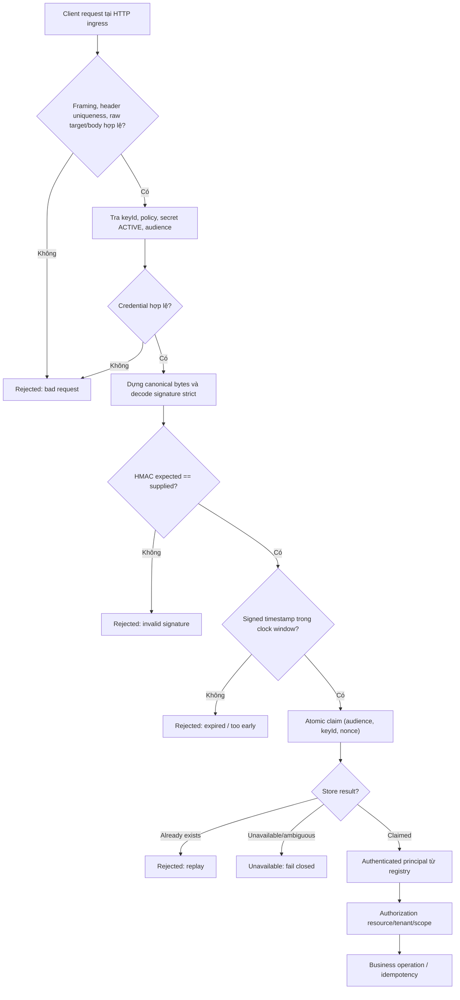

# Replay attack: Vì sao request HMAC hợp lệ vẫn có thể bị tấn công?

Một chữ ký HMAC hợp lệ chứng minh request được tạo bởi một bên có **shared secret tương ứng** và các thành phần đã ký **không bị thay đổi**. Nhưng HMAC không tự chứng minh rằng **request đó chưa từng được xử lý**. Nếu kẻ tấn công có một bản sao đầy đủ của HTTP request hợp lệ, việc gửi lại nguyên bản có thể khiến server thực hiện cùng hành động lần hai mà không cần phá SHA-256 hay đoán secret.

Đó là **replay attack** (*tấn công phát lại*). Với API có tác dụng phụ, replay có thể đồng nghĩa với tạo đơn hàng hai lần, gửi hai lệnh thanh toán, cập nhật trạng thái lặp, hủy cùng một tài nguyên nhiều lần hoặc gây tải/chi phí không cần thiết. Kể cả endpoint chỉ đọc cũng có thể gặp vấn đề về rate limit, kiểm toán hoặc bảo vệ truy cập nếu yêu cầu freshness.

Bài **Replay attack** thuộc chương **Replay protection** của module `SECURITY_AUTHENTICATION_HMAC_REQUEST_AUTHENTICATION`. Phạm vi module là thiết kế xác thực HTTP request bằng **HMAC với shared secret**, canonical request ràng buộc phương thức, URI, header hoặc body theo hợp đồng ký; xác minh chữ ký, chống replay bằng **timestamp/nonce**, quản lý key rotation, kiểm thử proxy/gateway và phân biệt **authentication với authorization**. Trọng tâm bài này là mô hình đe dọa replay, các biến thể tấn công, ranh giới bảo đảm và thiết kế phòng thủ kiểm chứng được.

## 1. Mục tiêu học tập

Sau bài học, bạn có thể:

1. Mô tả **các điều kiện** khiến replay xảy ra dù HMAC-SHA256 vẫn hợp lệ; phân biệt replay với giả mạo chữ ký và thay đổi request.
2. Phân tích các biến thể: **phát lại tuần tự**, **phát lại đồng thời**, **phát lại ở gateway khác**, **phát lại chéo audience** và request được gửi lại bởi retry middleware.
3. Giải thích tại sao timestamp-only giới hạn tuổi request nhưng không bảo đảm **một lần chấp nhận**, và vì sao nonce-only thiếu chính sách lưu/trọn đời cũng chưa đủ.
4. Đưa timestamp và nonce vào **canonical request được ký**, xử lý đúng CSPRNG, Base64URL, clock skew, key namespace và TTL.
5. Thiết kế kiểm tra replay với **atomic claim-if-absent** trên kho dùng chung, bảo đảm fail closed khi kho lỗi.
6. Viết ví dụ Java 17 xác minh HMAC, freshness, nonce và chạy thử **hai request đồng thời** trên cùng nonce.
7. Phân biệt chống replay ở tầng authentication với **idempotency**, transaction nghiệp vụ, key rotation và authorization.
8. Xây ma trận kiểm thử có cả proxy/gateway, lỗi hạ tầng và cạnh tranh đồng thời.

## 2. Replay attack là gì?

**Replay attack** là hành vi bên tấn công thu được một thông điệp hoặc request đã được xác thực hợp lệ, sau đó **phát lại thông điệp ấy** nhằm khiến bên nhận chấp nhận hoặc xử lý nó thêm lần nữa.

Với HMAC request authentication, điều nguy hiểm là **attacker không cần biết secret**. Một chữ ký HMAC có tính xác định:

\[
T = \operatorname{HMAC}_{\mathrm{SHA256}}(K,C)
\]

Nếu `K` và canonical request bytes `C` giữ nguyên thì raw tag `T` không đổi. Vì thế request hợp lệ trước đó vẫn vượt qua phép so MAC nếu server không kiểm tra **freshness/uniqueness**.

Ví dụ request tạo đơn:

```http
POST /v1/orders?channel=partner HTTP/1.1
Host: api.example.test
Content-Type: application/json
X-Key-Id: partner-a-202611
X-Timestamp: 2026-11-28T02:00:00Z
X-Nonce: Zq8DxKtUokcwPGNj3d_yvQ
X-Signature: v1=<BASE64_FULL_HMAC_SHA256>

{"sku":"BK-42","quantity":2}
```

Nếu request được gửi lại **y nguyên**, HMAC vẫn đúng. Rủi ro là **lớp ứng dụng chạy lại POST** nếu tầng xác thực không kiểm tra nonce đã được chấp nhận hay chưa.

### Hai bước tấn công điển hình

1. **Capture:** attacker có bản sao của request đã ký. Nó có thể bị lộ qua log/tracing, kết nối nội bộ bị kiểm soát, proxy không đáng tin, thiết bị client bị xâm nhập hoặc một lỗi xử lý dữ liệu khác.
2. **Replay:** attacker gửi bản sao tới điểm xác minh trong lúc server còn xem request là hợp lệ, hoặc tới một gateway/region khác có trạng thái chống replay không được chia sẻ.

**Cần đánh giá đúng vai trò của HTTPS:** TLS bảo vệ kết nối khỏi bên nghe lén thụ động thông thường; một attacker trên Internet **không thể mặc nhiên thu được request HTTPS chỉ vì nó được gửi**. Tuy nhiên request có thể tồn tại tại client, điểm TLS termination, log, queue hoặc hệ thống trung gian. Chống replay ở tầng ứng dụng là lớp bảo vệ bổ sung khi threat model đòi hỏi, **không thay thế TLS**.

## 3. Replay khác tampering và giả mạo ở đâu?

| Loại tình huống | Attacker làm gì? | HMAC phát hiện được? | Cần kiểm soát nào? |
| --- | --- | --- | --- |
| **Tampering** | Đổi body từ `quantity:2` thành `quantity:200` nhưng giữ signature. | **Có**, nếu body digest được ký đúng. | Canonical request bảo vệ raw body, MAC verification. |
| **Đổi method/URI** | Thay `POST /v1/orders` thành `DELETE /v1/orders/42`. | **Có**, nếu method và raw target nằm trong dữ liệu ký. | Ký đủ request components, bảo vệ route. |
| **Đổi timestamp/nonce** | Thay header freshness bằng giá trị mới mà giữ tag cũ. | **Có**, nếu cả hai header được ký. | Signed timestamp và signed nonce. |
| **Replay nguyên request** | Gửi lại mọi bytes đã có chữ ký đúng. | **Không**, MAC vẫn đúng. | Timestamp window **và** nonce claim nguyên tử. |
| **Replay song song** | Gửi cùng request tới hai verifier gần như đồng thời. | **Không**, cả hai MAC đúng. | Kho nonce **dùng chung**, atomic insert-if-absent. |
| **Cross-service replay** | Gửi một request đã ký đến service/môi trường khác dùng chung secret/policy. | **Không chắc**, nếu thiếu audience/host binding. | Ký audience/authority và tách credential theo service. |
| **Legitimate retry** | Client gửi lại sau timeout vì không biết server đã commit chưa. | MAC có thể đúng nếu phát lại y nguyên. | Ký attempt mới, nonce mới, thêm idempotency/status lookup. |

**Một sai lầm phổ biến:** “HMAC-SHA256 có 256 bit nên replay không thể xảy ra.” Độ dài tag liên quan đến khả năng **giả mạo MAC**, không tự cấp cho server bộ nhớ về những request đã xử lý. Chống replay cần thông tin **thời gian** và **trạng thái một lần** hoặc một giao thức tương đương.

## 4. Mô hình đe dọa và chuỗi tấn công

```mermaid
sequenceDiagram
    participant C as Client có secret
    participant A as Attacker có bản sao request
    participant G as Gateway / Verifier
    participant N as Nonce store
    participant B as Backend

    C->>G: POST /orders, T, N, HMAC hợp lệ
    G->>G: Verify method, target, signed headers, body, MAC, timestamp
    G->>N: Claim (audience, keyId, N)
    N-->>G: Thành công
    G->>B: Authenticated; sau đó authorize/create
    B-->>C: 201 Created

    A->>G: Phát lại cùng POST, T, N, HMAC
    G->>G: MAC vẫn đúng và timestamp có thể vẫn fresh
    G->>N: Claim cùng (audience, keyId, N)
    N-->>G: Already exists
    G-->>A: Từ chối replay, không gọi backend
```

Thành công của cơ chế chống replay phụ thuộc **thứ tự kiểm tra**:

- Không tạo principal ngay sau khi chỉ thấy `X-Key-Id` hoặc Base64 signature đúng format.
- Không claim nonce **trước khi** xác minh MAC, vì attacker có thể ghi một nonce của client khác vào store bằng request giả.
- Không gọi nghiệp vụ hoặc tạo side effect **trước khi** nonce được claim thành công.
- Không dùng local cache riêng của từng gateway như bằng chứng nonce chưa từng được nhận trên toàn cụm.
- Không tự động bỏ qua nonce store khi Redis/database timeout.

### Attacker có thể đạt được gì và không đạt được gì?

Nếu chỉ có một request hợp lệ bị ghi lại mà không có secret, attacker **không thể tùy ý thay timestamp, nonce, body, URI hoặc các header đã ký** mà vẫn giữ MAC hợp lệ (trừ khi giao thức ký thiếu trường đó hoặc có lỗi khác). Attacker có thể thử **gửi lại nguyên request**, đổi nơi gửi (nếu routing/credential cho phép) hoặc gửi **nhiều bản sao đồng thời**.

Nếu attacker **đã chiếm được shared secret**, bài toán nghiêm trọng hơn replay: họ có thể **tạo request mới**, tự ký timestamp/nonce mới và mạo danh client. Nonce store không khắc phục lộ secret; cần **revoke/rotate credential, điều tra và giới hạn quyền**.

## 5. Vì sao timestamp-only không đủ chống replay?

Giả sử server chấp nhận:

\[
\mathrm{now}-300\,s \le \mathrm{timestamp}
\le \mathrm{now}+300\,s.
\]

Một request ký tại `02:00:00Z` có thể còn hợp lệ trong vài phút. Attacker phát lại lúc `02:00:05Z`, `02:00:10Z`, `02:00:15Z`; cả ba lần đều nằm trong cửa sổ. Nếu server chỉ kiểm tra **timestamp và MAC**, cả ba có thể được authenticated.

| Thời gian server nhận | Timestamp đã ký | MAC | Freshness | Kết luận khi **chỉ** kiểm tra timestamp |
| --- | --- | --- | --- | --- |
| `02:00:01Z` | `02:00:00Z` | Đúng | Fresh | Chấp nhận. |
| `02:00:10Z` | `02:00:00Z` | Đúng | Fresh | **Vẫn chấp nhận** — dễ bị replay. |
| `02:03:00Z` | `02:00:00Z` | Đúng | Fresh | **Vẫn chấp nhận** nếu không có nonce. |
| `02:05:01Z` | `02:00:00Z` | Đúng | Quá cũ 301 giây | Từ chối. |

Timestamp **giới hạn thời gian** attacker có thể phát lại, nhưng không hạn chế **số lần** phát lại trong khoảng ấy. Giảm window từ 5 phút xuống 30 giây có thể giảm bề mặt tấn công, nhưng không triệt tiêu replay xảy ra ngay sau lần gửi đầu và có thể tạo lỗi với network latency hoặc clock skew.

**Điểm cần phân biệt:** request timestamp là một **signed value do client cung cấp**, không phải thời điểm server xác nhận request đã được dùng. Server cần đồng hồ đáng tin để quyết định tuổi request, và cần nonce store hoặc cơ chế tương đương để quyết định **uniqueness**.

## 6. Vì sao nonce-only cũng chưa đủ?

Một nonce ngẫu nhiên có entropy cao giúp request có định danh khó trùng, nhưng **chỉ sinh nonce rồi ký mà không lưu lịch sử** vẫn không chống được replay. Cùng request có cùng nonce sẽ được xác minh như request mới.

Ngay cả khi dùng nonce store, nếu **không giới hạn thời gian** hoặc không có policy hết hạn, store có thể phải giữ mọi nonce mãi mãi để chống phát lại không giới hạn; nếu xóa tùy ý, request cũ có thể được chấp nhận lần nữa.

Hợp đồng thực tế thường kết hợp:

- **Signed timestamp:** request chỉ hợp lệ trong cửa sổ tương đối ngắn so với đồng hồ verifier.
- **Signed nonce:** client tạo giá trị mới cho mỗi HTTP attempt, ví dụ 16 byte ngẫu nhiên từ CSPRNG.
- **Atomic nonce claim:** server ghi nhận nonce đã dùng trong kho tin cậy trước khi thực thi nghiệp vụ.
- **Nonce expiry:** chỉ xóa sau khi request gắn nonce không còn nằm trong timestamp window, có tính margin.

### Nonce không phải idempotency key

Nonce phải **mới cho mỗi lần gửi**. Idempotency key thường phải **giữ nguyên cho cùng ý định nghiệp vụ** qua các retry. Ví dụ client muốn tạo **một đơn hàng duy nhất** nhưng response bị mất: lần retry phải có nonce/timestamp/signature mới để được authenticated, còn idempotency key vẫn giữ nguyên để backend trả lại kết quả của ý định đã hoàn thành.

Chống replay **không đồng nghĩa exactly-once execution**. Nó có thể chặn bản sao nguyên request, nhưng một client có secret hợp lệ có thể gửi hai request **khác nonce**, cả hai được xác thực. Việc tránh side effect lặp phải được xử lý ở **idempotency/transaction layer**.

## 7. Hợp đồng canonical request HMAC-SHA256-V1

Bài chọn một **hợp đồng minh họa**, không phải một tiêu chuẩn mặc định của mọi API HMAC.

| Thành phần | Quy tắc V1 |
| --- | --- |
| Signature algorithm | `HmacSHA256`, **full tag 32 byte**. |
| Signature wire | Header `X-Signature: v1=<Base64 chuẩn có padding của full MAC>`. |
| Audience | Chính xác `orders-api-prod`, được đưa vào canonical string. |
| Method | Chính xác `POST`, phân biệt case. |
| Request target | Chính xác `/v1/orders?channel=partner`. |
| Body | SHA-256 của **raw content bytes**, tối đa 8 KiB trong demo. |
| `Content-Type` | Chính xác `application/json`, chỉ một value. |
| `Content-Encoding` | **Không được hiện diện** trong V1. |
| `X-Key-Id` | Duy nhất, chọn một credential ACTIVE theo ID và audience. |
| `X-Timestamp` | UTC `YYYY-MM-DDTHH:mm:ssZ`, signed value, window ±300s. |
| `X-Nonce` | 16 byte CSPRNG, Base64URL không padding, đúng 22 ký tự, được ký. |
| Canonical encoding | UTF-8, các dòng nối LF (`\n`), không LF cuối. |

Một canonical request:

```text
HMAC-SHA256-V1
orders-api-prod
POST
/v1/orders?channel=partner
content-type:application/json
x-key-id:partner-a-202611
x-timestamp:2026-11-28T02:00:00Z
x-nonce:Zq8DxKtUokcwPGNj3d_yvQ
sha256:<LOWERCASE_HEX_SHA256_RAW_BODY>
```

`<...>` là **placeholder**. Client thay body digest bằng giá trị SHA-256 trên **byte body sẽ gửi**, sau đó tính:

\[
\begin{aligned}
d &= \operatorname{SHA256}(\mathrm{rawBodyBytes}),\\
C &= \operatorname{UTF8}(\mathrm{canonicalString\ containing\ hex}(d)),\\
T &= \operatorname{HMAC}_{\mathrm{SHA256}}(K,C),\\
S &= \texttt{v1=} \Vert \operatorname{Base64}_{\mathrm{padded}}(T).
\end{aligned}
\]

**Dòng `x-nonce` và `x-timestamp` phải được ký.** Nếu bỏ nonce khỏi chuỗi canonical, attacker có thể thay nonce cũ bằng nonce mới mà vẫn giữ chữ ký cũ. Nếu bỏ timestamp, attacker có thể “làm mới” request cũ bằng cách sửa thời gian. Server phải **tự dựng canonical bytes** từ request thật, không tin một chuỗi canonical do client tự khai.

### Vì sao cần audience và method/resource binding?

Nếu hai service dùng cùng secret và format ký chỉ bao gồm body, một request hợp lệ ở service A có thể bị dùng ở service B khi có endpoint tương đương. Canonical request nên gắn signature với **service/audience** cụ thể, method/target đã được xác minh và các trường có ảnh hưởng đến nghiệp vụ. Nếu host/authority quyết định tenant hoặc backend, cần ký/bảo vệ đúng giá trị authority ở ranh giới tin cậy, không chỉ ký path.

## 8. Trình tự verifier để chống replay đúng cách



**Quy tắc bảo mật:**

1. **Ingress** parse request một cách nhất quán; chặn duplicate `X-Key-Id`, `X-Timestamp`, `X-Nonce`, `X-Signature` và những dạng request smuggling/path ambiguity.
2. **Credential lookup** dùng `keyId` như input **chưa xác minh** để tìm đúng secret; kiểm tra ACTIVE, audience, expiry và version. Chưa gắn principal cho đến khi xác thực xong.
3. **Verify MAC** bằng full tag đã giải mã nghiêm ngặt, so raw bytes với `MessageDigest.isEqual`. Không thử nhiều secret/algorithm/URI normalization để cho MAC khớp.
4. **Verify freshness** với server clock đáng tin, timestamp có định dạng và biên rõ ràng.
5. **Claim nonce nguyên tử**, trong **shared store** của tất cả gateway instance, trước mọi side effect.
6. **Authenticated result** chỉ được phát hành khi claim thành công. Nếu store timeout/không xác định, **fail closed**.
7. **Authorization và business validation** luôn là bước riêng; HMAC/nonce đúng không tự cấp quyền.

### Không claim nonce trước MAC

Nếu verifier lưu nonce ngay khi nhìn thấy `X-Nonce`, kẻ không biết secret có thể gửi rất nhiều request giả hoặc đoán/copy nonce từ một request khác và làm nonce store đánh dấu đã dùng. Khi request thật đến, nó bị từ chối. Đó là lỗi **nonce poisoning / denial-of-service amplification**.

Vì vậy thứ tự khuyến nghị là **policy và MAC hợp lệ → freshness hợp lệ → atomic claim**. Đặt rate limit và giới hạn kích thước sớm ở ingress để không biến việc tính HMAC thành công cụ DoS khác.

## 9. Race condition: replay đồng thời qua nhiều instance

Replay không chỉ xảy ra khi attacker **đợi** request đầu tiên thành công. Họ có thể gửi **hai bản sao cùng lúc**, thậm chí tới hai gateway khác nhau.

Thiết kế sai:

```java
// SAI: check-then-act không nguyên tử:
if (!nonceStore.contains(nonceKey)) {
    nonceStore.put(nonceKey, expiry);
    processBusinessRequest();
}
```

Lịch thực thi có thể là:

```text
Gateway A: contains(key) -> false
Gateway B: contains(key) -> false
Gateway A: put(key)
Gateway B: put(key)
Gateway A: xử lý nghiệp vụ
Gateway B: xử lý nghiệp vụ   <-- replay lọt qua
```

**Sửa lỗi:** sử dụng một thao tác **atomic insert-if-absent** có expiry. Ví dụ với Redis, ý tưởng là:

```text
SET replay:v1:orders-api-prod:<keyId>:<nonce> used NX PX <ttlMillis>
```

- `NX` yêu cầu key chưa tồn tại; **chỉ một** caller thành công khi backend store hoạt động đúng semantics.
- `PX` đặt TTL tính bằng mili-giây; phải đủ dài đến sau khi signed timestamp hết cửa sổ.
- Khi key đã tồn tại, trả replay và không xử lý nghiệp vụ.
- Khi lỗi mạng, failover hoặc kết quả claim **không xác định**, không được giả sử request chưa được dùng rồi cho tiếp.

Với database, có thể dùng **unique constraint** trên `(audience, key_id, nonce)` và một lệnh insert nguyên tử. Không dùng `SELECT` rồi `INSERT` như hai bước độc lập.

### Atomicity chưa phải tất cả

Ngay cả một lệnh `SET NX PX` cũng cần đánh giá: mất key khi failover, cache eviction, partition, replication lag, clock của store, quy tắc cleanup và chính sách retention. Nếu một nonce từng được claim **biến mất sớm**, request cũ có thể lại được chấp nhận. Hệ thống tài chính hoặc nghiệp vụ rủi ro cao cần chọn mức bền vững/nhất quán phù hợp threat model; có thể dùng transactional database hoặc thiết kế kết hợp với idempotency/ledger.

## 10. Cửa sổ thời gian và TTL nonce: tránh mở lại replay

Hợp đồng ví dụ chấp nhận timestamp nếu:

\[
\mathrm{now}-P \leq T \leq \mathrm{now}+F
\]

với `P = 300` giây cho quá khứ và `F = 300` giây cho tương lai, **biên inclusive**.

Một request có signed timestamp `T` có thể đến sớm nhất ở khoảng `T-F` và còn được chấp nhận muộn nhất tại `T+P`. Vì vậy nonce được claim **không thể xóa trước khi request ngừng hợp lệ**.

### Ví dụ định lượng

```text
Timestamp ký T:             2026-11-28T02:05:30Z
Server nhận sớm nhất:       2026-11-28T02:00:30Z  (T - 300s)
Server chấp nhận cuối:      2026-11-28T02:10:30Z  (T + 300s)
Nếu TTL = 300s từ lần đầu:  nonce mất tại 02:05:30Z
Nguy cơ:                    replay từ 02:05:30Z đến 02:10:30Z
```

Khoảng hiệu lực tối đa giữa lần nhận sớm nhất và lần cuối là **P + F = 600 giây**, dù mỗi phía thường nói “cửa sổ ±5 phút”.

**Cách tính expiry theo contract:**

```text
nonceExpiry = signedTimestamp + allowedPast + safetyMargin
ttlAtClaim  = nonceExpiry - serverNow
```

Trong Java, nên dùng `Instant`/`Duration` và kiểm tra overflow/giới hạn; nếu store yêu cầu TTL milliseconds thì làm tròn an toàn để tránh hết hạn sớm. `safetyMargin` bù độ lệch clock giữa các node, trễ store, rounding và thực tế vận hành. Một kho dọn nonce sớm hơn expiry sẽ phá bảo đảm chống replay.

**Timestamp mới không tự làm nonce cũ thành mới.** Replay key V1 **không chứa timestamp**; nếu client ký lại cùng nonce với timestamp khác dưới cùng credential trong khi key nonce còn lưu, verifier phải từ chối như đã dùng.

## 11. Demo Java 17: tái phát request và hai luồng cạnh tranh

Chương trình dưới đây là **demo tự chứa** chỉ dùng JDK 17. Nó không mở HTTP socket, mà mô phỏng **dữ liệu HTTP đã được adapter tin cậy parse** để tập trung vào quyết định replay. Đầu vào vẫn giữ phương thức, raw target, signed headers và raw body bytes giống request HTTP thực.

Demo thực hiện:

- Sinh nonce 128 bit qua `SecureRandom` và mã hóa Base64URL không padding.
- Tạo timestamp UTC có giây, dựng canonical request và ký HMAC-SHA256 full tag 32 byte.
- Decode `X-Signature: v1=...` theo Base64 chuẩn padded, tính lại MAC và so bằng `MessageDigest.isEqual`.
- Kiểm tra cửa sổ ±300 giây theo `Clock.fixed`.
- Claim nonce dùng `synchronized` trên **một shared store in-memory** (chỉ đúng với một JVM demo).
- Kiểm thử **gửi lại nguyên request**, **đổi body/nonce mà giữ signature**, **timestamp cũ**, **store outage**, và **hai luồng cùng claim một nonce**.

**Production:** Phải bổ sung HTTP parser, kiểm soát duplicate header, TLS, credential registry thật, distributed nonce store, rate limit, security context và authorization. Không coi lớp `LocalNonceStore` là bằng chứng chống replay trên nhiều máy.

```java
import java.nio.charset.StandardCharsets;
import java.security.GeneralSecurityException;
import java.security.MessageDigest;
import java.security.SecureRandom;
import java.time.Clock;
import java.time.Instant;
import java.time.ZoneOffset;
import java.time.format.DateTimeParseException;
import java.time.temporal.ChronoUnit;
import java.util.Arrays;
import java.util.Base64;
import java.util.HashMap;
import java.util.HexFormat;
import java.util.Map;
import java.util.concurrent.Callable;
import java.util.concurrent.CountDownLatch;
import java.util.concurrent.ExecutorService;
import java.util.concurrent.Executors;
import java.util.concurrent.Future;
import javax.crypto.Mac;
import javax.crypto.spec.SecretKeySpec;

public final class ReplayAttackHmacV1 {
    private static final String VERSION = "HMAC-SHA256-V1";
    private static final String AUDIENCE = "orders-api-prod";
    private static final String TARGET = "/v1/orders?channel=partner";
    private static final String MEDIA_TYPE = "application/json";
    private static final String SIGNATURE_PREFIX = "v1=";
    private static final long PAST_SECONDS = 300;
    private static final long FUTURE_SECONDS = 300;
    private static final long NONCE_MARGIN_SECONDS = 30;

    private ReplayAttackHmacV1() {}

    public enum Decision {
        AUTHENTICATED, BAD_REQUEST, INVALID_CREDENTIAL,
        INVALID_SIGNATURE, EXPIRED, TOO_EARLY, REPLAY, UNAVAILABLE
    }

    public record Result(Decision decision, String principal) {
        public Result {
            if ((decision == Decision.AUTHENTICATED) != (principal != null)) {
                throw new IllegalArgumentException("Principal/result mismatch");
            }
        }
        public static Result rejected(Decision code) {
            return new Result(code, null);
        }
        public static Result accepted(String principal) {
            return new Result(Decision.AUTHENTICATED, principal);
        }
    }

    public record Credential(
            String keyId, String clientId, String audience,
            boolean active, byte[] secret) {
        public Credential {
            secret = secret.clone();
        }
        @Override
        public byte[] secret() {
            return secret.clone();
        }
    }

    public record SignedRequest(
            String method, String rawTarget, String contentType,
            boolean contentEncodingPresent, String keyId, String timestamp,
            String nonce, byte[] body, String signature) {
        public SignedRequest {
            if (body != null) {
                body = body.clone();
            }
        }
        @Override
        public byte[] body() {
            return body == null ? null : body.clone();
        }
    }

    public static class StoreFailure extends Exception {
        public StoreFailure(String message) {
            super(message);
        }
    }

    public interface NonceStore {
        boolean claimIfAbsent(String key, Instant expiresAt, Instant now)
                throws StoreFailure;
    }

    /**
     * Chỉ phục vụ demo: synchronized giúp claim nguyên tử TRONG 1 JVM.
     * Production dùng kho chia sẻ và độ bền/TTL được bảo đảm phù hợp.
     */
    public static final class LocalNonceStore implements NonceStore {
        private final Map<String, Instant> expiries = new HashMap<>();

        @Override
        public synchronized boolean claimIfAbsent(
                String key, Instant expiresAt, Instant now) {
            if (!expiresAt.isAfter(now)) {
                return false;
            }
            expiries.entrySet().removeIf(
                    e -> !e.getValue().isAfter(now));
            if (expiries.containsKey(key)) {
                return false;
            }
            expiries.put(key, expiresAt);
            return true;
        }

        public synchronized int entries() {
            return expiries.size();
        }
    }

    public static String newNonce(SecureRandom random) {
        byte[] bytes = new byte[16];
        random.nextBytes(bytes);
        return Base64.getUrlEncoder().withoutPadding()
                .encodeToString(bytes);
    }

    private static boolean validNonce(String nonce) {
        if (nonce == null || nonce.length() != 22) {
            return false;
        }
        try {
            byte[] decoded = Base64.getUrlDecoder().decode(nonce);
            return decoded.length == 16
                    && Base64.getUrlEncoder().withoutPadding()
                            .encodeToString(decoded).equals(nonce);
        } catch (IllegalArgumentException badEncoding) {
            return false;
        }
    }

    private static Instant parseTimestamp(String timestamp) {
        if (timestamp == null || !timestamp.matches(
                "[0-9]{4}-[0-9]{2}-[0-9]{2}T"
                + "[0-9]{2}:[0-9]{2}:[0-9]{2}Z")) {
            throw new IllegalArgumentException("Bad timestamp format");
        }
        try {
            Instant instant = Instant.parse(timestamp);
            if (!instant.truncatedTo(ChronoUnit.SECONDS)
                    .toString().equals(timestamp)) {
                throw new IllegalArgumentException("Noncanonical timestamp");
            }
            return instant;
        } catch (DateTimeParseException invalid) {
            throw new IllegalArgumentException("Bad timestamp value", invalid);
        }
    }

    private static boolean validShape(SignedRequest r) {
        if (r == null || !"POST".equals(r.method())
                || !TARGET.equals(r.rawTarget())
                || !MEDIA_TYPE.equals(r.contentType())
                || r.contentEncodingPresent()
                || r.keyId() == null
                || !r.keyId().matches("[A-Za-z0-9_-]{1,80}")
                || !validNonce(r.nonce())
                || r.body() == null || r.body().length > 8192) {
            return false;
        }
        try {
            parseTimestamp(r.timestamp());
            return true;
        } catch (IllegalArgumentException invalid) {
            return false;
        }
    }

    private static byte[] canonicalBytes(SignedRequest r)
            throws GeneralSecurityException {
        String digest = HexFormat.of().formatHex(
                MessageDigest.getInstance("SHA-256").digest(r.body()));
        String canonical = String.join("\n",
                VERSION, AUDIENCE, r.method(), r.rawTarget(),
                "content-type:" + r.contentType(),
                "x-key-id:" + r.keyId(),
                "x-timestamp:" + r.timestamp(),
                "x-nonce:" + r.nonce(),
                "sha256:" + digest);
        return canonical.getBytes(StandardCharsets.UTF_8);
    }

    private static byte[] mac(byte[] secret, byte[] canonical)
            throws GeneralSecurityException {
        if (secret == null || secret.length < 32) {
            throw new GeneralSecurityException("Invalid HMAC credential");
        }
        Mac hmac = Mac.getInstance("HmacSHA256");
        hmac.init(new SecretKeySpec(secret, "HmacSHA256"));
        return hmac.doFinal(canonical);
    }

    private static byte[] decodeSignature(String wire) {
        if (wire == null || wire.length() != 47
                || !wire.startsWith(SIGNATURE_PREFIX)) {
            return null;
        }
        String base64 = wire.substring(SIGNATURE_PREFIX.length());
        if (!base64.matches("[A-Za-z0-9+/]{43}=")) {
            return null;
        }
        try {
            byte[] decoded = Base64.getDecoder().decode(base64);
            return decoded.length == 32
                    && Base64.getEncoder().encodeToString(decoded)
                            .equals(base64) ? decoded : null;
        } catch (IllegalArgumentException malformed) {
            return null;
        }
    }

    /** Không coi BAD_REQUEST hoặc UNAVAILABLE là authenticated. */
    public static Result verify(
            SignedRequest received, Map<String, Credential> registry,
            NonceStore nonceStore, Clock clock) {
        if (!validShape(received)) {
            return Result.rejected(Decision.BAD_REQUEST);
        }
        Credential credential = registry.get(received.keyId());
        if (credential == null || !credential.active()
                || !AUDIENCE.equals(credential.audience())
                || !received.keyId().equals(credential.keyId())) {
            return Result.rejected(Decision.INVALID_CREDENTIAL);
        }

        byte[] supplied = decodeSignature(received.signature());
        if (supplied == null) {
            return Result.rejected(Decision.INVALID_SIGNATURE);
        }
        try {
            byte[] expected = mac(
                    credential.secret(), canonicalBytes(received));
            if (!MessageDigest.isEqual(expected, supplied)) {
                return Result.rejected(Decision.INVALID_SIGNATURE);
            }
        } catch (GeneralSecurityException providerFailure) {
            return Result.rejected(Decision.UNAVAILABLE);
        }

        Instant now = clock.instant();
        Instant time = parseTimestamp(received.timestamp());
        if (time.isBefore(now.minusSeconds(PAST_SECONDS))) {
            return Result.rejected(Decision.EXPIRED);
        }
        if (time.isAfter(now.plusSeconds(FUTURE_SECONDS))) {
            return Result.rejected(Decision.TOO_EARLY);
        }

        // Key không chứa timestamp: ký lại cùng nonce vẫn bị xem là reuse.
        String replayKey = "replay:v1:" + AUDIENCE + ":"
                + received.keyId() + ":" + received.nonce();
        Instant expiresAt = time.plusSeconds(
                PAST_SECONDS + NONCE_MARGIN_SECONDS);
        try {
            if (!nonceStore.claimIfAbsent(replayKey, expiresAt, now)) {
                return Result.rejected(Decision.REPLAY);
            }
        } catch (StoreFailure unavailable) {
            return Result.rejected(Decision.UNAVAILABLE);
        }
        return Result.accepted(credential.clientId());
    }

    public static SignedRequest signForTest(
            Credential credential, String timestamp,
            String nonce, byte[] body) throws GeneralSecurityException {
        SignedRequest unsigned = new SignedRequest(
                "POST", TARGET, MEDIA_TYPE, false, credential.keyId(),
                timestamp, nonce, body, null);
        if (!validShape(unsigned)) {
            throw new IllegalArgumentException("Invalid outgoing request");
        }
        String signature = SIGNATURE_PREFIX
                + Base64.getEncoder().encodeToString(
                    mac(credential.secret(), canonicalBytes(unsigned)));
        return new SignedRequest(
                unsigned.method(), unsigned.rawTarget(),
                unsigned.contentType(), false, unsigned.keyId(),
                unsigned.timestamp(), unsigned.nonce(), body, signature);
    }

    private static void expect(Decision expected, Result actual) {
        if (actual.decision() != expected) {
            throw new AssertionError("Expected " + expected
                    + ", got " + actual.decision());
        }
        if (expected != Decision.AUTHENTICATED
                && actual.principal() != null) {
            throw new AssertionError("Principal leaked on failure");
        }
    }

    public static void main(String[] args) throws Exception {
        byte[] testSecret = new byte[32]; // Chỉ là dữ liệu test.
        Arrays.fill(testSecret, (byte) 0x5a);
        Credential credential = new Credential(
                "partner-a-202611", "partner-a",
                AUDIENCE, true, testSecret);
        Map<String, Credential> registry =
                Map.of(credential.keyId(), credential);
        Clock fixed = Clock.fixed(
                Instant.parse("2026-11-28T02:00:30Z"), ZoneOffset.UTC);
        SecureRandom random = new SecureRandom();
        byte[] body = "{\"sku\":\"BK-42\",\"quantity\":2}"
                .getBytes(StandardCharsets.UTF_8);

        String nonce = newNonce(random);
        SignedRequest request = signForTest(
                credential, "2026-11-28T02:00:00Z", nonce, body);
        LocalNonceStore store = new LocalNonceStore();

        expect(Decision.AUTHENTICATED, verify(
                request, registry, store, fixed));
        // Attacker phát lại nguyên request: MAC đúng, nonce đã dùng.
        expect(Decision.REPLAY, verify(
                request, registry, store, fixed));

        // Nonce cũ nhưng timestamp mới và HMAC được ký lại:
        // theo scope V1 vẫn không được nhận lần nữa.
        SignedRequest nonceReuse = signForTest(
                credential, "2026-11-28T02:00:10Z", nonce, body);
        expect(Decision.REPLAY, verify(
                nonceReuse, registry, store, fixed));

        // Sửa body trong request nhưng giữ signature: MAC mismatch.
        SignedRequest tampered = new SignedRequest(
                request.method(), request.rawTarget(), request.contentType(),
                false, request.keyId(), request.timestamp(), request.nonce(),
                "{\"sku\":\"BK-42\",\"quantity\":200}"
                    .getBytes(StandardCharsets.UTF_8),
                request.signature());
        LocalNonceStore untouched = new LocalNonceStore();
        expect(Decision.INVALID_SIGNATURE, verify(
                tampered, registry, untouched, fixed));
        if (untouched.entries() != 0) {
            throw new AssertionError("Bad signature consumed nonce");
        }

        // MAC đúng nhưng timestamp đã cũ hơn 300 giây.
        SignedRequest expired = signForTest(
                credential, "2026-11-28T01:55:29Z",
                newNonce(random), body);
        expect(Decision.EXPIRED, verify(
                expired, registry, new LocalNonceStore(), fixed));

        // Khi nonce store lỗi phải fail closed.
        NonceStore offline = (key, expiry, now) -> {
            throw new StoreFailure("test outage");
        };
        SignedRequest fresh = signForTest(
                credential, "2026-11-28T02:00:00Z",
                newNonce(random), body);
        expect(Decision.UNAVAILABLE, verify(
                fresh, registry, offline, fixed));

        // Hai luồng gửi cùng request vào cùng store:
        // phải có đúng một AUTHENTICATED và một REPLAY.
        SignedRequest raced = signForTest(
                credential, "2026-11-28T02:00:00Z",
                newNonce(random), body);
        LocalNonceStore sharedForRace = new LocalNonceStore();
        ExecutorService pool = Executors.newFixedThreadPool(2);
        CountDownLatch start = new CountDownLatch(1);
        Callable<Result> task = () -> {
            start.await();
            return verify(raced, registry, sharedForRace, fixed);
        };
        try {
            Future<Result> a = pool.submit(task);
            Future<Result> b = pool.submit(task);
            start.countDown();
            Result ra = a.get();
            Result rb = b.get();
            int accepted = (ra.decision() == Decision.AUTHENTICATED ? 1 : 0)
                    + (rb.decision() == Decision.AUTHENTICATED ? 1 : 0);
            int replayed = (ra.decision() == Decision.REPLAY ? 1 : 0)
                    + (rb.decision() == Decision.REPLAY ? 1 : 0);
            if (accepted != 1 || replayed != 1) {
                throw new AssertionError("Atomic claim race test failed");
            }
        } finally {
            pool.shutdownNow();
        }

        System.out.println("Replay and concurrent nonce checks passed.");
    }
}
```

### Vì sao demo có thể chống replay nhưng chưa đủ cho production?

- `LocalNonceStore.claimIfAbsent` dùng `synchronized` nên **hai luồng trong cùng JVM** không thể đồng thời claim cùng nonce. **Hai JVM hoặc hai region** cần dùng **một shared durable store** và thao tác insert có uniqueness được bảo đảm.
- `SignedRequest` và `Credential` sao chép `byte[]` để giảm khả năng code khác sửa body/secret sau khi ký. Production còn cần bảo vệ secret trong secret manager/HSM và quản lý memory.
- `validNonce` yêu cầu Base64URL canonical 16 byte. Không thể chỉ nhìn một nonce trên wire mà kết luận client thật sự dùng CSPRNG; đây là trách nhiệm client và policy/monitoring.
- `verify` chỉ cấp `principal` sau khi MAC, freshness và nonce claim hoàn tất. Khi store lỗi, `UNAVAILABLE` **không** chứa principal.
- Test đồng thời chứng minh **atomicity trong một process**, không chứng minh Redis/database/failover production. Kiểm thử tích hợp vẫn bắt buộc.
- Header duplicates, malformed framing, raw URI đã rewrite, `Content-Encoding` và rate limiting phải được kiểm soát bởi HTTP adapter/ingress **trước** khi dựng `SignedRequest`.
- Hợp đồng V1 demo cố định `POST` và target, `Content-Type`, audience. Hệ thống nhiều endpoint phải có policy route/authority rõ ràng, tránh cùng chữ ký được dùng trên hành động khác.

## 12. Replay thông qua proxy/gateway và ranh giới xác minh

Trong thực tế, request đi qua nhiều hop:

```text
Client → CDN/TLS terminator → API Gateway → Service Mesh → Backend
```

Một signature HMAC có thể được xác minh tại edge; gateway có thể thay raw URI, gộp header hoặc thay body trước khi gửi tới backend. Nếu gateway **đánh dấu nonce đã dùng** nhưng backend lại xử lý **một request có ý nghĩa khác** với request đã ký, replay protection không còn đủ để bảo đảm hành động đúng.

| Tình huống | Rủi ro replay hoặc trust | Hướng xử lý |
| --- | --- | --- |
| Client gửi hai request giống nhau đến hai gateway. | Mỗi gateway có local nonce set; cả hai cùng authenticated. | Shared atomic nonce store hoặc ownership tập trung. |
| CDN/gateway tự retry POST khi upstream timeout. | Gửi lại cùng nonce/signature hoặc tạo side effect trùng. | Kiểm soát retry policy, idempotency và cách chuyển outcome. |
| API gateway rewrite path/query **sau** khi xác minh. | Backend có thể xử lý resource khác dữ liệu đã ký. | Ràng buộc route/effective resource hoặc verify trước rewrite và truyền context tin cậy. |
| HTTP/1.1 → HTTP/2 chuyển `X-Nonce` thành `x-nonce`. | Tên header không phân biệt case; không nên thay MAC. | Canonical lowercase **tên** header, giữ nguyên value. |
| Proxy gộp hai `X-Nonce` khác case. | Verifier/backend có thể chọn value khác. | Từ chối duplicate security headers **ở ingress**. |
| Proxy tự sửa timestamp hoặc nonce để “làm mới” request. | MAC mismatch hoặc phá ranh giới credential. | Không sửa signed values. Client phải ký request mới. |
| Client thêm `X-Authenticated-Client` giả. | Backend có thể tin một principal chưa xác thực. | Strip spoofed header, truyền trusted context qua mTLS/assertion nội bộ. |
| Nonce store failover làm mất dữ liệu đã claim. | Replay có thể qua sau failover. | Chọn durability/consistency theo yêu cầu, fail closed khi kết quả không chắc. |

Một số hệ thống có **đúng một điểm chịu trách nhiệm claim nonce** ở gateway. Backend chỉ tin vào authentication result từ gateway nếu kênh giữa hai bên được xác thực, caller không thể bypass gateway, metadata principal được bảo vệ, và business route thực thi thống nhất với request đã ký. Không chấp nhận `X-Original-URI` do client tự gửi để “giúp xác minh chữ ký” trừ khi gateway đã xóa giá trị ngoài và thay bằng nguồn tin cậy.

## 13. Key rotation, audience và replay scope

Key rotation có thể tạo nhiều key ID cho cùng client:

| Key ID | Client | Trạng thái | Secret |
| --- | --- | --- | --- |
| `partner-a-202611` | `partner-a` | ACTIVE trong overlap | Secret A |
| `partner-a-202702` | `partner-a` | ACTIVE mới | Secret B độc lập |
| `partner-a-202608` | `partner-a` | REVOKED | Secret đã thu hồi |

Server phải chọn **đúng một secret** theo key ID từ registry, không thử A rồi B nếu chữ ký sai. Credential bị revoke phải bị từ chối **dù timestamp mới và nonce chưa dùng**.

Replay key V1 dùng:

```text
replay:v1:<audience>:<keyId>:<nonce>
```

Điều này bảo đảm uniqueness theo **credential/audience**, không mặc nhiên bảo đảm uniqueness theo **clientId** khi client đang sử dụng hai credential ACTIVE. Nếu thiết kế yêu cầu cùng client không bao giờ được dùng lại nonce qua rotation, scope replay key theo **clientId đã xác thực** (hoặc thiết kế mapping khác) thay vì `keyId`. Cần công bố policy, vì chọn scope khác ảnh hưởng API, data retention và khả năng tương thích.

**Audience binding:** `orders-api-prod` trong canonical request giúp tách chữ ký với một service hoặc môi trường khác. Tuy nhiên nếu hai verifier cùng dùng audience/secret và chấp nhận cùng target trên các cụm có nonce store độc lập, cross-cluster replay vẫn có thể xảy ra. Vì vậy **audience, key distribution, routing và nonce-store topology** phải được thiết kế thống nhất.

## 14. Replay attack khác sự cố delivery, exactly-once và ủy quyền

Một request có thể bị gửi lại mà **không có attacker**: HTTP client tự retry, queue redelivery, reverse proxy retry, người dùng bấm Submit hai lần, hoặc network timeout khiến bên gửi không biết server đã xử lý chưa.

### Ba tính chất thường bị nhập làm một

| Tính chất | Mục tiêu | Cơ chế thường dùng |
| --- | --- | --- |
| **Request authentication** | Bên gửi sở hữu credential và dữ liệu ký không bị sửa. | HMAC, canonical request, key policy. |
| **Replay protection** | Không chấp nhận lại **cùng attempt/nonce** trong window. | Signed timestamp + nonce + atomic store. |
| **Business idempotency** | Cùng một **ý định nghiệp vụ** không gây side effect trùng dù có nhiều attempt hợp lệ. | Idempotency key, transactional deduplication, trạng thái nghiệp vụ. |

Ví dụ tạo đơn: Client gửi POST, server đã tạo đơn nhưng response bị mất. Client thử lại bằng timestamp/nonce mới và MAC mới. Request thứ hai **không phải replay cùng nonce** theo nghĩa security, nhưng vẫn có nguy cơ tạo đơn thứ hai. Nếu API muốn tránh điều đó, cần **Idempotency-Key được ký** (khi ảnh hưởng xử lý) và cơ chế ghi nhận kết quả nghiệp vụ có tính nguyên tử.

### Tại sao nonce không chứng minh quyền?

Một client có HMAC hợp lệ và nonce mới vẫn có thể yêu cầu truy cập đơn hàng của tenant khác. Replay protection chỉ nói về **số lần và độ mới của request**, không xác định client được phép làm gì. Sau khi xác thực, backend còn phải kiểm tra **principal + method + resource/tenant + scope/field**, và thực thi business validation. Một request có MAC đúng nhưng thiếu quyền có thể nhận **403 Forbidden**.

### Vì sao không giải phóng nonce khi nghiệp vụ lỗi?

Giả sử MAC/freshness/nonce claim đạt, sau đó business validator trả `422`. Nonce đã được sử dụng tại cổng authentication. **Không xóa entry nonce** để “cho client thử lại cùng chữ ký”: làm vậy mở cửa phát lại ở nhiều thời điểm/race. Client phải xây request mới, nonce/timestamp/signature mới; idempotency quản lý business intent.

## 15. Phân loại kết quả và cách trả lỗi an toàn

| Điều kiện | Kết quả nội bộ | Hành động |
| --- | --- | --- |
| Header nonce, timestamp, signature sai định dạng | `BAD_REQUEST` / `INVALID_SIGNATURE` | Từ chối, không claim nonce. |
| Credential không tồn tại/revoked/sai audience | `INVALID_CREDENTIAL` | Từ chối; không cấp principal. |
| HMAC sai hoặc bị sửa method/body/nonce | `INVALID_SIGNATURE` | Từ chối; nonce chưa bị claim. |
| Signed timestamp quá cũ/quá tương lai | `EXPIRED` / `TOO_EARLY` | Từ chối theo freshness. |
| HMAC đúng, freshness đúng, nonce đã tồn tại | `REPLAY` | Từ chối, không chạy business handler. |
| Nonce store lỗi, timeout hoặc claim outcome không rõ | `UNAVAILABLE` | **Fail closed**, alert, không cấp principal. |
| Đủ authentication nhưng principal thiếu quyền | **Authorization failure** | Thường `403`, không gọi là lỗi replay. |
| Authenticated/authorized nhưng nghiệp vụ không hợp lệ | **Business validation error** | `400`/`409`/`422` theo contract. |

Ở lớp HTTP, `401 Unauthorized` có thể được dùng cho nhiều lỗi authentication, nhưng phải tuân theo chính sách challenge `WWW-Authenticate` của scheme đã công bố. Một HMAC scheme dùng `X-Signature` cần định nghĩa rõ response contract; đừng mặc nhiên dùng mọi status mà không xét chuẩn HTTP và trải nghiệm client.

### Logging và quan sát

Có thể dùng các internal codes như `SIG_FORMAT_INVALID`, `MAC_MISMATCH`, `NONCE_REPLAY`, `NONCE_STORE_UNAVAILABLE`, `CLOCK_SKEW`, `CREDENTIAL_REVOKED` để phân biệt lỗi. Tuy nhiên response bên ngoài nên tránh tiết lộ key ID tồn tại, trạng thái registry, secret và chi tiết MAC.

Không log **shared secret, full signature production, canonical bytes chứa PII hoặc raw body nhạy cảm**. Nonce không phải secret, nhưng nonce thực cũng có thể liên kết các request; nên giới hạn lưu nonce/raw replay key trong log. Dùng request ID, mã lỗi, policy version, metric tỉ lệ replay, latency claim, clock skew và trạng thái store theo quyền truy cập phù hợp.

## 16. Ma trận kiểm thử replay attack

| Test case | Kết quả mong đợi |
| --- | --- |
| Request mới, key ACTIVE, MAC đúng, timestamp fresh, nonce chưa dùng. | **Authenticated**, claim thành công. |
| Phát lại nguyên request ngay sau lần chấp nhận. | MAC có thể đúng nhưng **REPLAY**, không side effect lần hai. |
| Phát lại sau 2 phút vẫn trong window. | **REPLAY** nếu nonce còn trong store. |
| Phát lại khi timestamp đã quá hạn. | Bị từ chối **EXPIRED**, dù nonce đã được cleanup sau khi hết hiệu lực. |
| Đổi timestamp/nonce mà giữ signature. | MAC mismatch, không claim nonce. |
| Ký lại với cùng nonce nhưng timestamp mới theo cùng credential. | **REPLAY** theo replay key không chứa timestamp. |
| Gửi hai bản sao cùng lúc tới **một JVM** với atomic synchronized store. | **Đúng một** accepted và một replay. |
| Gửi hai bản sao đến **hai gateway có shared atomic store**. | **Tối đa một** accepted; kiểm thử tích hợp. |
| Hai gateway có local nonce store riêng. | **Test âm:** có thể cả hai accepted; kiến trúc sai. |
| Nonce store timeout/lỗi mạng khi claim. | **UNAVAILABLE**, fail closed. |
| Redis evict nonce trước expiry hoặc failover mất key. | **Test âm:** replay có thể được nhận; cần durability/retention policy. |
| TTL chỉ 300s từ lần nhận sớm nhất với window ±300s. | **Test âm:** entry mất trước khi request hết hạn, tạo replay window. |
| TTL đến `timestamp + allowedPast + margin`. | Key tồn tại tới sau lúc request không còn fresh. |
| Gửi nonce không đủ 16 byte hoặc Base64URL sai canonical form. | `BAD_REQUEST`. |
| Ký body A rồi backend parse/serialize thành body B. | Phải phát hiện MAC mismatch hoặc chặn thay đổi ngoài contract. |
| Duplicate `X-Nonce` khác cách viết hoa trong cùng request. | HTTP ingress từ chối; không chọn first/last. |
| Key ID REVOKED dù nonce mới. | `INVALID_CREDENTIAL`. |
| Cùng HMAC sang môi trường khác audience. | Từ chối theo audience/key policy. |
| Client hợp lệ gửi **request thứ hai** với nonce mới nhưng cùng nghiệp vụ. | HMAC/replay có thể pass; **idempotency** phải xử lý trùng nghiệp vụ. |
| Principal xác thực nhưng thiếu quyền sửa tenant khác. | Authorization từ chối, thường `403`. |

**Test vector liên ngôn ngữ** nên gồm secret giả, raw method/target, signed headers, timestamp, nonce, raw body bytes, SHA-256 body hex, canonical UTF-8 bytes, HMAC raw tag hex và Base64 wire signature. Ngoài unit test MAC cần có test **concurrency, multi-instance, TTL/failover, proxy rewrite và business idempotency**; riêng test HMAC đúng không chứng minh hệ thống chống replay.

## 17. Bài tập thực hành

### Bài 1 — Vì sao một MAC đúng có thể bị lợi dụng?

Attacker có bản sao request HMAC hợp lệ, gửi lại sau 10 giây. Timestamp vẫn fresh. Attacker có cần đoán secret để replay không?

**Gợi ý:** Không. Nếu không có nonce claim/anti-replay tương đương, bản sao nguyên request vẫn có HMAC đúng vì canonical bytes không đổi. Cần signed timestamp **và** nonce store nguyên tử.

### Bài 2 — Chọn thứ tự kiểm tra

Developer muốn claim nonce ngay khi HTTP parser đọc `X-Nonce`, sau đó mới verify MAC. Vì sao đây không phải lựa chọn an toàn?

**Gợi ý:** Attacker không biết secret vẫn có thể chiếm trước nonce hoặc gây áp lực bộ nhớ/store. Phải kiểm tra MAC và freshness trước claim; kèm rate limiting, parser limits ở ingress.

### Bài 3 — Race giữa hai gateway

Hai gateway cùng kiểm tra `GET nonceKey` rồi đều thấy chưa tồn tại, sau đó cùng `SET nonceKey` và cùng xử lý nghiệp vụ. Tại sao sai? Dùng gì thay thế?

**Gợi ý:** `GET` + `SET` riêng rẽ tạo race. Dùng atomic claim-if-absent như Redis `SET NX PX` hoặc database unique constraint; tất cả verifier phải dùng cùng phạm vi store.

### Bài 4 — Nonce TTL và timestamp tương lai

Request ký với `T = 02:05:30Z`, server nhận lúc `02:00:30Z`, cửa sổ ±300 giây. Kho xóa nonce sau 300 giây từ lúc nhận. Replay có thể lọt qua khi nào?

**Gợi ý:** Nonce có thể biến mất lúc `02:05:30Z` trong khi timestamp còn fresh tới `02:10:30Z`. Giữ key đến `T + allowedPast + margin`.

### Bài 5 — Retry là replay hay nghiệp vụ lặp?

Client gửi POST, server commit nhưng response mất; client tạo nonce mới, timestamp mới và signature mới rồi gửi lại. Replay store có bắt buộc từ chối lần hai không? Có thể tạo hai đơn không?

**Gợi ý:** Theo scope per-nonce, lần hai **không** là phát lại cùng attempt; authentication có thể thành công. Nếu không có idempotency hoặc unique business constraint, **có thể** tạo đơn thứ hai.

### Bài 6 — Cùng request trên hai audience

Client A có credential dùng chung secret giữa `orders-api-test` và `orders-api-prod`. Attacker chuyển request test sang production. Nếu canonical request không ký audience, nguy cơ gì?

**Gợi ý:** Một request test có thể bị chấp nhận ở production nếu method/URI và policies còn khớp. Tách secret theo audience, ký audience và kiểm tra credential đúng môi trường; bảo đảm replay store topology thống nhất.

### Bài 7 — Nonce đã claim, sau đó trả 403

Một request đã vượt MAC, timestamp và nonce claim, nhưng authorization từ chối vì tenant sai. Client gửi lại nguyên request với cùng nonce. Verifier phải làm gì?

**Gợi ý:** Từ chối replay; không xóa nonce vì kết quả nghiệp vụ/authorization thất bại. Nếu client muốn yêu cầu mới, tạo nonce/timestamp/signature mới; quyền tenant vẫn phải được kiểm tra.

## 18. Checklist triển khai và tổng kết

Trước khi tuyên bố một API HMAC đã chống replay:

- [ ] Threat model nêu rõ attacker có thể thu request từ đâu, nguy cơ replay **tuần tự, song song, xuyên gateway/region/audience** và tài nguyên cần bảo vệ.
- [ ] Canonical request ràng buộc **method, raw URI, signed headers, raw body digest, audience, timestamp và nonce** theo một protocol version rõ ràng.
- [ ] Signature HMAC dùng đúng secret ACTIVE, full tag với encoding canonical; key ID và version không được dùng để tự hạ cấp thuật toán.
- [ ] Timestamp được ký và parse theo một profile UTC duy nhất; freshness window, hướng quá khứ/tương lai và biên được công bố.
- [ ] Client sinh nonce mới cho mỗi attempt bằng CSPRNG (hoặc cơ chế được chứng minh phù hợp), có encoding/độ dài thống nhất.
- [ ] Verifier **không claim nonce** trước khi MAC và freshness hợp lệ; **không có side effect** trước khi claim.
- [ ] Nonce key có namespace rõ (audience/keyId/nonce hoặc authenticated principal tùy threat model), không tùy tiện bao gồm timestamp khiến reuse bị bỏ sót.
- [ ] Store là **dùng chung và atomic** cho tất cả verifier cần bảo vệ cùng phạm vi, không check-then-put.
- [ ] TTL giữ nonce đến **signedTimestamp + allowedPast + safetyMargin**, không ngắn hơn lifetime request.
- [ ] Store được đánh giá về failover, eviction, replication, persistence và clock; khi không xác định claim outcome phải **fail closed**.
- [ ] Gateway/HTTP adapter chặn header duplicate, request smuggling, path ambiguity và các phép rewrite khiến request thực thi khác request được ký.
- [ ] Client và proxy có chính sách retry có kiểm soát; mỗi HTTP attempt mới có timestamp/nonce/signature mới.
- [ ] **Idempotency key được ký** và deduplication nghiệp vụ được triển khai nếu phải tránh side effect lặp qua nhiều attempt hợp lệ.
- [ ] Rotation/revoke và audience binding được kiểm tra; không dùng lại shared secret bị lộ và không thử secret khác khi HMAC sai.
- [ ] Principal được tạo sau authentication thành công; **authorization** cho method/resource/tenant/scope vẫn chạy riêng.
- [ ] Unit và integration test bao phủ **concurrent replay, multi-instance, store outage, TTL boundary, proxy/gateway, rotation và 403 sau authentication**.
- [ ] Logs và metrics phân loại replay/store outage nhưng không tiết lộ secret, raw signature hoặc body nhạy cảm.

**Kết luận:** **Replay attack không cần phá HMAC.** Kẻ tấn công chỉ cần một request hợp lệ đã được ký và một cơ hội khiến server xử lý lại nó. Timestamp làm request hết hạn sau một cửa sổ; nonce được ký và **claim nguyên tử trong shared store** làm request đã dùng không được chấp nhận lại trong cửa sổ ấy. Cả hai cần phối hợp với **credential/audience binding, TTL đúng, fail-closed, kiểm soát gateway và idempotency nghiệp vụ**. Sau khi chặn replay, hệ thống vẫn phải xác thực đúng principal, **phân quyền** và kiểm tra điều kiện nghiệp vụ trước khi tạo side effect.
