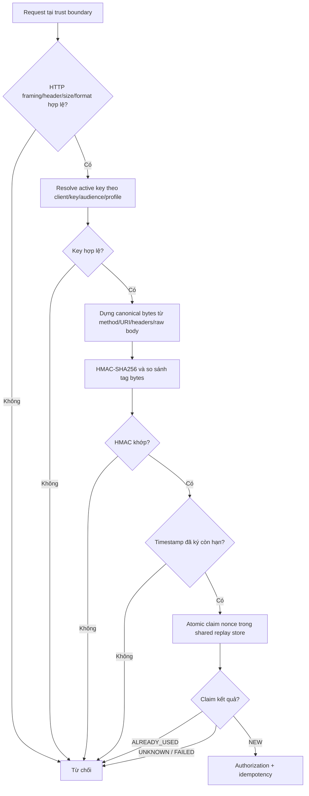
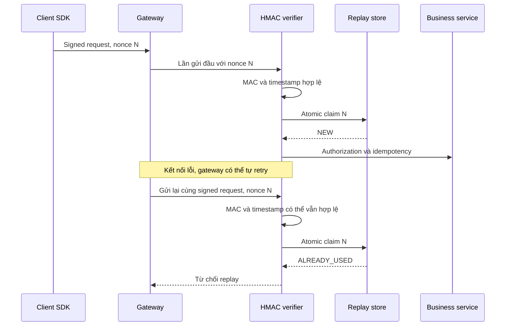

# Dấu hiệu replay trong xác thực HTTP request bằng HMAC

> **Chương:** Replay protection  
> **Bài học:** Dấu hiệu replay — nhận diện, kiểm chứng và điều tra những biểu hiện của việc một HTTP request đã ký bị gửi lại, kể cả trường hợp retry hợp lệ, proxy tự phát lại hoặc lỗi sinh nonce.  
> **Bối cảnh:** Module `SECURITY_AUTHENTICATION_HMAC_REQUEST_AUTHENTICATION` thiết kế xác thực request bằng HMAC với shared secret và canonical request chứa method, URI, các header hoặc body theo hợp đồng ký. Replay protection phải phối hợp với timestamp/nonce, key rotation, proxy/gateway, phân quyền và idempotency.

## 1. Điều gì được xem là dấu hiệu replay?

Giả sử client hợp lệ ký một request chuyển tiền:

```http
POST /v1/transfers?mode=commit HTTP/1.1
Host: payments.example.test
Content-Type: application/json
X-Client-Id: partner-01
X-Key-Id: partner-2026-11
X-Timestamp: 1795800000
X-Nonce: 3NHKKNy74FG5cgv7QEYFjQ
X-Idempotency-Key: transfer-101
X-Signature: <base64url-hmac-sha256>

{"transferId":"transfer-101","amountMinorUnits":100000}
```

Client gửi request, server xác minh HMAC và xử lý nghiệp vụ. Vài giây sau, có một request khác với **cùng timestamp, nonce, method, target, body và chữ ký**. Phép HMAC trên hai request cho kết quả giống nhau, vì HMAC **không ghi nhớ** request nào đã đi qua.

Tình huống này có **dấu hiệu replay rất mạnh**, nhưng nguyên nhân có thể khác nhau:

- Attacker đã ghi lại request và cố phát lại.
- HTTP client hoặc proxy tự động retry **nguyên request đã ký** sau lỗi kết nối.
- Một worker queue gửi lại cùng payload và signature sau khi restart.
- Một test/load generator vô tình dùng lại request fixture.
- Hai client instance sinh trùng nonce do nguồn random bị lỗi hoặc seed bị lặp.

**Dấu hiệu replay không đồng nghĩa đã chứng minh có attacker.** Tầng bảo mật phải **từ chối việc dùng lại nonce đã được claim** theo hợp đồng, còn tầng quan sát/điều tra mới tìm nguyên nhân.

### 1.1 HMAC đúng không có nghĩa request mới

Ba phép kiểm tra khác nhau:

| Kiểm tra | Câu hỏi | Điều chưa chứng minh |
| --- | --- | --- |
| HMAC | Bytes canonical có khớp tag của shared secret được phép không? | Request chưa từng đến trước đó |
| Signed timestamp | Thời điểm ký có còn trong khoảng chấp nhận không? | Nonce chưa từng được sử dụng trong khoảng đó |
| Atomic nonce claim | Nonce của danh tính/audience này đã được dùng chưa? | Bên gửi cố ý tấn công hay chỉ retry |

Vì vậy, một **replay đã được xác thực bằng MAC** vẫn có thể xảy ra trong cửa sổ thời gian. Nếu replay store hoạt động đúng, request thứ hai phải bị từ chối trước khi nghiệp vụ phát sinh side effect.

### 1.2 Mục tiêu bài học

Sau bài này, người học có thể:

1. Phân loại tín hiệu replay **mạnh**, **gợi ý** và **không đủ kết luận**.
2. Phân biệt replay cùng signed attempt với retry được ký lại bằng nonce mới.
3. Thiết kế detector dựa trên **HMAC hợp lệ + timestamp hợp lệ + atomic nonce claim**, thay vì đoán từ IP hoặc body.
4. Phân tích sự trùng lặp nonce, signature, canonical fingerprint và idempotency key.
5. Thu thập telemetry an toàn, đánh giá false positives, concurrency, proxy retry, cache eviction và failover.
6. Dùng Java 17 mô phỏng các tình huống replay và phân loại kết quả.
7. Đề xuất quy trình phản ứng vận hành mà không nhầm xác thực với phân quyền.

## 2. Replay là gì, và những trường hợp nào không phải replay?

Trong phạm vi profile của bài, **một HTTP attempt** gồm các giá trị đã ký: client ID, key ID, audience, method, target, signed headers, timestamp, nonce và body digest. Request được coi là một attempt cụ thể khi các giá trị này tạo thành cùng canonical bytes và tag.

### 2.1 Exact replay: gửi lại nguyên request đã ký

```text
Lần 1:
  client=partner-01, audience=payments-api-prod
  timestamp=T, nonce=N, bodyHash=H, MAC=M
  HMAC=valid, timestamp=in-window
  atomic claim(N)=CLAIMED                 -> được tiếp tục

Lần 2:
  client=partner-01, audience=payments-api-prod
  timestamp=T, nonce=N, bodyHash=H, MAC=M
  HMAC=valid, timestamp=in-window
  atomic claim(N)=ALREADY_USED            -> REJECT
```

Đây là dấu hiệu **mạnh nhất** của request đã được gửi lại. Tuy vậy, không thể chỉ từ việc trùng nonce mà kết luận “attacker”: retry tự động có thể tạo cùng biểu hiện.

### 2.2 Retry được ký mới: không phải replay cùng attempt

Một client không nhận được response có thể retry cùng thao tác:

```text
Attempt A: timestamp=T1, nonce=N1, MAC=M1
Attempt B: timestamp=T2, nonce=N2, MAC=M2
Cả hai: idempotencyKey=transfer-101, businessPayload giống nhau
```

Nếu client tạo nonce **mới**, timestamp đúng và tính lại chữ ký, attempt B là một **request mới hợp lệ về xác thực**. Đây không phải replay **của cùng signed attempt**, nhưng vẫn có nguy cơ làm lặp giao dịch. Tầng **idempotency** phải liên kết cả hai attempts với một operation.

Đừng đặt logic “cùng JSON body” hoặc “cùng idempotency key” vào replay detector rồi từ chối mọi attempt mới; nó có thể làm hỏng retry hợp lệ.

### 2.3 Re-sign cùng nonce: MAC khác nhưng vẫn bị từ chối

Nếu bên giữ secret ký hai request khác nội dung với **cùng nonce** trong một scope replay:

```text
Request A: nonce=N, bodyHash=H1, MAC=M1 (valid)
Request B: nonce=N, bodyHash=H2, MAC=M2 (valid)
```

Request B phải bị từ chối nếu nonce N đã được claim, dù MAC khác. Điều này có thể do client bug, seed lặp hoặc hành vi cố ý của bên có key.

**Nonce uniqueness là ràng buộc của signed attempt trong scope đã quy định**, không phải so sánh nguyên chuỗi signature.

### 2.4 Timestamp cũ chưa đủ kết luận là replay

Một request có timestamp hết hạn là **stale request**, có thể là:

- Replay sau thời hạn;
- Request nằm trong queue quá lâu;
- Client/server bị clock skew;
- SDK ký quá sớm, gửi quá muộn;
- Timestamp bị điền sai đơn vị seconds/milliseconds.

Bất kể nguyên nhân, signed timestamp ngoài cửa sổ phải bị từ chối. Nhưng chỉ riêng lỗi “quá cũ” **không chứng minh** request đã được xử lý trước đó.

## 3. Phân cấp các dấu hiệu replay

Để phân tích chính xác, phân loại dựa trên **evidence đã được xác thực**, thay vì một mẫu quan sát đơn lẻ.

| Dấu hiệu | Độ mạnh của evidence | Diễn giải đúng |
| --- | --- | --- |
| Nonce đã claim, MAC hợp lệ, timestamp còn hạn | **Rất mạnh** | Một signed nonce đang được dùng lại; từ chối |
| Cùng nonce và cùng canonical fingerprint đã xác minh | **Rất mạnh** | Có khả năng exact signed-attempt retransmission |
| Cùng nonce nhưng canonical fingerprint khác, cả hai MAC hợp lệ | **Rất mạnh** | Vi phạm uniqueness; có thể bug hoặc signer cố ý tái sử dụng |
| Cùng signature text trên nhiều request | Gợi ý | Có thể exact replay, nhưng phải xét profile, key, body, phạm vi và validation |
| Cùng timestamp trên nhiều request | **Yếu** | Nhiều requests có thể được ký trong cùng một giây |
| Cùng body hash hoặc path | **Yếu** | Nhiều lần đọc/ghi giống nhau có thể hoàn toàn hợp lệ |
| Cùng idempotency key, nonce khác | Thường là retry nghiệp vụ | Không phải exact replay; cần business deduplication |
| Cùng IP hoặc User-Agent | **Rất yếu** | NAT, proxy, load balancer có thể dùng chung |
| Timestamp quá cũ | Dấu hiệu request không còn hợp lệ | Chưa chứng minh nonce đã được dùng |
| Duplicate `X-Nonce` header | Input nhập nhằng | Lỗi HTTP parsing/format, không tự suy là replay |
| Replay store báo lỗi hoặc mất dữ liệu | **Không xác định** | Không được biến thành kết luận “chưa dùng” |

### 3.1 Sự khác nhau giữa “evidence” và “verdict”

**Evidence** là thông tin hỗ trợ điều tra: nonce có bị trùng không, fingerprint có giống không, response trước ra sao, gateway có retry hay không.

**Verdict** là quyết định bảo mật trong đường xử lý request:

- `ACCEPTED`: các kiểm tra bắt buộc thành công, nonce mới được claim.
- `BAD_SIGNATURE`: tag không khớp canonical bytes.
- `EXPIRED` hoặc `FUTURE`: timestamp đã ký ngoài cửa sổ.
- `REPLAY`: nonce hợp lệ đã được claim trước đó trong scope.
- `STORE_UNAVAILABLE`: không thể xác định chắc chắn trạng thái nonce.

Đối với request đã có `REPLAY`, không được “chấp nhận lại vì có thể chỉ là retry hợp lệ”. Cách phục hồi retry hợp lệ là client tạo **attempt mới** với nonce/tag mới và dùng **idempotency key ổn định**.

### 3.2 Dấu hiệu phía client và phía server

Ở **client**, có thể phát hiện:

- Hai attempts được ký với cùng nonce do generator bug;
- Một `HttpRequest` đã ký bị gửi lại mà không re-sign;
- Clock khác thường hoặc request chờ trong queue quá lâu;
- Nhiều worker cùng dùng signing request fixture.

Ở **server**, có thể phát hiện:

- Hai lần claim cùng replay key;
- Nonce đã claim nhưng đến từ gateway route hoặc instance khác;
- Hai MAC hợp lệ dùng cùng nonce với fingerprint khác nhau;
- Replay attempts tăng sau mất kết nối, redeploy hoặc key rotation.

Hai phía có cái nhìn khác nhau. Client **không có toàn bộ lịch sử claim của server**; server **không biết chắc ý định của client**. Cần correlation ID và telemetry được thiết kế cho việc đối chiếu.

## 4. Phạm vi nhận diện replay: client, audience và nonce

Một nonce không phải global ID cho toàn bộ Internet. Cần chọn **phạm vi một lần sử dụng** trong signing profile.

Ví dụ namespace:

```text
hmac-replay:v1:<audience>:<authenticated-client-id>:<nonce>
```

Ở đây:

- `audience` được server cấu hình/ràng buộc qua chữ ký.
- `authenticated-client-id` chỉ được coi là đã xác thực **sau khi MAC hợp lệ** và key policy cho phép.
- `nonce` đã qua strict format validation và nằm trong canonical bytes.
- `v1` là version của replay namespace, không nhất thiết đồng nghĩa key ID.

Một request HMAC hợp lệ của client A không nên chiếm nonce của client B nếu profile định nghĩa uniqueness theo client. Ngược lại, đừng tách theo `keyId` nếu policy yêu cầu nonce được dùng **một lần xuyên giai đoạn key rotation** của cùng client/audience.

### 4.1 Khi cùng nonce xuất hiện ở hai endpoints

Giả sử signer dùng nonce N cho:

```text
POST /v1/orders?mode=commit
POST /v1/refunds?mode=commit
```

Nếu cùng client và audience, theo profile bảo vệ của bài, nonce N **không được tái sử dụng**, dù target khác. Nếu muốn uniqueness theo endpoint, phải ghi rõ và đánh giá việc client được phép dùng lại nonce ở các endpoints; không tự đưa path vào Redis key để “giảm va chạm” khi điều đó nới lỏng chính sách.

### 4.2 Nếu nhiều khóa cùng hoạt động

Trong key rotation, server có thể tạm chấp nhận hai key ID riêng. Hai request được ký bằng hai key hợp lệ nhưng mang cùng nonce:

```text
Key A: client=partner-01, nonce=N, MAC_A hợp lệ
Key B: client=partner-01, nonce=N, MAC_B hợp lệ
```

Nếu profile định nghĩa nonce theo `client + audience`, lần thứ hai vẫn bị từ chối. Không ngầm coi đổi key ID là “reset nonce namespace”.

## 5. Phải xác minh HMAC trước khi kết luận nonce trùng

Một header `X-Nonce` do người ngoài gửi **không tự đáng tin**. Attacker có thể thử hàng triệu chuỗi nonce ngẫu nhiên hoặc cố ý trùng. Nếu server ghi nonce trước khi xác thực HMAC, attacker có thể gây **nonce poisoning**: đánh dấu nonce là “đã dùng” dù request không được ký hợp lệ.

Thứ tự khuyến nghị:



**Không suy ra “đã có replay hợp lệ” từ một nonce trùng trên request có MAC sai.** Một request chưa xác thực có thể copy nonce từ request thật mà không biết secret, hoặc chỉ tình cờ có cùng chuỗi.

### 5.1 Canonical bytes phải có nonce

Ví dụ hợp đồng tự thiết kế `hmac-replay-signals-v1`:

```text
hmac-replay-signals-v1
payments-api-prod
POST
/v1/transfers?mode=commit
application/json
partner-01
partner-2026-11
1795800000
3NHKKNy74FG5cgv7QEYFjQ
transfer-101
<sha256-lowercase-hex-of-raw-body>
```

Định dạng:

1. Phiên bản và audience được ràng buộc trong chữ ký.
2. Method/target là giá trị HTTP thực tại trust boundary đã thống nhất.
3. Content-Type, client/key ID, signed timestamp, signed nonce và idempotency key được validate theo grammar.
4. Body digest là SHA-256 của **raw body bytes** theo hợp đồng.
5. Ghép từng dòng bằng LF `0x0A`, encode UTF-8, không có LF cuối.
6. Tag là HMAC-SHA256 32 bytes, gửi bằng Base64URL không padding (43 ký tự).

```text
bodyHashHex = lower_hex(SHA256(rawBodyBytes))
canonicalBytes = UTF8(joinWithLF(
    version, audience, method, rawTarget, contentType,
    clientId, keyId, timestamp, nonce, idempotencyKey, bodyHashHex))
expectedTag = HMAC_SHA256(sharedSecret, canonicalBytes)
receivedTag = BASE64URL_DECODE(signatureHeader)
macValid = constant_time_compare(expectedTag, receivedTag)
```

Không nhận “canonical request text” do client tự cung cấp làm sự thật. Server phải dựng lại từ request thực, xử lý duplicate signed headers, URI encoding và header/body canonicalization đúng profile.

### 5.2 Từ chối header trùng trước khi so MAC

```http
X-Nonce: 3NHKKNy74FG5cgv7QEYFjQ
x-nonce: AAAAAAAAAAAAAAAAAAAAAA
```

HTTP header names không phân biệt hoa/thường. Nếu proxy lấy giá trị đầu, verifier lấy giá trị cuối và backend chọn một giá trị khác, replay store có thể claim một nonce trong khi nghiệp vụ xử lý request khác.

Từ chối duplicate signed headers tại tầng vẫn có thể quan sát cấu trúc thực của chúng. Nếu proxy đã merge trước khi verifier thấy, cấu hình gateway phải được kiểm thử và từ chối input nhập nhằng ở nơi phù hợp.

## 6. Fingerprint: dấu vân tay request hỗ trợ điều tra

Để phân biệt **exact replay** và **tái sử dụng nonce với nội dung khác**, có thể tính một request fingerprint từ **canonical bytes đã được xác thực**.

```text
fingerprint = lowercase_hex(SHA256(canonicalRequestBytes))
```

Vì canonical bytes chứa method, target, signed timestamp, nonce, idempotency key và body digest, fingerprint khác nếu bất kỳ trường đã ký nào khác theo profile.

| Hai lần nhận | Nonce | Fingerprint | Diễn giải nội bộ |
| --- | --- | --- | --- |
| A rồi A | Giống | Giống | Một signed attempt bị gửi lại |
| A rồi B, B có body khác nhưng ký hợp lệ | Giống | Khác | Tái sử dụng nonce với một signed request khác |
| A rồi B, B có nonce mới | Khác | Khác | Hai attempts khác nhau, cần xét idempotency |
| A rồi request giả chưa có MAC hợp lệ | Có thể giống | Không nên tính/so như evidence đáng tin | Chặn ở HMAC trước |

**Đây là thông tin điều tra, không thay thế replay key.** Một triển khai có thể đơn giản lưu `nonce -> đã dùng` và từ chối mọi lần claim trùng, không cần fingerprint.

### 6.1 Fingerprint không phải định danh nghiệp vụ

Nếu client gửi hai signed requests giống hệt JSON body nhưng nonce khác, canonical fingerprint của chúng **khác** vì nonce được ký. Đó là hành vi đúng của fingerprint cho **HTTP attempt**, nhưng không chứng minh có hai nghiệp vụ khác nhau.

Muốn nhận diện một transaction, cần business operation ID/idempotency key được xác thực và kiểm tra bằng chính sách nghiệp vụ riêng.

### 6.2 Không công bố fingerprint tùy tiện

SHA-256 không phải cơ chế che giấu thông tin. Nếu canonical bytes có những trường dễ đoán, digest có thể tiết lộ mối liên hệ hoặc hỗ trợ dò từ điển trong một số tình huống. Hãy:

- Chỉ lưu fingerprint phục vụ debug trong phạm vi đã được đánh giá.
- Không log shared secret, expected HMAC, raw body nhạy cảm hoặc full canonical request.
- Xem xét fingerprint bằng **HMAC với diagnostic key riêng** nếu cần hạn chế khả năng đoán dữ liệu từ log.
- Đặt TTL, kiểm soát quyền truy cập và retention cho telemetry.
- Không biến nonce, signature hay fingerprint thành **metric label** có cardinality cực cao.

Thông tin “same fingerprint” / “different fingerprint” nên là **mã phân loại nội bộ**, không cần trả chi tiết cho client có request bị từ chối.

## 7. Atomic replay claim: tín hiệu quyết định

Không dùng đoạn logic:

```text
if NOT EXISTS(replayKey):
    SET replayKey
    accept
```

Hai request đến song song có thể đều thấy key chưa tồn tại, rồi cùng xử lý nghiệp vụ. Phải có **một thao tác atomic insert-if-absent**.

Ví dụ Redis trên một primary:

```redis
SET hmac-replay:v1:payments-api-prod:partner-01:<nonce> 1 NX EX 420
```

Diễn giải:

| Kết quả | Ý nghĩa | Quyết định |
| --- | --- | --- |
| `OK` | Nonce mới được claim nguyên tử | Tiếp tục authorization |
| Nil / không ghi vì key tồn tại | Nonce đã được claim | Từ chối replay |
| Timeout, failover, connection error | Kết quả không chắc chắn | **Fail closed**, không chạy nghiệp vụ |

Nếu lưu fingerprint để phân loại duplicate, có thể đặt **giá trị** của replay key là fingerprint ở lần claim đầu. Khi `SET NX EX` trả “đã tồn tại”, một thao tác đọc bổ sung có thể hỗ trợ điều tra sự trùng hay khác fingerprint. **Đừng dùng `GET` sau đó `SET` để quyết định chấp nhận.** Đọc chẩn đoán có thể race với expiration; nếu dữ liệu không còn hoặc trạng thái không rõ, hệ thống vẫn phải từ chối theo kết quả claim ban đầu.

### 7.1 Cửa sổ timestamp và TTL

Giả sử profile chấp nhận:

- `PAST=300` giây quá khứ;
- `FUTURE=60` giây tương lai.

Timestamp `t` hợp lệ khi:

\[
now - PAST \le t \le now + FUTURE.
\]

Request có thể được chấp nhận sớm nhất khi `now=t-FUTURE`, và muộn nhất khi `now=t+PAST`. Khoảng thời gian tối đa từ lần claim sớm nhất tới hạn cuối:

\[
TTL_{\text{min, ideal}} = PAST + FUTURE = 360\ \text{giây}.
\]

Một TTL ví dụ `420 giây` cộng 60 giây dự phòng cho sai lệch vận hành đã phân tích. Trong hệ thống thực, cần tính margin theo clock skew giữa instances, độ trễ, độ chính xác TTL và yêu cầu consistency. Nếu cửa sổ đối xứng ±300 giây thì khoảng bảo vệ tối đa là **600 giây**, không phải 300 giây.

**Dấu hiệu replay có thể biến mất nếu TTL đặt quá ngắn hoặc store bị mất bản ghi**, dù nonce từng được claim. Vì vậy, một kết quả “store chưa thấy nonce” không phải bằng chứng toàn cục rằng request chưa từng xuất hiện trong lịch sử.

### 7.2 Multi-region và failover

Redis `SET NX EX` atomic trên một primary, nhưng replication bất đồng bộ có thể làm mất bản ghi được ACK trước khi failover. Nếu hai vùng có primary độc lập, cùng nonce có thể được claim đồng thời ở cả hai vùng.

Đối với giao dịch có rủi ro cao:

- Chọn một scope uniqueness có backend nhất quán phù hợp;
- Định tuyến/đồng bộ để tránh double claim giữa regions;
- Theo dõi failover, eviction, replication lag và cache flush;
- Cân nhắc unique constraint bền vững trong database hoặc hệ thống claim có consistency mạnh hơn;
- **Không coi replay cache là cơ chế exactly-once cho chuyển tiền**; cần idempotency và transaction ở tầng nghiệp vụ.

## 8. Java 17: phân loại dấu hiệu replay sau khi xác minh HMAC

Ví dụ sau chạy bằng JDK 17 không cần dependency ngoài. Mục tiêu là mô phỏng:

- Request có MAC đúng và nonce mới được nhận;
- Exact signed attempt bị replay;
- Hai request **đều có HMAC đúng** nhưng tái sử dụng cùng nonce với body khác;
- Retry với nonce mới và idempotency key cũ;
- Nonce bị sửa sau khi ký dẫn đến MAC sai;
- Timestamp hết hạn và replay store không sẵn sàng;
- Hai luồng cùng claim một nonce, chỉ một luồng được chấp nhận.

**Lưu ý về mô hình:** Đoạn mã dùng một `ConcurrentHashMap` trong JVM để minh họa atomic claim. Nó **không có TTL, durability, replication hoặc shared state giữa các instances**, nên **không được dùng nguyên dạng trong production**. Để tập trung vào replay, method, target, Content-Type, client ID, key ID và audience được cố định; HTTP adapter thật phải đọc/kiểm tra các trường này từ request thực.

Lưu thành `ReplaySignalsDemo.java`:

```java
import java.nio.charset.StandardCharsets;
import java.security.GeneralSecurityException;
import java.security.MessageDigest;
import java.security.SecureRandom;
import java.time.Clock;
import java.time.Instant;
import java.time.ZoneOffset;
import java.util.Base64;
import java.util.HexFormat;
import java.util.concurrent.Callable;
import java.util.concurrent.ConcurrentHashMap;
import java.util.concurrent.CountDownLatch;
import java.util.concurrent.ExecutorService;
import java.util.concurrent.Executors;
import java.util.concurrent.Future;

import javax.crypto.Mac;
import javax.crypto.spec.SecretKeySpec;

public final class ReplaySignalsDemo {
    private static final String PROFILE = "hmac-replay-signals-v1";
    private static final String AUDIENCE = "payments-api-prod";
    private static final String METHOD = "POST";
    private static final String TARGET =
            "/v1/transfers?mode=commit";
    private static final String CONTENT_TYPE = "application/json";
    private static final String CLIENT = "partner-01";
    private static final String KEY_ID = "partner-2026-11";
    private static final long PAST = 300;
    private static final long FUTURE = 60;
    private static final long TTL = PAST + FUTURE + 60;

    private ReplaySignalsDemo() {}

    enum Verdict {
        ACCEPTED, BAD_FORMAT, BAD_SIGNATURE,
        EXPIRED, FUTURE_TIMESTAMP,
        REPLAY_SAME_REQUEST, REPLAY_DIFFERENT_REQUEST,
        STORE_UNAVAILABLE
    }

    enum ClaimType {
        FIRST, DUPLICATE_SAME, DUPLICATE_DIFFERENT
    }

    record ClaimResult(ClaimType type) {}

    static final class StoreFailure extends Exception {
        StoreFailure(String reason) { super(reason); }
    }

    interface ReplayStore {
        ClaimResult claimOnce(
                String replayKey, String fingerprint, long ttlSeconds)
                throws StoreFailure;
    }

    // Chỉ để minh họa atomicity trong một JVM. Không có TTL.
    static final class DemoStore implements ReplayStore {
        private final ConcurrentHashMap<String, String> used =
                new ConcurrentHashMap<>();

        @Override
        public ClaimResult claimOnce(
                String replayKey, String fingerprint, long ttlSeconds) {
            String previous = used.putIfAbsent(replayKey, fingerprint);
            if (previous == null) {
                return new ClaimResult(ClaimType.FIRST);
            }
            return new ClaimResult(
                    previous.equals(fingerprint)
                            ? ClaimType.DUPLICATE_SAME
                            : ClaimType.DUPLICATE_DIFFERENT);
        }
    }

    public record SignedRequest(
            String timestamp,
            String nonce,
            String idempotencyKey,
            byte[] rawBody,
            String signature) {

        public SignedRequest {
            rawBody = rawBody == null ? null : rawBody.clone();
        }

        @Override
        public byte[] rawBody() {
            return rawBody == null ? null : rawBody.clone();
        }
    }

    static String freshNonce(SecureRandom rng) {
        byte[] random = new byte[16];
        rng.nextBytes(random);
        return Base64.getUrlEncoder()
                .withoutPadding()
                .encodeToString(random);
    }

    static boolean validNonce(String value) {
        if (value == null
                || !value.matches("[A-Za-z0-9_-]{22}")) {
            return false;
        }
        try {
            byte[] nonce = Base64.getUrlDecoder().decode(value);
            return nonce.length == 16
                    && Base64.getUrlEncoder()
                            .withoutPadding()
                            .encodeToString(nonce).equals(value);
        } catch (IllegalArgumentException malformed) {
            return false;
        }
    }

    static boolean validFields(SignedRequest request) {
        return request != null
                && request.timestamp() != null
                && request.timestamp().matches("[1-9][0-9]{9,11}")
                && validNonce(request.nonce())
                && request.idempotencyKey() != null
                && request.idempotencyKey()
                        .matches("[A-Za-z0-9._-]{1,80}")
                && request.rawBody() != null
                && request.rawBody().length > 0
                && request.rawBody().length <= 1_048_576;
    }

    static byte[] canonicalBytes(SignedRequest request)
            throws GeneralSecurityException {
        if (!validFields(request)) {
            throw new IllegalArgumentException("Invalid signed fields");
        }

        String bodyHash = HexFormat.of().formatHex(
                MessageDigest.getInstance("SHA-256")
                        .digest(request.rawBody()));

        String canonical = String.join("\n",
                PROFILE, AUDIENCE,
                METHOD, TARGET, CONTENT_TYPE,
                CLIENT, KEY_ID,
                request.timestamp(),
                request.nonce(),
                request.idempotencyKey(),
                bodyHash);

        return canonical.getBytes(StandardCharsets.UTF_8);
    }

    static byte[] hmac(byte[] secret, byte[] data)
            throws GeneralSecurityException {
        Mac mac = Mac.getInstance("HmacSHA256");
        mac.init(new SecretKeySpec(secret, "HmacSHA256"));
        return mac.doFinal(data);
    }

    static SignedRequest signForDemo(
            byte[] secret, SignedRequest unsigned)
            throws GeneralSecurityException {

        byte[] tag = hmac(secret, canonicalBytes(unsigned));
        String signature = Base64.getUrlEncoder()
                .withoutPadding()
                .encodeToString(tag);

        return new SignedRequest(
                unsigned.timestamp(),
                unsigned.nonce(),
                unsigned.idempotencyKey(),
                unsigned.rawBody(),
                signature);
    }

    static SignedRequest request(
            long timestamp, String nonce,
            String operationId, byte[] body) {
        return new SignedRequest(
                Long.toString(timestamp),
                nonce,
                operationId,
                body,
                "");
    }

    static Verdict verify(
            byte[] resolvedSecret,
            SignedRequest request,
            Clock clock,
            ReplayStore store) throws GeneralSecurityException {

        if (resolvedSecret == null || resolvedSecret.length < 32
                || clock == null || store == null
                || !validFields(request)
                || request.signature() == null
                || !request.signature()
                        .matches("[A-Za-z0-9_-]{43}")) {
            return Verdict.BAD_FORMAT;
        }

        final byte[] supplied;
        try {
            supplied = Base64.getUrlDecoder()
                    .decode(request.signature());
        } catch (IllegalArgumentException malformedTag) {
            return Verdict.BAD_FORMAT;
        }

        if (supplied.length != 32
                || !Base64.getUrlEncoder()
                        .withoutPadding()
                        .encodeToString(supplied)
                        .equals(request.signature())) {
            return Verdict.BAD_FORMAT;
        }

        byte[] canonical = canonicalBytes(request);
        byte[] expected = hmac(resolvedSecret, canonical);

        if (!MessageDigest.isEqual(expected, supplied)) {
            return Verdict.BAD_SIGNATURE;
        }

        long signedAt = Long.parseLong(request.timestamp());
        long now = clock.instant().getEpochSecond();
        final long earliest;
        final long latest;
        try {
            earliest = Math.subtractExact(now, PAST);
            latest = Math.addExact(now, FUTURE);
        } catch (ArithmeticException overflow) {
            return Verdict.BAD_FORMAT;
        }

        if (signedAt < earliest) return Verdict.EXPIRED;
        if (signedAt > latest) return Verdict.FUTURE_TIMESTAMP;

        // Chỉ lập fingerprint SAU khi MAC và timestamp hợp lệ.
        String fingerprint = HexFormat.of().formatHex(
                MessageDigest.getInstance("SHA-256")
                        .digest(canonical));

        // Namespace không chứa key ID: nonce một lần theo client+audience.
        String replayKey = "hmac-replay:v1:" + AUDIENCE
                + ":" + CLIENT + ":" + request.nonce();

        final ClaimResult claim;
        try {
            claim = store.claimOnce(replayKey, fingerprint, TTL);
        } catch (StoreFailure unavailable) {
            return Verdict.STORE_UNAVAILABLE;
        }

        return switch (claim.type()) {
            case FIRST -> Verdict.ACCEPTED;
            case DUPLICATE_SAME -> Verdict.REPLAY_SAME_REQUEST;
            case DUPLICATE_DIFFERENT ->
                    Verdict.REPLAY_DIFFERENT_REQUEST;
        };
    }

    public static void main(String[] args) throws Exception {
        SecureRandom rng = new SecureRandom();
        byte[] secret = new byte[32];
        rng.nextBytes(secret);

        Clock clock = Clock.fixed(
                Instant.parse("2026-11-28T02:00:00Z"),
                ZoneOffset.UTC);
        long now = clock.instant().getEpochSecond();

        byte[] body1 = (
                "{\"transferId\":\"transfer-101\","
                + "\"amountMinorUnits\":100000}"
        ).getBytes(StandardCharsets.UTF_8);
        byte[] body2 = (
                "{\"transferId\":\"transfer-101\","
                + "\"amountMinorUnits\":900000}"
        ).getBytes(StandardCharsets.UTF_8);

        String nonce = freshNonce(rng);
        SignedRequest first = signForDemo(
                secret, request(now, nonce, "transfer-101", body1));

        DemoStore store = new DemoStore();
        System.out.println("First: "
                + verify(secret, first, clock, store));
        System.out.println("Exact replay: "
                + verify(secret, first, clock, store));

        // Cùng nonce, body khác nhưng có HMAC mới hợp lệ.
        SignedRequest changedBody = signForDemo(
                secret, request(now, nonce, "transfer-101", body2));
        System.out.println("Valid MAC, reused nonce, changed body: "
                + verify(secret, changedBody, clock, store));

        // Cùng nghiệp vụ nhưng attempt mới có nonce khác.
        SignedRequest retry = signForDemo(
                secret, request(now, freshNonce(rng),
                        "transfer-101", body1));
        System.out.println("New nonce retry: "
                + verify(secret, retry, clock, store));

        // Sửa nonce sau khi ký, giữ signature cũ.
        SignedRequest forged = new SignedRequest(
                first.timestamp(), freshNonce(rng),
                first.idempotencyKey(), first.rawBody(),
                first.signature());
        System.out.println("Tampered nonce: "
                + verify(secret, forged, clock, store));

        // Ký THẬT một request đã quá hạn.
        SignedRequest expired = signForDemo(
                secret, request(now - 301, freshNonce(rng),
                        "transfer-101", body1));
        System.out.println("Signed expired request: "
                + verify(secret, expired, clock, store));

        ReplayStore unavailable = (key, fingerprint, ttl) -> {
            throw new StoreFailure("timeout");
        };
        SignedRequest fresh = signForDemo(
                secret, request(now, freshNonce(rng),
                        "transfer-101", body1));
        System.out.println("Store unavailable: "
                + verify(secret, fresh, clock, unavailable));

        // Hai luồng đua claim cùng signed request qua store chung.
        DemoStore concurrentStore = new DemoStore();
        CountDownLatch start = new CountDownLatch(1);
        ExecutorService pool = Executors.newFixedThreadPool(2);
        Callable<Verdict> task = () -> {
            start.await();
            return verify(secret, first, clock, concurrentStore);
        };
        try {
            Future<Verdict> a = pool.submit(task);
            Future<Verdict> b = pool.submit(task);
            start.countDown();
            Verdict left = a.get();
            Verdict right = b.get();
            long accepted =
                    (left == Verdict.ACCEPTED ? 1 : 0)
                    + (right == Verdict.ACCEPTED ? 1 : 0);
            System.out.println("Concurrent exactly one accepted: "
                    + (accepted == 1));
        } finally {
            pool.shutdownNow();
        }
    }
}
```

Chạy bằng Java 17:

```bash
javac -encoding UTF-8 ReplaySignalsDemo.java
java ReplaySignalsDemo
```

Kết quả kỳ vọng về **trạng thái**:

```text
First: ACCEPTED
Exact replay: REPLAY_SAME_REQUEST
Valid MAC, reused nonce, changed body: REPLAY_DIFFERENT_REQUEST
New nonce retry: ACCEPTED
Tampered nonce: BAD_SIGNATURE
Signed expired request: EXPIRED
Store unavailable: STORE_UNAVAILABLE
Concurrent exactly one accepted: true
```

### 8.1 Cách đọc kết quả

- `First`: MAC hợp lệ, timestamp trong cửa sổ, nonce được claim lần đầu.
- `Exact replay`: cùng canonical fingerprint và nonce → dấu hiệu retransmission mạnh.
- `Valid MAC, reused nonce, changed body`: một signer đã tạo request khác với nonce đã dùng. Có thể là bug trong SDK, môi trường clone RNG hoặc signer cố ý vi phạm profile. **Vẫn từ chối.**
- `New nonce retry`: attempt mới qua xác thực, nhưng nghiệp vụ phải kiểm tra idempotency key để không chuyển tiền hai lần.
- `Tampered nonce`: sửa nonce mà không ký lại làm MAC sai. Server **không claim nonce này**.
- `Signed expired request`: HMAC hợp lệ nhưng timestamp quá cũ.
- `Store unavailable`: fail closed, không xử lý.
- `Concurrent exactly one accepted`: `putIfAbsent` giúp minh họa chỉ một claim thành công khi các threads dùng chung store.

### 8.2 Giới hạn cực kỳ quan trọng

Ví dụ **không phải verifier production**:

- Không có HTTP parser thực, TLS, gateway, duplicate-header handling hoặc request framing validation.
- Method, target, client/key ID và audience được cố định trong bài; server thật phải tái dựng từ HTTP request thật và key resolver đáng tin.
- Không parse JSON nghiêm ngặt, không kiểm tra duplicate object keys và schema; handler phải dùng đúng payload đã được xác minh.
- `DemoStore` **không hỗ trợ TTL, multi-process, multi-region, durability, restart hoặc failover**.
- Nhãn `REPLAY_SAME_REQUEST` và `REPLAY_DIFFERENT_REQUEST` chỉ dành cho **chẩn đoán nội bộ**; API công khai không bắt buộc phân biệt chúng.
- Chương trình không triển khai authorization/idempotency transaction và chưa đo thời gian so MAC end-to-end.

**Ý tưởng cần giữ lại khi triển khai thực** là thứ tự xác thực và phép claim nguyên tử, không phải dùng nguyên đoạn `ConcurrentHashMap` như một security control trong cluster.

## 9. Dấu hiệu replay qua proxy và gateway

Khi đường đi gồm client → CDN → API gateway → service Java, việc phát lại có thể xuất hiện ở nhiều hop.



### 9.1 Gateway retry khác client re-sign

Nếu gateway không có shared secret và không phải một signing principal, nó **không thể sửa nonce/timestamp rồi tạo MAC hợp lệ**. Vì thế auto-retry tại gateway thường gửi lại cùng signed request và có nguy cơ bị nonce store chặn.

Client hoặc thành phần được ủy quyền ký mới có thể tạo một **attempt mới** với nonce, timestamp và MAC mới. Điều này phải đi kèm chính sách retry/idempotency rõ ràng. Không bypass replay detector chỉ để giữ tính năng auto-retry của gateway.

### 9.2 Chênh lệch parser có thể che giấu dấu hiệu

Một vài lỗi thường gặp:

| Vấn đề | Tác động | Hành động |
| --- | --- | --- |
| Gateway gộp hai `X-Nonce` | Verifier không biết đầu vào gốc nhập nhằng | Reject duplicate tại hop còn quan sát được |
| Gateway rewrite URI | Client ký một target, backend xử lý target khác | Xác định trust boundary và canonicalization rõ |
| HTTP/2 `:path` chuyển sang HTTP/1.1 request-target | Khác wire representation | Ký biểu diễn ngữ nghĩa đã định, test xuyên giao thức |
| Proxy tự giải nén/re-serialize JSON | Body bytes sau gateway khác bytes đã ký | Ràng buộc Content-Encoding và hash đúng payload theo hợp đồng |
| Header `X-Forwarded-*` do client khai | Có thể giả mạo nguồn/hop | Gateway xóa, tái tạo theo trust policy |
| Client/gateway cùng retry | Cùng signed attempt phát lại nhiều lần | Telemetry giúp tìm hop phát lại |
| Load balancer đổi instance | Nonce store local không thấy claim cũ | Dùng store chia sẻ nhất quán |

HMAC và replay store chỉ bảo vệ **đúng request đã được verifier hiểu**. Nếu proxy/backend không thống nhất framing, method, URI hoặc headers, phải sửa trust boundary/parser differential, không chỉ tăng TTL.

## 10. Phân biệt false positive và tấn công thật

**Replay detector không nên cố suy đoán ý định ngay trong đường request.** Luồng bảo mật chỉ cần bảo đảm đã claim nonce rồi thì không xử lý lần hai. Luồng điều tra có thể xét các dấu hiệu bổ sung.

### 10.1 Những nguyên nhân vô hại thường gặp

| Hiện tượng | Gợi ý nguyên nhân | Cách kiểm chứng |
| --- | --- | --- |
| Exact replay ngay sau connection reset | HTTP client/proxy retry cùng signature | Correlation ID của client, retry logs ở gateway |
| Dấu replay tăng sau deploy | SDK tái sử dụng signed request object | Kiểm tra signer tạo nonce trên mỗi network attempt |
| Nonce trùng trên nhiều pods | Seed hoặc snapshot RNG lặp | Kiểm tra lifecycle `SecureRandom`, restore/restart |
| Timestamp stale, không có duplicate claim | Queue hoặc clock skew | Đo queue delay và clock drift |
| Cùng idempotency key nhưng nonce khác | Retry đúng thiết kế | Kiểm tra business idempotency store |
| Duplicate header nonce | Proxy/HTTP SDK merge behavior | Capture test traffic ở ingress được phép |
| Claim state mất sau failover | Replay store durability kém | Failover logs, replication lag, eviction |
| Cùng body nhiều lần | Polling hoặc action nghiệp vụ giống nhau | Đối chiếu operation ID, không quy kết replay |

Một client bug gây nonce trùng có thể làm request hợp lệ bị từ chối. Không giải quyết bằng cách cho phép cùng nonce dùng lại: điều đó phá tính chất chống replay. Thay vào đó sửa signer, tạo attempt mới và dùng idempotency.

### 10.2 Tín hiệu tăng nghi ngờ hành vi đối kháng

- Nhiều exact replays xuất hiện từ đường mạng/ASN hoặc thiết bị khác hẳn sau lần dùng đầu, trong khi credential hợp lệ.
- Cố phát lại request vào nhiều regions gần đồng thời để khai thác replication race.
- Request cũ lặp liên tục gần ngưỡng timestamp expiry.
- Lưu lượng khai thác sau một giai đoạn có nghi vấn lộ traffic capture, token hoặc logging.
- Nhiều nonce khác nhau bị gửi cùng signature cũ (chỉ làm MAC sai), gợi ý thử né store.
- HMAC hợp lệ trên những signed requests khác nội dung nhưng tái sử dụng nonce thường xuyên, cần kiểm tra signer/credential compromise.

Những tín hiệu này **không chứng minh có tấn công** nếu thiếu bối cảnh. Không suy ra danh tính cá nhân hoặc mức độ ác ý từ IP, vùng địa lý hay một dấu hiệu duy nhất.

## 11. Quan sát và telemetry cho replay protection

Mục đích telemetry là phát hiện sự cố, điều tra false positives và xác nhận các bảo đảm chống replay hoạt động. Không log toàn bộ bí mật để tìm replay.

### 11.1 Mã sự kiện khuyến nghị

| Mã nội bộ | Điều kiện | Ghi chú |
| --- | --- | --- |
| `hmac.signature_invalid` | MAC không khớp | Chưa gọi là replay có xác thực |
| `hmac.timestamp_expired` | Signed timestamp quá cũ | Có thể là stale queue/clock |
| `hmac.timestamp_future` | Signed timestamp quá xa tương lai | Có thể là clock skew |
| `hmac.nonce_claimed` | Atomic claim trả NEW | Chưa đồng nghĩa được authorization |
| `hmac.nonce_duplicate_same` | Nonce trùng và fingerprint trùng | Dấu hiệu exact signed-attempt retry |
| `hmac.nonce_duplicate_different` | Nonce trùng nhưng signed fingerprint khác | Dấu hiệu reuse nonce bất thường |
| `hmac.replay_store_unavailable` | Không xác định trạng thái claim | Fail closed |
| `hmac.key_inactive` | Key chưa/không còn được policy cho phép | Không xem như replay |
| `business.idempotency_hit` | Attempt mới nhưng operation đã có kết quả | Phân biệt với nonce replay |
| `business.authorization_denied` | MAC/nonce hợp lệ nhưng thiếu quyền | Lỗi phân quyền độc lập |

Đường response công khai không nhất thiết trả toàn bộ mã chi tiết. Ví dụ, `nonce_duplicate_same` và `nonce_duplicate_different` đều có thể trả một lỗi chung “request cannot be accepted”. Hạn chế việc public error trở thành oracle về replay state hoặc lịch sử giao dịch.

### 11.2 Metric nên có cardinality thấp

Ví dụ:

```text
hmac_verify_total{result="bad_signature",profile="v1"}
hmac_verify_total{result="timestamp_expired",profile="v1"}
hmac_replay_claim_total{result="new",region="ap-southeast"}
hmac_replay_claim_total{result="duplicate",region="ap-southeast"}
hmac_replay_claim_total{result="unavailable",region="ap-southeast"}
hmac_replay_store_latency_seconds{operation="claim"}
hmac_gateway_retries_total{route="transfers"}
```

Không thêm `nonce`, `signature`, raw user ID, body digest hoặc full path chứa PII làm metric labels. Với lượng request lớn, cardinality sẽ bùng nổ và có thể làm hỏng hệ thống giám sát.

### 11.3 Structured log an toàn

Một sự kiện điều tra có thể gồm:

```json
{
  "event": "hmac.nonce_duplicate_same",
  "profile": "hmac-replay-signals-v1",
  "audience": "payments-api-prod",
  "routeTemplate": "POST /v1/transfers",
  "clientRef": "opaque-client-reference",
  "requestCorrelationId": "req-example-1024",
  "gatewayAttempt": 2,
  "region": "region-example",
  "timeWindowResult": "in_window",
  "claimOutcome": "duplicate",
  "fingerprintRelation": "same",
  "decision": "reject"
}
```

Đây là cấu trúc **minh họa**, không yêu cầu log đúng những field đó. Cần đánh giá thông tin nào có thể được lưu, ai có quyền đọc và thời hạn lưu. Hạn chế raw nonce, signature, secret, body và canonical request trong log production.

Nếu cần liên kết các events cùng nonce mà không lộ nonce thô, có thể tạo reference bằng **HMAC của nonce với một diagnostic key riêng**, namespace theo client/audience, rồi giới hạn retention. Diagnostic key không được dùng thay cho signing key, và mục đích sử dụng phải được kiểm soát.

## 12. Quy trình điều tra khi replay tăng bất thường

Khi thấy tỷ lệ `nonce_duplicate` tăng, đừng ngay lập tức kết luận credential bị đánh cắp. Quy trình có thể gồm:

1. **Xác nhận hệ thống chặn an toàn:** kết quả claim duplicate phải khiến nghiệp vụ không chạy; store unavailable phải fail closed.
2. **Phân loại lỗi:** MAC sai, timestamp ngoài cửa sổ, nonce duplicate hay idempotency hit? Chúng là những hiện tượng khác nhau.
3. **Xác định phạm vi:** profile, audience, client reference, route template, region và thời điểm xảy ra, dùng telemetry đã được phép lưu.
4. **Đối chiếu retries:** HTTP SDK, gateway, load balancer và queue có tự gửi lại cùng signed attempt không?
5. **Kiểm tra nonce generator:** thay đổi SDK, deterministic test source, seed cố định, nhiều pods, VM snapshot/restore, clock hoặc lifecycle.
6. **Kiểm tra replay store:** eviction, failover, replication lag, key namespace, TTL, clock skew, multi-region routing.
7. **Kiểm tra key policy:** key rotation, key ID và client identity có thay đổi không? Có key đã bị thu hồi nhưng được một node tiếp tục chấp nhận?
8. **Đối chiếu idempotency:** nếu đã có operation thành công, retry mới có trả kết quả cũ thay vì chạy side effect lần hai?
9. **Đánh giá nguy cơ đối kháng:** dấu hiệu cross-region, khác hop bất thường, lộ logs/traffic, signer compromise; không phỏng đoán nguyên nhân khi thiếu evidence.
10. **Khắc phục và bổ sung test:** cập nhật gateway retry policy, signer, replay store hoặc key rotation; thêm regression tests ở tầng phát sinh lỗi.

Khi kết quả store không chắc chắn, **không chạy nghiệp vụ để “không mất request”**. Có thể phản hồi lỗi tạm thời và hướng dẫn client sử dụng một attempt được ký mới theo chính sách idempotency, thay vì cho qua nonce cũ.

### 12.1 Phân biệt ba kịch bản có cùng dấu hiệu “lặp”

**Kịch bản A — attacker replay một request đã ký:** HMAC đúng, nonce bị claim lần trước. Detector từ chối. Bước vận hành có thể cần điều tra nguồn traffic capture hoặc credential.

**Kịch bản B — SDK auto-retry:** Request đầu đã được server nhận, response mất. SDK phát lại cùng headers/signature, nonce trùng. Detector **cũng từ chối**. Sửa SDK để re-sign attempt mới, giữ idempotency key, bổ sung API tra cứu trạng thái.

**Kịch bản C — hai request nghiệp vụ hợp lệ giống nhau:** Cùng body hoặc cùng customer/amount nhưng nonce khác, signature mới và có thể idempotency key khác. Detector chống replay không được tự coi đây là exact replay. Nếu nghiệp vụ yêu cầu ngăn duplicate payments, chính sách nằm ở business idempotency/fraud controls.

## 13. Key rotation, replay signals và credential compromise

Trong giai đoạn rotation, nhiều key ID có thể cùng được cho phép theo client policy. Các yêu cầu sau vẫn giữ nguyên:

- Tra secret duy nhất theo `clientId + keyId + audience + signingProfile`.
- Key bị thu hồi/expired phải bị từ chối ngay cả khi tag đúng và nonce chưa được dùng.
- Không thử toàn bộ key/thuật toán/canonicalization biến thể cho tới khi MAC khớp.
- Claim nonce trong scope đã được định nghĩa **xuyên giai đoạn rotation** nếu policy dùng uniqueness theo client/audience.
- Các events `key_inactive`, `signature_invalid` và `nonce_duplicate` được phân biệt.

**Một key bị lộ cho phép attacker tạo signed requests mới với nonce mới.** Replay detector chỉ chặn việc dùng lại nonce, không chặn mọi request mới được ký bằng key bị đánh cắp. Do đó cần secret protection, revocation, least privilege, TLS, giám sát bất thường và authorization.

### 13.1 Replay và phân quyền là hai tầng khác nhau

Ví dụ client có secret hợp lệ gửi một signed request mới để thao tác với tài nguyên của tenant khác. HMAC đúng, timestamp còn hạn và nonce mới; kết quả của replay detector là **NEW**, nhưng authorization phải từ chối vì client không có quyền.

Không dùng trạng thái `nonce_claimed` làm bằng chứng đủ để cấp quyền; nó chỉ nói nonce vừa được ghi một lần trong replay store. Một người ký hợp lệ không được tự động trở thành admin.

### 13.2 Replay và exactly-once khác nhau

Cùng business operation có thể sinh nhiều signed attempts với nonce khác nhau:

```text
Attempt 1: N1, signature1, idempotencyKey=transfer-101
Attempt 2: N2, signature2, idempotencyKey=transfer-101
```

Cả hai đều có thể là `NEW` ở replay store. Tầng idempotency phải dùng operation ID/body hash/client context và transaction bền vững để quyết định trả kết quả đã lưu hay tạo tác vụ mới. Nonce là kiểm tra anti-replay ở tầng xác thực; idempotency là bảo vệ side effects ở tầng nghiệp vụ.

## 14. Ma trận kiểm thử các dấu hiệu replay

### 14.1 Ca thử chức năng

| Ca | Điều kiện | Kỳ vọng |
| --- | --- | --- |
| Request đầu tiên | HMAC đúng, timestamp hợp lệ, nonce mới | Claim NEW |
| Exact replay còn trong cửa sổ | Cùng signed request/tag/nonce | REPLAY, nghiệp vụ không chạy |
| Reuse nonce, body khác nhưng MAC ký lại đúng | Cùng client/audience/nonce | REPLAY, có thể phân loại fingerprint khác |
| Thay nonce, giữ tag cũ | Canonical bytes thay đổi | BAD_SIGNATURE, không claim |
| Same body, nonce mới, MAC mới | Attempt mới | Qua anti-replay, xét idempotency |
| Same idempotency key, nonce mới | Retry đúng | Không tự coi là replay, business dedupe |
| Same timestamp, nonce khác | Ký trong cùng giây | Không tự coi là replay |
| Request quá cũ với MAC hợp lệ | Signed timestamp ngoài cửa sổ | EXPIRED trước claim |
| Request quá xa tương lai | Timestamp signed ngoài policy | FUTURE trước claim |
| Nonce duplicate với MAC sai | Attacker copy nonce | BAD_SIGNATURE trước claim |
| Duplicate `X-Nonce` header | HTTP input nhập nhằng | Từ chối parse/format |
| Duplicate signature header | Hai giá trị signature | Từ chối, không chọn tùy ý |
| Client khác cùng nonce | Scope theo client/audience | Không đụng replay key nếu cả hai được xác thực riêng |
| Key rotation, cùng client/nonce | Hai key hợp lệ | Lần sau bị chặn theo scope đã định |
| Store unavailable | Timeout/failover không chắc | Fail closed |
| Eviction trước TTL | Dấu claim mất khi request còn hợp lệ | Test phát hiện rủi ro chấp nhận replay |
| Concurrent duplicate | Hai threads/nodes, cùng nonce | Chỉ một claim thành công |
| Multi-region | Hai vùng nhận cùng nonce | Phải bảo đảm uniqueness theo kiến trúc |
| Gateway auto-retry | Gửi lại cùng signed request | Nonce store từ chối |
| JSON body reformat | Payload bytes khác signed body | MAC mismatch theo raw-body profile |
| HTTP/2 → HTTP/1.1 | Biểu diễn wire khác | Canonical semantics đúng hoặc reject |
| HMAC/nonce đúng, sai quyền | Resource tenant khác | Authorization từ chối |
| Replay được chặn nhưng client cần retry | Re-sign nonce mới, giữ operation ID | Không tạo side effect lặp |

### 14.2 Golden test vectors

Dùng một tập dữ liệu test cố định:

```text
profile: hmac-replay-signals-v1
algorithm: HmacSHA256
test_secret_hex: <32-byte-test-secret>
audience: payments-api-prod
client_id: partner-01
key_id: partner-2026-11
method: POST
raw_target: /v1/transfers?mode=commit
content_type: application/json
timestamp: <fixed-epoch-seconds>
nonce: <fixed-base64url-22-char>
idempotency_key: transfer-101
raw_body_utf8_hex: <exact-test-body-bytes>
body_sha256_hex: <64-lowercase-hex>
canonical_utf8_hex: <exact-canonical-bytes>
hmac_tag_hex: <64-lowercase-hex>
signature_base64url: <43-char-tag>
first_claim: NEW
second_claim_same_nonce: ALREADY_USED
```

Các `<...>` là placeholders, **không phải** values đã được tính. Trong test thực, điền dữ liệu test được kiểm tra độc lập. Tách vector về HMAC/canonical bytes khỏi các integration tests cho TTL, concurrency, failover và gateway.

### 14.3 Test cạnh tranh giữa hai request

Sử dụng `CountDownLatch` trong bài Java để hai luồng gửi cùng signed request gần như đồng thời. Kiểm tra:

```text
acceptedCount == 1
duplicateCount == 1
businessSideEffects <= 1
```

Phép thử chỉ minh họa atomicity trong cùng JVM. Production cần test qua nhiều API instances/regions với shared store thật và cả tình huống failover/eviction. Một test thành công không tự chứng minh tính bền vững của replay store dưới mọi sự cố.

## 15. Những sai lầm thường gặp khi nhận diện replay

| Sai lầm | Hậu quả | Cách sửa |
| --- | --- | --- |
| Chỉ dựa vào signature text trùng | Nhầm retry/định dạng, bỏ qua nonce reuse với MAC khác | Claim nonce sau HMAC/time |
| Chỉ dựa vào timestamp | Nhiều request cùng giây bị phân loại sai | Ký timestamp và nonce riêng |
| Dùng body hash làm replay key | Request nghiệp vụ hợp lệ cùng body bị từ chối | Nonce key cho anti-replay, business key cho idempotency |
| Claim nonce trước MAC | Attacker poisoning store | HMAC trước claim |
| Tin client ID từ header trước xác thực | Giả mạo namespace và metrics | Resolve identity/key policy rồi MAC |
| Dùng `GET` rồi `SET` | Race condition | Atomic insert-if-absent |
| Chỉ dùng local in-memory map trong cluster | Node khác không thấy nonce đã dùng | Shared consistent replay store |
| TTL bằng quá khứ cho phép nhưng bỏ tương lai | Dấu nonce hết trước hạn | Tính `PAST + FUTURE + margin` |
| Store timeout thì chấp nhận | Bypass replay protection | Fail closed |
| Mất cache state sau failover | Request cũ có thể được chấp nhận | Đánh giá durability/eviction |
| Tách replay namespace theo key ID tự phát | Có thể dùng lại nonce sau rotation | Scope theo chính sách client/audience |
| Trả chi tiết fingerprint cho người gọi | Tăng oracle thông tin | Lỗi công khai chung, telemetry nội bộ |
| Gắn raw nonce vào metric label | Cardinality bùng nổ | Dùng result/route/profile/region |
| Coi duplicate nonce chắc chắn là attacker | Phân tích sai nguyên nhân | Xét retry, RNG, gateway, logs |
| Thấy nonce mới thì bỏ idempotency | Double payment/side effect | Transaction/idempotency store |
| HMAC hợp lệ thì bỏ authorization | Vượt quyền resource/tenant | Authorization độc lập |

## 16. Bài tập thực hành

**Bài 1 — Phân loại evidence:** Một hệ thống ghi lại hai request có cùng timestamp và body nhưng nonce khác. Có đủ để kết luận replay không? Hãy nêu thêm những thông tin cần kiểm tra và phạm vi nào có thể là retry nghiệp vụ.

**Bài 2 — Exact replay:** Dùng `ReplaySignalsDemo` gửi request đã ký hai lần tới cùng `DemoStore`. Xác định điều kiện làm kết quả chuyển từ `ACCEPTED` sang `REPLAY_SAME_REQUEST` và giải thích vì sao MAC vẫn đúng.

**Bài 3 — Same nonce, changed body:** Dùng cùng nonce để ký lại một body khác bằng secret test. Chứng minh cả hai HMAC hợp lệ nhưng claim thứ hai bị từ chối; phân biệt dấu hiệu bug signer với kết luận attacker.

**Bài 4 — Retry/idempotency:** Giả lập client đã được server xử lý nhưng response bị mất. Thiết kế retry bằng timestamp/nonce/signature mới, idempotency key không đổi, và bảo đảm một giao dịch chỉ có một side effect.

**Bài 5 — Atomicity:** Thay `putIfAbsent` bằng đoạn kiểm tra `containsKey` rồi `put`. Chạy test concurrency đủ nhiều để tìm race và giải thích tại sao một lần test không phát hiện race chưa chứng minh an toàn.

**Bài 6 — Redis TTL:** Với `PAST=300`, `FUTURE=60`, tính quãng thời gian nonce phải được giữ kể từ lúc claim sớm nhất. Lặp lại với policy ±300 giây. Liệt kê margin cần đánh giá trong cluster.

**Bài 7 — Failover:** Mô phỏng Redis ACK claim rồi failover trước replication. Làm rõ vì sao `SET NX EX` trên primary không tự chứng minh durable exactly-once. Đề xuất lưu trữ/tầng idempotency bền vững cho thanh toán.

**Bài 8 — Telemetry:** Thiết kế counter và structured event cho `REPLAY_SAME_REQUEST`, `REPLAY_DIFFERENT_REQUEST` và `STORE_UNAVAILABLE`. Đảm bảo không log shared secret, full signature, raw body hoặc metric label có cardinality cao.

**Bài 9 — Proxy:** Với gateway auto-retry request đã ký, xác định hop nào có thể tạo lại nonce/signature hợp lệ và giải thích vì sao backend phải từ chối lần gửi lại cùng nonce dù gateway có thiện chí.

**Bài 10 — Incident response:** Replay events tăng sau deploy SDK mới. Liệt kê thứ tự kiểm tra client retry, replay store, clock drift, key rotation, duplicate headers và khả năng credential compromise mà không quy kết tấn công khi thiếu evidence.

## 17. Câu hỏi tự kiểm tra

1. Vì sao HMAC-SHA256 khớp không chứng minh request chưa từng được gửi?
2. Dấu hiệu replay mạnh nhất khi có replay store nguyên tử là gì?
3. Trùng timestamp trong cùng một giây có đủ để kết luận replay không?
4. Trùng nonce nhưng canonical fingerprint khác và cả hai MAC hợp lệ có phải được chấp nhận không?
5. Vì sao phải xác minh HMAC trước khi claim nonce?
6. Fingerprint từ canonical bytes giúp điều tra điều gì? Nó có thay thế replay key không?
7. Tại sao cùng idempotency key với nonce khác thường là retry hợp lệ, không phải exact replay?
8. Nếu client sửa nonce nhưng giữ chữ ký cũ, bước nào phải từ chối trước?
9. TTL của replay key liên quan ra sao đến cửa sổ timestamp quá khứ/tương lai?
10. Vì sao `GET` rồi `SET` dễ tạo race condition?
11. Redis `SET NX EX` có tự bảo đảm dữ liệu không mất sau failover bất đồng bộ không?
12. Gateway retry nguyên request đã ký nên được xử lý thế nào ở verifier?
13. Tại sao nonce duplicate có thể là lỗi SDK/VM snapshot chứ chưa chắc là attacker?
14. Những fields nào nên và không nên xuất hiện trong metrics/logs về replay?
15. Tại sao key rotation không nên tự làm thay đổi uniqueness scope của nonce?
16. Nếu có shared secret bị lộ, replay detector có chặn hết request mới do attacker ký không?
17. Replay store cho kết quả không xác định thì hệ thống có được chạy nghiệp vụ không?
18. HMAC, timestamp và nonce đều hợp lệ đã chứng minh client có quyền đối với mọi tenant chưa?

**Ghi nhớ:** *Dấu hiệu replay* là những quan sát về việc signed request hoặc nonce xuất hiện lặp lại, **không phải bằng chứng tự động về ý định tấn công**. Tín hiệu quyết định trong profile của bài là **nonce đã được HMAC bảo vệ, timestamp còn hạn và atomic replay claim báo đã sử dụng**. Exact fingerprint giúp chẩn đoán retransmission, nhưng HMAC sai, timestamp cũ, cùng body hoặc cùng idempotency key phải được phân biệt. Verifier phải **fail closed** khi store không chắc chắn; retry đúng tạo nonce/signature mới, còn phân quyền và idempotency nghiệp vụ vẫn là hai lớp kiểm soát độc lập.
