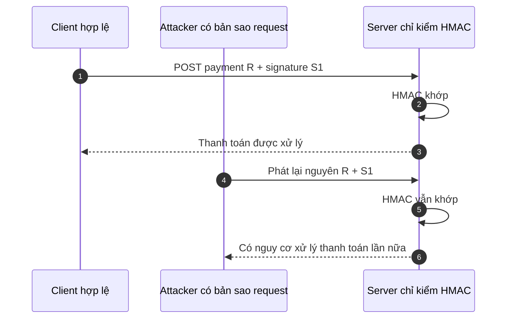
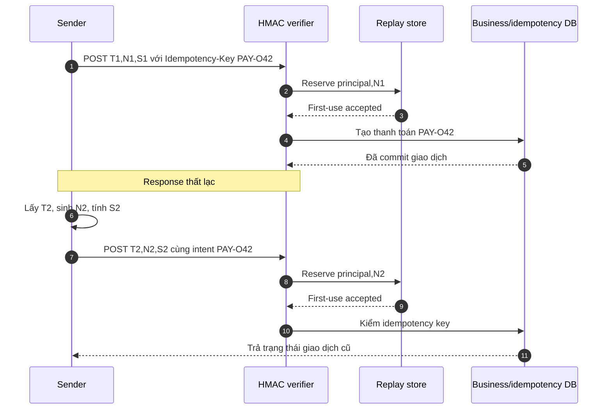

# Timestamp chống replay

## 1. Timestamp chống replay là gì?

Trong cơ chế **HMAC request authentication**, client và server dùng một **shared secret** để ký và xác minh một **canonical HTTP request**. Các thành phần ký thường bao gồm HTTP method, public URI, một số header quan trọng và hash của request body. Khi server tính lại HMAC khớp với chữ ký client gửi, server biết rằng bên tạo chữ ký có khóa tương ứng và những dữ liệu **đã ký** không bị sửa đổi.

Tuy vậy, **HMAC không tự ghi nhớ request nào đã được xử lý**. Nếu kẻ tấn công lấy được nguyên request có chữ ký và gửi lại, chữ ký vẫn có thể hợp lệ. Đây là **replay attack** — cuộc tấn công phát lại một thông điệp đã xác thực.

**Timestamp chống replay** là việc client gắn một thời điểm vào request, **đưa thời điểm ấy vào canonical request được HMAC ký**, rồi server chỉ chấp nhận request nằm trong **cửa sổ thời gian cho phép**. Timestamp làm cho chữ ký có **thời hạn sử dụng giới hạn**, nhưng **không tự ngăn được lần phát lại trong thời hạn đó**.

Bài này có tên **“Timestamp chống replay”** thuộc chương **Replay protection**, mô-đun **`SECURITY_AUTHENTICATION_HMAC_REQUEST_AUTHENTICATION`**. Phạm vi mô-đun là thiết kế xác thực HTTP request bằng HMAC và shared secret trên canonical request chứa phương thức, URI, header hoặc body; xác minh chữ ký, chống replay bằng timestamp/nonce, quản lý key rotation, kiểm thử proxy/gateway và phân biệt xác thực với phân quyền.

Sau khi học, người học cần làm được các việc:

- Phân biệt **request authentication**, **freshness** và **single-use replay protection**.
- Định nghĩa một timestamp có **đơn vị, cú pháp và thời hạn rõ ràng**.
- Chứng minh timestamp phải **nằm trong những byte được HMAC ký**.
- Cấu hình **past-age window**, **future skew**, kiểm tra đồng hồ server và giới hạn retry.
- Kết hợp timestamp với **nonce** và **replay store nguyên tử** để chặn bản sao trong cửa sổ còn hạn.
- Tính **TTL của nonce** sao cho không mất bản ghi khi request cũ vẫn còn đủ điều kiện được xác minh.
- Xây dựng ví dụ Java 17, golden HMAC vector, JUnit test và kiểm thử đa node/gateway.
- Phân biệt chống replay với **idempotency**, **key rotation** và **authorization**.

## 2. Tấn công replay: một chữ ký đúng có thể xuất hiện nhiều lần

Giả sử client hợp lệ gửi yêu cầu thanh toán:

```http
POST /v1/payments?merchantId=m-42 HTTP/1.1
Host: api.example.test
Content-Type: application/json
X-Client-Id: client-42
X-Key-Id: key-demo-01
X-Timestamp: 1795856400
X-Nonce: AAAAAAAAAAAAAAAAAAAAAA
X-Signature: <base64-hmac-sha256>

{"orderId":"O-42","amount":250000,"currency":"VND"}
```

Request trên là **fixture để học**: timestamp cố định, nonce không ngẫu nhiên và chữ ký là placeholder. Không dùng các giá trị này như credential thật.

Khi có HMAC nhưng **không có chính sách freshness hoặc replay detection**, kịch bản có thể là:



Attacker không phải giải HMAC hay đoán secret; họ chỉ cần **một bản request hợp lệ còn có thể dùng lại**. Bản sao có thể đến từ log vô tình chứa cả header chữ ký, thiết bị bị xâm nhập hoặc kênh truyền không được bảo vệ phù hợp.

### 2.1. Timestamp thay đổi diễn biến thế nào?

Khi server yêu cầu signed timestamp nằm trong một cửa sổ, request **quá cũ** bị từ chối:

```text
T = thời gian request được ký

T + 1 giây     -> Timestamp có thể vẫn hợp lệ
T + 30 giây    -> Timestamp có thể vẫn hợp lệ
T + 300 giây   -> Có thể đúng giới hạn chấp nhận
T + 301 giây   -> Hết hạn với chính sách 300 giây quá khứ
```

Nhưng giữa `T` và thời hạn cuối, bản sao có thể còn vượt qua bước **timestamp + HMAC**. Bởi vậy, câu “đã thêm timestamp nên không thể replay” là **không chính xác** nếu không có bảo đảm khác.

### 2.2. Chặn replay tại lần thứ hai cần thêm điều kiện gì?

Một giải pháp phổ biến kết hợp:

```text
HMAC hợp lệ
    AND timestamp trong window
    AND nonce chưa từng được chấp nhận trong replay scope
    AND key đang còn hiệu lực
    AND principal được phép truy cập tài nguyên
```

**Nonce** là giá trị mới cho mỗi lần ký request. Server cần **ghi nhận nó nguyên tử** vào replay store chung. Chỉ có timestamp thì **chưa đủ**; chỉ có nonce mà không lưu trạng thái cũng **chưa đủ**.

## 3. Threat model: timestamp bảo vệ được gì và không bảo vệ được gì?

| Khả năng của đối thủ | Timestamp đã ký có ích thế nào? | Cần bổ sung |
| --- | --- | --- |
| Lấy được request đã ký **sau khi hết hạn** | Server từ chối theo time window | Clock đáng tin, reject fail closed |
| Phát lại request **trong cửa sổ** | Timestamp vẫn hợp lệ | Nonce + atomic replay store |
| Sửa `X-Timestamp` để làm mới request cũ | HMAC phải không khớp **nếu timestamp được ký** | Canonical request đúng, không bỏ signed header |
| Tự tạo timestamp mới nhưng **không có secret** | Không tính được HMAC mới | Secret management, kiểm MAC đúng cách |
| Lấy được **shared secret** | Có thể tạo request mới với timestamp/nonce/chữ ký mới | Thu hồi/xoay khóa, điều tra lộ key, phân quyền |
| Gửi bản sao **đến trước sender thật** | Bản sao có thể thắng cuộc đua first-use nonce | TLS, bảo vệ log/credential, hạn chế lộ signed request |
| Phát lại cùng request đến **hai node đồng thời** | Cả hai đều thấy timestamp hợp lệ | Replay store có tính nhất quán và insert-if-absent nguyên tử |
| Phát lại qua **hai region bất đồng bộ** | Timestamp không thay đổi | Chọn consistency/fencing phù hợp hoặc giảm mức bảo đảm được công bố |
| Đổi resource/path/body không được ký | Timestamp không giúp bảo vệ các trường bị bỏ sót | Ký đầy đủ thành phần ảnh hưởng ý nghĩa request |
| Client HMAC hợp lệ nhưng **không có quyền** | Timestamp không cấp quyền | Authorization độc lập |

**Kết luận của threat model:** timestamp là một **freshness constraint**; nó hạn chế **khoảng thời gian** một signed request có thể tái sử dụng. Replay prevention một lần dùng là đặc tính **có trạng thái** của hệ thống hoặc cần một cơ chế giao thức khác được thiết kế tương đương.

## 4. Định nghĩa timestamp trong hợp đồng HMAC-SHA256-V1

Không có một định dạng timestamp duy nhất do HMAC áp đặt. Mỗi API phải **đặc tả**, chứ không được tự suy đoán.

Bài sử dụng hợp đồng minh họa **`HMAC-SHA256-V1`**:

| Thành phần | Hợp đồng của ví dụ |
| --- | --- |
| Header | `X-Timestamp`, xuất hiện đúng **một** lần |
| Đơn vị | **Unix epoch seconds** tính từ 1970-01-01T00:00:00Z |
| Cú pháp | Decimal ASCII, không dấu `+`/`-`, không phần thập phân |
| Canonical representation | Không leading zero, trừ giá trị `0` |
| Giới hạn định dạng minh họa | `0` hoặc tối đa 12 chữ số, fit `long` |
| Timezone | Không chứa timezone text; giá trị epoch là thời điểm tuyệt đối |
| Định danh trong canonical | Dòng `x-timestamp:<seconds>`, tên header lowercase cố định |
| Cửa sổ quá khứ | **300 giây** |
| Cửa sổ tương lai | **60 giây** |
| Boundary | Chấp nhận **bao gồm** cả cận dưới và cận trên |
| Nonce | `X-Nonce`, 16 byte CSPRNG, Base64URL no-padding 22 ký tự |
| Signature | Full HMAC-SHA-256 32 byte, Base64 Basic có padding |
| Các trường khác được ký | Method, public path, raw query, selected headers, hash raw body |
| Sai định dạng, lỗi store, key không hợp lệ | **Từ chối**, không tìm fallback không được phép |

**Đây là một hợp đồng ví dụ, không phải mặc định của RFC 7230, RFC 9110 hay mọi API HMAC.** Hợp đồng của sản phẩm khác có thể chọn milliseconds hoặc ngày RFC 3339 nhưng bắt buộc phải thống nhất **cách tạo byte canonical** và cách kiểm độ mới.

### 4.1. Vì sao chọn Unix seconds thay vì chuỗi ngày?

Java `Instant.now().getEpochSecond()` cho số giây từ epoch. Nó không phụ thuộc cách hiển thị múi giờ ở client. Ngược lại, `LocalDateTime.now().toString()` có thể gây hiểu nhầm vì local time không tự mang offset và hai máy có timezone khác nhau.

```java
import java.time.Clock;
import java.time.Instant;

Clock clock = Clock.systemUTC();

String timestampHeader =
        Long.toString(Instant.now(clock).getEpochSecond());
```

Không dùng `System.currentTimeMillis()` trực tiếp cho hợp đồng tính **giây**. Không phân tích chuỗi dài 13 chữ số rồi tự chia 1000 như một fallback tự động. Đơn vị timestamp là **một phần của phiên bản giao thức ký**.

### 4.2. Chữ ký phải bảo vệ đúng biểu diễn timestamp

Ví dụ sender ký:

```text
x-timestamp:1795856400
```

Verifier không được tự thay dòng này bằng `x-timestamp:1795856401` chỉ vì clock server đã tiến một giây. Timestamp được xác minh từ **giá trị signed header trong request**, sau đó **so với server clock** để đánh giá freshness.

Nếu một phía dùng decimal string gốc, phía kia parse thành `long` rồi format lại có leading zero, whitespace hoặc timezone khác, HMAC có thể lệch. V1 chọn **từ chối biểu diễn không chính tắc** thay vì sửa input tùy ý.

## 5. Cửa sổ timestamp: giới hạn tuổi request bằng phép so sánh rõ ràng

Đặt:

- `s` = signed timestamp (Unix seconds) được gửi và ký bởi client;
- `n` = timestamp của server tại thời điểm xác minh;
- `P = 300` = độ tuổi quá khứ tối đa;
- `F = 60` = mức đồng hồ client được đi trước server tối đa.

Request hợp lệ về thời gian khi:

\[
n-P \le s \le n+F
\]

Hay:

\[
s-F \le n \le s+P
\]

Hai cách viết tương đương, giúp kiểm thử việc đảo dấu sai.

### 5.1. Một ví dụ số cố định

Giả sử đồng hồ server là `1795856400`:

| Signed timestamp | Độ lệch với server | Kết quả **time check** |
| --- | ---: | --- |
| `1795856099` | Cũ 301 giây | **Từ chối** |
| `1795856100` | Cũ đúng 300 giây | Chấp nhận |
| `1795856101` | Cũ 299 giây | Chấp nhận |
| `1795856399` | Cũ 1 giây | Chấp nhận |
| `1795856400` | Bằng server | Chấp nhận |
| `1795856401` | Tương lai 1 giây | Chấp nhận |
| `1795856459` | Tương lai 59 giây | Chấp nhận |
| `1795856460` | Tương lai đúng 60 giây | Chấp nhận |
| `1795856461` | Tương lai 61 giây | **Từ chối** |

“Chấp nhận” trong bảng chỉ có nghĩa **qua time window**. Một request còn có thể bị loại vì signature sai, nonce lặp, key đã thu hồi hoặc client thiếu quyền.

### 5.2. Có nên dùng thời gian đối xứng `abs(now - s) <= 300`?

Không với hợp đồng đang có **hai giới hạn khác nhau**. Kiểm `Math.abs(n-s) <= 300` sẽ cho client ở tương lai **tới 300 giây**, trái quy tắc cho phép chỉ **60 giây**.

Ngoài ra, phép trừ trên các giá trị `long` cực trị có thể **overflow**. Kiểm rõ hai cận và có chính sách định dạng/dải số là phương pháp dễ hiểu và dễ đánh giá hơn.

### 5.3. Time window lớn có an toàn hơn không?

Một window lớn giúp giảm false reject khi mạng chậm hoặc client lệch clock, nhưng kéo dài khoảng thời gian attacker có thể **thử dùng bản sao chưa reserve** và tăng yêu cầu lưu nonce.

Một window quá nhỏ lại dễ gây lỗi cho hệ thống có queueing, mạng xa hoặc các đồng hồ không được đồng bộ.

Chọn window dựa vào **network latency distribution**, đồng bộ giờ, rủi ro endpoint và SLA vận hành. Không cố tăng window vô hạn để che lỗi NTP, delay bất thường hoặc retry policy kém.

## 6. Timestamp phải được HMAC ký, không chỉ xuất hiện trong header

Nếu client chỉ gửi `X-Timestamp` nhưng **không đưa nó vào canonical request**, attacker có thể chỉnh sửa timestamp và **giữ nguyên chữ ký cũ**.

**Thiết kế sai:**

```text
canonical = method + path + query + bodyHash
signature = HMAC(secret, canonical)

HTTP:
  X-Timestamp: 1795856400  // Không được ký
```

Kẻ tấn công có thể thay `X-Timestamp` thành thời điểm mới mà verifier **vẫn tính cùng expected HMAC**. Freshness check khi ấy không có tác dụng chống việc kéo dài tuổi của chữ ký.

**Thiết kế đúng:**

```text
canonical = version
          + method
          + public path
          + raw query
          + selected headers
          + "x-timestamp:" + signedTimestamp
          + "x-nonce:" + nonce
          + bodyHash

signature = HMAC(secret, UTF8(canonical))
```

Server dựng lại canonical bytes từ **HTTP request thực nhận** rồi so tag HMAC. Khi attacker thay timestamp, nonce hoặc body mà không có secret để ký lại, raw MAC kỳ vọng phải khác.

### 6.1. Những header khác cũng cần xét

Timestamp bị ký đúng nhưng **method, URI hoặc body không được ký** vẫn có thể để lộ lỗ hổng integrity. Ví dụ kẻ tấn công sửa `merchantId` trong query, còn server chỉ xác minh timestamp/body hash, request sẽ được diễn giải khác với nội dung bên gửi định bảo vệ.

Những trường ảnh hưởng mục đích xử lý — method, public path/query, content type/body bytes, client/key ID, timestamp, nonce và có thể `Idempotency-Key` — phải có **hợp đồng ký chính xác** hoặc được suy từ một ranh giới tin cậy khác.

## 7. Golden vector: thay timestamp một giây thì chữ ký phải đổi

Để kiểm chứng việc **timestamp nằm trong dữ liệu ký**, dùng một fixture độc lập.

HTTP request minh họa:

```http
POST /v1/payments?merchantId=m-42 HTTP/1.1
Content-Type: application/json
X-Client-Id: client-42
X-Key-Id: key-demo-01
X-Timestamp: 1795856400
X-Nonce: AAAAAAAAAAAAAAAAAAAAAA
X-Signature: <base64-hmac-sha256>

{"orderId":"O-42","amount":250000,"currency":"VND"}
```

Body test chứa **đúng 51 byte UTF-8**, không có newline cuối. SHA-256 của body đó ở dạng hex lowercase:

```text
ea646bb8b1903a83256034142a633e90ffad35b3a40bb4c5f0e8f1eb4f4f27f9
```

Canonical request V1 là **10 dòng LF-delimited**, không có LF cuối:

```text
HMAC-SHA256-V1
POST
/v1/payments
merchantId=m-42
content-type:application/json
x-client-id:client-42
x-key-id:key-demo-01
x-timestamp:1795856400
x-nonce:AAAAAAAAAAAAAAAAAAAAAA
ea646bb8b1903a83256034142a633e90ffad35b3a40bb4c5f0e8f1eb4f4f27f9
```

Độ dài canonical request trên là **240 byte UTF-8**. Secret **chỉ dùng để thử nghiệm** gồm 32 byte ASCII:

```text
0123456789abcdef0123456789abcdef
```

Full HMAC-SHA-256, Base64 Basic padded:

```text
GMGNFyHLvQHRH53KE9+jTILR1qc0HauQJiX06bXm1n0=
```

Nếu **chỉ** thay một dòng thành:

```text
x-timestamp:1795856401
```

và giữ nguyên secret, body, URI, nonce, các header còn lại, chữ ký mới là:

```text
yDUc2xZJMgJ2Gfa0IjTHiw1SFMmL5tMV8YNlPwj6gvk=
```

Hai chữ ký mẫu đã được đối chiếu bằng phép tính HMAC độc lập trong chuỗi bài thực hành. Nếu một implementation tạo ra cùng chữ ký cho hai timestamp, cần kiểm tra **timestamp có thật sự được đưa vào canonical bytes không** hoặc có đang dùng một giá trị timestamp cũ khi ký.

**Không dùng vector tĩnh cho production:** secret có thể đọc công khai, nonce `AAAAAAAAAAAAAAAAAAAAAA` là 16 byte zero, timestamp cố định không còn bảo đảm freshness theo đồng hồ thực. Golden vector chỉ kiểm **sự nhất quán mật mã và encoding**; kiểm window cần dùng **đồng hồ server giả lập**.

### 7.1. Hai bài test khác nhau cần tách biệt

1. **HMAC binding test:** giữ secret/canonical fixture, thay `1795856400` thành `1795856401`, so hai expected HMAC khác nhau.
2. **Time-window test:** dùng clock server cố định `1795856400`, xác nhận cả `1795856400` và `1795856401` đều nằm trong cửa sổ `-300/+60`.

Một request có timestamp hợp lệ **không có nghĩa chữ ký cũ vẫn dùng được sau khi đổi header**.

## 8. Java 17: policy kiểm timestamp và thời hạn nonce

Code sau nhận signed timestamp dạng decimal và một thời điểm server `nowSeconds`. Nó giới hạn định dạng trước khi parse, tránh tự động sửa input và dùng phép cộng/trừ có kiểm soát overflow.

```java
import java.time.Clock;
import java.time.Instant;
import java.util.Objects;
import java.util.regex.Pattern;

public final class TimestampReplayPolicyV1 {
    public static final long MAX_PAST_SECONDS = 300L;
    public static final long MAX_FUTURE_SECONDS = 60L;

    // Margin minh họa: phải được xác nhận cho cả cluster.
    public static final long REPLAY_MARGIN_SECONDS = 60L;

    private static final Pattern CANONICAL_SECONDS =
            Pattern.compile("0|[1-9][0-9]{0,11}");

    private TimestampReplayPolicyV1() {}

    public static boolean isCanonical(String value) {
        return value != null &&
                CANONICAL_SECONDS.matcher(value).matches();
    }

    public static long epochSecond(Clock clock) {
        Objects.requireNonNull(clock, "clock");
        return Instant.now(clock).getEpochSecond();
    }

    public static boolean isFreshAt(
            String signedTimestamp, long nowSeconds) {

        if (!isCanonical(signedTimestamp)) return false;

        try {
            long signed = Long.parseLong(signedTimestamp);
            long min = Math.subtractExact(
                    nowSeconds, MAX_PAST_SECONDS);
            long max = Math.addExact(
                    nowSeconds, MAX_FUTURE_SECONDS);

            return signed >= min && signed <= max;
        } catch (NumberFormatException | ArithmeticException bad) {
            return false;
        }
    }

    // Chỉ gọi SAU khi isFreshAt(...) == true.
    public static long ttlForAccepted(
            String signedTimestamp, long nowSeconds) {

        if (!isFreshAt(signedTimestamp, nowSeconds)) {
            throw new IllegalArgumentException("Expired timestamp");
        }

        long signed = Long.parseLong(signedTimestamp);
        long lastAccept = Math.addExact(
                signed, MAX_PAST_SECONDS);

        long remaining = Math.subtractExact(
                lastAccept, nowSeconds);

        return Math.max(1L,
                Math.addExact(remaining, REPLAY_MARGIN_SECONDS));
    }
}
```

**Giải thích ranh giới:**

- `isFreshAt` trả `true` **chỉ cho điều kiện thời gian**. Nó không gọi HMAC, không ghi nonce, không cấp quyền.
- `nowSeconds` phải được lấy **một lần** tại điểm xác minh cho mọi phép tính cửa sổ/TTL liên quan. Không đọc clock rời rạc giữa nhiều dòng để tạo off-by-one ở biên.
- `0|[1-9][0-9]{0,11}` là cú pháp của V1, không nhận `+`, `-`, decimal point, leading zero hay Unix milliseconds.
- `ttlForAccepted` dựa vào **thời gian còn lại cho đến lần cuối request có thể được chấp nhận**, cộng margin; không cố cho mọi nonce một TTL bằng `MAX_PAST_SECONDS`.
- Phép toán thời gian dùng `long` và `Math.addExact/subtractExact`; khi gặp lỗi overflow cần **từ chối**, không được bỏ kiểm tra.
- `REPLAY_MARGIN_SECONDS=60` chỉ là **giả định của ví dụ**, không tự chứng minh đúng với mọi mức clock skew của production.

Trong production, `Clock.systemUTC()` phải được vận hành với clock đồng bộ. Nếu clock server lệch đáng kể hoặc nhảy về quá khứ, cửa sổ xác thực thực tế có thể rộng hơn dự kiến.

### 8.1. Vì sao không dùng monotonic clock cho signed Unix seconds?

Monotonic time (`System.nanoTime()`) thích hợp đo **thời lượng trong cùng process**, nhưng không gắn trực tiếp với UTC epoch. Không thể lấy `nanoTime` chia 1 tỷ rồi so với Unix timestamp client gửi.

Để xác minh freshness của **thời điểm tuyệt đối**, dùng wall clock UTC có giám sát; để đo latency hoặc timeouts nội bộ có thể dùng nguồn monotonic thích hợp. Hai mục đích khác nhau.

## 9. Java 17: sinh timestamp và nonce trước khi ký request

Sender nên chốt **timestamp/nonce/body bytes** trước khi dựng canonical request và tính HMAC. Với nonce, dùng CSPRNG đủ entropy:

```java
import java.security.SecureRandom;
import java.time.Clock;
import java.util.Base64;

public final class RequestFreshnessV1 {
    private static final SecureRandom RANDOM = new SecureRandom();

    private RequestFreshnessV1() {}

    public static String freshTimestamp(Clock clock) {
        return Long.toString(
                TimestampReplayPolicyV1.epochSecond(clock));
    }

    public static String freshNonce() {
        byte[] bytes = new byte[16]; // 128 bits
        RANDOM.nextBytes(bytes);

        return Base64.getUrlEncoder()
                .withoutPadding().encodeToString(bytes);
    }

    public static boolean canonicalNonce(String value) {
        if (value == null
                || !value.matches("[A-Za-z0-9_-]{22}")) {
            return false;
        }

        final byte[] decoded;
        try {
            decoded = Base64.getUrlDecoder().decode(value);
        } catch (IllegalArgumentException invalid) {
            return false;
        }

        return decoded.length == 16
                && Base64.getUrlEncoder().withoutPadding()
                    .encodeToString(decoded).equals(value);
    }
}
```

Gọi:

```java
java.time.Clock clock = java.time.Clock.systemUTC();

String timestamp = RequestFreshnessV1.freshTimestamp(clock);
String nonce = RequestFreshnessV1.freshNonce();

// Cùng hai giá trị này được chèn vào canonical request,
// rồi gắn làm X-Timestamp và X-Nonce trên HTTP request.
```

Không tạo một nonce khác sau bước ký, không chuyển timestamp từ seconds sang milliseconds trong interceptor. Sau khi ký, không được để HTTP client/proxy tự đổi các trường đã được HMAC bảo vệ mà không có quy tắc canonical hợp lệ.

**Lưu ý:** định dạng nonce đúng **không chứng minh** giá trị được tạo từ CSPRNG. Nonce test toàn `A` vẫn hợp lệ về Base64URL, nhưng không đáp ứng yêu cầu ngẫu nhiên cho production.

## 10. Java 17: ví dụ signer/verifier gắn timestamp với HMAC

Để người học thấy rõ chỗ **timestamp tham gia MAC** và chỗ **timestamp giới hạn replay**, ví dụ dưới chỉ cho phép endpoint minh họa:

```text
POST /v1/payments?merchantId=m-42
Content-Type: application/json
```

Một triển khai tổng quát phải chuẩn hóa request target, query, headers, content coding và body theo **hợp đồng riêng cho API thật**. Không dùng utility minh họa này cho một endpoint tùy ý.

### 10.1. Mô hình request bất biến và key/replay dependencies

```java
import java.util.Objects;

public final class ReplayInterfacesV1 {
    private ReplayInterfacesV1() {}

    public record SignedRequest(
            String method,
            String publicRawPath,
            String rawQuery,
            String contentType,
            String clientId,
            String keyId,
            String timestamp,
            String nonce,
            byte[] bodyBytes) {

        public SignedRequest {
            Objects.requireNonNull(bodyBytes, "bodyBytes");
            bodyBytes = bodyBytes.clone();
        }

        @Override
        public byte[] bodyBytes() {
            return bodyBytes.clone();
        }
    }

    public record ActiveKey(
            String authenticatedPrincipal, byte[] secret) {

        public ActiveKey {
            Objects.requireNonNull(
                    authenticatedPrincipal, "authenticatedPrincipal");
            Objects.requireNonNull(secret, "secret");
            if (secret.length == 0) {
                throw new IllegalArgumentException("Empty secret");
            }
            secret = secret.clone();
        }

        @Override
        public byte[] secret() {
            return secret.clone();
        }
    }

    @FunctionalInterface
    public interface KeyResolver {
        // Chỉ trả key thuộc đúng client/keyId và còn hiệu lực.
        ActiveKey resolveActive(String clientId, String keyId);
    }

    @FunctionalInterface
    public interface ReplayStore {
        // Phải là insert-if-absent nguyên tử, với TTL thực.
        // Lỗi store phải fail closed, không trả true.
        boolean reserveOnce(String authenticatedPrincipal,
                            String nonce, long ttlSeconds);
    }
}
```

`SignedRequest` giữ snapshot của body bytes để caller không vô ý mutate sau khi chuẩn bị ký. `KeyResolver` và `ReplayStore` là **interfaces dành cho ứng dụng**, không phải triển khai secret manager/Redis production.

### 10.2. Canonical request, signer và verifier

```java
import java.nio.charset.StandardCharsets;
import java.security.GeneralSecurityException;
import java.security.MessageDigest;
import java.time.Clock;
import java.util.Base64;
import java.util.HexFormat;
import java.util.Objects;
import java.util.Optional;
import javax.crypto.Mac;
import javax.crypto.spec.SecretKeySpec;

public final class ReplayHmacV1 {
    private ReplayHmacV1() {}

    private static boolean validId(String id) {
        return id != null
                && id.matches("[A-Za-z0-9._-]{1,80}");
    }

    public static String canonical(
            ReplayInterfacesV1.SignedRequest req)
            throws GeneralSecurityException {

        Objects.requireNonNull(req, "request");

        if (!"POST".equals(req.method())
                || !"/v1/payments".equals(req.publicRawPath())
                || !"merchantId=m-42".equals(req.rawQuery())
                || !"application/json".equals(req.contentType())
                || !validId(req.clientId())
                || !validId(req.keyId())
                || !TimestampReplayPolicyV1.isCanonical(
                        req.timestamp())
                || !RequestFreshnessV1.canonicalNonce(
                        req.nonce())) {
            throw new IllegalArgumentException(
                    "Invalid HMAC-SHA256-V1 request");
        }

        String bodyHash = HexFormat.of().formatHex(
                MessageDigest.getInstance("SHA-256")
                        .digest(req.bodyBytes()));

        return String.join("\n",
                "HMAC-SHA256-V1",
                req.method(),
                req.publicRawPath(),
                req.rawQuery(),
                "content-type:" + req.contentType(),
                "x-client-id:" + req.clientId(),
                "x-key-id:" + req.keyId(),
                "x-timestamp:" + req.timestamp(),
                "x-nonce:" + req.nonce(),
                bodyHash);
    }

    private static byte[] mac(byte[] secret, String canonical)
            throws GeneralSecurityException {

        Objects.requireNonNull(secret, "secret");
        if (secret.length == 0) {
            throw new IllegalArgumentException("Empty secret");
        }

        // Mac là mutable state; tạo local mỗi lần gọi.
        Mac hmac = Mac.getInstance("HmacSHA256");
        hmac.init(new SecretKeySpec(secret, "HmacSHA256"));
        return hmac.doFinal(
                canonical.getBytes(StandardCharsets.UTF_8));
    }

    public static String sign(
            ReplayInterfacesV1.SignedRequest req,
            byte[] secret) throws GeneralSecurityException {

        return Base64.getEncoder()
                .encodeToString(mac(secret, canonical(req)));
    }

    public static Optional<String> verifyAndReserve(
            ReplayInterfacesV1.SignedRequest req,
            String suppliedSignature,
            Clock serverClock,
            ReplayInterfacesV1.KeyResolver keys,
            ReplayInterfacesV1.ReplayStore replay)
            throws GeneralSecurityException {

        Objects.requireNonNull(req, "request");
        Objects.requireNonNull(serverClock, "serverClock");
        Objects.requireNonNull(keys, "keys");
        Objects.requireNonNull(replay, "replay");

        // Chỉ đọc clock một lần cho window và TTL.
        long now = TimestampReplayPolicyV1.epochSecond(serverClock);
        if (!TimestampReplayPolicyV1.isFreshAt(
                req.timestamp(), now)) {
            return Optional.empty();
        }

        // Canonical hóa/kiểm tra body bytes thực nhận.
        String canonical;
        try {
            canonical = canonical(req);
        } catch (IllegalArgumentException malformed) {
            return Optional.empty();
        }

        // clientId/keyId chỉ là gợi ý lookup trước HMAC.
        ReplayInterfacesV1.ActiveKey active =
                keys.resolveActive(req.clientId(), req.keyId());

        if (active == null) {
            return Optional.empty();
        }

        // Full 32-byte HMAC-SHA-256 tag = 44-char Base64 padded.
        if (suppliedSignature == null
                || suppliedSignature.length() != 44) {
            return Optional.empty();
        }

        final byte[] supplied;
        try {
            supplied = Base64.getDecoder()
                    .decode(suppliedSignature);
        } catch (IllegalArgumentException invalidBase64) {
            return Optional.empty();
        }

        if (supplied.length != 32
                || !Base64.getEncoder()
                        .encodeToString(supplied)
                        .equals(suppliedSignature)) {
            return Optional.empty();
        }

        byte[] expected = mac(active.secret(), canonical);
        if (!MessageDigest.isEqual(expected, supplied)) {
            return Optional.empty();
        }

        // Chỉ SAU HMAC hợp lệ mới ghi nonce.
        long ttl = TimestampReplayPolicyV1.ttlForAccepted(
                req.timestamp(), now);

        if (!replay.reserveOnce(
                active.authenticatedPrincipal(),
                req.nonce(), ttl)) {
            return Optional.empty();
        }

        // Tầng gọi phải tiếp tục authorization/idempotency.
        return Optional.of(active.authenticatedPrincipal());
    }
}
```

**Những giới hạn quan trọng của code:**

1. `canonical` chỉ hỗ trợ endpoint mẫu. Trong request thật, method/path/query/headers/body phải lấy từ **HTTP request thực nhận** ở điểm xác minh; không dùng `X-Original-URI` do client tùy ý khai báo.
2. HTTP adapter phải từ chối **duplicate signed headers**, giới hạn kích thước và áp dụng **Content-Encoding policy** trước khi gọi verifier.
3. `ReplayInterfacesV1.KeyResolver` phải áp dụng **key lifecycle** và trả secret đúng principal; key ID do request gửi **chưa chứng minh danh tính** cho tới khi MAC khớp.
4. `verifyAndReserve` trả `Optional<String>` cho authenticated principal chỉ khi **signature và reserve nonce** đều thành công. Nó **chưa phân quyền**.
5. Khi replay store lỗi, không được bắt exception rồi trả một giá trị thành công. Luồng xác thực phải **fail closed**.
6. Time checks, HMAC và nonce store **không thay thế** TLS, schema validation hay idempotency.
7. Code sử dụng `MessageDigest.isEqual` trên hai tag **32 byte**; không cho client quyết định số byte tag phải so.
8. Dữ liệu để ký gồm body hash do server **tự tính trên raw bytes**, không tin một digest do sender tự khai báo mà không kiểm tra.

## 11. Tại sao timestamp không thay được nonce?

Có thể thử giảm trạng thái bằng cách chỉ dùng:

```text
signature = HMAC(secret, method || URI || timestamp || bodyHash)
accept if HMAC valid and timestamp within 300 seconds
```

Nhưng điều này **không phân biệt** hai lần gửi nguyên request trong cửa sổ đó. Cả hai lần đều dùng timestamp hợp lệ và cùng chữ ký đúng.

Nếu yêu cầu bảo mật là “mỗi signed request **được chấp nhận không quá một lần**”, thông thường cần:

- Nonce hoặc định danh lần gửi **được ký**.
- Replay store dùng chung theo **authenticated principal**.
- Thao tác **check-and-insert nguyên tử**.
- TTL dài đến khi timestamp chắc chắn hết khả năng được chấp nhận.
- Fail closed khi không thể bảo đảm kết quả reserve.
- Chính sách xử lý retry và idempotency nghiệp vụ.

### 11.1. Replay key nên lấy từ những trường nào?

Với chính sách nonce **dùng một lần trên toàn client**:

```text
replayKey = "hmac-replay:v1:"
          + encode(authenticatedPrincipalId)
          + ":"
          + nonce
```

**Authenticated principal** chỉ xác định sau khi HMAC đã khớp với secret của một key còn hiệu lực. Không chỉ tin `X-Client-Id` chưa được xác thực.

**Không nhất thiết đưa key ID vào replay key.** Nếu principal chuyển từ `key-A` sang `key-B` trong giai đoạn key rotation, hai key vẫn đại diện cùng client; chọn `(principal,nonce)` giúp không vô tình cho cùng nonce được nhận lại khi đổi key.

Replay key cần có cách phân tách/encode an toàn, giới hạn ký tự và length; đừng nối nhiều identifier tùy ý tạo collision.

### 11.2. Atomicity: check rồi set riêng là sai

```text
Instance A: exists(key) = false
Instance B: exists(key) = false
Instance A: set(key) và chấp nhận
Instance B: set(key) và chấp nhận
=> replay có thể được xử lý hai lần
```

Primitive cần là **atomic insert-if-absent**. Ví dụ, một lệnh Redis trên primary:

```redis
SET hmac-replay:v1:client-42:AAAAAAAAAAAAAAAAAAAAAA 1 NX EX 420
```

`NX` bảo đảm chỉ ghi nếu chưa tồn tại; `EX 420` định thời gian sống. **420 giây chỉ là ví dụ**, phụ thuộc timestamp policy và clock assumptions.

**Đừng đánh đồng** atomicity của một command trên Redis primary với durability/consistency tuyệt đối khi failover hoặc multi-region. Nếu hệ thống lưu replay records bất đồng bộ và có thể mất record lúc chuyển primary, request cũ có thể được chấp nhận lại. Thiết kế production phải xem xét recovery/fencing/replication và mức bảo đảm thực sự.

## 12. TTL replay record phải dài hơn thời gian timestamp có thể còn hiệu lực

Đây là chỗ rất dễ sai trong bài toán timestamp chống replay.

Với chính sách:

\[
n-300 \le s \le n+60
\]

Một request có signed timestamp `s` có thể được chấp nhận về thời gian **đến khi** server time đạt:

\[
n_{\text{last}} = s + 300
\]

Giả sử ở lần đầu server đang ở `n=1000` và request mang timestamp tương lai `s=1060`. Lúc đó request được chấp nhận vì `s=n+60`.

```text
Lần đầu:
  now = 1000
  signedTimestamp = 1060
  maxFuture = 60
  maxPast = 300

Thời điểm cuối vẫn hợp lệ:
  1060 + 300 = 1360

Khoảng còn lại ngay lúc reserve:
  1360 - 1000 = 360 giây
```

Nếu chỉ lưu nonce **300 giây từ thời điểm đầu**, record có thể hết hạn ở `n=1300` nhưng request vẫn **còn hợp lệ đến `n=1360`**. Attacker gửi bản sao sau khi record bị xóa sẽ có cơ hội qua lại nonce check.

Một cách tính:

\[
\text{remaining}(s,n) = (s+P)-n
\]

\[
\text{replayTTL}(s,n) = \max(1,\text{remaining}(s,n)+M)
\]

Trong đó `M` là safety margin có căn cứ vận hành: **clock skew tối đa giữa verifier instances**, độ trễ và các bất định của store.

Với `P=300, F=60, M=60`, trường hợp `s=n+60` cho `TTL=420` giây.

### 12.1. Vì sao cần quan tâm clock skew giữa các node?

Nếu node A có clock **nhanh** và node B có clock **chậm**, record có thể được ghi ở A rồi request được phát lại tới B. B có thể còn thấy timestamp hợp lệ khi record đã hết TTL dựa trên thời gian/quy tắc tại A.

Hệ thống cần **theo dõi clock offset**, đồng bộ thời gian và chọn margin phù hợp với **mọi verifier có thể chấp nhận request**. Không có TTL hữu hạn nào bù được một hệ thống đồng hồ tùy ý hoặc các bản ghi replay bị xóa sớm do cache eviction.

### 12.2. Không làm sao chép nonce sớm bị từ chối thành “được nhận”

Nếu một request có timestamp quá hạn, không được **gia hạn lại** timestamp dựa trên thời gian máy chủ hiện tại để “giúp client”:

```text
Sai:
  if request expired:
      signedTimestamp = now
      continue verification

Đúng:
  if request expired:
      reject; sender must make a new signed request
```

Sửa timestamp sau khi client ký sẽ khiến HMAC không còn bảo vệ cùng bytes; nếu server bỏ qua lỗi này, cơ chế chống replay bị phá.

## 13. Phân biệt retry hợp lệ, replay attack và idempotency

Trong thanh toán, sender có thể retry sau timeout. Tình huống:



Một **retry có chủ đích** cần **timestamp mới, nonce mới và signature mới**, nhưng giữ **idempotency key** của cùng ý định nghiệp vụ.

| Tình huống | Timestamp | Nonce | Signature | Idempotency key |
| --- | --- | --- | --- | --- |
| Lần gửi đầu | `T1` | `N1` | `S1` | `PAY-O42` |
| Attacker replay nguyên request | `T1` | `N1` | `S1` | `PAY-O42` |
| Client retry hợp lệ | `T2` | `N2` | `S2` | **`PAY-O42`** |
| Giao dịch khác | `T3` | `N3` | `S3` | `PAY-O43` |

Replay store không biết giao dịch đã commit hay chưa. Nếu server **reserve nonce thành công nhưng crash trước khi xử lý**, nonce vẫn có thể đã bị tiêu thụ. Đó là lý do không nên dùng nonce làm **idempotency key** hoặc cam kết “exactly-once business effect”.

Nếu `Idempotency-Key` quyết định hành vi business, hợp đồng ký cần **bảo vệ header ấy** hoặc ràng buộc qua nguồn tin cậy khác. Đừng dùng một giá trị unsigned mà attacker có thể đổi để làm thay ý nghĩa request đã được xác minh.

### 13.1. Request bị đánh cắp trước lần gửi đầu

Nếu attacker có bản request ký hợp lệ và **gửi nó trước sender thật**, attacker có thể thắng thao tác **first-use reserve**. Hệ thống sẽ chặn bản thứ hai đến sau, nhưng không biết bản đầu đến từ bên “đúng” theo ý người dùng.

Do đó vẫn cần **TLS**, giữ kín request logs/traces, không để lộ secret, rate limiting, authorization và ràng buộc nghiệp vụ. Timestamp/nonce không phải mã hóa nội dung hoặc bằng chứng danh tính thiết bị.

## 14. Java 17 và JUnit 5: kiểm thử freshness, chữ ký và replay

### 14.1. Test biên thời gian bằng `Clock.fixed`

Với timestamp `1795856400` và server clock cố định, hãy kiểm cả hai cận:

```java
import static org.junit.jupiter.api.Assertions.*;
import java.time.Clock;
import java.time.Instant;
import java.time.ZoneOffset;
import org.junit.jupiter.api.Test;

class TimestampReplayPolicyV1Test {
    private static final long NOW = 1795856400L;
    private static final Clock FIXED = Clock.fixed(
            Instant.ofEpochSecond(NOW), ZoneOffset.UTC);

    @Test
    void acceptedInclusiveBoundaries() {
        assertTrue(TimestampReplayPolicyV1.isFreshAt(
                "1795856100", TimestampReplayPolicyV1.epochSecond(FIXED)));
        assertTrue(TimestampReplayPolicyV1.isFreshAt(
                "1795856400", NOW));
        assertTrue(TimestampReplayPolicyV1.isFreshAt(
                "1795856460", NOW));
    }

    @Test
    void rejectedOutsideBoundaries() {
        assertFalse(TimestampReplayPolicyV1.isFreshAt(
                "1795856099", NOW));
        assertFalse(TimestampReplayPolicyV1.isFreshAt(
                "1795856461", NOW));
    }

    @Test
    void rejectsMalformedTimestamps() {
        String[] bad = {
                null, "", " 1795856400", "01795856400",
                "+1795856400", "-1795856400",
                "1795856400.0", "1795856400000",
                "1795856400\n", "invalid"
        };

        for (String value : bad) {
            assertFalse(
                    TimestampReplayPolicyV1.isFreshAt(value, NOW),
                    "Rejected input=" + value);
        }
    }

    @Test
    void futureBoundaryNeedsFullReplayTtl() {
        assertEquals(420,
                TimestampReplayPolicyV1.ttlForAccepted(
                        "1795856460", NOW));
    }
}
```

Những test dùng **thời gian ảo**, không cần `Thread.sleep(300_000)`. Không nên so timestamp cố định của golden vector với `Instant.now()` thật trong unit test, vì bài test sẽ hết hạn theo ngày chạy CI.

### 14.2. Test độc lập chữ ký có timestamp

```java
import static org.junit.jupiter.api.Assertions.*;
import java.nio.charset.StandardCharsets;
import org.junit.jupiter.api.Test;

class ReplayHmacV1Test {

    private static final byte[] SECRET = (
            "0123456789abcdef0123456789abcdef"
    ).getBytes(StandardCharsets.US_ASCII);

    private static ReplayInterfacesV1.SignedRequest sample(
            String timestamp, String nonce) {

        byte[] rawBody = (
                "{\"orderId\":\"O-42\",\"amount\":250000,"
              + "\"currency\":\"VND\"}"
        ).getBytes(StandardCharsets.UTF_8);

        return new ReplayInterfacesV1.SignedRequest(
                "POST", "/v1/payments", "merchantId=m-42",
                "application/json", "client-42", "key-demo-01",
                timestamp, nonce, rawBody);
    }

    @Test
    void signatureBindsTimestamp() throws Exception {
        var first = sample(
                "1795856400", "AAAAAAAAAAAAAAAAAAAAAA");
        var oneSecondLater = sample(
                "1795856401", "AAAAAAAAAAAAAAAAAAAAAA");

        assertEquals(
                "GMGNFyHLvQHRH53KE9+jTILR1qc0HauQJiX06bXm1n0=",
                ReplayHmacV1.sign(first, SECRET));
        assertEquals(
                "yDUc2xZJMgJ2Gfa0IjTHiw1SFMmL5tMV8YNlPwj6gvk=",
                ReplayHmacV1.sign(oneSecondLater, SECRET));

        assertNotEquals(
                ReplayHmacV1.sign(first, SECRET),
                ReplayHmacV1.sign(oneSecondLater, SECRET));
    }

    @Test
    void firstUseAcceptsButExactReplayRejects() throws Exception {
        var req = sample(
                "1795856400", "AAAAAAAAAAAAAAAAAAAAAA");

        String tag = ReplayHmacV1.sign(req, SECRET);

        // Test double: CHỈ đúng cho concurrency trong một JVM;
        // không thay Redis/DB store thật khi triển khai nhiều node.
        var seen = new java.util.concurrent.ConcurrentHashMap<
                String, Boolean>();

        ReplayInterfacesV1.ReplayStore store =
                (principal, nonce, ttl) ->
                    seen.putIfAbsent(
                        principal + ":" + nonce, true) == null;

        ReplayInterfacesV1.KeyResolver resolver =
                (clientId, keyId) -> {
                    if (!"client-42".equals(clientId)
                            || !"key-demo-01".equals(keyId)) {
                        return null;
                    }
                    return new ReplayInterfacesV1.ActiveKey(
                            "client-42", SECRET);
                };

        var fixed = java.time.Clock.fixed(
                java.time.Instant.ofEpochSecond(1795856400L),
                java.time.ZoneOffset.UTC);

        assertTrue(ReplayHmacV1.verifyAndReserve(
                req, tag, fixed, resolver, store).isPresent());

        assertTrue(ReplayHmacV1.verifyAndReserve(
                req, tag, fixed, resolver, store).isEmpty());
    }
}
```

Các test trên là **ví dụ JUnit 5**, cần dependency phù hợp để chạy trong dự án. Bài học STEP 4 không chạy Gradle hay chuyên môn Content QA; việc thử nghiệm trong môi trường dự án thuộc vòng tiếp theo.

### 14.3. Test “sửa timestamp giữ signature” nhưng không reserve nonce

Khi client sửa `X-Timestamp` mà không tạo HMAC mới, verifier phải **từ chối trước khi ghi nonce**. Test nên dùng một `ReplayStore` đếm số lời gọi:

```java
var reserveCount = new java.util.concurrent.atomic.AtomicInteger();

ReplayInterfacesV1.ReplayStore store =
        (principal, nonce, ttl) -> {
            reserveCount.incrementAndGet();
            return true;
        };

// Tạo signature cho timestamp T, rồi gọi verifier với
// request dùng T+1 và signature cũ. HMAC phải sai.
// Sau đó assertEquals(0, reserveCount.get()).
```

Nếu replay store được gọi trong trường hợp MAC sai, code đang **ghi nhận dữ liệu của request chưa xác thực**. Đây là lỗi về thứ tự bảo vệ và có thể tạo điều kiện DoS.

## 15. Đồng hồ, proxy/gateway và hệ thống phân tán

Trong hạ tầng nhiều lớp, timestamp được ký bởi client backend và được đánh giá ở một điểm xác minh cụ thể. Bất kỳ tầng nào thay timestamp **sau khi ký** có thể làm HMAC sai; bất kỳ verifier nào có clock lệch đáng kể có thể đánh giá request sai về freshness.

```text
Signed request từ client
    |
    v
Load balancer / CDN / WAF
    |
    v
API gateway (có thể xác minh HMAC)
    |
    v
Backend verifier
    |
    v
Replay store + authorization
    |
    v
Business handler
```

| Tình huống | Hệ quả | Test hoặc biện pháp |
| --- | --- | --- |
| Client dùng milliseconds thay seconds | Timestamp ở tương lai rất xa | Từ chối theo format/window |
| Client timezone khác | Epoch seconds không đổi nếu tính đúng | Test UTC/Asia/Ho_Chi_Minh cùng `Instant` |
| Clock node A nhanh 120s | Request có thể bị xem quá cũ | Giám sát NTP/clock offset |
| Clock node B chậm 120s | Request có thể bị xem quá xa tương lai | Thống nhất window/clock policy |
| Gateway tự ghi lại `X-Timestamp` | Canonical HMAC khác | Không biến đổi signed header |
| Gateway thay URI/body nhưng giữ timestamp | HMAC có thể sai vì thành phần khác | Xác minh đúng public canonical target |
| Gateway verify + backend reserve lại cùng nonce | Backend coi request hợp lệ thành replay | Chọn một điểm reserve hoặc hop-specific scope |
| Mỗi API node có replay cache riêng | Cùng request được chấp nhận ở node khác | Store dùng chung/nhất quán |
| Multi-region eventual replication | Hai region có thể cùng reserve trước khi đồng bộ | Thiết kế consistency/fencing phù hợp |
| Store eviction hoặc failover mất nonce | Request cũ có thể được chấp nhận lại | Capacity, durability, fail-closed policy |
| Queue delay vượt 300 giây | Timestamp cũ, request hết hạn | Ký gần thời điểm phát thật |
| Proxy đổi `Content-Encoding`/body bytes | Content hash/HMAC không còn đúng | Chốt raw-body/decoded-body contract |

### 15.1. Clock skew không phải lý do bỏ qua xác minh

Nếu node A và B có clock khác nhau, không nên giải quyết bằng cách “chấp nhận mọi timestamp khi NTP lỗi”. Khi không thể biết thời gian đủ tin cậy, hệ thống cần **giám sát, cảnh báo và fail closed** cho các endpoint nhạy cảm theo rủi ro sản phẩm.

Timestamp server phải được lấy từ **đồng hồ đáng tin cậy tại điểm xác minh**, không phải từ `X-Forwarded-Date` hoặc header do client Internet gửi. Metadata từ gateway chỉ có thể được dùng nếu ranh giới tin cậy được thiết kế và bảo vệ rõ ràng.

### 15.2. Cẩn thận với double verification

Nếu gateway đã kiểm HMAC và **reserve nonce**, backend không nên **reserve lại cùng replay key** trong cùng scope; backend sẽ từ chối bản forward nội bộ của chính request ấy.

Có thể:

1. Verify + reserve **một lần tại gateway**, rồi chuyển principal qua kênh nội bộ tin cậy và để backend kiểm authorization.
2. Hoặc gateway không reserve, backend chịu trách nhiệm verify + reserve với dữ liệu request đã được bảo toàn.
3. Hoặc thiết kế **hop-specific authentication** với nonce/key/scope riêng, có threat model và tests đầy đủ.

Không nên tình cờ dùng chung replay store giữa hai tầng mà không có thỏa thuận.

## 16. Test matrix: chứng minh timestamp chống replay thực sự hoạt động

| ID | Input/tình huống | Kỳ vọng |
| --- | --- | --- |
| R01 | Timestamp decimal Unix seconds chính tắc | Parse được |
| R02 | Timestamp dạng milliseconds | Từ chối |
| R03 | Có dấu `+`, `-`, leading zero | Từ chối |
| R04 | Timestamp có space/tab/CRLF | Từ chối |
| R05 | Timestamp quá dài hoặc overflow | Từ chối, không bỏ qua kiểm |
| R06 | Header `X-Timestamp` xuất hiện hai lần | Từ chối ở HTTP adapter |
| R07 | `s=n-300` | Qua time window |
| R08 | `s=n-301` | Từ chối |
| R09 | `s=n+60` | Qua time window |
| R10 | `s=n+61` | Từ chối |
| R11 | Thay timestamp nhưng giữ chữ ký cũ | HMAC không khớp |
| R12 | Hai golden vectors `T` và `T+1` | Chữ ký khác và đúng fixture |
| R13 | Timestamp được gửi nhưng **không ký** | Security test phát hiện khả năng tamper |
| R14 | Cùng request replay sau khi quá hạn | Time window từ chối |
| R15 | Cùng request replay **trong** window | Replay store từ chối |
| R16 | HMAC sai nhưng nonce mới | Không được reserve nonce |
| R17 | Nonce bị đổi nhưng giữ chữ ký cũ | HMAC không khớp |
| R18 | Nonce 128-bit Base64URL sai format | Từ chối |
| R19 | Hai request cùng nonce đồng thời | Tối đa một lần reserve thành công |
| R20 | Replay cùng nonce qua hai API nodes | Bản thứ hai bị từ chối |
| R21 | Replay sau key rotation cùng principal | Nonce cũ vẫn không được dùng lại |
| R22 | Replay qua hai region | Kiểm consistency, không quảng bá bảo đảm quá khả năng store |
| R23 | Nonce TTL đúng 300s, timestamp ở future bound | Test phát hiện **replay gap** |
| R24 | TTL tính theo `s+P-n` + margin | Nonce sống đến khi request không còn hợp lệ |
| R25 | Store timeout/unavailable | Fail closed, không chạy nghiệp vụ |
| R26 | Key bị thu hồi, timestamp vẫn hợp lệ | Key resolver từ chối |
| R27 | Client dùng key ID sai hoặc secret sai | HMAC từ chối |
| R28 | Proxy thay signed `X-Timestamp` | HMAC từ chối |
| R29 | Proxy đổi signed URI/body | HMAC từ chối |
| R30 | Gateway và backend cùng reserve nonce | Test phát hiện thiết kế double verification |
| R31 | Retry với `T2,N2,S2` mới | Được xem là lần gửi mới nếu các bước khác hợp lệ |
| R32 | Retry cùng idempotency key | Business không tạo side effect trùng |
| R33 | HMAC/time/nonce đúng, client thiếu quyền | Authorization từ chối |
| R34 | Test dùng timestamp tĩnh theo `Clock.fixed` | Không phụ thuộc ngày chạy CI |
| R35 | Đồng hồ node nhảy tới/lùi | Không bypass window/replay |
| R36 | Client request bị sao chép trước first-use | Đánh giá giới hạn của nonce, bảo vệ TLS/log |

**Tầng kiểm thử cần kết hợp:**

- **Unit:** cú pháp, time-window, TTL calculation, canonicalization, HMAC golden vectors.
- **Property-based:** tất cả input trong/out of window, monotonic expiration theo server time, fuzz timestamp.
- **Integration:** HTTP adapter, duplicate headers, proxy rewrite, content coding, key resolver.
- **Concurrency:** nhiều JVM cùng reserve nonce, không chỉ fake `ConcurrentHashMap`.
- **Failure injection:** Redis timeout/failover/eviction, node clock drift, queue delay.
- **Business/security:** authorization, idempotency và không tạo side effect khi verifier từ chối.

### 16.1. Thuộc tính nên kiểm bằng property-based tests

Với `s` cố định và server time tăng đều:

```text
n < s - 60          -> từ chối (quá xa tương lai)
s - 60 <= n <= s+300 -> chấp nhận về thời gian
n > s + 300         -> từ chối (quá cũ)
```

Một request không nên **tự hợp lệ lại** khi thời gian server tiến tiếp trong điều kiện clock không nhảy lùi. Với các giá trị timestamp đầu vào bất thường, parser không được gây exception để hệ thống **fail open**.

### 16.2. Test failover/durability không được thay bằng unit test

`ConcurrentHashMap.putIfAbsent` chứng minh atomicity **trong một JVM**, không chứng minh replay store production giữ bản ghi khi replica failover hoặc hai region cùng nhận nonce.

Nếu API nhạy cảm cần **strict cross-node single-use**, integration tests phải chứng minh khả năng đó bằng **cấu hình store thật**, kể cả concurrency và failure mode phù hợp.

## 17. Lỗi thiết kế thường gặp và cách xử lý

| Lỗi | Vì sao nguy hiểm? | Cách sửa |
| --- | --- | --- |
| “Có timestamp là đã chống replay” | Bản sao vẫn được dùng trong window | Ký nonce + replay store |
| Timestamp chỉ nằm trong header, không được ký | Attacker có thể làm mới chữ ký cũ | Đưa timestamp vào canonical request |
| Dùng milliseconds cho contract seconds | Freshness sai | Cố định Unix seconds |
| Timestamp được chuẩn hóa bằng `trim`/fallback | Nhiều biểu diễn mơ hồ | Từ chối format không chính tắc |
| Dùng `Math.abs(now-s)` cho window bất đối xứng | Cho timestamp tương lai vượt policy | Kiểm hai cận riêng |
| Không inject clock vào unit test | Test flaky theo ngày chạy | `Clock.fixed/offset` |
| Chỉ có nonce nhưng không có store | Không nhớ nonce đã dùng | Replay store có trạng thái |
| Ghi nonce trước khi HMAC hợp lệ | Request giả chiếm nonce gây DoS | Verify MAC trước reserve |
| `GET` rồi `SET` trên cache | Hai node cùng thắng race | Atomic insert-if-absent |
| Nonce TTL = past window | Bỏ sót future skew | TTL tới `s+P` + margin |
| Replay cache tự eviction sớm | Request cũ lại được chấp nhận | Bảo vệ capacity, durability |
| Store lỗi thì cho request qua | Bỏ anti-replay | Fail closed |
| Replay key gắn key ID thay vì principal | Dùng lại nonce qua rotation | Định nghĩa scope trên principal |
| Retry nguyên request/signature cũ | Dễ bị anti-replay chặn | Ký lại với timestamp/nonce mới |
| Retry với idempotency key mới | Có thể tạo business effect trùng | Giữ intent key và ký khi cần |
| Gateway tự đổi timestamp/body/URI | HMAC không còn ràng buộc dữ liệu thật | Chọn trust boundary và verify trước rewrite |
| Key đã revoke nhưng timestamp còn mới | Key policy bị bỏ qua | Resolver chỉ cấp key còn hiệu lực |
| Bỏ authorization vì HMAC hợp lệ | Client có thể vượt scope/tenant | Authorization độc lập sau HMAC |

### 17.1. Quan sát hệ thống mà không làm lộ signed request

Trong môi trường **test** có thể log canonical bytes dưới dạng hex dump với dữ liệu giả để so sánh. Trong production, tránh log secret, request body nhạy cảm hoặc **bản đầy đủ gồm signature và timestamp còn hiệu lực** — bản sao như vậy có thể bị dùng để tranh first-use nonce.

Nên giám sát:

- Tỷ lệ `expired_timestamp`, `future_timestamp`, `malformed_timestamp`.
- Độ lệch giữa signed timestamp và server clock (ở mức aggregate có kiểm soát privacy).
- Tỷ lệ `invalid_mac`, `nonce_replayed`, `replay_store_unavailable`.
- Clock offset/NTP health của các verifier nodes.
- Số replay records sống đồng thời, memory pressure, eviction và store latency.
- Retry/idempotency outcomes, số request bị từ chối vì quyền.

Không tạo một **oracle quá chi tiết** cho đối thủ bằng cách trả công khai trạng thái key/secret/replay store nội bộ. Mã HTTP cụ thể phụ thuộc contract API, nhưng mọi đường lỗi phải không cho side effect đi tiếp.

## 18. Khi nào có thể dùng cách khác ngoài timestamp + nonce?

Timestamp + nonce + store là một mô hình phổ biến, nhưng không phải khả năng duy nhất. Cần **ràng buộc yêu cầu sản phẩm** trước khi chọn:

| Lựa chọn | Cơ chế | Trade-off |
| --- | --- | --- |
| Timestamp-only | Ký timestamp, từ chối khi quá hạn | Stateless, đơn giản; **không chặn replay trong window** |
| Timestamp + nonce store | Signed timestamp + single-use nonce | Ngăn replay lặp trong window; cần store nhất quán, TTL, availability |
| Signed sequence number | Counter tăng dần theo client | Có thể phát hiện request cũ; khó với concurrency/out-of-order và phân vùng |
| Unique request ID + durable ledger | Lưu ID request đã xử lý | Kết hợp với nghiệp vụ, storage/capacity lớn hơn |
| Server-issued challenge | Server cấp challenge dùng một lần | Có round trip, server quản lý challenge; phù hợp một số tương tác |
| TLS channel/session binding | Ràng buộc request với kênh được bảo vệ theo thiết kế riêng | Có giới hạn qua proxies/termination, không tự thay yêu cầu idempotency |
| Idempotency ledger | Gom lặp cùng intent nghiệp vụ | Chặn duplicate effect, **không thay authentication và replay checks** |

Không nên tuyên bố một giao thức dùng timestamp-only là “replay-proof”. Nó chỉ giới hạn **tuổi request**. Nếu business operation thực sự idempotent và threat model chấp nhận những lần dùng lại trong cửa sổ, điều đó phải được **nói rõ**, không che bằng thuật ngữ “nonce-free replay protection”.

## 19. Bài tập thực hành: thiết kế replay protection cho API thanh toán

Một ứng dụng Java gửi:

```http
POST /v1/payments?merchantId=m-42 HTTP/1.1
Content-Type: application/json
X-Client-Id: client-42
X-Key-Id: key-demo-01
X-Timestamp: <unix-seconds>
X-Nonce: <fresh-base64url-nonce>
X-Signature: <base64-hmac>
```

Server dùng window **300 giây quá khứ và 60 giây tương lai**, nhiều API instances, replay store nguyên tử và secret có thể được rotation.

**Yêu cầu:**

1. Vì sao HMAC vẫn hợp lệ khi kẻ tấn công gửi lại nguyên request?
2. Nếu chỉ thêm timestamp đã ký, một bản sao được gửi **10 giây sau lần đầu** có thể qua kiểm freshness không?
3. Điều gì xảy ra nếu header timestamp được gửi nhưng bị bỏ khỏi canonical string?
4. Chọn format timestamp cụ thể. Vì sao không tự đoán seconds/milliseconds?
5. Với server time `1795856400`, phân loại `1795856099`, `1795856100`, `1795856460` và `1795856461`.
6. Tại sao cần lấy `nowSeconds` một lần khi đánh giá window và TTL?
7. Nonce phải được tạo bằng nguồn nào, có bao nhiêu byte và phải được ký ở đâu?
8. Nếu một người đổi nonce mà giữ signature cũ, bước nào phải chặn?
9. Vì sao không được reserve nonce trước khi HMAC hợp lệ?
10. Hai API nodes cùng nhận một request: nếu replay store triển khai `exists` rồi `put` tách rời, điều gì có thể xảy ra?
11. Request có `s=1060` được nhận ở `n=1000`. Với past=300/future=60, thời điểm cuối còn hợp lệ và TTL tối thiểu theo policy là bao nhiêu nếu không tính margin? Với margin=60 thì sao?
12. Client retry sau timeout: trường nào phải đổi và trường nào nên giữ cho cùng payment intent?
13. Replay store trả timeout sau khi có thể đã ghi nonce. Verifier nên cho request đi tiếp không?
14. Client đổi sang key ID khác nhưng tái sử dụng nonce cũ. Replay key nên đặt scope ra sao?
15. Kẻ tấn công lấy được một signed request và gửi **trước sender**. Nonce store có bảo đảm chỉ sender thật được xử lý không?
16. Nếu HMAC, timestamp và nonce đều hợp lệ nhưng principal không có quyền với `merchantId=m-99`, bước nào chặn?
17. Khi gateway rewrite public path sau khi sender ký, vì sao lỗi không nhất thiết liên quan timestamp?
18. Trong CI, bài test nào chạy được bằng `Clock.fixed` và bài test nào cần một replay store thật nhiều node?

### Gợi ý đáp án

1. MAC ký **nội dung** chứ không nhớ request đã xuất hiện.
2. Có, nếu trong window; nonce store mới phát hiện lần dùng lại.
3. Attacker có thể sửa timestamp kéo dài tuổi request mà không cần ký lại.
4. Unix epoch seconds decimal canonical; tự đoán unit tạo giao thức mơ hồ.
5. `6099` từ chối, `6100` chấp nhận, `6460` chấp nhận, `6461` từ chối theo time window.
6. Tránh khác biệt ở biên nếu clock tiến giữa các bước và giữ tính nhất quán của quyết định.
7. CSPRNG như `SecureRandom`, 16 byte/128 bit, Base64URL no-padding, ký dòng `x-nonce:<nonce>`.
8. HMAC expected phải khác vì nonce là signed field.
9. Request giả có thể chiếm nonce và làm sender hợp lệ bị từ chối.
10. Race khiến cả hai chấp nhận; cần atomic insert-if-absent.
11. Chấp nhận đến `n=1360`; còn 360 giây từ lúc reserve, margin 60 giây thành TTL 420 giây.
12. Timestamp, nonce, signature mới; giữ idempotency key của cùng intent.
13. Không. Fail closed, sender có thể retry với chữ ký mới.
14. Đặt scope theo authenticated principal nếu contract yêu cầu nonce một lần trên mỗi client, không chỉ theo key ID.
15. Không; bản bị đánh cắp có thể thắng first-use. Cần TLS, bảo vệ logs/secret và authorization.
16. Authorization độc lập.
17. HMAC bảo vệ cả URI và các field khác đã ký; cần xác minh đúng public request target.
18. Unit test window/canonical/HMAC/TTL dùng fixed clock; concurrency đa node/failover phải integration test với hạ tầng thật.

## 20. Tổng kết

**Timestamp chống replay không có nghĩa timestamp một mình ngăn được mọi lần phát lại.** Timestamp **được HMAC ký** giúp server giới hạn tuổi signed request, giảm thời gian một bản sao còn có thể được dùng. Với hợp đồng minh họa, `X-Timestamp` là **Unix epoch seconds** theo format decimal canonical, được chấp nhận khi:

\[
\text{serverNow} - 300 \le \text{signedTimestamp}
\le \text{serverNow} + 60
\]

Để chặn bản sao **trong cửa sổ hợp lệ**, cần **nonce được ký**, replay store dùng chung có **atomic insert-if-absent**, replay key theo **principal đã xác thực** và TTL bao trùm **toàn bộ thời gian còn chấp nhận timestamp** cùng margin vận hành. Ghi nonce **sau khi HMAC đúng**, và **fail closed** nếu không bảo đảm được kết quả reserve.

Khi retry, sender tạo timestamp, nonce và chữ ký mới nhưng giữ idempotency key cho cùng intent. Khi qua proxy/gateway, sender và verifier phải dùng **cùng canonical HTTP request**. Key rotation, TLS, bảo vệ log, schema validation và **authorization** vẫn là các lớp độc lập.

Bảo đảm thực tế không đến từ một header đơn lẻ, mà từ **HMAC đúng byte + freshness window + atomic replay state + clock synchronization + end-to-end tests + idempotency/authorization**. Phân biệt rạch ròi các lớp ấy là nền tảng để thiết kế và đánh giá một hệ thống HMAC request authentication đáng tin cậy.

