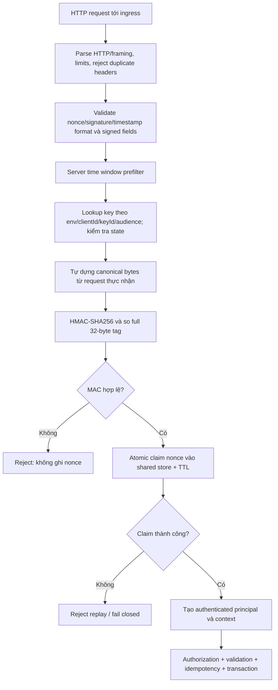
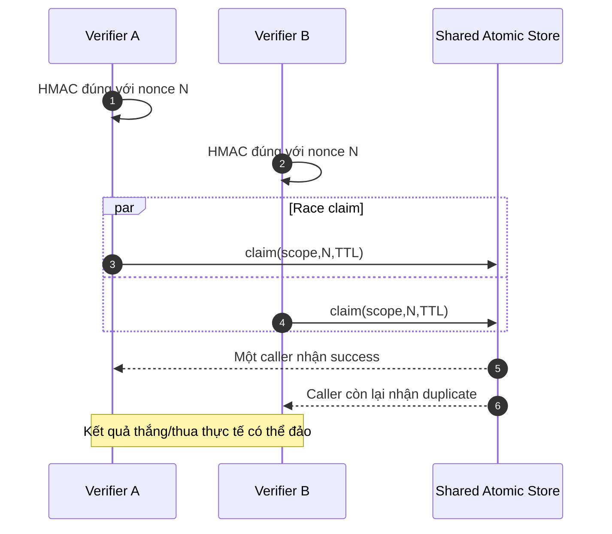

# Nonce chống replay trong xác thực HTTP request bằng HMAC

## Mục tiêu học tập

Sau bài học, bạn có thể:

- Nhận diện **replay attack**: kẻ tấn công gửi lại một HTTP request **đã được ký hợp lệ** mà không cần biết shared secret.
- Giải thích **vì sao HMAC và timestamp riêng lẻ không chống replay**, và vai trò của nonce **được ký trong canonical request** kết hợp **nonce store có trạng thái**.
- Thiết kế quy trình **format → time window → scoped key lookup → server canonicalization → HMAC verification → atomic nonce claim → authorization/business logic**.
- Lựa chọn **phạm vi duy nhất (nonce scope)**, cửa sổ thời gian, cách tính TTL, khóa lưu trong Redis/SQL và chính sách **fail closed** khi shared store không khả dụng.
- Phân biệt tính **nguyên tử**, **tính nhất quán giữa replica**, **khả năng khôi phục sau failover** và lời hứa “exactly once” mà một nonce store đơn lẻ không thể đưa ra.
- Viết ví dụ Java 17 dùng `SecureRandom`, `java.time.Clock`, `javax.crypto.Mac`, `MessageDigest.isEqual` và interface `NonceStore`, cùng negative tests cho replay và nonce bị sửa.
- Kiểm thử replay tuần tự, đồng thời, xuyên node/region, qua proxy/gateway, qua key rotation, và tách biệt replay với **idempotency** và **authorization**.

**Ngữ cảnh:** Bài thuộc chương **Replay protection** của module `SECURITY_AUTHENTICATION_HMAC_REQUEST_AUTHENTICATION`. Module mô tả cách xác thực HTTP request bằng **shared secret** và **canonical request** gồm method, URI, header hoặc body theo hợp đồng ký; thực hành xác minh HMAC, timestamp/nonce chống replay, key rotation, kiểm thử proxy/gateway và phân biệt xác thực với phân quyền. Trọng tâm bài này là **Nonce chống replay**, đặc biệt là **kiểm tra và ghi nhớ nonce một cách nguyên tử sau khi chữ ký đúng**, không chỉ sinh một chuỗi ngẫu nhiên.

> Những tên header `X-*` và profile `replay-nonce-v1` là **hợp đồng ví dụ** để giải thích thiết kế. Một API thực tế cần công bố giao thức wire, nguồn dữ liệu dùng để ký, scope khóa, cửa sổ thời gian và chính sách lỗi cụ thể; không được tự cho rằng mọi HMAC API dùng cùng format.

## 1. Replay attack: một chữ ký hợp lệ có thể bị lợi dụng thế nào?

Giả sử một đối tác hợp lệ gửi request:

```http
POST /v1/orders HTTP/1.1
Host: api.example.test
Content-Type: application/json
X-Client-Id: partner-17
X-Key-Id: k2
X-Timestamp: <epoch-seconds-hien-tai>
X-Nonce: <nonce-128-bit-base64url>
X-Signature: <hmac-sha256-base64url>

{"orderId":"O-42","amount":120000}
```

Các dấu `<...>` chỉ là **placeholder**. Hệ thống có thể kiểm tra HMAC thành công: đối tác có thể sử dụng secret hợp lệ, và các trường ký không bị sửa. Nhưng nếu toàn bộ request đã ký bị ghi lại, một bên khác có thể **gửi lại chính bytes ấy**, bao gồm cùng timestamp, nonce và tag HMAC.

Không cần giải mã HMAC hay biết secret để **replay một request đã hợp lệ**. HMAC giúp phát hiện **sửa đổi**, không tự phát hiện **lặp lại**.

### Ba request trông giống nhau nhưng khác về chính sách

| Request đến server | HMAC | Timestamp | Nonce store | Quyết định |
|---|---|---|---|---|
| Lần đầu: tag đúng, nonce N chưa dùng | Đúng | Trong cửa sổ | Chưa có N | Có thể cho qua authentication/replay gate |
| Lần hai: gửi lại **nguyên** tag, timestamp, nonce N | Vẫn đúng | Có thể còn trong cửa sổ | Đã có N | **Reject replay** |
| Request mới: payload tương tự, timestamp/nonce mới, tag mới | Đúng nếu client có secret | Trong cửa sổ | Nonce mới | Có thể qua replay gate; **chưa chắc nên chạy nghiệp vụ lần nữa** |

Ví dụ cuối rất quan trọng: một client hợp lệ có thể tạo **lệnh mới** có nội dung giống lệnh trước. Nonce store không giải quyết việc khách hàng đã đặt hàng/thanh toán hai lần; cần **idempotency** và business transaction riêng.

### Điều kiện mà replay attack trở nên đáng lo

- Thao tác có **side effect**: tạo đơn hàng, chuyển tiền, cập nhật trạng thái, xoá tài nguyên, cấp token.
- Request có thể được quan sát hoặc thu thập từ log, proxy, service nội bộ, hệ thống test hoặc một kênh thiếu bảo vệ. **TLS vẫn bắt buộc** để hạn chế lộ dữ liệu trên đường truyền.
- Verifier chỉ so MAC hoặc chỉ kiểm tra timestamp mà không ghi nhớ nonce.
- Nhiều replica xử lý cùng một request, mỗi replica dùng nonce cache riêng.
- Một hệ thống có nonce store nhưng TTL quá ngắn, mất state sau failover hoặc dùng thao tác **check rồi set** không nguyên tử.

Replay attack **không** đòi hỏi attacker có quyền thay HMAC: chính việc chấp nhận lại **một chữ ký cũ còn hợp lệ** mới là vấn đề.

## 2. Ba lớp cần có: HMAC, timestamp và nonce store

Thiết kế chống replay bằng nonce thường gồm ba lớp phối hợp:

1. **HMAC** ràng buộc nonce và timestamp với **method, URI, signed headers và body digest**. Attacker không biết secret không thể đổi nonce hoặc timestamp mà giữ tag cũ.
2. **Timestamp window** giới hạn thời gian server nhận một request đã ký, ví dụ `now−300 ≤ t ≤ now+300`, với `now` lấy từ clock server.
3. **Nonce store** ghi nhớ những nonce đã được chấp nhận trong phạm vi phù hợp, từ chối mọi lần sử dụng lặp lại dù HMAC vẫn đúng và timestamp vẫn còn mới.

Nếu thiếu từng lớp:

| Thiếu kiểm soát | Điều gì có thể xảy ra? |
|---|---|
| Không ký nonce | Attacker thay nonce thành giá trị mới, giữ HMAC cũ, tránh kiểm tra trùng |
| Không ký timestamp | Attacker sửa timestamp cũ thành giá trị hiện tại, giữ HMAC cũ |
| Không kiểm tra time window | Một request rất cũ có thể được thử lại khi state nonce bị mất/xoá |
| Không có nonce store | Bản sao request còn trong time window có thể đi qua nhiều lần |
| Nonce store không nguyên tử | Hai bản sao đồng thời cùng thấy nonce chưa tồn tại và cùng được xử lý |
| Nonce store chỉ local | Gửi bản sao sang replica khác có cache rỗng |
| TTL không đủ | Cùng request còn hợp lệ về timestamp sau khi nonce bị xoá |
| Không khóa scope đúng | Có thể bypass qua key rotation, environment hoặc tenant/audience không nhất quán |
| Không authorization | Request HMAC hợp lệ vẫn có thể thao tác tài nguyên ngoài quyền |

Một nonce ngẫu nhiên dài **128 bit** làm xác suất trùng ngẫu nhiên cực nhỏ nếu client dùng CSPRNG đúng, nhưng nó **không lưu được lịch sử request**. Thuộc tính “đã dùng hay chưa” chỉ đến từ **state phía server**.

## 3. Nonce: duy nhất theo scope, không phải bí mật

Nonce (*number used once*) là giá trị cần **không lặp lại** trong phạm vi và khoảng thời gian mà replay policy bảo vệ. Với HTTP HMAC server-to-server, một profile thực dụng là:

```text
raw nonce       = 16 byte lấy từ CSPRNG
entropy kỳ vọng ≈ 128 bit nếu CSPRNG sinh uniform
wire text       = Base64URL_NoPadding(raw nonce)
text length     = 22 ký tự ASCII
```

**Độ dài format không chứng minh ngẫu nhiên**. Chuỗi `AAAAAAAAAAAAAAAAAAAAAA` có thể decode thành đúng 16 byte số 0; nó hợp **format**, nhưng nếu client cố định chuỗi này cho mọi request thì request thứ hai sẽ bị chặn và việc sinh nonce không đạt yêu cầu.

### Quy tắc wire của profile `replay-nonce-v1`

| Thuộc tính | Quy định |
|---|---|
| Header | `X-Nonce`, đúng **một occurrence** |
| Raw nonce | **16 byte** do `SecureRandom`/CSPRNG sinh |
| Encoding | Base64URL **không padding** |
| Độ dài text | **22 ký tự**, alphabet `A-Z a-z 0-9 - _` |
| Kiểm tra canonical encoding | Decode ra đúng 16 byte, encode lại phải bằng chuỗi nhận |
| Case/whitespace | Giá trị phân biệt hoa/thường, không lowercase/trim tùy ý |
| Header thiếu/trùng | Reject tại HTTP parser/ingress |
| Nonce trong HMAC | Ký **`x-nonce:` + nonce text đã validate** |
| Replay claim | Sau HMAC hợp lệ, trước side effect |
| Replay store | Dùng chung các replica có thể xử lý cùng nonce |
| Key rotation | Scope nonce không đổi chỉ vì `keyId` thay phiên bản |

Với 16 bytes, ký tự Base64URL cuối chỉ mang một phần bit dữ liệu; một số decoder có thể chấp nhận **pad bits không canonical**. Do đó không chỉ kiểm tra regex; phải **decode → kiểm tra 16 bytes → re-encode → so text**.

**Nonce khác tag HMAC:** nonce là 16 byte random → 22 ký tự Base64URL; HMAC-SHA256 tag là **32 byte** → **43 ký tự** Base64URL không padding. Không lấy tag làm nonce và không dùng giá trị nonce như bằng chứng có secret.

## 4. Nonce được bảo vệ bằng canonical request như thế nào?

Giả sử một API chấp nhận `POST /v1/orders`, request body JSON và header `Idempotency-Key`. Một hợp đồng ký có phiên bản nên ràng buộc:

- **Method** thực sự được backend thực thi.
- **Raw request-target**, gồm query nếu endpoint cho phép query.
- **Public Host/authority** được ingress xác minh.
- **Content-Type** và những header quyết định nghiệp vụ.
- Client ID và key ID để chọn đúng bản ghi khóa.
- **Timestamp** và **nonce text**.
- SHA-256 của **raw body bytes**.

Canonical string ví dụ:

```text
replay-nonce-v1
POST
/v1/orders
host:api.example.test
content-type:application/json
idempotency-key:order-2026-001
x-client-id:partner-17
x-key-id:k2
x-timestamp:<unix-seconds>
x-nonce:<22-char-base64url>
body-sha256:<base64url-sha256-of-exact-body>
```

Quy tắc **byte-level**:

1. Tên dòng và thứ tự cố định, các dòng ngăn bằng **LF** (`0x0A`), **không có LF cuối**.
2. Encode chuỗi canonical thành **UTF-8 không BOM**.
3. Body digest = `SHA256(exactRawBodyBytes)`, encode Base64URL không padding.
4. Tag = `HMAC-SHA256(secretKeyBytes, canonicalRequestBytes)`, đầy đủ **32 bytes**.
5. `X-Signature` = Base64URL không padding của tag, **43 ký tự**.
6. Không ký trực tiếp chính `X-Signature` để tránh tự tham chiếu.
7. Verifier **tự tạo** canonical bytes từ request thực nhận; không tin một header `X-Canonical-Request` do client gửi.
8. Các header nghiệp vụ như `Idempotency-Key` phải được ký nếu handler dùng chúng, hoặc phải được ràng buộc với context tin cậy khác.

**Thử sửa nonce sau khi ký:** nếu attacker đổi `X-Nonce` từ N sang M nhưng giữ tag tính với N, dòng `x-nonce:` thay đổi. Expected HMAC sẽ khác tag nhận được và verifier từ chối **trước khi chạm vào nonce store**.

**Thử gửi lại y nguyên:** nếu attacker giữ N và toàn bộ signed fields, HMAC vẫn đúng. Khi đó chỉ có **replay gate với state** mới từ chối được bản sao.

## 5. Thứ tự xử lý an toàn ở verifier

Không nên gọi nonce store ngay khi parser nhìn thấy `X-Nonce`; lúc đó header còn **untrusted**. Một thứ tự gợi ý:



### Tại sao claim **sau HMAC**?

Giả sử nonce N thuộc request hợp lệ chưa tới backend. Attacker gửi `X-Nonce: N` nhưng với signature giả. Nếu server ghi N **trước khi kiểm tra HMAC**, attacker có thể **chiếm nonce** và khiến request hợp lệ đến sau bị từ chối. Đây là một kiểu denial-of-service đối với replay state.

Khi chỉ ghi nonce **sau khi HMAC đúng**, kẻ không có secret không thể sử dụng một tag giả để chiếm chỗ của nonce hợp lệ. Dù vậy, kẻ nắm **bản sao request thật** vẫn có thể gửi trước; “first accepted claim wins” có thể làm request gốc không được xử lý. Nonce chống **lặp xử lý**, không bảo đảm client thật là bên thắng cuộc race.

### Khi nào có thể kiểm tra timestamp?

Kiểm tra timestamp **format** và cửa sổ thời gian trước HMAC thường là một bước giảm tải. Tuy nhiên timestamp do client khai **chỉ được xác thực sau khi HMAC khớp**; không được cấp principal hoặc thực hiện side effect chỉ vì số giây trông hợp lệ.

Không phải mọi hệ thống phải dùng chính xác cùng thứ tự prefilter, nhưng các bất biến phải giữ:

- Không **claim nonce** trước khi key và HMAC được xác minh.
- Không **thực thi side effect** trước khi replay claim thành công.
- Không coi client ID/key ID khai trong header là **principal đã xác thực** trước khi MAC đúng.
- Không bỏ qua **authorization** sau khi principal được tạo.

## 6. Scope của nonce store: tránh replay xuyên key và môi trường

Hãy định nghĩa **replay namespace** trước khi chọn Redis key hay SQL primary key. Một lựa chọn cho Orders API:

```text
nonce identity = (
    environment,
    audience/service,
    authenticated client identity,
    canonical nonce bytes hoặc canonical nonce text
)
```

| Thành phần | Ví dụ | Vì sao cần? |
|---|---|---|
| Environment | `production` | Tránh vô tình dùng chung namespace giữa sandbox và production |
| Audience/service | `orders-api` | Phân biệt bối cảnh signature được phép dùng |
| Authenticated client | `partner-17` từ bản ghi khóa đã verify | Giữ uniqueness trong phạm vi client |
| Nonce | `22-char Base64URL` đã validate | Phát hiện giá trị đã được chấp nhận |

### Những lựa chọn dễ gây hở

**Scope chỉ theo nonce:** có thể bảo vệ replay xuyên mọi client, nhưng hai client vô tình dùng cùng nonce sẽ ảnh hưởng nhau. Về bảo mật không nhất thiết sai, song có chi phí và chính sách availability khác.

**Scope theo `(clientId, keyId, nonce)`:** khi cùng một client chuyển `k1` → `k2`, giá trị N nằm trong hai namespace. Nếu protocol/khoá có thể tạo những request mới được ký ở cả hai phiên bản, cách chia namespace này có thể tạo khoảng trống so với mục tiêu “một nonce cho một client trong cửa sổ”. **Nên tránh thêm key ID vào scope** trừ khi có phân tích rõ và quyết định khác được công bố.

**Scope theo `clientId` tự khai mà không xác minh:** attacker có thể gửi cùng signature nhưng đổi ID để đổi namespace; nếu ID là signed field, HMAC phải ngăn sửa đổi. An toàn hơn là lấy identity **từ key record sau verify** và ràng buộc scope theo owner/audience.

**Scope theo từng replica:** không chặn replay khi request được load balancer chuyển sang node khác.

**Scope theo `timestamp` tùy tiện:** nếu client hợp lệ ký lại cùng nonce với timestamp mới, kho có thể coi đó là identity khác. Nếu chủ đích là uniqueness trong thời gian tồn tại nonce theo client, **không nên** bao timestamp vào key store một cách làm mỗi lần ký tạo namespace mới.

### Tạo store key tránh va chạm cấu trúc

Không ghép các trường bằng một ký tự ngăn tùy ý nếu dữ liệu có thể chứa ký tự ấy. Ví dụ `a|bc` + `d` có thể va chạm cách ghép với `a` + `bc|d`. Dùng:

- Tuple/unique columns trong SQL.
- **Length-prefix** cho các trường khi serialize, ví dụ `len:value`.
- Hoặc một digest có phân tách trường rõ ràng; cân nhắc việc lộ identifier trong tên key/log và độ dài fingerprint.

Bản ghi nonce là **state chống replay**, không phải secret. Dẫu vậy, giới hạn quyền đọc/ghi store vì lộ danh tính client, pattern lưu lượng hoặc khả năng xóa key cũng là rủi ro.

## 7. Atomic claim: Redis, SQL và cơ chế nhất quán

### 7.1. Redis: SET với NX và TTL trong **một thao tác**

Với một Redis instance/topology có semantics được xác lập, một thao tác mẫu:

```redis
SET replay:v1:<scoped-key> 1 NX EX 605
```

Trong đó:

- `NX`: chỉ ghi nếu key **chưa tồn tại**.
- `EX 605`: đặt expiry theo giây **cùng thao tác**.
- Khi Redis trả thành công theo contract, nonce được claim; khi key đã tồn tại, từ chối.
- Nếu Redis timeout, mất kết nối hoặc phản hồi không chắc chắn, **không tự coi là claim thành công**.

Đây là ví dụ, không phải lời hứa rằng chỉ cần dùng Redis là có an toàn đa vùng. **Redis replication/failover bất đồng bộ** có thể khiến một claim đã được node cũ xác nhận **không được lưu** ở replica được nâng lên sau failover. Nếu yêu cầu at-most-once nghiêm ngặt qua failover, phải xem xét mô hình nhất quán/durability, topology và phương án lưu trữ phù hợp với threat model.

### 7.2. SQL: unique constraint cùng transaction

Một thiết kế khác dùng bảng:

```sql
CREATE TABLE accepted_nonces (
    environment VARCHAR(32) NOT NULL,
    audience VARCHAR(64) NOT NULL,
    client_id VARCHAR(128) NOT NULL,
    nonce VARCHAR(22) NOT NULL,
    expires_at TIMESTAMP NOT NULL,
    PRIMARY KEY (environment, audience, client_id, nonce)
);
```

Một giao dịch cố gắng **INSERT** bộ khóa mới; unique constraint đảm bảo hai transaction đồng thời không thể cùng commit hai bản ghi có **cùng primary key** trên một primary/database có bảo đảm phù hợp.

Nếu insert thành công: nonce mới; lỗi duplicate key: replay. Nếu lỗi kết nối/transaction outcome không rõ: **fail closed**, kiểm tra lại nếu nghiệp vụ yêu cầu. Expiry cleanup và partition retention cần được thiết kế sao cho **không xoá bản ghi trước hạn replay thực tế**.

**Chú ý:** một cơ sở dữ liệu SQL cụ thể có thể dùng transaction/locking khác nhau; khi phân tán qua nhiều primary, phải xác nhận uniqueness **toàn miền cần bảo vệ**, không chỉ cục bộ một shard.

### 7.3. Vì sao check rồi write riêng là sai?

```text
Replica A: EXISTS(scope,N) -> false
Replica B: EXISTS(scope,N) -> false
Replica A: INSERT(scope,N) -> success
Replica B: INSERT(scope,N) -> success, nếu không có atomic uniqueness
```

Từ “nonce chưa dùng” đến “nonce đã claim” phải là **một bước quyết định nguyên tử**, vì requests có thể đến đồng thời. Cache local, eventual replication hoặc `GET` rồi `SET` không đạt được bất biến này khi không có thêm cơ chế phối hợp.

### Phân biệt at-most-once gate với exactly-once business

Nếu nonce claim thành công, rồi backend gặp lỗi **trước khi lưu đơn**, request retry với **cùng nonce** vẫn bị chặn. Replay gate không biết nghiệp vụ đã commit hay chưa.

Nếu transaction đã commit nhưng response bị mất, retry với **nonce mới và signature mới** có thể qua replay gate; backend cần **idempotency** để không tạo đơn trùng.

Do đó:

- **Nonce store:** ngăn cùng nonce vượt replay gate lần hai trong thời gian bảo vệ.
- **Idempotency store:** quản lý cùng thao tác nghiệp vụ với một `Idempotency-Key` đã ký và gắn với principal/payload.
- **Business transaction:** xác định kết quả commit/rollback.

Không mô tả `SET NX` là “exactly once execution” của toàn bộ hệ thống.

## 8. Tính TTL đủ để che phủ toàn bộ timestamp window

Giả sử server cho request timestamp `t` nằm trong cửa sổ đối xứng `±W`:

\[
now-W\le t\le now+W
\]

Đối với một timestamp cố định `t`, request có thể được chấp nhận **sớm nhất** khi `now=t-W` và **muộn nhất** khi `now=t+W`.

```text
               timestamp t
                   |
earliest           |               latest
   |---------------|-----------------|
  t-W              t                t+W

        Tổng bề rộng cửa sổ = 2W
```

Với `W=300 giây`, thời gian giữa earliest và latest là **600 giây**. Nếu nonce được claim ở điểm sớm nhất mà TTL chỉ **300 giây**, bản ghi có thể hết hạn **khi request vẫn còn hợp lệ thêm khoảng 300 giây nữa**. Attacker replay cùng request trong phần sau cửa sổ sẽ không gặp nonce cũ trong store.

### Fixed TTL khi claim

Một policy đơn giản cho lab:

\[
TTL \geq 2W + \text{safety margin}
\]

Ví dụ `W=300`, margin giả định `5s` thì `TTL=605s`. Con số `605` **không tự an toàn với mọi topology**: clock lệch giữa verifier replica, độ chính xác TTL, network delay, failover, race cleanup và retry có thể đòi margin lớn hơn.

### Expiry theo timestamp

Thay vì fixed TTL, một hệ thống có thể giữ nonce **đến sau mốc `t+W` theo đồng hồ đáng tin**, cộng margin cần thiết. Điều này giảm retention cho request đến muộn, nhưng cần tính thời gian store/verifier và xử lý biến đổi clock. Không tự dựa vào thời gian client khai làm thời điểm xóa key **nếu chưa xác minh HMAC**.

### Store cleanup phải tôn trọng expiry

- SQL job cleanup theo `expires_at` không được xóa sớm.
- Redis TTL cần được tạo **cùng atomic claim**, không làm `SET NX` rồi `EXPIRE` tách rời.
- Nonce store recovery/failover không được âm thầm quên các nonce còn trong cửa sổ chấp nhận.
- Khi state mất hoặc không chắc chắn, endpoint có side effect nhạy cảm nên **từ chối tạm thời** thay vì xử lý request như chưa từng có nonce.

**Kích thước nonce không thay TTL:** nonce 256 bit cũng có thể bị replay nguyên vẹn nếu TTL quá ngắn. TTL được quyết định bởi **cửa sổ timestamp và hành vi hệ thống**, không bởi entropy.

## 9. Java 17: một verifier có nonce chống replay

Ví dụ sau dùng một profile hẹp cho `POST /v1/orders`, ký method, URI, Host, Content-Type, Idempotency-Key, client/key ID, timestamp, nonce và SHA-256 raw body. Phần quan trọng là **HMAC hợp lệ trước khi claim nonce**, rồi mới tạo principal.

Ví dụ tự chứa bằng JDK; `InMemoryNonceStore` chỉ để **mô phỏng unit test trong một process**, không thay thế Redis/SQL dùng chung nhiều replica.

### 9.1. Java/JCA code

```java
import java.nio.charset.StandardCharsets;
import java.security.GeneralSecurityException;
import java.security.MessageDigest;
import java.security.SecureRandom;
import java.time.Clock;
import java.time.Instant;
import java.time.ZoneOffset;
import java.util.Base64;
import java.util.Optional;
import java.util.concurrent.ConcurrentHashMap;
import java.util.concurrent.atomic.AtomicBoolean;
import java.util.regex.Pattern;
import javax.crypto.Mac;
import javax.crypto.spec.SecretKeySpec;

public final class ReplayNonceVerifierV1 {
    private static final String VERSION = "replay-nonce-v1";
    private static final String HOST = "api.example.test";
    private static final String TARGET = "/v1/orders";
    private static final String AUDIENCE = "orders-api";
    private static final long WINDOW = 300L;
    private static final long TTL_SECONDS = 605L;
    private static final long MAX_EPOCH_SECONDS = 253402300799L;
    private static final int MAX_BODY_BYTES = 16 * 1024;

    private static final Pattern ID = Pattern.compile(
            "[A-Za-z0-9][A-Za-z0-9._-]{0,63}");
    private static final Pattern TIMESTAMP = Pattern.compile(
            "(?:0|[1-9][0-9]{0,11})");
    private static final Pattern NONCE = Pattern.compile(
            "[A-Za-z0-9_-]{22}");
    private static final Pattern SIGNATURE = Pattern.compile(
            "[A-Za-z0-9_-]{43}");
    private static final Base64.Encoder B64 =
            Base64.getUrlEncoder().withoutPadding();

    private ReplayNonceVerifierV1() {}

    // Snapshot chỉ đến từ HTTP adapter đã validate request thật:
    // publicHost không được lấy từ X-Forwarded-Host tự khai.
    public record RequestSnapshot(
            String method,
            String rawTarget,
            String publicHost,
            String contentType,
            String idempotencyKey,
            String clientId,
            String keyId,
            String timestampText,
            String nonceText,
            byte[] rawBody) {

        public RequestSnapshot {
            if (rawBody == null) {
                throw new IllegalArgumentException("Missing body");
            }
            rawBody = rawBody.clone();
        }

        @Override
        public byte[] rawBody() {
            return rawBody.clone();
        }
    }

    public record KeyRecord(
            String environment,
            String clientId,
            String keyId,
            String audience,
            String principal,
            boolean mayVerify,
            byte[] secret) {

        public KeyRecord {
            if (secret == null) {
                throw new IllegalArgumentException("Missing secret");
            }
            secret = secret.clone();
        }

        @Override
        public byte[] secret() {
            return secret.clone();
        }
    }

    public interface KeyStore {
        Optional<KeyRecord> find(
                String environment, String clientId,
                String keyId, String audience);
    }

    public interface NonceStore {
        // Must be atomic across ALL replicas for the same scope.
        // Return false if nonce already exists.
        boolean claim(
                String environment, String audience,
                String authenticatedClientId, String nonce,
                long ttlSeconds);
    }

    // 16 byte CSPRNG -> 22 Base64URL chars.
    public static String newNonce(SecureRandom rng) {
        byte[] value = new byte[16];
        rng.nextBytes(value);
        return B64.encodeToString(value);
    }

    private static byte[] decodeCanonical(
            String text, Pattern pattern, int byteCount) {
        if (text == null || !pattern.matcher(text).matches()) {
            throw new IllegalArgumentException("Invalid Base64URL format");
        }
        byte[] decoded;
        try {
            decoded = Base64.getUrlDecoder().decode(text);
        } catch (IllegalArgumentException malformed) {
            throw new IllegalArgumentException("Malformed Base64URL");
        }
        if (decoded.length != byteCount ||
                !B64.encodeToString(decoded).equals(text)) {
            throw new IllegalArgumentException("Noncanonical Base64URL");
        }
        return decoded;
    }

    private static long parseTimestamp(String text) {
        if (text == null || !TIMESTAMP.matcher(text).matches()) {
            throw new IllegalArgumentException("Invalid timestamp");
        }
        long timestamp = Long.parseLong(text);
        if (timestamp > MAX_EPOCH_SECONDS) {
            throw new IllegalArgumentException("Timestamp out of range");
        }
        return timestamp;
    }

    private static void validate(RequestSnapshot r) {
        if (r == null ||
                !"POST".equals(r.method()) ||
                !TARGET.equals(r.rawTarget()) ||
                !HOST.equals(r.publicHost()) ||
                !"application/json".equals(r.contentType()) ||
                r.idempotencyKey() == null ||
                !ID.matcher(r.idempotencyKey()).matches() ||
                r.clientId() == null ||
                !ID.matcher(r.clientId()).matches() ||
                r.keyId() == null ||
                !ID.matcher(r.keyId()).matches() ||
                r.rawBody().length == 0 ||
                r.rawBody().length > MAX_BODY_BYTES) {
            throw new IllegalArgumentException("Invalid signed request");
        }
        parseTimestamp(r.timestampText());
        decodeCanonical(r.nonceText(), NONCE, 16);
    }

    public static byte[] canonicalBytes(RequestSnapshot r)
            throws GeneralSecurityException {
        validate(r);
        byte[] bodyDigest = MessageDigest.getInstance("SHA-256")
                .digest(r.rawBody());

        String canonical = String.join("\n",
                VERSION,
                "POST",
                TARGET,
                "host:" + HOST,
                "content-type:application/json",
                "idempotency-key:" + r.idempotencyKey(),
                "x-client-id:" + r.clientId(),
                "x-key-id:" + r.keyId(),
                "x-timestamp:" + r.timestampText(),
                "x-nonce:" + r.nonceText(),
                "body-sha256:" + B64.encodeToString(bodyDigest));

        return canonical.getBytes(StandardCharsets.UTF_8);
    }

    private static byte[] expectedHmac(
            byte[] secret, RequestSnapshot r)
            throws GeneralSecurityException {
        Mac mac = Mac.getInstance("HmacSHA256");
        mac.init(new SecretKeySpec(secret, "HmacSHA256"));
        return mac.doFinal(canonicalBytes(r));
    }

    // Chỉ dùng trong client/test, không tạo chữ ký thay caller ở server.
    public static String signForTest(
            byte[] secret, RequestSnapshot r)
            throws GeneralSecurityException {
        return B64.encodeToString(expectedHmac(secret, r));
    }

    public static Optional<String> authenticate(
            RequestSnapshot request,
            String signatureText,
            Clock clock,
            String serverEnvironment,
            KeyStore keyStore,
            NonceStore nonceStore)
            throws GeneralSecurityException {

        final byte[] suppliedTag;
        final long requestTime;
        try {
            validate(request);
            suppliedTag = decodeCanonical(signatureText, SIGNATURE, 32);
            requestTime = parseTimestamp(request.timestampText());
        } catch (IllegalArgumentException invalidInput) {
            return Optional.empty();
        }

        long now = clock.instant().getEpochSecond();
        if (now < 0 || now > MAX_EPOCH_SECONDS ||
                requestTime - now < -WINDOW ||
                requestTime - now > WINDOW) {
            return Optional.empty();
        }

        // clientId/keyId từ request CHỈ DÙNG ĐỂ TÌM key ứng viên.
        // env/audience thuộc cấu hình server.
        Optional<KeyRecord> candidate = keyStore.find(
                serverEnvironment, request.clientId(),
                request.keyId(), AUDIENCE);
        if (candidate.isEmpty()) return Optional.empty();

        KeyRecord key = candidate.get();
        if (!key.mayVerify() ||
                !serverEnvironment.equals(key.environment()) ||
                !AUDIENCE.equals(key.audience()) ||
                !request.clientId().equals(key.clientId()) ||
                !request.keyId().equals(key.keyId()) ||
                key.principal() == null ||
                key.secret() == null ||
                key.secret().length < 32) {
            return Optional.empty();
        }

        byte[] expectedTag = expectedHmac(key.secret(), request);
        if (!MessageDigest.isEqual(expectedTag, suppliedTag)) {
            return Optional.empty();
        }

        // HMAC đã đúng: CHỈ BÂY GIỜ mới được claim nonce.
        // Scope không dùng keyId, giữ nhất quán khi key rotation.
        final boolean claimed;
        try {
            claimed = nonceStore.claim(
                    serverEnvironment, AUDIENCE,
                    key.clientId(), request.nonceText(), TTL_SECONDS);
        } catch (RuntimeException storeFailure) {
            return Optional.empty();  // Fail closed; ops logs ở tầng trên.
        }
        if (!claimed) return Optional.empty();

        // Authenticated principal, chưa phải authorization.
        return Optional.of(key.principal());
    }

    // Fixture in-memory. compute() atomic trong một process,
    // KHÔNG chia sẻ đa replica, KHÔNG dọn key expired định kỳ.
    public static final class InMemoryNonceStore implements NonceStore {
        private final Clock clock;
        private final ConcurrentHashMap<String, Long> expiration =
                new ConcurrentHashMap<>();

        public InMemoryNonceStore(Clock clock) {
            this.clock = clock;
        }

        // Length-prefix để các tuple không bị nhầm khi ghép string.
        private static String segment(String value) {
            return value.length() + ":" + value;
        }

        @Override
        public boolean claim(
                String env, String audience,
                String client, String nonce, long ttlSeconds) {
            if (ttlSeconds <= 0) {
                throw new IllegalArgumentException("Invalid TTL");
            }
            long now = clock.instant().getEpochSecond();
            String key = segment(env) + segment(audience) +
                    segment(client) + segment(nonce);
            AtomicBoolean inserted = new AtomicBoolean(false);
            expiration.compute(key, (ignored, expiresAt) -> {
                if (expiresAt == null || expiresAt <= now) {
                    inserted.set(true);
                    return now + ttlSeconds;
                }
                return expiresAt;
            });
            return inserted.get();
        }
    }

    public static void main(String[] args)
            throws GeneralSecurityException {
        Clock fixed = Clock.fixed(
                Instant.parse("2026-11-28T00:00:00Z"), ZoneOffset.UTC);
        SecureRandom rng = new SecureRandom();
        byte[] secret = new byte[32];
        rng.nextBytes(secret);
        String nonce = newNonce(rng);

        RequestSnapshot original = new RequestSnapshot(
                "POST", TARGET, HOST, "application/json",
                "order-2026-001", "partner-17", "k2",
                Long.toString(fixed.instant().getEpochSecond()),
                nonce,
                "{\"orderId\":\"O-42\",\"amount\":120000}"
                        .getBytes(StandardCharsets.UTF_8));

        KeyStore keys = (env, client, keyId, audience) ->
                "production".equals(env) &&
                "partner-17".equals(client) &&
                "k2".equals(keyId) &&
                AUDIENCE.equals(audience)
                ? Optional.of(new KeyRecord(
                    env, client, keyId, audience,
                    "partner-17", true, secret))
                : Optional.empty();

        NonceStore store = new InMemoryNonceStore(fixed);
        String signature = signForTest(secret, original);

        // First valid request: HMAC + nonce claim thành công.
        if (!"partner-17".equals(authenticate(
                original, signature, fixed, "production",
                keys, store).orElse(null))) {
            throw new AssertionError("First request rejected");
        }

        // Replay nguyên request: HMAC vẫn đúng nhưng nonce đã dùng.
        if (authenticate(original, signature, fixed,
                "production", keys, store).isPresent()) {
            throw new AssertionError("Replay was accepted");
        }

        // Chỉ thay nonce, giữ signature cũ: HMAC phải sai.
        RequestSnapshot changedNonce = new RequestSnapshot(
                original.method(), original.rawTarget(),
                original.publicHost(), original.contentType(),
                original.idempotencyKey(),
                original.clientId(), original.keyId(),
                original.timestampText(), newNonce(rng),
                original.rawBody());
        if (authenticate(changedNonce, signature, fixed,
                "production", keys, store).isPresent()) {
            throw new AssertionError("Nonce tampering accepted");
        }

        // Request mới được ký lại với nonce mới có thể qua replay gate,
        // nhưng Idempotency-Key giống nhau: backend PHẢI khử trùng lặp.
        RequestSnapshot reSigned = new RequestSnapshot(
                original.method(), original.rawTarget(),
                original.publicHost(), original.contentType(),
                original.idempotencyKey(),
                original.clientId(), original.keyId(),
                original.timestampText(), newNonce(rng),
                original.rawBody());
        String secondSignature = signForTest(secret, reSigned);
        if (authenticate(reSigned, secondSignature, fixed,
                "production", keys, store).isEmpty()) {
            throw new AssertionError("Fresh request unexpectedly rejected");
        }

        System.out.println("Replay nonce checks: PASS");
    }
}
```

### 9.2. Điểm kỹ thuật quan trọng trong ví dụ

- `newNonce`: 16 byte từ `SecureRandom`, Base64URL không padding; **22 ký tự**.
- `decodeCanonical`: nonce text phải decode thành **16 byte**, signature phải decode thành **32 byte**. Re-encode tránh các biểu diễn Base64URL không canonical.
- `RequestSnapshot`: clone body, giúp giảm nguy cơ sửa mảng sau khi chụp request. HTTP adapter vẫn phải giữ **đúng raw representation** mà backend sẽ sử dụng.
- `canonicalBytes`: ký nonce và timestamp cùng method, URI, Host, signed headers, body digest; không tin canonical string do client tự gửi.
- `MessageDigest.isEqual`: so **raw 32-byte HMAC tag**, không dùng `String.equals` trên signature để quyết định MAC có hợp lệ.
- `KeyStore`: tra key theo `(environment, clientId, keyId, audience)`; principal lấy từ bản ghi key **sau khi HMAC đúng**.
- `NonceStore.claim`: gọi **sau HMAC**, có TTL và scope không chứa key ID.
- `InMemoryNonceStore`: sử dụng `ConcurrentHashMap.compute` nguyên tử **trong một tiến trình** nhưng **không durable, không multi-region, không có periodic expiration cleanup**. Chỉ phù hợp test.
- `main`: chứng minh request đầu được nhận; bản sao bị reject; sửa nonce sau ký làm MAC fail; request **ký lại bằng nonce mới** có thể đi qua replay gate nhưng cần idempotency ở backend.

**Hạn chế cố ý:** mã không trực tiếp parse HTTP framing/headers, không kết nối Redis/SQL, không triển khai transaction/idempotency/authz. Các lỗi key store/nonce store cần được ghi metric vận hành ở tầng ứng dụng, response công khai không tiết lộ secret hoặc khóa có tồn tại không. Với triển khai thực, HTTP adapter cần reject duplicate `X-Nonce`, `X-Signature`, Host/`:authority` và các signed headers trước khi tạo snapshot.

## 10. Race condition, hệ thống đa vùng và failover

### 10.1. Hai request cùng lúc

Kẻ tấn công gửi cùng một request với nonce N tới replica A và B gần như đồng thời:



Sơ đồ dùng A thắng **chỉ để minh họa**; trong thực tế B có thể thắng. Thuộc tính cần kiểm tra là **tối đa một claim thành công** trong cùng namespace và retention window.

Một `ConcurrentHashMap` trên **mỗi replica** không thể thực hiện điều này, kể cả khi mỗi JVM dùng `computeIfAbsent` hoặc `putIfAbsent` nguyên tử. State phải **chung và nhất quán** đối với mọi nơi có thể xác minh cùng request.

### 10.2. Multi-region có thể làm replay protection sai

Nếu vùng VN và vùng EU có nonce store độc lập, kẻ tấn công có thể gửi cùng request sang cả hai vùng và nhận **hai claim thành công**. Việc sao chép nonce giữa hai vùng **theo kiểu eventual consistency** có thể không đủ vì hai request đồng thời đều thấy state cũ.

Một số hướng kiến trúc:

1. **Một miền claim nhất quán** cho cùng scope, mọi verifier chuyển tới miền đó trước khi thực thi side effect.
2. **Phân vùng chủ sở hữu ổn định theo client/audience**, mọi request của client đó được định tuyến tới một writer có semantics nguyên tử; phải xử lý failover mà không làm mất nonce.
3. **Kho giao dịch có unique constraint/strong consistency** trong miền replay, phù hợp với khả năng chịu lỗi và độ trễ của hệ thống.
4. Nếu không thể bảo đảm claim toàn cục khi mất kết nối giữa vùng, **fail closed** cho các endpoint nhạy cảm thay vì để hai vùng cùng xử lý.

**Không có bảo đảm exactly-once chỉ vì có Redis hoặc multi-region database.** Cần kiểm tra tính nhất quán của thao tác claim và độ bền bản ghi khi failover, phân vùng mạng, restore backup và rollback state.

### 10.3. Cửa sổ mất state sau failover

Một tình huống:

1. Replica/primary A claim nonce N và trả success.
2. Trước khi record được lưu bền hoặc replicate đủ, A gặp lỗi.
3. Primary B lên thay nhưng **không chứa nonce N**.
4. Replay lại request còn trong timestamp window; B tưởng N chưa dùng.

Dù code dùng `SET NX EX` đúng cú pháp, bảo đảm chống replay **không còn** nếu topology có thể mất state đã được xác nhận. Cần đánh giá durability/acknowledgment policy, failover mode và giảm thiểu rủi ro nghiệp vụ (ví dụ idempotency transaction ở downstream).

## 11. Retry, idempotency và “first claim wins”

**Replay protection không giống idempotency**.

| Tình huống | Nonce gate | Business outcome cần có |
|---|---|---|
| Gửi lần đầu, body hợp lệ, nonce N | Claim N thành công | Có thể xử lý sau authz |
| Replay **nguyên** request N sau khi đã claim | Reject N | Không thực hiện side effect lần hai |
| Lần đầu claim N, backend lỗi trước commit | N đã được dùng | Client cần biết cách tra cứu trạng thái và retry theo chính sách |
| Request đã commit, response bị mất | N đã được dùng | Client có thể hỏi trạng thái/idempotency result |
| Client gửi lại với nonce M và **tag mới** | Claim M có thể thành công | Idempotency layer phải nhận diện thao tác trùng |
| Hai request khác nhau dùng cùng nonce N | Chỉ một claim thành công | Request còn lại bị chặn, dù HMAC riêng có thể hợp lệ |

### Idempotency-Key phải được bảo vệ

Trong ví dụ, `Idempotency-Key: order-2026-001` được đưa vào canonical request. Backend có thể lưu idempotency record gắn với:

```text
(authenticated principal, operation/endpoint, idempotency key,
 request fingerprint, result/status)
```

Khi client retry với nonce mới nhưng cùng idempotency key và cùng nội dung thao tác, backend trả kết quả đã ghi hoặc xử lý trạng thái đang chạy theo transaction policy; nếu idempotency key bị **reuse cho payload khác**, hệ thống phải từ chối xung đột theo contract.

Không tự xóa nonce cũ khi downstream trả HTTP 500 chỉ để cho retry nguyên request: backend có thể **đã commit trước khi phát sinh lỗi phản hồi**. Muốn retry an toàn cần trạng thái nghiệp vụ/transaction cụ thể.

### Client timeout và điều phối retry

Một SDK dùng HMAC nên:

1. Chốt body/URI/signed headers.
2. Sinh timestamp và nonce mới nếu tạo **một lần gửi mới**.
3. Tính lại HMAC tag **sau khi các trường ký đã được chốt**.
4. Giữ cùng **Idempotency-Key nghiệp vụ** khi retry cùng thao tác, theo contract API.
5. Không tự chuyển Authorization/signature cũ sang host khác khi follow redirect.
6. Khi trạng thái giao dịch không rõ, ưu tiên API truy vấn kết quả theo idempotency key thay vì phát lại vô hạn.

## 12. Key rotation, secret compromise và authorization

### Key rotation

Verifier có thể đồng thời cho phép `k1` và `k2` trong một giai đoạn rotation hữu hạn. Mỗi request ký `x-key-id` để gắn tag với đúng secret đã provision.

- Nonce scope cho cùng **authenticated client + audience** nên **không chia theo `keyId`** nếu chính sách muốn unique nonce xuyên hai phiên bản key.
- Chỉ những key ở trạng thái được phép verify mới có thể tính expected MAC; key `REVOKED` phải bị từ chối dù nonce mới.
- Cache key state ở các replica phải được cập nhật/invalidated phù hợp khi thu hồi.
- Nếu secret `k1` bị lộ, attacker có thể tạo **timestamp mới, nonce mới, HMAC mới** cho tới khi key bị thu hồi. Nonce store không ngăn người biết secret tạo request mới.
- Không dùng “chữ ký HMAC khớp với một trong các secret” bằng cách thử toàn bộ key trong hệ thống: cần lookup đúng client, environment, audience và key ID.

### Authentication khác authorization

Một request có chữ ký hợp lệ và nonce chưa dùng mới hoàn thành **authentication + replay gate**, không có nghĩa có quyền. Ví dụ client `partner-17` ký request để thay trạng thái đơn thuộc `partner-42`:

- HMAC có thể **đúng**.
- Timestamp trong cửa sổ.
- Nonce claim **thành công**.
- Backend vẫn phải **deny** theo quyền tenant/resource/action.

Principal phải đến từ **bản ghi khóa đã verify**, không phải client ID chưa xác thực, một header `X-Authenticated-Principal` do client tự chèn, hay hostname giả mạo. Lỗi authorization **không được** làm verifier tự xóa nonce đã claim.

## 13. Reverse proxy/gateway có thể phá replay protection ở đâu?

| Tình huống | Sai lệch | Cách phòng vệ |
|---|---|---|
| Gateway bỏ `X-Nonce` | Verifier không có nonce | Reject hoặc sửa cấu hình forwarding |
| Header nonce trùng | Hai tầng chọn first/last khác nhau | Reject duplicate ở ingress |
| Host rewrite public → internal | Verifier ký Host khác client | Verify trước rewrite hoặc trusted public authority context |
| URI rewrite, decode path/query | Canonical request khác hoặc router thực thi resource khác | Chốt signing target, reject ambiguity |
| Body bị parse rồi serialize lại | Body hash khác, có thể đổi nghiệp vụ | Hash exact raw representation bytes, giữ snapshot |
| Gateway tự tạo nonce mới | Thay signed metadata sau khi client ký | Không tự viết lại signed fields |
| Proxy retry HTTP tự động | Gửi lại cùng nonce/tag | Replay gate reject; upstream cần retry/idempotency policy |
| Load balancer đổi replica | Node sau thiếu nonce local | Shared atomic store |
| Multi-region routing | Hai vùng claim độc lập | Strongly consistent claim domain hoặc fail closed |
| Reverse proxy tin `X-Forwarded-Host` do client gửi | Authority/audience bị giả | Strip/overwrite header forwarding không đáng tin |
| Gateway tạo `X-Authenticated-Client` từ raw header | Bỏ qua HMAC và principal từ key record | Chỉ truyền verified identity qua hop tin cậy |
| Store timeout/failover | Claim outcome không xác định | Fail closed, quan sát telemetry, không cho qua mặc định |

### HTTP parser là phần của bảo mật

- HTTP/1.1 `Host` và HTTP/2/HTTP/3 `:authority` cần được chọn/đối chiếu nhất quán theo protocol.
- HTTP framing như `Content-Length`/`Transfer-Encoding` phải được xử lý chặt để tránh request smuggling; ký HMAC không tự sửa lỗi parser khác nhau.
- Header `X-Nonce` không được biến thành một danh sách giá trị ngăn bằng dấu phẩy rồi parser chọn một giá trị tùy ý.
- Request-target và raw body mà verifier HMAC phải là **đúng representation backend xử lý** theo contract.
- Nếu xác minh ở gateway, backend không được mở đường gọi trực tiếp bỏ qua replay gate; nếu ở service sau gateway, original routing metadata phải được bảo vệ.

## 14. Giám sát, vận hành và phản hồi lỗi

Một replay defense có thể đúng về mã nhưng sai về vận hành nếu nonce store hết bộ nhớ, TTL bị đổi hoặc mất khả năng nhất quán.

### Những chỉ số nên giám sát

| Metric | Gợi ý diễn giải |
|---|---|
| `nonce_claim_success` | Các request mới đã được HMAC xác minh và claim |
| `nonce_duplicate_rejected` | Có request lặp nonce; có thể là retry sai, replay hoặc bug CSPRNG |
| `nonce_store_unavailable` | Replay protection không thể đảm bảo; endpoint nhạy cảm cần fail closed |
| `timestamp_out_of_window` | Đồng hồ lệch, request quá cũ, retry queue lâu hoặc tấn công |
| `signature_invalid` | Canonical mismatch, wrong key, sửa request hoặc cấu hình sai |
| `key_revoked_rejected` | Có request dùng key đã bị thu hồi |
| `idempotency_reused` | Cùng operation được retry bằng nonce mới; kết quả phải theo business policy |
| `replay_claim_latency` | Độ trễ store, nguy cơ timeout/đứt kết nối |
| `nonce_ttl_effective` | TTL thực tế, kiểm tra không ngắn hơn cửa sổ hợp lệ |
| `replication_failover_events` | Các sự kiện có thể làm mất replay state đã ack |

Không log raw shared secret, full Authorization header, raw body chứa dữ liệu cá nhân hay nonce của mọi request chỉ để debug. Nonce không phải secret, nhưng khi gắn với client ID/timestamp cũng có thể tiết lộ lưu lượng và hỗ trợ đối thủ thu thập request; cân nhắc chỉ log fingerprint/trạng thái cùng metadata đã lọc.

### Trả lỗi cho client

Một hệ thống có thể dùng phản hồi authentication failure chung khi signature/nonce/replay check không qua, ví dụ `401 Unauthorized` kèm `WWW-Authenticate` thích hợp nếu sử dụng authentication scheme HTTP. Một số API dùng mã khác cho replay theo hợp đồng, nhưng không nên tiết lộ chi tiết về key tồn tại, nonce store key hoặc canonical HMAC.

Nếu nonce store outage, API cần trả lỗi tạm thời có thể retry **theo cơ chế ký lại/idempotency đã quy định**, đồng thời **không xử lý side effect** khi chưa claim nonce. Tránh đề xuất “bỏ nonce check khi Redis lỗi” để giữ availability đối với endpoint nhạy cảm.

## 15. Ma trận kiểm thử replay chống lặp

| Kiểm thử | Thao tác | Kết quả kỳ vọng |
|---|---|---|
| Happy path | Tag đúng, nonce mới, timestamp hiện tại | HMAC pass, claim thành công, tạo principal |
| Replay tuần tự | Gửi lại nguyên request/tag/nonce | Reject dù MAC vẫn đúng |
| Nonce bị sửa | Đổi `X-Nonce` nhưng giữ tag | MAC fail; không claim |
| Nonce không nằm trong MAC | Cố tình bỏ dòng nonce ở implementation lỗi | Test phải phát hiện replay bypass |
| Nonce format sai | 21/23 chars, padded Base64, hex hoặc Unicode | Reject format trước lookup |
| Noncanonical Base64URL | Pad bits không chuẩn, decode cùng bytes | Reject sau re-encode |
| Timestamp quá cũ | Tag đúng nhưng `t < now-W` | Reject time window |
| Timestamp quá tương lai | Tag đúng nhưng `t > now+W` | Reject time window |
| Nonce TTL `W` | Claim khi `now=t-W`, replay gần `t+W` | Test phải chứng minh lỗ retention |
| Nonce TTL `2W+margin` | Replay trong toàn cửa sổ | Reject khi state còn đủ |
| Hai request đồng thời | Cùng nonce/scope qua hai verifier | **Tối đa một** claim thành công |
| Hai region độc lập | Cùng nonce qua cả hai region | Phải test và phát hiện nguy cơ nhận hai lần |
| Key rotation | Ký bằng `k1`/`k2` trong overlap cùng principal | Nonce scope không reset theo key ID |
| Revoked key | Tag đúng với secret bị revoke | Reject trước claim |
| Wrong key/client | Client A khai ID/key B | Reject; không nhận principal B |
| Missing store | Redis/SQL timeout/partition | Fail closed trước side effect |
| Failover mất state | Claim N được ack, new primary thiếu N | Test phải phát hiện; xem xét durability |
| Nonce collision | Client vô tình tạo cùng nonce ở request mới | Request thứ hai reject; bug/availability alert |
| Retry với nonce mới | Cùng business payload và Idempotency-Key | Replay gate có thể pass, backend trả kết quả idempotent |
| Retry với nonce cũ | Gửi lại request y nguyên vì mất response | Reject replay; client cần status/idempotency policy |
| Gateway rewrite Host/URI/body | Signed fields khác client ký | HMAC mismatch hoặc reject |
| Duplicate nonce header | Hai `X-Nonce`, có thể khác case | Reject HTTP parser |
| Sai tenant | HMAC và nonce hợp lệ nhưng resource ngoài quyền | Authentication pass, authorization deny |
| Backend bypass | Gọi trực tiếp backend với header principal giả | Không được thực thi ngoài trust boundary |

**Phân lớp test:** Unit test `decodeCanonical` và `canonicalBytes`; integration test Redis/SQL atomic claim/TTL/race; E2E test client → CDN/gateway → verifier → backend; chaos test failover và network partition. **Chỉ unit test HMAC không chứng minh hệ thống chống replay đa replica.**

### Pseudocode kiểm thử race đồng thời

```text
given:
  một signed request R đã hợp lệ với nonce N
  một nonce store chia sẻ cùng scope
  hai hoặc nhiều verifier thực sự kết nối tới cùng store

start 20 concurrent requests R
wait for all responses
assert count(accepted_at_replay_gate) <= 1
assert count(committed_business_side_effects) <= 1
assert count(duplicate_rejected) >= 19
```

**Chú ý:** điều kiện `committed_business_side_effects ≤ 1` cũng phụ thuộc kiến trúc backend/transaction và việc handler không chạy ngoài replay gate. Điều kiện `duplicate_rejected ≥ 19` chỉ đúng khi **cả 20 request** qua HMAC/time check và nhận phản hồi từ store trong test không lỗi; nếu có timeout/lỗi mạng, một số request có thể bị reject vì nguyên nhân khác. Vì vậy nên gắn metrics riêng cho **replay gate outcome**, không suy từ HTTP status một cách mơ hồ.

## 16. Bài tập thực hành: chống replay cho Orders API đa vùng

Một API `POST /v1/orders` sử dụng HMAC-SHA256, phục vụ nhiều đối tác và nhiều tenant. Client gọi qua HTTPS vào một CDN/gateway; hệ thống có ba verifier replica ở hai vùng; khóa `k1` đang được xoay sang `k2`; timestamp window đối xứng `±300 giây`. Một thao tác tạo đơn phải tránh side effect lặp khi client timeout.

Hãy thực hiện:

1. **Threat model:** vẽ đường attacker ghi lại signed request từ log/service không được bảo vệ rồi phát lại qua hai replica. Giải thích vì sao HMAC vẫn đúng mà request không được phép chạy hai lần.
2. **Canonical request:** thiết kế profile `replay-nonce-v1` gồm method, raw URI, trusted Host, Content-Type, Idempotency-Key, client/key ID, timestamp, nonce và SHA-256 raw body. Quy định LF, UTF-8, Base64URL và signed headers.
3. **Java client:** sinh **16 byte nonce** bằng `SecureRandom`, Base64URL không padding thành 22 ký tự; ký chính nonce trong canonical bytes và gửi request đã chốt.
4. **Java verifier:** reject duplicate/malformed `X-Nonce`, lookup `(env, clientId, keyId, audience)`, xác minh HMAC-SHA256 bằng `MessageDigest.isEqual` rồi mới claim nonce.
5. **Nonce store:** thiết kế `claim(scope,nonce,TTL)` bằng atomic Redis `SET NX EX` hoặc SQL unique constraint; giải thích policy **fail closed** và kiểm soát store exception.
6. **TTL:** chứng minh với `W=300` tại sao fixed TTL `300s` là thiếu, thiết kế tối thiểu `2W+margin` hoặc expiration theo `t+W+margin`, kiểm thử request đến rất sớm.
7. **Race test:** gửi cùng request đồng thời đến hai region. Phân biệt local atomicity, eventual replication và một globally consistent claim domain.
8. **Chaos test:** cho Redis/SQL timeout, failover, restore từ backup và mất mạng giữa vùng; xác nhận endpoint **không commit side effect** khi không chắc claim.
9. **Key rotation:** cho cả `k1` và `k2` verify trong overlap, revoke `k1`, kiểm tra nonce namespace không bị tách theo key ID.
10. **Idempotency:** giả lập request đầu đã commit nhưng response mất. Retry với nonce mới và HMAC mới nhưng giữ `Idempotency-Key` đã ký; backend trả lại kết quả cũ thay vì tạo đơn mới.
11. **Authorization:** client `partner-17` ký hợp lệ request truy cập order của `partner-42`; xác minh authentication/replay gate có thể pass nhưng backend phải deny quyền.
12. **Gateway tests:** duplicate `X-Nonce`, `X-Forwarded-Host` giả, Host rewrite, path/query rewrite, JSON reserialization, HTTP/1.1↔HTTP/2 và gọi trực tiếp backend.

**Tiêu chí hoàn thành:** chứng minh được chuỗi **nonce được HMAC ký → HMAC đúng → atomic shared nonce claim → một replay-gate acceptance → authenticated principal → authorization/idempotency**. Không có trường hợp hai replica độc lập cùng xử lý nonce chưa được đồng bộ, không chấp nhận khi nonce store lỗi và không đồng nhất khái niệm chống replay với “exactly once” của nghiệp vụ.

---

## Ghi nhớ

Trong `SECURITY_AUTHENTICATION_HMAC_REQUEST_AUTHENTICATION`, **nonce chống replay** không đơn giản là thêm một chuỗi ngẫu nhiên vào header. Hệ thống phải **ký nonce và timestamp trong canonical request**, xác minh **HMAC bằng key đúng scope**, rồi **ghi nonce bằng thao tác atomically insert-if-absent ở shared store trước khi có side effect**. Store phải có **TTL che phủ toàn timestamp window**, bảo đảm nhất quán qua replica/failover và **fail closed** khi không thể claim an toàn. Cùng nonce bị chặn; request ký lại bằng nonce mới vẫn cần **idempotency**, key rotation và **authorization theo tài nguyên**.
