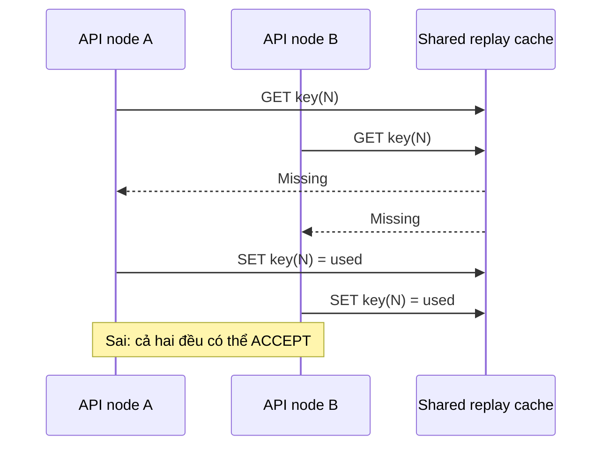
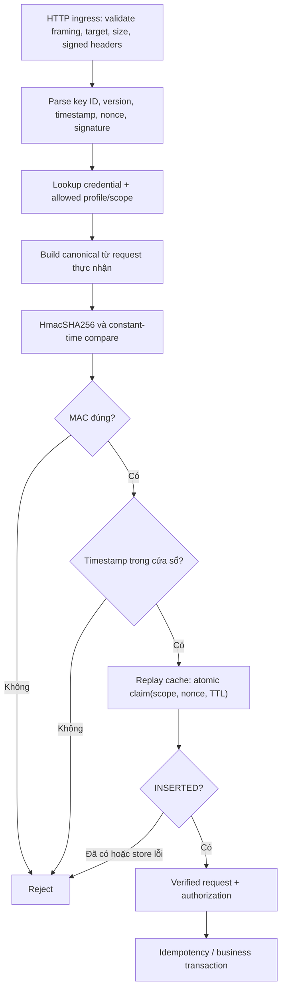

# Replay cache: chống phát lại HTTP request đã ký bằng HMAC

## 1. Replay cache giải quyết vấn đề gì?

**Replay cache** là một kho dữ liệu ngắn hạn giúp server nhớ **định danh chống phát lại của những request đã được chấp nhận**, thường là cặp `(credential, nonce)`. Khi một request khác sử dụng lại cùng định danh trong khoảng thời gian còn hiệu lực, server từ chối nó dù **chữ ký HMAC có thể vẫn đúng**.

Bài **Replay cache** thuộc chương **Replay protection** trong module `SECURITY_AUTHENTICATION_HMAC_REQUEST_AUTHENTICATION`. Module hướng dẫn thiết kế **xác thực HTTP request bằng HMAC với shared secret** và **canonical request** chứa method, URI, header hoặc body theo hợp đồng ký; xác minh chữ ký, chống replay bằng timestamp/nonce, quản lý key rotation, kiểm thử proxy/gateway và phân biệt **xác thực (authentication)** với **phân quyền (authorization)**.

Giả sử client gọi API tạo đơn hàng:

```http
POST /v1/orders HTTP/1.1
Host: api.example.test
Content-Type: application/json
X-Key-Id: partner-a-2026-11
X-Signature-Version: hmac-replay-v1
X-Timestamp: 2026-11-28T09:59:00Z
X-Nonce: 9aEzX2C8ByYSaBYt9wpMHXu1mACCyvDE
X-Idempotency-Key: 550e8400-e29b-41d4-a716-446655440000
X-Signature: <64 lowercase hex characters>

{"orderId":"O-42","amount":90000}
```

Nếu request được ký hợp lệ và **gửi lại nguyên vẹn** trong 60 giây tiếp theo thì:

- Method, URI, body và signed headers **không đổi**.
- HMAC tính từ cùng secret và canonical bytes **vẫn khớp**.
- Timestamp **vẫn nằm trong cửa sổ chấp nhận**.
- **Nonce đã dùng** là thông tin duy nhất cho biết đây là một request đã được tiếp nhận trước đó.

Vì vậy, chỉ có HMAC và timestamp là **chưa đủ** để chặn replay trong time window. Server cần một thao tác **đánh dấu nonce đã sử dụng theo cách nguyên tử**.

```mermaid
sequenceDiagram
    participant C as Client
    participant V as HMAC verifier
    participant R as Replay cache
    participant B as Business handler

    C->>V: Request R1 với timestamp T, nonce N, HMAC S
    V->>V: Validate fields, canonicalize, verify MAC, time window
    V->>R: claim(credential, N) atomically
    R-->>V: INSERTED
    V->>B: Authenticated request + verified snapshot
    B-->>C: Response

    C->>V: Phát lại nguyên R1 (T, N, S)
    V->>V: MAC vẫn đúng, timestamp vẫn mới
    V->>R: claim(credential, N) atomically
    R-->>V: ALREADY_EXISTS
    V-->>C: Reject replay; không thực thi lần nữa
```

**Điểm mấu chốt:** Replay cache không phải nơi lưu secret, và cũng không phải cache kết quả HMAC để bỏ qua xác minh. Nó lưu **bằng chứng một nonce đã được sử dụng** trong phạm vi và khoảng thời gian xác định. Request phải qua các bước xác thực đáng tin cậy trước khi được phép chiếm một mục trong cache.

## 2. Phân biệt HMAC, freshness, replay cache và idempotency

| Thành phần | Câu hỏi được trả lời | Ví dụ |
| --- | --- | --- |
| **HMAC verification** | Bên gửi có biết shared secret và request có giữ nguyên những phần đã ký không? | MAC sai khi body bị sửa nhưng signature giữ nguyên. |
| **Timestamp freshness** | Request có nằm trong cửa sổ thời gian được phép hay không? | Request ký 20 phút trước bị từ chối với giới hạn tuổi 5 phút. |
| **Replay cache / nonce store** | Nonce này đã được một request hợp lệ sử dụng trong cùng phạm vi chưa? | Request ký 1 phút trước, MAC đúng, nhưng nonce đã tồn tại → từ chối. |
| **Idempotency store** | Một *lệnh nghiệp vụ* với idempotency key đã được thực hiện/chờ xử lý chưa? | Retry tạo đơn sau timeout với nonce mới nhưng cùng idempotency key không tạo đơn lần hai. |
| **Authorization** | Credential đã xác thực có quyền thao tác trên tài nguyên đó không? | HMAC đúng nhưng partner A không có quyền tạo đơn cho merchant B. |

Giải pháp an toàn thường cần **cả timestamp và nonce**. Timestamp giữ số lượng nonce phải lưu ở mức hữu hạn, còn replay cache chặn request trùng trong khoảng thời gian timestamp còn có thể được chấp nhận.

### Replay không giống retry hợp lệ

Trong một hệ thống thật, client có thể không nhận được HTTP response dù server đã xử lý thành công. Có hai khả năng retry:

1. **Gửi lại nguyên request và nguyên signature/nonce**: server từ chối vì nonce đã được claim. Đây là hành vi chống replay đúng, nhưng client vẫn cần một cách lấy trạng thái nghiệp vụ.
2. **Tạo timestamp mới, nonce mới, chữ ký mới; giữ idempotency key của cùng thao tác**: replay cache chấp nhận nonce mới; business idempotency store nhận ra thao tác đã thực hiện và không thực thi lần nữa.

Do đó **không dùng replay cache như kho “exactly-once business processing”**. Nó chỉ bảo đảm **at-most-one successful nonce claim** trong một phạm vi và cửa sổ, với điều kiện hạ tầng cache hoạt động đúng. Giao dịch và idempotency là một ranh giới nhất quán khác.

## 3. Điều gì phải được ký để replay cache có tác dụng?

Một hợp đồng request signing cần ràng buộc ít nhất:

- **Method và request target (path + query)** theo canonicalization contract.
- **Body bytes hoặc digest** nếu body ảnh hưởng hành vi API.
- **Credential/key ID** và signature version, tránh nhầm khóa hoặc downgrade.
- **Timestamp** để xác định request còn trong cửa sổ chấp nhận.
- **Nonce** để mỗi signed request có định danh chống replay.
- **Signed headers khác** có ảnh hưởng semantics, ví dụ `Content-Type` hoặc `X-Idempotency-Key`.

Nếu timestamp hoặc nonce **không nằm trong canonical HMAC**, attacker có thể sửa riêng các field này mà **giữ nguyên signature**, đánh lừa time-window hoặc replay cache.

```text
SAI:
HMAC(method | target | bodyDigest)           // bỏ qua nonce/timestamp
Request có X-Nonce = N1
Attacker thay X-Nonce = N2 mà không cần ký lại

ĐÚNG:
HMAC(method | target | signedTimestamp | signedNonce | bodyDigest | ...)
Request có N1 -> sửa thành N2 làm canonical bytes khác -> MAC cũ sai
```

**Nonce không phải secret.** Nó là một giá trị công khai, cần khó đoán hoặc khó va chạm và **duy nhất trong phạm vi cần thiết**, thường tạo bởi `SecureRandom` trên client. Tính bí mật đến từ **shared secret HMAC**; tính mới và chống trùng đến từ **timestamp + nonce + atomic replay cache**.

## 4. Thiết kế cache key: nonce phải duy nhất trong phạm vi nào?

Một khóa replay cache hợp lý cho dịch vụ minh họa:

```text
replay:v1:<service-scope>:<credential-id>:<nonce>
```

Ví dụ:

```text
replay:v1:orders-api:partner-a-2026-11:9aEzX2C8ByYSaBYt9wpMHXu1mACCyvDE
```

Ở đây:

- `replay:v1`: namespace của dữ liệu replay-cache, **không phải signature algorithm version**.
- `service-scope`: phạm vi đáng tin cậy của dịch vụ; phải đủ ổn định giữa tất cả instance phục vụ cùng credential.
- `credential-id`: **định danh khóa bất biến**, không phải giá trị tenant tự khai chưa được xác minh; server tra và xác nhận từ credential store.
- `nonce`: giá trị đã được HMAC ký và qua kiểm tra cú pháp.

**Không dùng signature hoặc body digest làm replay cache key.** Nếu caller có credential và ký lại cùng nonce với timestamp mới, MAC sẽ đổi; cache theo signature khi ấy có thể chấp nhận **nonce cũ** dù cùng một định danh chống replay. Cũng không ghép `timestamp` vào key mặc định: `(credential, nonce, timestamp)` cho phép cùng nonce được dùng lại với timestamp khác.

### Có nên đưa method, path, tenant hoặc signature version vào key?

| Trường | Đưa vào replay key? | Lý do |
| --- | --- | --- |
| Credential/key ID bất biến | **Có**. | Hai credential độc lập có thể tạo cùng nonce mà không phải replay cùng principal. |
| Service/audience scope tin cậy | **Có khi cần tách namespace**. | Tránh va chạm giữa dịch vụ không chia sẻ không gian nonce. |
| Tenant đã xác minh | Có thể, nếu **credential ID không toàn cục**. | Tuyệt đối không dùng tenant ID do caller tự khai mà chưa xác thực. |
| Nonce | **Có**. | Đây là đơn vị cần ghi nhớ. |
| Timestamp | **Không** theo profile bài. | Tránh làm mới cùng nonce bằng timestamp khác. |
| Signature hex | **Không**. | Signature thay đổi khi nội dung hoặc timestamp thay đổi. |
| Body digest | **Không**. | Nonce phải dùng một lần dù body khác. |
| Method/path | Thường **không**, nếu credential dùng chung nhiều route. | Cùng nonce trên route khác vẫn là reuse cần bị chặn. |
| Signature version | Thường **không** nếu cùng credential. | Tránh cho phép reuse nonce khi đổi version. |

Phạm vi phải được **công bố trong hợp đồng**. Nếu một tenant có nhiều credentials, tùy chính sách có thể chọn namespace theo credential (mỗi key ID có nonce riêng) hoặc theo principal. Bài chọn **theo credential ID ổn định, dùng chung giữa mọi route trong cùng dịch vụ**.

**Không tái sử dụng key ID đã giải phóng để cấp cho một secret hoàn toàn mới** khi vẫn có request cũ đang hợp lệ; cách đơn giản là cấp key ID mới cho mỗi vòng rotation. Nếu key ID chỉ duy nhất trong từng tenant, phải đưa **tenant đã được xác minh** vào scope hoặc thay bằng một internal immutable credential identifier.

### Giới hạn và mã hóa cache key

Cache key phải có **giới hạn độ dài và alphabet cố định** để không bị key injection, memory amplification hoặc trùng cấu trúc phân tách. Ví dụ `credentialId` chỉ cho phép `[A-Za-z0-9._-]{1,128}`, nonce là Base64URL không padding **32 ký tự** (24 byte ngẫu nhiên) và không có dấu `:`.

Trong hạ tầng không muốn lộ key ID/nonce qua các công cụ quan sát cache, có thể lưu **mã hash của tuple được đóng gói không nhập nhằng** dưới namespace cố định; không cần đưa body hoặc shared secret HMAC request trực tiếp vào cache key. Hashing key không thay thế các biện pháp hạn chế truy cập Redis, TLS, audit và chính sách log.

## 5. Claim nonce phải là thao tác nguyên tử

Replay cache không được hoạt động theo kiểu **“đọc xem có chưa, rồi ghi”**:

```text
SAI:
if !cache.exists(key):
    cache.put(key, ttl)
    acceptRequest()
```

Hai server đồng thời nhận cùng một request có thể cùng thấy `exists=false`, cùng ghi cache và **cùng thực hiện nghiệp vụ**. Đây là race condition *check-then-act*.



Thay bằng một **atomic insert-if-absent**: cache chỉ cho **một** request thắng khi cả hai cùng claim một key.

```text
claim(scope, nonce, ttl):
    INSERT_IF_ABSENT(replayKey(scope, nonce), "1", ttl)
    if inserted: ACCEPT_NONCE
    if already_exists: REJECT_REPLAY
    if store_error: FAIL_CLOSED
```

Hành động **claim và đặt TTL** phải thực hiện trong **cùng một thao tác nguyên tử**. Nếu insert thành công nhưng TTL chưa được đặt do kết nối đứt, key có thể tồn tại mãi; nếu TTL được đặt trước khi lưu key hoặc giữa nhiều round-trip, có thể xảy ra trạng thái không mong muốn.

Một request **MAC sai** không được chiếm nonce trong cache: nếu attacker tự đặt `X-Nonce=N` mà không cần biết secret nhưng vẫn claim được N, họ có thể làm hỏng request thật với cùng nonce. Thông thường cache chỉ được gọi **sau khi MAC, key scope và timestamp đạt chính sách**.

### Redis: `SET ... NX EX` hoặc `SET ... NX PX`

Ví dụ command nguyên tử có TTL 360 giây:

```redis
SET replay:v1:orders-api:partner-a-2026-11:9aEzX2C8ByYSaBYt9wpMHXu1mACCyvDE 1 NX EX 360
```

Kết quả:

- **`OK`**: key chưa tồn tại, đã được tạo với TTL → request đầu tiên có thể qua replay check.
- **Null reply** (key đã tồn tại): nonce đã dùng → từ chối.
- **Timeout/connection error** hoặc kết quả không xác định: **không accept**; ứng dụng cần policy fail closed và có thể trả lỗi dịch vụ.

`NX` nghĩa là **chỉ tạo nếu chưa tồn tại**, `EX 360` đặt thời hạn bằng giây; `PX 360000` biểu diễn TTL tương đương bằng millisecond. Không tách `SETNX` và `EXPIRE` thành hai round-trip không có transaction/atomicity.

**Lưu ý về idempotent retries:** nếu cache trả “already exists”, **không tự xóa key để cho phép chạy lại**. Client muốn retry cùng thao tác phải dùng **timestamp và nonce mới**, ký lại HMAC và giữ idempotency key đã ký; business layer sau đó quyết định có dùng lại kết quả cũ hay không.

## 6. Tính TTL replay cache từ cửa sổ chấp nhận timestamp

**TTL không phải một con số được chọn tùy ý.** Nếu cache xóa nonce **trước khi request tương ứng hết hiệu lực theo timestamp**, cùng một signed request có thể được phát lại thành công sau khi entry hết hạn.

Hợp đồng minh họa chọn:

```text
MAX_AGE         = 300 giây  (request không được cũ hơn 5 phút)
MAX_FUTURE_SKEW = 30 giây   (client được đi trước server tối đa 30 giây)
CACHE_MARGIN    = 30 giây   (biên vận hành được công bố cho cache)
```

Server chấp nhận một timestamp `T` khi:

```text
now - 300s <= T <= now + 30s
```

Giả sử lần đầu nonce được claim tại `t0\), khi timestamp ở **tương lai 30 giây**, tức `T = t0 + 30s`. Cùng request vẫn có thể nằm trong time window tới `T + 300s = t0 + 330s`. Nếu replay cache lưu entry chỉ **300 giây từ lúc claim**, nó có thể xóa key ở `t0+300s`, trong khi request đó còn hợp lệ khoảng **30 giây nữa**.

Vì vậy, chính sách đơn giản của ví dụ là:

```text
MINIMUM_HOLD_FROM_FIRST_CLAIM = MAX_AGE + MAX_FUTURE_SKEW
                             = 300s + 30s = 330s

FIXED_TTL = MAX_AGE + MAX_FUTURE_SKEW + CACHE_MARGIN
          = 300s + 30s + 30s
          = 360s
```

**Các giả định của công thức:** tất cả verifier dùng đồng hồ được đồng bộ trong giới hạn đã thiết kế, cùng policy về thời gian, cache không mất key sớm và TTL được tính từ thao tác claim đầu tiên. Khi nhiều node/region có clock skew lớn hơn biên cho phép, hoặc latency từ điểm capture `now` tới điểm cache claim đáng kể, cần **tăng biên có cơ sở** và kiểm thử. Không coi `360s` là giá trị chuẩn áp dụng cho mọi dịch vụ.

### Ví dụ biên thời gian

Cho `serverNow = 2026-11-28T10:00:00Z`:

| Timestamp ký | Thời gian tại claim | Thời điểm cuối còn hợp lệ | TTL cần giữ từ claim |
| --- | --- | --- | --- |
| `09:55:00Z` (cũ 300s) | `10:00:00Z` | `10:00:00Z` | Ít nhất qua chính phép claim; fixed 360s dư biên. |
| `09:59:00Z` (cũ 60s) | `10:00:00Z` | `10:04:00Z` | Ít nhất 240s, cộng biên. |
| `10:00:00Z` (hiện tại) | `10:00:00Z` | `10:05:00Z` | Ít nhất 300s, cộng biên. |
| `10:00:30Z` (tương lai 30s) | `10:00:00Z` | `10:05:30Z` | Ít nhất 330s, cộng biên. |

**Chú ý điều kiện biên:** trong hợp đồng, timestamp đúng ngưỡng **vẫn được chấp nhận**. Cache entry phải tồn tại đủ để một request đúng ngưỡng không thể được claim lần hai; biên `CACHE_MARGIN` giúp tránh các sai số và race quanh thời điểm TTL hết hạn.

### TTL cố định hay TTL động?

- **TTL cố định từ lúc claim** (360s trong bài): dễ triển khai và bảo đảm an toàn theo worst case nếu clock/policy đúng. Nhược điểm: lưu một nonce quá cũ gần hết window lâu hơn cần thiết.
- **TTL động tới thời điểm hết hiệu lực**: có thể dùng `expiresAt = signedTimestamp + MAX_AGE + safetyMargin`, sau đó tính TTL từ **server now**. Nhưng phải xử lý round-trip latency, clock drift, độ phân giải time, policy inclusive boundary, time jumps và đồng bộ giữa cache với verifier. Cần tránh ttl=0 hoặc TTL âm đối với request còn được cho phép ở biên.

Khi chưa có bằng chứng vận hành để tối ưu an toàn, **TTL cố định có biên phù hợp** thường dễ đánh giá hơn. Tuy nhiên, nó không khắc phục được việc **cache bị eviction trước hạn** hoặc store mất dữ liệu khi failover.

## 7. Hợp đồng ký HMAC-REPLAY-V1 dùng với replay cache

Để thấy vị trí của replay cache trong toàn bộ xác thực HTTP, ta định nghĩa một profile **tự minh họa** `hmac-replay-v1`, không phải format chuẩn có sẵn của HTTP:

```http
POST /v1/orders HTTP/1.1
Host: api.example.test
Content-Type: application/json
X-Key-Id: partner-a-2026-11
X-Signature-Version: hmac-replay-v1
X-Timestamp: 2026-11-28T09:59:00Z
X-Nonce: 9aEzX2C8ByYSaBYt9wpMHXu1mACCyvDE
X-Idempotency-Key: 550e8400-e29b-41d4-a716-446655440000
X-Signature: <64 lowercase hex characters>

{"orderId":"O-42","amount":90000}
```

Các quy tắc **hai phía phải thống nhất**:

1. **Method và URI:** chính xác `POST` và raw request target `/v1/orders` trong demo. Nếu mở rộng query, phải định nghĩa canonical query rõ ràng và đưa vào HMAC.
2. **Audience:** `https://api.example.test` lấy từ cấu hình định tuyến tin cậy, không tin bừa `Host` hoặc `X-Forwarded-Host` do caller tự đặt. Credential phải được cấp quyền cho đúng service/route.
3. **Signed headers bắt buộc:** `Content-Type`, `X-Key-Id`, `X-Signature-Version`, `X-Timestamp`, `X-Nonce`, `X-Idempotency-Key` đều phải xuất hiện **đúng một field line**. Tên field không phân biệt hoa/thường; giá trị kiểm tra cú pháp nghiêm ngặt.
4. **Signature carrier:** `X-Signature` cũng phải có **đúng một dòng**, chứa **64 lowercase hex characters** của HMAC-SHA256 full 32-byte. Không đưa chính `X-Signature` vào canonical.
5. **Body:** nội dung UTF-8 JSON không rỗng, tối đa 1 MiB trong ví dụ; SHA-256 trên **body bytes sau gỡ HTTP transfer framing nhưng trước parse/reformat**, không hỗ trợ `Content-Encoding`.
6. **Timestamp:** UTC ISO-8601 chính xác tới giây `YYYY-MM-DDTHH:mm:ssZ`, có max age 300s và future skew 30s, **hai biên inclusive**.
7. **Nonce:** 24 byte từ CSPRNG trên client, Base64URL không padding thành 32 ký tự; đưa nguyên chuỗi vào canonical. Cache key dùng **service scope + credential ID bất biến + nonce**, dùng chung xuyên các route với cùng credential.
8. **Idempotency key:** UUID lowercase dưới dạng `8-4-4-4-12`; được ký để không bị đổi, nhưng logic idempotency phải được triển khai riêng.
9. **Key/version:** `X-Key-Id` chọn đúng secret bên server; version `hmac-replay-v1` ánh xạ cố định tới `HmacSHA256` và canonical schema; kiểm tra active, allowed audience/targets, rotation/revocation.
10. **Canonical framing:** mỗi dòng nối bằng **LF** (`0A`), mã hóa **UTF-8**, không thêm LF cuối; signed header names ghi chữ thường và đặt theo **thứ tự contract cố định**.

Canonical message:

```text
HMAC-REPLAY-V1
POST
https://api.example.test
/v1/orders
content-type:application/json
x-idempotency-key:550e8400-e29b-41d4-a716-446655440000
x-key-id:partner-a-2026-11
x-signature-version:hmac-replay-v1
x-timestamp:2026-11-28T09:59:00Z
x-nonce:9aEzX2C8ByYSaBYt9wpMHXu1mACCyvDE
<64 lowercase hex characters of SHA-256(bodyBytes)>
```

Dòng cuối là **placeholder cho digest thật**, không ký các ký tự `<` hoặc `>`. Chữ ký được tính:

```text
bodyDigestHex  = lowercaseHex(SHA-256(bodyBytes))
canonicalBytes = UTF8(canonicalMessage)
signatureBytes = HMAC-SHA256(sharedSecretBytes, canonicalBytes)
signatureHex   = lowercaseHex(signatureBytes)
```

Replay cache **không nằm trong canonical request**, vì nó là **trạng thái xác minh phía server**. Tuy nhiên nonce mà cache ghi nhớ **phải nằm trong canonical đã ký**.

### Thứ tự xác minh tại backend



**Không gọi business handler trước khi atomic claim thành công.** Nếu business side effect xảy ra rồi mới kiểm tra cache, hai request chạy song song vẫn có thể thực hiện giao dịch lặp. Việc **kiểm tra authorization** có thể đặt trước hoặc sau claim tùy hợp đồng; trong cả hai trường hợp, request chưa claim thành công **không được phép gây side effect**.

## 8. Java 17+: HMAC verifier tích hợp replay cache

Ví dụ sau minh họa đầy đủ quy tắc **chỉ cho một request cùng nonce vượt qua replay check**:

- Header parser nhận từng field line và từ chối duplicate theo tên không phân biệt case.
- HMAC được tính lại từ canonical request, so sánh MAC byte arrays bằng `MessageDigest.isEqual`.
- Timestamp phải trong `now-300s` tới `now+30s`.
- Nonce đúng định dạng Base64URL, được ký và dùng làm cache key thuộc **credential scope đã xác minh**.
- `InMemoryReplayCache` dùng `ConcurrentHashMap.compute` để thực hiện **atomic claim trong một JVM**, mô phỏng hành vi `SET NX EX`.
- Chạy thử request đầu tiên, request bị replay, request quá cũ, request ở tương lai, MAC bị sửa và **hai request tới đồng thời**.

**Giới hạn quan trọng:** Cache trong ví dụ **chỉ minh họa tính nguyên tử trên một JVM**, không có cleanup TTL định kỳ, không được chia sẻ giữa nhiều server/region và không bảo đảm durability. Nó **không được dùng làm replay cache production**. Cần thay bằng backend shared storage có atomic insert-if-absent và TTL được bảo đảm. Các method trả về `Decision` phục vụ test/metrics; API thật nên ánh xạ lỗi theo chính sách và tránh làm lộ thông tin credential.

```java
import java.nio.charset.StandardCharsets;
import java.security.GeneralSecurityException;
import java.security.MessageDigest;
import java.security.SecureRandom;
import java.time.Clock;
import java.time.Duration;
import java.time.Instant;
import java.time.ZoneOffset;
import java.time.format.DateTimeParseException;
import java.util.ArrayList;
import java.util.Base64;
import java.util.HashMap;
import java.util.HexFormat;
import java.util.List;
import java.util.Locale;
import java.util.Map;
import java.util.Set;
import java.util.concurrent.ConcurrentHashMap;
import java.util.concurrent.CountDownLatch;
import java.util.concurrent.ExecutorService;
import java.util.concurrent.Executors;
import java.util.concurrent.Future;
import java.util.concurrent.atomic.AtomicBoolean;
import javax.crypto.Mac;
import javax.crypto.spec.SecretKeySpec;

public final class ReplayCacheHmacDemo {
    private static final String VERSION = "hmac-replay-v1";
    private static final String ORIGIN = "https://api.example.test";
    private static final String TARGET = "/v1/orders";
    private static final String SERVICE_SCOPE = "orders-api";
    private static final Duration MAX_AGE = Duration.ofSeconds(300);
    private static final Duration FUTURE_SKEW = Duration.ofSeconds(30);
    private static final Duration REPLAY_TTL = Duration.ofSeconds(360);
    private static final HexFormat HEX = HexFormat.of();
    private static final String IDEMPOTENCY =
            "550e8400-e29b-41d4-a716-446655440000";
    private static final Set<String> REQUIRED = Set.of(
            "content-type", "x-idempotency-key", "x-key-id",
            "x-signature-version", "x-timestamp", "x-nonce",
            "x-signature");

    public record FieldLine(String name, String value) {}

    // Defensive copy để không đổi body snapshot sau khi ký.
    public record Request(
            String method, String rawTarget, String trustedOrigin,
            List<FieldLine> fields, byte[] body) {
        public Request {
            fields = fields == null ? null : List.copyOf(fields);
            body = body == null ? null : body.clone();
        }
        @Override public byte[] body() {
            return body == null ? null : body.clone();
        }
    }

    public record Credential(
            String internalId, String keyId, byte[] secret, boolean active,
            String audience, Set<String> versions, Set<String> targets) {
        public Credential {
            secret = secret == null ? null : secret.clone();
        }
        @Override public byte[] secret() {
            return secret == null ? null : secret.clone();
        }
    }

    public interface CredentialStore {
        Credential find(String keyId);
    }

    public static final class ReplayStoreException extends Exception {
        public ReplayStoreException(String message) { super(message); }
    }

    public interface ReplayCache {
        // Production: atomic insert-if-absent kèm TTL trên shared store.
        // true = nonce mới; false = đã dùng.
        boolean claim(
                String service, String credentialId, String nonce,
                Duration ttl, Instant now) throws ReplayStoreException;
    }

    // Chỉ dùng minh họa concurrency TRONG MỘT JVM, không có eviction.
    public static final class InMemoryReplayCache implements ReplayCache {
        private final ConcurrentHashMap<String, Instant> expires =
                new ConcurrentHashMap<>();

        @Override
        public boolean claim(
                String service, String credentialId, String nonce,
                Duration ttl, Instant now) {
            if (ttl.isZero() || ttl.isNegative()) {
                throw new IllegalArgumentException("Invalid replay TTL");
            }
            String cacheKey = "replay:v1:" + service
                    + ":" + credentialId + ":" + nonce;
            AtomicBoolean inserted = new AtomicBoolean(false);
            // Atomic per key: không được viết containsKey rồi put.
            expires.compute(cacheKey, (key, previousExpiry) -> {
                if (previousExpiry == null
                        || !previousExpiry.isAfter(now)) {
                    inserted.set(true);
                    return now.plus(ttl);
                }
                return previousExpiry;
            });
            return inserted.get();
        }
    }

    public enum Decision {
        ACCEPTED, INVALID_REQUEST, INVALID_CREDENTIAL, BAD_MAC,
        TOO_OLD, TOO_FAR_IN_FUTURE, REPLAY, CACHE_UNAVAILABLE
    }

    private static String trimOws(String value) {
        int start = 0, end = value.length();
        while (start < end
                && (value.charAt(start) == ' '
                    || value.charAt(start) == '\t')) start++;
        while (end > start
                && (value.charAt(end - 1) == ' '
                    || value.charAt(end - 1) == '\t')) end--;
        return value.substring(start, end);
    }

    // Không dùng getHeader/firstValue khi cần phát hiện duplicate.
    private static Map<String, String> readHeaders(
            List<FieldLine> raw) {
        if (raw == null) {
            throw new IllegalArgumentException("Headers unavailable");
        }
        Map<String, String> found = new HashMap<>();
        for (FieldLine h : raw) {
            if (h == null || h.name() == null
                    || !h.name().matches("[A-Za-z0-9-]{1,128}")
                    || h.value() == null) {
                throw new IllegalArgumentException("Malformed header");
            }
            String name = h.name().toLowerCase(Locale.ROOT);
            if ("content-encoding".equals(name)) {
                throw new IllegalArgumentException("Unsupported encoding");
            }
            String value = trimOws(h.value());
            for (int i = 0; i < value.length(); i++) {
                char c = value.charAt(i);
                if (c < 0x20 || c > 0x7e) {
                    throw new IllegalArgumentException("Unsafe header");
                }
            }
            if (REQUIRED.contains(name)
                    && found.putIfAbsent(name, value) != null) {
                throw new IllegalArgumentException(
                        "Duplicate signed header: " + name);
            }
        }
        if (!found.keySet().equals(REQUIRED)) {
            throw new IllegalArgumentException("Missing signed header");
        }
        return Map.copyOf(found);
    }

    private static boolean nonceCanonical(String value) {
        if (!value.matches("[A-Za-z0-9_-]{32}")) return false;
        try {
            byte[] bytes = Base64.getUrlDecoder().decode(value);
            return bytes.length == 24
                    && value.equals(Base64.getUrlEncoder()
                            .withoutPadding().encodeToString(bytes));
        } catch (IllegalArgumentException invalid) {
            return false;
        }
    }

    private static boolean validFields(Map<String, String> f) {
        return "application/json".equals(f.get("content-type"))
                && f.get("x-idempotency-key").matches(
                    "[0-9a-f]{8}(-[0-9a-f]{4}){3}-[0-9a-f]{12}")
                && f.get("x-key-id").matches(
                    "[A-Za-z0-9._-]{1,128}")
                && VERSION.equals(f.get("x-signature-version"))
                && nonceCanonical(f.get("x-nonce"))
                && f.get("x-signature").matches("[0-9a-f]{64}");
    }

    private static Instant timestamp(String raw) {
        if (!raw.matches("[0-9]{4}-[0-9]{2}-[0-9]{2}T"
                + "[0-9]{2}:[0-9]{2}:[0-9]{2}Z")) {
            throw new IllegalArgumentException("Bad UTC timestamp");
        }
        try {
            Instant time = Instant.parse(raw);
            if (time.getNano() != 0
                    || !raw.equals(time.toString())) {
                throw new IllegalArgumentException("Noncanonical time");
            }
            return time;
        } catch (DateTimeParseException ex) {
            throw new IllegalArgumentException("Invalid timestamp", ex);
        }
    }

    private static byte[] canonicalBytes(
            Request r, Map<String, String> f)
            throws GeneralSecurityException {
        String bodySha256 = HEX.formatHex(
                MessageDigest.getInstance("SHA-256").digest(r.body()));
        String canonical = String.join("\n",
                "HMAC-REPLAY-V1",
                r.method(), ORIGIN, r.rawTarget(),
                "content-type:" + f.get("content-type"),
                "x-idempotency-key:" + f.get("x-idempotency-key"),
                "x-key-id:" + f.get("x-key-id"),
                "x-signature-version:" + f.get("x-signature-version"),
                "x-timestamp:" + f.get("x-timestamp"),
                "x-nonce:" + f.get("x-nonce"),
                bodySha256);
        return canonical.getBytes(StandardCharsets.UTF_8);
    }

    private static byte[] computeMac(
            byte[] secret, byte[] canonical)
            throws GeneralSecurityException {
        Mac mac = Mac.getInstance("HmacSHA256");
        mac.init(new SecretKeySpec(secret, "HmacSHA256"));
        return mac.doFinal(canonical);
    }

    public static Decision verify(
            Request request, CredentialStore credentials,
            ReplayCache replay, Clock clock)
            throws GeneralSecurityException {
        if (request == null || credentials == null
                || replay == null || clock == null
                || request.method() == null
                || request.rawTarget() == null
                || request.trustedOrigin() == null
                || request.body() == null) {
            return Decision.INVALID_REQUEST;
        }
        if (!"POST".equals(request.method())
                || !TARGET.equals(request.rawTarget())
                || !ORIGIN.equals(request.trustedOrigin())
                || request.body().length == 0
                || request.body().length > 1_048_576) {
            return Decision.INVALID_REQUEST;
        }

        final Map<String, String> fields;
        final Instant issuedAt;
        try {
            fields = readHeaders(request.fields());
            if (!validFields(fields)) return Decision.INVALID_REQUEST;
            issuedAt = timestamp(fields.get("x-timestamp"));
        } catch (IllegalArgumentException invalid) {
            return Decision.INVALID_REQUEST;
        }

        String keyId = fields.get("x-key-id");
        Credential credential = credentials.find(keyId);
        if (credential == null || !credential.active()
                || !keyId.equals(credential.keyId())
                || !ORIGIN.equals(credential.audience())
                || credential.versions() == null
                || !credential.versions().contains(VERSION)
                || credential.targets() == null
                || !credential.targets().contains(TARGET)
                || credential.internalId() == null
                || !credential.internalId()
                        .matches("[A-Za-z0-9._-]{1,128}")) {
            return Decision.INVALID_CREDENTIAL;
        }
        byte[] secret = credential.secret();
        if (secret == null || secret.length < 32) {
            return Decision.INVALID_CREDENTIAL;
        }

        byte[] expected = computeMac(
                secret, canonicalBytes(request, fields));
        byte[] received = HEX.parseHex(fields.get("x-signature"));
        if (expected.length != 32 || received.length != 32
                || !MessageDigest.isEqual(expected, received)) {
            return Decision.BAD_MAC;
        }

        // Lấy một thời điểm UTC duy nhất cho freshness + cache claim.
        Instant now = clock.instant();
        if (issuedAt.isBefore(now.minus(MAX_AGE))) {
            return Decision.TOO_OLD;
        }
        if (issuedAt.isAfter(now.plus(FUTURE_SKEW))) {
            return Decision.TOO_FAR_IN_FUTURE;
        }

        // Chỉ sau MAC + freshness đạt: claim nonce trên trusted scope.
        try {
            boolean first = replay.claim(
                    SERVICE_SCOPE, credential.internalId(),
                    fields.get("x-nonce"), REPLAY_TTL, now);
            return first ? Decision.ACCEPTED : Decision.REPLAY;
        } catch (ReplayStoreException unavailable) {
            return Decision.CACHE_UNAVAILABLE; // FAIL CLOSED
        }
        // Chỉ sau ACCEPTED mới có thể sang authorization/side effects.
    }

    private static Request signForDemo(
            String issuedAt, byte[] secret, SecureRandom random)
            throws GeneralSecurityException {
        byte[] nonceBytes = new byte[24];
        random.nextBytes(nonceBytes);
        String nonce = Base64.getUrlEncoder().withoutPadding()
                .encodeToString(nonceBytes);
        byte[] body = (
                "{\"orderId\":\"O-42\",\"amount\":90000}")
                .getBytes(StandardCharsets.UTF_8);
        List<FieldLine> headers = new ArrayList<>(List.of(
                new FieldLine("Content-Type", "application/json"),
                new FieldLine("X-Idempotency-Key", IDEMPOTENCY),
                new FieldLine("X-Key-Id", "partner-a-2026-11"),
                new FieldLine("X-Signature-Version", VERSION),
                new FieldLine("X-Timestamp", issuedAt),
                new FieldLine("X-Nonce", nonce)));
        Request draft = new Request(
                "POST", TARGET, ORIGIN, headers, body);
        Map<String, String> values = new HashMap<>();
        for (FieldLine h : headers) {
            values.put(h.name().toLowerCase(Locale.ROOT), h.value());
        }
        String signature = HEX.formatHex(
                computeMac(secret, canonicalBytes(draft, values)));
        headers.add(new FieldLine("X-Signature", signature));
        return new Request("POST", TARGET, ORIGIN, headers, body);
    }

    // Đổi payload nhưng giữ signature cũ để mô phỏng sửa request.
    private static Request tamperBody(Request original) {
        byte[] changed = (
                "{\"orderId\":\"O-42\",\"amount\":99000}")
                .getBytes(StandardCharsets.UTF_8);
        return new Request(original.method(), original.rawTarget(),
                original.trustedOrigin(), original.fields(), changed);
    }

    private static void expect(
            String test, Decision actual, Decision expected) {
        if (actual != expected) {
            throw new AssertionError(test + " expected "
                    + expected + ", got " + actual);
        }
        System.out.println(test + " -> " + actual);
    }

    public static void main(String[] args) throws Exception {
        byte[] secret = new byte[32]; // Chỉ tạo khóa test, không log.
        SecureRandom random = new SecureRandom();
        random.nextBytes(secret);
        Credential credential = new Credential(
                "credential-immutable-42",
                "partner-a-2026-11", secret, true,
                ORIGIN, Set.of(VERSION), Set.of(TARGET));
        CredentialStore credentials = keyId ->
                credential.keyId().equals(keyId) ? credential : null;
        Clock fixed = Clock.fixed(
                Instant.parse("2026-11-28T10:00:00Z"),
                ZoneOffset.UTC);
        ReplayCache cache = new InMemoryReplayCache();

        Request fresh = signForDemo(
                "2026-11-28T09:59:00Z", secret, random);
        Request tooOld = signForDemo(
                "2026-11-28T09:54:59Z", secret, random);
        Request edgeOld = signForDemo(
                "2026-11-28T09:55:00Z", secret, random);
        Request future = signForDemo(
                "2026-11-28T10:00:31Z", secret, random);

        // Body sửa không thể claim nonce vì MAC sai.
        expect("Tampered body",
                verify(tamperBody(fresh), credentials, cache, fixed),
                Decision.BAD_MAC);
        expect("Fresh request",
                verify(fresh, credentials, cache, fixed),
                Decision.ACCEPTED);
        expect("Same nonce replay",
                verify(fresh, credentials, cache, fixed),
                Decision.REPLAY);
        expect("301 seconds old",
                verify(tooOld, credentials, cache, fixed),
                Decision.TOO_OLD);
        expect("300 seconds old (inclusive)",
                verify(edgeOld, credentials, cache, fixed),
                Decision.ACCEPTED);
        expect("31 seconds in future",
                verify(future, credentials, cache, fixed),
                Decision.TOO_FAR_IN_FUTURE);

        // Store lỗi: không được cho request qua.
        ReplayCache unavailable = (s, id, nonce, ttl, now) -> {
            throw new ReplayStoreException("Cache unavailable");
        };
        Request another = signForDemo(
                "2026-11-28T10:00:00Z", secret, random);
        expect("Replay store outage",
                verify(another, credentials, unavailable, fixed),
                Decision.CACHE_UNAVAILABLE);

        // Hai thread cùng claim một nonce: chỉ đúng MỘT được ACCEPTED.
        ReplayCache concurrentCache = new InMemoryReplayCache();
        Request simultaneous = signForDemo(
                "2026-11-28T09:59:30Z", secret, random);
        CountDownLatch start = new CountDownLatch(1);
        ExecutorService pool = Executors.newFixedThreadPool(2);
        try {
            Future<Decision> first = pool.submit(() -> {
                start.await();
                return verify(simultaneous, credentials,
                        concurrentCache, fixed);
            });
            Future<Decision> second = pool.submit(() -> {
                start.await();
                return verify(simultaneous, credentials,
                        concurrentCache, fixed);
            });
            start.countDown();
            Decision a = first.get();
            Decision b = second.get();
            long accepted = (a == Decision.ACCEPTED ? 1 : 0)
                    + (b == Decision.ACCEPTED ? 1 : 0);
            long replayed = (a == Decision.REPLAY ? 1 : 0)
                    + (b == Decision.REPLAY ? 1 : 0);
            if (accepted != 1 || replayed != 1) {
                throw new AssertionError(
                        "Atomic claim must have exactly one winner");
            }
            System.out.println("Concurrent claims -> "
                    + a + " / " + b);
        } finally {
            pool.shutdownNow();
        }
    }
}
```

### Phân tích phần replay cache trong Java

Code mô phỏng claim:

```java
expires.compute(cacheKey, (key, previousExpiry) -> {
    if (previousExpiry == null || !previousExpiry.isAfter(now)) {
        inserted.set(true);
        return now.plus(ttl);
    }
    return previousExpiry;
});
```

`ConcurrentHashMap.compute` cho phép một thao tác cập nhật **nguyên tử đối với cùng key trong một JVM**. Vì vậy hai thread cùng đến với `(service, credential, nonce)` chỉ có thể có **một thread đặt expiry mới** khi key chưa tồn tại, thread còn lại nhìn thấy entry và trả `false`.

**Nhưng điều đó không làm giải pháp trở thành distributed cache**. Một instance Java A và instance Java B có hai `ConcurrentHashMap` riêng sẽ cùng cho request đầu tiên qua. Trong production, thay interface `ReplayCache` bằng Redis có `SET NX EX`, một database có unique constraint/atomic insert và TTL cleanup, hoặc storage tương đương với guarantees đã kiểm chứng.

### Kiểm soát lỗi `CACHE_UNAVAILABLE`

Nếu cache timeout sau khi gửi lệnh claim, client có thể **không biết server đã ghi key hay chưa**. Đối với luồng nghiệp vụ nhạy cảm, **không chấp nhận request khi kết quả claim không xác định**. Có thể trả lỗi tạm thời theo policy, để client retry bằng nonce mới và idempotency key cũ; tầng idempotency sẽ quyết định lệnh đã thực hiện hay chưa. Không thử lại cùng nonce và giả định “already exists” nghĩa là nghiệp vụ đã chạy.

Demo bắt `ReplayStoreException` để trả `CACHE_UNAVAILABLE`. Nếu hạ tầng cache thực ném exception khác hoặc thư viện tự reconnect, adapter phải chuyển **mọi lỗi không thể xác định claim outcome** thành **không được cấp quyền xử lý**, đồng thời xuất metrics/alerts. Không `catch (Exception) { return true; }` hoặc fallback sang bộ nhớ riêng từng node.

### Kiểm thử timestamp ở biên

Điều kiện server dùng:

```java
if (issuedAt.isBefore(now.minus(MAX_AGE))) return TOO_OLD;
if (issuedAt.isAfter(now.plus(FUTURE_SKEW))) return TOO_FAR_IN_FUTURE;
```

Vì vậy request đúng **300 giây tuổi** được chấp nhận, còn **301 giây** bị từ chối. Timestamp **ở tương lai đúng 30 giây** cũng được chấp nhận, 31 giây thì không. Trong code, `now` được chụp **một lần** cho cả việc kiểm tra time window và claim replay cache. `Clock.fixed` giúp các test chạy tất định; production phải dùng một đồng hồ UTC được đồng bộ và giám sát.

## 9. Replay cache chạy trên nhiều instance, region và qua failover

Đây là điểm khác nhau quan trọng giữa **demo chạy đúng trên một máy** và **replay protection an toàn trong hệ thống phân tán**.

### Nhiều instance trong cùng region

Giả sử load balancer gửi request A tới instance 1, còn bản sao A tới instance 2:

```text
                      Load balancer
                      /           \
          Signed R1  /             \ Signed R1 replay
                    v               v
             API instance 1    API instance 2
                    |               |
                    +------ + ------+
                            |
                     Shared replay cache
                            |
                 Atomic SET NX EX (same key)
                            |
                   One winner, one reject
```

Nếu mỗi instance sử dụng **local `HashSet` hoặc `ConcurrentHashMap` riêng**, cả hai sẽ cho phép N vì mỗi bên đều chưa biết entry của bên kia. Không giải quyết vấn đề bằng sticky session: load balancer có thể chuyển tuyến khi retry, auto-scaling, node crash hoặc failover. Replay protection phải ràng buộc vào **storage/partition consistent với phạm vi tiếp nhận request**, không phải một biến static riêng từng JVM.

### Active-active đa region

Trong kiến trúc hai region A và B nhận cùng credential, một backend cache **eventually consistent** có thể cho cả hai region claim cùng nonce **trước khi các bản sao kịp đồng bộ**:

```text
Region A: SETNX(N) -> success
Region B: SETNX(N) -> success (chưa nhìn thấy write A)
Replication: hai region nhận dữ liệu trễ
```

Đây **không phải** yêu cầu “cache càng nhanh càng tốt” mà là yêu cầu **tính nhất quán của thao tác claim**. Một vài hướng kiến trúc:

1. **Một writer/authority replay cache chung** cho cùng credential/scope, nơi mỗi claim được tuần tự hóa.
2. **Phân vùng traffic có quy tắc** theo credential ID vào một region được chỉ định và bảo đảm failover không làm mất replay state cần thiết.
3. **Kho dữ liệu hỗ trợ conditional write/unique key với consistency phù hợp** trên phạm vi triển khai, được kiểm thử thật dưới concurrency, partition và failover.

Không gắn nhãn một hệ thống là “distributed” rồi cho rằng nó bảo đảm **global atomicity**. Replication bất đồng bộ có thể không đủ nếu attacker phát lại rất nhanh qua hai region. Khi vùng lưu cache mất tính nhất quán, API nhạy cảm cần **fail closed** hoặc vận hành trong chế độ đã được thiết kế để không thể chấp nhận duplicate.

### Eviction, restart và dữ liệu bị mất sớm

Replay cache thường có TTL, nhưng điều đó **không có nghĩa** được phép xóa entry trước TTL:

- **Redis maxmemory với eviction policy** có thể xóa key chưa hết TTL để giải phóng RAM. Nếu entry mất, nonce cũ lại có vẻ “mới”.
- **Redis restart/failover** hoặc replication lag có thể làm mất những write vừa thành công, nhất là khi hạ tầng không có durability/consistency đủ cho mức rủi ro.
- **Manual cache flush**, lỗi prefix/namespace khi deploy phiên bản mới hoặc job cleanup sai cũng có thể làm mất replay state.
- **Mạng bị partition** giữa API và cache không được coi như “cache trống”.

Trong môi trường yêu cầu bảo vệ mạnh, cần có **capacity reserve**, chính sách không eviction sớm đối với replay keys, alert memory/TTL, kiểm tra failover và fail-closed behavior. Một số hệ thống chọn **persistent database unique constraint** hoặc một storage có conditional insert bền vững hơn thay vì cache volatile; lựa chọn phải dựa trên khả năng chịu mất mát và yêu cầu thời gian phản hồi.

**Cảnh báo về thuật ngữ:** “Replay cache” không bảo đảm bền vững như transaction log. Nếu persistence hoặc replication của nó không thể duy trì nonce trong toàn bộ thời gian request còn hiệu lực, giải pháp chưa chứng minh được chống replay theo scope đã công bố.

## 10. Capacity planning và chống lạm dụng replay cache

Số entry cần giữ xấp xỉ:

```text
liveEntries ≈ acceptedRequestsPerSecond × nonceTTLSeconds
```

Ví dụ một service xử lý trung bình **1.000 request HMAC được chấp nhận mỗi giây**, TTL **360 giây**:

```text
1,000 requests/s × 360s ≈ 360,000 live nonce entries
```

Đây chỉ là **ước lượng số entry cơ bản** trong trạng thái tải ổn định. Bộ nhớ thực tế còn gồm key bytes, value, metadata, allocator overhead, replication, hash table và peak traffic; phải đo bằng workload thật và lập dự phòng.

Các rủi ro và biện pháp:

| Rủi ro | Hệ quả | Phòng vệ |
| --- | --- | --- |
| Client hợp lệ gửi nhiều nonce khác nhau rất nhanh. | Cache tăng nhanh vì từng request hợp lệ chiếm một entry. | Per-credential rate limits, quotas, capacity alerts; không tự xóa nonce sớm. |
| Request không có MAC hợp lệ vẫn được claim nonce. | Kẻ tấn công có thể làm đầy cache và chiếm nonce của client. | **Chỉ claim sau khi MAC và timestamp đạt**. |
| Nonce dài hoặc có ký tự tùy ý. | Key amplification, injection hoặc collision trong cách ghép key. | Strict Base64URL 32 ký tự và giới hạn key ID/scope. |
| Một credential dùng chung quá nhiều route. | Nonce collision do SDK tái sử dụng giá trị khi ký nhiều request. | SDK dùng CSPRNG cho mỗi request, nonce namespace phù hợp, không tách key theo path để che lỗi reuse. |
| Cache hết RAM nhưng tự eviction key còn sống. | Replay window mở lại. | Chọn eviction policy/storage thích hợp; khi không đủ capacity thì fail closed. |
| Mọi lỗi signature đều tạo log chứa key/nonce. | Lộ metadata, log lớn hoặc hỗ trợ tấn công. | Redact, metrics theo mã lỗi, sampling và rate limit; không log secret hay MAC. |
| Một bot gửi MAC sai liên tục. | CPU HMAC/body hashing và key lookup bị lạm dụng. | Request-size limits, connection timeouts, rate limiting, cheap parsing check trước cryptography. |

**Lọc request malformed sớm** là hợp lý: ví dụ không có signature, version sai, timestamp quá xa hoặc body vượt giới hạn có thể bị từ chối trước khi tính HMAC, với điều kiện không vì tối ưu mà **ghi cache/trao quyền cho dữ liệu chưa xác thực**. Cần tránh thiết kế chỉ dựa vào rate limit vì một request phát lại duy nhất có thể đã gây tác động nghiệp vụ lớn.

## 11. Sự cố và semantics khi claim đã thành công nhưng business chưa chạy

Một tình huống khó: replay cache trả `INSERTED`, nhưng API node bị crash **trước khi hoàn tất lưu đơn**.

```text
T0: HMAC valid + timestamp valid
T1: replay.claim(N1) -> INSERTED
T2: application crash trước khi commit đơn hàng
T3: client retry NGUYÊN request N1 -> REPLAY, bị từ chối
```

Điều này **không chứng minh replay cache sai**. Nó đang làm đúng nhiệm vụ **không cho sử dụng lại nonce N1**. Nhưng hệ thống cần xử lý **khả năng mất kết quả hoặc không rõ kết quả**:

- Client nên retry bằng **nonce/timestamp và chữ ký mới**, nhưng cùng **idempotency key I1** nếu đó là cùng operation.
- Tầng nghiệp vụ dùng **idempotency store** ràng buộc caller, operation, payload fingerprint và trạng thái transaction, để không tạo đơn/trừ tiền hai lần.
- Không xóa nonce N1 khi business lỗi chỉ để “cho client retry”: attacker cũng có thể lợi dụng việc xóa để phát lại request còn thời gian hợp lệ.
- Nếu phải đảm bảo exactly-once side effect, cần thiết kế transaction/idempotency/outbox hoặc cơ chế tương đương theo yêu cầu dịch vụ; **atomic replay claim không đồng nghĩa atomic commit nghiệp vụ**.

### Thứ tự authorization và claim

Hai chiến lược có thể dùng:

**A. Claim sau MAC + freshness, trước authorization**: đường đi rõ ràng, không side effect trước claim; nhưng một request MAC đúng mà **thiếu quyền** vẫn tiêu thụ nonce. Client phải ký request mới nếu quyền/trạng thái thay đổi.

**B. Kiểm tra authorization trước claim**, nhưng vẫn **không thực hiện side effect trước claim**: tránh tốn replay entry cho request không có quyền; đòi hỏi kết quả authorization không tạo side effect và không làm phát sinh race nghiệp vụ sau khi claim.

Profile ví dụ dùng **A** để minh họa. Cả hai cần được mô tả nhất quán và kiểm thử với lỗi storage, timeout, concurrency, revoke key và redirect/gateway rewrite. Chỉ cần nhớ bất biến quan trọng nhất: **business side effect không được xảy ra khi replay claim thất bại hoặc chưa được xác nhận thành công**.

## 12. Key rotation, nonce reuse và replay cache namespace

Khi xoay secret:

```text
Credential A: keyId=partner-a-2026-11, secret=K1
Credential B: keyId=partner-a-2026-12, secret=K2
```

Server có thể cho cả A và B active trong giai đoạn chuyển tiếp theo key policy. Một nonce N được dùng với credential A không nhất thiết chặn một request hợp lệ với credential B **nếu hợp đồng namespace theo credential**, vì `(A,N)` và `(B,N)` là hai replay keys khác nhau. Nhưng client vẫn nên tạo **nonce ngẫu nhiên mới cho mỗi request**, không chủ động tái sử dụng N.

Không nhầm:

- **Key rotation:** thay secret và trạng thái credential; không dùng `Mac.reset()` để coi như nạp secret mới.
- **Replay cache TTL:** giữ nonce đủ lâu theo time window; không xóa toàn cache khi rotate vì key cũ có thể vẫn được phép trong thời gian chuyển tiếp.
- **Signature version migration:** nếu cùng credential dùng `hmac-replay-v1` và một version mới, replay cache **không tự phân vùng theo version** nếu chính sách muốn nonce unique trên cùng credential. Nếu thêm version vào cache key sẽ cho phép một nonce được chấp nhận lại qua version khác.
- **Credential revocation:** key đã revoke phải bị từ chối **trước cache claim**, ngay cả khi signature và timestamp toán học vẫn khớp. Không coi cache entry là bằng chứng key còn active.

### Rủi ro nonce bị đánh cắp và “first writer wins”

Replay cache bảo vệ theo nguyên tắc **request đầu tiên claim được nonce sẽ thắng**. Nếu attacker có quyền nhìn thấy một signed request và gửi **bản sao đến server trước request gốc**, cache có thể chấp nhận **bản sao đầu tiên** và từ chối bản gốc. Cache **không phân biệt “ai là client thật”** khi hai bản sao giống hệt về HMAC.

Do đó vẫn cần **HTTPS/TLS** để bảo vệ đường truyền và xác minh server, bảo vệ secret ở client, hạn chế log/access đối với signed headers, quan sát abuse và áp dụng authorization. Với lệnh tài chính nhạy cảm, còn cần idempotency, transaction controls và phát hiện gian lận.

## 13. Kiểm thử end-to-end qua API gateway và HTTP versions

Thực tế, nhiều lỗi replay protection phát sinh **trước khi code Java gọi `ReplayCache.claim`**. Ví dụ:

| Điểm thay đổi | Nguy cơ đối với replay cache | Cách kiểm tra |
| --- | --- | --- |
| API gateway tự tạo `X-Nonce` thay cho client. | Nonce đã ký không còn đúng; nếu không ký nonce thì mất chống replay. | Kiểm tra MAC phải fail khi nonce bị rewrite. |
| Gateway bỏ `X-Nonce` hoặc `X-Timestamp`. | Backend không thể tạo replay key hoặc xác định freshness. | Reject thiếu signed header; không cấp nonce mặc định. |
| Proxy gộp hai header `X-Nonce` có giá trị khác nhau. | Verifier dùng một nonce, cache dùng nonce khác. | Reject duplicate tại ingress trước khi thông tin field lines mất. |
| HTTP/1.1 → HTTP/2 thay đổi cách biểu diễn `:path` hoặc `:authority`. | Canonical request khác hoặc audience không đúng, MAC sai. | Dùng trusted route adapter và golden byte fixtures xuyên các hop. |
| Middleware JSON parse rồi serialize lại body. | MAC tính trên bytes khác body client ký; nguy cơ handler dùng payload khác đã verify. | Verify trên body snapshot đúng contract; không double-transform. |
| Gateway verify nhưng backend vẫn tin `X-Verified-Client` từ Internet. | Attacker có thể bypass toàn bộ HMAC và replay cache. | Strip untrusted identity headers, dùng kênh xác thực giữa gateway/backend và chặn direct access. |
| CDN trả response private trước khi auth. | Request có thể không qua replay verifier nhưng vẫn nhận dữ liệu. | Kiểm tra cache policy; dữ liệu riêng tư không được cache công khai trước auth. |
| Load balancer gửi duplicate requests tới hai node khác nhau. | Hai local caches cùng báo nonce mới. | Test concurrency với shared atomic store, không tin sticky sessions. |
| Multi-region active-active nhưng replication chậm. | Hai region cùng claim thành công. | Test race giữa region; cần consistency/routing phù hợp. |
| Failover làm mất key đang còn TTL. | Một request cũ có thể được accept lại. | Test recovery và policy fail closed; lưu trạng thái replay đủ bền. |
| Autoscaling/deploy đổi namespace replay key. | Cùng nonce được xem như mới ở phiên bản mới. | Contract namespace ổn định trong thời gian TTL; thử canary/rolling deploy. |

### Thiết lập kiểm thử hiệu quả

Một **golden fixture** nên chứa:

```text
testName
method
rawRequestTarget
trustedAudience
signedHeaderFieldLines  # giữ tên/case/số lần xuất hiện
bodyBytesHex             # không chỉ parsed JSON
testCredentialId
testSecretBytes
canonicalBytesHex
expectedHmacHex
fixedServerNow
cacheInitialEntries
expectedOutcome
```

Đối với test “replay”, phải dùng **cùng một request có MAC hợp lệ** và gửi tới **hai node thực tế** hoặc mô phỏng đồng thời. Nếu test gửi một request MAC sai rồi thấy bị từ chối, **chưa chứng minh replay cache hoạt động**.

Ở môi trường kiểm thử, có thể log **mã kiểm thử, canonical digest, cache key đã được ẩn danh, kết quả atomic claim và hop** để đối chiếu. Không log shared secret, full request signature, raw authorization hoặc body chứa dữ liệu thật. Các fixture phải dùng **secret và payload giả**, không lấy từ production.

## 14. Ma trận kiểm thử Replay cache

Các ca dưới đây kiểm tra **đúng chức năng**, **biên thời gian**, **concurrency**, **khả dụng storage** và **tách biệt authentication/authorization/idempotency**.

| Ca kiểm thử | Kết quả mong đợi |
| --- | --- |
| Request lần đầu: HMAC đúng, timestamp mới, nonce N1 chưa tồn tại. | `INSERTED`; qua replay check, tiếp tục authorization. |
| Gửi lại **nguyên request N1** trong time window. | `ALREADY_EXISTS`; reject replay dù MAC đúng. |
| Gửi lại N1 sau khi server khởi động một API instance khác. | Vẫn reject do cùng shared replay store. |
| Hai request N1 tới hai thread **cùng lúc**. | Chính xác một `INSERTED`, một `ALREADY_EXISTS`. |
| Hai request N1 tới **hai server** cùng lúc. | Chỉ một claim thắng nếu storage đảm bảo atomicity. |
| Request mới N2 với signature mới, cùng credential. | Cache có thể claim N2 nếu MAC, timestamp và policy đúng. |
| Hai credential độc lập dùng cùng N1. | Chấp nhận từng credential theo scope minh họa, nếu cả hai hợp lệ. |
| Cùng credential dùng N1 trên hai route. | Route thứ hai phải reject N1, vì replay key không tách theo path. |
| Cùng credential dùng N1 với timestamp mới, MAC mới. | Reject N1; key không chứa timestamp. |
| Cùng credential dùng N1 với signature version khác đã allowlist. | Reject N1; key không chứa signature version. |
| Hai signed requests khác body nhưng **cùng N1**. | Chỉ request đầu tiên được phép claim; key không chứa body hash. |
| HMAC sai nhưng nonce N3 chưa tồn tại. | Reject MAC; **không thêm N3 vào cache**. |
| Key ID không tồn tại/revoked với nonce N4. | Reject credential; không claim N4. |
| Timestamp cũ 301s, MAC đúng và nonce mới. | Reject `TOO_OLD`; không chiếm cache. |
| Timestamp cũ đúng 300s, MAC đúng và nonce mới. | Qua freshness theo biên inclusive; thử claim nonce. |
| Timestamp ở tương lai 30s, MAC đúng và nonce mới. | Qua freshness; cache giữ đủ tới khi hết validity window. |
| Timestamp ở tương lai 31s, MAC đúng. | Reject `TOO_FAR_IN_FUTURE`; không claim. |
| Cache TTL chỉ 300s trong khi max age 300s + future skew 30s. | **Test phải phát hiện nguy cơ replay** sau khi entry hết TTL nhưng request vẫn nằm trong window. |
| Replay key hết hạn **sau** khi timestamp cũng đã hết hiệu lực. | Dù entry đã mất, server vẫn reject request do timestamp cũ. |
| Cache `SET NX EX` trả `OK`. | Claim thành công đúng một lần. |
| Cache `SET NX EX` trả key already exists. | Reject replay, **không gia hạn TTL mặc định**. |
| Cache timeout, không biết lệnh đã ghi hay chưa. | **Fail closed**, không xử lý request dựa trên outcome không rõ. |
| Cache unavailable, nhưng local JVM còn `HashSet` rỗng. | Không được fallback local và accept. |
| Cache memory pressure gây eviction key chưa hết hạn. | Alert/fail-closed theo thiết kế; không coi eviction sớm là bình thường. |
| Cache restart/failover mất nonce còn sống. | Test phát hiện rủi ro; yêu cầu durability/consistency phù hợp. |
| Hai region cùng nhận N1 trước khi replication hoàn tất. | Không được cả hai accept theo scope toàn cục đã công bố. |
| Gateway xóa/đổi `X-Nonce` hoặc `X-Timestamp`. | Reject vì missing field hoặc HMAC mismatch. |
| Header `X-Nonce` bị lặp (khác case), cùng hoặc khác value. | Reject duplicate trước canonicalization. |
| Client tạo nonce bằng `java.util.Random` dễ lặp. | SDK test/policy từ chối cách tạo yếu; dùng `SecureRandom`. |
| Client retry cùng operation với nonce N2, cùng idempotency key I1. | Replay cache claim N2; business layer không tạo đơn lần hai. |
| Claim N1 thành công rồi handler crash trước commit. | N1 vẫn được coi là used; retry với N2/I1 theo idempotency flow. |
| Caller có HMAC đúng nhưng không đủ quyền tạo đơn. | Authentication/replay có thể đạt; **authorization phải reject**. |
| Key rotation từ K1 sang K2 nhưng key ID không đổi. | Test phát hiện rủi ro namespace/key mapping; phải có chính sách ID bất biến. |
| Key ID mới K2 trong thời gian migration. | Kiểm tra key scope và nonce riêng theo credential; không xóa replay state của K1 còn hợp lệ. |

### Bài tập 1: phân biệt cache key đúng và sai

Cho ba cách xây key:

```text
A = replay:<keyId>:<nonce>
B = replay:<keyId>:<nonce>:<timestamp>
C = replay:<keyId>:<signatureHex>
```

Giả sử cùng credential dùng lại nonce N nhưng đổi timestamp và ký lại, hãy giải thích:

- **A** tiếp tục từ chối N (đúng với chính sách nonce dùng một lần trong profile).
- **B** tạo cache key mới, có thể cho N qua lần nữa (không đúng chính sách đã công bố).
- **C** cũng tạo key mới vì signature thay đổi; replay cache không còn ràng buộc nonce.

Trong hệ thống nhiều dịch vụ hoặc key ID chỉ unique theo tenant, cần thêm **scope đáng tin cậy và có cấu trúc không nhập nhằng** vào A; không phải cứ dùng chuỗi `<keyId>:<nonce>` là đủ cho mọi ứng dụng.

### Bài tập 2: chứng minh race của get-then-put

Viết một test có hai thread chờ trên `CountDownLatch`, cả hai cùng đọc `exists(N1)` trước khi một thread ghi. Quan sát cả hai có thể trả `true` trong triển khai sai. Sau đó thay bằng `ConcurrentHashMap.compute` (test một JVM) hoặc Redis `SET NX EX` (integration test nhiều JVM) và kiểm tra chỉ một request được chấp nhận.

### Bài tập 3: chứng minh TTL thiếu 30 giây là nguy hiểm

Giả sử N1 được claim tại `10:00:00Z`, còn timestamp đã ký là `10:00:30Z`. Replay cache giữ N1 **300 giây** rồi xóa lúc `10:05:00Z`. Vì profile cho phép request tối đa 300 giây tuổi, N1 chỉ hết hiệu lực **sau `10:05:30Z`**. Mô tả điều gì có thể xảy ra nếu attacker gửi lại request lúc `10:05:10Z`: timestamp vẫn nằm trong cửa sổ, MAC vẫn đúng, cache lại không còn N1.

Hãy sửa TTL thành **360 giây** theo profile và kiểm thử lại; sau thời điểm entry hết TTL, timestamp gốc đã hết hạn nên replay vẫn không được nhận.

### Bài tập 4: cache failover và retry/idempotency

Mô phỏng Redis không khả dụng đúng lúc request có HMAC hợp lệ đến:

- Trạng thái nào phải được trả về nội bộ? Có được gọi handler không?
- Client có thể retry bằng nonce mới ra sao?
- Idempotency key hỗ trợ tránh lặp lệnh nghiệp vụ như thế nào?
- Nếu cache trả timeout **sau khi lệnh được gửi**, vì sao không thể coi retry cùng nonce là bằng chứng lệnh trước chưa chạy?

### Bài tập 5: multi-region

Cho region A và B nhận cùng signed request trong cùng millisecond nhưng replication cache có độ trễ 200 ms. Thiết kế một giải pháp chỉ cho phép **một successful claim toàn phạm vi**. Phân tích giới hạn của eventual consistency, rủi ro trong failover và việc route theo credential so với sử dụng một conditional-write store mạnh hơn.

## 15. Giám sát, phản hồi lỗi và checklist triển khai

### Các chỉ số nên theo dõi

| Chỉ số | Ý nghĩa | Hành động vận hành gợi ý |
| --- | --- | --- |
| `replay_claim_inserted_total` | Số nonce mới được claim thành công. | So với số request HMAC hợp lệ và tăng trưởng QPS. |
| `replay_claim_duplicate_total` | Số nonce đã dùng bị phát hiện. | Tìm retry SDK dùng lại nonce, bot/replay attack hoặc lỗi dùng CSPRNG. |
| `replay_claim_error_total` | Timeout, store unavailable, kết quả claim không xác định. | Cảnh báo và bảo đảm **fail closed**, không chuyển sang local cache. |
| `replay_claim_latency` | Latency của atomic insert, bao gồm network và store. | Đánh giá capacity, hot shards và timeout policy. |
| `replay_store_key_count` | Số nonce entries đang được giữ. | So với dự báo QPS × TTL; cảnh báo memory pressure. |
| `replay_store_evictions` | Entry có thể bị xóa trước hạn. | Với thiết kế yêu cầu không eviction, đây là cảnh báo bảo mật. |
| `hmac_invalid_mac_total` | Request có MAC sai. | Không claim nonce cho nhóm này; rate-limit abusive traffic. |
| `hmac_stale_timestamp_total` | Request có timestamp ngoài cửa sổ. | Kiểm tra client clock, queue delay, gateway latency và attempts replay. |
| `clock_skew_estimate` | Độ lệch đồng hồ client/server quan sát được trong request hợp lệ. | Không tin như nguồn thời gian bảo mật; dùng để chẩn đoán, giám sát UTC clock nodes. |

Không log **raw shared secret, full HMAC signature, dữ liệu thanh toán nhạy cảm** hoặc nguyên vẹn toàn bộ HTTP header/body. Nonce có thể được biểu diễn bằng một mã quan sát nội bộ được hash/ẩn danh nếu cần correlating theo chính sách quyền truy cập và retention.

### Khi cache bị lỗi thì trả gì?

Replay cache là một **phụ thuộc bảo mật** của endpoint đã tuyên bố chống replay. Với request có HMAC đúng nhưng cache unavailable:

- **Không được cho request đi vào business handler** và không được ghi đơn hàng.
- Có thể trả một phản hồi lỗi dịch vụ tạm thời (thường lớp 5xx/503) theo API contract và circuit-breaker policy; tránh lộ sơ đồ storage hoặc tình trạng credential.
- Ghi metrics/alert có request ID nhưng **không log secret/expected MAC**.
- Khi khôi phục, kiểm tra cache còn giữ replay state cần thiết hay không; nếu mất dữ liệu trong cửa sổ HMAC vẫn hợp lệ, cân nhắc chặn traffic nhạy cảm theo quy trình fail-closed cho đến khi điều kiện an toàn được khôi phục.

### Checklist kỹ thuật

- [ ] Hợp đồng HMAC chỉ rõ **timestamp, nonce, key ID, signature version, method, target, signed headers và body digest** được ký bằng canonical bytes nhất quán.
- [ ] Nonce được tạo bằng **CSPRNG** cho mỗi request, ví dụ `SecureRandom` 24 byte và mã hóa Base64URL không padding; không dùng counter cục bộ dễ reset hoặc timestamp đơn thuần.
- [ ] Signed `X-Nonce` và `X-Timestamp` có **đúng một field line**; từ chối null/empty, duplicate tên khác case, malformed encoding và value vượt giới hạn.
- [ ] Verifier dùng server-side credential store để tra đúng secret/key scope, active/revocation và allowed signature version; không tự fallback khi HMAC sai.
- [ ] Tính `HmacSHA256` trên canonical request thực nhận và so sánh **MAC bytes độ dài cố định** bằng `MessageDigest.isEqual`.
- [ ] Timestamp được kiểm tra với UTC `Clock`, max age/future skew và quy tắc biên rõ ràng; clock của node được đồng bộ/giám sát.
- [ ] **Chỉ claim nonce sau MAC, key policy và timestamp đạt**; không cho request MAC sai chiếm replay entry.
- [ ] Replay cache key ràng buộc **scope tin cậy + immutable credential ID + nonce**; không tách theo timestamp, signature, body hash hoặc route khi contract đòi nonce unique toàn credential.
- [ ] `claim` là **atomic insert-if-absent kèm TTL**, không dùng `GET` rồi `SET` hoặc `SETNX` rồi `EXPIRE` rời rạc.
- [ ] TTL bao phủ **max age + future skew + biên an toàn** của cửa sổ chấp nhận; kiểm thử biên ngay trước/sau expiry.
- [ ] API đa instance dùng **shared replay store**, không dựa vào `HashSet`/local memory hoặc sticky sessions.
- [ ] Multi-region chỉ được công bố chống replay toàn cục khi có **atomicity/consistency đúng phạm vi**; kiểm thử concurrent claims và failover.
- [ ] Có chính sách tránh **eviction sớm, cache flush, replication loss hoặc namespace change** làm một nonce còn hợp lệ bị coi là mới.
- [ ] Lỗi cache, timeout hoặc claim outcome không rõ phải **fail closed**; không fallback vào cache cục bộ và không ghi business side effect.
- [ ] Chặn body quá lớn, malformed HTTP framing, gateway rewrite và duplicate signed headers ở ingress; verifier và handler dùng cùng request snapshot.
- [ ] Không thực thi nghiệp vụ trước khi replay claim thành công; authorization và business validation vẫn bắt buộc sau authentication.
- [ ] Có **idempotency key được ký** và idempotency/transaction store riêng cho retry với nonce mới, nhằm xử lý crash và timeout.
- [ ] SDK retry tạo **timestamp, nonce và HMAC mới**, không gửi lại nguyên signature một cách vô hạn.
- [ ] Key rotation không xóa replay state khi credential cũ còn hợp lệ; không reuse key ID một cách mơ hồ.
- [ ] Có rate limiting, capacity planning, metrics/alerts và cơ chế redaction logs phù hợp.
- [ ] Có unit test concurrency, golden fixtures và integration tests qua HTTP/1.1, HTTP/2, gateway, đa node, store outage, failover và queue.
- [ ] HMAC và replay cache **không thay thế HTTPS/TLS**, authorization, idempotency hoặc kiểm tra chống gian lận.

## 16. Tổng kết

**Replay cache** là một thành phần có trạng thái phía server để **từ chối việc sử dụng lại nonce của một request HMAC hợp lệ**. Việc triển khai đúng đòi hỏi:

1. **Nonce/timestamp được ký** cùng canonical method, URI, signed headers và body digest.
2. Server chỉ chấp nhận nonce **sau khi HMAC và time window hợp lệ**.
3. Replay cache dùng **key scope ổn định**, **atomic claim** và **TTL đủ bao phủ toàn bộ thời gian request còn hợp lệ**.
4. Tất cả node/region có thể nhận cùng credential phải chia sẻ **cơ chế claim đủ nhất quán**; cache eviction/failover không được âm thầm mở lại replay window.
5. Business handler chỉ được tạo side effect khi authentication, replay check **và authorization** đã đạt; idempotency store bảo vệ retry của cùng một operation.

**Điểm cần nhớ:** Một request HMAC **có thể có MAC đúng và timestamp vẫn mới nhưng vẫn phải bị từ chối vì nonce đã được dùng**. Bảo đảm đó chỉ có ý nghĩa nếu replay cache **ghi nhớ nonce bằng thao tác nguyên tử với TTL và phạm vi phù hợp**. Cache cục bộ, `GET`-rồi-`SET`, TTL quá ngắn hoặc replication không nhất quán có thể khiến request phát lại được chấp nhận. Replay cache chống trùng request; **idempotency và authorization** vẫn xử lý tính đúng đắn của hành vi nghiệp vụ.
