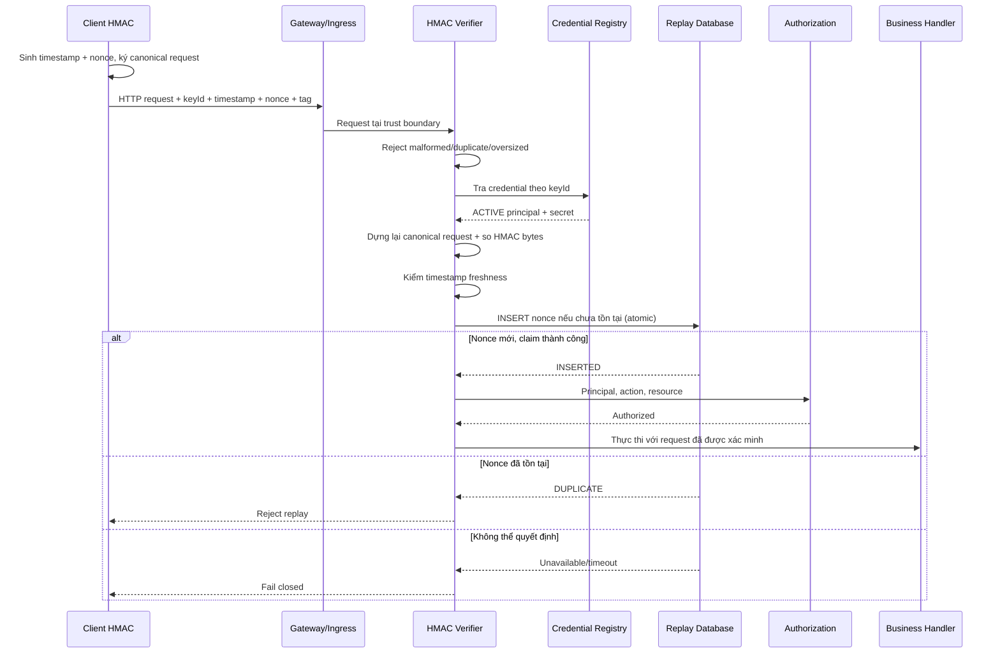
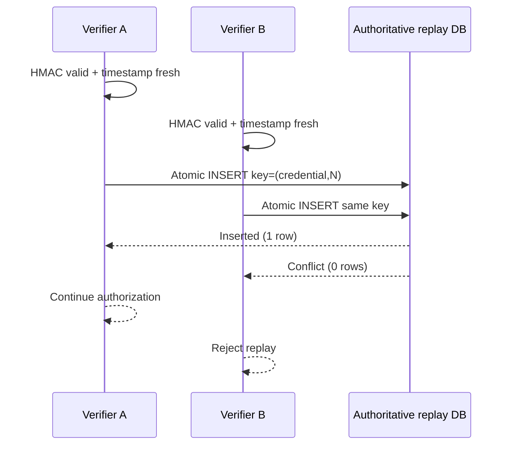
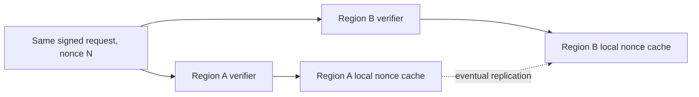
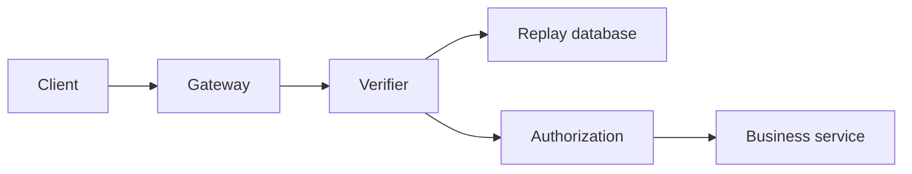

# Replay database: lưu và chặn request HMAC bị phát lại bằng ghi nhận nonce nguyên tử

> **Chương:** Replay protection  
> **Bài học:** Replay database  
> **Bối cảnh module:** `SECURITY_AUTHENTICATION_HMAC_REQUEST_AUTHENTICATION` — xác thực HTTP request bằng HMAC với shared secret, ký canonical request gồm method, URI, signed headers và/hoặc body. Bài này đi sâu vào **replay database**: nơi lưu dấu nonce đã dùng, tính duy nhất khi có nhiều verifier, TTL theo timestamp, vận hành và kiểm thử qua proxy/gateway. Nội dung cũng chỉ rõ ranh giới với key rotation, retry/idempotency và authorization.

## 1. Replay database là gì?

**Replay database** là thành phần lưu trạng thái để server biết **một bằng chứng xác thực/request đã được sử dụng hay chưa**. Trong mô hình HMAC HTTP API có nonce, nó thường là một **kho khóa đã dùng**:

```text
key:      (credentialId, nonce)
value:    claimedAt, expiresAt, optional request metadata
operation: insert-if-absent, atomic
```

Khi một request HMAC hợp lệ đến:

- Nếu `(credentialId, nonce)` chưa được claim trong khoảng hiệu lực, server **ghi nhận nguyên tử** và có thể tiếp tục authorization.
- Nếu cùng khóa đã được claim, server **từ chối replay**, kể cả khi HMAC vẫn đúng.
- Nếu không thể kiểm tra/ghi nhận do kho bị lỗi, server **fail closed** với endpoint yêu cầu chống replay: không bỏ qua kho để xử lý request.

Ví dụ minh họa:

```http
POST /v1/payments?orderId=42 HTTP/1.1
Host: api.example.test
Content-Type: application/json
X-Key-Id: merchant-a-k2
X-Timestamp: 1767225600
X-Nonce: 87a3d56ea72d40af89f5b68cb3e831d4
X-Signature: v1=<BASE64URL_HMAC_TAG>

{"amount":100000,"currency":"VND"}
```

`<BASE64URL_HMAC_TAG>` chỉ là placeholder; các giá trị thời gian/nonce là fixture để học, **không** phải request production có thể tái sử dụng.

**Câu hỏi cốt lõi:** Server đã nhìn thấy và chấp nhận nonce `87a3...` của credential `merchant-a-k2` chưa? **HMAC thuần túy không trả lời được**, vì với cùng signing input và secret, HMAC luôn tạo cùng tag.

### Khi nào cần replay database?

Nó đặc biệt quan trọng với những thao tác mà **phát lại nguyên request cũ** có thể gây tác động: thanh toán, tạo lệnh chuyển khoản, kích hoạt tài khoản, sửa hạn mức hoặc gọi API write nhạy cảm. Replay database không phải một đặc tính tự có của mọi giao thức HMAC; đây là **lựa chọn chống phát lại** khi contract dùng nonce và server có yêu cầu chặn request lặp.

Nếu hệ thống có phương thức chống replay khác (ví dụ sequence number có state trên từng credential), thành phần lưu trạng thái có thể không gọi là “nonce database”. Nguyên tắc không đổi: **một request đã được sử dụng không được chấp nhận lại trong phạm vi nó còn có thể hợp lệ**.

## 2. HMAC, timestamp, nonce và replay database làm các việc khác nhau

| Thành phần | Kiểm soát điều gì? | Không tự đảm bảo |
| --- | --- | --- |
| `HMAC-SHA256` | Tính xác thực/toàn vẹn của các **byte được ký** bằng shared secret. | Không nhớ request đã được dùng. |
| `X-Timestamp` đã ký | Giới hạn request hợp lệ trong một **cửa sổ thời gian**. | Không chặn replay trong cửa sổ ấy. |
| `X-Nonce` đã ký | Định danh một lần sử dụng trong phạm vi hợp đồng. | Không chặn lặp nếu server không lưu. |
| **Replay database** | Chỉ cho **một atomic claim** thành công cho một replay key. | Không tự xác thực HMAC, không cấp quyền, không đảm bảo giao dịch đúng một lần. |
| **Idempotency store** | Tránh thực hiện lại **cùng thao tác nghiệp vụ** khi có retry hợp lệ. | Không thay credential authentication hoặc chống phát lại nguyên request. |
| **Authorization** | Quyết định principal đã xác thực có quyền trên action/resource. | Không bảo đảm chữ ký đúng hoặc nonce chưa dùng. |

Một attacker không có secret có thể **sao chép** nguyên request và chữ ký còn hạn. Attacker không cần đoán nonce mới. Một replay database đúng thiết kế vẫn từ chối bản sao vì nonce đã được claim.

**Hai định nghĩa cần tách:**

- *Client nonce uniqueness:* sinh nonce ngẫu nhiên đủ lớn để việc trùng một cách vô ý cực hiếm.
- *Server nonce uniqueness:* một record có cùng scope **không thể được ghi nhận thành công hai lần đồng thời** trong thời gian request có thể được chấp nhận.

Client có thể tạo nonce bằng `SecureRandom` 16 byte (128 bit) rồi biểu diễn bằng 32 ký tự hex chữ thường. Nhưng chỉ **unique constraint hoặc atomic conditional write** của replay database mới cưỡng chế server-side uniqueness.

## 3. Luồng xác minh và vị trí của database



Vị trí của **atomic claim** là phần quan trọng:

1. Kiểm HTTP grammar, kích thước, signed headers và chính sách endpoint.
2. Tra credential đáng tin, kiểm credential còn hiệu lực và thuật toán/version được phép.
3. Tự dựng canonical request từ **method/URI/header/body thực nhận**, tính HMAC và so tag.
4. Kiểm timestamp đã ký còn trong freshness window.
5. **Sau khi HMAC + freshness đúng**, claim `(credentialId, nonce)` bằng **một thao tác nguyên tử** trong replay database.
6. Chỉ claim thành công mới được đi tiếp tới authorization và business logic; **không tạo business side effect trước khi claim**.

Có thể kiểm **cú pháp** timestamp/nonce trước HMAC để giảm tải, nhưng không được **ghi nonce** khi chữ ký chưa được chứng minh đúng.

### Vì sao không claim trước HMAC?

Giả sử request của client thật dùng nonce `N`. Attacker không có secret nhưng biết hoặc đoán giá trị `N`, rồi gửi một tag giả cùng nonce ấy. Nếu server ghi nonce **trước** khi verify HMAC, nonce bị “chiếm” và request hợp lệ sau đó sẽ bị từ chối. Đây là **nonce poisoning/DoS logic**.

Vì vậy replay database nên phục vụ những request **đã qua xác thực mật mã**, không phải nơi hứng mọi nonce mà Internet khai báo.

## 4. Khóa duy nhất trong replay database: lưu theo scope nào?

Chọn scope là một quyết định giao thức, không đơn giản là chọn một cột làm primary key.

Một contract minh họa dùng:

```text
replayKey = (credentialIdentity, nonce)
```

Trong API mà mỗi `X-Key-Id` ánh xạ duy nhất một credential, đã được HMAC bảo vệ và không có alias, `credentialIdentity` có thể chính là `keyId` chuẩn hóa.

| Phạm vi uniqueness | Ưu điểm | Rủi ro/điều kiện |
| --- | --- | --- |
| `(keyId, nonce)` | Dễ triển khai với credential registry rõ ràng. | Cùng secret hoặc cùng credential có nhiều key ID alias có thể tạo namespace không mong muốn. |
| `(stableCredentialId, nonce)` | Tách ID nội bộ đáng tin khỏi text key ID do caller gửi. | Registry phải gán identity ổn định và gắn với secret/version. |
| `(principalId, nonce)` | Nonce dùng một lần trên toàn principal. | Các thiết bị/client khác nhau cùng principal có thể va chạm ngoài ý muốn; cần rõ scope. |
| `(tenantId, credentialId, nonce)` | Hữu ích nếu credential ID không duy nhất toàn hệ thống. | Tenant phải lấy từ registry đã xác minh, không từ header tự khai chưa tin. |
| `nonce` toàn cục | Mô hình uniqueness rộng. | Không nhất thiết cần; tăng write contention/collision giữa các client. |

**Đề xuất:** dùng **stable credential identity** từ registry làm khóa namespace, cộng nonce canonical. Không coi một trường `X-Tenant-Id` tùy ý là cách chia namespace đáng tin.

### Không đưa body hash hoặc timestamp vào replay key khi contract quy định nonce dùng một lần

Sai với semantics “một nonce trên mỗi credential”:

```text
replayKey = (credentialId, nonce, bodyHash)
replayKey = (credentialId, nonce, timestamp)
```

Một caller có secret có thể ký **body hoặc timestamp mới nhưng giữ nonce cũ**. Nếu hash/timestamp là một phần của database key, hệ thống coi đó là record khác và để nonce được dùng nhiều lần.

Đúng cho contract này:

```text
UNIQUE (credential_id, nonce_hex)
```

Body digest, request fingerprint, key ID và timestamp vẫn nên có trong **HMAC signing input**, nhưng database uniqueness **không phụ thuộc** body/timestamp ngoài scope đã chọn.

### Có nên lưu hash của nonce không?

Có thể dùng digest đã chuẩn hóa của `credentialIdentity + nonce` làm storage key để giảm lộ dữ liệu hoặc giới hạn ký tự, nhưng cần cân nhắc domain separation, encoding không nhập nhằng và collision model. Với **nonce 128 bit random, không bí mật**, lưu hex canonical đã validate thường đơn giản và dễ vận hành hơn.

**Không dùng hash “đã mã hóa” làm bằng chứng HMAC**: replay database chỉ lưu trạng thái, còn verifier phải kiểm HMAC bằng secret theo registry.

## 5. Mô hình record: những cột thực sự cần

Một record replay tối thiểu có ba nhóm thông tin:

- **Khóa duy nhất**: `credential_id` + `nonce_hex`.
- **Thời điểm được claim**: `first_seen_at` phục vụ điều tra/giám sát.
- **Thời điểm có thể dọn**: `expires_at` theo freshness policy, **không phải TTL tùy tiện từ khi nhận**.

Một mô hình PostgreSQL minh họa:

```sql
CREATE TABLE hmac_replay_nonce (
    credential_id VARCHAR(128) NOT NULL,
    nonce_hex CHAR(32) NOT NULL,
    first_seen_at TIMESTAMPTZ NOT NULL DEFAULT clock_timestamp(),
    expires_at TIMESTAMPTZ NOT NULL,

    CONSTRAINT pk_hmac_replay_nonce
        PRIMARY KEY (credential_id, nonce_hex),

    CONSTRAINT ck_nonce_hex_lowercase
        CHECK (nonce_hex ~ '^[0-9a-f]{32}$')
);

-- Cần tạo quy trình cleanup riêng cho record hết hạn.
-- Index này hỗ trợ tìm dữ liệu hết hạn, nhưng phát sinh overhead ghi.
CREATE INDEX idx_hmac_replay_nonce_expiry
    ON hmac_replay_nonce (expires_at);
```

Đây là **DDL PostgreSQL**, không phải cú pháp SQL đa hệ quản trị. Với throughput cao, cần tính tới partitioning, index bloat, vacuum, WAL, HA và cleanup; không copy schema vào production mà chưa sizing.

### Có nên thêm trường `status`?

Có hệ thống muốn phân biệt `CLAIMED`, `PROCESSING`, `COMPLETED`, `FAILED`. Cần xác định rõ **hợp đồng replay** trước khi thêm:

- Một nonce **đã claim** phải **không được claim lần hai** trong thời gian nó có hiệu lực, kể cả business processing sau đó thất bại.
- Nếu cho phép “release nonce” sau business fail, attacker hoặc client có thể phát lại **cùng request**; tính dùng một lần không còn được bảo đảm.
- Trạng thái xử lý nghiệp vụ, kết quả retry và transaction là trách nhiệm của **idempotency store/workflow state**, không nên gộp vào cơ chế nonce nếu không có thiết kế chính thức.

Đối với bài học này, record không có cờ `completed`; **row tồn tại nghĩa là nonce đã được sử dụng**.

### Bảo vệ thông tin lưu trữ

Nonce **không phải secret**, nhưng metadata kết hợp `credentialId`, IP, thời điểm, path và correlation ID có thể nhạy cảm. Không lưu shared secret hoặc raw full signature trong replay database. Quản lý quyền đọc/ghi, backup, logs, retention và mã hóa at-rest theo chính sách tổ chức.

## 6. Ghi nhận nguyên tử: không `SELECT` rồi `INSERT` theo hai bước rời

Cách sai:

```text
Instance A: SELECT ... WHERE key=K -> none
Instance B: SELECT ... WHERE key=K -> none
Instance A: INSERT key=K -> succeeds
Instance B: INSERT key=K -> succeeds (nếu không có unique constraint)
Instance A: ACCEPT
Instance B: ACCEPT
```

Hai request giống hệt có thể đến cùng lúc qua hai verifier instances. Nếu tính duy nhất chỉ là `SELECT` rồi `INSERT` không có ràng buộc transaction/uniqueness, cả hai có thể cho request đi tiếp.

### 6.1. PostgreSQL: `INSERT ... ON CONFLICT DO NOTHING`

```sql
INSERT INTO hmac_replay_nonce (
    credential_id,
    nonce_hex,
    expires_at
)
VALUES (
    :credential_id,
    :nonce_hex,
    :expires_at
)
ON CONFLICT (credential_id, nonce_hex) DO NOTHING;
```

Trong JDBC, các marker `:credential_id` là **pseudocode cho parameter bind**, không phải dấu `?` của `PreparedStatement`. Query JDBC thật sử dụng placeholder `?`.

Kết quả cần đọc chính xác:

- **1 row inserted:** claim thành công, record mới.
- **0 row inserted do conflict:** nonce đã tồn tại, reject replay.
- **SQLException/timeout/unknown transaction outcome:** không biết chắc đã ghi hay chưa → **fail closed**, không trả ACCEPT.

**Không nuốt SQLException và coi như “nonce chưa được dùng”.** Cũng không cần chạy một `SELECT` trước insert; **unique constraint + atomic insert** là nguồn quyết định.

### 6.2. JDBC Java 17: repository minh họa

```java
import java.sql.Connection;
import java.sql.PreparedStatement;
import java.sql.SQLException;
import java.sql.Timestamp;
import java.time.Instant;
import javax.sql.DataSource;

public final class JdbcReplayRepository {
    private final DataSource dataSource;

    public JdbcReplayRepository(DataSource dataSource) {
        this.dataSource = java.util.Objects.requireNonNull(dataSource);
    }

    /**
     * Gọi CHỈ SAU HMAC + freshness pass.
     * @return true nếu insert mới; false nếu record đã tồn tại.
     * @throws SQLException nếu database không quyết định được.
     */
    public boolean claim(
            String credentialId, String nonceHex, long expiresAtEpoch)
            throws SQLException {
        if (credentialId == null
                || !credentialId.matches("[A-Za-z0-9._-]{1,128}")
                || nonceHex == null
                || !nonceHex.matches("[0-9a-f]{32}")) {
            throw new IllegalArgumentException("Invalid replay key");
        }

        String sql = """
            INSERT INTO hmac_replay_nonce
                (credential_id, nonce_hex, expires_at)
            VALUES (?, ?, ?)
            ON CONFLICT (credential_id, nonce_hex) DO NOTHING
            """;

        try (Connection conn = dataSource.getConnection();
             PreparedStatement stmt = conn.prepareStatement(sql)) {
            stmt.setString(1, credentialId);
            stmt.setString(2, nonceHex);
            stmt.setTimestamp(3,
                    Timestamp.from(Instant.ofEpochSecond(expiresAtEpoch)));
            int rows = stmt.executeUpdate();
            if (rows != 0 && rows != 1) {
                throw new SQLException("Unexpected insert row count: " + rows);
            }
            return rows == 1;
        }
    }
}
```

**Điều kiện áp dụng code JDBC:**

- Cần PostgreSQL driver, `DataSource` và database được cấu hình; đoạn này **không phải chương trình runnable độc lập chỉ với JDK**.
- Với `autoCommit=true` như nhiều pool mặc định, lệnh insert hoàn tất tại transaction riêng. Nếu dùng transaction do framework quản lý, **chỉ coi claim bền vững khi commit thành công**; không cho business side effect bên ngoài transaction trước khi biết transaction đã commit theo policy.
- Khi request dùng transaction bao cả nonce claim và business write, rollback làm claim cũng biến mất. Nếu đây không phải semantics mong muốn, phải quyết định tách transaction/đảm bảo retry qua idempotency. Không tự đánh đồng database commit với việc payment tới hệ thống ngoài đã diễn ra.
- `expiresAtEpoch` phải được tính từ signed timestamp và freshness policy trước khi gọi, **không lấy `now+300` mặc định**.
- Kết quả update count và tính chất isolation phụ thuộc driver/DB, cần chạy integration test trên phiên bản database dùng thật.
- Nếu timeout sau khi DB đã commit, ứng dụng có thể không biết claim đã tồn tại hay chưa. **Không cho request đi tiếp khi outcome chưa rõ**.

### 6.3. Tạo lập TTL trong database quan hệ

PostgreSQL **không tự xóa row theo `expires_at`** chỉ vì có index. Cần một quy trình cleanup có kiểm soát:

```sql
-- Ví dụ logic dọn theo thời gian phía database.
DELETE FROM hmac_replay_nonce
WHERE expires_at < clock_timestamp();
```

Với lưu lượng lớn, **không** nên chạy một DELETE không giới hạn trên bảng lớn trong giờ cao điểm. Dùng batch/partition/retention worker, giám sát dead tuples/WAL và giới hạn transaction. Dọn hết hạn chỉ an toàn nếu expiry thật sự nằm **sau mốc cuối cùng request đó có thể được chấp nhận** với clock skew/margin được thiết kế.

Có thể partition table theo thời gian để drop dữ liệu theo lô, nhưng **unique constraints qua partition** cần được thiết kế cẩn thận. Nếu partition theo thời gian và unique key vô tình trở thành `(credential, nonce, day)`, **một nonce có thể được claim ở hai partition khác nhau** trong cùng freshness window gần ranh giới ngày. Không được đổi phạm vi uniqueness ngầm khi tối ưu dữ liệu.

## 7. Redis cũng có thể làm replay database

“Replay database” không nhất thiết là hệ SQL. Redis thường được sử dụng vì thao tác claim atomically với TTL gọn:

```text
SET hmac:replay:<credentialId>:<nonceHex> 1 NX EX <ttlSeconds>
```

Ký hiệu `<...>` là placeholder. Ý nghĩa:

- `NX`: chỉ đặt key nếu **chưa tồn tại**.
- `EX <ttlSeconds>`: đặt expiry ngay trong **cùng thao tác atomic**.
- Trả về thành công (`OK`) → request được claim; không thành công vì key đã có (`nil/null` theo client) → replay.
- Network error, timeout hoặc kết quả không xác định → **fail closed**.

Tránh:

```text
GET key
if absent:
    SET key value
    EXPIRE key 300
```

Đây là **check-then-act race**. Nếu SET và EXPIRE tách rời, có thể tạo key không TTL khi process crash hoặc có thể cùng ACCEPT giữa hai node.

### Redis: nhanh không đồng nghĩa luôn bền vững khi failover

Một lệnh `SET NX EX` atomic **trên authoritative Redis instance** không tự bảo đảm:

- Dữ liệu được ghi đủ bền trước khi phản hồi.
- Replica đã nhận claim trước khi failover.
- Hai region với Redis riêng không đồng thời chấp nhận cùng replay key.
- TTL không bị hết hạn sớm do wall clock/expiry policy sai.
- Bộ nhớ không bị eviction xóa nonce còn hiệu lực.

Vì vậy cần chọn kiến trúc theo threat model: mức rủi ro của một replay lọt qua, vùng triển khai, khả năng mất commit lúc failover, chính sách eviction, latency, kích thước và chi phí.

**Không dùng Redis cache eventual-consistent theo vùng như thể đó là một unique constraint toàn cục** khi request có thể đến nhiều vùng đồng thời.

### PostgreSQL hay Redis?

| Tiêu chí | PostgreSQL unique row | Redis `SET NX EX` |
| --- | --- | --- |
| Điều kiện atomic cơ bản | Unique constraint + insert. | `SET NX` trên một primary. |
| Expiry | Cleanup/partition tự quản lý. | TTL gắn trực tiếp vào key. |
| Durable commit | Có cơ chế WAL/transaction tùy cấu hình. | Phụ thuộc persistence, replication và failover policy. |
| Latency/write throughput | Cần đo index/transaction/WAL. | Thường phù hợp thao tác key ngắn, cần đo memory và HA. |
| Multi-region | Cần authoritative DB topology/consistency. | Cần authoritative routing hoặc giao thức consistency được bảo đảm. |
| Audit/debug | SQL có thể dễ truy vấn record/metadata. | Key-value tối giản, audit thường phải kết hợp telemetry. |
| Dữ liệu hết hạn | Phải dọn không làm phá uniqueness. | TTL tự hết, nhưng phải dự phòng drift và eviction. |
| Khi store lỗi | **Fail closed**. | **Fail closed**. |

Lựa chọn phụ thuộc yêu cầu latency, durability, compliance, lưu lượng, key distribution, khả năng vận hành và ảnh hưởng nếu một replay được chấp nhận. Không có lựa chọn nào miễn kiểm thử concurrency và failover.

## 8. Tính thời gian giữ record: tránh TTL quá ngắn

**Sai TTL** là một lỗi bảo mật nghiêm trọng vì database có thể “quên” nonce trong khi request **vẫn đủ mới** để được xác minh.

Định nghĩa:

- `T`: timestamp trong request, đã được HMAC bảo vệ, đơn vị UTC epoch seconds.
- `N`: thời điểm server kiểm freshness.
- `P`: khoảng cho phép request **trễ/cũ** (past window).
- `F`: khoảng cho phép timestamp **đi trước** server (future window).

Freshness hợp lệ khi:

\[
N - P \le T \le N + F
\]

Suy ra khoảng mà một request với timestamp cố định `T` có thể được nhận hợp lệ:

\[
T - F \le N \le T + P
\]

Vậy **mốc muộn nhất** mà một replay còn có thể lọt freshness check là `T+P`. Database phải giữ record đến **sau mốc này** với margin phù hợp:

\[
\mathrm{expiresAt} = T + P + \mathrm{safetyMargin}
\]

Khi ghi vào store có TTL tính từ hiện tại:

\[
\mathrm{ttlSeconds} = \mathrm{expiresAt} - N
\]

### Ví dụ với cửa sổ ±300 giây

```text
Signed timestamp T = 1767225600
Past window P      = 300 seconds
Future window F    = 300 seconds

Request có thể hợp lệ khi:
  T - 300 <= N <= T + 300

Nếu nhận sớm ở N = T - 300:
  (T + 300) - (T - 300) = 600 seconds

TTL 300 giây kể từ lúc claim sớm sẽ hết ở N = T:
  nhưng request vẫn hợp lệ thêm 300 giây.
```

Với margin 60 giây, record nên tồn tại tới ít nhất `T+360`. Tại lần nhận sớm nhất, TTL tương ứng **660 giây**.

### Trường hợp freshness bất đối xứng

```text
P = 180 seconds
F = 30 seconds
T = 1767225600

Chấp nhận từ N = T-30 đến N = T+180
Khoảng chấp nhận toàn phần = 210 giây
Record cần giữ tới ít nhất T+180 (+ margin)
```

**Đừng nhầm P và F:** past window `P` quyết định **thời điểm nhận muộn nhất**; future window `F` quyết định **thời điểm nhận sớm nhất**.

### Kiểm đồng hồ và expiration source

Nếu database clock khác verifier clock, expiry có thể đến sớm so với một verifier đang chậm. Các node/regions phải được đồng bộ và có một giới hạn skew đáng tin; safety margin dựa trên số đo/threat model chứ không phải hằng số ngẫu nhiên. Nếu clock jump/drift vượt giả định, nên fail closed hoặc cô lập node cho tới khi thời gian ổn định.

**Không dùng `System.nanoTime()` để tạo Unix timestamp**. `nanoTime` đo khoảng thời gian nội bộ JVM, không gắn với mốc UTC.

## 9. Ước lượng dung lượng và chiến lược retention

Tính sơ bộ số record còn hiệu lực:

\[
\text{activeRecords} \approx \text{validSignedRequestsPerSecond} \times \text{averageRetentionSeconds}
\]

Ví dụ, dịch vụ nhận **5.000 request HMAC hợp lệ/giây**, mỗi nonce tồn tại trung bình **600 giây**:

```text
5,000 records/second × 600 seconds = 3,000,000 active records
```

Con số đó **chưa** tính overhead index, allocator, metadata, replication, backup hay write amplification. Nếu chạy ở tốc độ này, lựa chọn SQL/Redis cần benchmark thực tế và quy trình cleanup/partition rõ ràng.

### Dung lượng database ảnh hưởng bảo mật như thế nào?

- Nếu store đầy và tự **evict nonce còn hiệu lực**, replay có thể lọt qua.
- Nếu retention quá dài, chi phí tăng và áp lực tài nguyên có thể làm verifier từ chối request hợp lệ.
- Nếu cleanup dùng clock hoặc partition boundary sai, record bị xóa trước khi hết freshness.
- Nếu API cho request chưa xác minh ghi nonce, attacker không có secret có thể làm đầy kho.

Đưa **claim sau HMAC**, dùng rate limits, giới hạn kích thước request, quota credential, giám sát dung lượng và **fail closed** khi store không còn đảm bảo uniqueness. Không tự chuyển sang cho phép request không kiểm replay để giảm áp lực hệ thống.

## 10. Java 17+: mô phỏng replay database và verifier HMAC

Ví dụ sau là chương trình **có thể chạy độc lập trên Java 17+**, không phụ thuộc PostgreSQL/Redis. Nó cho thấy chính xác **hợp đồng của replay database** trước khi thay bằng repository production:

- `ReplayStore.claim` trả **true** nếu record mới được claim, **false** nếu đã dùng.
- `LocalAtomicStore` dùng `ConcurrentHashMap.compute` tạo một atomic claim trong **một JVM**, có expiry theo timestamp.
- Verifier tính HMAC-SHA256 trên method, authority, URI, Content-Type, key ID, timestamp, nonce và SHA-256 raw body.
- Signature là `v1=` + **43 ký tự Base64URL không padding** (tag HMAC-SHA256 đầy đủ 32 byte).
- Credential registry kiểm ACTIVE; replay claim diễn ra **sau HMAC và freshness**, trước authorization.
- Test từ chối tag sai, nonce trùng, timestamp đã hết hạn, key bị revoke, store unavailable và principal không đủ quyền.
- Test concurrency cho hai threads cùng claim một replay key và phép tái sử dụng nonce sau expiry trong store **với nhận xét policy đi kèm**.

### 10.1. Hợp đồng `REPLAY-DB-V1` của ví dụ

Endpoint cố định:

```text
POST https://api.example.test/v1/payments?orderId=42
Content-Type: application/json
X-Key-Id: client-a-k1
X-Timestamp: 1767225600
X-Nonce: 87a3d56ea72d40af89f5b68cb3e831d4
```

Chỉ chấp nhận:

- Method `POST`, authority `api.example.test`, path `/v1/payments`, query `orderId=42`.
- `application/json` và body raw bytes tối đa 64 KiB.
- Key ID ASCII giới hạn, timestamp 10–11 chữ số epoch seconds không leading zero, nonce đúng **32 hex lowercase**.
- Chuỗi canonical nối bằng LF, **không có LF cuối**, body SHA-256 biểu diễn hex chữ thường.
- HMAC-SHA256, full tag, Base64URL no padding.
- Freshness `P=F=300` giây; record expiry `T + P + 60`.
- Replay key `(keyId, nonce)`, với giả định mỗi key ID ánh xạ một credential riêng.
- Không định nghĩa cơ chế header duplicate ở trong record; **HTTP adapter phải reject duplicate trước khi tạo request model**.

```java
import java.nio.charset.StandardCharsets;
import java.security.GeneralSecurityException;
import java.security.MessageDigest;
import java.time.Clock;
import java.time.Instant;
import java.time.ZoneOffset;
import java.util.ArrayList;
import java.util.Base64;
import java.util.HexFormat;
import java.util.List;
import java.util.Map;
import java.util.Objects;
import java.util.concurrent.Callable;
import java.util.concurrent.ConcurrentHashMap;
import java.util.concurrent.CountDownLatch;
import java.util.concurrent.ExecutorService;
import java.util.concurrent.Executors;
import java.util.concurrent.Future;
import java.util.concurrent.TimeUnit;
import java.util.concurrent.atomic.AtomicBoolean;
import java.util.function.Predicate;
import javax.crypto.Mac;
import javax.crypto.spec.SecretKeySpec;

public final class ReplayDatabaseDemo {
    private static final HexFormat HEX = HexFormat.of();
    private static final long PAST_SECONDS = 300;
    private static final long FUTURE_SECONDS = 300;
    private static final long EXPIRY_MARGIN = 60;
    private static final String PREFIX = "HMAC-SHA256/REPLAY-DB-V1\n";

    private ReplayDatabaseDemo() {}

    record ReplayKey(String credentialId, String nonceHex) {}

    record Credential(String principal, byte[] secret, boolean active) {
        Credential {
            Objects.requireNonNull(principal);
            Objects.requireNonNull(secret);
            secret = secret.clone();
        }
        @Override public byte[] secret() {
            return secret.clone();
        }
    }

    record Request(String method, String authority, String path,
                   String query, String contentType, String keyId,
                   String timestamp, String nonce, byte[] body,
                   String signature) {
        Request {
            Objects.requireNonNull(method);
            Objects.requireNonNull(authority);
            Objects.requireNonNull(path);
            Objects.requireNonNull(query);
            Objects.requireNonNull(contentType);
            Objects.requireNonNull(keyId);
            Objects.requireNonNull(timestamp);
            Objects.requireNonNull(nonce);
            Objects.requireNonNull(body);
            Objects.requireNonNull(signature);
            body = body.clone();
        }
        @Override public byte[] body() {
            return body.clone();
        }
    }

    enum Decision {
        ACCEPT, MALFORMED, UNAUTHENTICATED, STALE,
        REPLAY, FORBIDDEN, UNAVAILABLE
    }

    interface ReplayStore {
        // true: created new record; false: duplicate.
        // A store error MUST throw: never return true on uncertainty.
        boolean claim(ReplayKey key, long expiresAt, long nowSeconds);
    }

    // Demo only: atomic within ONE JVM, not durable, not multi-node.
    static final class LocalAtomicStore implements ReplayStore {
        private final ConcurrentHashMap<ReplayKey, Long> expiries =
                new ConcurrentHashMap<>();

        @Override
        public boolean claim(
                ReplayKey key, long expiresAt, long nowSeconds) {
            if (expiresAt <= nowSeconds) {
                throw new IllegalStateException("Invalid replay expiry");
            }
            AtomicBoolean acquired = new AtomicBoolean(false);
            expiries.compute(key, (ignored, oldExpiry) -> {
                if (oldExpiry == null || oldExpiry <= nowSeconds) {
                    acquired.set(true);
                    return expiresAt;
                }
                return oldExpiry;
            });
            return acquired.get();
        }
    }

    private static long parseTimestamp(String text) {
        if (!text.matches("[1-9][0-9]{9,10}")) {
            throw new IllegalArgumentException("Noncanonical timestamp");
        }
        return Long.parseLong(text);
    }

    // Strict fixture contract: HTTP adapter must have validated
    // all original field occurrences, authority and content bytes.
    private static void validate(Request r) {
        if (!"POST".equals(r.method())
                || !"api.example.test".equals(r.authority())
                || !"/v1/payments".equals(r.path())
                || !"orderId=42".equals(r.query())
                || !"application/json".equals(r.contentType())
                || !r.keyId().matches("[A-Za-z0-9._-]{1,64}")
                || !r.nonce().matches("[0-9a-f]{32}")
                || r.body().length > 64 * 1024) {
            throw new IllegalArgumentException("Invalid request contract");
        }
        parseTimestamp(r.timestamp());
    }

    private static String canonical(Request r)
            throws GeneralSecurityException {
        validate(r);
        byte[] bodyDigest = MessageDigest.getInstance("SHA-256")
                .digest(r.body());
        return String.join("\n",
                "POST",
                "api.example.test",
                r.path(),
                r.query(),
                "content-type:" + r.contentType(),
                "x-key-id:" + r.keyId(),
                "x-nonce:" + r.nonce(),
                "x-timestamp:" + r.timestamp(),
                "content-type;x-key-id;x-nonce;x-timestamp",
                HEX.formatHex(bodyDigest));
    }

    private static byte[] computeTag(byte[] secret, Request r)
            throws GeneralSecurityException {
        Mac mac = Mac.getInstance("HmacSHA256");
        mac.init(new SecretKeySpec(secret, "HmacSHA256"));
        String signingText = PREFIX + canonical(r);
        return mac.doFinal(
                signingText.getBytes(StandardCharsets.UTF_8));
    }

    private static String encodeTag(byte[] tag) {
        if (tag.length != 32) {
            throw new IllegalArgumentException("Expected full tag");
        }
        return "v1=" + Base64.getUrlEncoder().withoutPadding()
                .encodeToString(tag);
    }

    private static byte[] decodeTag(String text) {
        if (!text.matches("v1=[A-Za-z0-9_-]{43}")) {
            throw new IllegalArgumentException("Signature grammar");
        }
        String b64 = text.substring(3);
        byte[] tag = Base64.getUrlDecoder().decode(b64);
        if (tag.length != 32
                || !b64.equals(Base64.getUrlEncoder()
                        .withoutPadding().encodeToString(tag))) {
            throw new IllegalArgumentException("Noncanonical signature");
        }
        return tag;
    }

    private static Request unsigned(
            String keyId, String nonce, String timestamp, String json) {
        return new Request(
                "POST", "api.example.test", "/v1/payments",
                "orderId=42", "application/json", keyId,
                timestamp, nonce,
                json.getBytes(StandardCharsets.UTF_8), "");
    }

    private static Request signed(Request r, byte[] secret)
            throws GeneralSecurityException {
        String wire = encodeTag(computeTag(secret, r));
        return new Request(
                r.method(), r.authority(), r.path(), r.query(),
                r.contentType(), r.keyId(), r.timestamp(), r.nonce(),
                r.body(), wire);
    }

    private static Request changeBody(Request r, String json) {
        return new Request(
                r.method(), r.authority(), r.path(), r.query(),
                r.contentType(), r.keyId(), r.timestamp(), r.nonce(),
                json.getBytes(StandardCharsets.UTF_8), r.signature());
    }

    private static Request changeNonce(Request r, String nonce) {
        return new Request(
                r.method(), r.authority(), r.path(), r.query(),
                r.contentType(), r.keyId(), r.timestamp(), nonce,
                r.body(), r.signature());
    }

    static Decision verify(
            Request r, Map<String, Credential> registry,
            ReplayStore store, Clock clock,
            Predicate<String> isAuthorized) {
        try {
            validate(r);
            byte[] supplied = decodeTag(r.signature());
            Credential credential = registry.get(r.keyId());
            if (credential == null || !credential.active()) {
                return Decision.UNAUTHENTICATED;
            }

            byte[] expected = computeTag(credential.secret(), r);
            if (!MessageDigest.isEqual(expected, supplied)) {
                return Decision.UNAUTHENTICATED;
            }

            long t = parseTimestamp(r.timestamp());
            long now = clock.instant().getEpochSecond();
            if (t < now - PAST_SECONDS
                    || t > now + FUTURE_SECONDS) {
                return Decision.STALE;
            }

            // Latest acceptance of timestamp T occurs at T + PAST.
            long expiresAt = t + PAST_SECONDS + EXPIRY_MARGIN;

            // Atomic claim only AFTER HMAC and freshness success.
            ReplayKey replayKey = new ReplayKey(r.keyId(), r.nonce());
            if (!store.claim(replayKey, expiresAt, now)) {
                return Decision.REPLAY;
            }

            if (!isAuthorized.test(credential.principal())) {
                return Decision.FORBIDDEN;
            }
            return Decision.ACCEPT;
        } catch (IllegalArgumentException invalid) {
            return Decision.MALFORMED;
        } catch (GeneralSecurityException cryptoFailure) {
            return Decision.UNAVAILABLE;
        } catch (RuntimeException storeFailure) {
            return Decision.UNAVAILABLE; // Fail closed.
        }
    }

    private static void expect(Decision result, Decision wanted) {
        if (result != wanted) {
            throw new AssertionError(
                    "Wanted " + wanted + ", got " + result);
        }
    }

    public static void main(String[] args) throws Exception {
        byte[] keyA = HEX.parseHex(
                "000102030405060708090a0b0c0d0e0f"
              + "101112131415161718191a1b1c1d1e1f");
        byte[] keyB = HEX.parseHex(
                "f0e0d0c0b0a090807060504030201000"
              + "ffeeddccbbaa99887766554433221100");

        Map<String, Credential> registry = Map.of(
                "client-a-k1", new Credential("client-A", keyA, true),
                "client-b-k2", new Credential("client-B", keyB, true));
        long t = 1767225600L;
        Clock fixed = Clock.fixed(
                Instant.ofEpochSecond(t), ZoneOffset.UTC);
        String nonce = "87a3d56ea72d40af89f5b68cb3e831d4";

        Request request = signed(
                unsigned("client-a-k1", nonce, "1767225600",
                        "{\"amount\":100000}"), keyA);

        LocalAtomicStore db = new LocalAtomicStore();
        expect(verify(request, registry, db, fixed, p -> true),
                Decision.ACCEPT);
        expect(verify(request, registry, db, fixed, p -> true),
                Decision.REPLAY);

        // Changed body with old signature must fail before DB claim.
        LocalAtomicStore unclaimed = new LocalAtomicStore();
        expect(verify(changeBody(request, "{\"amount\":900000}"),
                registry, unclaimed, fixed, p -> true),
                Decision.UNAUTHENTICATED);
        expect(verify(request, registry, unclaimed, fixed, p -> true),
                Decision.ACCEPT);

        // Changed nonce with unchanged tag must fail HMAC.
        expect(verify(changeNonce(request,
                        "aaaaaaaaaaaaaaaaaaaaaaaaaaaaaaaa"),
                registry, new LocalAtomicStore(), fixed, p -> true),
                Decision.UNAUTHENTICATED);

        // Same credential + same nonce, new timestamp/body/tag:
        // uniqueness key does NOT include body hash or timestamp.
        Request alteredAndResigned = signed(
                unsigned("client-a-k1", nonce, "1767225601",
                        "{\"amount\":900000}"), keyA);
        expect(verify(alteredAndResigned, registry, db, fixed, p -> true),
                Decision.REPLAY);

        // Same nonce text under DIFFERENT credential namespace.
        Request otherCredential = signed(
                unsigned("client-b-k2", nonce, "1767225600", "{}"),
                keyB);
        expect(verify(otherCredential, registry, db, fixed, p -> true),
                Decision.ACCEPT);

        // Expired timestamp: correct HMAC, but not fresh.
        Request stale = signed(
                unsigned("client-a-k1", nonce, "1767225299", "{}"),
                keyA);
        expect(verify(stale, registry, new LocalAtomicStore(),
                fixed, p -> true), Decision.STALE);

        // Revoked credential: reject even though HMAC key was correct.
        Map<String, Credential> revoked = Map.of(
                "client-a-k1",
                new Credential("client-A", keyA, false));
        expect(verify(request, revoked, new LocalAtomicStore(),
                fixed, p -> true), Decision.UNAUTHENTICATED);

        // Authn and replay check pass, authorization can still deny.
        expect(verify(request, registry, new LocalAtomicStore(),
                fixed, p -> false), Decision.FORBIDDEN);

        // Unavailable DB must never mean "nonce is new".
        ReplayStore broken = (key, expiresAt, now) -> {
            throw new IllegalStateException("Test database outage");
        };
        expect(verify(request, registry, broken, fixed, p -> true),
                Decision.UNAVAILABLE);

        // Test atomicity under concurrent attempts in a SINGLE JVM.
        LocalAtomicStore raceDb = new LocalAtomicStore();
        ExecutorService executor = Executors.newFixedThreadPool(2);
        CountDownLatch ready = new CountDownLatch(2);
        CountDownLatch start = new CountDownLatch(1);
        Callable<Decision> task = () -> {
            ready.countDown();
            start.await();
            return verify(request, registry, raceDb, fixed, p -> true);
        };
        try {
            Future<Decision> a = executor.submit(task);
            Future<Decision> b = executor.submit(task);
            if (!ready.await(5, TimeUnit.SECONDS)) {
                throw new AssertionError("Concurrent tasks not ready");
            }
            start.countDown();
            Decision ra = a.get(5, TimeUnit.SECONDS);
            Decision rb = b.get(5, TimeUnit.SECONDS);
            if (!((ra == Decision.ACCEPT && rb == Decision.REPLAY)
                    || (rb == Decision.ACCEPT && ra == Decision.REPLAY))) {
                throw new AssertionError("Atomic replay claim failed");
            }
        } finally {
            start.countDown();
            executor.shutdownNow();
        }

        // Expiration rule T + PAST + margin, NOT now+PAST.
        long expiresAt = t + PAST_SECONDS + EXPIRY_MARGIN;
        long earliestArrival = t - FUTURE_SECONDS;
        if (expiresAt - earliestArrival != 660L) {
            throw new AssertionError("Replay TTL calculation mismatch");
        }

        System.out.println("PASS: replay database / HMAC / TTL tests");
    }
}
```

Chạy sau khi lưu đúng tên `ReplayDatabaseDemo.java` trên JDK 17+:

```bash
javac ReplayDatabaseDemo.java
java ReplayDatabaseDemo
```

### Code minh họa **không chứng minh** những gì?

1. `LocalAtomicStore` chỉ atomic trong **một process**, không chia sẻ giữa service instances/regions, không bền vững sau restart và không có cleanup.
2. Replay key demo dựa vào `keyId`, với giả định registry ánh xạ key ID duy nhất. Production nên dùng **stable credential identity** đã kiểm chứng.
3. HTTP adapter thật phải reject duplicate `X-Nonce`/`X-Signature`, malformed URI/query/headers, unsupported content coding và body vượt hạn **trước** khi cấp request model cho verifier.
4. `Predicate<String>` chỉ minh họa authorization. Business thật phải kiểm principal, action, resource/tenant và điều kiện liên quan.
5. Request trong code dùng fixed endpoint và JSON raw bytes; không phải canonicalizer HTTP tổng quát và không kiểm proxy/gateway thực.
6. `Clock.fixed` dùng cho test. Production cần đồng bộ, giám sát clock và xử lý clock skew.
7. Mã không tự cung cấp idempotency transaction, event outbox, payment side effects hoặc secret manager; chúng cần thiết kế/test riêng.

**Không khẳng định code đã được chạy trong môi trường production** chỉ vì nó có thể biên dịch. Unit test cần bổ sung integration test trên **DB driver, transaction manager, cluster và gateway thật**.

## 11. Concurrent requests: các race phải được thử

Một replay database không chỉ cần một unit test chạy tuần tự:

```text
verify(request) -> ACCEPT
verify(request) -> REPLAY
```

Nó còn phải đứng vững khi hai requests tới cùng lúc:



**Kết quả mong đợi:** Chính xác **một claim mới thành công**; mọi request không claim được phải **không tạo side effect**. Nếu hai instance cùng ACCEPT, điều tra:

- Cả hai có đang dùng cùng replay DB/namespace không?
- Có dùng `SELECT` rồi `INSERT` ngoài transaction/constraint không?
- Có ghi vào hai region không đồng bộ eventual-consistent không?
- Database dùng replica read mà không ghi vào authoritative primary không?
- Một đường đi qua gateway có bỏ qua claim không?
- Key có chứa bodyHash/timestamp/route tạo hai replay keys khác nhau không?

### Crash sau khi claim

Có thể xảy ra:

```text
HMAC verified
    -> replay DB claim COMMITTED
    -> process crashes before business transaction
```

Retry **nguyên request** sẽ bị đánh dấu replay. Đây là hành vi đúng với “nonce chỉ một lần”, nhưng có thể làm client không biết transaction đã hoàn thành chưa.

Không giải quyết bằng cách **xóa nonce vừa claim để retry nguyên request**, vì như vậy có thể cho replay lọt qua khi business side effect đã xảy ra. Thay vào đó dùng **retry với nonce mới** và **Idempotency-Key có scope/fingerprint**, theo kiến trúc nghiệp vụ.

### Nếu replay claim và business transaction dùng cùng DB?

Có thể thiết kế transaction bao cả hai, nhưng phải định nghĩa rõ:

- Nếu rollback toàn transaction, claim cũng biến mất → liệu retry nguyên request được phép trong hợp đồng không?
- Nếu commit claim trước business, request có thể đã claim nhưng chưa tạo giao dịch.
- Nếu business gửi event/network call ngoài DB transaction trước commit, việc rollback không thu hồi side effect.

**Không hứa “exactly once” chỉ nhờ một unique constraint nonce.** Với thanh toán hoặc workflow bất đồng bộ, có thể cần transactional outbox, idempotency state machine, reconciliation và cơ chế retry an toàn.

## 12. Multi-instance, multi-region, HA và failover

### 12.1. Mọi instance phải nhìn thấy cùng quyết định claim

Nếu mỗi verifier giữ `HashSet` local:

```text
Instance A: nonce N chưa có -> ACCEPT
Instance B: nonce N chưa có -> ACCEPT
```

Cùng request sẽ được chấp nhận hai lần. `ConcurrentHashMap.putIfAbsent` chỉ giải quyết concurrency **bên trong một JVM**, không giải quyết hệ phân tán.

### 12.2. Hai region ghi độc lập cũng có thể cùng accept



Nếu replication chưa tới, cả hai region có thể claim thành công. Với yêu cầu chống replay mạnh, cần **một authoritative decision** có tính nhất quán phù hợp hoặc phân vùng request sao cho cùng replay key chỉ có một điểm quyết định có thể kiểm chứng.

Một số mô hình khả thi:

- **Single authoritative store** với routing, circuit breaker và fail-closed khi không liên lạc được.
- **Partition ownership theo credential** với cơ chế chuyển quyền/fencing an toàn, không có hai leader đồng thời.
- **Database có giao thức consensus/strong consistency** đáp ứng yêu cầu, dù đổi lại latency và complexity.

Không có lựa chọn nào tự được đảm bảo chỉ vì nhãn “multi-region” hoặc “HA” trong tên dịch vụ.

### 12.3. Failover và lost writes

Một primary có thể trả claim success rồi fail trước khi replica nhận record. Sau failover, database mới **không còn biết nonce đã được claim**; request cũ có thể bị chấp nhận lại.

Test vận hành phải xác định durability/ack semantics của database và thời điểm trả ACCEPT. Nếu không đạt mức bảo đảm theo threat model, cần đổi kiến trúc hoặc **fail closed trong giai đoạn trạng thái replay không đáng tin**.

### 12.4. Khi timeout sau write

DB có thể commit record nhưng response timeout. Verifier **không được tự coi đây là “chưa có record” rồi cho request đi tiếp**.

- Nếu kết quả claim không xác định → **không thực thi business**.
- Nếu client retry nguyên request, có thể bị REPLAY vì DB đã ghi; đây là kết quả chấp nhận được của at-most-once claim.
- Client có thể gửi request mới nonce mới với idempotency key cũ và kiểm business state.

Phân biệt việc replay database **đã claim** với giao dịch nghiệp vụ **đã thành công**.

## 13. Ranh giới giữa replay database và idempotency database

Đây là khác biệt quan trọng nhất với các API POST.

| Replay database | Idempotency database |
| --- | --- |
| Key thường là `(credentialId, nonce)`. | Key thường là `(principal/tenant, operation, Idempotency-Key)`. |
| Chống **phát lại cùng attempt đã ký**. | Chống **thực thi lặp cùng ý định nghiệp vụ** qua nhiều attempts hợp lệ. |
| Ghi sau HMAC/freshness, trước side effect. | Thường phối hợp transaction/business state. |
| Record chỉ tồn tại trong freshness retention. | Retention theo đặc tính nghiệp vụ và SLA retry. |
| Duplicate → reject replay. | Duplicate phù hợp fingerprint → có thể trả kết quả cũ. |
| Không hiểu `amount` hay `orderId`. | Thường kiểm request fingerprint/action/resource. |
| Không đảm bảo exactly-once payment. | Hỗ trợ idempotent business, vẫn cần transaction/outbox khi cần. |

### Ví dụ timeout sau khi tạo thanh toán

```text
Attempt 1:
  Idempotency-Key: pay-order-42
  X-Nonce: N1
  X-Timestamp: T1
  HMAC: HMAC(K, canonical request including N1)
  Business result: payment created (response lost)

Attempt 2:
  Idempotency-Key: pay-order-42
  X-Nonce: N2
  X-Timestamp: T2
  HMAC: HMAC(K, canonical request including N2)
  Business result: return existing payment, not create another
```

Nonce `N2` mới nên **không** bị replay database từ chối. Idempotency store mới biết đây là cùng thao tác có thể trả lại kết quả trước đó. `Idempotency-Key` và các trường nghiệp vụ liên quan cần được ký hoặc ràng buộc tương đương theo contract.

Nếu cùng idempotency key nhưng body/payment recipient khác, ứng dụng phải **reject conflict**, không tái sử dụng kết quả không đúng request.

**Không chọn replay key = Idempotency-Key.** Một idempotency key được phép tái sử dụng trên những retry hợp lệ; nonce theo hợp đồng lại phải là giá trị dùng một lần.

## 14. Key rotation và namespace trong replay database

Ví dụ credential đổi:

```text
merchant-a-k1 -> secret K1, đang bị thu hồi
merchant-a-k2 -> secret K2, ACTIVE
```

Với replay scope theo `keyId`:

- Cùng nonce text `N` ở k1 và k2 là hai database keys khác nhau.
- Request mang k2 phải **được ký bằng K2**, có key ID k2 trong signed headers.
- Request mang k1 đã revoked phải bị từ chối **trước claim** dù tính HMAC với K1 có thể ra tag đúng.
- Đổi key không nhất thiết đổi grammar nonce, expiry formula hay signature encoding nếu signing contract giữ nguyên.
- Cần tính đến những request hợp lệ đang bay trong **overlap window**: credential policy quyết định k1 có được chấp nhận tới thời điểm nào.

### Tránh lỗi alias

Nếu k1 và k2 thực chất là **hai alias cho cùng một credential/secret** và cùng logical request được xác minh dưới cả hai, hai namespace `(keyId,nonce)` có thể vô tình cho phép “replay xuyên alias”. Một thiết kế thận trọng sử dụng `stableCredentialIdentity` từ registry sau xác thực để xác định replay key.

Không cho client tự chỉ định `credentialIdentity` ngoài chữ ký hoặc tự thử mọi secret cho tới khi HMAC khớp. **Identity cho database key phải đến từ credential đã được xác minh**, không đến từ body/header chưa đáng tin.

### Thu hồi key không có nghĩa xóa replay records ngay

Nếu một key đã bị revoke, mọi request của nó bị từ chối theo credential policy. Nhưng việc **xóa sớm replay records** liên quan key ấy cần cân nhắc trường hợp credential được phục hồi, rollback cấu hình hoặc key alias chuyển đổi. Không nên xóa dữ liệu chống replay đang có hiệu lực chỉ để “dọn cho gọn” khi trạng thái credential thay đổi, trừ khi có quy trình migration/retention đã thiết kế.

Java `Mac.reset()` **không thay secret**; rotation dùng `Mac.init(newKey)` hoặc `Mac` mới.

## 15. Proxy/gateway: chọn **một** điểm claim có thẩm quyền

Một request HMAC có thể qua:



### Mô hình A: Gateway xác minh HMAC và claim nonce

Gateway là **authoritative verifier**:

1. Kiểm HTTP raw path/query/signed headers/body đúng trước rewrite.
2. Tra credential, verify HMAC, freshness và claim nonce trong shared replay DB.
3. Gán principal qua kênh nội bộ đã xác thực nguồn (ví dụ mTLS/trusted service boundary).
4. Backend **không claim lại cùng nonce như một request Internet mới**; nó tin bằng chứng nội bộ đúng cách và tiếp tục authorization.

Bắt buộc chặn gọi trực tiếp backend và **strip/overwrite** các header principal do client tự gửi, như `X-Authenticated-Client`.

### Mô hình B: Service xác minh HMAC và claim nonce

Gateway phải giữ nguyên signing input hoặc chuyển dữ liệu original request được bảo vệ đúng trust boundary. Service tự verify và claim nonce. Nó không tin `X-Original-URI` hay `X-Forwarded-*` do caller có thể kiểm soát nếu gateway chưa lọc/chứng thực.

**Lỗi kiến trúc:** Gateway và service **đều claim cùng nonce** trên cùng replay database mà không có delegation semantics. Gateway claim thành công, service thấy duplicate và từ chối mọi request hợp lệ. Phải định nghĩa **một authoritative claim point** hoặc giao thức xác minh nội bộ khác, không sửa bằng cách bỏ replay database.

### Những biến đổi cần kiểm

| Tình huống qua gateway | Nguy cơ | Kết quả mong đợi |
| --- | --- | --- |
| Gateway xóa `X-Nonce` | Signing input mất dữ liệu. | Reject/fail closed. |
| Gateway thay nonce hoặc timestamp | HMAC client không khớp. | Reject, không sửa signed metadata âm thầm. |
| Header nonce bị lặp, tên khác case | Có thể gây first/last parser differential. | Reject duplicate tại ingress. |
| Gateway rewrite URI/query sau client ký | Canonical request khác. | Verify ở điểm đúng hoặc dùng mapping được bảo vệ. |
| Proxy parse/re-serialize JSON | Raw body digest thay đổi. | HMAC mismatch trừ khi contract khác được thiết kế rõ. |
| Proxy chuyển HTTP/1.1 sang HTTP/2 | Header framing/case khác. | Canonicalize HTTP semantics đúng, không ký raw framing. |
| Hai region riêng nhận replay | Có thể cùng claim. | Authoritative consistent store/routing, test failover. |
| Gateway verify rồi service claim lại | Từ chối nhầm request hợp lệ. | Chọn một claim boundary. |
| Backend nhận `X-Authenticated-Client` từ Internet | Identity spoofing. | Strip/overwrite, mạng nội bộ có authentication. |

## 16. HTTP response, logging và giới hạn tài nguyên

### Phân loại lỗi nội bộ

| Tình huống | Quyết định | Response công khai có thể áp dụng |
| --- | --- | --- |
| Thiếu/sai nonce grammar, duplicate header | Malformed request | 400 hoặc lỗi 4xx theo contract. |
| Secret/key không tồn tại, đã revoke, tag sai | Authentication failure | 401 hoặc mã xác thực theo scheme. |
| Timestamp quá cũ/tương lai | Freshness failure | Lỗi xác thực phù hợp, có thể gộp bên ngoài. |
| Atomic insert báo duplicate | Replay rejected | Lỗi xác thực/replay theo policy; không tạo side effect. |
| Database timeout/unavailable | Verification unavailable | 503 hoặc lỗi dịch vụ phù hợp, **fail closed**. |
| Principal không có quyền | Authorization denied | Thường 403. |
| Idempotency key trùng nhưng fingerprint khác | Business conflict | Có thể 409. |

**HTTP 401** gắn với cơ chế HTTP authentication và `WWW-Authenticate` theo chuẩn. API dùng custom `X-Signature` cần định nghĩa response/challenge policy rõ ràng; không giả định mọi custom header tự là một chuẩn `Authorization` scheme.

Bên ngoài có thể dùng thông điệp không tiết lộ tồn tại của key, trạng thái nonce/credential hoặc sai byte HMAC. Bên trong cần reason codes đủ chính xác:

```text
malformed_nonce
invalid_signature
credential_inactive
stale_timestamp
replay_nonce
replay_store_unavailable
forbidden_resource
idempotency_conflict
```

### Metrics vận hành

Theo dõi:

- `replay_claim_inserted_total`, `replay_claim_duplicate_total`.
- `replay_claim_unavailable_total` và latency theo percentile.
- Số records còn hiệu lực, số row cleanup/expired, TTL distribution.
- Clock skew giữa verifier, DB và các regions.
- Số request HMAC hợp lệ theo credential class, lưu lượng đột biến.
- Số lỗi failover/partition và tỷ lệ phát lại sau retry.
- Business side-effect count, idempotency conflict và transaction retry.

**Không log secret, raw full HMAC tag hoặc body nhạy cảm.** Cân nhắc mask keyId/nonce, tránh ghi đủ chi tiết để tạo lại request chưa hết hạn; lưu correlation ID và metadata không nhạy cảm theo chính sách truy cập/retention.

### Rate limits và khả năng chống DoS

Nonce store thường chịu **write trên mọi request HMAC hợp lệ**. HMAC invalid thì **không ghi**. Giới hạn kích thước URI/headers/body, parse cost, số lượng request theo key/principal và tổng capacity để người nắm credential không gây bão ghi. Khi không thể đảm bảo replay uniqueness, **không evict record active và cho request tiếp tục** chỉ để hệ thống “còn chạy”.

## 17. Ma trận kiểm thử replay database

Bộ test cần có cả unit tests, **database integration tests với driver thật**, concurrency tests qua nhiều verifier và chaos/failover tests trên môi trường được phép.

| # | Tình huống | Kết quả mong đợi |
| --- | --- | --- |
| 1 | Request HMAC đúng, timestamp tươi, nonce mới. | Insert record thành công; request tiếp tục authorization. |
| 2 | Gửi lại nguyên request khi timestamp còn hạn. | Conflict/duplicate; reject replay. |
| 3 | Cùng credential+nonce, body khác nhưng ký lại bằng secret đúng. | Reject vì replay key không chứa body hash. |
| 4 | Cùng credential+nonce, timestamp mới và HMAC mới. | Reject vì replay key không chứa timestamp. |
| 5 | Cùng credential, nonce mới, tag đúng. | Claim được nếu các điều kiện khác đạt. |
| 6 | Cùng nonce text, hai credential độc lập với secret đúng. | Theo `(credential,nonce)` scope, mỗi credential claim một lần. |
| 7 | Hai key ID alias cùng một credential. | Test namespace ổn định, không tạo replay bypass. |
| 8 | HMAC tag sai nhưng nonce mới. | Reject HMAC, **không ghi record**. |
| 9 | Sau tag sai, gửi request hợp lệ cùng nonce chưa claim. | Có thể claim thành công. |
| 10 | Timestamp quá cũ với HMAC đúng. | Reject freshness, không ghi nonce. |
| 11 | Timestamp quá xa tương lai với HMAC đúng. | Reject freshness, không ghi nonce. |
| 12 | Signed nonce bị sửa nhưng giữ tag cũ. | HMAC mismatch. |
| 13 | Nonce thiếu/sai hex/length/whitespace. | Reject malformed. |
| 14 | Hai `X-Nonce` khác case tên field. | Reject duplicate ở HTTP adapter. |
| 15 | Hai threads cùng claim một nonce trên một store atomic. | Chính xác một inserted, một duplicate. |
| 16 | Hai JVM cùng DB primary claim một nonce. | Một insert thành công, một unique conflict. |
| 17 | Hai service instances dùng local `HashSet` riêng. | Test phát hiện thiết kế sai: có thể cùng accept. |
| 18 | DB chỉ dùng `SELECT` rồi `INSERT` không unique. | Concurrency test phát hiện race. |
| 19 | PostgreSQL `ON CONFLICT DO NOTHING` dưới tải concurrent. | Exactly one committed insert đối với key khi không lỗi hạ tầng. |
| 20 | JDBC SQLException hoặc transaction timeout. | Fail closed, không trả ACCEPT. |
| 21 | DB commit claim rồi response bị timeout. | Không suy đoán nonce chưa claim; fail closed. |
| 22 | DB process crash sau claim nhưng trước business write. | Retry bằng nonce mới/idempotency; không mở lại nonce cũ tùy tiện. |
| 23 | Unique constraint bị thiếu sau migration. | Deployment/integration test fail trước production. |
| 24 | Nonce record bị dọn trong freshness window. | Test phát hiện replay có thể lọt; sửa TTL/cleanup. |
| 25 | Nonce được claim tại `T-F`, replay gần `T+P`. | Record vẫn tồn tại; reject replay. |
| 26 | Window đối xứng ±300s, TTL 300s từ claim sớm nhất. | Test phải phát hiện TTL quá ngắn. |
| 27 | Window bất đối xứng `P=180,F=30`. | Expiry theo `T+P+margin`, không theo `T+F`. |
| 28 | Clock server khác DB clock vượt margin. | Reject/cô lập node hoặc xử lý fail closed theo time policy. |
| 29 | Redis `SET NX EX` cùng key từ hai clients. | Một success, một key-exists. |
| 30 | Redis dùng `GET` rồi `SET`. | Race test chứng minh không đảm bảo atomic. |
| 31 | Redis SET thành công nhưng EXPIRE lỗi khi gọi tách rời. | Test phát hiện key không TTL; dùng một atomic command. |
| 32 | Redis eviction xóa record chưa hết hạn. | Không được để replay được accept; policy fail closed/capacity. |
| 33 | Redis failover làm mất acknowledged write. | Chaos test đánh giá durability/replay risk. |
| 34 | PostgreSQL replica lag, app đọc replica để check nonce. | Không dùng read-replica check thay authoritative unique insert. |
| 35 | Two-region eventual replication claim cùng key. | Test phát hiện double-accept; cần single authority/consistency. |
| 36 | Region partition khỏi authoritative store. | Fail closed, không dùng cache local như fallback. |
| 37 | HTTP gateway xác minh/claim, service claim lại cùng nonce. | Kiến trúc test phát hiện double-claim không đúng boundary. |
| 38 | Gateway xóa/rewrite nonce, timestamp hoặc signed headers. | Signature mismatch/contract reject. |
| 39 | Proxy sửa query/path/body sau khi ký. | Reject hoặc verify tại trust boundary tương ứng. |
| 40 | Key ID đổi nhưng tag giữ cũ. | Authentication failure, không đổi replay namespace để bypass. |
| 41 | Key revoked dù tag với key cũ tính đúng. | Reject credential, không tiếp tục claim. |
| 42 | HMAC đúng nhưng principal không có quyền với resource. | Authorization deny, không có side effect. |
| 43 | Retry POST nonce mới, cùng idempotency key/body. | Business không thực hiện hai lần. |
| 44 | Retry POST cùng idempotency key nhưng body khác. | Business idempotency conflict. |
| 45 | Hai attempt mới có nonce khác nhưng cùng ý định thanh toán. | Replay DB không chặn; idempotency store mới xử lý. |
| 46 | Stream body bị cắt/oversized trước HMAC. | Reject, không ghi nonce hoặc side effect. |
| 47 | Tốc độ request invalid signature tăng mạnh. | Không làm phình nonce store do claim sai thứ tự; rate limits hoạt động. |
| 48 | Storage gần đầy hoặc cleanup quá chậm. | Monitoring/capacity alert; không xóa record còn hạn. |
| 49 | Transactional outbox lỗi sau replay claim. | Không báo exactly-once; cơ chế retry/idempotency hợp lệ. |
| 50 | HTTP/1.1 ↔ HTTP/2 qua proxy với signed metadata giữ nguyên. | Request hợp lệ qua đúng verifier; replay bị chặn toàn cluster. |

### Assertions cần có ngoài HTTP status

Không đủ nếu test chỉ thấy `401` hay `409`. Hãy assert:

- Một record claim mới được **commit đúng một lần**.
- Request duplicate không tạo thêm payment, event hoặc message.
- Tag sai và timestamp hết hạn **không** ghi nonce.
- Khi hai instance nhận cùng key, đúng **một** node có cơ hội tiếp tục xử lý.
- Khi DB unavailable, không có code path fallback sang ACCEPT.
- Hạn dùng record lớn hơn thời điểm muộn nhất timestamp còn valid.
- Principal/tenant của request đã xác minh, không lấy từ header do caller tự gắn.
- Retry hợp lệ dùng nonce mới nhưng không tạo tác động trùng nhờ idempotency.

## 18. Checklist triển khai replay database

### Trước khi code

1. Chốt signing contract: nonce/timestamp/key ID **được HMAC ký** cùng method/URI/headers/body cần bảo vệ.
2. Chốt nonce grammar (ví dụ 128 bit random, 32 hex lowercase) và generation policy phía SDK.
3. Chốt **stable credential namespace** và alias/rotation behavior.
4. Chốt freshness `P/F`, giờ UTC epoch seconds, clock skew budget và mốc kiểm timestamp.
5. Chốt expiry `T+P+margin` và retention/cleanup strategy.
6. Chốt consistency, durability và routing khi có nhiều verifier/region.
7. Chốt một **authoritative claim point** tại gateway hoặc service.
8. Chốt xử lý DB unavailable, timeout/ambiguous result và yêu cầu fail closed.

### Trước khi production

1. Chạy golden HMAC vectors và canonical request tests độc lập giữa client/server.
2. Kiểm unique constraint hoặc atomic NX có hiệu lực **trên DB thật**.
3. Chạy concurrent races từ nhiều instances và multiple regions.
4. Kiểm cleanup/TTL ở điểm đầu và cuối freshness window, kể cả clock drift.
5. Kiểm database failover, network partition và lost acknowledgments.
6. Kiểm request đi qua proxy/gateway giữ đúng signed input.
7. Kiểm business authorization và idempotency với retry thật.
8. Quan sát metrics, alerts, quota, security logs và quyền DB.
9. Không cho business side effects trước khi replay claim/authorization hoàn thành.
10. Định kỳ review khi thêm key aliases, thay signing version hoặc mở rộng regions.

## 19. Bài tập thực hành

### Bài tập A — Viết JDBC replay repository

Từ schema PostgreSQL, viết `claim(credentialId, nonce, expiry)` bằng `PreparedStatement` và `INSERT ... ON CONFLICT DO NOTHING`.

**Tiêu chí đạt:** 1 inserted = mới, 0 rows = replay, SQLException = fail closed; test concurrent JDBC sessions cùng credential/nonce chỉ một commit thành công.

### Bài tập B — Tính TTL cho cửa sổ bất đối xứng

Giả sử:

```text
T = 1767225600
P = 180 seconds
F = 30 seconds
margin = 30 seconds
```

Request có thể được nhận sớm nhất khi `N=T-30` và muộn nhất `N=T+180`. Expiry record tối thiểu:

```text
expiresAt = T + P + margin = 1767225810
TTL nếu claim sớm nhất N = T-30:
  (T+180+30) - (T-30) = 240 seconds
```

Không dùng `now+P` như công thức chung cho mọi timestamp.

### Bài tập C — Kiểm thử multi-region

Đặt hai verifier tại hai region có thể nhận cùng signed request trong 1 ms. Thực hiện test đối chiếu:

- Hai cache local chỉ eventual-replicate.
- Một authoritative store có atomic constraint và consistency phù hợp.
- Store mất kết nối từ một region.
- Failover ngay sau một claim đã được báo thành công.

**Tiêu chí đạt:** trong mọi tình huống được cho phép phục vụ, không thể có hai request cùng replay key được ACCEPT; khi không thể bảo đảm, phải fail closed.

### Bài tập D — Tách replay và idempotency

Mô phỏng POST thanh toán đã commit nhưng response bị thất lạc.

- Retry **nguyên nonce** → replay database reject.
- Retry bằng **nonce mới và signature mới**, giữ `Idempotency-Key` cũ đã ký → replay database cho claim, idempotency store trả kết quả cũ.
- Retry cùng idempotency key nhưng body amount khác → idempotency conflict.
- Client A ký hợp lệ nhưng target resource B → authorization deny.

**Tiêu chí đạt:** có assertions riêng cho HMAC, freshness, replay, authorization và business idempotency.

## 20. Câu hỏi tự kiểm tra

**Câu 1.** HMAC-SHA256 và timestamp hợp lệ có đủ để chặn phát lại nguyên request không?

*Đáp án:* Không. HMAC xác minh tính đúng của các byte đã ký, timestamp giới hạn thời gian. Trong cửa sổ đó, request cũ vẫn có tag đúng. Cần replay database ghi nhận nonce đã dùng.

**Câu 2.** Vì sao `(credentialId, nonce)` thường phù hợp hơn chỉ lưu nonce toàn cục?

*Đáp án:* Mỗi credential có namespace riêng, tránh cạnh tranh và collision giữa các client độc lập. Nhưng credential identity phải đến từ registry đã xác thực; alias cùng credential cần chính sách riêng.

**Câu 3.** Có nên thêm body hash vào replay key để nhận biết hai request khác nhau không?

*Đáp án:* Không nếu hợp đồng quy định một nonce chỉ dùng một lần cho credential. Thêm body hash cho phép tái sử dụng nonce với body khác và tag mới.

**Câu 4.** Tại sao không được dùng `SELECT` rồi `INSERT` không có unique constraint?

*Đáp án:* Hai request concurrent có thể cùng đọc “chưa tồn tại” rồi cùng ghi. Cần một **atomic insert-if-absent** và uniqueness constraint ở store có thẩm quyền.

**Câu 5.** PostgreSQL `ON CONFLICT DO NOTHING` trả zero rows nghĩa là gì?

*Đáp án:* Với unique key được định nghĩa đúng, insert không thêm row vì record đã tồn tại. Verifier phải từ chối replay, không cho phép request vì query không ném exception.

**Câu 6.** Vì sao Redis `GET`/`SET`/`EXPIRE` tách rời là nguy hiểm?

*Đáp án:* Có race giữa kiểm và ghi; nếu process lỗi giữa SET và EXPIRE thì record có thể thiếu TTL. Dùng thao tác `SET ... NX EX` atomic với expiry.

**Câu 7.** Với freshness ±300 giây, TTL cố định 300 giây kể từ lần claim có luôn đủ không?

*Đáp án:* Không. Timestamp có thể hợp lệ từ `T-300` đến `T+300`. Nonce claim sớm cần được giữ gần 600 giây, cộng safety margin.

**Câu 8.** Nếu replay database timeout sau khi gửi lệnh insert, có nên coi nonce chưa được dùng không?

*Đáp án:* Không. Insert có thể đã commit nhưng acknowledgment bị mất. Kết quả không xác định phải fail closed; retry dùng nonce mới và idempotency nếu cần.

**Câu 9.** `ConcurrentHashMap.compute` trên một JVM có chặn được replay qua hai pods không?

*Đáp án:* Không. Nó chỉ atomic trong một process. Các pods phải dùng authoritative shared store với consistency phù hợp.

**Câu 10.** Gateway và service cùng claim nonce từ cùng một request đã ký có vấn đề gì?

*Đáp án:* Claim lần hai bị coi replay, có thể làm tất cả request hợp lệ thất bại. Phải thiết kế một authoritative claim boundary hoặc delegation tin cậy.

**Câu 11.** Nếu key bị revoke, replay database còn cần kiểm nonce không?

*Đáp án:* Không được bỏ credential policy: key revoked phải bị từ chối trước khi claim. Dữ liệu nonce của key cũ vẫn cần retention/migration policy, không xóa bừa khi đổi key.

**Câu 12.** Replay database có đảm bảo exactly-once payment không?

*Đáp án:* Không. Nó chỉ cưỡng chế một nonce được claim một lần trong window. Crash, retry hợp lệ với nonce mới và external side effects cần idempotency, transactions/outbox và reconciliation riêng.

**Câu 13.** HMAC đúng và replay database cho claim có chứng minh client được quyền với tenant B không?

*Đáp án:* Không. Authorization phải kiểm principal, action và resource riêng; nonce dùng một lần không cấp quyền.

**Câu 14.** Vì sao không nên lưu nonce từ request có chữ ký sai?

*Đáp án:* Attacker không có secret có thể làm đầy store hoặc chiếm nonce của request hợp lệ. Chỉ claim sau HMAC và freshness pass.

---

## Tài liệu tham khảo

- [RFC 2104 — HMAC: Keyed-Hashing for Message Authentication](https://www.rfc-editor.org/rfc/rfc2104): cơ chế MAC có khóa, không tự có replay memory.
- [RFC 4231 — HMAC-SHA-224/256/384/512 Test Vectors](https://www.rfc-editor.org/rfc/rfc4231): known-answer vectors cho HMAC-SHA256.
- [RFC 9110 — HTTP Semantics](https://www.rfc-editor.org/rfc/rfc9110): HTTP method, field semantics và request interpretation.
- [RFC 3986 — URI Generic Syntax](https://www.rfc-editor.org/rfc/rfc3986): path/query, percent-encoding trong canonical request.
- [RFC 4648 — Base16, Base32, and Base64 Data Encodings](https://www.rfc-editor.org/rfc/rfc4648): hex và Base64URL cho nonce/signature.
- [RFC 9421 — HTTP Message Signatures](https://www.rfc-editor.org/rfc/rfc9421): chuẩn signature base/covered components, **khác** custom `REPLAY-DB-V1`.
- [PostgreSQL — INSERT / ON CONFLICT](https://www.postgresql.org/docs/current/sql-insert.html): atomic insert với unique conflict.
- [PostgreSQL — Constraints](https://www.postgresql.org/docs/current/ddl-constraints.html): unique/primary key constraint.
- [Redis — SET command](https://redis.io/docs/latest/commands/set/): `NX` và TTL trong cùng một thao tác.
- [Oracle Java SE 17 — `javax.crypto.Mac`](https://docs.oracle.com/en/java/javase/17/docs/api/java.base/javax/crypto/Mac.html): tính HMAC-SHA256.
- [Oracle Java SE 17 — `MessageDigest`](https://docs.oracle.com/en/java/javase/17/docs/api/java.base/java/security/MessageDigest.html): hash body, so raw tag.
- [Oracle Java SE 17 — `ConcurrentHashMap`](https://docs.oracle.com/en/java/javase/17/docs/api/java.base/java/util/concurrent/ConcurrentHashMap.html): atomic compute trong **một JVM**.
- [Oracle Java SE 17 — `Clock`](https://docs.oracle.com/en/java/javase/17/docs/api/java.base/java/time/Clock.html): thời điểm kiểm freshness và test với fixed time.

**Ghi nhớ:** **Replay database không chỉ là một cache nhớ nonce**. Nó là nguồn quyết định **atomic, nhất quán và có thời hạn đúng** để mỗi nonce trong phạm vi credential chỉ được claim thành công một lần khi request còn hợp lệ. Hãy ký nonce/timestamp cùng canonical HTTP request bằng HMAC, **verify HMAC và freshness trước khi ghi**, dùng unique constraint hoặc atomic `SET NX`, giữ record ít nhất tới `T+P+margin`, và **fail closed** khi kết quả database không rõ. Qua nhiều instance/gateway/region phải có một điểm claim có thẩm quyền; key rotation, idempotency và **authorization** là các lớp kiểm soát riêng.
