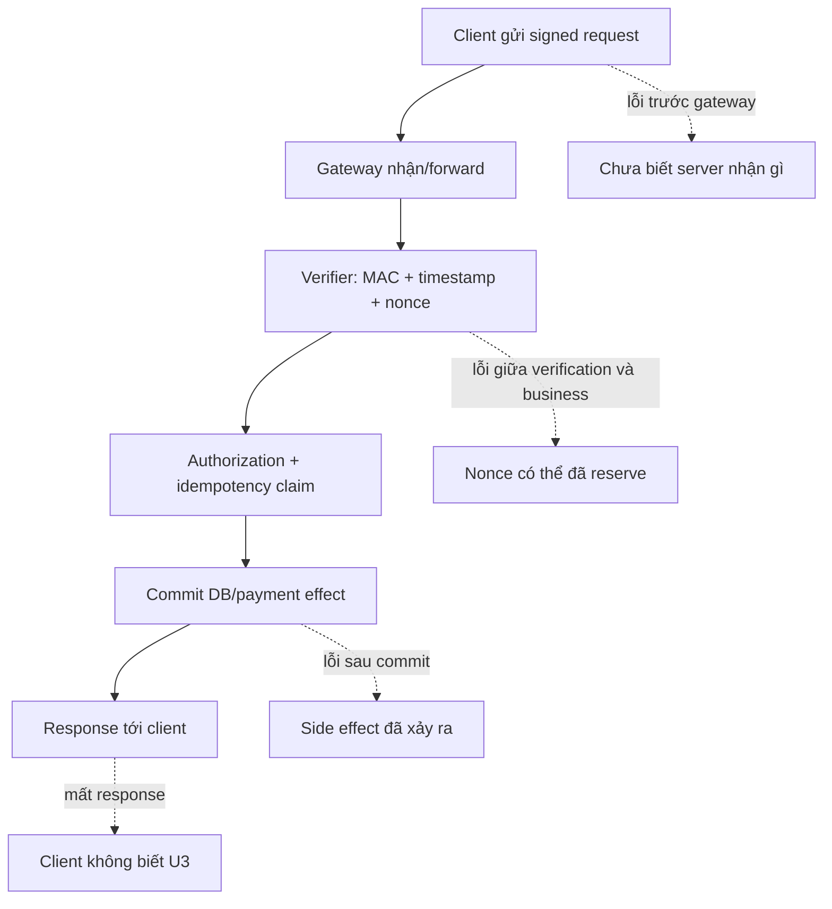
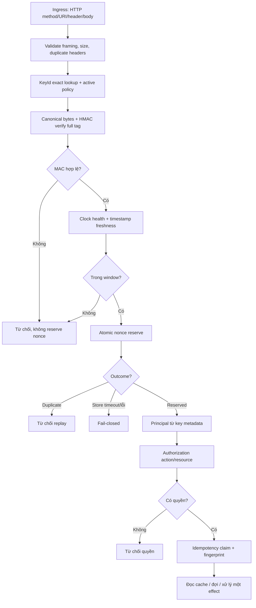
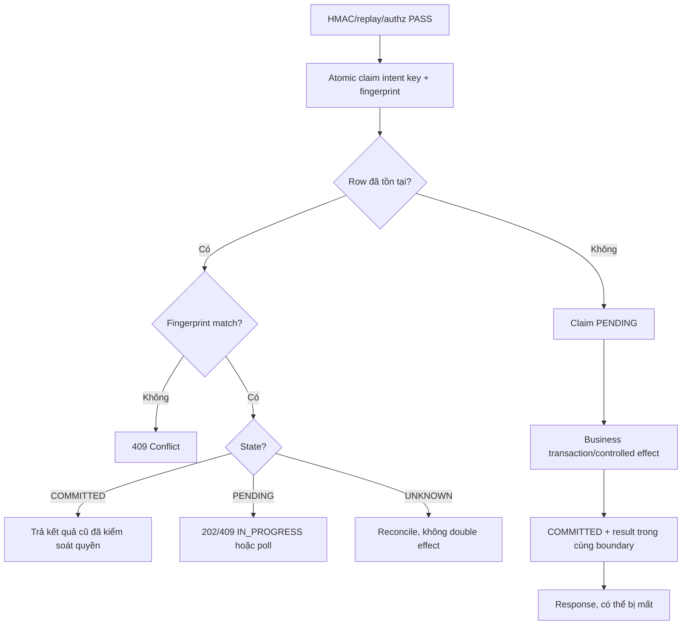

# Replay khi retry trong xác thực HTTP request bằng HMAC

## 1. Retry không đồng nghĩa replay, nhưng một retry có thể trở thành replay

Trong module `SECURITY_AUTHENTICATION_HMAC_REQUEST_AUTHENTICATION`, client ký HTTP request bằng HMAC sử dụng **shared secret**. Dữ liệu được ký là **canonical request**: HTTP method, raw URI/query, các header theo hợp đồng, và/hoặc SHA-256 của body bytes. Timestamp giới hạn thời gian một chữ ký được sử dụng; nonce giúp server xác định một **signing attempt** đã được chấp nhận trước đó. Key rotation quản lý secret còn được verify; **authorization** kiểm tra principal có quyền thực hiện action trên tài nguyên thực tế hay không.

Trong hệ thống phân tán, request có thể bị **timeout, reset connection, mất response, lỗi gateway hoặc service trả 5xx**. Client thường **retry** để đạt được mục tiêu nghiệp vụ. Nhưng một request được gửi lại không nhất thiết là một request chưa từng được server thực thi.

Hãy xét tình huống:

```text
Client                         API / payment service
  | POST /payments, nonce=N1, HMAC đúng |
  |----------------------------------->|
  |                                    | MAC PASS
  |                                    | reserve N1
  |                                    | tạo payment P-100
  |             [response bị mất]       |
  |               X                    |
  |                                    |
  | Retry nguyên request, nonce=N1      |
  |----------------------------------->|
  |                                    | MAC PASS nhưng N1 đã dùng
  |<------------ replay rejected ------|
```

Nếu client cố “khắc phục” bằng cách ký lại **nonce=N2, timestamp mới**, request thứ hai có thể qua anti-replay. Tuy nhiên nếu hệ thống không có **business idempotency**, nó có thể tạo **payment P-101** dù ý định người dùng chỉ là một lần thanh toán.

**Replay protection và retry safety cần được thiết kế cùng nhau nhưng giải quyết hai bài toán khác nhau:**

- **Anti-replay:** một **signed attempt** (hoặc cùng nonce trong replay domain) không được accept hai lần trong freshness window.
- **Retry safety/idempotency:** nhiều **attempt hợp lệ khác nonce** cho cùng một **ý định nghiệp vụ** không được làm side effect lặp ngoài chính sách.

> **Nguyên tắc:** Không tắt nonce check để “cho retry”; không tự động coi timeout là thất bại nghiệp vụ; và không dùng nonce thay cho idempotency key. Một retry an toàn thường **ký lại attempt mới** nhưng **giữ idempotency key ổn định** cho cùng intent — và idempotency key phải được **HMAC bảo vệ** hoặc ràng buộc tương đương.

Bài **“Replay khi retry”** thuộc chương **“Replay protection”** đi sâu vào lỗi “không biết request đầu đã thành công hay chưa”, cách ký lại attempt, thiết kế idempotency state machine và những bảo đảm có thể/không thể có khi gateway, nonce store và payment database hoạt động không đồng bộ.

### Mục tiêu học tập

Sau bài này, bạn có thể:

1. Phân biệt replay có chủ đích, duplicate nonce, retry mạng và duplicate ý định nghiệp vụ.
2. Quyết định **khi nào giữ nguyên idempotency key, khi nào tạo timestamp/nonce mới**, khi nào không nên tự retry.
3. Dùng canonical contract ký cả `Idempotency-Key`, tránh một request HMAC hợp lệ bị thay đổi ý nghĩa retry.
4. Thiết kế hai cơ chế độc lập: **nonce reservation nguyên tử** và **idempotency record** với unique constraint/transaction.
5. Xử lý request đầu có kết quả **chưa biết**: timeout trước/sau commit, response mất, server crash và request đang chạy.
6. Viết client signer Java 17+ đóng băng body, tạo attempt mới bằng `SecureRandom` và dùng `HttpClient` không thay body sau ký.
7. Xử lý key rotation, TTL timestamp/nonce, trust boundary gateway, multi-region và authorization.
8. Xây dựng ma trận test end-to-end kiểm tra **không double charge**, không lộ kết quả giữa principals và không bypass HMAC/replay.

## 2. Bốn khái niệm cần đặt đúng cấp độ

| Khái niệm | Được nhận diện bởi | Mục tiêu | Có thể trùng khi retry? |
| --- | --- | --- | --- |
| **HTTP transport attempt** | Một lần gửi qua kết nối/request pipeline | Vận chuyển bytes tới server | Có thể retry nhiều lần khi lỗi mạng. |
| **Signed attempt** | Canonical bytes + key ID + timestamp + nonce + HMAC | Chứng minh request được bên biết secret tạo ra, ràng buộc nội dung | Retry nguyên chữ ký = cùng attempt; ký lại nonce mới = attempt khác. |
| **Replay nonce** | `(authenticated principal, audience, nonce)` trong contract mẫu | Chặn một nonce được chấp nhận lại trong time window | **Không** được tái dùng trong replay domain. |
| **Business intent** | ID giao dịch/idempotency key + fingerprint request + principal | Ngăn hai side effects cho một ý định nghiệp vụ | **Có**: nhiều signed attempts có thể cùng một intent. |

Ví dụ một khách bấm “Thanh toán” một lần:

```text
Business intent          = payment-intent-2026-00017
HTTP attempt 1           = timestamp=T1, nonce=N1, signature=S1
HTTP attempt 2           = timestamp=T2, nonce=N2, signature=S2
HTTP attempt 3           = timestamp=T3, nonce=N3, signature=S3

T1/T2/T3 có thể khác nhau, N1/N2/N3 PHẢI mới.
Idempotency key giữ NGUYÊN cho cùng business intent.
Payload/action/target phải cùng fingerprint theo hợp đồng.
```

Nếu người dùng thực sự muốn tạo **giao dịch thứ hai**, phải cấp **business intent/idempotency key mới**, ngay cả khi số tiền và người nhận giống nhau. Ngược lại, nếu cùng idempotency key bị dùng với **payload khác**, server phải trả conflict thay vì coi đó là retry an toàn.

### 2.1 Sự khác biệt quan trọng về kết quả

- **HMAC đúng**: client chứng minh khả năng dùng secret để ký đúng những trường đã chọn; chưa chứng minh timestamp/nonce hợp lệ.
- **Timestamp hợp lệ**: request chưa quá cũ/xa tương lai; chưa chứng minh request chưa được nhận.
- **Nonce mới**: signed attempt chưa bị reserve trong replay domain; chưa chứng minh client chưa tạo một attempt khác cùng ý định.
- **Authorization pass**: principal có quyền với action/resource; chưa chứng minh chưa xử lý intent.
- **Idempotency match/record**: cung cấp chính sách chống lặp **hiệu ứng nghiệp vụ**, không thay thế authentication/authorization.

Một server thiếu bất kỳ bước nào đều có thể “đúng HMAC” nhưng không đạt mục tiêu an toàn khi retry.

## 3. Unknown outcome: lỗi mạng không có nghĩa server chưa thực thi

Đây là thách thức quan trọng nhất. Client thường chỉ quan sát được **có response hay không**, không thể kết luận chính xác **server đã commit business effect hay chưa**.

### 3.1 Bốn thời điểm lỗi khác nhau



| Điểm client gặp lỗi | Server có thể đã làm gì? | Điều client **không nên** suy ra |
| --- | --- | --- |
| Không kết nối được trước khi có bằng chứng gửi | Có thể chưa nhận; chi tiết phụ thuộc HTTP stack/proxy | Không mặc định mọi lỗi `connect` đều giống một lỗi sau gửi. |
| Timeout trong khi upload | Có thể nhận một phần, có thể nhận đủ qua proxy | Không coi “timeout” là chắc chắn không xử lý. |
| Timeout khi chờ response | Có thể đã xác minh, reserve nonce và commit DB | Không tạo payment mới với idempotency key mới chỉ vì chưa thấy response. |
| HTTP 502/503/504 từ gateway | Backend có thể đã xử lý, gateway mất kết nối upstream | Không coi mọi 5xx là thất bại chưa có side effect. |
| HTTP 409 request `IN_PROGRESS` | Một attempt khác cùng intent đang chạy | Không tạo intent mới; chờ/poll theo policy. |
| Client crash sau gửi | Không biết request đã đến/commit | Phải lưu bền intent key và trạng thái retry để phục hồi an toàn. |

**HTTP semantics** hữu ích nhưng không đủ: `POST` theo mặc định không phải idempotent, còn `GET` được thiết kế là safe/read-only. Tuy vậy bất kể method nào, nếu API HMAC yêu cầu nonce mới cho mỗi attempt, việc gửi lại **y nguyên request** vẫn có thể bị replay guard từ chối. Business retry policy cần biết endpoint cụ thể và hợp đồng của nó.

### 3.2 Không hứa “exactly-once HTTP delivery”

Mạng có thể tạo duplicate attempts và mất acknowledgements. Không thể từ một HTTP retry loop đơn lẻ suy ra **exactly-once execution** cho toàn bộ workflow, đặc biệt khi có DB, message queue và payment provider.

Một lời hứa có thể triển khai và kiểm chứng tốt hơn là:

- **At-most-once admission per nonce** trong freshness window, với replay store có consistency/durability đúng.
- **At-most-one committed business effect per idempotency key + fingerprint** trong thời hạn retention đã công bố, nếu state machine/transaction và downstream integration được thiết kế đúng.
- **Retry có thể trả cùng kết quả trước đó** sau authentication và authorization mới, không cần chạy side effect lần hai.

Nếu effect ra ngoài một transaction (ví dụ gọi cổng thanh toán ngoài), phải dựa thêm vào **provider idempotency / transaction ID**, outbox/state machine và reconciliation; một dòng idempotency trong DB local **không tự chứng minh exactly-once** ở dịch vụ khác.

## 4. Hai chiến lược retry: gửi nguyên chữ ký hay ký attempt mới?

### 4.1 Retry nguyên signed request

Giữ nguyên:

```text
method, raw URI/query, signed headers, body bytes
X-HMAC-Timestamp = T1
X-HMAC-Nonce     = N1
X-HMAC-Signature = S1
```

Nếu request đầu **đã reserve N1**, lần gửi lại phải bị **từ chối duplicate/replay**, kể cả khi business xử lý đã thành công hay bị crash. Nếu request đầu chưa tới verifier hoặc chưa reserve N1 và timestamp còn hợp lệ, bản gửi lại **có thể** được chấp nhận. Client không thể dựa vào điều đó để định nghĩa retry an toàn.

**Đừng mở ngoại lệ “nonce trùng nhưng body hash giống nhau thì cho qua”.** Như vậy một attacker có bản signed request có thể gửi lại cùng body để lặp side effect. Trong hợp đồng minh họa, replay detection được áp dụng **trước** khi trả cached idempotency result.

### 4.2 Retry bằng signed attempt mới

Giữ ổn định **business intent**, nhưng tạo **timestamp và nonce mới**, rồi tính HMAC mới:

```text
Attempt 1: idempotencyKey=payment-intent-00017, nonce=N1, HMAC=S1
Attempt 2: idempotencyKey=payment-intent-00017, nonce=N2, HMAC=S2
Attempt 3: idempotencyKey=payment-intent-00017, nonce=N3, HMAC=S3

N1 != N2 != N3 theo chính sách random nonce.
S1/S2/S3 đều ký cả idempotencyKey trong canonical request.
```

Server có thể xác thực cả ba attempts. Nhưng **business layer** chỉ nên xử lý **một payment intent** với một fingerprint; attempt sau có thể nhận kết quả đã hoàn tất hoặc trạng thái đang xử lý.

### 4.3 Bảng quyết định client theo lỗi

| Tình huống | Có nên retry ngay? | Quy tắc an toàn |
| --- | --- | --- |
| `401` do MAC/timestamp/nonce không hợp lệ | **Không retry mù** | Sửa key/clock/canonicalization; không bỏ authentication. |
| `403` thiếu quyền | **Không** | Sửa quyền hoặc resource; ký lại không cấp quyền. |
| `409` idempotency fingerprint conflict | **Không**, với payload khác | Là lỗi dùng lại key cho operation khác; không tự tạo key mới để “vượt” conflict. |
| `409` hoặc `202` đang xử lý | Có thể **poll/wait theo API contract** | Không bắt đầu payment intent khác; tôn trọng `Retry-After` nếu được công bố. |
| `408`, `429`, `502`, `503`, `504` | **Có điều kiện**, tùy endpoint/Retry-After | Dùng retry budget/backoff, intent key giữ nguyên, nonce/timestamp mới mỗi attempt. |
| `500` hoặc mất kết nối khi chờ response | **Outcome có thể mơ hồ** | Chỉ retry side-effecting API khi idempotency/reconciliation đã được bảo đảm. |
| Network error đã được xác nhận trước khi gửi request | Có thể, theo client policy | Vẫn cân nhắc proxy/stack; dùng attempt mới để tránh timestamp hết hạn. |
| Request body không thể đọc lại | Không tự retry bằng một stream đã consume | Phải có replayable snapshot/spool hoặc dùng resumable protocol khác. |
| Deadline nghiệp vụ đã hết | **Dừng tự động** | Reconcile trạng thái intent, không mở vòng retry vô hạn. |

Một số HTTP clients tự retry/redirect một số trường hợp. Với HMAC, phải kiểm soát **automatic redirect**, vì host/URI/method/body có thể đổi sau khi ký. Bài dùng `HttpClient.Redirect.NEVER` trong ví dụ.

## 5. Hợp đồng minh họa RETRY-V1: ký cả Idempotency-Key

Bài sử dụng hợp đồng học tập tên `HMAC-REQUEST/RETRY-V1`, không phải định dạng HMAC mặc định của AWS, HTTP Message Signatures hay mọi API khác. Đặc điểm quan trọng của version này là **Idempotency-Key phải nằm trong HMAC**.

### 5.1 HTTP request mẫu

```http
POST /v1/payments?mode=online HTTP/1.1
Host: payments.example.test
Content-Type: application/json
Idempotency-Key: payment-intent-2026-00017
X-HMAC-Key-Id: merchant-42:k7
X-HMAC-Timestamp: 1767268800
X-HMAC-Nonce: 7d46b2dd65d618a32ba74de99da88d80
X-HMAC-Signed-Headers: content-type;idempotency-key;x-hmac-key-id;x-hmac-nonce;x-hmac-timestamp
X-HMAC-Signature: <base64-full-hmac-sha256>

{"amountMinor":125000,"currency":"VND","beneficiaryId":"b-7"}
```

Đây là fixture minh họa. Timestamp `1767268800` ứng với `2026-01-01T12:00:00Z`, **không dùng nguyên trong production**; signature là placeholder. Body được định nghĩa là **chính xác các byte UTF-8 của JSON trên, không có newline cuối**.

### 5.2 Những thành phần được bảo vệ

| Field | Quy tắc RETRY-V1 |
| --- | --- |
| Canonical version | `HMAC-REQUEST/RETRY-V1`, version ghim theo key metadata server. |
| Algorithm | `HmacSHA256`, full 32-byte tag, Base64 chuẩn có padding 44 ký tự. |
| Method | `POST` thực tế, không hỗ trợ method override. |
| Raw target | `/v1/payments?mode=online` đúng origin-form; không tự sort/query-decode. |
| Audience | `payments-api/prod` từ key/service policy, ngăn cross-service replay. |
| Content-Type | Đúng một header, canonical value `application/json`. |
| Idempotency-Key | Singleton, token ASCII `[A-Za-z0-9._:-]{8,128}`, client giữ ổn định qua retry cùng intent. |
| Key ID | Singleton `X-HMAC-Key-Id`, ánh xạ secret/version/principal/status server-side. |
| Timestamp | Unix epoch **seconds** dạng canonical decimal, ký trong HMAC. |
| Nonce | 16 random bytes, 32 hex lowercase, **mới ở mỗi attempt** và ký trong HMAC. |
| Signed header manifest | Chuỗi năm tên ASCII lowercase/sort cố định, server **pin** chứ không theo subset client tự chọn. |
| Body bytes | Raw application bytes sau HTTP framing và trước content transform; demo **cấm Content-Encoding**. |
| Body digest | SHA-256(raw body bytes) lowercase hex 64 ký tự. |
| Canonical encoding | **12 dòng UTF-8** nối bởi LF `0x0A`, không có LF cuối. |
| Replay domain | `(principalId, audience, nonce)`, dùng nonce store nguyên tử chung. |
| Business idempotency scope | `(principalId, audience, idempotencyKey)` + fingerprint method/target/content-type/body. |

**Không dùng `Idempotency-Key` chưa ký.** Nếu attacker đổi header idempotency sau khi client tạo MAC mà verifier không kiểm tra, request có thể bị xử lý như một intent khác, hoặc trả về cached result không đúng. Giá trị phải nằm trong **canonical header line** và manifest gắn với policy.

Hợp đồng mẫu **cấm** `X-Tenant-Id`, `X-HTTP-Method-Override` và `Content-Encoding` vì chúng có thể làm đổi ngữ nghĩa mà không được ký. Một API thật cần signed fields khác phải định nghĩa version hoặc ràng buộc server-side chặt tương ứng.

### 5.3 Canonical request gồm đúng 12 dòng

```text
HMAC-REQUEST/RETRY-V1
HMAC-SHA256
POST
/v1/payments?mode=online
audience:payments-api/prod
content-type:application/json
idempotency-key:payment-intent-2026-00017
x-hmac-key-id:merchant-42:k7
x-hmac-nonce:7d46b2dd65d618a32ba74de99da88d80
x-hmac-timestamp:1767268800
signed-headers:content-type;idempotency-key;x-hmac-key-id;x-hmac-nonce;x-hmac-timestamp
body-sha256:<lowercase-sha256-hex-of-exact-json-body>
```

Dòng cuối chỉ là **placeholder** mô tả, không được dùng ký như ký tự thật. Client phải tính digest từ **chính byte[] gửi qua HTTP**, rồi dựng 12 dòng, không thêm LF cuối:

```text
bodyHashHex       = hexLower(SHA256(rawBodyBytes))
canonicalBytes    = UTF8(joinLF(12_lines, noFinalLF))
fullMacBytes      = HMAC_SHA256(sharedSecretBytes, canonicalBytes)
signatureText     = Base64StandardPadded(fullMacBytes)
```

Server phải **tự dựng** canonical từ raw request nhận được, không tin một chuỗi canonical do client gửi. `X-HMAC-Signed-Headers` là manifest phải đối chiếu với version; `X-HMAC-Signature` **không** ký chính nó để tránh vòng lặp.

### 5.4 Retry thay đổi dòng nào?

Attempt đầu:

```text
idempotency-key:payment-intent-2026-00017
x-hmac-nonce:7d46b2dd65d618a32ba74de99da88d80
x-hmac-timestamp:1767268800
body-sha256:<digest-cua-body-A>
```

Attempt retry hợp lệ cùng intent:

```text
idempotency-key:payment-intent-2026-00017    (GIỮ NGUYÊN)
x-hmac-nonce:<nonce-moi-128-bit>
x-hmac-timestamp:<epoch-seconds-moi>
body-sha256:<digest-cua-cung-body-A>          (GIỮ NGUYÊN)
```

`method`, `rawTarget` và nội dung nghiệp vụ phải giữ nguyên theo fingerprint contract. Nếu client sửa số tiền hoặc người thụ hưởng, đó **không còn là cùng intent**; server phải từ chối reuse idempotency key bằng lỗi conflict, không coi là retry đơn giản.

## 6. Replay guard: timestamp + atomic nonce reservation

### 6.1 Thứ tự xác minh đúng



Không reserve nonce từ header chưa được MAC xác minh. Nếu làm thế, người không biết secret có thể gửi request giả để chiếm nonce của request hợp lệ (**nonce poisoning**) hoặc làm đầy kho replay.

Khi HMAC hợp lệ mà nonce đã được reserve:

- Trả kết quả **replay rejected** theo policy; không đi thẳng tới cached payment vì nếu không, attacker chỉ cần bản sao signed request có thể khai thác retry result.
- Một client hợp lệ muốn **truy vấn trạng thái giao dịch** phải gửi attempt mới có timestamp/nonce/HMAC riêng, dùng **idempotency key cũ** hoặc endpoint tra cứu riêng được xác thực.
- Nonce duplicate không chứng minh request đầu đã commit. Nó chỉ chứng minh một **reservation** trước đó tồn tại trong replay domain.

### 6.2 Phải dùng atomic operation, không GET rồi SET

Ví dụ Redis:

```redis
SET hmac:nonce:v1:<digest-cua-principal-audience-nonce> 1 NX EX 360
```

- `NX`: chỉ ghi khi chưa có key.
- `EX 360`: gắn TTL trong cùng thao tác.
- `OK`: mới reserve; đi tiếp.
- `nil`/already exists: duplicate.
- Timeout/unknown outcome: **fail-closed**, không coi là “chưa từng dùng”.

Không dùng `ConcurrentHashMap` độc lập trên từng JVM/region để thay replay store nếu request có thể đến nhiều replica. Không dùng `GET` rồi `SET` hai bước hoặc local mutex; chúng không ngăn race toàn hệ thống.

### 6.3 TTL bao phủ cả past age, future skew và lệch replica

Với chính sách mẫu:

```text
maxPastAge         = 300 seconds
maxFutureAllowance =  30 seconds
maxServerClockErr  =   5 seconds
safetyMargin       =  20 seconds

minimumNonceTtl >= 300 + 30 + 2*5 + 20 = 360 seconds
```

Lý do: timestamp cố định `T` được chấp nhận khi `now − 300 <= T <= now + 30`, tương đương `T − 30 <= now <= T + 300`. Khoảng chấp nhận **330 giây** dù đồng hồ chính xác; khi replica có sai số ±5 giây, dành thêm 10 giây và 20 giây dự phòng trong mô hình minh họa.

`360` là cấu hình ví dụ, **không phải TTL chuẩn cho mọi API**. Khi clock bị nhảy lùi vượt tolerance, Redis failover mất reservation, eviction trước hạn hoặc multi-region stores không đồng bộ, công thức trên **không bảo đảm** chống replay. Cần clock health fail-closed, storage consistency/durability, quota và test failover.

### 6.4 Vấn đề khi một request đã reserve nonce rồi server crash

```text
MAC PASS
  -> SET NX thành công cho nonce N1
  -> crash TRƯỚC khi ghi idempotency/payment
  -> client retry y nguyên N1
  -> DUPLICATE; không thể mặc định chạy tiếp
```

Đây là trade-off cố hữu khi phân tách **anti-replay** và **business commit**. Retry an toàn phải dùng **attempt mới N2** nhưng **giữ cùng idempotency key**, để server có thể thực hiện intent nếu lần đầu chưa commit hoặc trả kết quả cũ nếu đã commit.

**Không xóa N1 tự động khi request lỗi**: một lỗi sau commit hoặc lỗi trả response có thể khiến side effect thực sự đã xảy ra. Xóa nonce sẽ mở lại khả năng replay exact signed request. Nếu cần cơ chế khôi phục tinh vi hơn, thiết kế transaction/idempotency state machine, không làm suy yếu nonce store.

## 7. Idempotency key: cách gắn nhiều attempts vào một business intent

### 7.1 Idempotency key có phạm vi riêng

Bài chọn:

```text
Idempotency record identity:
  (authenticatedPrincipalId, audience, idempotencyKey)

Fingerprint của intent:
  (canonicalContractVersion, method, rawTarget,
   canonicalContentType, SHA256(rawBodyBytes))
```

`principalId` và `audience` phải đến từ metadata key phía server **sau authentication**. `idempotencyKey` là header client tạo, **đã được ký**. Fingerprint cũng do server tính từ **request thực tế đã validate**, không tin fingerprint do client khai.

**Không đưa timestamp, nonce hoặc key ID vào fingerprint business intent**, vì chúng hợp lệ khi đổi giữa attempts/retry hoặc key rotation. Ngược lại, method, target, content type và body digest phải giữ nhất quán theo contract. Nếu endpoint chọn tenant/resource từ một phần khác, fingerprint cần bao gồm **đúng semantics đó**, hoặc không cho trường đó không được ký.

### 7.2 Fingerprint conflict là lỗi nghiêm trọng

Giả sử:

```text
Attempt A:
  key = payment-intent-00017
  POST /v1/payments?mode=online
  body = {"amountMinor":125000,...}
  fingerprint = F1

Attempt B:
  key = payment-intent-00017
  POST /v1/payments?mode=online
  body = {"amountMinor":250000,...}
  fingerprint = F2

F1 != F2 -> conflict (ví dụ HTTP 409).
```

Không bao giờ trả cached success của F1 như thể F2 đã được xử lý; cũng không thực thi F2 bằng một intent key vốn thuộc F1. Client phải **sửa logic reuse key**, không tự tạo key mới sau 409 chỉ để bypass conflict.

Bản thân SHA-256 được dùng làm fingerprint thành phần **không phải credential**. HMAC request đã bảo vệ body digest và idempotency header; DB unique constraint bảo vệ atomicity cho business intent.

### 7.3 Key reuse giữa các principal

`Idempotency-Key: payment-intent-00017` có thể trùng ở hai merchant khác nhau. Nếu dùng key global không scoped, một merchant có thể gây conflict cho merchant khác hoặc dẫn đến lộ cached result. Vì vậy unique key nên bao gồm **principal/audience và policy resource/operation phù hợp**.

Ngay cả khi cùng principal gửi retry, server cần **authorization trên request mới** trước khi trả kết quả đã lưu. Nếu merchant bị thu hồi quyền hoặc đang truy vấn resource ngoài grant, không được tiết lộ response cũ chỉ vì idempotency key khớp.

### 7.4 Retention của idempotency khác TTL nonce

| Kho | Dùng để | Thời hạn ví dụ | Điều cần bảo đảm |
| --- | --- | --- | --- |
| Nonce store | Ngăn signed attempt trùng trong freshness window | 360 giây theo policy mẫu | Atomic reserve, không mất state sớm, clock health. |
| Idempotency store | Lưu intent fingerprint/trạng thái/kết quả cho retry nghiệp vụ | Phụ thuộc contract; có thể hàng giờ/ngày | Unique claim, durable effect, kiểm soát retention và dữ liệu nhạy cảm. |
| Ledger/payment DB | Lưu giao dịch tài chính thực tế | Theo yêu cầu pháp lý/nghiệp vụ | Consistency, audit, recovery/reconciliation. |

**Không dùng cùng TTL** cho nonce và idempotency theo mặc định. Khi idempotency record hết hạn, client retry rất muộn có thể bị xem là **intent mới**. Cần công bố retention, deadline và một cách tra cứu/reconcile operation ID để không vô tình tạo thanh toán thứ hai.

## 8. State machine idempotency: PENDING, COMMITTED và UNKNOWN

Một thiết kế điển hình:



### 8.1 Ý nghĩa từng state

| State | Ý nghĩa | Hành vi retry cùng key và fingerprint |
| --- | --- | --- |
| **PENDING/PROCESSING** | Có một worker đã claim, effect chưa có outcome chắc chắn | Không tạo effect song song; có thể trả 202/409 + Retry-After hoặc status endpoint. |
| **COMMITTED/SUCCEEDED** | Effect đã commit và kết quả được ghi bền | Trả kết quả đã lưu **sau authz hiện tại**, không commit lần hai. |
| **DEFINITIVELY_FAILED** | Biết chắc không có side effect, lỗi được ghi rõ theo policy | Trả lại failure hoặc cho retry bằng quy trình chuyển state an toàn được định nghĩa. |
| **UNKNOWN/NEEDS_RECONCILIATION** | Effect external/DB không rõ đã xảy ra chưa | **Không** khởi tạo effect mới; tra cứu downstream theo operation ID/idempotency token. |

Không tự xóa row `PENDING` vì nó “quá lâu” rồi tạo mới nếu không chứng minh effect đầu **không xảy ra**. Timeout của một process không đồng nghĩa operation đã rollback; database commit, queue publish hoặc payment provider call có thể đã hoàn tất.

### 8.2 Atomic claim bằng unique constraint

Ví dụ schema SQL minh họa:

```sql
CREATE TABLE payment_idempotency (
    principal_id         VARCHAR(100) NOT NULL,
    audience             VARCHAR(100) NOT NULL,
    idempotency_key      VARCHAR(128) NOT NULL,
    request_fingerprint  CHAR(64) NOT NULL,
    state                VARCHAR(32) NOT NULL,
    payment_id           VARCHAR(100),
    response_payload     TEXT,
    created_at           TIMESTAMP NOT NULL,
    updated_at           TIMESTAMP NOT NULL,
    PRIMARY KEY (principal_id, audience, idempotency_key)
);
```

Atomic claim về mặt ý tưởng:

```text
BEGIN;
  INSERT (principal_id, audience, idempotency_key,
          fingerprint, state='PENDING', ...)
  ON CONFLICT DO NOTHING;
  IF inserted:
      this request becomes the intent owner
  ELSE:
      read existing row through consistent/locking path
      IF fingerprint differs: reject conflict
      IF COMMITTED: return stored safe result (after authorization)
      IF PENDING/UNKNOWN: do not launch duplicate effect
COMMIT/continue via documented transaction boundary;
```

Cú pháp `ON CONFLICT` thuộc một số RDBMS như PostgreSQL; với database khác phải dùng cơ chế unique insert/transaction tương đương. **Một SELECT “chưa thấy key” rồi INSERT không có unique constraint vẫn bị race** khi hai attempts tới hai replicas.

### 8.3 Local DB transaction và outbox

Với effect **nằm hoàn toàn trong cùng database transaction**, có thể thiết kế atomicity:

```text
BEGIN TRANSACTION
  lock/claim idempotency row
  verify fingerprint + state
  insert payment (unique business operation ID)
  update idempotency row to COMMITTED, store payment ID/result
  insert outbox event (nếu cần)
COMMIT
```

Transaction boundary này giúp tránh tình huống payment row được commit nhưng idempotency row mất (hoặc ngược lại), **nếu tất cả writes thực sự nằm trong cùng transaction và isolation phù hợp**.

Khi có **external payment provider**, không giữ DB transaction mở rồi coi HTTP call là atomic. Có thể dùng **outbox + worker**, provider idempotency token ổn định gắn với intent, và reconciliation bằng provider reference. **Outbox xử lý bền việc phát event, nhưng consumer vẫn cần idempotency**, vì delivery có thể ít nhất một lần. Không tuyên bố một unique index trong local DB đủ bảo vệ tác động ở hệ thống ngoài.

### 8.4 Hai requests mới đến đồng thời với cùng idempotency key

Nếu N2 và N3 khác nhau và cả hai MAC/replay pass, unique claim quyết định chỉ **một intent owner**:

```text
Request A: nonce=N2, key=I, fingerprint=F -> reserve N2 -> claim I
Request B: nonce=N3, key=I, fingerprint=F -> reserve N3 -> sees I/PENDING

A xử lý business.
B KHÔNG tạo payment mới; B poll/wait/return IN_PROGRESS theo policy.
```

Atomic nonce bảo vệ từng attempt; unique idempotency key bảo vệ **business intent**. **Cả hai tầng đều cần**.

## 9. Java 17+: client ký lại mỗi attempt, giữ intent key

Đoạn Java 17 dưới đây triển khai **client-side signer** của RETRY-V1. Đầu vào `byte[] frozenBody` phải là **snapshot serialization đã chốt**; các retries dùng cùng bytes. `SecretKey` phải được cấp qua cấu hình an toàn; không hardcode secret production vào source.

### 9.1 Signer HMAC-SHA256

```java
import java.nio.charset.StandardCharsets;
import java.security.GeneralSecurityException;
import java.security.MessageDigest;
import java.security.SecureRandom;
import java.time.Clock;
import java.util.Base64;
import java.util.HexFormat;
import java.util.Map;
import java.util.Objects;
import javax.crypto.Mac;
import javax.crypto.SecretKey;

public final class RetryRequestSignerV1 {
    public static final String AUDIENCE = "payments-api/prod";
    public static final String MANIFEST =
            "content-type;idempotency-key;x-hmac-key-id;"
          + "x-hmac-nonce;x-hmac-timestamp";

    private static final SecureRandom RANDOM = new SecureRandom();

    private RetryRequestSignerV1() {}

    public record SignedAttempt(
            String method,
            String rawTarget,
            byte[] body,
            byte[] canonical,
            Map<String, String> headers) {

        public SignedAttempt {
            body = Objects.requireNonNull(body).clone();
            canonical = Objects.requireNonNull(canonical).clone();
            headers = Map.copyOf(Objects.requireNonNull(headers));
        }

        @Override public byte[] body() {
            return body.clone();
        }

        @Override public byte[] canonical() {
            return canonical.clone();
        }
    }

    public static SignedAttempt signNewAttempt(
            String rawTarget,
            byte[] frozenBody,
            String idempotencyKey,
            String keyId,
            SecretKey secret,
            Clock clock) {

        Objects.requireNonNull(frozenBody);
        Objects.requireNonNull(secret);
        Objects.requireNonNull(clock);

        // Mẫu endpoint/URI cố định. Với router đa endpoint cần
        // raw URI parser & contract phù hợp, không normalize tùy ý.
        if (!"/v1/payments?mode=online".equals(rawTarget)
                || idempotencyKey == null
                || !idempotencyKey.matches("[A-Za-z0-9._:-]{8,128}")
                || keyId == null
                || !keyId.matches("[A-Za-z0-9._:-]{1,100}")) {
            throw new IllegalArgumentException("Invalid signing inputs");
        }

        byte[] body = frozenBody.clone();
        byte[] nonceBytes = new byte[16];
        RANDOM.nextBytes(nonceBytes);

        String nonce = HexFormat.of().formatHex(nonceBytes);
        String timestamp = Long.toString(
                clock.instant().getEpochSecond());

        final String bodyHash;
        try {
            bodyHash = HexFormat.of().formatHex(
                    MessageDigest.getInstance("SHA-256").digest(body));
        } catch (GeneralSecurityException e) {
            throw new IllegalStateException("SHA-256 unavailable", e);
        }

        String canonicalText = String.join("\n",
                "HMAC-REQUEST/RETRY-V1",
                "HMAC-SHA256",
                "POST",
                rawTarget,
                "audience:" + AUDIENCE,
                "content-type:application/json",
                "idempotency-key:" + idempotencyKey,
                "x-hmac-key-id:" + keyId,
                "x-hmac-nonce:" + nonce,
                "x-hmac-timestamp:" + timestamp,
                "signed-headers:" + MANIFEST,
                "body-sha256:" + bodyHash);
        byte[] canonical =
                canonicalText.getBytes(StandardCharsets.UTF_8);

        final byte[] macBytes;
        try {
            Mac mac = Mac.getInstance("HmacSHA256");
            mac.init(secret);
            macBytes = mac.doFinal(canonical);
        } catch (GeneralSecurityException e) {
            throw new IllegalStateException("HMAC signing failed", e);
        }

        String signature = Base64.getEncoder()
                .encodeToString(macBytes);

        Map<String, String> headers = Map.of(
                "Content-Type", "application/json",
                "Idempotency-Key", idempotencyKey,
                "X-HMAC-Key-Id", keyId,
                "X-HMAC-Nonce", nonce,
                "X-HMAC-Timestamp", timestamp,
                "X-HMAC-Signed-Headers", MANIFEST,
                "X-HMAC-Signature", signature);

        return new SignedAttempt(
                "POST", rawTarget, body, canonical, headers);
    }
}
```

**Giải thích:**

1. **Một lời gọi `signNewAttempt` = một nonce mới**, do `SecureRandom` sinh 16 byte. Không lưu nonce ở singleton request profile hay dùng lại qua retry.
2. `idempotencyKey` được truyền **ổn định cho cùng business intent** từ bên ngoài; signer **không** tự sinh key mới mỗi lần retry.
3. `frozenBody.clone()` và record clone giúp HMAC và HTTP gửi cùng byte snapshot. Khi body thay đổi, fingerprint sẽ khác và idempotency server phải reject reuse key.
4. `String.join("\n", ...)` tạo **12 dòng** không có LF cuối; digest body lowercase hex, full HMAC-SHA256 và Base64 chuẩn.
5. Dùng `Mac` một lần trên **canonical bytes**. `X-HMAC-Signature` không được đưa vào canonical để tránh vòng ký lặp chính nó.
6. `SecretKey` được caller lấy từ kho key an toàn, gắn với key ID/algorithm/version/audience. Server phải kiểm tra tương ứng từ metadata **phía server**, không theo claim do client tự khai.
7. Mã được giới hạn vào đúng một raw target để tránh ví dụ vô tình chấp nhận URI nhập nhằng. API nhiều route cần parser/security policy riêng cho percent-encoding, query duplicate và gateway rewrite.
8. Trong production cần giới hạn kích thước body, tránh clone toàn bộ upload lớn; với body lớn dùng **prehash/spool/replayable body source** và thiết kế ký có version riêng.
9. `SignedAttempt` chỉ đóng băng dữ liệu client đang giữ. HTTP stack/gateway vẫn có thể rewrite URI/headers; phải integration test **byte thực tế tại verifier**.

### 9.2 Java HttpClient: không tự redirect signed POST

Ví dụ đặt trong một method có `SecretKey secret` và intent đã tồn tại:

```java
import java.net.URI;
import java.net.http.HttpClient;
import java.net.http.HttpRequest;
import java.net.http.HttpResponse;
import java.nio.charset.StandardCharsets;
import java.time.Clock;
import java.time.Duration;

byte[] stableBody =
        "{\"amountMinor\":125000,\"currency\":\"VND\","
      + "\"beneficiaryId\":\"b-7\"}"
            .getBytes(StandardCharsets.UTF_8);

String stableIntentKey = "payment-intent-2026-00017";

HttpClient httpClient = HttpClient.newBuilder()
        .followRedirects(HttpClient.Redirect.NEVER)
        .build();

// Cho mỗi attempt được phép retry:
//   giữ stableIntentKey + stableBody
//   tạo timestamp/nonce/signature mới
RetryRequestSignerV1.SignedAttempt signed =
        RetryRequestSignerV1.signNewAttempt(
                "/v1/payments?mode=online",
                stableBody,
                stableIntentKey,
                "merchant-42:k7",
                secret,
                Clock.systemUTC());

HttpRequest.Builder request = HttpRequest.newBuilder(
        URI.create("https://payments.example.test"
                + signed.rawTarget()))
        .timeout(Duration.ofSeconds(15))
        .POST(HttpRequest.BodyPublishers.ofByteArray(signed.body()));

signed.headers().forEach(request::header);
HttpResponse<String> response = httpClient.send(
        request.build(), HttpResponse.BodyHandlers.ofString());
```

**Java 17:** `HttpClient` chưa dùng trực tiếp `try-with-resources`; nên tái sử dụng client theo vòng đời ứng dụng. Đoạn code chỉ trình bày **một attempt**, không tự viết vòng retry vô hạn. Caller cần xử lý `IOException`, `InterruptedException` (bảo toàn interrupt), deadline, rate limit và **điều kiện an toàn để retry** theo API contract.

### 9.3 Vòng retry nên quản lý gì?

Pseudocode:

```text
intent = durablePersist(idempotencyKey, target, bodySnapshot)
deadline = businessDeadline
attempts = 0

while attempts < retryBudget AND now < deadline:
    attempts += 1
    signed = signNewAttempt(intent)
    try:
        response = sendWithoutAutomaticRedirect(signed)
        if response is COMMITTED:
            persistSuccessAndStop()
        if response is IN_PROGRESS:
            waitOrPollStatusAccordingToContract()
        if response is FINGERPRINT_CONFLICT or AUTHENTICATION/ACCESS_ERROR:
            stopAndInvestigate()
        if response is transient/ambiguous:
            applyBackoffWithFullJitterAndRetryAfter()
    catch IOException:
        // Không biết server đã commit hay chưa.
        reconcileOrRetrySameIntentWithFreshSignature()
    catch InterruptedException:
        preserveInterruptAndStop()
after budget/deadline:
    return UNKNOWN/PENDING_RECONCILIATION, NOT "PAYMENT FAILED"
```

**Backoff** giúp tránh retry storm nhưng không cấp phép bỏ HMAC/nonce. Áp dụng **exponential backoff with jitter**, tổng deadline, giới hạn attempts, phân biệt `Retry-After` với policy endpoint. Không tự đổi idempotency key sau 5xx; nếu key bị conflict vì payload khác, phải sửa client bug hoặc tạo **business operation mới được người dùng chủ động xác nhận**.

## 10. Java 17+: tách ReplayGuard và IdempotencyService

Đây là skeleton **server-side**, không phải một thư viện production hoàn chỉnh. Hai interface mô tả các primitive mà backend Redis/RDBMS phải cung cấp. HMAC verifier và HTTP adapter nằm ngoài lớp này; không để caller tạo “verified context” trực tiếp từ raw header chưa xác minh.

### 10.1 ReplayGuard chỉ chặn duplicate signed attempts

```java
import java.time.Duration;
import java.util.Objects;

interface AtomicNonceStore {
    enum Result { INSERTED, ALREADY_PRESENT }

    // Timeout/unknown/error phải throw, KHÔNG return INSERTED.
    Result reserve(String replayKey, Duration ttl);
}

record VerifiedRequestIdentity(
        String principalId,
        String audience,
        String keyId) {}

final class ReplayGuard {
    private final AtomicNonceStore store;
    private final Duration ttl;

    ReplayGuard(AtomicNonceStore store, Duration ttl) {
        this.store = Objects.requireNonNull(store);
        this.ttl = Objects.requireNonNull(ttl);
        if (ttl.isNegative() || ttl.isZero()) {
            throw new IllegalArgumentException("Invalid nonce TTL");
        }
    }

    boolean reserveFreshNonce(
            VerifiedRequestIdentity identity, String nonceHex) {
        Objects.requireNonNull(identity);
        if (nonceHex == null || !nonceHex.matches("[0-9a-f]{32}")) {
            throw new IllegalArgumentException("Invalid nonce");
        }
        // Không nối các ID có dấu ':' tự do gây collision namespace.
        String replayKey = storageKey(identity, nonceHex);

        AtomicNonceStore.Result outcome = store.reserve(
                replayKey, ttl);
        if (outcome == AtomicNonceStore.Result.INSERTED) return true;
        if (outcome == AtomicNonceStore.Result.ALREADY_PRESENT) return false;
        throw new IllegalStateException("Unknown nonce-store result");
    }

    private static String storageKey(
            VerifiedRequestIdentity identity, String nonceHex) {
        String audience = Objects.requireNonNull(identity.audience());
        String principal = Objects.requireNonNull(identity.principalId());
        if (!audience.matches("[A-Za-z0-9._:/-]{1,100}")
                || !principal.matches("[A-Za-z0-9._:-]{1,100}")) {
            throw new IllegalArgumentException("Invalid replay domain");
        }
        // Length-prefix tránh hai tuple khác nhau có cùng chuỗi nối.
        String tuple = audience.length() + ":" + audience
                + principal.length() + ":" + principal
                + nonceHex;
        try {
            byte[] digest = java.security.MessageDigest
                    .getInstance("SHA-256")
                    .digest(tuple.getBytes(
                            java.nio.charset.StandardCharsets.UTF_8));
            return "hmac:nonce:v1:"
                    + java.util.HexFormat.of().formatHex(digest);
        } catch (java.security.NoSuchAlgorithmException error) {
            throw new IllegalStateException("SHA-256 unavailable", error);
        }
    }
}
```

**Tính chất:** `reserveFreshNonce` trả true khi **nonce vừa được reserve**. Nó không nói giao dịch đã chạy. `VerifiedRequestIdentity` phải được lấy từ key metadata sau MAC pass; key ID không là scope nonce trong version này, để rotate key không reset replay namespace.

Hàm `storageKey` dùng **length-prefix tuple + SHA-256** để tạo tên key Redis kích thước cố định, không mơ hồ khi ID có dấu `:`; hash này **không phải HMAC thay thế cho xác thực**. Redis adapter phải bảo đảm atomic reserve/TTL, không eviction sớm, và cùng replay domain trên mọi ingress. Đoạn skeleton **không** giải quyết consistency multi-region.

### 10.2 IdempotencyService phải so fingerprint và trạng thái

```java
import java.util.Objects;

record IntentKey(String principalId,
                 String audience,
                 String idempotencyKey) {}

record IntentFingerprint(String canonicalVersion,
                         String method,
                         String rawTarget,
                         String contentType,
                         String bodySha256Hex) {}

sealed interface IntentDecision {
    record OwnerCreated() implements IntentDecision {}
    record ExistingCommitted(String paymentId)
            implements IntentDecision {}
    record InProgress() implements IntentDecision {}
    record FingerprintConflict() implements IntentDecision {}
    record NeedsReconciliation() implements IntentDecision {}
}

interface AtomicIdempotencyRepository {
    // Yêu cầu unique constraint và transaction/locking thật.
    // Không dùng SELECT rồi INSERT không có uniqueness.
    IntentDecision claimOrRead(
            IntentKey key, IntentFingerprint fingerprint);
}

final class IdempotencyService {
    private final AtomicIdempotencyRepository repository;

    IdempotencyService(AtomicIdempotencyRepository repository) {
        this.repository = Objects.requireNonNull(repository);
    }

    IntentDecision beginOrRecover(
            VerifiedRequestIdentity identity,
            String signedIdempotencyKey,
            IntentFingerprint fingerprint) {

        Objects.requireNonNull(identity);
        Objects.requireNonNull(fingerprint);
        if (signedIdempotencyKey == null
                || !signedIdempotencyKey
                    .matches("[A-Za-z0-9._:-]{8,128}")) {
            throw new IllegalArgumentException(
                    "Invalid idempotency key");
        }

        IntentKey key = new IntentKey(
                identity.principalId(),
                identity.audience(),
                signedIdempotencyKey);

        return repository.claimOrRead(key, fingerprint);
    }
}
```

`IntentFingerprint` chứa **canonicalVersion/method/rawTarget/contentType/bodyHash**, **không chứa timestamp/nonce/key ID**. Với những API mà raw target có biến thể biểu diễn cùng semantic resource, phải có **quy tắc canonical/route an toàn**; không tự normalize tùy hứng khiến hai resource khác nhau có cùng fingerprint.

`IntentDecision.ExistingCommitted` chỉ chứa payment ID; không tự trả dữ liệu nhạy cảm cho caller. Endpoint vẫn phải **authorization hiện tại** và kiểm tra ownership của result. `AtomicIdempotencyRepository` thực sự phải có unique index và cơ chế transition state nhất quán; một interface Java không tự bảo đảm atomicity.

### 10.3 Pipeline tích hợp (pseudocode)

```java
// Các type/services bên dưới là abstraction ứng dụng, KHÔNG phải JDK.
ValidatedRequest req = ingress.validateRequest(http);

// Không dùng req.keyId như principal.
KeyPolicy policy = keyRegistry.lookupExactAllowed(req.keyId());
byte[] canonical = canonicalizer.buildFromActualRequest(req, policy);

if (!hmac.verifyFullTagConstantTime(
        policy.secretHandle(), canonical, req.signature())) {
    rejectUnauthenticated();
    return;
}

if (!clockHealth.isHealthy()
        || !timestampPolicy.accepts(req.timestamp(), clock.instant())
        || !keyRegistry.stillCurrentAndVerifiable(policy)) {
    rejectUnauthenticatedOrUnavailable();
    return;
}

VerifiedRequestIdentity identity =
        identityFromVerifiedKey(policy);

// Replay reserve trước authz theo contract này.
boolean newNonce = replayGuard.reserveFreshNonce(
        identity, req.nonce());
if (!newNonce) {
    rejectReplay();
    return;
}

// Kiểm tra quyền trên tài nguyên thực mà router/DB sẽ sử dụng.
if (!authorization.canCreatePayment(
        identity.principalId(), req.actualTenant(), req.actualResource())) {
    rejectForbidden();
    return;
}

// Idempotency-Key và bodyHash đều đến từ request đã được HMAC bảo vệ.
IntentFingerprint fingerprint = intentFingerprinter.fromVerified(req);
IntentDecision decision = idempotency.beginOrRecover(
        identity, req.signedIdempotencyKey(), fingerprint);

// Java 17: instanceof pattern matching, không cần preview switch.
if (decision instanceof IntentDecision.OwnerCreated) {
    paymentWorkflow.processDurablyAndCommitIntent(req);
} else if (decision instanceof IntentDecision.ExistingCommitted done) {
    returnPreviouslyCommittedResultAfterOwnershipChecks(done.paymentId());
} else if (decision instanceof IntentDecision.InProgress) {
    respondInProgressWithRetryPolicy();
} else if (decision instanceof IntentDecision.FingerprintConflict) {
    respondConflictWithoutProcessing();
} else if (decision instanceof IntentDecision.NeedsReconciliation) {
    respondPendingReconciliation();
} else {
    throw new IllegalStateException("Unsupported intent state");
}
```

**Quan trọng:** Cú pháp `instanceof` pattern matching trong nhánh `ExistingCommitted` tương thích Java 17 mà không cần bật preview. Đoạn pipeline vẫn là **pseudocode ứng dụng** vì `ingress`, `paymentWorkflow` và các service không thuộc JDK. Mọi tác vụ nghiệp vụ trong `OwnerCreated` phải thực hiện qua transaction/workflow có ràng buộc idempotency đúng, không chỉ gọi một hàm rồi tin là atomic.

### 10.4 Vì sao đặt idempotency sau replay guard?

Bài chọn thứ tự:

```text
Authentication → timestamp → nonce → authorization → idempotency
```

Nhờ vậy, một người chỉ có **bản sao signed request cũ** không thể lặp lại nonce để truy vấn cached payment result; lần replay bị chặn trước. Một client hợp lệ biết secret có thể ký **attempt mới** với cùng intent key để lấy trạng thái an toàn theo quyền hiện hành.

Một số API khác có thể tra cứu idempotency sớm hơn để tối ưu, nhưng nếu trả result trước xác minh request/nonce/quyền, attacker có thể lợi dụng replay/IDOR. Mọi thay đổi thứ tự phải được threat-model và công bố trong protocol, không xem cache lookup là ngoại lệ bỏ security.

## 11. Key rotation, retry dài và clock skew

### 11.1 Retry qua hai key versions

Giả sử `merchant-42:k7` chuyển `VERIFY_ONLY`, key mới `merchant-42:k8` ở trạng thái `ACTIVE`:

```text
Attempt 1:
  keyId = merchant-42:k7
  nonce = N1
  intentKey = I
  bodyHash = H

Attempt 2 sau rotation:
  keyId = merchant-42:k8
  nonce = N2
  intentKey = I
  bodyHash = H
```

Server tra đúng **một key record** theo key ID từng attempt, tính MAC với secret/version của key đó, rồi ánh xạ về **cùng principalId**. Anti-replay scope `(principal, audience, nonce)` và idempotency scope `(principal, audience, intentKey)` không tự chia đôi chỉ vì key ID đổi.

Nếu key k7 bị **REVOKED**, request signed bằng k7 bị từ chối ngay cả khi timestamp từng hợp lệ và nonce mới. Không dùng timestamp client để quay lại trạng thái key đã được phép. Retrying bằng k8 cũng **không** cấp quyền mới: authorization phải kiểm tra principal hiện tại với resource.

### 11.2 TTL key/nonce/idempotency không giống nhau

- **Key verify lifetime**: theo metadata trạng thái, `verifyNotBefore`, `verifyUntil` và revocation; cache metadata phải đáp ứng SLO thu hồi.
- **Nonce TTL**: phủ toàn freshness acceptance lifetime và server clock error; vài trăm giây trong ví dụ.
- **Idempotency record retention**: đủ dài cho retries và reconciliation của **business intent**, có thể dài hơn đáng kể.
- **Retry budget/deadline**: client kiểm soát số attempts và tổng thời gian chờ, không được mặc định bằng nonce TTL.

Nếu client vẫn giữ idempotency key nhưng key cũ đã revoke, server nên từ chối HMAC cũ; client có quyền được cấp **key mới** cần ký attempt mới. Không mở lại key revoked để lấy cached result.

### 11.3 Retry sau khi timestamp hết hạn

Một request T1/N1 đã quá cũ thì không được tái sử dụng. Nếu business contract cho phép, client có thể tạo **T2/N2/S2** mới cho cùng intent I. Tuy nhiên, request đầu **có thể đã commit**; idempotency store cần nhận ra I và trả kết quả cũ hoặc trạng thái đang xử lý.

Cửa sổ freshness không phải deadline nghiệp vụ. Nếu retention của idempotency store đã hết, retry không còn được bảo đảm dedup; client phải dùng **operation status/reconciliation API** hoặc xác nhận intent mới, không tự gửi lệnh thanh toán lần hai.

### 11.4 Clock skew và gateway buffering

Client ký gần lúc gửi nhưng gateway có thể giữ request lâu trước khi verifier thấy; timestamp có thể hết hạn. Với HMAC phụ thuộc body digest toàn body, upload dài còn có thể qua **preflight** rồi hết hạn ở EOF. Cần một **acceptance-time policy** rõ ràng:

- Mẫu dùng **verify-time freshness** sau khi đọc đủ body, có thể reject upload dài.
- Nếu dùng trusted ingress-arrival time, phải bảo vệ nguồn timestamp và giới hạn upload duration, không cho client tự tạo `X-Arrived-At`.
- Không cộng bừa `X-Clock-Offset` của client vào window.
- Nếu nới window, tăng nonce TTL và kiểm thử clock/replica behavior tương ứng.

## 12. Proxy, HTTP/2 và những dữ liệu retry có thể bị đổi

### 12.1 Cùng ý định nghiệp vụ nhưng khác bytes ký

| Thành phần | Lỗi phổ biến khi retry | Tác động |
| --- | --- | --- |
| Raw URI/query | SDK tự sort query; gateway decode `%2F` | Canonical bytes khác; MAC fail hoặc fingerprint conflict. |
| Header `Idempotency-Key` | Retry middleware tự tạo key mới | Server coi như **business intent mới**, có nguy cơ double charge. |
| Header `Content-Type` | HTTP library thêm `charset=utf-8` | Signed header value khác, MAC mismatch. |
| `X-HMAC-Timestamp`/nonce | Middleware giữ nguyên bản cũ khi re-send | Request duplicate nonce/expired. |
| Body JSON | Serialize Map lại, đổi key order/whitespace | Body SHA-256 khác, fingerprint conflict dù semantic tương tự. |
| Content-Encoding | Gateway tự gzip/ungzip | Body hash client và verifier khác nếu contract không hỗ trợ transform. |
| HTTP framing | HTTP/1.1 chunked ↔ HTTP/2 DATA frames | Framing bytes có thể khác; contract phải hash **application bytes** đúng định nghĩa. |
| Duplicate security headers | Gateway gộp hay chọn first/last | Verifier/router có thể hiểu khác, mở rủi ro auth bypass. |
| Method override | `POST` ký nhưng downstream thực thi `DELETE` | Phải cấm hoặc ràng buộc trong signed contract. |

Cách bảo vệ là **freeze request snapshot** trước ký, validate raw URI/header/body ở ingress, và giữ semantics đồng nhất tới backend. Với Java `HttpClient`, kiểm tra thực tế qua HTTP/1.1/HTTP/2 gateway; `BodyPublishers.ofByteArray` dùng đúng body bytes đã ký, nhưng URI/header vẫn cần integration tests.

### 12.2 Gateway verify thay backend

Nếu gateway tự kiểm tra HMAC/nonce:

- Gateway phải **strip/overwrite** mọi forwarded identity/tenant/header do Internet tự khai.
- Truyền **authenticated principal** và trạng thái verify qua kênh tin cậy đến backend (ví dụ mTLS, network policy), không chỉ tin `X-Verified-Principal` từ client.
- Backend vẫn áp dụng **authorization** trên resource thực tế và **idempotency** trên key/fingerprint đã được ký.
- Nếu gateway/body transform làm backend nhận bytes khác bản đã verify, cần contract transform và bảo vệ object/bytes sau verify; không dựa vào chữ “verified” mơ hồ.
- Replay store và idempotency store phải có consistency phù hợp khi gateway/backend ở nhiều region. Một nonce được reserve ở region A không thể tự được coi là đã reserve ở B nếu stores độc lập.

### 12.3 Retry storm và rate limiting

Một outage khiến hàng chục nghìn clients retry cùng lúc có thể làm quá tải key registry, nonce store, database và payment provider. Cần:

1. **Exponential backoff với jitter**, tuân thủ `Retry-After` và deadline;
2. Giới hạn concurrent requests/attempts theo principal và endpoint sau khi identity được xác thực; admission control sơ bộ trước HMAC vẫn cần chống DoS;
3. Quota body size, timeout, số retries, pending intents và request budget;
4. Idempotency claim nhẹ hơn business effect, nhưng không để pending rows tăng vô hạn;
5. Circuit breaker có điều kiện và fail-closed cho **critical security dependencies** như nonce store và key status;
6. Metric phân biệt duplicate nonce, idempotent cache hit, fingerprint conflict và backend unavailable.

**Không coi 429/503 là tín hiệu được phép bỏ chữ ký hoặc nonce**. Client có thể retry mới theo policy, nhưng mỗi attempt vẫn phải được xác minh đầy đủ.

## 13. Kiểm thử từng ranh giới, không chỉ kiểm tra HMAC đúng

### 13.1 Golden vector request và retry

Một bộ fixture có thể định nghĩa:

```text
canonicalVersion = HMAC-REQUEST/RETRY-V1
algorithm        = HmacSHA256
audience         = payments-api/prod
principalId      = merchant-42 (lấy từ metadata khi verify)
rawTarget        = /v1/payments?mode=online
method           = POST
contentType      = application/json
idempotencyKey   = payment-intent-2026-00017
bodyBytes        = UTF8(exact_json_without_final_newline)
bodySha256Hex    = lowercase_hex_sha256(bodyBytes)

attempt1:
    keyId        = merchant-42:k7
    timestamp    = 1767268800
    nonce        = 7d46b2dd65d618a32ba74de99da88d80
    canonical    = exact_12_lines_UTF8_LF_no_final_LF
    signature    = HMAC_SHA256(secret_k7, canonical)

attempt2:
    keyId        = merchant-42:k7
    timestamp    = new_valid_epoch_seconds
    nonce        = independently_random_128_bits
    canonical    = same_intent, new_freshness_fields
    signature    = HMAC_SHA256(secret_k7, canonical)
```

Fixture cần **test-only secret bytes** và expected raw MAC/Base64 **được tính độc lập**; placeholders trong block trên không phải vector đã tính xong. Dùng `Clock.fixed` kiểm tra timestamp window; đối chiếu canonical bytes từ Java và ít nhất một triển khai khác.

### 13.2 Những trạng thái cần mô phỏng

- Request A **chưa tới server**; attempt B cùng intent mới được accept.
- A **đã reserve nonce nhưng chưa claim intent**; B ký nonce mới và claim intent.
- A **đã claim PENDING**, B nonce mới nhìn thấy `IN_PROGRESS`.
- A **đã COMMITTED nhưng response mất**; B nonce mới nhận cached safe result.
- A gọi **external provider, outcome UNKNOWN**; B không gửi payment effect thứ hai.
- Hai attempts với cùng intent tới hai replica **đồng thời**, unique index chặn double owner.
- Same signed attempt được phát lại vào nhiều regions; nonce store chung/consistency chặn.
- Key đổi giữa retry; replay/idempotency scope vẫn đúng principal/audience.
- Authorization bị rút giữa attempts; cached result không được lộ nếu caller không còn quyền.
- Gateway rewrite URI/body; HMAC/fingerprint không bị normalize tùy ý để “cho chạy”.

### 13.3 Không giả định một test framework bảo đảm distributed exactly-once

Unit test Java cho `AtomicNonceStore`/`AtomicIdempotencyRepository` giả chỉ kiểm tra logic đơn process. Integration test cần một database/replay store có cấu hình tương tự production và **chủ động gây failover, mất kết nối sau commit, clock skew, duplicate delivery**.

Một unique constraint cộng Redis NX có thể đủ cho nhiều ứng dụng **local DB transaction**; với workflow chuyển tiền qua payment provider, cần test **provider duplicate request/late callback** và reconciliation. Đừng tuyên bố “exactly-once” chỉ từ hai HTTP requests thử trong test suite.

## 14. Ma trận kiểm thử replay khi retry

| Case | Tình huống | Kết quả mong đợi |
| --- | --- | --- |
| R01 | Signed attempt đầu tiên, MAC/time/key hợp lệ, nonce chưa có. | Reserve thành công; đi tới authorization/idempotency. |
| R02 | Gửi lại **nguyên request** cùng timestamp/nonce/signature. | Reject replay; không trả cached result trước replay guard. |
| R03 | Retry cùng intent key, **nonce mới**, body/target không đổi. | Authentication pass; không tạo payment thứ hai. |
| R04 | Retry cùng intent key nhưng body/số tiền đổi. | Fingerprint conflict, không thực thi. |
| R05 | Retry cùng intent key nhưng raw URI/tenant khác. | Fingerprint conflict hoặc authorization reject theo route policy. |
| R06 | Một attempt khác nonce nhưng same key và payment đã COMMITTED. | Trả result đã lưu sau kiểm tra quyền hiện tại. |
| R07 | Một attempt khác nonce gặp row PENDING. | Trả IN_PROGRESS/poll, không tạo effect song song. |
| R08 | External provider outcome UNKNOWN. | Reconcile; không gửi effect mới mù quáng. |
| R09 | Request A không tới server; B ký attempt mới với same intent. | B có thể claim/commit một lần. |
| R10 | A reserve nonce rồi crash trước DB claim. | B nonce mới được xử lý; A y nguyên bị replay reject. |
| R11 | A commit DB và idempotency row, response mất. | B nonce mới trả result cũ, không charge lần hai. |
| R12 | A commit payment nhưng idempotency row thiếu do transaction sai. | Test phát hiện double effect, yêu cầu atomic transaction/recovery. |
| R13 | Two attempts khác nonce cùng intent tới hai replicas đồng thời. | Unique constraint chỉ cho một owner. |
| R14 | Code idempotency dùng SELECT rồi INSERT không unique. | Race test chỉ ra double claim; reject thiết kế. |
| R15 | Same intent key/fingerprint nhưng principal khác. | Scope độc lập, không lộ cached result của principal trước. |
| R16 | Principal mất quyền giữa attempt 1 và retry. | Không trả dữ liệu nhạy cảm hoặc commit effect trái quyền. |
| R17 | Key rotate k7→k8, cùng principal/intent, nonce mới. | Tra đúng secret từng key; idempotency cùng scope. |
| R18 | Key k7 đã REVOKED, attempt mới ký bằng k7. | Authentication reject dù idempotency record tồn tại. |
| R19 | Client thay Idempotency-Key sau ký. | HMAC mismatch, không đổi business intent lén lút. |
| R20 | Client khai manifest không có `idempotency-key`. | Server pin manifest RETRY-V1, reject. |
| R21 | Duplicate `Idempotency-Key` headers khác case. | HTTP ingress reject, không first/last-wins. |
| R22 | Body JSON được serialize lại khác whitespace qua retry. | Fingerprint conflict; client giữ frozen body bytes. |
| R23 | Body UTF-8 đa byte, signer dùng String.length thay bytes. | Golden vector phát hiện digest/length sai. |
| R24 | `POST` bị auto-redirect sang path/host/method khác. | Không reuse signature; redirect bị chặn theo policy. |
| R25 | HTTP/2 gateway rewrite `:path` hoặc query. | MAC mismatch/reject; không fallback nhiều canonical versions. |
| R26 | Gzip transform body sau khi ký. | RETRY-V1 cấm Content-Encoding; reject. |
| R27 | Duplicate `X-HMAC-Nonce` hoặc signature headers. | Ingress reject trước chọn value. |
| R28 | Nonce store trả `ALREADY_PRESENT`. | Replay reject, không coi là 5xx để chạy business. |
| R29 | Redis timeout **sau khi reserve thực tế thành công**. | Fail-closed; attempt mới cùng intent phục hồi có kiểm soát. |
| R30 | Redis store unavailable. | Fail-closed, không dùng local Map fallback. |
| R31 | TTL nonce 300s với window [-300,+30]. | Test tái hiện replay lọt trước timestamp expiry; cấu hình sai. |
| R32 | TTL ≥360s theo error model ±5s/margin 20s. | Đạt validation cấu hình; test clock/eviction/failover riêng. |
| R33 | Region A/B dùng two independent nonce stores. | Test phát hiện double admission; yêu cầu replay consistency. |
| R34 | Redis failover mất reservation gần nhất. | Có replay risk; phải sửa durability/consistency. |
| R35 | Client retry nguyên attempt sau 6 phút. | Timestamp/nonce policy từ chối; không cho bypass. |
| R36 | Client retry với timestamp/nonce mới nhưng same idempotency intent. | Có thể auth pass; business dedup theo retention. |
| R37 | Idempotency record expired, client retry rất muộn. | Theo contract phải reconcile/stop, không tự double charge. |
| R38 | Client dùng key mới mỗi khi nhận 503. | Test phát hiện tạo nhiều intents; sửa SDK. |
| R39 | `401` vì wrong secret, SDK retry liên tục. | Dừng và báo cấu hình; không tăng cửa sổ clock/skip HMAC. |
| R40 | `403` thiếu quyền, client ký lại. | Không tạo quyền; authorization vẫn reject. |
| R41 | `409` fingerprint conflict, client tự thay intent key. | Không coi là retry hợp lệ; cần xử lý input bug/ý định mới. |
| R42 | `202` PENDING với Retry-After. | Poll/backoff theo contract; không chạy effect khác. |
| R43 | Một worker crash, row PENDING stale. | Reconcile trước claim lại; không xóa row mù. |
| R44 | Payment provider response mất sau external side effect. | Provider idempotency/transaction ID tránh double charge. |
| R45 | Outbox event delivery hai lần. | Consumer idempotency, không giả định outbox exactly-once. |
| R46 | Clock server unhealthy hoặc lệch quá tolerance. | Fail-closed; không nới freshness window tự động. |
| R47 | Key registry/cache stale sau revoke giữa upload. | Recheck trạng thái hiện tại; không accept revoked key. |
| R48 | Body upload dài, signature ở header phụ thuộc toàn body digest. | Spool/hash đủ rồi HMAC; không side effect trước verify. |
| R49 | Header `X-Verified-Principal` do Internet tự khai. | Gateway strip/overwrite, backend chỉ tin kênh bảo vệ. |
| R50 | Same idempotency key/canonical vector Java và Go/Node. | HMAC bytes, fingerprint, nonce verdict và effect semantics khớp. |

### 14.1 Assertions quan trọng hơn status code

End-to-end tests phải kiểm tra cả **side effects**:

```text
assert unauthorized_request => no_payment_created
assert invalid_mac => nonce_not_written + no_payment_created
assert duplicate_nonce => no_new_payment_created
assert idempotency_conflict => no_new_payment_created
assert same_intent_two_fresh_nonces => exactly_one_business_commit
assert unknown_provider_outcome => no_second_provider_charge
assert cached_result => current_authorization_checked
assert key_revoked => no_business_effect_even_if_old_mac_valid
```

“Exactly one business commit” trong assert cần dựa vào **một business operation ID/unique effect** trong storage/provider, không chỉ đếm response HTTP 200. Một worker có thể trả lỗi sau commit; điều phải kiểm tra là số giao dịch thực sự phát sinh.

## 15. Vận hành và observability khi retry tăng mạnh

### 15.1 Tách tín hiệu replay, retry và lỗi backend

| Metric | Điều nó giúp nhìn thấy | Điều cần cẩn trọng |
| --- | --- | --- |
| `hmac_nonce_replay_total` | Exact signed attempt hoặc nonce reused | Không đồng nhất với “attacker”; có thể là retry SDK lỗi. |
| `hmac_timestamp_out_of_window` | Client clock, queue delay, upload dài | Chỉ dùng dữ liệu client sau verify để phân tích skew đáng tin. |
| `hmac_invalid_signature` | Sai canonical/key/body/gateway hoặc malicious requests | Không log expected MAC/secret. |
| `idempotency_record_created` | Số business intents mới | Không dùng raw intent key làm metric label unbounded. |
| `idempotency_cache_hit` | Attempts mới được trả result cũ | Phân biệt authz denial trước result. |
| `idempotency_in_progress` | Intent đang được worker khác xử lý | Cần SLO và stale-pending recovery. |
| `idempotency_fingerprint_conflict` | SDK reuse key cho payload khác | Có thể là bug hoặc abuse. |
| `business_effect_duplicate_detected` | Unique constraint/provider chống double effect | Cảnh báo thiết kế/race, phải phân loại. |
| `nonce_store_unavailable` | Không thể đảm bảo at-most-once admission | Fail-closed, alert. |
| `payment_provider_outcome_unknown` | External charge có thể đã xảy ra | Tăng priority reconciliation. |

Không log shared secret, full signature, body nhạy cảm hoặc cached payment response chưa redacted. `Idempotency-Key`, raw URI/query và fingerprint cũng có thể chứa dữ liệu nhận diện; giới hạn log, retention và access. Khi thu thập telemetry từ retry, không tin `keyId` chưa HMAC xác minh làm một principal thực.

### 15.2 Runbook khi “client bị 401 replay nhưng payment đã thành công”

1. Xác minh đây có phải **cùng nonce/signature** được gửi lại sau timeout hay không, không thay thế kiểm tra MAC.
2. Tìm **business intent/idempotency key** đã ký và kết quả đã commit **bằng công cụ nội bộ có kiểm soát**.
3. Hướng dẫn client dùng **authenticated status endpoint** hoặc ký attempt mới với cùng key intent, không yêu cầu tắt replay guard.
4. Nếu row `PENDING/UNKNOWN`, khởi động reconciliation thay vì tạo payment mới.
5. Kiểm tra client SDK có auto-retry dùng lại nonce hay tự tạo idempotency key mới không.
6. Kiểm tra gateway/proxy có làm mất response, có retry nội bộ hoặc rewrite body/URI không.
7. Kiểm tra consistency nonce/idempotency store, failover và key rotation.
8. Nếu phát hiện double charge, xử lý theo quy trình tài chính/incident; không “xóa nonce để sửa retry”.

### 15.3 Không biến retry thành cách vượt kiểm soát

Các “hotfix” nguy hiểm cần chặn trong review:

- Cho phép nonce duplicate khi body hash giống nhau.
- Bỏ HMAC nếu cùng `Idempotency-Key` đã thấy trong DB.
- Không kiểm tra authorization khi trả cached response.
- Tự tạo key intent mới sau 409/5xx.
- Dùng `X-Retry-Count` hoặc `X-Bypass-Nonce` do client gửi để mở rộng time window.
- Thử nhiều secret/algorithm/canonical variants khi signature mismatch.
- Dùng local in-memory nonce fallback khi Redis outage.
- Coi mọi 5xx là “chưa commit” và gọi external payment provider lại vô điều kiện.

## 16. Tình huống thực hành: mất response sau commit, retry gây hai khoản thanh toán

Một API Java nhận `POST /v1/payments?mode=online` qua API gateway. Client ký HMAC-SHA256 từ method, raw target, Content-Type, key ID, timestamp, nonce và SHA-256(raw body). Backend dùng Redis để ghi nonce nhưng **không có idempotency record**. Mỗi khi `HttpClient.send()` timeout, SDK tự sinh **nonce mới và cả Idempotency-Key mới**. Có một lần server đã commit payment đầu, nhưng response biến mất ở gateway. Attempt thứ hai có chữ ký đúng, timestamp mới, nonce mới và key intent mới nên backend tạo payment thứ hai.

Team đề xuất: “Đối với retry, cho phép gửi lại nonce cũ; server sẽ bỏ qua Redis nếu body hash giống nhau.” Cùng lúc hệ thống triển khai region B với Redis độc lập và một replica vẫn cache key cũ đã `REVOKED`.

**Yêu cầu:** Sửa flow từ client đến server, không hy sinh HMAC/replay và không double charge.

**Hướng giải:**

1. **Không tắt replay guard.** Cho phép cùng nonce cũ làm side effect sẽ mở cửa phát lại một signed request hợp lệ. Nonce vẫn phải được reserve bằng thao tác nguyên tử.
2. **Client phải có business intent key ổn định** cho mỗi yêu cầu thanh toán; lưu bền qua crash/restart. Retry tạo **timestamp/nonce/HMAC mới** nhưng giữ idempotency key và body snapshot.
3. **Nâng canonical contract** để ký `Idempotency-Key`; server pin signed header list. Nếu header không được ký, attacker/proxy có thể đổi ý nghĩa retry mà MAC vẫn đúng.
4. **Backend dùng unique record** theo principal/audience/intent key và fingerprint method/target/content-type/body hash. Record `COMMITTED` trả kết quả cũ sau authorization; `PENDING` trả in-progress; `UNKNOWN` yêu cầu reconciliation; conflict bị từ chối.
5. **Payment commit + idempotency update** cần một consistency boundary. Với external provider, gửi một provider idempotency token ổn định, dùng outbox/reconciliation. Không tuyên bố local DB transaction bao trùm HTTP call.
6. **Region A/B phải chia sẻ replay decision** hoặc route theo domain có consistency/durability tương đương; Redis riêng không đồng bộ có thể accept cùng nonce song song.
7. **Key đã REVOKED bị từ chối** trên tất cả replicas; cache status phải có freshness/invalidation đáp ứng SLO. Key mới dùng metadata chính xác; không thử secret cũ khi verify fail.
8. **Authorization vẫn bắt buộc:** Merchant có HMAC hợp lệ không được tạo/đọc payment của tenant khác. Kể cả khi idempotency record tồn tại, phải xác minh current principal và quyền trước khi trả cached data.
9. **Test toàn tuyến:** timeout sau DB commit, crash sau nonce reserve, hai retries N2/N3 đồng thời, key conflict, provider response loss, Redis failover, clock skew, gateway URI rewrite, authz revoke và retry sau idempotency retention.
10. **Thành công được đo bằng business effect:** Một payment intent đã được thực hiện **không tạo hai giao dịch**, ngay cả khi HTTP response được gửi/nhận nhiều lần hoặc thất lạc.

### Câu hỏi tự kiểm tra

1. Vì sao HTTP client gặp timeout không chứng minh server chưa commit?
2. Retry nguyên HMAC signature và retry với timestamp/nonce mới khác nhau thế nào?
3. Vì sao một nonce đã reserve không nên xóa tự động khi business trả 500?
4. Khi retry bằng nonce mới, cơ chế nào ngăn thanh toán lần hai?
5. Vì sao `Idempotency-Key` phải được ký hoặc ràng buộc tương đương trong HMAC contract?
6. Nên đưa những gì vào fingerprint intent, và vì sao **không** đưa nonce/timestamp/key ID vào đó?
7. Nếu cùng key intent nhưng body khác, server xử lý ra sao?
8. Nếu có hai requests với nonce khác nhau nhưng cùng intent tới hai replicas đồng thời, cần primitive gì ngoài Redis NX?
9. `PENDING` khác `COMMITTED` và `UNKNOWN` thế nào khi trả response retry?
10. Vì sao một local DB unique index không tự ngăn charge trùng ở external provider?
11. Khi client mất response sau commit, status endpoint cần xác thực/phân quyền thế nào?
12. Khi rotate key, nên đổi replay/idempotency namespace theo key ID hay principal?
13. Với freshness [-300,+30] và clock error ±5 giây, margin 20 giây, nonce TTL tối thiểu theo mô hình là bao nhiêu?
14. Vì sao retry qua gateway có thể làm HMAC sai dù người dùng không đổi dữ liệu?
15. Cách xử lý đúng khi nonce store timeout nhưng không biết Redis đã ghi reservation chưa?
16. Vì sao không tự tạo idempotency key mới sau `409 FingerprintConflict`?
17. Những loại lỗi HTTP nào cho phép retry tự động, và vì sao vẫn cần endpoint-specific contract?
18. Nếu cached result của intent thuộc principal đã mất quyền, server có được trả lại không?
19. Replay guard chặn người không biết secret có bản signed request; idempotency chặn trường hợp nào khác?
20. Bạn sẽ kiểm tra **business commit count** và external provider effects thế nào trong integration tests?

**Ghi nhớ:** **Replay khi retry** phải được giải quyết bằng **hai hàng rào độc lập**: HMAC + timestamp/nonce với **atomic nonce reservation** ngăn cùng signed attempt được chấp nhận lại, và **idempotency key đã được ký + durable state machine** ngăn nhiều signed attempts hợp lệ tạo cùng business effect. Retry side-effecting request cần nhận thức **unknown outcome**, giữ intent key/body fingerprint ổn định, ký lại nonce/timestamp, kiểm soát backoff/deadline, không thử fallback yếu. Key rotation, gateway/multi-region, clock health và storage consistency phải được kiểm thử; **authorization vẫn kiểm tra quyền trên tài nguyên thực tế ở mọi attempt**, kể cả khi trả kết quả đã lưu.

