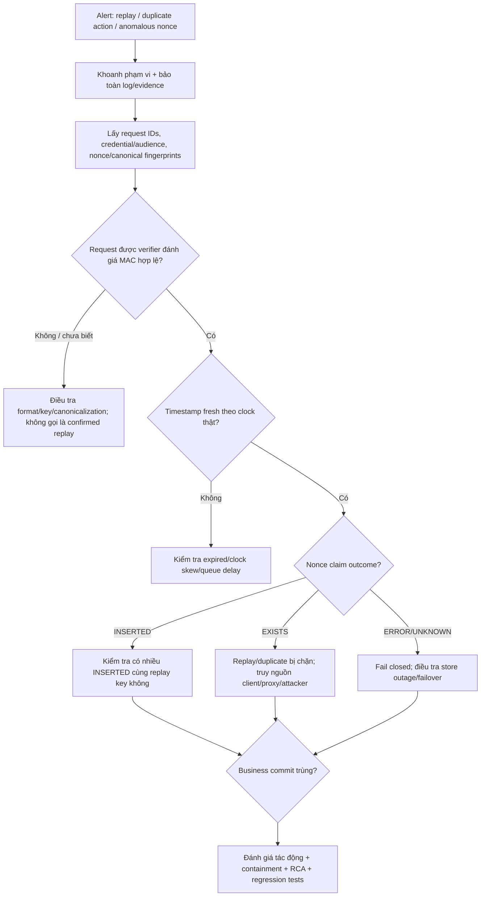

# Điều tra replay: Phân tích bằng chứng, truy vết và khắc phục sự cố HTTP HMAC

Khi hệ thống ghi nhận `NONCE_REPLAY`, không thể lập tức khẳng định có kẻ tấn công. Cùng một dấu hiệu có thể xuất phát từ **attacker phát lại request**, client tự retry sau timeout, gateway gửi trùng, nhiều tầng cùng xác minh nonce, hoặc hạ tầng lưu nonce hoạt động không nhất quán. Ngược lại, **không có cảnh báo replay cũng không chứng minh hệ thống an toàn**: nếu hai gateway cùng chấp nhận một nonce do lỗi race hoặc store bị mất dữ liệu, không có bước từ chối nào để ghi lại.

**Điều tra replay** là quá trình thu thập và đối chiếu bằng chứng từ HTTP ingress, bộ xác minh HMAC, credential registry, đồng hồ, nonce store, API gateway và hệ thống nghiệp vụ để trả lời: *Request nào được gửi/nhận? Đã xác minh những gì? Nonce đã được claim tại đâu? Bao nhiêu lần request đi tới nghiệp vụ? Nguyên nhân có khả năng nhất và rủi ro còn tồn tại là gì?*

Bài này thuộc chương **Replay protection** của module `SECURITY_AUTHENTICATION_HMAC_REQUEST_AUTHENTICATION`. Module hướng dẫn thiết kế xác thực HTTP request bằng **shared secret**, canonical request ký method, URI, header hoặc body theo hợp đồng, xác minh chữ ký, chống replay bằng timestamp/nonce, quản lý key rotation, kiểm thử proxy/gateway và phân biệt **authentication** với **authorization**. Trọng tâm bài học **không chỉ là chặn replay**, mà là **điều tra replay có hệ thống, có bằng chứng và tránh suy đoán**.

## 1. Mục tiêu học tập

Sau bài, bạn có thể:

1. Nhận biết các tín hiệu `NONCE_REPLAY`, duplicate business action, claim conflict, clock skew và store outage; phân biệt **dấu hiệu**, **giả thuyết** và **kết luận**.
2. Xây **timeline đa hệ thống** theo request ID, nonce fingerprint, credential, signed timestamp, điểm xác minh và trạng thái side effect.
3. Chẩn đoán nguyên nhân: replay thật, retry hợp lệ, proxy retry, duplicate header, **check-then-put race**, TTL nonce quá ngắn, failover/eviction, định tuyến sai audience, clock drift và key rotation.
4. Kiểm chứng thứ tự xác thực **MAC → freshness → atomic nonce claim → authenticated principal → authorization → business handler**.
5. Xác định bằng chứng cần giữ và cách ghi log **không lộ secret, signature đầy đủ, raw body nhạy cảm hay nonce không cần thiết**.
6. Viết chương trình Java 17 **phân tích nhật ký bằng chứng đã lọc**, nhóm các sự kiện cùng nonce và tách replay bị chặn với nguy cơ **double accept** hoặc **double business commit**.
7. Đề xuất biện pháp containment, remediation, regression tests và quan sát sau khắc phục.
8. Phân biệt **xác thực request**, **chống replay** và **idempotency nghiệp vụ** khi lập báo cáo sự cố.

## 2. Định nghĩa chính xác vấn đề cần điều tra

Trong HMAC request authentication, một request đã ký gồm các dữ liệu thường gặp:

```http
POST /v1/orders?channel=partner HTTP/1.1
Host: api.example.test
Content-Type: application/json
X-Key-Id: partner-a-202611
X-Timestamp: 2026-11-28T02:00:00Z
X-Nonce: Zq8DxKtUokcwPGNj3d_yvQ
X-Signature: v1=<BASE64_HMAC_SHA256_FULL_TAG>

{"sku":"BK-42","quantity":2}
```

Chữ ký được tính trên **canonical request bytes** theo hợp đồng. Nếu kẻ tấn công có bản sao nguyên request, họ có thể gửi lại mà **không cần biết shared secret**. Khi những byte được ký không đổi, HMAC vẫn hợp lệ.

Cơ chế bảo vệ thường yêu cầu:

- **Timestamp đã ký** nằm trong cửa sổ thời gian, ví dụ ±300 giây so với đồng hồ server.
- **Nonce đã ký** phải là giá trị mới trong phạm vi `(audience, keyId)` hoặc phạm vi principal đã định nghĩa.
- **Nonce claim nguyên tử** xảy ra trong store dùng chung, sau MAC/freshness và trước side effect.
- **Audience/method/raw URI/body digest** được ký để ngăn đổi hành động hoặc phát lại sang môi trường khác.
- **Credential ACTIVE** và key policy phải được kiểm tra; một key bị revoke không được chấp nhận chỉ vì MAC từng đúng.

Trong điều tra, cần phân biệt các trạng thái:

| Trạng thái quan sát được | Có ý nghĩa gì? | Chưa chứng minh điều gì? |
| --- | --- | --- |
| Signature Base64 parse được | Header phù hợp wire encoding. | **Chưa chứng minh** HMAC đúng. |
| `MAC_VALID` | Các thành phần **đã ký** khớp secret đã chọn. | Chưa chứng minh freshness, nonce mới hoặc đủ quyền. |
| `TIMESTAMP_FRESH` | Signed timestamp còn trong cửa sổ. | Chưa chứng minh request chưa từng được dùng. |
| `NONCE_ALREADY_EXISTS` | Store báo nonce key đã được claim trước đó. | **Không tự chứng minh** kẻ tấn công; client/proxy retry cũng tạo dấu hiệu này. |
| `NONCE_CLAIMED` | Một verifier được phép tiếp tục sau khi claim thành công. | Chưa chứng minh nghiệp vụ đã commit. |
| `BUSINESS_COMMITTED` | Một side effect đã được ghi nhận tại tầng nghiệp vụ. | Không thể suy ra mọi lần commit đều là replay cùng nonce. |
| `CLAIM_OUTCOME_UNKNOWN` | Không biết chắc thao tác store có thành công trước timeout. | Không được coi request an toàn để tiếp tục xử lý. |

**Nguyên tắc điều tra:** từ một dòng `401 replay` không được suy ra “đã xảy ra thiệt hại” hay “attacker X là thủ phạm”. Phải có **chuỗi bằng chứng độc lập** từ request ingress, nonce claim và business state.

## 3. Các kiểu sự cố dễ bị nhầm là replay

| Hiện tượng | Dạng lỗi/tấn công có thể có | Điểm phân biệt cần tìm |
| --- | --- | --- |
| Cùng `nonce`, `keyId` và canonical digest được nhận hai lần | Phát lại nguyên request; retry của client/proxy; queue redelivery. | Request IDs, source path, transport logs, claim outcomes, retry settings. |
| Hai request khác nonce nhưng cùng ý định tạo đơn | Retry hợp lệ ở tầng authentication, nhưng thiếu **idempotency**. | `Idempotency-Key`, business intent ID, transaction/unique constraint. |
| Hai verifier đều báo claim thành công cho cùng nonce | Race, store phân mảnh, failover mất key, namespace không thống nhất hoặc audit sai. | Storage command/result, instance/region, retention, exact replay namespace. |
| Nonce bị báo trùng nhưng không thấy lần đầu | Log thiếu, lần đầu nằm ngoài retention, key trùng do client bug, request đến gateway khác. | Độ bao phủ log, khoảng thời gian, key-space scope và độ tin cậy của dữ liệu. |
| Một request `MAC_INVALID` rồi request khác cùng nonce `MAC_VALID` | Request giả thử chiếm nonce; proxy mutation; lỗi SDK. | Kiểm tra MAC sai **không được claim nonce**. |
| Tỷ lệ `EXPIRED`/`TOO_EARLY` tăng đột biến | NTP/clock skew, timestamp theo mili-giây, queue delay, time zone. | Signed timestamp so với **đồng hồ của verifier**. |
| `REPLAY` xuất hiện tại backend ngay sau khi gateway xác minh thành công | Cả gateway và backend có thể **claim cùng nonce hai lần**. | Ownership của bước nonce claim và trust contract giữa tầng. |
| Request cũ được chấp nhận sau khi Redis restart | Mất nonce state, eviction, TTL quá ngắn hoặc partition. | Logs failover, key expiry, persistence/replication policy. |
| MAC fail chỉ ở một vùng/route | Proxy rewrite method/URI/query/header/body, key registry/algorithm khác version. | Canonical byte test vector tại từng điểm tin cậy. |
| Nhiều signature với cùng key và target trên các region | Có thể là lưu lượng bình thường hoặc cross-region replay. | Audience, principal, credential deployment, nonce namespace và business traces. |

### “Replay detected” không đồng nghĩa “replay succeeded”

Nếu nonce store trả `EXISTS` và gateway **từ chối trước business handler**, đây là một sự kiện replay/duplicate **đã bị chặn**. Nếu backend cũng đã thực thi side effect lần hai, phải xác minh **side effect ấy thuộc request nào**, có đúng cùng nonce hay do **request mới khác nonce** được authenticated.

Một cảnh báo replay có thể phản ánh **cơ chế phòng vệ đang hoạt động đúng**. Ngược lại, một đơn hàng được tạo hai lần chưa chắc chứng minh nonce store lỗi: client có thể gửi **hai attempt với nonce khác nhau**.

## 4. Preflight điều tra: khoanh vùng và bảo toàn bằng chứng

Khi nhận cảnh báo hoặc báo cáo “request bị replay”, hãy xác định phạm vi trước khi tìm thủ phạm:

1. **Service/audience:** production hay staging? `orders-api-prod` hay một audience khác? Có dùng chung secret/registry không?
2. **Credential:** key ID nào, client/principal nào đã được xác minh, trạng thái ACTIVE/REVOKED tại từng thời điểm?
3. **Hành động:** method, raw target, route thực thi, loại side effect, tenant/resource chịu ảnh hưởng.
4. **Khoảng thời gian:** server receive time, signed timestamp, clock skew và thời gian retention log/store.
5. **Điểm xác minh:** edge, gateway, sidecar, backend? Có lớp nào claim nonce trùng nhau?
6. **Quy mô:** một request, một client SDK version, một vùng, hay nhiều gateway sau deploy mới?
7. **Tình trạng nghiệp vụ:** side effect đã commit chưa? Có thể đối soát để xác định tác động không?
8. **Độ tin cậy bằng chứng:** log từ nguồn nào, có đủ request ID/trace ID hay bị sampler bỏ? Đồng hồ các node đã đồng bộ?

### Bảo toàn đúng bằng chứng

Giữ dữ liệu có tính pháp chứng hoặc audit theo quy định tổ chức: sự kiện ingress, verifier decision, store claim result, deployment/config version, key registry state lịch sử, gateway changes, DB transaction/audit và clock-health metrics. Ghi rõ **nguồn, thời gian thu thập, độ đầy đủ và quyền truy cập**, bảo đảm retention phù hợp.

**Không sao chép shared secret, signature production đầy đủ, raw body chứa PII hoặc header Authorization vào ticket/chat chung** để tiện debug. Dùng dữ liệu đã lọc, fingerprint có khóa dành riêng cho audit và test vector giả. Khi bắt buộc cần lưu mẫu raw request vì điều tra bảo mật, phải theo quy trình quản lý bằng chứng được phê duyệt, mã hóa, hạn chế quyền và thời gian giữ.

## 5. Hợp đồng HMAC phải được biết trước khi phân tích log

Đừng đánh giá `MAC_VALID` dựa trên cách *bạn nghĩ* request nên được ký. Cần biết **chính xác hợp đồng đã dùng** tại thời điểm xảy ra sự cố.

Bài dùng một hợp đồng minh họa `HMAC-SHA256-V1`:

| Thành phần | Quy tắc |
| --- | --- |
| Algorithm | `HmacSHA256`, full 32-byte tag. |
| Signature wire | `X-Signature: v1=<Base64 chuẩn có padding>`, 44 ký tự Base64/47 ký tự cả prefix. |
| Audience | `orders-api-prod`, là dòng cố định trong chuỗi ký. |
| Method | Chính xác `POST` (test endpoint). |
| Raw request target | Chính xác `/v1/orders?channel=partner`. |
| Signed headers | `Content-Type`, `X-Key-Id`, `X-Timestamp`, `X-Nonce`; tên lowercase, thứ tự cố định. |
| Content-Type | `application/json`, đúng một field value. |
| Content-Encoding | **Không được hiện diện** trong V1. |
| Body digest | SHA-256 trên **raw HTTP content bytes** (sau framing, trước JSON parsing), hex lowercase. |
| Timestamp | UTC `YYYY-MM-DDTHH:mm:ssZ`, cửa sổ `±300s` theo clock verifier. |
| Nonce | 16 byte ngẫu nhiên, Base64URL không padding (22 ký tự), được ký. |
| Canonical encoding | UTF-8, dòng nối LF (`\n`), không LF cuối. |

Canonical request:

```text
HMAC-SHA256-V1
orders-api-prod
POST
/v1/orders?channel=partner
content-type:application/json
x-key-id:partner-a-202611
x-timestamp:2026-11-28T02:00:00Z
x-nonce:Zq8DxKtUokcwPGNj3d_yvQ
sha256:<LOWERCASE_HEX_SHA256_RAW_BODY>
```

Phần `<...>` chỉ là placeholder; không phải digest hoặc MAC thực. Client và server tính:

\[
\begin{aligned}
d &= \operatorname{SHA256}(\mathrm{rawBodyBytes}),\\
C &= \operatorname{UTF8}(\mathrm{canonicalRequest\ containing\ hex}(d)),\\
T &= \operatorname{HMAC}_{\mathrm{SHA256}}(K,C),\\
S &= \texttt{v1=} \Vert \operatorname{Base64}_{\mathrm{standard,padded}}(T).
\end{aligned}
\]

**Để điều tra mismatch:** so sánh thứ tự từng field, **bytes canonical**, signed timestamp/nonce và **body hash** bằng **test data**, không trực tiếp log canonical payload thật. Dấu hiệu như JSON “trông giống nhau”, URI “cùng ý nghĩa” hoặc signature Base64 có độ dài đúng **không chứng minh** bytes ký giống nhau.

### Canonicalization và replay là hai tầng khác nhau

Nếu request bị đổi một byte raw body nhưng giữ signature, thường là **MAC mismatch**, không phải replay thành công. Nếu mọi dữ liệu ký giống nhau và được gửi lại, MAC đúng; kiểm soát replay phải **từ chối bằng nonce/timestamp**, không cố giải quyết bằng việc đổi cách canonicalize JSON.

## 6. Thiết kế sự kiện audit đủ để dựng timeline

Một bản ghi `NONCE_REPLAY` chỉ có timestamp và text “duplicate” là chưa đủ. Nên lưu **sự kiện định dạng ổn định** tại các cột kiểm soát, với những giá trị được phép log theo chính sách.

| Field đề xuất | Ví dụ giả | Phục vụ điều tra |
| --- | --- | --- |
| `request_id` | `req-A1` | Phân biệt từng lần HTTP ingress nhận. |
| `trace_id` | `trace-41` | Ghép gateway → backend → database/queue. |
| `received_at_utc` | `2026-11-28T02:00:10Z` | Timeline tại verifier, đối chiếu clock. |
| `gateway_id` / `region` | `gw-sg-01` | Phát hiện khác biệt theo node/region. |
| `audience` / `scheme_version` | `orders-api-prod` / `HMAC-SHA256-V1` | Phân tách môi trường và protocol. |
| `credential_alias` | `partner-a (pseudonym)` | Nhóm sự kiện theo credential **đã xác minh** hoặc lookup label đã lọc. |
| `signed_timestamp` hoặc `clock_delta_seconds` | `2026-11-28T02:00:00Z` / `+10` | Kiểm tra freshness; dữ liệu vẫn cần chính sách lưu. |
| `nonce_fingerprint` | `hmac(auditKey, namespace+nonce)[:16]` | Ghép các request cùng nonce mà không ghi raw nonce. |
| `canonical_fingerprint` | `hmac(auditKey, canonicalBytes)[:16]` | Nhận biết cùng dữ liệu ký ở các lần gửi. |
| `mac_status` | `VALID` / `INVALID` | Phân biệt lỗi ký với replay. |
| `freshness_status` | `FRESH` / `EXPIRED` | Kiểm tra timestamp trước claim. |
| `nonce_claim_status` | `INSERTED` / `EXISTS` / `ERROR` / `NOT_ATTEMPTED` | Điểm quyết định chống replay. |
| `auth_result` | `AUTHENTICATED` / `REJECTED` / `UNAVAILABLE` | Bất biến không tạo principal khi thất bại. |
| `business_intent_id` (nếu có) | `intent-742` | Phân biệt retry nghiệp vụ với replay cùng nonce. |
| `business_effect` | `COMMITTED` / `NOT_STARTED` / `UNKNOWN` | Xác định tác động thực tế thay vì suy từ HTTP status. |
| `config_version` / `store_cluster` | `auth-v1.8` / `redis-a` | Gắn lỗi với rollout, shard, failover. |

**Fingerprint cho điều tra không phải chữ ký xác thực.** Có thể dùng `HMAC-SHA256` với **audit key riêng**, rồi giữ một đoạn fingerprint đủ dài (ví dụ 128 bit) để liên kết sự kiện theo chính sách. Không dùng shared secret của client để tạo fingerprint log, không phát tán audit key và không coi fingerprint là bằng chứng mật mã để chấp nhận request.

Đặc biệt, không ghi toàn bộ nonce, MAC, digest của dữ liệu nhạy cảm hoặc raw body một cách mặc định. Hash không có khóa của dữ liệu ít entropy (ví dụ số đơn hàng) cũng có thể lộ thông tin qua đoán trước; **HMAC audit key riêng** an toàn hơn cho việc tương quan trong phạm vi được ủy quyền. Nếu audit key được rotation, cần có chiến lược version/khả năng nối sự kiện qua khoảng thời gian điều tra.

### Không dùng IP hoặc User-Agent để kết luận ai tấn công

NAT, proxy, CDN, egress gateway và retry middleware có thể làm cùng client xuất hiện từ nhiều IP; ngược lại nhiều người có thể chia sẻ một IP. IP/ASN, User-Agent, mTLS client identity và địa điểm mạng là **tín hiệu bổ sung**, không tự chứng minh một actor đã replay request. Điều tra cần đối chiếu **bằng chứng xác thực, store và thực thi**, rồi mới đánh giá nguồn phát.

## 7. Dựng timeline: một ví dụ có replay bị chặn

Giả sử policy cho phép signed timestamp trong khoảng `±300` giây, với request được ký tại `T=02:00:00Z`. Các sự kiện sau đều **giả lập**:

| UTC nhận | Request ID | Gateway | Nonce FP | Canonical FP | MAC / Freshness | Claim | Business |
| --- | --- | --- | --- | --- | --- | --- | --- |
| `02:00:10Z` | `req-101` | `gw-a` | `N-77` | `C-18` | VALID / FRESH | **INSERTED** | **COMMITTED** một đơn. |
| `02:00:11Z` | `req-102` | `gw-b` | `N-77` | `C-18` | VALID / FRESH | **EXISTS** | **NOT_STARTED**. |
| `02:00:12Z` | `req-103` | `gw-a` | `N-77` | `C-18` | VALID / FRESH | **EXISTS** | **NOT_STARTED**. |
| `02:00:20Z` | `req-104` | `gw-a` | `N-88` | `C-27` | VALID / FRESH | **INSERTED** | Cần kiểm tra idempotency. |
| `02:05:01Z` | `req-105` | `gw-b` | `N-77` | `C-18` | VALID / **EXPIRED** | NOT_ATTEMPTED | NOT_STARTED. |

Từ bảng này có thể kết luận ở phạm vi **log đang có**:

- `req-102` và `req-103` là hai **lần nhận trùng cùng nonce và cùng canonical fingerprint**, bị chặn bởi store.
- Bảng **không chứng minh** `req-102`/`req-103` do attacker; chúng có thể đến từ retry/queue hoặc người xấu phát lại.
- `req-104` có nonce mới, nên **không phải replay cùng nonce**, dù có thể vẫn là **trùng ý định nghiệp vụ** nếu business intent bằng `req-101`.
- `req-105` bị từ chối freshness trước claim. Không nên yêu cầu nonce store phải giữ key mãi mãi sau thời điểm request không thể được chấp nhận.

**Thứ tự log là bằng chứng có giới hạn:** nếu clock của `gw-a` lệch `gw-b` 2 giây, việc sắp xếp chỉ theo `received_at_utc` có thể đảo thứ tự. Claim store/DB có thể có mốc thời gian riêng; cần hiệu chỉnh clock skew và ưu tiên event IDs/transaction sequence khi quyết định request nào thật sự thắng claim.

## 8. Quy trình điều tra từng bước



### Bước 1 — Xác định alert có gắn với request nhận thực sự không

Kiểm tra alert do verifier phát hành hay do dashboard ước lượng từ HTTP response `401`. Một số API có thể dùng `401` cho **invalid signature, expired, unknown credential hoặc nonce replay**. Một tỷ lệ `401` tăng **không đủ để kết luận replay**.

Lấy request ID, trace ID, các internal reason codes và nguồn phát event. Xác định data pipeline có thể **gửi log trùng** khi retry (at-least-once delivery); hai audit rows giống hệt event ID không nhất thiết là hai HTTP attempts.

### Bước 2 — Xác minh credential và canonical contract

Tra policy/version và trạng thái credential ở **thời điểm xảy ra sự cố**, không chỉ trạng thái hiện tại. Trong giai đoạn key rotation, cùng client có thể gửi bằng hai key ID ACTIVE. Nếu key đã revoked, authentication phải từ chối trước khi cấp principal.

Với MAC mismatch, kiểm tra method, raw target/query, header name/value, content coding, UTF-8, raw body digest và audience bằng **test vector không nhạy cảm**. Đừng “thử nhiều key hoặc nhiều URI cho tới khi khớp” trong verifier production để xác minh giả thuyết.

### Bước 3 — So signed timestamp với clock thực tại điểm nhận

Tính `clock_delta = receivedAt - signedTimestamp` theo đúng độ chính xác và policy của endpoint. Nếu timestamp là UTC `Z`, không tự coi giờ địa phương của dashboard là UTC. Kiểm tra NTP/chrony, drift, leap correction, thời gian queue và điểm mà HTTP filter lấy `now`.

Phân biệt `MAC_VALID + EXPIRED` với `MAC_INVALID`: đổi timestamp bằng proxy để “giúp request mới” chỉ làm MAC sai. Nếu request hết hạn, client phải tạo attempt mới với nonce mới và ký lại.

### Bước 4 — Tra nonce claim result, không chỉ đọc `GET key` hiện tại

Một `GET` hiện tại trả nil có thể có nhiều giải thích: key chưa từng được claim, key đã **hết hạn đúng thời điểm**, đã bị evict, failover mất dữ liệu hoặc bạn hỏi nhầm shard/namespace. Không thể suy lịch sử chỉ từ trạng thái hiện tại.

Đối chiếu **atomic claim response lúc nhận**, cấu hình cluster/namespace, expiry/TTL đã ghi, event store, snapshot/failover logs và version policy. Với Redis, tính xem client/gateway thực sự gọi `SET NX PX` trên **cùng key** hay không. Với DB, kiểm tra unique constraint và transaction commits.

### Bước 5 — Dựng chuỗi effect tại backend

Kiểm tra authorization, business request ID, `Idempotency-Key` nếu có, DB transaction IDs, order/payment IDs, event/outbox. Đừng dựa duy nhất vào HTTP status: gateway có thể trả timeout trong khi backend đã commit, hoặc một `201` có thể được client nhìn thấy hai lần qua retry ở tầng kết nối.

Cần xác nhận **có bao nhiêu side effect**, thuộc cùng intent hay cùng replay key. Nếu phát hiện hai commit, ưu tiên kiểm soát tác động nghiệp vụ/đối soát theo quy trình được ủy quyền.

### Bước 6 — Xếp loại theo mức chắc chắn của bằng chứng

Một báo cáo chất lượng nên có các mức như:

- **Đã quan sát duplicate attempt bị chặn:** cùng nonce fingerprint, MAC valid, claim thứ hai `EXISTS`, không có side effect thứ hai trong phạm vi logs.
- **Nghi ngờ replay do bên thứ ba:** có dấu hiệu nhiều nguồn truy cập khác nhau **và** bằng chứng request duplicate, nhưng attribution chưa chắc chắn.
- **Nghi ngờ bypass replay control:** nhiều `INSERTED` cho cùng replay key trong cùng thời gian, hoặc hai commit sau trạng thái được chấp nhận; cần xác minh loss/race/namespace.
- **Retry/idempotency issue:** nonce khác, chữ ký khác, cùng business intent, tạo side effect trùng.
- **Chưa đủ kết luận:** thiếu log, clock skew chưa đo, outcome store unknown hoặc registry/policy lịch sử không có.

**Không suy diễn mức “tấn công đã được xác nhận” chỉ từ mã `NONCE_REPLAY`.**

## 9. Ma trận chẩn đoán nguyên nhân gốc

| Bằng chứng then chốt | Giả thuyết ưu tiên | Cần loại trừ |
| --- | --- | --- |
| MAC valid, cùng nonce/keyId/canonical FP, lần đầu INSERTED, lần sau EXISTS | Duplicate attempt đã bị chặn. | Client retry, proxy retry, attacker replay, log trùng. |
| Hai INSERTED cho **cùng replay key** trên hai gateway | Store không chia sẻ hoặc atomicity/retention bị phá. | Có phải audit event duplicate? Có dùng khác audience/key namespace? |
| Hai INSERTED cách nhau sau Redis restart/failover | Mất nonce state hoặc TTL quá ngắn. | Policy clock đã hết hiệu lực đúng lúc chưa? |
| Nonce key khác nhưng cùng body + business intent | Idempotency/retry issue, không phải replay cùng nonce. | User thực sự muốn hai giao dịch khác nhau? |
| Nonce EXISTS ở backend ngay sau edge success | Có hai lớp cùng claim nonce một lần. | Backend có đang xác minh một credential/audience khác hợp lệ? |
| NONCE_REPLAY chủ yếu từ một SDK version | Retry logic hoặc generator nonce lỗi. | Có đồng thời abuse từ ngoài? CSPRNG seed/clone state? |
| EXPIRED tăng mạnh chỉ ở một region | Clock drift hoặc queue delay. | Client timestamp có đúng định dạng? NTP/clock health? |
| INVALID_SIGNATURE tăng sau deploy gateway | Rewrite raw target/body/signed headers hoặc key registry mismatch. | Client SDK vừa đổi serializer? |
| Key ID đổi trong rotation, cùng client gửi request | Replay namespace chuyển theo key ID hoặc credential mismatch. | Same business intent qua hai credential? |
| Nonce store logs không có claim nhưng business commit | Bypass verifier hoặc thiếu audit/hệ thống cũ. | Logs bị sampling? Side effect thuộc request khác? |

**Điểm then chốt:** một *claim conflict* có thể cho thấy store đang ngăn replay đúng; một *double claim success* cùng key có thể là lỗi nghiêm trọng. Nhưng phải xác nhận hai success thật sự áp dụng **cùng namespace/key** và đến từ hai HTTP attempts khác nhau, không phải các bản sao của một log event.

## 10. Điều tra race và store consistency

Một thiết kế dễ bị race:

```java
// KHÔNG an toàn khi nhiều thread / nhiều gateway:
if (!nonceStore.contains(nonceKey)) {
    nonceStore.put(nonceKey, expiresAt);
    processBusinessRequest();
}
```

Hai gateway có thể cùng đọc “chưa tồn tại” và cùng ghi/tiếp tục. Log đơn lẻ trên từng node không thể chứng minh uniqueness toàn cụm.

### Dấu vết cần tìm

- Hai `nonce_claim_status=INSERTED` có cùng **replay key fingerprint** nhưng khác `request_id`.
- Hai gateway sử dụng **khác Redis endpoint, database primary, namespace prefix hoặc tenant scope**.
- Claim được triển khai bằng `GET` rồi `SET`/`INSERT` thay vì atomic command.
- Store key bị evict hoặc đã cleanup trước expiry.
- Timeout xảy ra sau khi thao tác claim ghi thành công nhưng trước khi caller nhận response.
- Một instance fallback sang memory local khi distributed store lỗi.
- Replica read lạc hậu được dùng làm cơ sở quyết định trước khi insert.

### Cấu trúc atomic claim

Ví dụ Redis mang tính mô tả:

```text
SET replay:v1:orders-api-prod:<keyId>:<nonce> used NX PX <ttlMs>
```

`NX` chỉ ghi khi key chưa có; `PX` gắn TTL. **Một lệnh atomic là cần thiết**, nhưng chưa đủ để bảo đảm chống replay qua sự cố: vẫn phải xét eviction, persistence, failover, replication, partition và tuyến kết nối. Với database, một **unique constraint**/insert atomic theo `(audience,keyId,nonce)` có thể phù hợp nếu cần durability mạnh hơn.

**Điều tra timeout:** nếu API call đến store trả lỗi hoặc không biết ghi đã hoàn tất, request phải **fail closed** và không có side effect. Không tự coi timeout là “nonce chưa tồn tại” rồi cho qua, cũng không vô điều kiện retry claim rồi cho business chạy nếu không xác định được trạng thái ban đầu.

## 11. TTL nonce và kiểm tra lỗ hổng thời gian

Hợp đồng minh họa chấp nhận timestamp `T` theo:

\[
\mathrm{now}-P \le T \le \mathrm{now}+F,
\]

trong đó `P = 300s` cho quá khứ và `F = 300s` cho tương lai. Hai biên được xem là **inclusive**.

Một timestamp `T` có thể được chấp nhận sớm nhất lúc `T-F` và muộn nhất lúc `T+P`. Nếu server claim nonce tại lần nhận sớm nhất, cần giữ nonce đến ít nhất:

\[
\mathrm{nonceExpiresAt}=T+P+\mathrm{safetyMargin}.
\]

### Ví dụ kiểm tra sai TTL

```text
Signed timestamp T:             2026-11-28T02:05:30Z
Server nhận sớm nhất:           2026-11-28T02:00:30Z  (T - 300s)
Server còn chấp nhận cuối:      2026-11-28T02:10:30Z  (T + 300s)
Store đặt TTL 300s từ lần đầu:  key biến mất lúc 02:05:30Z
Khoảng rủi ro:                  02:05:30Z → 02:10:30Z
TTL đúng phải giữ đến:          sau 02:10:30Z + margin
```

Từ lần nhận sớm nhất tới lần chấp nhận cuối có thể là **600 giây** trong policy ±300s. Do đó khi điều tra **một request cũ được chấp nhận lại**, kiểm tra thật kỹ cách tính TTL: `300s from now` khác hoàn toàn `signedTimestamp + allowedPast + margin`.

Nếu store sử dụng TTL tương đối, phải tính `ttl = expiresAt - serverNow`, làm tròn an toàn, kiểm tra overflow và bảo vệ khỏi TTL bằng 0 khi timestamp vẫn fresh ở biên. Phải hiểu quy tắc hết hạn TTL và clock của store, không đơn thuần dựa vào đồng hồ ứng dụng.

### Một entry hết hạn sau khi request không còn hợp lệ

Việc kho không còn nonce vài giờ sau sự kiện **không tự chứng minh lỗi**. Nếu request đã `EXPIRED`, verifier phải từ chối **trước khi thử claim nonce**, nên entry có thể được cleanup bình thường. Investigation cần timeline lịch sử để phân biệt **cleanup đúng** với **xóa quá sớm**.

## 12. Đối chiếu với retry, idempotency và side effect nghiệp vụ

Đây là phần thường gây kết luận sai nhất.

| Sự kiện | Nonce | Signature | Business intent | Replay-control outcome |
| --- | --- | --- | --- | --- |
| Client gửi request lần đầu | `N1` | `S1` | `Order-742` | Được claim nếu mới. |
| Gateway gửi lại **nguyên request** | **`N1`** | **`S1`** | `Order-742` | **REPLAY** nếu lần đầu đã claim. |
| Client chủ động retry đúng contract | **`N2`** | **`S2`** | **`Order-742`** | Có thể authenticated, vì nonce mới. |
| Client thực hiện đơn thứ hai | `N3` | `S3` | `Order-743` | Có thể authenticated và được xử lý. |
| Attacker sửa body nhưng giữ chữ ký cũ | `N1` | `S1` | Bất kỳ | **MAC mismatch**, không phải replay được chấp nhận. |

**Giả định nguy hiểm:** “Hai `201 Created` nghĩa là replay protection thất bại.” Thực tế, nếu hai request có nonce khác, cả hai có thể vượt authentication chính xác. Lúc này cần kiểm tra **idempotency key, unique business constraint, DB transaction, outbox và retry behavior**, không chỉ nonce store.

### Cần ký `Idempotency-Key` không?

Nếu idempotency key ảnh hưởng quyết định backend có thực hiện side effect hay không, nó nên được **ràng buộc vào canonical request theo một protocol/endpoint contract có phiên bản rõ**. Không tự thêm header vào V1 cũ rồi kỳ vọng signature vẫn khớp. Một hợp đồng mở rộng có thể yêu cầu header `X-Idempotency-Key` duy nhất được ký, với server dedupe theo authenticated principal, method, raw URI và fingerprint body.

### Khi business trả 403/422 sau nonce claim

Nonce đã dùng tại cổng authentication. Không “hoàn lại” nonce chỉ vì authorization từ chối hoặc JSON validation lỗi; việc xóa entry để thử lại signature cũ mở ra replay/race. Client gửi attempt mới với timestamp/nonce/signature mới, và idempotency quản lý ý định nghiệp vụ nếu cần.

## 13. Java 17: phân tích audit evidence mà không log dữ liệu mật

Ví dụ sau **tự chạy với Java 17**; nó không truy cập API thật, Redis hay bí mật production. Mục tiêu là **phân tích các sự kiện đã được verifier phát hành**, thay vì lặp lại toàn bộ bộ xác minh HMAC.

Các sự kiện giả lập có:

- `requestId` và giờ nhận từ verifier;
- `gatewayId` và `credentialAlias` đã lọc;
- **`nonceFp`**: fingerprint ổn định của replay key dùng **audit key riêng**;
- **`canonicalFp`**: fingerprint ổn định của canonical bytes đã ký;
- trạng thái MAC, freshness, nonce claim và side effect;
- **business intent** giả định để phát hiện một loại lỗi khác: retry tạo trùng nghiệp vụ.

Class `ReplayInvestigationDemo` nhóm theo **credential + nonce fingerprint**, cảnh báo nếu một nonce có nhiều `INSERTED` hoặc nhiều `COMMITTED`; đồng thời nhóm theo business intent để phát hiện hai commit với **nonce khác nhau**. Kết quả là **hướng điều tra**, không phải kết luận về actor tấn công.

```java
import java.nio.charset.StandardCharsets;
import java.security.GeneralSecurityException;
import java.time.Instant;
import java.util.ArrayList;
import java.util.Arrays;
import java.util.Base64;
import java.util.Comparator;
import java.util.HashMap;
import java.util.List;
import java.util.Map;
import javax.crypto.Mac;
import javax.crypto.spec.SecretKeySpec;
import java.util.HexFormat;

public final class ReplayInvestigationDemo {
    private ReplayInvestigationDemo() {}

    public enum MacStatus { VALID, INVALID, NOT_CHECKED }
    public enum Freshness { FRESH, EXPIRED, TOO_EARLY, UNKNOWN }
    public enum Claim { INSERTED, EXISTS, ERROR, NOT_ATTEMPTED }
    public enum Effect { COMMITTED, NOT_STARTED, UNKNOWN }

    /**
     * Synthetic audit event. Fields have already been filtered by
     * trusted ingress / verifier instrumentation.
     */
    public record Evidence(
            String requestId,
            Instant receivedAt,
            String gatewayId,
            String credentialAlias,
            String nonceFp,
            String canonicalFp,
            String businessIntent,
            MacStatus mac,
            Freshness freshness,
            Claim claim,
            Effect effect) {}

    /**
     * Keyed correlation tag; auditKey is NOT a client HMAC credential.
     * Truncation to 16 bytes is ONLY for telemetry fingerprinting,
     * never for accepting or authenticating a request.
     */
    public static String auditFingerprint(byte[] auditKey, byte[] data)
            throws GeneralSecurityException {
        Mac mac = Mac.getInstance("HmacSHA256");
        mac.init(new SecretKeySpec(auditKey, "HmacSHA256"));
        byte[] tag = mac.doFinal(data);
        return HexFormat.of().formatHex(Arrays.copyOf(tag, 16));
    }

    public static String nonceFingerprint(
            byte[] auditKey, String audience, String keyId, String nonce)
            throws GeneralSecurityException {
        // Data is synthetic; use canonical, length-delimited
        // serialization for general-purpose production namespaces.
        String namespace = audience + "\n" + keyId + "\n" + nonce;
        return auditFingerprint(
                auditKey, namespace.getBytes(StandardCharsets.UTF_8));
    }

    private static String label(String key, List<Evidence> events) {
        // Never log raw nonce / secret / full wire signature.
        return "key=" + key + ", events=" + events.size();
    }

    public static void investigate(List<Evidence> audit) {
        Map<String, List<Evidence>> byNonce = new HashMap<>();
        Map<String, List<Evidence>> byIntent = new HashMap<>();

        for (Evidence e : audit) {
            if (e.nonceFp() != null) {
                String key = e.credentialAlias() + "/" + e.nonceFp();
                byNonce.computeIfAbsent(key, ignored -> new ArrayList<>())
                        .add(e);
            }
            if (e.businessIntent() != null) {
                String key = e.credentialAlias() + "/" + e.businessIntent();
                byIntent.computeIfAbsent(key, ignored -> new ArrayList<>())
                        .add(e);
            }
        }

        System.out.println("=== Nonce investigation ===");
        for (var entry : byNonce.entrySet()) {
            List<Evidence> events = entry.getValue();
            events.sort(Comparator.comparing(Evidence::receivedAt)
                    .thenComparing(Evidence::requestId));
            long inserted = events.stream()
                    .filter(e -> e.claim() == Claim.INSERTED).count();
            long exists = events.stream()
                    .filter(e -> e.claim() == Claim.EXISTS).count();
            long committed = events.stream()
                    .filter(e -> e.effect() == Effect.COMMITTED).count();
            long claimErrors = events.stream()
                    .filter(e -> e.claim() == Claim.ERROR).count();

            if (inserted > 1) {
                System.out.println("CRITICAL investigation: "
                        + label(entry.getKey(), events)
                        + ", claim INSERTED multiple times");
                System.out.println(
                        "  Check store namespace, atomicity, TTL, failover, "
                        + "gateway ownership and audit duplication.");
            } else if (inserted == 1 && exists >= 1) {
                System.out.println("Duplicate attempt(s) blocked: "
                        + label(entry.getKey(), events));
                System.out.println(
                        "  Determine client/proxy retry versus malicious replay "
                        + "using other independent evidence.");
            } else if (exists >= 1) {
                System.out.println("Prior claim not visible in this slice: "
                        + label(entry.getKey(), events));
                System.out.println(
                        "  Check log retention and cross-region tracing.");
            }

            if (committed > 1) {
                System.out.println("CRITICAL business investigation: "
                        + label(entry.getKey(), events)
                        + ", multiple COMMITTED effects on same nonce.");
            }
            if (claimErrors > 0) {
                System.out.println("Store error/unknown outcome: "
                        + label(entry.getKey(), events)
                        + "; verify fail-closed behavior.");
            }
        }

        System.out.println("=== Business intent investigation ===");
        for (var entry : byIntent.entrySet()) {
            List<Evidence> events = entry.getValue();
            long commits = events.stream()
                    .filter(e -> e.effect() == Effect.COMMITTED).count();
            long distinctNonces = events.stream()
                    .filter(e -> e.effect() == Effect.COMMITTED)
                    .map(Evidence::nonceFp).distinct().count();
            if (commits > 1 && distinctNonces > 1) {
                System.out.println("Potential idempotency failure: intent="
                        + entry.getKey() + ", commits=" + commits
                        + ", distinct nonces=" + distinctNonces);
                System.out.println(
                        "  Authentication replay store may be correct; "
                        + "check deduplication and transaction IDs.");
            }
        }
    }

    public static void main(String[] args) throws Exception {
        // Audit key is synthetic and distinct from client shared secrets.
        byte[] auditKey = new byte[32];
        Arrays.fill(auditKey, (byte) 0x61);

        String scope = "orders-api-prod";
        String key = "partner-a-202611";
        String nonce1 = Base64.getUrlEncoder().withoutPadding()
                .encodeToString(new byte[16]); // Synthetic fixture ONLY.
        String nonce2 = Base64.getUrlEncoder().withoutPadding()
                .encodeToString(new byte[] {
                    1, 2, 3, 4, 5, 6, 7, 8,
                    9, 10, 11, 12, 13, 14, 15, 16
                });
        String nonce3 = Base64.getUrlEncoder().withoutPadding()
                .encodeToString(new byte[] {
                    16, 15, 14, 13, 12, 11, 10, 9,
                    8, 7, 6, 5, 4, 3, 2, 1
                });

        String n1 = nonceFingerprint(auditKey, scope, key, nonce1);
        String n2 = nonceFingerprint(auditKey, scope, key, nonce2);
        String n3 = nonceFingerprint(auditKey, scope, key, nonce3);

        String canonical1 = auditFingerprint(auditKey,
                "signed-canonical-fixture-1".getBytes(StandardCharsets.UTF_8));
        String canonical2 = auditFingerprint(auditKey,
                "signed-canonical-fixture-2".getBytes(StandardCharsets.UTF_8));
        String canonical3 = auditFingerprint(auditKey,
                "signed-canonical-fixture-3".getBytes(StandardCharsets.UTF_8));

        List<Evidence> events = new ArrayList<>();
        events.add(new Evidence(
                "req-101", Instant.parse("2026-11-28T02:00:10Z"),
                "gw-a", "partner-a", n1, canonical1, "order-742",
                MacStatus.VALID, Freshness.FRESH, Claim.INSERTED,
                Effect.COMMITTED));
        // Same nonce, same canonical request, different gateway.
        events.add(new Evidence(
                "req-102", Instant.parse("2026-11-28T02:00:11Z"),
                "gw-b", "partner-a", n1, canonical1, "order-742",
                MacStatus.VALID, Freshness.FRESH, Claim.EXISTS,
                Effect.NOT_STARTED));
        // Fresh nonce/signature, same business intent:
        // this can cause a second order without idempotency.
        events.add(new Evidence(
                "req-103", Instant.parse("2026-11-28T02:00:20Z"),
                "gw-a", "partner-a", n2, canonical2, "order-742",
                MacStatus.VALID, Freshness.FRESH, Claim.INSERTED,
                Effect.COMMITTED));
        // Synthetic double-accept finding, not an actual attack.
        events.add(new Evidence(
                "req-104", Instant.parse("2026-11-28T02:01:00Z"),
                "gw-a", "partner-a", n3, canonical3, "order-743",
                MacStatus.VALID, Freshness.FRESH, Claim.INSERTED,
                Effect.COMMITTED));
        events.add(new Evidence(
                "req-105", Instant.parse("2026-11-28T02:01:01Z"),
                "gw-b", "partner-a", n3, canonical3, "order-743",
                MacStatus.VALID, Freshness.FRESH, Claim.INSERTED,
                Effect.COMMITTED));
        investigate(events);

        // Sanity checks on the synthetic input itself.
        if (events.size() != 5
                || n1.equals(n2) || n2.equals(n3)
                || canonical1.equals(canonical2)
                || canonical1.equals(canonical3)
                || canonical2.equals(canonical3)) {
            throw new AssertionError("Invalid replay test fixture");
        }
    }
}
```

### Cách đọc kết quả

Chạy `main` trên JDK 17 sẽ in các nhận định ở mức **hướng điều tra**, ví dụ:

```text
=== Nonce investigation ===
Duplicate attempt(s) blocked: key=partner-a/<fingerprint>, events=2
CRITICAL investigation: key=partner-a/<fingerprint>, events=2, claim INSERTED multiple times
CRITICAL business investigation: key=partner-a/<fingerprint>, events=2, multiple COMMITTED effects on same nonce
=== Business intent investigation ===
Potential idempotency failure: intent=partner-a/order-742, commits=2, distinct nonces=2
```

Thứ tự nhóm có thể khác vì `HashMap` không bảo đảm thứ tự lặp; phần `<fingerprint>` chỉ là placeholder cho chuỗi hex 32 ký tự mà chương trình tự tính.

**Cảnh báo quan trọng về diễn giải:**

- Hai sự kiện `INSERTED` trong nhật ký **chưa phải chứng minh tuyệt đối** store đã chấp nhận hai lần: có thể do duplicate log event, mapping key sai hoặc audit bug. Phải đối chiếu storage command/transaction IDs.
- Một business intent có hai `COMMITTED` không tự chứng minh **hai side effect thực sự** nếu event pipeline tự ghi trùng. Kiểm tra DB ledger, order IDs và transaction.
- `auditFingerprint` chỉ tạo **mã tương quan an toàn hơn** cho dữ liệu đã được phép quan sát, **không dùng** để xác minh request. MAC của client vẫn phải tính từ secret credential và canonical request bytes bằng hợp đồng riêng.
- `nonce1` là chuỗi gồm zero bytes được tạo **chỉ cho fixture**; nonce của client production phải sinh bằng CSPRNG, không hardcode.
- Các event được giả lập, không phải bằng chứng từ hệ thống thật; code không truy cập Redis/DB, không so HMAC của request production và không đo clock skew.
- Audit instrumentation phải được **bảo vệ khỏi client giả**, phải phát ra sau khi ingress đã parse và có source-of-truth rõ ràng. Một header do client tự khai như `X-Replay-Status` không phải chứng cứ đáng tin.

## 14. Thêm instrumentation vào Java verifier

Phân tích audit chỉ tốt khi verifier phát ra sự kiện ở đúng **ranh giới quyết định**. Mảnh pseudocode sau mô tả nơi nên ghi nhận kết quả; đây không phải class Java độc lập:

```java
// requestView: HTTP adapter đã kiểm tra framing/duplicate headers.
// credential: registry trả đúng credential ACTIVE; keyId chưa
// trở thành principal trước khi HMAC/freshness/nonce cùng đạt.
VerifiedMac mac = verifier.verifyMac(requestView, credential);

if (!mac.isValid()) {
    audit.emitSecurityEvent(
            requestId, "MAC_INVALID", "CLAIM_NOT_ATTEMPTED");
    return authenticationRejected();
}

Instant now = clock.instant();
Freshness freshness = policy.checkSignedTimestamp(
        requestView.signedTimestamp(), now);
if (!freshness.isAcceptable()) {
    audit.emitSecurityEvent(
            requestId, "TIMESTAMP_REJECTED", "CLAIM_NOT_ATTEMPTED");
    return authenticationRejected();
}

String replayKey = replayNamespace.keyFor(
        policy.audience(), credential.id(), requestView.signedNonce());
Instant expiresAt = requestView.signedTimestamp()
        .plus(policy.allowedPast()).plus(policy.margin());

try {
    // Đây phải là thao tác nguyên tử trên SHARED nonce store.
    ClaimResult claim = nonceStore.claimIfAbsent(replayKey, expiresAt);
    audit.emitClaimResult(
            requestId, replayKey, claim, now, expiresAt);
    if (claim == ClaimResult.EXISTS) {
        return authenticationRejected();
    }
    if (claim != ClaimResult.INSERTED) {
        return authenticationUnavailable(); // Fail closed.
    }
} catch (NonceStoreException error) {
    audit.emitStorageFailure(requestId, "CLAIM_OUTCOME_UNKNOWN");
    return authenticationUnavailable();     // Không tạo principal.
}

TrustedPrincipal principal = credential.toPrincipal();
return authenticationSucceeded(principal);
```

**Không đưa raw replayKey/nonce vào audit log mặc định**: lời gọi `audit.emitClaimResult` ở code minh họa cần được triển khai để **fingerprint/pseudonymize** trước khi lưu. `VerifiedMac`, `Freshness`, `ClaimResult` và các interface là các thành phần kiến trúc giả định.

Hai thời điểm cần phân biệt trong tracing:

- **Authentication accepted:** MAC/freshness/nonce claim thành công, principal được tạo.
- **Business committed:** authorization đã cho phép và transaction/outbox thực sự ghi side effect.

Nếu log chỉ có `201` từ gateway, có thể bỏ sót việc backend commit trước khi timeout hoặc worker xử lý lại event. Dùng transaction/outbox IDs để nối kết thay vì giả định status code là bằng chứng duy nhất.

## 15. Truy vấn điều tra và kiểm chứng giả thuyết

### 15.1. SQL trên bảng audit giả định

Giả sử tổ chức có bảng `security_request_audit` với các cột đã chuẩn hóa và dữ liệu được lưu theo chính sách. Truy vấn **minh họa**, phải chỉnh cho schema và database thật:

```sql
-- Tìm nonce có nhiều claim INSERTED trong một khoảng UTC.
SELECT audience, credential_alias, nonce_fingerprint,
       COUNT(*) AS inserted_events,
       COUNT(DISTINCT request_id) AS distinct_requests
FROM security_request_audit
WHERE received_at_utc >= TIMESTAMP '2026-11-28 02:00:00'
  AND received_at_utc <  TIMESTAMP '2026-11-28 03:00:00'
  AND nonce_claim_status = 'INSERTED'
GROUP BY audience, credential_alias, nonce_fingerprint
HAVING COUNT(DISTINCT request_id) > 1;
```

Kết quả là **các nhóm cần kiểm chứng**, không tự động là double claim đã xác nhận. Xem event IDs, việc log nhân đôi và storage transaction.

```sql
-- Dựng timeline cho một nonce fingerprint đã được phép truy vấn.
SELECT request_id, trace_id, received_at_utc, gateway_id,
       mac_status, freshness_status,
       nonce_claim_status, authentication_result,
       business_intent_id, business_effect
FROM security_request_audit
WHERE audience = 'orders-api-prod'
  AND credential_alias = 'partner-a'
  AND nonce_fingerprint = '<AUDIT_NONCE_FINGERPRINT>'
ORDER BY received_at_utc, request_id;
```

`<AUDIT_NONCE_FINGERPRINT>` là placeholder. SQL trên dữ liệu thực cần tính đến timezone của cột, drift node, phân quyền truy vấn và retention.

### 15.2. Redis: xem TTL hiện tại không thay thế lịch sử

Trong môi trường được ủy quyền, người vận hành có thể kiểm tra expiry của một **key đã biết chính xác**:

```text
PTTL replay:v1:orders-api-prod:<keyId>:<nonce>
```

Redis trả số mili-giây còn lại, hoặc mã đặc biệt khi key không tồn tại/không có expiry. **Nhưng `PTTL` ở hiện tại không cho biết key từng tồn tại hay không**. Ngoài ra, câu lệnh minh họa chứa raw key/nonce; trong production, không dán raw key vào ticket/log hoặc các kênh không bảo vệ. Ưu tiên công cụ vận hành được phân quyền có khả năng tra cứu qua fingerprint và truy xuất audit claim lịch sử.

Không “thử replay request production” bằng cách gửi lại một POST có side effect để debug nếu chưa có môi trường test và quy trình được phê duyệt. Dùng **sandbox/fixture** và mô phỏng TTL/clock nếu cần chứng minh lỗi.

## 16. Containment và remediation khi phát hiện rủi ro

Khi có bằng chứng một replay có thể đã gây side effect, ưu tiên **giảm thiểu tác động** theo mức độ và thẩm quyền vận hành. Các biện pháp có thể gồm:

1. **Tạm ngăn thực thi rủi ro** trên endpoint/credential/vùng ảnh hưởng bằng rate limit, policy chặn hoặc ngắt tính năng theo quy trình sự cố — tránh đóng toàn hệ thống nếu không cần.
2. **Đối soát side effect** ở nguồn dữ liệu nghiệp vụ đáng tin (ledger, payment, order DB), không chỉ HTTP log. Xác định những giao dịch có thể cần xử lý bù/truyền thông.
3. **Bảo toàn evidence** trước khi thay đổi cấu hình log, rollout, cache hay nonce store; ghi lại timeline và ownership.
4. **Kiểm tra lộ credential**: nếu có dấu hiệu attacker ký **request mới** hoặc secret bị lộ, revoke/rotate key, cập nhật trusted clients và kiểm tra scope. Replay nguyên request **không tự chứng minh secret lộ**.
5. **Sửa đúng nguyên nhân:** atomic claim, shared namespace, TTL formula, persistence/eviction, failover, clock sync hoặc retry policy. Không giải quyết bằng cách bỏ kiểm tra nonce.
6. **Bổ sung idempotency** cho business mutations nếu duplicate intent có thể xảy ra ngay cả khi mỗi request có nonce mới.
7. **Khóa đường bypass**: backend chỉ nhận authenticated principal từ gateway tin cậy, không tin headers do client gửi; route được thực thi phải tương ứng với request đã ký.
8. **Thực hiện test hồi quy** gồm concurrent requests, multi-instance, fault injection, rolling deploy và recovery sau store outage.
9. **Quan sát sau rollout**: theo dõi `EXISTS/INSERTED/ERROR`, rate của `MAC_INVALID`, `EXPIRED`, tỉ lệ retry và số effect commit; đặt alert trên bất biến *một replay key không có hai claim thành công*.

**Lưu ý:** Không tự xóa sạch nonce store production như một bước “reset lỗi replay”. Việc mất toàn bộ state trong lúc signed requests vẫn fresh có thể **mở lại cửa sổ phát lại**. Nếu cần chuyển store, phải thiết kế migration/rollover được bảo vệ, bảo toàn retention và fail closed trong khoảng không chắc chắn.

## 17. Kiểm thử hồi quy sau điều tra

| Ca kiểm thử | Bằng chứng/kết quả mong đợi |
| --- | --- |
| HMAC hợp lệ, timestamp fresh, nonce mới | Một `INSERTED`, một authentication success trước authorization. |
| Phát lại nguyên request ngay sau khi chấp nhận | MAC vẫn valid, claim `EXISTS`, business không chạy lần hai. |
| Cùng request đến **hai gateway đồng thời** | **Tối đa một** claim thành công trên shared store; event IDs độc lập. |
| Gateway dùng `GET` rồi `SET` không atomic | Test âm: có thể hai claim success; fix bằng atomic operation. |
| Store trả timeout khi claim | `UNAVAILABLE`, fail closed, không principal/side effect. |
| Failover Redis/DB trong khi nonce còn hiệu lực | Không mất uniqueness theo durability policy; nếu không bảo đảm phải fail closed. |
| TTL chỉ 300 giây từ lần nhận sớm nhất với policy ±300s | Test âm: key có thể hết hạn trước timestamp, dẫn tới replay được nhận. |
| TTL = signedTimestamp + allowedPast + margin | Nonce vẫn được nhớ tới sau lifetime của request. |
| Request timestamp đã quá hạn | `EXPIRED`, không thực hiện claim; key cũ có thể được cleanup an toàn. |
| Client đổi nonce hoặc timestamp nhưng giữ signature | `MAC_INVALID`, không claim nonce. |
| Client retry với nonce mới và cùng business intent | Authentication có thể hợp lệ; idempotency tránh commit trùng. |
| Hai tầng gateway/backend cùng claim một nonce | Test phát hiện ownership sai; phải có một điểm claim hoặc contract phối hợp. |
| Duplicate `X-Nonce` hoặc `X-Signature` khác case | Ingress từ chối thay vì gộp/chọn một field. |
| Proxy rewrite raw URI, header có ký hoặc body | Test phát hiện MAC mismatch hoặc trust-boundary violation. |
| Clock một gateway lệch thời gian | Freshness và audit có thể khác; clock monitoring báo động. |
| Key rotation với hai credential ACTIVE | Lookup đúng secret theo key ID; replay key scope nhất quán. |
| Credential REVOKED, dù timestamp/nonce mới | Từ chối trước authenticated principal. |
| Authenticated nhưng thiếu scope/tenant | `403` hoặc policy tương đương; nonce đã claim không được trả lại. |
| Audit ingestion phát event trùng | Analytics dedupe theo event ID; không coi hai log rows là hai HTTP request. |
| Cùng canonical FP nhưng nonce FP khác và hai business commits | Điều tra idempotency, không vội quy cho nonce store. |

**Kiểm thử phải thực sự qua topology deployment.** Một bài test Java `synchronized` trong một JVM chỉ chứng minh lock cục bộ; không chứng minh được Redis cluster, failover, split-brain, gateway rewrite hoặc HTTP retry trong production.

## 18. Bài tập điều tra tình huống

### Bài 1 — Alert `NONCE_REPLAY`, có phải attacker?

Gateway ghi hai request cùng nonce: `req-1` được claim, `req-2` bị `EXISTS`. Cả hai đến từ cùng NAT IP sau khi client timeout. Có thể kết luận bị tấn công không?

**Gợi ý đáp án:** Chưa. Có bằng chứng một **duplicate attempt bị chặn**. Cần đối chiếu retry middleware, trace/headers, network timeout và các dấu hiệu khác trước khi quy kết attacker. Nonce store có thể đang hoạt động đúng.

### Bài 2 — Hai lần `INSERTED` ở hai gateway

`gw-a` và `gw-b` cùng ghi `INSERTED` cho cùng credential, nonce fingerprint và audience trong một giây, rồi mỗi backend tạo một đơn. Ưu tiên điều tra gì?

**Gợi ý đáp án:** Đây là tín hiệu **bypass nghiêm trọng**. Kiểm tra dữ liệu audit có bị duplicate/nhầm namespace không, hai gateway có dùng cùng store và atomic claim không, Redis failover/eviction, TTL và transaction IDs. Đồng thời đánh giá tác động nghiệp vụ.

### Bài 3 — Timestamp còn fresh nhưng key Redis đã mất

Một request có timestamp ở tương lai 300 giây được nhận sớm nhất, nonce store đặt TTL 300 giây từ lần nhận. Sau 301 giây, cùng request được chấp nhận lần nữa. Vì sao?

**Gợi ý đáp án:** Với policy ±300 giây, request có thể fresh tới gần 600 giây sau lần nhận sớm nhất. Nonce bị xóa quá sớm. Phải giữ đến `signedTimestamp + allowedPast + safetyMargin`.

### Bài 4 — Có hai đơn nhưng nonce khác nhau

Client gửi POST tạo một đơn, bị timeout, sau đó ký lại với nonce mới. Cả hai request authentication đều thành công và DB có hai đơn. Đây có phải thất bại nonce store?

**Gợi ý đáp án:** **Không nhất thiết.** Nonce store chỉ ngăn phát lại **cùng attempt/nonce**. Đây có thể là **idempotency failure**; cần đối chiếu Idempotency-Key, business intent, transaction và retry behavior.

### Bài 5 — MAC sai nhưng log “replay”

Một gateway claim nonce ngay khi đọc header, sau đó mới tính HMAC. Attacker gửi request MAC sai với một nonce đã thấy trong log. Dashboard ghi `NONCE_REPLAY`. Suy luận nào là sai?

**Gợi ý đáp án:** Không nên kết luận request đã vượt authentication. Claim trước HMAC là sai thiết kế và có thể dẫn đến nonce poisoning. Cần sửa thứ tự, chỉ claim sau MAC/freshness, và tách mã lỗi nội bộ.

### Bài 6 — Key rotation và nguồn bằng chứng

Hai key ID A/B cùng ánh xạ `partner-a`. Có hai request cùng body và cùng business intent, mỗi request ký bằng một key khác và có nonce riêng. Replay protection theo key ID có bắt buộc từ chối request thứ hai không?

**Gợi ý đáp án:** Không theo scope `(audience,keyId,nonce)`. Cần phân biệt **credential-level replay** với **business-level duplication**; nếu muốn uniqueness xuyên key, thay scope theo principal đã xác minh hoặc dùng idempotency theo intent.

### Bài 7 — Kết luận điều tra từ IP

Một request `MAC_VALID` với nonce đã dùng đến từ IP khác IP request đầu. Nhóm trực muốn báo “attacker đã xâm nhập”. Có đủ bằng chứng không?

**Gợi ý đáp án:** Chưa. NAT, proxy và gateway egress có thể đổi IP; cần kiểm tra request fingerprint, claim history, client SDK logs, auth transport và nguồn mạng khác. MAC vẫn có thể đúng trên request bị sao chép mà không lộ secret. Attribution phải có bằng chứng bổ sung.

## 19. Checklist điều tra và tổng kết

Khi xử lý một sự cố nghi replay:

- [ ] Phân biệt **alert**, **giả thuyết**, **kết luận** và **tác động đã xác nhận**.
- [ ] Khoanh rõ audience, method/raw route, credential, principal, gateway, thời gian và business effect.
- [ ] Bảo toàn request/trace IDs, event IDs, verifier decisions, nonce claim results, store config/failover logs và DB transaction evidence.
- [ ] Không đưa shared secret, full signature, raw body hoặc raw nonce không cần thiết vào ticket/log; dùng pseudonym/fingerprint theo chính sách.
- [ ] Khôi phục đúng **canonical request contract** và credential trạng thái lịch sử trước khi diễn giải MAC.
- [ ] Xác minh MAC, freshness và nonce claim là **các bước khác nhau**, với thứ tự không gây nonce poisoning.
- [ ] Nhóm sự kiện theo **audience + credential + nonce fingerprint**, đối chiếu canonical fingerprint và event IDs.
- [ ] Không dùng `PTTL/GET` hiện tại làm bằng chứng duy nhất về lịch sử nonce.
- [ ] Kiểm tra **atomicity, shared namespace, TTL, eviction, persistence, replication, failover** và clock skew.
- [ ] Nếu cùng nonce có hai INSERTED, tìm bằng chứng double claim thực và rủi ro side effect, không chỉ hai log rows.
- [ ] Nếu nonce khác nhưng cùng business intent có hai commit, điều tra **idempotency** riêng.
- [ ] Nếu request bị chặn `EXISTS`, điều tra nguồn retry/attacker nhưng không quy kết khi chưa đủ bằng chứng.
- [ ] Xác nhận principal chỉ được publish sau HMAC/freshness/nonce claim; authorization vẫn kiểm tra method, resource, tenant và scope.
- [ ] Khi store lỗi/outcome unknown, **fail closed**, không fallback kiểm tra replay bằng memory local.
- [ ] Key rotation/revocation và audience binding phải tuân đúng policy; không thử nhiều secret/algorithm để “cứu” signature.
- [ ] Sau containment/remediation, chạy test **concurrency, multi-region, TTL boundary, failover, proxy rewrite, client retry và business effects**.
- [ ] Lập báo cáo RCA tách **trigger, root cause, ảnh hưởng, bằng chứng, giới hạn kết luận, remediation và kiểm thử xác nhận**.

**Kết luận:** **Điều tra replay là điều tra một chuỗi quyết định bảo mật và nghiệp vụ, không chỉ tìm một nonce bị trùng.** Một sự kiện `EXISTS` cho thấy duplicate attempt có thể đã bị chặn; hai `INSERTED` cùng replay key hoặc hai business commits mới là tín hiệu cần điều tra sâu hơn. Hãy kết hợp **canonical HMAC evidence, signed timestamp, atomic nonce-store history, gateway topology và transaction/intent records**, đồng thời thận trọng với clock skew, log duplication và nguyên nhân retry hợp lệ. Kết quả điều tra tốt vừa chỉ ra **điều gì thực sự xảy ra**, vừa sửa đúng lớp: authentication, replay prevention, idempotency, authorization hoặc hạ tầng.
