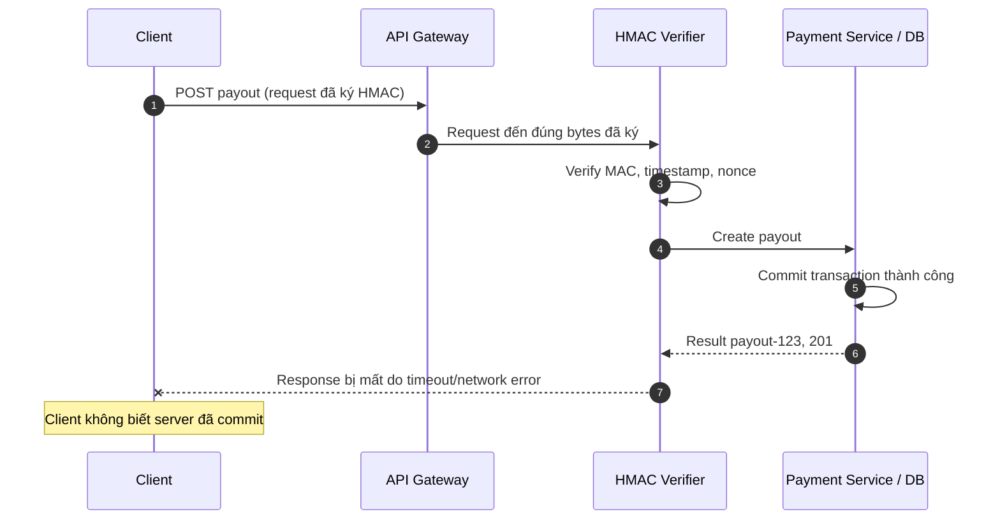
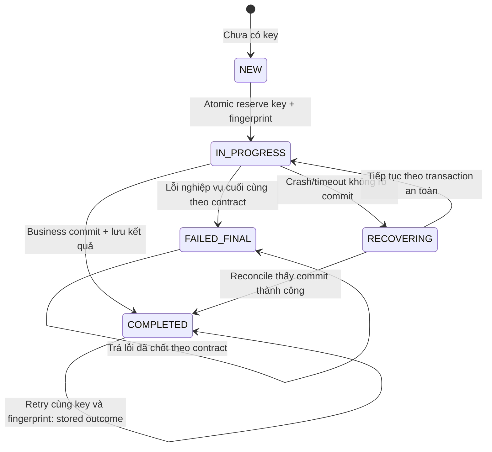
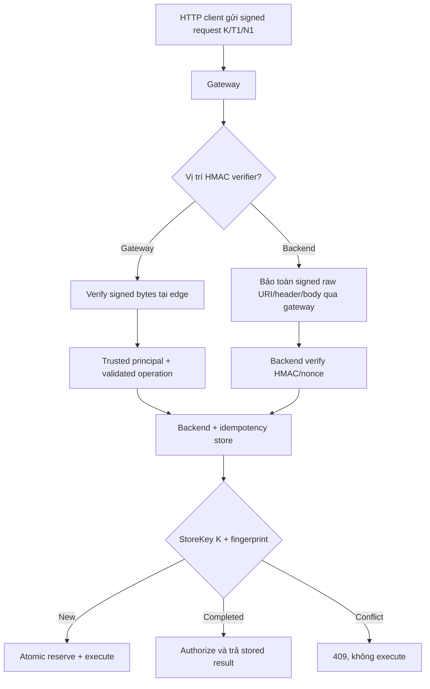

# Idempotency là gì trong HTTP API và HMAC request authentication?

## Mục tiêu học tập

Trong chương **Idempotency**, *idempotency* (tính lũy đẳng) là khả năng thực hiện một thao tác nhiều lần mà **tác động dự định lên trạng thái hệ thống** vẫn như khi thực hiện một lần. Trong HTTP API, khái niệm này đặc biệt quan trọng khi client **không biết request đầu đã được xử lý hay chưa** vì timeout, lỗi kết nối hoặc mất response, rồi cần gửi lại request.

Bài thuộc module `SECURITY_AUTHENTICATION_HMAC_REQUEST_AUTHENTICATION`: thiết kế xác thực HTTP request bằng **HMAC với shared secret**, dựng **canonical request** từ method, URI, header/body theo hợp đồng, xác minh chữ ký, chống replay bằng timestamp/nonce, quản lý key rotation, kiểm thử proxy/gateway và phân biệt **authentication** với **authorization**.

Học xong, bạn có thể:

- Nêu định nghĩa **idempotency** và phân biệt nó với **safe method**, **replay protection**, **deduplication**, **at-most-once** và tuyên bố “exactly once”.
- Giải thích vì sao `GET`, `PUT`, `DELETE` được HTTP định nghĩa với những semantics khác `POST`; không đánh đồng thuộc tính của method với kết quả triển khai backend.
- Chỉ ra những rủi ro khi **response bị mất sau khi server commit**, đặc biệt với thanh toán, tạo đơn hàng, gửi email hoặc phát sự kiện.
- Thiết kế **Idempotency-Key** theo **logical operation**, phạm vi principal/audience, request fingerprint, thời hạn lưu kết quả và xử lý nhiều request đồng thời.
- Đưa Idempotency-Key vào **canonical request HMAC**, nhưng vẫn tạo **timestamp, nonce và MAC mới** cho từng signed attempt.
- Minh họa cách dùng **Java 17** kiểm tra HMAC, chống nonce replay và mô phỏng idempotency khi client retry sau timeout.
- Nhận diện ranh giới giữa **kỹ thuật chống lặp**, transaction, key rotation, proxy/gateway, authorization và những hạn chế khi triển khai đa node.

## 1. Định nghĩa: idempotent nghĩa là gì?

Trong toán học, một phép biến đổi `f` được gọi là idempotent nếu:

```text
f(f(x)) = f(x)
```

Ví dụ, đặt giá trị của một trường thành `ACTIVE` hai lần có thể để lại cùng trạng thái cuối như đặt một lần. Ngược lại, **cộng thêm 1** hai lần thì không cho kết quả giống cộng một lần.

Trong HTTP, `RFC 9110` dùng cách hiểu gắn với **tác động dự định (*intended effect*) lên server**: nhiều request giống nhau được gửi liên tiếp có cùng tác động dự định như một request. Điều này **không bắt buộc** status code, response body, access log, audit event hay chi phí mạng phải hoàn toàn giống nhau giữa các lần gửi.

### 1.1. Ví dụ trực quan

Giả sử tài nguyên có trạng thái ban đầu:

```json
{
  "id": "file-123",
  "state": "DRAFT",
  "retryCount": 0
}
```

Hai cách xử lý:

```text
(A) PUT /v1/files/file-123/state
    {"state":"ACTIVE"}

    Lần 1 -> state=ACTIVE
    Lần 2 -> state=ACTIVE
    Lần 3 -> state=ACTIVE

    Tác động dự định cuối cùng: state=ACTIVE

(B) POST /v1/files/file-123/increment-retry-count
    {}

    Lần 1 -> retryCount=1
    Lần 2 -> retryCount=2
    Lần 3 -> retryCount=3

    Tác động dự định cuối cùng bị cộng dồn.
```

Đoạn trên là **minh họa về semantics**; khi xây API thật, việc chọn `PUT` hay `POST` còn phải đúng mô hình tài nguyên và HTTP contract. Một endpoint tên `/state` không tự bảo đảm idempotency nếu handler thực thi side effect mới không mong muốn mỗi lần nhận.

### 1.2. Idempotency không có nghĩa “server không làm gì ở lần thứ hai”

Một `PUT` có thể được server xử lý nhiều lần và:

- Ghi access log cho từng request.
- Cập nhật chỉ số monitoring.
- Trả `201 Created` ở lần đầu, `200 OK` hoặc `204 No Content` ở lần sau.
- Thực hiện một số hoạt động kiểm tra, tạo audit record theo chính sách.

Vì thế, **idempotent** chủ yếu nói về **tác động dự định theo HTTP semantics**, không đồng nghĩa **tổng thể mọi side effect và mọi response giống hệt nhau**. Nếu một thao tác có tác động không được phép lặp (như trừ tiền), cần cơ chế idempotency nghiệp vụ rõ hơn.

### 1.3. Tác động “đặt trạng thái” khác “tạo thêm”

| Ý định | Hành vi khi gửi hai lần | Có tính idempotent theo thiết kế? |
| --- | --- | --- |
| Đặt `state=ACTIVE` cho cùng resource | Cùng trạng thái đích | Thường có nếu handler đúng semantics. |
| Thay toàn bộ representation tại cùng URI bằng `PUT` | Cùng representation mục tiêu | Có theo HTTP semantics của `PUT`, có thể cần precondition để tránh ghi đè phiên bản mới. |
| Xóa resource bằng `DELETE` | Tài nguyên mục tiêu vẫn không còn tồn tại | Idempotent về **tác động dự định**; response có thể khác. |
| Tăng bộ đếm thêm 1 | Hai lần tăng thành 2 | **Không**. |
| Tạo đơn hàng mới từ payload giống nhau | Có thể tạo hai order | **Không**, nếu không có bảo vệ nghiệp vụ. |
| Chuyển 120.000 VND hai lần | Có nguy cơ trừ tiền hai lần | **Không**, trừ khi API có idempotency contract và backend bảo vệ. |

**Điểm cần nhớ:** Cùng nội dung request là một dấu hiệu nhưng **không đủ** xác định hai request có phải cùng một logical operation không. Người dùng có thể **cố ý mua cùng sản phẩm hai lần**. Hệ thống phải phân biệt “retry của giao dịch cũ” với “giao dịch mới có dữ liệu trùng”.

## 2. Safe, idempotent và cacheable là ba khái niệm khác nhau

### 2.1. HTTP method có semantics riêng

Theo HTTP semantics:

| Method | Safe? | Idempotent theo chuẩn? | Bình luận |
| --- | --- | --- | --- |
| `GET` | **Có** | **Có** | Dùng đọc representation; client không yêu cầu thay đổi trạng thái. |
| `HEAD` | **Có** | **Có** | Như GET về semantics đọc nhưng không gửi response content. |
| `OPTIONS` | **Có** | **Có** | Truy vấn khả năng/giao tiếp. |
| `TRACE` | **Có** theo semantics | **Có** | Thường bị vô hiệu trên hệ thống vì lý do bảo mật; không liên quan trực tiếp API nghiệp vụ. |
| `PUT` | **Không** | **Có** | Tạo/thay thế trạng thái tài nguyên tại URI xác định. |
| `DELETE` | **Không** | **Có** | Yêu cầu loại bỏ liên kết/tài nguyên mục tiêu theo semantics API. |
| `POST` | **Không** | **Không được bảo đảm** | Cho server xử lý theo semantics riêng; có thể tạo resource/giao dịch. |
| `PATCH` | **Không được chuẩn HTTP bảo đảm** | **Không được bảo đảm** | Có thể thiết kế thao tác patch idempotent, nhưng phụ thuộc patch document và logic. |

**Safe** nghĩa là client không yêu cầu tạo **tác động thay đổi trạng thái**; server vẫn có thể ghi log, metric. **Idempotent** nghĩa là nhiều yêu cầu giống nhau có **cùng tác động dự định** như một yêu cầu. **Cacheable** là tính chất riêng liên quan khả năng tái sử dụng response theo HTTP cache rules, không suy ra từ idempotency.

Lưu ý: một implementation **có thể vi phạm** semantics, chẳng hạn `GET /transfer?amount=...` làm trừ tiền. Đó là thiết kế nguy hiểm; việc method tên `GET` không biến giao dịch thành safe về thực tế.

### 2.2. PUT/DELETE idempotent vẫn cần kiểm soát đồng thời

Ví dụ:

```text
T1: PUT /v1/files/123   -> content A
T2: PUT /v1/files/123   -> content B
T3: Retry PUT cũ        -> content A
```

Request ở T3 giống T1 nhưng diễn ra **sau một thay đổi khác**, và có thể **ghi đè** B. HTTP idempotency của PUT **không giải quyết lost update/concurrency**. Cần dùng **ETag/If-Match**, version number, precondition hoặc chính sách ứng dụng.

Tương tự, DELETE idempotent không có nghĩa lặp lại DELETE sẽ luôn trả cùng status. Lần đầu có thể `204`, lần sau `404` hoặc `410` tùy API, dù tài nguyên đã bị xóa theo tác động dự định. Không mặc định HTTP status khác nhau chứng minh DELETE không idempotent.

### 2.3. POST có thể trở nên idempotent ở tầng nghiệp vụ

Đối với:

```http
POST /v1/payouts?tenant=merchant-42
Idempotency-Key: operation-abc
```

Server **có thể công bố** rằng mọi attempt có cùng Idempotency-Key và cùng nội dung thao tác trong cùng phạm vi sẽ chỉ tạo **một payout**. Đây là **idempotency của API contract**, không làm `POST` trở thành method idempotent theo semantics chung của HTTP.

**Chỉ gắn header `Idempotency-Key` không đủ.** Server phải thực sự lưu/cưỡng chế trạng thái giao dịch và có chính sách xử lý trùng, race, crash/recovery và thời hạn giữ kết quả.

## 3. Vấn đề thực tế: response bị mất sau khi server đã commit

Giả sử client tạo payout trị giá 120.000 VND:



Khi client không nhận response, **timeout không chứng minh request đã thất bại**. Nó có thể chưa tới server, đã được nhận nhưng chưa xử lý, hoặc đã tạo giao dịch thành công và chỉ mất phản hồi.

Nếu client gửi lại một `POST` có nonce/HMAC mới nhưng server tạo một payout mới, có thể xảy ra:

```text
Attempt #1: payout-123 -> đã trừ 120.000 VND
Attempt #2: payout-124 -> lại trừ 120.000 VND
```

Đó là rủi ro **duplicate side effect**. Để giải quyết, cần một **định danh thao tác logic** xuyên các attempt và một cơ chế server-side nhận ra **cùng thao tác đã xử lý**.

### 3.1. Idempotency-Key biểu diễn điều gì?

`Idempotency-Key` là một token do client tạo cho **một thao tác nghiệp vụ logic**.

Ví dụ:

```text
Một lần người dùng nhấn "Thanh toán":
    operationId = K
    attempt 1 (network request) -> K
    attempt 2 (retry)           -> K
    attempt 3 (retry)           -> K

Một lần người dùng thanh toán khác, dù số tiền giống nhau:
    operationId = K2 (mới, khác K)
```

Server sử dụng K để biết các attempt là **cùng một operation**, và phân biệt operation K2 mới dù payload trùng. Key nên có entropy cao để giảm đoán/trùng; **không sử dụng key như credential hay bằng chứng phân quyền**.

Ví dụ tạo 16 byte ngẫu nhiên bằng `SecureRandom` rồi Base64URL không padding tạo token **22 ký tự**, nhưng API thật có thể quy định format khác (UUID, chuỗi allowlist, chiều dài khác). Client phải theo đúng hợp đồng của API.

### 3.2. Vì sao chỉ so sánh payload không đủ?

Hai request cùng payload `{"amount":120000}` có thể là:

- Một retry của lần thanh toán cũ do response bị mất.
- Hai thao tác thanh toán **có chủ đích**, cùng người nhận và cùng số tiền.
- Hai người dùng/client khác nhau cùng tạo payout hợp lệ.

Nếu server “cứ payload giống nhau thì bỏ request thứ hai”, nó sẽ **từ chối nhầm thao tác hợp lệ**. Vì vậy cần **Idempotency-Key** để client tuyên bố ý định “đây là cùng logical operation”, và dùng **request fingerprint** để kiểm tra rằng một key không bị tái sử dụng cho operation khác.

## 4. Idempotency, nonce và HMAC bảo vệ những điều khác nhau

Bài học này thuộc **HMAC request authentication**, nên phải đặt ba cơ chế đúng lớp:

| Lớp | Giá trị/primitive | Câu hỏi được trả lời | Điều không giải quyết |
| --- | --- | --- | --- |
| HMAC authentication | Shared secret + canonical request + MAC | Request có được ký bằng credential được đăng ký và các trường có bị sửa không? | Client có được phép trên resource hay không; request đã gửi trước đó chưa. |
| Timestamp freshness | Epoch seconds đã ký | Request có đủ mới theo server clock không? | Request đã dùng trong window chưa. |
| **Nonce replay protection** | Nonce mới **mỗi signed attempt**, atomic claim | Cùng signed attempt có bị phát lại không? | Hai attempt **khác nonce** có phải cùng business operation không. |
| **Business idempotency** | **Idempotency-Key ổn định** + fingerprint + stored outcome | Các attempt có phải cùng logical operation và side effect có bị tạo lặp không? | Chữ ký/secret có đúng không; principal có quyền không. |
| Authorization | Principal/tenant/action/resource | Credential đã xác thực có quyền thực thi/đọc kết quả không? | Không tự chống replay hoặc business duplication. |

### 4.1. Sai lầm: dùng nonce làm Idempotency-Key

Nonce HMAC được thiết kế **mới cho mỗi attempt**, nên:

```text
Attempt 1: nonce = N1
Attempt 2: nonce = N2    (retry đúng cách)
```

Nếu server coi nonce là khóa idempotency thì attempt 2 trông giống **thao tác mới**, có thể gây double payout. Ngược lại, nếu client cố **giữ nonce cũ** để biểu diễn cùng operation, replay store sẽ chặn request đã được claim; HMAC/timestamp cũ có thể hết hạn.

Thiết kế đúng:

```text
logical operation id = K   (ổn định qua retry)

attempt1 = { K, T1, N1, HMAC1 }
attempt2 = { K, T2, N2, HMAC2 }

nonceStore:
  N1 chỉ claim một lần
  N2 chỉ claim một lần

idempotencyStore:
  K -> cùng fingerprint F -> cùng operation/result
```

Timestamp có thể **trùng giá trị số giây** nếu hai attempt trong cùng một giây; nonce vẫn phải mới. HMAC phải được **tính lại** theo timestamp và nonce thực tế của attempt mới.

### 4.2. Vì sao phải ký Idempotency-Key?

Nếu business handler sử dụng `Idempotency-Key` nhưng trường đó **không nằm trong canonical request** và không được bảo vệ qua trust boundary, một bên có thể đổi/bỏ key mà **MAC trên các trường khác vẫn khớp**. Hậu quả: server có thể tạo operation thứ hai hoặc lấy nhầm trạng thái của operation khác.

Do đó, trong hợp đồng HMAC của bài:

- Method, raw target, header ảnh hưởng semantics, body hash, timestamp và nonce đều được ký.
- **Idempotency-Key cũng được ký**, bởi nó ảnh hưởng cách server quyết định có thực thi operation hay không.
- Server tạo authenticated principal từ registry, không tin `X-Client-Id` hoặc `X-Tenant` chỉ vì được gửi dưới dạng text.
- Backend phải dùng **chính effective request đã được xác minh**; không ký tenant A nhưng xử lý tenant B sau gateway rewrite.

**MAC đúng không tự chứng minh Idempotency-Key chưa từng được dùng.** Đó là việc của idempotency registry.

### 4.3. Tính idempotent khác “exactly once”

Cần phân biệt ít nhất ba phạm vi:

1. **At-most-once acceptance** của một nonce: một signed attempt được claim tối đa một lần trong một consistency domain và replay horizon.
2. **At-most-once business effect** cho một operation key: hệ thống cố đảm bảo không trừ tiền hai lần trong các attempt cùng operation.
3. **Exactly-once end-to-end**: một tuyên bố rộng hơn, đòi hỏi phối hợp client, network, nhiều service, datastore và side effects; không có được chỉ nhờ một key/value cache.

Một request có thể đã được ghi nonce nhưng process crash **trước khi** tạo payout: request cũ bị reject, operation chưa hoàn thành. Điều này cho thấy “nonce đã claim đúng một lần” **không có nghĩa business operation đã xảy ra đúng một lần**. Hệ thống cần cơ chế retry mới/tra cứu/reconciliation để phục hồi.

## 5. Thiết kế Idempotency-Key và phạm vi nhận diện

### 5.1. Sinh key một lần cho logical operation

Một cách tạo token Java 17:

```java
import java.security.SecureRandom;
import java.util.Base64;

SecureRandom rng = new SecureRandom();
byte[] bytes = new byte[16];
rng.nextBytes(bytes);

String idempotencyKey = Base64.getUrlEncoder()
        .withoutPadding().encodeToString(bytes);
// Giữ "idempotencyKey" cho mọi retry CÙNG logical operation.
```

Không tạo key mới ở mỗi attempt. Không dùng timestamp milliseconds làm key nếu nó có nguy cơ trùng giữa nhiều request, restart hoặc instance. Token 128 bit CSPRNG là cách tạo thực tế; mức entropy và format cụ thể phụ thuộc threat model/API contract.

**Key không phải secret:** bên khác nhìn thấy key không được vì thế có quyền đọc kết quả hoặc truy cập tenant. Server vẫn kiểm tra HMAC, principal và authorization cho mỗi attempt.

### 5.2. Scope key theo principal, audience và nghiệp vụ

Một lựa chọn:

```text
storeKey = (audience, authenticatedPrincipalId, idempotencyKey)
```

Có thể bổ sung namespace theo **operation type** nếu contract quy định key chỉ duy nhất trong mỗi operation type; nếu không, key tái sử dụng giữa nhiều route phải được phát hiện và trả conflict. Việc tách theo path/method mà không có fingerprint kiểm tra có thể vô tình cho phép một key đại diện nhiều side effect độc lập.

Không scope chỉ theo raw `X-Client-Id` khi chưa xác thực, cũng không scope mỗi lần theo `keyId` nếu **key rotation** vẫn thuộc cùng principal: cùng operation với key cũ và key mới phải được nhận ra là cùng operation.

Ví dụ hệ thống có audience `payments-api-prod` và client `payout-worker-prod`:

```text
(payments-api-prod, payout-worker-prod, K) -> payout operation P
(payments-api-prod, another-client, K)    -> namespace khác
```

Đây là các nhãn **minh họa**: cần dùng audience nhất quán trong mọi thành phần thực tế. Nếu key được dùng trong nhiều tenant của một client, fingerprint phải ràng buộc **tenant/resource/action**, tránh lộ hoặc reuse kết quả giữa tenants.

### 5.3. Fingerprint là gì?

*Request fingerprint* là đại diện có độ ổn định cao của **nội dung nghiệp vụ không đổi** giữa các attempt. Ví dụ:

```text
operationInput = [
  version            = "payout-operation-v1",
  audience           = "payments-api-prod",
  authenticatedClientId,
  method             = "POST",
  rawTarget          = "/v1/payouts?tenant=merchant-42",
  contentType        = "application/json",
  bodySha256         = SHA256(exactBodyBytes)
]

fingerprint = SHA256(UTF8(canonicalStableOperationInput))
```

Với cùng logical operation, các giá trị này ổn định. **Không đưa nonce, timestamp, signature hoặc key ID** vào fingerprint: chúng thay đổi theo signed attempt mới hoặc trong key rotation. Nếu có những header hoặc option ảnh hưởng **business semantics** như currency, settlement mode, beneficiary ID, precondition, API version, chúng cũng phải được đưa vào fingerprint hoặc ràng buộc chắc chắn qua body/target/version.

Một hash SHA-256 chỉ giúp fingerprint nhỏ và dễ so khớp; **nó không có khóa và không thay HMAC**, cũng không tự đảm bảo side effect nguyên tử.

### 5.4. Khi cùng key được gửi với nội dung khác

| Idempotency-Key | Fingerprint | Hành vi mong đợi |
| --- | --- | --- |
| `K1` mới | `F1` | Đăng ký operation và bắt đầu xử lý. |
| `K1` lần hai | `F1` | Trả trạng thái/kết quả của **cùng operation**, không tạo thêm. |
| `K1` lần ba | `F2` | **Conflict**, ví dụ `409`, không thực thi như một operation mới. |
| `K2` mới | `F1` | **Operation khác** theo intent client, có thể tạo side effect mới nếu được phép. |

Không tự động coi mọi payload giống nhau là duplicate. Không âm thầm sửa fingerprint để “match” key đã tồn tại. Nếu client thay đổi amount trong khi retry và giữ key cũ, server phải từ chối theo contract; muốn đổi amount cần một **operation mới** hoặc một endpoint cập nhật được thiết kế riêng.

## 6. Idempotency registry: trạng thái và kết quả phải được lưu nhất quán

Idempotency-Key chỉ có ý nghĩa khi **server** triển khai một **bộ nhớ nhận diện operation** đủ bền vững và nhất quán. Cơ chế thường lưu:

```text
IdempotencyRecord {
    storeKey          = (audience, authenticatedPrincipal, idempotencyKey)
    fingerprint       = hash(stable business request fields)
    status            = IN_PROGRESS | COMPLETED | FAILED_FINAL | RECOVERING
    businessOperation = payout-123 hoặc order-456
    resultStatus      = HTTP status đã chốt theo hợp đồng
    resultBody        = representation của kết quả được phép lưu
    createdAt
    updatedAt
    expiresAt
}
```

Một quy trình mẫu:



**Quan trọng:** Đây là state machine **minh họa**. Các API có thể lựa chọn cách xử lý lỗi, trạng thái, TTL và response khác nhau; phải có hợp đồng rõ với client.

### 6.1. Bốn trường hợp server phải xử lý

Với cùng authenticated principal và Idempotency-Key:

1. **Chưa có record:** kiểm tra fingerprint và quyền, rồi **reserve key nguyên tử** trước khi side effect được kích hoạt.
2. **Record COMPLETED, fingerprint giống:** trả kết quả đã chốt (có thể status/body trước đó), **không commit lần thứ hai**.
3. **Record IN_PROGRESS, fingerprint giống:** không chạy một operation song song; trả `202 Accepted`, `409 Conflict` với mã “in progress”, chỉ dẫn `Retry-After` hoặc API poll tùy contract.
4. **Record tồn tại nhưng fingerprint khác:** trả lỗi **idempotency conflict**, thường `409 Conflict`, không thực thi request thay thế.

Ngoài ra, **FAILED_FINAL** và **RECOVERING** cần chính sách riêng. Một lỗi `400` do payload business invalid có thể được coi là kết quả kết thúc và được lưu theo contract; một lỗi `503` do datastore tạm thời thường không nên mặc định chốt như một thất bại nghiệp vụ vĩnh viễn. Không có một bộ quy tắc cache mọi lỗi chung cho tất cả dịch vụ.

### 6.2. Không dùng `GET` rồi `INSERT` tách rời

Một anti-pattern thường gặp:

```text
if (idempotencyCache.get(K) == null) {
    createPayout();               # Có thể tạo giao dịch
    idempotencyCache.put(K, result);
}
```

Khi hai request cùng đến:

```text
Node A: GET K -> missing
Node B: GET K -> missing
Node A: INSERT payout-123
Node B: INSERT payout-124
Node A: PUT K -> payout-123
Node B: PUT K -> payout-124

=> Hai payout đã được tạo; cache chỉ còn nhớ một kết quả.
```

Phải dùng cơ chế **đặt chỗ/unique constraint nguyên tử** hoặc transaction có guarantee đủ mạnh. Dùng `synchronized` trong Java chỉ khóa thread trong **một JVM**, không bảo vệ nhiều pod/node. Redis atomic SET NX có thể giúp claim key trên primary, nhưng **không tự bảo đảm** side effect thanh toán, kết quả lưu và Redis update là một transaction xuyên hệ thống.

### 6.3. Mô hình database transaction

Ví dụ **sơ đồ tham khảo**, không phải SQL độc lập có thể triển khai ngay:

```sql
CREATE TABLE idempotent_operation (
    audience       VARCHAR(80)  NOT NULL,
    principal_id   VARCHAR(128) NOT NULL,
    operation_key  VARCHAR(128) NOT NULL,
    fingerprint    CHAR(64)     NOT NULL,
    status         VARCHAR(24)  NOT NULL,
    result_ref     VARCHAR(128),
    created_at     TIMESTAMP WITH TIME ZONE NOT NULL,
    expires_at     TIMESTAMP WITH TIME ZONE NOT NULL,
    PRIMARY KEY (audience, principal_id, operation_key)
);

-- Trong một transaction có isolation/lock và unique key rõ:
INSERT INTO idempotent_operation
    (audience, principal_id, operation_key,
     fingerprint, status, created_at, expires_at)
VALUES
    (:audience, :principal, :key,
     :fingerprint, 'IN_PROGRESS', :now, :expiresAt)
ON CONFLICT DO NOTHING;
```

**Đừng hiểu `ON CONFLICT DO NOTHING` đồng nghĩa thao tác hoàn thành.** Nó chỉ xác định reservation có thắng hay không. Nếu record đã tồn tại, server phải đọc fingerprint/status **theo cùng chính sách isolation**, rồi quyết định conflict, in-progress, hay trả outcome đã lưu.

Đối với payment/order trong **cùng database**, nên thiết kế transaction liên kết **business effect** với **idempotency record hoặc business operation ID duy nhất**. Nếu payout thực hiện ở hệ thống thứ ba, transaction local không thể tự bao trùm external transfer; cần **transactional outbox, idempotent downstream API, state machine và reconciliation**.

### 6.4. Crash sau commit nhưng trước khi lưu kết quả

```text
T1: API tạo payout và external system đã commit.
T2: API crash trước khi cập nhật idempotency record = COMPLETED.
T3: Client retry cùng K.
```

Nếu server nhìn thấy `IN_PROGRESS` rồi “xóa key để thử lại từ đầu”, nó có thể tạo payout thứ hai. Phải có **business operation reference** và cơ chế **reconcile** với trạng thái payout đã commit. Khi không chắc chắn, an toàn hơn là trả `IN_PROGRESS`/`RECOVERING` theo contract, không tạo effect mới mà không có bằng chứng.

Một thực hành thiết kế tốt là dùng business operation ID độc lập có **unique constraint**, kết nối với Idempotency-Key; khi retry, hệ thống kiểm tra operation đó trước khi phát lệnh side effect mới.

### 6.5. TTL của Idempotency-Key khác TTL nonce

Giả sử HMAC freshness window là `P=300s`, `F=60s` và nonce TTL ví dụ **370 giây**. Thời gian client cần retry/reconcile business operation **có thể dài hơn nhiều**: hàng phút, giờ hoặc ngày tùy API.

```text
Nonce TTL:       che phủ thời gian một signed attempt còn có thể replay.
Idempotency TTL: che phủ thời gian các attempt của một operation có thể tới
                 + nghĩa vụ nghiệp vụ/kiểm toán/retention theo hợp đồng.
```

Không dùng TTL nonce ngắn làm TTL idempotency mặc định. Sau khi idempotency record hết hạn, cùng key có thể bị xem là **operation mới** nếu contract cho phép. API phải **công bố retention/horizon** để client không giả định key an toàn vô hạn.

Với dữ liệu thanh toán và những tác động không đảo ngược, ngoài cache idempotency còn nên có **business transaction reference/unique constraint** có vòng đời phù hợp với yêu cầu nghiệp vụ; xóa cache không được khiến thanh toán cũ “biến mất”.

### 6.6. Phạm vi consistency và multi-region

Nếu `Region A` và `Region B` cùng nhận request có key K nhưng dùng **hai idempotency store độc lập**, cả hai có thể tạo operation mới. Không giải quyết bằng cách “mỗi region dùng cache nhanh”, sticky routing yếu hoặc replication eventual không có xung đột rõ.

Tùy yêu cầu, có thể dùng **một authority** cho mỗi storeKey, database có unique constraint và consistency mạnh, quorum/linearizable service, hoặc downstream ledger bảo đảm idempotent theo business transaction ID. Khi partition/failover, cân nhắc **fail closed/IN_PROGRESS** thay vì cho phép hai region commit độc lập.

Redis `SET NX` nguyên tử trên một primary nhưng **replication bất đồng bộ và failover** có thể làm mất record đã ACK; nếu nghiệp vụ đòi at-most-once mạnh sau failover thì phải chọn datastore/architecture phù hợp. Không tuyên bố “exactly once” chỉ từ việc một lần `SET NX` trả OK.

## 7. Hợp đồng HMAC và Idempotency-Key cho API mẫu

Để tự chứa, bài định nghĩa một giao thức học tập có version **`idempotency-v1`**. Đây **không** phải chuẩn mặc định áp dụng cho mọi API HMAC. Client và server phải triển khai **đúng một hợp đồng**.

Request minh họa:

```http
POST /v1/payouts?tenant=merchant-42 HTTP/1.1
Host: payments.example.test
Content-Type: application/json
X-Client-Id: payout-worker-prod
X-Key-Id: key-2026-11
Idempotency-Key: <22-character-operation-token>
X-Timestamp: <unix-epoch-seconds>
X-Nonce: <22-character-fresh-nonce>
X-Content-SHA256: <sha256-body-base64url>
X-Signature: <hmac-sha256-base64url>

{"amount":120000,"currency":"VND"}
```

Các chuỗi trong dấu `<...>` là placeholder. Không gửi **shared secret** vào header. Endpoint là một `POST` có tác động nghiệp vụ, nhưng API ví dụ thêm **idempotency contract** cho từng operation.

### 7.1. Canonical request gồm 12 dòng

```text
HMAC-SHA256
idempotency-v1
payments-api-prod
payout-worker-prod
key-2026-11
POST
/v1/payouts?tenant=merchant-42
application/json
<body-sha256-base64url>
<idempotency-key-22-chars>
<timestamp-epoch-seconds>
<nonce-22-chars>
```

| Dòng | Trường | Quy tắc |
| --- | --- | --- |
| 1 | `HMAC-SHA256` | Nhãn thuật toán; Java dùng `HmacSHA256`. |
| 2 | `idempotency-v1` | Khóa version và canonical contract. |
| 3 | `payments-api-prod` | Audience đáng tin, kiểm tra trong registry. |
| 4 | Client ID | `X-Client-Id`, thuộc credential và được ký. |
| 5 | Key ID | `X-Key-Id`, được ký và dùng tra đúng secret. |
| 6 | Method `POST` | Ràng buộc operation và tránh method substitution. |
| 7 | Raw target | `/v1/payouts?tenant=[A-Za-z0-9_-]{1,64}` chính xác. |
| 8 | `application/json` | Content-Type được ký, chỉ một giá trị hợp lệ. |
| 9 | Body hash | Base64URL không padding của SHA-256 **exact body bytes**. |
| **10** | **Idempotency-Key** | **Ổn định qua retry của cùng logical operation**. |
| 11 | Timestamp | Epoch seconds, lấy lúc ký attempt. |
| 12 | Nonce | 16 byte CSPRNG, mới ở **mỗi signed attempt**. |

Các dòng text được nối bằng **một LF (`\n`)**, không có LF cuối. Dùng **UTF-8** cho canonical string và **SHA-256 trên byte body thực nhận**; không tự parse JSON rồi serialize lại trước khi hash. Không có JSON canonicalization đặc biệt trong hợp đồng mẫu.

### 7.2. Quy tắc định dạng và xác minh

1. Chỉ `POST /v1/payouts?tenant={id}`; tenant ID dùng allowlist ASCII, không nhận query trùng/unknown/encoded delimiter, route rewrite hoặc method override ngoài hợp đồng.
2. Chỉ `Content-Type: application/json`; Content-Encoding vắng mặt hoặc `identity`. Header quan trọng phải có **đúng một giá trị** và không có CR/LF.
3. Client/key ID: `[A-Za-z0-9_-]{1,64}`. Server tra secret theo `(clientId, keyId)` trong credential registry, đối chiếu `payments-api-prod`, algorithm/contract và trạng thái `ACTIVE/RETIRING/REVOKED`.
4. Idempotency-Key và nonce: **16 byte ngẫu nhiên**, Base64URL không padding **22 ký tự**, strict-decode và re-encode để loại biểu diễn noncanonical.
5. Timestamp: Unix epoch seconds decimal canonical, được server đối chiếu clock theo freshness window, ví dụ `past=300s` và `future=60s`.
6. Body hash: SHA-256 đúng body bytes, xuất Base64URL **43 ký tự**. Nếu có `X-Content-SHA256`, server **tự tính** digest và so sánh với giá trị đã nhận.
7. Signature: HMAC-SHA256 raw **32 byte**, Base64URL không padding **43 ký tự**. Server strict-decode và so sánh MAC bytes với `MessageDigest.isEqual`.
8. **Nonce claim** sau khi HMAC hợp lệ, qua kho dùng chung với atomic put-if-absent; TTL bao phủ `P+F+margin` (ví dụ **370s**).
9. **Authorization** dựa trên authenticated principal, tenant/action/resource thực, không dùng Idempotency-Key làm quyền truy cập.
10. **Idempotency** dựa trên storeKey và fingerprint ổn định; server không xử lý double payout khi nonce/timestamp/key ID của attempt thay đổi.

`Idempotency-Key` và nonce được ký **nhưng có tuổi thọ khác nhau**. Không cho client gửi một canonical string thay cho request thực tế; verifier phải tự dựng canonical từ method, raw URI, headers và body tại trust boundary.

### 7.3. Fingerprint theo version `payout-operation-v1`

Ví dụ này chọn:

```text
stableOperationText = join(LF, [
  "payout-operation-v1",
  "payments-api-prod",
  authenticatedPrincipal,
  "POST",
  "/v1/payouts?tenant=merchant-42",
  "application/json",
  Base64URL_NoPadding(SHA256(exactBodyBytes))
])

fingerprint = Base64URL_NoPadding(SHA256(UTF8(stableOperationText)))
```

Với mọi retry hợp lệ, **Idempotency-Key và fingerprint ổn định**, còn `timestamp, nonce, signature` thay đổi. Nếu key rotation khiến `keyId` đổi nhưng principal/operation vẫn như cũ, fingerprint không đổi.

Ở hệ thống thật, fingerprint phải bao gồm **mọi thành phần được phép ảnh hưởng đến side effect**: schema version, route identity, tenant, currency, beneficiary, headers/flags xử lý, điều kiện ghi đè, v.v. Nếu không, hai request **khác nghĩa nghiệp vụ** có thể trùng fingerprint và bị nhận lầm là một operation.

### 7.4. Ví dụ retry có chữ ký mới

```mermaid
sequenceDiagram
    autonumber
    participant C as Client
    participant V as HMAC Verifier
    participant N as Shared Nonce Store
    participant I as Idempotency Store
    participant D as Business DB
    C->>V: POST signed attempt 1: K, T1, N1, MAC1
    V->>V: Verify body hash, MAC và timestamp
    V->>N: Claim N1 (atomic)
    N-->>V: CLAIMED
    V->>I: Reserve K + fingerprint F
    I-->>V: New operation
    V->>D: Commit payout
    D-->>I: COMPLETE + stored result
    V--x C: Response bị mất
    Note over C: Không thể kết luận payout chưa tạo
    C->>C: Backoff, giữ K/body/URI, tạo T2/N2/MAC2
    C->>V: POST signed attempt 2: K, T2, N2, MAC2
    V->>V: Verify attempt 2
    V->>N: Claim N2 (atomic)
    N-->>V: CLAIMED
    V->>I: Lookup K + fingerprint F
    I-->>V: COMPLETED; stored result
    V-->>C: Trả lại kết quả; KHÔNG tạo payout thứ hai
```

Bảng hành vi:

| Nhận xét server | Quyết định |
| --- | --- |
| Request đã ký bị phát lại **nguyên nonce** | **REPLAYED** ở tầng chống replay. |
| Request ký lại có **nonce mới**, cùng K/F | Đi tới idempotency registry, trả **cùng kết quả** nếu COMPLETED. |
| Request ký lại có nonce mới nhưng giữ K, đổi amount | HMAC vẫn có thể đúng; **fingerprint mismatch → 409**. |
| Cùng amount/body nhưng **K mới** | Được coi là logical operation khác; có thể tạo payout mới nếu được phép. |
| MAC đúng nhưng tenant ngoài quyền | **403** ở authorization; không lấy idempotency cache làm bypass quyền. |

### 7.5. Đăng ký Idempotency-Key không phải công việc của client

Client **sinh và giữ** key, nhưng **server** chịu trách nhiệm lưu phạm vi/key/fingerprint/result nguyên tử, phục hồi khi crash và dọn dữ liệu theo contract. Nếu server không triển khai dedup, sự có mặt của header không làm request trở nên idempotent. Chúng ta không thể “bảo đảm chính xác một payout” chỉ từ SDK retry logic.

## 8. Java 17: retry HMAC nhưng chỉ tạo một payout

Ví dụ **`IdempotencyHmacDemo.java`** sau chỉ dùng JDK 17+. Nó mô phỏng **một signer/client và một server** với shared secret được cung cấp sẵn. Mục tiêu chính không phải viết HTTP server mà là hiểu idempotency trong một luồng HMAC có timestamp/nonce.

Chương trình sẽ:

1. Sinh secret 32 byte, nonce 16 byte và **một Idempotency-Key 16 byte** bằng `SecureRandom`.
2. Ký request đầu với method/URI/body và Idempotency-Key đã chọn.
3. Server xác minh HMAC, timestamp, claim nonce rồi tạo payout giả lập và lưu kết quả.
4. Client **làm mất response đầu** trên phía mình, rồi ký **attempt thứ hai** với nonce mới, timestamp lấy lại từ `Clock`, nhưng **giữ nguyên key và body**.
5. Server nhận lại cùng operation key/fingerprint nên **trả stored result**, counter payout vẫn bằng 1.
6. Phát lại attempt cũ → từ chối **nonce replay**.
7. Ký request với body khác nhưng giữ Idempotency-Key → **409 Conflict**.
8. Tạo Idempotency-Key **mới** cho cùng payload → một logical operation mới, có thể tăng counter.
9. Thử hai attempt đồng thời mang **cùng operation key nhưng nonce khác** → hai MAC hợp lệ, chỉ **một business effect** được tạo trong mock.
10. Kiểm tra client ký hợp lệ cho tenant ngoài quyền → bị từ chối **authorization**, không tạo payout.

**Lưu ý:** `MockServer` cố tình dùng `ConcurrentHashMap.compute` và `AtomicInteger` để mô phỏng một consistency domain trong **một JVM**. Không được suy rằng bộ nhớ chung, một map hay counter trong Java giải quyết double payment qua nhiều pod/region, database crash hoặc external payment provider.

### 8.1. Chương trình Java hoàn chỉnh

```java
import java.nio.charset.StandardCharsets;
import java.security.GeneralSecurityException;
import java.security.MessageDigest;
import java.security.SecureRandom;
import java.time.Clock;
import java.time.Instant;
import java.time.ZoneOffset;
import java.util.Base64;
import java.util.Objects;
import java.util.Set;
import java.util.Arrays;
import java.util.concurrent.ConcurrentHashMap;
import java.util.concurrent.ConcurrentMap;
import java.util.concurrent.CountDownLatch;
import java.util.concurrent.ExecutorService;
import java.util.concurrent.Executors;
import java.util.concurrent.Future;
import java.util.concurrent.atomic.AtomicBoolean;
import java.util.concurrent.atomic.AtomicInteger;
import java.util.regex.Pattern;
import javax.crypto.Mac;
import javax.crypto.spec.SecretKeySpec;

public final class IdempotencyHmacDemo {
    private static final String AUDIENCE = "payments-api-prod";
    private static final String CLIENT_ID = "payout-worker-prod";
    private static final String KEY_ID = "key-2026-11";
    private static final long PAST_SECONDS = 300;
    private static final long FUTURE_SECONDS = 60;

    private static final Pattern TARGET = Pattern.compile(
            "/v1/payouts\\?tenant=[A-Za-z0-9_-]{1,64}");
    private static final Pattern ID = Pattern.compile(
            "[A-Za-z0-9_-]{1,64}");
    private static final Pattern TIME = Pattern.compile(
            "[1-9][0-9]{0,11}");
    private static final Base64.Encoder B64 =
            Base64.getUrlEncoder().withoutPadding();
    private static final Base64.Decoder DECODER =
            Base64.getUrlDecoder();

    private IdempotencyHmacDemo() {}

    record Operation(
            String clientId, String keyId, String method,
            String rawTarget, String contentType, byte[] body,
            String idempotencyKey) {
        Operation {
            body = Objects.requireNonNull(body, "body").clone();
        }
        @Override public byte[] body() {
            return body.clone(); // Tránh caller sửa body sau khi ký.
        }
    }

    record SignedAttempt(
            Operation operation, String timestamp, String nonce,
            String bodyHash, String signature) {}

    record Reply(int status, String result, boolean reused) {}
    record Stored(String fingerprint, String result, int status) {}

    static String newToken(SecureRandom random) {
        byte[] bytes = new byte[16];
        random.nextBytes(bytes);
        return B64.encodeToString(bytes);
    }

    static byte[] strictDecode(
            String encoded, int textLength, int rawLength) {
        if (encoded == null || encoded.length() != textLength
                || !encoded.matches("[A-Za-z0-9_-]+")) {
            throw new IllegalArgumentException("Bad Base64URL syntax");
        }
        byte[] raw = DECODER.decode(encoded);
        if (raw.length != rawLength
                || !B64.encodeToString(raw).equals(encoded)) {
            throw new IllegalArgumentException("Noncanonical Base64URL");
        }
        return raw;
    }

    static void validate(SignedAttempt request) {
        if (request == null || request.operation() == null) {
            throw new IllegalArgumentException("Missing request");
        }
        Operation op = request.operation();
        if (!"POST".equals(op.method())
                || !"application/json".equals(op.contentType())
                || op.rawTarget() == null
                || !TARGET.matcher(op.rawTarget()).matches()) {
            throw new IllegalArgumentException("Bad operation grammar");
        }
        if (op.clientId() == null
                || !ID.matcher(op.clientId()).matches()
                || op.keyId() == null
                || !ID.matcher(op.keyId()).matches()) {
            throw new IllegalArgumentException("Bad client/key ID");
        }
        if (op.body().length == 0 || op.body().length > 1_048_576) {
            throw new IllegalArgumentException("Invalid body size");
        }
        strictDecode(op.idempotencyKey(), 22, 16);
        if (request.timestamp() == null
                || !TIME.matcher(request.timestamp()).matches()) {
            throw new IllegalArgumentException("Bad timestamp syntax");
        }
        strictDecode(request.nonce(), 22, 16);
    }

    static byte[] sha256(byte[] bytes)
            throws GeneralSecurityException {
        return MessageDigest.getInstance("SHA-256").digest(bytes);
    }

    static String hashText(byte[] body)
            throws GeneralSecurityException {
        return B64.encodeToString(sha256(body));
    }

    static String canonical(SignedAttempt request, String bodyHash) {
        validate(request);
        Operation op = request.operation();
        return String.join("\n",
                "HMAC-SHA256", "idempotency-v1", AUDIENCE,
                op.clientId(), op.keyId(), op.method(),
                op.rawTarget(), op.contentType(), bodyHash,
                op.idempotencyKey(), request.timestamp(), request.nonce());
        // 12 dòng UTF-8, LF, không LF cuối.
    }

    static byte[] mac(byte[] secret, String canonical)
            throws GeneralSecurityException {
        Mac engine = Mac.getInstance("HmacSHA256");
        engine.init(new SecretKeySpec(secret, "HmacSHA256"));
        return engine.doFinal(
                canonical.getBytes(StandardCharsets.UTF_8));
    }

    static SignedAttempt sign(
            Operation op, byte[] secret, Clock clock, SecureRandom rng)
            throws GeneralSecurityException {
        String time = Long.toString(
                Instant.now(clock).getEpochSecond());
        String nonce = newToken(rng); // MỚI cho từng attempt.
        String bodyHash = hashText(op.body());
        SignedAttempt unsigned = new SignedAttempt(
                op, time, nonce, bodyHash, "");
        String signature = B64.encodeToString(
                mac(secret, canonical(unsigned, bodyHash)));
        return new SignedAttempt(op, time, nonce, bodyHash, signature);
    }

    static boolean checkMac(SignedAttempt request, byte[] secret)
            throws GeneralSecurityException {
        try {
            validate(request);
            byte[] declaredHash =
                    strictDecode(request.bodyHash(), 43, 32);
            byte[] actualHash = sha256(request.operation().body());
            if (!MessageDigest.isEqual(actualHash, declaredHash)) {
                return false;
            }
            byte[] receivedMac =
                    strictDecode(request.signature(), 43, 32);
            byte[] expected = mac(secret, canonical(
                    request, B64.encodeToString(actualHash)));
            return MessageDigest.isEqual(expected, receivedMac);
        } catch (IllegalArgumentException ex) {
            return false;
        }
    }

    static String fingerprint(Operation op, String actualBodyHash)
            throws GeneralSecurityException {
        // Các trường ỔN ĐỊNH theo logical operation.
        // Không có timestamp, nonce, MAC hoặc keyId.
        String stable = String.join("\n",
                "payout-operation-v1", AUDIENCE, op.clientId(),
                op.method(), op.rawTarget(), op.contentType(),
                actualBodyHash);
        return B64.encodeToString(sha256(
                stable.getBytes(StandardCharsets.UTF_8)));
    }

    static final class MockServer {
        private final byte[] activeSecret;
        private final Clock clock;

        // Chỉ chung trong 1 JVM. Không phải distributed replay store.
        private final Set<String> usedNonces =
                ConcurrentHashMap.newKeySet();
        private final ConcurrentMap<String, Stored> completed =
                new ConcurrentHashMap<>();
        private final AtomicInteger payouts = new AtomicInteger();

        MockServer(byte[] key, Clock clock) {
            this.activeSecret = key.clone();
            this.clock = clock;
        }

        Reply receive(SignedAttempt attempt)
                throws GeneralSecurityException {
            try {
                validate(attempt);
            } catch (IllegalArgumentException ex) {
                return new Reply(400, "invalid-request", false);
            }
            Operation op = attempt.operation();

            // Demo registry: một client/key ACTIVE cho audience cố định.
            if (!CLIENT_ID.equals(op.clientId())
                    || !KEY_ID.equals(op.keyId())
                    || !checkMac(attempt, activeSecret)) {
                return new Reply(401, "invalid-authentication", false);
            }

            long t;
            try {
                t = Long.parseLong(attempt.timestamp());
            } catch (NumberFormatException ex) {
                return new Reply(400, "invalid-timestamp", false);
            }
            long now = Instant.now(clock).getEpochSecond();
            if (t < Math.subtractExact(now, PAST_SECONDS)
                    || t > Math.addExact(now, FUTURE_SECONDS)) {
                return new Reply(401, "expired-request", false);
            }

            String replayKey = AUDIENCE + "|" + op.clientId()
                    + "|" + attempt.nonce();
            if (!usedNonces.add(replayKey)) {
                return new Reply(401, "replayed-nonce", false);
            }

            // Mock authorization: client được phép merchant-42.
            if (!"/v1/payouts?tenant=merchant-42".equals(op.rawTarget())) {
                return new Reply(403, "forbidden-tenant", false);
            }

            String key = AUDIENCE + "|" + op.clientId()
                    + "|" + op.idempotencyKey();
            String fp = fingerprint(op, hashText(op.body()));

            AtomicBoolean createdNow = new AtomicBoolean(false);
            Stored stored = completed.compute(key, (ignored, previous) -> {
                if (previous != null) {
                    return previous;  // Không tạo payout thứ hai.
                }
                createdNow.set(true);
                int sequence = payouts.incrementAndGet();
                return new Stored(fp, "payout-" + sequence, 201);
            });
            if (!stored.fingerprint().equals(fp)) {
                return new Reply(409, "idempotency-conflict", false);
            }
            return new Reply(
                    stored.status(), stored.result(), !createdNow.get());
        }

        int createdCount() {
            return payouts.get();
        }
    }

    public static void main(String[] args) throws Exception {
        long now = 1_700_000_000L; // Test fixture cố định.
        Clock clock = Clock.fixed(
                Instant.ofEpochSecond(now), ZoneOffset.UTC);
        SecureRandom random = new SecureRandom();
        byte[] secret = new byte[32];
        random.nextBytes(secret);

        byte[] originalBody = (
                "{\"amount\":120000,\"currency\":\"VND\"}")
                .getBytes(StandardCharsets.UTF_8);
        Operation op = new Operation(
                CLIENT_ID, KEY_ID, "POST",
                "/v1/payouts?tenant=merchant-42",
                "application/json", originalBody,
                newToken(random)); // Chỉ sinh một lần cho operation.

        MockServer server = new MockServer(secret, clock);
        SignedAttempt first = sign(op, secret, clock, random);
        Reply lost = server.receive(first);
        // Cố tình KHÔNG chuyển "lost" tới logic của client.
        System.out.println("First committed: " + (lost.status() == 201));

        SignedAttempt retry = sign(op, secret, clock, random);
        Reply recovered = server.receive(retry);
        System.out.println("Retry nonce changed: "
                + !first.nonce().equals(retry.nonce()));
        System.out.println("Same logical key: "
                + first.operation().idempotencyKey()
                  .equals(retry.operation().idempotencyKey()));
        System.out.println("Recovered stored result: "
                + recovered.reused());
        System.out.println("Payout count after retry: "
                + server.createdCount());

        Reply replay = server.receive(first);
        System.out.println("Old attempt replay blocked: "
                + (replay.status() == 401));

        Operation changed = new Operation(
                CLIENT_ID, KEY_ID, "POST", op.rawTarget(),
                op.contentType(),
                "{\"amount\":240000,\"currency\":\"VND\"}"
                    .getBytes(StandardCharsets.UTF_8),
                op.idempotencyKey()); // Sai: cùng key, payload khác!
        Reply conflict = server.receive(
                sign(changed, secret, clock, random));
        System.out.println("Changed payload conflict: "
                + (conflict.status() == 409));
        System.out.println("Payout count after conflict: "
                + server.createdCount());

        // Cùng body nhưng operation ID mới -> business operation mới.
        Operation secondPurchase = new Operation(
                CLIENT_ID, KEY_ID, op.method(), op.rawTarget(),
                op.contentType(), op.body(), newToken(random));
        Reply newPurchase = server.receive(
                sign(secondPurchase, secret, clock, random));
        System.out.println("New logical operation committed: "
                + (newPurchase.status() == 201
                   && !newPurchase.reused()));
        System.out.println("Payout count after new operation: "
                + server.createdCount());

        // Hai signed attempts có nonce mới, cùng business key.
        Operation concurrentOp = new Operation(
                CLIENT_ID, KEY_ID, op.method(), op.rawTarget(),
                op.contentType(), op.body(), newToken(random));
        SignedAttempt a = sign(concurrentOp, secret, clock, random);
        SignedAttempt b = sign(concurrentOp, secret, clock, random);
        CountDownLatch ready = new CountDownLatch(2);
        CountDownLatch go = new CountDownLatch(1);
        ExecutorService pool = Executors.newFixedThreadPool(2);
        int before = server.createdCount();
        try {
            Future<Reply> f1 = pool.submit(() -> {
                ready.countDown();
                go.await();
                return server.receive(a);
            });
            Future<Reply> f2 = pool.submit(() -> {
                ready.countDown();
                go.await();
                return server.receive(b);
            });
            ready.await();
            go.countDown();
            Reply r1 = f1.get();
            Reply r2 = f2.get();
            System.out.println("Two attempts authenticated: "
                    + (r1.status() == 201 && r2.status() == 201));
            System.out.println("Concurrent created count: "
                    + (server.createdCount() - before));
        } finally {
            pool.shutdownNow();
        }

        Operation forbiddenOp = new Operation(
                CLIENT_ID, KEY_ID, "POST",
                "/v1/payouts?tenant=merchant-99",
                "application/json", op.body(), newToken(random));
        Reply forbidden = server.receive(
                sign(forbiddenOp, secret, clock, random));
        System.out.println("Other tenant forbidden: "
                + (forbidden.status() == 403));

        Arrays.fill(secret, (byte) 0);
        Arrays.fill(originalBody, (byte) 0);
    }
}
```

Kết quả kỳ vọng (giá trị nonce thực tế ngẫu nhiên, các assertion vẫn giữ):

```text
First committed: true
Retry nonce changed: true
Same logical key: true
Recovered stored result: true
Payout count after retry: 1
Old attempt replay blocked: true
Changed payload conflict: true
Payout count after conflict: 1
New logical operation committed: true
Payout count after new operation: 2
Two attempts authenticated: true
Concurrent created count: 1
Other tenant forbidden: true
```

### 8.2. Giải thích những điểm then chốt trong code

**`Operation` là snapshot nghiệp vụ:** bản ghi chứa method, URI, byte body và Idempotency-Key **giữ nguyên**. Constructor clone byte array để hạn chế lỗi mutable body. Trong production, tệp/stream lớn cần immutable snapshot hoặc spool có quota; không hash file A rồi gửi file B.

**`sign(...)` tạo một signed attempt mới:** timestamp được lấy bằng `Clock`, nonce mới bằng `SecureRandom`, body hash và MAC được tính lại. Timestamp có thể trùng số giây nếu retry nhanh; nonce mới là điều kiện cần. Không phát lại cùng `X-Signature`/nonce để “retry thành công”.

**`checkMac(...)` tự tính body digest**, strict-decode MAC Base64URL thành **32 byte**, so bằng `MessageDigest.isEqual`. Nó không nhận một canonical string do client tự khai. Server cũng phải kiểm tra actual HTTP request ở adapter thật, không mặc định mọi trường text trong record Java là đã parse an toàn.

**`usedNonces` mô phỏng replay protection cục bộ:** trong một JVM nó từ chối dùng lại nonce. Nhưng không có TTL, persistence, failover hay đồng bộ nhiều node. Production cần **atomic claim** trong shared store, TTL che phủ cửa sổ timestamp và fail closed khi store không sẵn sàng.

**`completed.compute(...)` mô phỏng atomic dedup trong một map:** side effect `payouts.incrementAndGet()` chỉ là một counter **trong bộ nhớ cùng JVM**. Không đặt một external payment call vào mapping function rồi mặc định có atomic transaction với database; khi chạy nhiều instance, crash hoặc network partition, kiến trúc này **không bảo đảm** at-most-once business effect.

**`recovered.reused()` là dấu hiệu kết quả từ cache:** trong hệ thống thực, ngoài kiểm tra fingerprint, phải kiểm tra authorization hiện tại trước khi trả stored result có dữ liệu nhạy cảm. Dữ liệu lưu phải được ràng buộc đúng authenticated principal/audience.

**`Two attempts authenticated`** trong ví dụ là cách diễn đạt rút gọn: server trả `201` cho cả hai signed attempts có nonce riêng, nhưng **một kết quả được tái sử dụng**. Khác với việc gửi lại **chính một signed attempt**, bị `REPLAYED` khi nonce đã được claim.

### 8.3. Giới hạn rõ của demo

Ví dụ không phải HTTP server đầy đủ và **chưa** thực hiện:

- Parser HTTP framing và duplicate header; Content-Encoding/URI rewrite thực tế.
- Credential registry hỗ trợ nhiều key và key rotation; secret manager.
- Timestamp kiểm tra với clock server đa node được đồng bộ; nonce store có TTL 370s và atomic claim phân tán.
- Durable/idempotent business transaction, in-progress state, crash recovery, outbox hoặc reconciliation.
- Rate limit, deadline, client retry/backoff, idempotency record expiry, log audit và privacy.
- Authorization phức tạp theo tenant, resource object, currency, payout recipient và quyền thay đổi theo thời gian.

Chính các thành phần này cần được hoàn thiện và kiểm thử trước khi triển khai thực tế. Demo chỉ minh họa **ý nghĩa idempotency** và ranh giới giữa HMAC/nonce và business dedup.

## 9. Cách retry một HTTP request có HMAC và Idempotency-Key

### 9.1. Chuỗi thao tác phía client

Một retry policy có kiểm soát:

```text
logicalOperation = {
  idempotencyKey = K,  # Sinh một lần
  method, uri, contentType, immutableBody
}

for each allowed attempt:
  if not firstAttempt:
     wait(backoff + jitter, subject to Retry-After/deadline)

  timestamp = clock.nowEpochSeconds()
  nonce = SecureRandom(16 bytes)       # Mới mỗi attempt
  canonical = buildFromOperationAndAttempt(...)
  signature = HMAC(secretForActiveKey, canonical)

  response = sendFreshRequest(...)
  if terminal/success -> stop
  if retryable and budget remains -> try next attempt
  else -> stop or reconcile unknown outcome
```

**Ký sau khi chờ**: nếu ký trước `Retry-After` 5 phút rồi mới gửi, timestamp có thể hết cửa sổ ngay lúc retry. HTTP client/proxy phải không tự phát lại nguyên raw request đã ký với nonce cũ ở một tầng thấp mà signer không biết.

### 9.2. Khi nào được retry?

| Tình huống | Khuyến nghị theo contract |
| --- | --- |
| Timeout trước khi request rời client | Có thể gửi signed attempt mới trong giới hạn policy. |
| Timeout/đứt mạng sau khi request được gửi | **Kết quả chưa biết**; chỉ retry POST nếu có idempotency/reconciliation bảo đảm. |
| `429 Too Many Requests` | Chờ `Retry-After` và áp rate limit; ký lại sau chờ. |
| `502/503/504` | Có thể retry sau backoff nếu API hỗ trợ idempotency. |
| `500` | Không suy ra chưa có side effect; cần hợp đồng rõ. |
| `400` do payload/schema | Không retry request lỗi y nguyên. |
| `401` credential/MAC không hợp lệ | Không retry vô hạn hoặc thử key ngẫu nhiên; sửa credential/clock theo kênh đáng tin. |
| `403` không có quyền | Không retry như lỗi mạng; MAC mới không tạo quyền. |
| `409` fingerprint mismatch | **Không retry** cùng key/body đã thay; xử lý lỗi idempotency. |
| Operation `IN_PROGRESS` | Chờ theo API policy, poll trạng thái hoặc Retry-After; không tạo operation mới. |
| Redirect `307/308` | Nếu đích được phép, phải ký lại **URI thực tế** và kiểm tra audience/credential; không forward secret sang host lạ. |

Không có một danh sách status **tự động retry** hợp lệ cho mọi API. POST tạo tiền, chuyển tiền và gửi thông báo có side effect phải có **ngân sách retry, deadline**, và cách biết trạng thái operation khi outcome không rõ.

### 9.3. Exponential backoff, jitter và retry storm

Một cấu hình ví dụ: tối đa **3 attempts** tính cả request đầu, backoff cơ bản 200 ms, cap 2 s, **full jitter**. Trước mỗi retry:

```text
retryNumber = 1 hoặc 2
maximumDelay = min(2000ms, 200ms * 2^(retryNumber - 1))
delay = random(0..maximumDelay)
wait(delay)
signNewAttemptWithCurrentTimestampAndFreshNonce()
```

`Retry-After` của server (delta-seconds hoặc HTTP-date) và deadline caller có thể khiến phải chờ lâu hơn hoặc **không retry nữa**. Jitter giảm khả năng nhiều client cùng retry tạo **retry storm**; không giải quyết business idempotency.

### 9.4. Retry khác replay ở chính xác chỗ nào?

```text
Replay:
  Same (method, URI, body, K, timestamp, nonce, signature)
  => nonce store từ chối attempt đã dùng.

Legitimate retry:
  Same (method, URI, body, K)
  New (timestamp/current time, nonce, signature)
  => HMAC + nonce có thể đạt; idempotency store trả cùng operation.

New business action:
  New K, may have same body
  => Được coi là operation mới nếu authorization/business policy cho phép.
```

Client phải quyết định **khi nào người dùng thực sự yêu cầu thao tác mới**. Nếu UI gửi hai sự kiện thanh toán độc lập với K khác nhau nhưng người dùng chỉ muốn trả một lần, backend không thể tự đoán hai K là cùng intent; cần kiểm soát ở tầng ứng dụng/transaction.

## 10. Idempotency qua gateway, key rotation và authorization

### 10.1. Gateway phải giữ nguyên các thành phần định danh operation

Giả sử client ký:

```text
POST /public/v1/payouts?tenant=merchant-42
Idempotency-Key: K
Body SHA-256: Fbody
```

Gateway chuyển đến backend:

```text
POST /internal/v1/payouts?tenant=merchant-42
Idempotency-Key: K
Body SHA-256: Fbody
```

Nếu HMAC được tính lại ở backend **sau path rewrite** trong khi client ký raw URI **trước rewrite**, chữ ký sẽ không khớp. Nếu server idempotency dùng **internal URI** còn gateway/verifier dùng **external URI**, fingerprint cũng có nguy cơ lệch hoặc nhập nhằng qua nhiều service.

Cách xử lý:

- **Verify tại gateway trước khi rewrite** rồi chuyển authenticated principal, effective operation và signed input đã xác minh qua kênh nội bộ có bảo vệ; backend phải được thiết kế để chỉ tin metadata do gateway thiết lập.
- Hoặc **verify tại backend bằng raw target gốc đáng tin** được bảo toàn/đóng gói qua cơ chế chống giả mạo; không lấy `X-Original-URI` do internet tự khai.
- Chuẩn hóa identity của operation trong fingerprint **theo hợp đồng thống nhất**, không tùy ý thay raw/external/internal path giữa các phiên bản.
- Dùng một **validated representation** xuyên các lớp hoặc chứng minh các parser/route transformations tương thích bằng test.
- Nếu gateway thêm/xóa `Idempotency-Key`, đổi body bytes hoặc Content-Type **sau khi ký**, MAC phải sai hoặc thay đổi đó phải bị cấm theo trust-boundary contract.

Không “chữa” lỗi canonical bằng cách bỏ Idempotency-Key, URI hoặc body hash ra khỏi chữ ký. Điều đó có thể cho phép dữ liệu ảnh hưởng side effect **không được HMAC bảo vệ**.

### 10.2. Hai phương pháp xác minh HMAC



Đặc biệt, nếu một request được xác minh ở gateway, backend **không được** chấp nhận header `X-Authenticated-Client` do chính client internet gửi. Edge phải xóa các header nội bộ không đáng tin trước khi thiết lập thông tin authenticated principal, và hai tầng phải giao tiếp qua kênh có xác thực/toàn vẹn.

### 10.3. Key rotation không được biến một retry thành operation mới

Giả sử một logical operation K được ký bằng key cũ lần đầu và key mới ở lần retry:

```text
Attempt 1:
  clientId=C, keyId=key-old, nonce=N1
  idempotencyKey=K

Attempt 2:
  clientId=C, keyId=key-new, nonce=N2
  idempotencyKey=K
```

Mỗi attempt phải được xác minh bằng **đúng secret** theo `(clientId, keyId)`, với trạng thái key phù hợp. Tuy nhiên idempotency store nên scope theo **authenticated principal/audience/operation key ổn định**; không chỉ theo key ID, vì key rotation sẽ khiến operation bị coi là mới và có thể lặp side effect.

- Key `ACTIVE` hoặc `RETIRING` trong overlap hữu hạn có thể hợp lệ theo chính sách.
- Key `REVOKED` phải bị từ chối dù MAC bằng secret cũ vẫn khớp toán học.
- Khóa mới phải có secret **độc lập**, không chỉ đổi tên key ID.
- Nếu key mới thực sự thuộc **principal khác** hoặc scope đã đổi, phải đánh giá lại quyền; không “mượn” Idempotency-Key để chuyển kết quả giữa danh tính khác nhau.

### 10.4. Không dùng stored result để vượt qua authorization

Một lỗi nghiêm trọng:

```text
if (idempotencyRecordExists(K)) {
    return storedSensitiveResult; // Sai: chưa authenticate/authorize caller.
}
```

Đúng hơn, **mọi attempt** phải đi qua xác thực credential/HMAC và chính sách replay theo contract. Khi có record K, backend phải:

1. Bảo đảm người gọi có **cùng principal/audience** hoặc đủ quyền tương ứng theo phạm vi API.
2. Xác minh fingerprint của **operation thực nhận** khớp bản ghi.
3. Kiểm tra **authorization hiện tại** trước khi trả kết quả nhạy cảm hoặc tiếp tục xử lý.
4. Không cho một client khác truy cập payout chỉ bằng cách đoán/thu thập Idempotency-Key.
5. Không coi MAC đúng cho `merchant-99` đồng nghĩa client có quyền trên tenant đó.

HMAC là **authentication**; Idempotency-Key biểu diễn **operation identity**; authorization quyết định **principal được phép thao tác hoặc đọc kết quả** hay không. Ba khái niệm độc lập.

### 10.5. Hệ thống nhiều region và các downstream side effects

Một hệ thống thanh toán có thể gồm:

```text
HTTP API -> Idempotency Registry -> Orders DB
                                -> Payment Provider
                                -> Event Bus
                                -> Email Sender
```

Dù chỉ tạo một row order, vẫn có thể:

- Gọi payment provider hai lần nếu external request không có idempotency key.
- Phát event hai lần nếu không có transactional outbox hoặc event-level dedup.
- Gửi hai email nếu consumer xử lý lại event nhưng không idempotent.
- Tạo charge hai lần khi retry sau timeout ở provider dù local DB ghi một order.

Vì thế idempotency phải được đánh giá **trên từng hiệu ứng cần không lặp**, từ ingress tới downstream. Với payment provider, cần tuân **contract idempotency của chính provider**, thường dùng một downstream operation key ổn định và reconciliation. Với event-driven architecture, có thể dùng **outbox/inbox, unique event ID và idempotent consumer** để quản lý giao hàng lặp.

Không giả định “message broker exactly-once” sẽ tự bao trùm một external API call, database khác hoặc email đã được gửi; semantics thường có phạm vi cụ thể.

## 11. Những lỗi thường gặp và cách phòng tránh

| Sai lầm | Rủi ro | Cách khắc phục |
| --- | --- | --- |
| Chỉ dựa vào `POST` kèm HMAC | Mỗi POST mới có nonce mới vẫn có thể tạo charge mới. | Idempotency-Key + durable business dedup. |
| Dùng nonce làm operation ID | Retry hợp lệ có nonce khác, mất liên kết operation. | Key ổn định qua retry, nonce mới mỗi attempt. |
| Phát lại request đã ký cũ | Nonce bị reject/hết cửa sổ thời gian. | Tạo timestamp/nonce/MAC mới sát lúc gửi. |
| Sinh Idempotency-Key mới cho mỗi retry | Server hiểu thành các operation khác nhau. | Sinh key một lần cho logical operation. |
| Dedupe theo raw payload duy nhất | Hai giao dịch có chủ đích nhưng payload trùng bị gộp nhầm. | Key thể hiện client intent + fingerprint. |
| Cùng key nhưng khác amount vẫn được chạy | Giao dịch mới có thể ghi đè/tiếp tục sai result. | Fingerprint mismatch → conflict. |
| Lưu key trong cache JVM từng pod | Nhiều node không nhìn thấy record nhau. | Shared authoritative idempotency registry. |
| `GET` rồi `INSERT` không atomic | Hai request đồng thời đều thấy missing. | Unique constraint/atomic reservation. |
| Cache key sau khi external payout commit | Crash tạo khoảng trống dẫn đến double payout. | Transactional state machine, stable business ref và reconciliation. |
| TTL idempotency chỉ bằng nonce TTL | Key hết quá sớm, retry muộn tạo giao dịch mới. | Retention theo retry horizon và nghĩa vụ nghiệp vụ. |
| Key scope theo `keyId` | Rotation có thể tạo operation lần hai. | Scope theo authenticated principal và audience. |
| Không ký `Idempotency-Key` | Header ảnh hưởng business behavior có thể bị thay ngoài MAC. | Ràng buộc key vào canonical request. |
| Fingerprint thiếu tenant/beneficiary/flag | Hai operation khác nghĩa bị coi là một. | Versioned fingerprint bao phủ mọi yếu tố business. |
| Trả cached result trước khi authenticate/authorize | Lộ dữ liệu giữa principals/tenants. | Xác thực từng attempt và kiểm tra quyền hiện tại. |
| Proxy rewrite path/body trước verifier | MAC/fingerprint không phản ánh cùng operation. | Chọn trust boundary, thống nhất canonical/operation identity. |
| Retry vô hạn với `429/503` | Gây retry storm và quá tải dịch vụ đang lỗi. | Backoff, jitter, Retry-After, max attempts và deadline. |
| Tin Redis primary ACK là bảo đảm mạnh qua failover | Bản ghi có thể mất trong async replication. | Chọn consistency/durability đúng threat model. |
| Tin “exactly once” ở một thành phần là đủ | Side effect downstream vẫn có thể bị gửi hai lần. | Idempotency end-to-end theo từng hệ thống/phạm vi. |

### 11.1. Không lạm dụng “return cached response”

Một cache response không gắn với transaction có thể trả kết quả sai hoặc cũ. Với operation đã COMPLETED, API cần công bố có trả **đúng status/body gốc**, representation mới nhất, hay một operation reference để poll. Nếu data nhạy cảm, việc replay stored result còn phải tuân **authorization và data retention policy**.

Với operation `IN_PROGRESS`, không nên trả một `201` “thành công” khi chưa có commit chắc chắn. Nếu outcome chưa biết, phải biểu diễn trạng thái chưa biết một cách trung thực, giữ khả năng reconcile.

### 11.2. Trách nhiệm của API provider và client SDK

**API provider** phải triển khai uniqueness/fingerprint/result store, atomicity và error contract. **Client SDK** chịu trách nhiệm sinh key cho operation, giữ nguyên qua retry, tạo signed attempt mới, tôn trọng backoff và không chuyển key qua audience khác.

Nếu chỉ client có Idempotency-Key mà server bỏ qua, **không có bảo đảm chống double side effect**. Nếu chỉ server có idempotency policy mà SDK sinh key mới mỗi retry, cũng không đạt mục tiêu.

## 12. Ma trận kiểm thử Idempotency kết hợp HMAC

Bộ kiểm thử nên quan sát **HTTP request, authentication result, nonce claim, operation key/fingerprint, trạng thái business commit và response**, không chỉ nhìn status `2xx`.

| Trường hợp | Đầu vào/điều kiện | Kết quả mong đợi |
| --- | --- | --- |
| POST lần đầu | K mới, F mới, MAC/nonce hợp lệ | Tạo operation một lần, lưu outcome. |
| Response bị mất sau commit | Retry K/F cũ, timestamp/nonce/MAC mới | Trả stored result, **không commit lại**. |
| Replay nguyên request | Timestamp/nonce/MAC không đổi, đã claim | Chặn replay ngay tại nonce store. |
| Retry trong cùng một giây | Timestamp giống, nonce mới | HMAC attempt mới, có thể hợp lệ; K/F không đổi. |
| Cùng K, payload khác | Amount khác, HMAC mới hợp lệ | **Fingerprint conflict**, thường `409`. |
| Cùng payload, K mới | Client cố ý tạo operation mới | Có thể tạo side effect mới nếu policy/authorization cho phép. |
| Không có Idempotency-Key | POST endpoint yêu cầu key | Reject theo contract; không âm thầm chạy như request không bảo vệ. |
| Token key sai format | Header dài/quá ngắn/noncanonical | Reject schema trước business execution. |
| Header Idempotency-Key trùng | Hai giá trị, một có thể đã được ký | Reject, không chọn bản đầu/cuối. |
| Header key bị đổi sau ký | K bị thay, giữ MAC cũ | HMAC fail, không thực thi operation. |
| URI đổi sau ký | Tenant, path hoặc query khác | HMAC fail hoặc grammar reject. |
| Client ký body khác với body thực gửi | SHA-256 mismatch | Authentication fail. |
| Cùng K/F đang `IN_PROGRESS` | Hai requests khác nonce đến gần nhau | Chỉ một reservation/processing; request còn lại chờ/nhận in-progress. |
| Hai node đồng thời cùng K/F | HMAC/nonce đều đúng | Một business commit theo consistency domain. |
| Crash sau business commit | Idempotency result chưa được ghi | Recover/reconcile; không double payout. |
| Crash sau reserve nhưng trước commit | Record kẹt `IN_PROGRESS` | Lease/recovery; không xóa key bừa rồi chạy trùng. |
| Key rotation A → B | Cùng principal, K/F, nonce/MAC mới | Không tạo operation mới chỉ vì key ID thay. |
| Key A đã `REVOKED` | MAC toán học khớp secret A | Từ chối authentication dù stored result tồn tại. |
| Client mất quyền sau attempt đầu | Retry cùng K/F | Authz hiện tại quyết định đọc kết quả/hành động. |
| Client khác dùng K trùng | Principal khác có credential hợp lệ | Không đọc cached result của client trước. |
| Different tenant cùng key | cùng clientId nhưng tenant khác | Fingerprint mismatch hoặc namespace policy reject. |
| Gateway rewrite URI | Signed target khác effective target | MAC fail hoặc verify ở đúng trust boundary; không bypass. |
| Redis/DB timeout | Kết quả reservation không rõ | Fail closed hoặc in-progress/recovery; không khởi tạo operation mới tùy tiện. |
| Multi-region active-active | Cùng K tới hai region | Không có double commit nhờ global authority/strong business uniqueness. |
| Nonce store không sẵn sàng | HMAC có thể đúng | Fail closed cho authentication; không bypass. |
| Retry sau Idempotency-Key hết hạn | K đã bị expire theo contract | Hành vi phải được công bố; dùng business reference để tránh duplicate ngoài ý muốn. |
| Outbox/consumer redelivery | Một event giao nhiều lần | Idempotent downstream effect, không gửi charge/email trùng. |

### 12.1. Test vector liên ngôn ngữ

Bên cạnh integration tests, hãy công bố test vector cố định với **secret giả**:

- Client ID, key ID, audience, contract `idempotency-v1`, method, raw request-target và Content-Type.
- Exact body UTF-8 bytes, SHA-256 body raw hex/Base64URL.
- Cùng một Idempotency-Key K của 16 byte, **hai timestamp và nonce** cho attempt 1/2.
- Canonical request **12 dòng UTF-8**, LF không LF cuối; có thể thêm canonical bytes dạng hex.
- HMAC-SHA256 raw MAC bytes và Base64URL signature mong đợi cho **từng attempt**.
- Stable fingerprint dựa trên `payout-operation-v1`, chứng minh F không đổi khi timestamp/nonce/key ID thay trong cùng principal/operation.
- Test case conflict khi body hoặc tenant thay nhưng K giữ nguyên; invalid format, revoked key, nonce replay và authz denied.

Không đưa secret production, PAN/card details, tài khoản ngân hàng hoặc payload nhạy cảm vào tài liệu/test vector.

## 13. Bài thực hành từng bước

Xây dựng API giả lập **`POST /v1/payouts?tenant={tenantId}`** với idempotency và HMAC-SHA256:

1. **Định nghĩa logical operation:** một payout duy nhất; ghi rõ điều gì là “cùng thao tác” và dữ liệu nghiệp vụ nào không được phép thay khi retry.
2. **Cấp credential:** `SecureRandom` sinh shared secret 32 byte, đặt client ID/key ID và audience vào registry thử nghiệm; không gửi secret qua HTTP.
3. **Sinh Idempotency-Key:** một lần 16 byte CSPRNG/Base64URL, giữ xuyên mọi retry của cùng operation; nonce sinh riêng mỗi attempt.
4. **Viết canonical signer:** 12 dòng `idempotency-v1` gồm algorithm/version/audience/client/key/method/raw URI/Content-Type/body hash/operation key/timestamp/nonce. SHA-256 body và HMAC-SHA256 bằng JCA.
5. **Viết HTTP verifier:** reject duplicate headers/framing sai, kiểm tra credential/key status, timestamp window `P=300,F=60`, strict-decode signature, so MAC qua `MessageDigest.isEqual`.
6. **Thêm nonce store:** atomic claim theo audience/authenticated principal/nonce; TTL đủ `P+F+margin` (ví dụ 370s), fail closed khi không xác nhận được claim.
7. **Thêm idempotency registry:** unique `(audience, principal, K)`; fingerprint versioned bao phủ tenant, method, raw URI, Content-Type, body digest và các field business khác.
8. **Tạo trạng thái `IN_PROGRESS`/`COMPLETED`/`RECOVERING`:** cùng K/F không chạy hai operation; khác F trả conflict. Thiết kế reservation/transaction bền vững và recovery.
9. **Mô phỏng lost response:** server đã commit payout nhưng client không nhận 201; ký lại với nonce/MAC mới nhưng cùng K; xác nhận chỉ một payout và kết quả cũ được trả lại.
10. **Kiểm thử concurrency:** gửi hai signed attempts có cùng K/F và nonce khác nhau đến hai server process thật; xác nhận một business commit khi cả hai tranh chấp.
11. **Kiểm thử các lỗi:** thay amount, body hash, tenant, key ID, duplicate Idempotency-Key, nonce cũ và key revoked; phân biệt HMAC invalid, replay, fingerprint conflict và authz denied.
12. **Key rotation và proxy:** đổi key trong retry, giữ principal/K; thử gateway rewrite path/query/body để kiểm tra contract/trust boundary.
13. **Downstream:** giả lập provider timeout sau commit và event redelivery, thêm business reference/outbox/inbox và reconciliation để tránh side effect lặp xuyên service.
14. **Đo và quan sát:** theo dõi idempotency hit/miss/conflict/in-progress, claim nonce, latency, race, stored-result retention và tỷ lệ recovery; không log secrets.

**Câu hỏi tự đánh giá:**

- Vì sao `PUT` và `DELETE` được HTTP xem là idempotent nhưng có thể trả response khác nhau giữa hai request giống hệt?
- Một `POST` có thể được làm idempotent ở tầng API dù bản thân POST không được chuẩn HTTP bảo đảm idempotent không?
- Vì sao timeout sau khi gửi POST không chứng minh server chưa tạo payout?
- Tại sao cùng body nhưng Idempotency-Key mới có thể được coi là thao tác hợp lệ **khác**?
- Vì sao một retry HMAC phải sinh nonce/chữ ký mới nhưng lại phải **giữ Idempotency-Key**?
- Tại sao Idempotency-Key phải được MAC bảo vệ nếu handler dùng nó để bỏ qua side effect?
- Fingerprint có nên chứa timestamp, nonce, signature hoặc key ID không? Vì sao?
- Hai node cùng thấy key missing rồi cùng commit có thể xảy ra như thế nào? Unique constraint/transaction giúp gì?
- Nếu server crash sau payout commit nhưng trước cập nhật idempotency record, vì sao không được xóa key rồi tự chạy lại?
- Key rotation có thể gây double payout nếu idempotency store scope theo key ID ra sao?
- MAC đúng và cached result tồn tại có chứng minh client hiện tại được xem nội dung payout không?
- Điều gì còn cần kiểm tra khi payment provider hoặc event consumer có thể xử lý lại một yêu cầu?

## 14. Tài liệu tham khảo

- **RFC 9110 — HTTP Semantics:** safe/idempotent methods, GET/PUT/DELETE/POST, conditional requests, status code và retry.
- **RFC 6585 — Additional HTTP Status Codes:** `429 Too Many Requests`.
- **RFC 2104 — HMAC: Keyed-Hashing for Message Authentication:** MAC dùng shared secret.
- **RFC 4648 — The Base16, Base32, and Base64 Data Encodings:** Base64URL không padding cho nonce, Idempotency-Key, body digest và signature.
- **Java SE API — `java.security.SecureRandom`, `java.security.MessageDigest`, `javax.crypto.Mac`, `javax.crypto.spec.SecretKeySpec`:** sinh token, body SHA-256 và HMAC-SHA256.
- **Java SE API — `java.time.Clock`, `java.util.concurrent.ConcurrentHashMap`, `java.util.concurrent.atomic.AtomicInteger`:** mô phỏng thời gian, concurrency và idempotency trong một JVM.
- **PostgreSQL documentation — Unique Constraints, Transaction Isolation, INSERT ON CONFLICT:** mẫu bảo vệ duplicate operation qua unique key và transaction.
- **Tài liệu API nhà cung cấp đang tích hợp:** mỗi hệ thống có định dạng/retention Idempotency-Key, trạng thái in-progress, conflict và quy tắc trả stored result riêng. Không áp đặt `idempotency-v1` của bài như chuẩn bắt buộc cho mọi API.

**Kết luận:** **Idempotency** là khả năng **lặp một thao tác mà không nhân đôi tác động dự định**. Với HTTP API có HMAC, timestamp và nonce chặn một **signed attempt** bị replay, còn Idempotency-Key, fingerprint và cơ chế lưu kết quả nguyên tử bảo vệ **cùng logical business operation** xuyên nhiều signed attempts. Khi kết hợp với canonical request đúng byte, key rotation, proxy/gateway trust boundary, authorization, transaction và recovery, hệ thống mới có cơ sở xử lý retry an toàn mà không tạo trùng giao dịch khi response bị mất.


