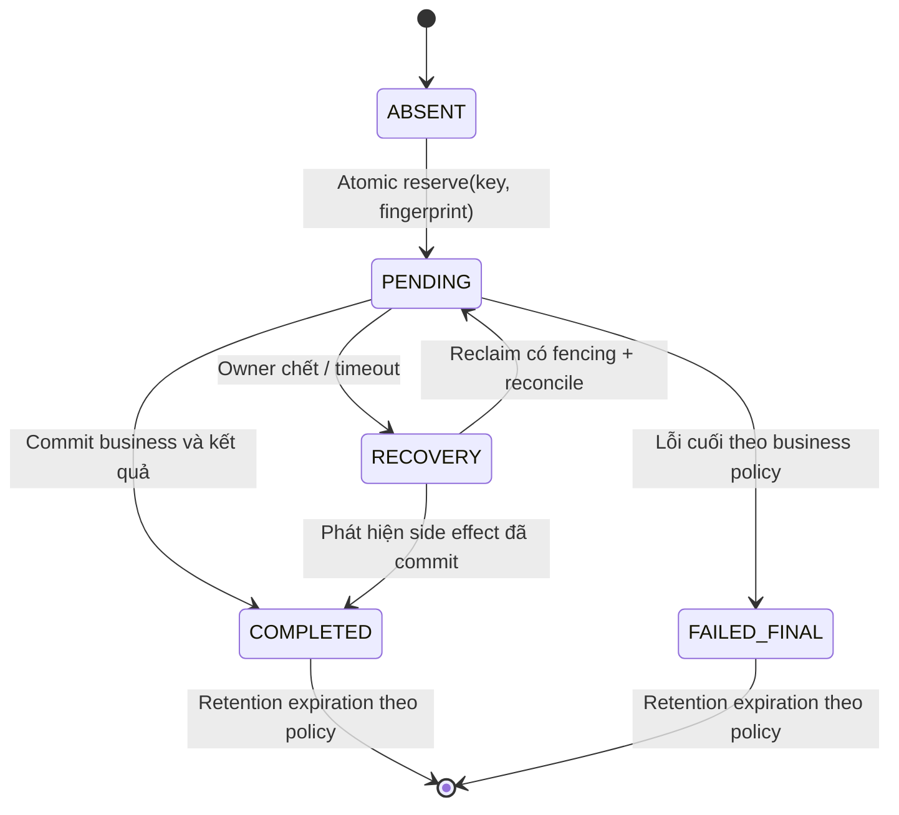
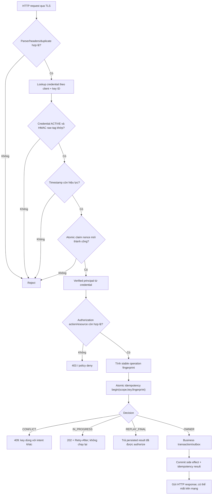

# Idempotency key

## 1. Vì sao request HMAC hợp lệ vẫn có thể tạo giao dịch hai lần?

Một hệ thống xác thực HTTP request bằng **HMAC với shared secret** có thể chứng minh client đã ký đúng **canonical request** (HTTP method, URI, selected headers, body hoặc body hash), đồng thời sử dụng timestamp và nonce để chặn **replay**. Nhưng nó vẫn cần giải quyết một bài toán khác: client không biết kết quả nghiệp vụ sau một lỗi mạng.

Ví dụ:

```text
Client                 Gateway          Payment service           Database
  |                      |                     |                      |
  |---- POST /payouts -->|-------------------->|---- INSERT payout -->|
  |                      |                     |<----- COMMIT --------|
  |                      |<---- HTTP 201 -------|                      |
  |<-- network timeout --X                     |                      |
  |                                            |                      |
  |-- Retry cùng ý định, nonce mới, HMAC mới -->|                      |
  |                                            |                      |
```

Request đầu tiên **đã tạo payout**, nhưng client không nhận được response. Để retry an toàn, client **không gửi lại nguyên request có nonce cũ** (vì đó là replay). Client tạo timestamp/nonce mới, ký lại một request hợp lệ. Nếu server chỉ kiểm tra HMAC và nonce, **request mới** sẽ được xác thực và có thể tạo **payout thứ hai**.

**Idempotency key** là một định danh ổn định cho **cùng một ý định nghiệp vụ** qua các lần thử. Server ghi nhận kết quả xử lý của ý định này và không thực thi side effect lần hai.

Bài **Idempotency key** thuộc chương *Idempotency* của module `SECURITY_AUTHENTICATION_HMAC_REQUEST_AUTHENTICATION`. Phạm vi module gồm HMAC trên canonical HTTP request, timestamp/nonce chống replay, key rotation, kiểm thử proxy/gateway và phân biệt authentication với authorization. Bài này giải thích cách **idempotency phối hợp với các lớp ấy mà không thay thế chúng**.

Sau bài, bạn sẽ:

- Phân biệt **nonce** (một lần sử dụng thông điệp xác thực) với **idempotency key** (một lần thực thi ý định nghiệp vụ).
- Thiết kế nơi tạo, thời điểm gửi và phạm vi lưu idempotency key, bao gồm **verified principal**, operation và environment.
- Đưa `X-Idempotency-Key` vào **canonical request được HMAC bảo vệ**.
- Tạo **operation fingerprint** ổn định khi timestamp, nonce, key ID và signature đổi qua các lần retry.
- Xử lý cùng key + cùng payload, cùng key + payload khác, hai request đồng thời, kết quả đang `PENDING` và response bị mất.
- Lưu state/result bằng **atomic reservation và transaction**, có quy trình recovery khi gọi external provider.
- Kiểm thử Java 17, golden HMAC vector, concurrency, gateway, key rotation, replay và authorization.

**Định nghĩa thực tế:** idempotency không phải “mọi HTTP POST tự động chỉ chạy một lần”. Nó là **hợp đồng server áp dụng cho một operation và phạm vi khóa cụ thể trong một thời hạn lưu trữ nhất định**.

## 2. Nonce, idempotency key và business ID khác nhau như thế nào?

Giả sử client tạo payout `po-701`, request đầu có:

```http
POST /v1/payouts?currency=VND HTTP/1.1
Host: api.example.test
Content-Type: application/json
X-Client-Id: merchant-42
X-Key-Id: key-2026-b
X-Timestamp: 1790000015
X-Nonce: EBESExQVFhcYGRobHB0eHw
X-Idempotency-Key: pay-2026-701
X-Signature: <43-char-HMAC-Base64url>

{"payoutId":"po-701","amount":175000,"destination":"acc-9"}
```

| Trường | Yêu cầu khi retry cùng ý định | Tác dụng |
| --- | --- | --- |
| `X-Timestamp` | **Tạo mới** theo giờ client | Hạn chế request cũ |
| `X-Nonce` | **Tạo mới** và khó đoán | Bảo vệ replay authentication |
| `X-Signature` | **Tính lại** trên canonical request mới | HMAC ràng buộc timestamp/nonce/key và payload |
| `X-Key-Id` | Có thể giữ hoặc chuyển sang key mới khi rotation | Chọn credential để verify |
| `X-Idempotency-Key` | **Giữ nguyên** | Nhận diện cùng nghiệp vụ qua nhiều lần thử |
| `payoutId` trong body | Thường giữ nguyên cho cùng ý định | Business identifier, có thể bổ sung unique constraint |
| Body/amount/destination | **Giữ nguyên ý định và fingerprint** | Không được dùng một key để thay đổi nội dung giao dịch |

Bảng so sánh:

| Cơ chế | Ngăn rủi ro nào? | Dùng lại khi retry? | Phạm vi lưu |
| --- | --- | --- | --- |
| **HMAC** | Giả mạo hoặc sửa signed request | Phải **ký lại** khi timestamp/nonce thay đổi | Credential + bytes |
| **Timestamp** | Request quá cũ/đi quá xa tương lai | Thường thay đổi | Server time window |
| **Nonce** | Phát lại cùng giá trị xác thực | **Không**, nonce cũ bị reject | Verified principal + nonce |
| **Idempotency key** | Thực thi lại cùng business intent | **Có**, giữ nguyên | Principal + operation + key |
| **Business unique ID** | Hai bản ghi nghiệp vụ có cùng định danh | Tùy domain | Database/business rules |
| **Authorization** | Người đã xác thực thao tác vượt quyền | Kiểm tra mỗi request | Principal + action + resource |

**Không đánh đồng:**

- Một request HMAC đúng **chưa đủ** để được xử lý: phải còn key hợp lệ, timestamp hợp lệ, nonce chưa dùng và đủ quyền.
- Một request có idempotency key hợp lệ **không có nghĩa đã xác thực**. Bất kỳ caller nào cũng có thể tạo một chuỗi nhìn như ID.
- Một response `409` do key reuse sai payload **không phải** replay error của nonce.
- Một business ID duy nhất không tự lưu được **kết quả trả về** hay trạng thái của request timeout; nó là lớp bổ sung chứ không nhất thiết thay được idempotency record.

### 2.1. Đặt idempotency key ở phía client hay server?

Trong nhiều API, client tạo một giá trị **ổn định cho một ý định nghiệp vụ** trước lần gửi đầu tiên, rồi giữ nó trong durable client job/outbox. Server có thể cung cấp key hoặc request token trong một protocol khác, nhưng không nên tự tạo key mới **cho mỗi request đã đến server** nếu mục tiêu là nhận diện retry của cùng ý định.

Một client có thể dùng UUID v4 hoặc 16+ byte ngẫu nhiên từ CSPRNG. Hợp đồng lab ở đây sử dụng chữ `pay-2026-701` để dễ đọc; **đây là test fixture**, không phải gợi ý tạo ID dễ đoán cho production.

Idempotency key không nhất thiết là secret nhưng nên có entropy/uniqueness tốt để tránh reuse vô tình. **Không được dùng key này như access token**, và không đưa thông tin tài khoản/người dùng nhạy cảm vào key.

### 2.2. Idempotency nên áp dụng ở đâu?

Các operation có side effects là ứng viên rõ ràng: tạo payment, payout, chuyển tiền, đặt hàng, phát hành vé, tạo resource có thu phí. Với `GET` không có side effects theo HTTP semantics, idempotency key thường không cần. `PUT`/`DELETE` có tính idempotent theo ngữ nghĩa HTTP nhưng vẫn có thể cần bảo vệ **event/notification/side effects** ở một số thiết kế.

Tránh áp dụng cơ chế chung kiểu “mọi POST đều ghi một key trong cache” mà không hiểu domain: scope, fingerprint, response/recovery và retention của payout khác hoàn toàn gửi email hoặc tạo một báo cáo tạm thời.

## 3. Hợp đồng idempotency key phải quyết định những gì?

### 3.1. Header singleton và schema

Hợp đồng minh họa dùng `X-Idempotency-Key`, một header ứng dụng tự thiết kế. Một API cũng có thể dùng `Idempotency-Key` theo quy ước của mình; **chọn một tên và grammar chính thức** cho mỗi protocol version, không tìm fallback tùy ý.

```text
X-Idempotency-Key: pay-2026-701
Allowed schema (lab): [A-Za-z0-9._-]{8,64}
Required: đúng một occurrence
Max length: 64 ASCII characters
Value case-sensitive: Pay-2026-701 != pay-2026-701
No spaces, comma, slash, CR/LF, Unicode, wildcard or zero byte
```

Tại ingress cần:

1. Kiểm tra **HTTP field name case-insensitive**: `X-Idempotency-Key` và `x-idempotency-key` là cùng một trường.
2. Từ chối **duplicate occurrences**, kể cả hai giá trị giống nhau, trước khi gateway/framework gộp hoặc chọn giá trị đầu/cuối.
3. Parser HTTP xử lý OWS cú pháp; tầng ứng dụng kiểm tra semantic value đúng grammar. Không tự `trim()` hoặc lowercase giá trị sau đó để làm “hợp lệ” input đã sai.
4. Từ chối giá trị quá dài, ký tự điều khiển, CR/LF, obs-fold và header injection; có giới hạn tổng kích thước headers/request.
5. Không nhận idempotency key từ query/cookie/`X-Original-Idempotency-Key` khi header chính thức bị thiếu.
6. Đưa key vào **HMAC signed headers** để proxy và attacker không thể đổi business intent identifier mà chữ ký cũ vẫn hợp lệ.

**Cảnh báo:** Java `request.getHeader("X-Idempotency-Key")` thường chỉ lấy một giá trị. Điều đó **không chứng minh** wire request có đúng một occurrence. Phải kiểm tra ở HTTP adapter/ingress còn dữ liệu occurrence.

### 3.2. Phạm vi khóa không được tùy tiện

Một lựa chọn cho API payout:

```text
Idempotency scope key =
  (environment, verifiedPrincipalId, operation, idempotencyKey)

Ví dụ:
  ("prod", "merchant-42", "POST /v1/payouts", "pay-2026-701")
```

Trong phạm vi đó, record có **intent fingerprint** và trạng thái. Hậu quả:

- Client `merchant-73` có cùng chuỗi key vẫn là **namespace khác**, không thấy response hay payout của `merchant-42`.
- Cùng client dùng key A hoặc B trong rotation vẫn là **cùng namespace**. **Không đưa key ID vào idempotency scope** nếu muốn retry không nhân đôi sau rotation.
- Operation khác có thể dùng cùng key nếu contract scope theo operation. Nếu sản phẩm chọn key unique **toàn client**, phải công bố và test policy khác.
- Không tạo scope từ `X-Client-Id` do caller khai **trước HMAC**. Phải lấy verified principal từ credential đáng tin sau xác thực.
- Operation phải là định danh route/command được server chuẩn hóa, không phải chuỗi path tự khai dễ có alias.

**Không được dùng scope** chỉ là `(idempotencyKey)` toàn cục nếu nhiều tenant có thể đoán/trùng key, bởi điều đó có thể gây denial-of-service chéo tenant hoặc trả response chứa dữ liệu người khác.

### 3.3. TTL và retention là hợp đồng nghiệp vụ

Nonce thường chỉ cần lưu đến hết khoảng request có thể được chấp nhận, ví dụ vài phút. Idempotency record cần tồn tại qua **toàn bộ khoảng client có thể retry và khoảng nghiệp vụ cần ngăn thực thi lại**, có thể là hàng giờ/ngày hoặc lâu hơn theo domain.

Ví dụ **24 giờ** cho payout trong một môi trường lab là quyết định **minh họa**, không phải tiêu chuẩn phổ quát. Cần xác định:

- Thời hạn retry SDK/client và job worker.
- Thời gian có thể nhận response muộn, timeout, mạng partition.
- Thời gian processor/PSP bên thứ ba phản hồi hoặc reconciliation.
- Business retention/regulatory requirements; liệu phải lưu mapping business ID lâu hơn expiry idempotency record không.
- Thời điểm key được phép reuse **sau expiration**; tài liệu API phải nói rõ đây là yêu cầu mới hay xung đột cần xử lý.

TTL **không được** ngắn chỉ bằng TTL nonce nếu một request có thể retry sau nhiều phút/giờ. Trong khi đó, giữ mọi response/error và body mãi mãi cũng làm tăng chi phí và rủi ro bảo mật; cần retention policy và data minimization.

## 4. Intent fingerprint: cùng key có thật sự cùng ý định không?

### 4.1. Tại sao phải có fingerprint?

Một caller gửi:

```text
First request:
  X-Idempotency-Key: pay-2026-701
  amount: 175000
  destination: acc-9

Second request:
  X-Idempotency-Key: pay-2026-701
  amount: 999000
  destination: acc-777
```

Nếu server chỉ tra key rồi trả **response cũ** mà không kiểm tra payload, client có thể không phát hiện đã gửi sai dữ liệu; nguy hiểm hơn, implementation có thể thực thi **ý định mới** dưới key cũ. Hợp đồng yêu cầu same key chỉ dùng lại cho **cùng business intent**.

Server tính một **fingerprint ổn định từ các thành phần nghiệp vụ** của request:

```text
fingerprint = SHA256(
    UTF8(stableOperationCanonicalization(request))
)
```

Trong lab, operation canonicalization có 6 dòng:

```text
POST
/v1/payouts
currency=VND
authority:api.example.test
content-type:application/json
body-sha256:37ce56a869e62e4a0652f197890101d3493fbb7fbea61d4b42862fad6e6679b8
```

Nối bằng LF, **không LF cuối**, UTF-8. SHA-256 của operation input:

```text
stable operation input = 163 UTF-8 bytes
operation fingerprint SHA-256 hex:
794c56d2ee7bf4c4c718c7b3564e40bb682cf22ecd2ec61ae1b854c0088c31e0
```

Operation fingerprint được tính **sau khi authentication đã xác minh request**; không phải MAC, không chứng minh principal. Nó là **đại diện cho ý định đã xác thực** để so với record idempotency cũ.

### 4.2. Những trường nào không được đưa vào operation fingerprint?

Để retry với HMAC hợp lệ mới vẫn được coi là **cùng ý định**, operation fingerprint **không chứa**:

- `X-Timestamp`: sẽ khác sau retry.
- `X-Nonce`: bắt buộc khác sau retry.
- `X-Signature`: sẽ thay theo canonical request mới.
- `X-Key-Id`: có thể thay trong key rotation nhưng cùng verified principal.
- `X-Idempotency-Key`: đã là một phần của **lookup scope**; không cần đưa lại vào fingerprint.

Ngược lại, fingerprint phải bao gồm mọi trường có thể thay đổi **hiệu ứng nghiệp vụ**: method/operation, resource, amount, currency, destination, các headers điều khiển nghiệp vụ, body, nội dung đã chuẩn hóa hoặc trường vững chắc tương đương.

Ví dụ nếu một header `X-Account-Id` quyết định tài khoản thanh toán nhưng không nằm trong fingerprint, caller có thể reuse key cho account khác mà không bị phát hiện. Header đó **cũng phải được HMAC bảo vệ** hoặc đến từ trusted security context.

### 4.3. Exact bytes hay cùng nghĩa JSON?

Lab sử dụng **SHA-256 của exact body bytes**, vì đó cũng là representation body được ký HMAC. Hai JSON có cùng object nhưng khác whitespace/thứ tự key sẽ có **fingerprint khác**:

```json
{"amount":175000,"destination":"acc-9"}
```

và:

```json
{ "destination": "acc-9", "amount": 175000 }
```

Nếu sản phẩm muốn xem hai request ấy là cùng intent, phải định nghĩa **canonical JSON/business projection** một cách rõ ràng: field nào quan trọng, duplicate JSON keys xử lý ra sao, number precision, default values, Unicode, timezone và serialization. Không để client/gateway/server dùng các JSON parser khác nhau rồi tự suy “cùng nghĩa”.

**Quyết định của V1:** exact body bytes phải giữ ổn định khi retry cùng idempotency key. Đây là policy nghiêm ngặt nhưng dễ kiểm thử và tránh ambiguity. Client SDK nên lưu body bytes/signed business fields gốc để retry, chỉ cập nhật authn timestamp/nonce/signature.

### 4.4. Fingerprint còn phải được so dưới cùng quyền

Ngay cả khi hai requests có cùng hash fingerprint, server không nên trả cached response cho caller **không được xác thực/không có quyền**. Thứ tự bắt buộc:

1. Xác minh HMAC + key state + timestamp + nonce (authn/freshness).
2. Xác minh principal có quyền thực hiện/nhìn thấy operation và resource **ở thời điểm hiện tại**.
3. Scope theo principal đáng tin và lookup idempotency record.
4. So fingerprint; nếu khác thì reject conflict; nếu giống thì replay result hoặc in-progress response.

Nếu quyền đã bị thu hồi kể từ lần đầu, cache idempotency **không được trở thành đường bypass authorization** để lấy response cũ chứa dữ liệu nhạy cảm.

## 5. Bảng quyết định của idempotency store

Sau khi request đã được xác thực và phân quyền, thực hiện atomic reservation/lookup:

| Record trong scope | Fingerprint | State | Kết quả theo hợp đồng V1 |
| --- | --- | --- | --- |
| Chưa có | — | — | **Reserve** record `PENDING`; chỉ một owner được chạy business |
| Đã có | **Khác** | Bất kỳ còn hiệu lực | `409 Idempotency conflict`; không thay record/không chạy business |
| Đã có | **Giống** | `PENDING` | Không khởi chạy business lần hai; `202 Accepted` + `Retry-After` hoặc `409 in progress` theo policy |
| Đã có | **Giống** | `COMPLETED` | Trả **stored result** (HTTP status/body hợp lệ) sau authz |
| Đã có | **Giống** | `FAILED_FINAL` | Trả result lỗi cuối được policy cho cache; không tái thực thi |
| Record hết retention | — | Hết hạn | Có thể xem là ý định mới **chỉ theo hợp đồng API**, vẫn cần business unique constraints |
| Store unavailable | — | Không rõ | **Fail-closed**; không chạy side effect không được bảo vệ |

**Cùng key + fingerprint khác** phải là conflict ngay cả khi record đang `PENDING`. Nếu implementation cho phép request thứ hai ghi đè fingerprint, nó có thể thay đổi giao dịch đã được reserve.

### 5.1. State machine



Trong state machine này, `RECOVERY` không có nghĩa “tự chạy lại side effect ngay”. Cần xác định giao dịch trước **đã commit hay chưa**. Khi có external provider, phải reconcile hoặc gọi provider bằng **một idempotency key ổn định** ở provider trước khi quyết định retry.

### 5.2. Response replay nên có hành vi xác định

Ví dụ contract:

- Lần đầu thành công: `201 Created` cùng body chứa `payoutId` và trạng thái payout.
- Retry sau khi `COMPLETED`: trả lại **201 và cùng result body** đã lưu; có thể thêm header `Idempotency-Replayed: true` nếu API công bố, không làm lộ dữ liệu ngoài principal.
- Retry trong khi `PENDING`: `202 Accepted` với `Retry-After`, kèm identifier an toàn để client biết cần poll; hoặc `409` với mã “in progress”. **Chọn một cách** cho endpoint.
- Same key/different fingerprint: `409 Conflict` với thông báo không lộ secret/resource của tenant khác.
- HTTP syntax sai hoặc HMAC không hợp lệ: reject authn **trước khi lookup idempotency store**.

Một số hệ thống cache cả response lỗi; số khác chỉ lưu success và deterministic final failure. **Không cache mọi `500` tùy tiện**: một failure tạm thời của DB/provider có thể bị khóa thành lỗi “vĩnh viễn” cho key. Policy cần chỉ rõ errors nào được coi `FAILED_FINAL` và cách recovery từ `PENDING`.

## 6. Atomic reservation và transaction: đảm bảo không chạy hai lần

### 6.1. Vì sao `get-if-absent rồi put` không đủ?

Pseudocode sai:

```text
if store.get(scopeKey) == null:
    executePayout()
    store.put(scopeKey, SUCCESS)
else:
    return storedResponse
```

Hai threads/replicas có thể cùng thấy key chưa tồn tại rồi cùng tạo payout. Một `ConcurrentHashMap` trong **một JVM** không bảo vệ các gateway khác, và một cache eventually consistent không bảo đảm at-most-one across regions.

Thay vào đó, **reserve atomically trước side effect**, gắn immutable fingerprint và owner/fencing token. Mọi request đồng thời phải thấy **cùng một reservation/record**, không tạo thêm business execution.

### 6.2. Chặn race với database transaction

Một hướng triển khai bằng relational database:

```sql
-- Schema mang tính minh họa, chỉnh cho database/transaction isolation thực tế.
CREATE TABLE idempotency_requests (
    environment         VARCHAR(32)  NOT NULL,
    principal_id        VARCHAR(128) NOT NULL,
    operation           VARCHAR(128) NOT NULL,
    idempotency_key     VARCHAR(64)  NOT NULL,
    intent_fingerprint  CHAR(64)     NOT NULL,
    state               VARCHAR(20)  NOT NULL,
    response_status     INTEGER,
    response_body       TEXT,
    expires_at          TIMESTAMP WITH TIME ZONE NOT NULL,
    PRIMARY KEY (environment, principal_id, operation, idempotency_key)
);
```

Pseudocode transaction cho **side effect cùng database**:

```text
BEGIN TRANSACTION

1. INSERT idempotency row as PENDING if absent
   (unique constraint chống đồng thời tạo hai row)
2. SELECT row FOR UPDATE
3. If fingerprint differs => ROLLBACK, return 409
4. If COMPLETED => load stored result, COMMIT, return result
5. If another owner still processing => return in-progress per contract
6. As reserved owner:
     create payout / update ledger rows in SAME transaction
     update idempotency row = COMPLETED + safe response data
7. COMMIT atomically

HTTP response gửi SAU COMMIT.
```

Tùy database, `INSERT ... ON CONFLICT DO NOTHING` và `SELECT ... FOR UPDATE` có semantics chờ lock/xử lý serialization khác nhau. Cần kiểm thử ở isolation level thật. Nếu business và idempotency record **cùng commit transaction**, lỗi mạng sau commit vẫn cho phép retry đọc lại kết quả mà không thêm payout.

**Không thực thi business trước khi reservation đã được bảo đảm.** Không giữ database lock lâu trong lúc gọi một API ngoài mạng nếu có thể thiết kế outbox/saga thay thế.

### 6.3. Gọi provider ngoài DB làm “exactly once” khó hơn

Nếu service gọi một payment provider bên ngoài:

```text
Reserve PENDING ở DB → Gọi provider tạo payment → Process crash
```

DB có thể vẫn ghi `PENDING` dù provider **đã** tạo payment. Nếu recovery chỉ nhìn DB rồi gọi provider lần nữa với **một identifier mới**, có thể tạo payment thứ hai.

Thiết kế production nên kết hợp:

- Một **provider idempotency identifier** ổn định theo business intent nếu bên thứ ba hỗ trợ.
- **Transactional outbox**/job record để đảm bảo lệnh gửi được lưu cùng state nội bộ.
- **Reconciliation** bằng provider reference/transaction ID để xác định side effect trước khi retry.
- Unique constraints trên business reference và **fencing/lease** khi worker takeover để tránh stale owner commit.
- Một state machine có trạng thái không chắc chắn (`IN_PROGRESS`/`UNKNOWN`) thay vì tùy ý đánh dấu `FAILED`.

**Không tuyên bố “exactly-once end-to-end”** chỉ vì có một idempotency table. Bảo đảm thực tế phụ thuộc transaction boundary, provider semantics và failure recovery. Một cách diễn đạt an toàn: **at-most-once effect trong phạm vi được kiểm soát và trong retention được công bố**, với phục hồi trạng thái khi lỗi phân tán.

### 6.4. Không xóa `PENDING` chỉ vì TTL hết lúc worker còn chạy

Giả sử worker A đã reserve, provider xử lý chậm; `PENDING` hết TTL và worker B reserve lại cùng key. Cả hai có thể thực hiện side effect.

Cần lease có **owner/fencing token**, heartbeat/expiry phù hợp, recovery reconciliation và transaction bảo vệ business write. Token owner thay đổi khi takeover, mọi lệnh complete từ owner cũ phải bị từ chối. **Nhưng fencing ở DB không thể thu hồi side effect đã gửi tới provider**; provider idempotency hoặc reconciliation vẫn bắt buộc.

Retention của idempotency không đồng nghĩa lease của worker; lưu record result lâu hơn vòng đời worker và không để các cơ chế cleanup làm mất trạng thái khi side effect chưa được xác định.

## 7. Hợp đồng HMAC tích hợp idempotency key

Để kiểm thử byte-level, bài định nghĩa hợp đồng **`HTTP-HMAC-IDEMPOTENCY-V1`**. Đây là hợp đồng **minh họa**, không phải chuẩn bắt buộc của HTTP/JCA.

### 7.1. Thành phần đã ký và cách encode

Request fixture:

```http
POST /v1/payouts?currency=VND HTTP/1.1
Host: api.example.test
Content-Type: application/json
X-Client-Id: merchant-42
X-Key-Id: key-2026-b
X-Timestamp: 1790000015
X-Nonce: EBESExQVFhcYGRobHB0eHw
X-Idempotency-Key: pay-2026-701
X-Signature: 9AGBxt6AF0ZgxxnsDNO2vQPYWsiwbzIobZ9KxXxPEqM

{"payoutId":"po-701","amount":175000,"destination":"acc-9"}
```

Giao thức quy định:

1. Method `POST`, raw path `/v1/payouts`, raw query `currency=VND`, external authority `api.example.test` được lấy tại authentication boundary tin cậy.
2. Các header `content-type`, `x-client-id`, `x-key-id`, `x-timestamp`, `x-nonce`, `x-idempotency-key` **đều nằm trong HMAC input** với thứ tự cố định, tên lowercase ASCII.
3. Mọi signed header và `X-Signature` xuất hiện đúng một occurrence, không CR/LF, duplicate, parser disagreement. `X-Idempotency-Key` theo grammar `[A-Za-z0-9._-]{8,64}`.
4. Body SHA-256 tính trên **exact UTF-8 bytes** của fixture, không có LF cuối, trước JSON reserialization. Content coding `identity`, content type `application/json`.
5. Canonical request gồm 12 dòng nối bằng `\n` (LF), **không thêm LF cuối**, mã hóa UTF-8.
6. HMAC-SHA256 raw tag **32 byte**, encode Base64url không padding **43 ASCII ký tự**. `X-Signature` là output, không nằm trong canonical input.
7. Timestamp là epoch seconds; nonce là raw 16 byte được encode Base64url 22 ký tự. Server kiểm tra freshness và claim nonce nguyên tử sau MAC hợp lệ.
8. Secret chọn từ trusted credential store theo `(environment,clientId,keyId)`. Không coi client ID/key ID/idempotency key tự khai là verified principal.
9. Idempotency fingerprint tính từ **stable operation input**, không chứa timestamp/nonce/key ID/signature; idempotency key đã được dùng trong scope.
10. Sau HMAC, freshness và claim nonce, service **authorize** principal theo scope/resource rồi mới đọc/trả cached business result hoặc reserve giao dịch.

### 7.2. Canonical request chính xác 12 dòng

```text
HTTP-HMAC-IDEMPOTENCY-V1
POST
/v1/payouts
currency=VND
authority:api.example.test
content-type:application/json
x-client-id:merchant-42
x-key-id:key-2026-b
x-timestamp:1790000015
x-nonce:EBESExQVFhcYGRobHB0eHw
x-idempotency-key:pay-2026-701
37ce56a869e62e4a0652f197890101d3493fbb7fbea61d4b42862fad6e6679b8
```

Tổng cộng **12 dòng, 305 byte UTF-8**, chỉ dùng LF, không LF cuối. Dòng cuối là SHA-256 lowercase hex của exact body:

```json
{"payoutId":"po-701","amount":175000,"destination":"acc-9"}
```

### 7.3. Golden vector: kiểm tra cả MAC và business fingerprint

Khóa thử nghiệm **công khai**, tuyệt đối không dùng để ký production:

```text
Test secret hex (32 byte: 00..1f):
000102030405060708090a0b0c0d0e0f101112131415161718191a1b1c1d1e1f

Nonce raw hex:
101112131415161718191a1b1c1d1e1f
Nonce Base64url no padding:
EBESExQVFhcYGRobHB0eHw

Exact body byte count: 59
SHA-256(body) hex:
37ce56a869e62e4a0652f197890101d3493fbb7fbea61d4b42862fad6e6679b8

Canonical HMAC input: 12 lines, 305 UTF-8 bytes
Raw HMAC-SHA256 tag (hex, 32 bytes):
f40181c6de80174660c719ec0cd3b6bd03d85ac8b06f32286d9f4ac57c4f12a3

Expected Base64url signature (43 chars, no padding):
9AGBxt6AF0ZgxxnsDNO2vQPYWsiwbzIobZ9KxXxPEqM

Stable operation input: 6 lines, 163 UTF-8 bytes
Operation fingerprint SHA-256 hex:
794c56d2ee7bf4c4c718c7b3564e40bb682cf22ecd2ec61ae1b854c0088c31e0
```

Các giá trị trên được tính **độc lập** bằng primitive SHA-256/HMAC-SHA256. Đừng chỉ test `sign() == verify()` trong cùng class: hai phía có thể cùng bỏ quên `X-Idempotency-Key` trong dữ liệu ký mà roundtrip test vẫn qua.

**Timestamp test cố định** `1790000015` không nhất thiết còn nằm trong cửa sổ khi chạy thực tế. Golden test kiểm tra đúng byte input và output MAC. Integration test authentication/retry phải dùng `Clock.fixed` hoặc timestamp/nonce mới, ký lại.

### 7.4. Tại sao key phải được ký nhưng fingerprint lại bỏ key?

Đây là sự khác nhau **có chủ đích**:

- **HMAC input** chứa idempotency key để bảo vệ nó trước tampering; cũng chứa timestamp/nonce/key ID để ràng buộc thông điệp xác thực.
- **Idempotency scope** chứa idempotency key và verified principal/operation để nhận diện ý định nghiệp vụ.
- **Operation fingerprint** so sánh **nội dung nghiệp vụ ổn định**, không nên đổi khi client retry với timestamp, nonce, signature mới hoặc xoay sang secret/key ID mới.

Ba cấu trúc này phục vụ **ba câu hỏi khác nhau**: *Ai ký và ký những gì?*, *đây là ý định nào?*, và *nội dung ý định có bị thay đổi không?*.

## 8. Java 17: ký request, xác minh nonce và tạo fingerprint ổn định

Ví dụ Java 17 dưới đây có thể đặt trong file `IdempotencyHmacV1.java` trong một lab độc lập. Nó gồm:

- `SignedRequest` cho dữ liệu đã được HTTP adapter chuẩn hóa. **Adapter phải bắt duplicate headers, HTTP framing, raw URI và trust boundary** trước khi dựng record.
- `canonicalBytes` và `signForTest` để kiểm tra HMAC input và signature Base64url.
- `verify` xác minh credential, raw HMAC tag, freshness và nonce; chỉ sau đó tạo `VerifiedIntent`.
- `operationFingerprint` **cố ý không chứa** timestamp, nonce, key ID, idempotency key hoặc HMAC tag.

Lớp này **không tự phân quyền** và **không thực thi payout**. Caller phải authorize principal trước khi đưa `VerifiedIntent` vào idempotency coordinator.

### 8.1. Class IdempotencyHmacV1

```java
import java.nio.charset.StandardCharsets;
import java.security.GeneralSecurityException;
import java.security.MessageDigest;
import java.time.Clock;
import java.util.Base64;
import java.util.HexFormat;
import java.util.Optional;
import javax.crypto.Mac;
import javax.crypto.spec.SecretKeySpec;

public final class IdempotencyHmacV1 {
    private static final String VERSION = "HTTP-HMAC-IDEMPOTENCY-V1";
    private static final String HMAC_ALGORITHM = "HmacSHA256";
    private static final long PAST_SECONDS = 300L;
    private static final long FUTURE_SECONDS = 30L;
    private static final long NONCE_MARGIN_SECONDS = 60L;

    public static final String OPERATION = "POST /v1/payouts";

    public record SignedRequest(
        String method, String rawPath, String rawQuery,
        String trustedAuthority, String contentType,
        String clientId, String keyId,
        String timestamp, String nonce,
        String idempotencyKey, byte[] exactBodyBytes
    ) {
        // Không để caller sửa byte[] sau khi request đã được verify.
        public SignedRequest {
            if (exactBodyBytes == null) {
                throw new IllegalArgumentException("Missing body");
            }
            exactBodyBytes = exactBodyBytes.clone();
        }
        @Override
        public byte[] exactBodyBytes() {
            return exactBodyBytes.clone();
        }
    }

    public record Credential(
        String ownerClientId, String keyId,
        String algorithm, boolean active,
        long notBeforeEpoch, long expiresAtEpoch,
        byte[] secret
    ) {}

    public record VerifiedIntent(
        String verifiedClientId,
        String operation,
        String idempotencyKey,
        String fingerprintHex
    ) {}

    public interface CredentialStore {
        // Implementation phải scope theo deployment environment.
        Optional<Credential> find(
            String environment, String clientId, String keyId);
    }

    public interface NonceStore {
        // Atomic insert-if-absent trên shared replay store.
        // Lỗi kết nối/unknown claim outcome phải fail-closed.
        boolean claim(
            String environment, String verifiedClientId,
            byte[] rawNonce, long expiresAtEpoch);
    }

    private IdempotencyHmacV1() {}

    private static void validate(SignedRequest r) {
        if (r == null
                || r.exactBodyBytes().length > 1_048_576
                || !"POST".equals(r.method())
                || !"/v1/payouts".equals(r.rawPath())
                || !"currency=VND".equals(r.rawQuery())
                || !"api.example.test".equals(r.trustedAuthority())
                || !"application/json".equals(r.contentType())
                || r.clientId() == null
                || !r.clientId().matches("[A-Za-z0-9._-]{1,64}")
                || r.keyId() == null
                || !r.keyId().matches("[A-Za-z0-9._-]{1,64}")
                || r.idempotencyKey() == null
                || !r.idempotencyKey().matches("[A-Za-z0-9._-]{8,64}")
                || r.timestamp() == null
                || !r.timestamp().matches("[1-9][0-9]{0,18}")) {
            throw new IllegalArgumentException("Invalid signed input");
        }
        try {
            Long.parseLong(r.timestamp());
        } catch (NumberFormatException invalid) {
            throw new IllegalArgumentException("Timestamp overflow", invalid);
        }
        strictDecode(
            r.nonce(), 22, 16, "nonce");
    }

    private static byte[] strictDecode(
            String encoded, int encodedLength,
            int rawLength, String field) {
        if (encoded == null
                || encoded.length() != encodedLength
                || !encoded.matches("[A-Za-z0-9_-]+")) {
            throw new IllegalArgumentException(
                "Malformed " + field + " encoding");
        }
        final byte[] raw;
        try {
            raw = Base64.getUrlDecoder().decode(encoded);
        } catch (IllegalArgumentException invalid) {
            throw new IllegalArgumentException(
                "Invalid Base64url " + field, invalid);
        }
        if (raw.length != rawLength
                || !Base64.getUrlEncoder().withoutPadding()
                    .encodeToString(raw).equals(encoded)) {
            throw new IllegalArgumentException(
                "Noncanonical " + field);
        }
        return raw;
    }

    private static String sha256Hex(byte[] bytes)
            throws GeneralSecurityException {
        return HexFormat.of().formatHex(
            MessageDigest.getInstance("SHA-256").digest(bytes));
    }

    private static String bodySha256(SignedRequest r)
            throws GeneralSecurityException {
        return sha256Hex(r.exactBodyBytes());
    }

    public static byte[] canonicalBytes(SignedRequest r)
            throws GeneralSecurityException {
        validate(r);
        String canonical = String.join("\n",
            VERSION,
            r.method(),
            r.rawPath(),
            r.rawQuery(),
            "authority:" + r.trustedAuthority(),
            "content-type:" + r.contentType(),
            "x-client-id:" + r.clientId(),
            "x-key-id:" + r.keyId(),
            "x-timestamp:" + r.timestamp(),
            "x-nonce:" + r.nonce(),
            "x-idempotency-key:" + r.idempotencyKey(),
            bodySha256(r)
        );
        return canonical.getBytes(StandardCharsets.UTF_8);
    }

    public static String operationFingerprint(SignedRequest r)
            throws GeneralSecurityException {
        validate(r);
        // Chỉ những trường quyết định business intent.
        // Principal/operation/key nằm trong scope idempotency.
        String operation = String.join("\n",
            r.method(),
            r.rawPath(),
            r.rawQuery(),
            "authority:" + r.trustedAuthority(),
            "content-type:" + r.contentType(),
            "body-sha256:" + bodySha256(r)
        );
        return sha256Hex(
            operation.getBytes(StandardCharsets.UTF_8));
    }

    private static byte[] hmac(byte[] secret, byte[] input)
            throws GeneralSecurityException {
        if (secret == null || secret.length < 32) {
            throw new IllegalStateException(
                "HMAC credential secret missing or weak");
        }
        Mac mac = Mac.getInstance(HMAC_ALGORITHM);
        mac.init(new SecretKeySpec(secret, HMAC_ALGORITHM));
        return mac.doFinal(input);
    }

    public static String signForTest(
            SignedRequest r, byte[] sharedSecret)
            throws GeneralSecurityException {
        byte[] tag = hmac(sharedSecret, canonicalBytes(r));
        return Base64.getUrlEncoder().withoutPadding()
            .encodeToString(tag);
    }

    public static Optional<VerifiedIntent> verify(
            SignedRequest r, String signatureText,
            String environment, CredentialStore credentials,
            NonceStore replayNonces, Clock trustedServerClock
    ) throws GeneralSecurityException {
        // HTTP adapter đã chặn duplicate/CRLF/oversized wire fields.
        byte[] input = canonicalBytes(r);
        byte[] supplied = strictDecode(
            signatureText, 43, 32, "signature");

        // clientId và keyId chưa đáng tin: chỉ là lookup selectors.
        Optional<Credential> found = credentials.find(
            environment, r.clientId(), r.keyId());
        if (found.isEmpty()) return Optional.empty();

        Credential c = found.get();
        long now = trustedServerClock.instant().getEpochSecond();
        if (!c.active()
                || !r.clientId().equals(c.ownerClientId())
                || !r.keyId().equals(c.keyId())
                || !HMAC_ALGORITHM.equals(c.algorithm())
                || now < c.notBeforeEpoch()
                || now >= c.expiresAtEpoch()) {
            return Optional.empty();
        }

        byte[] expected = hmac(c.secret(), input);
        if (!MessageDigest.isEqual(expected, supplied)) {
            return Optional.empty();
        }

        long ts = Long.parseLong(r.timestamp());
        final long oldest, newest, expiresAt;
        try {
            oldest = Math.subtractExact(now, PAST_SECONDS);
            newest = Math.addExact(now, FUTURE_SECONDS);
            expiresAt = Math.addExact(
                ts, PAST_SECONDS + NONCE_MARGIN_SECONDS);
        } catch (ArithmeticException overflow) {
            throw new IllegalStateException(
                "Cannot evaluate trusted freshness window", overflow);
        }
        if (ts < oldest || ts > newest) return Optional.empty();

        // Replay key chỉ dựa trên authenticated owner, không keyId.
        byte[] rawNonce = strictDecode(
            r.nonce(), 22, 16, "nonce");
        if (!replayNonces.claim(
                environment, c.ownerClientId(), rawNonce, expiresAt)) {
            return Optional.empty();
        }

        return Optional.of(new VerifiedIntent(
            c.ownerClientId(),
            OPERATION,
            r.idempotencyKey(),
            operationFingerprint(r)
        ));
    }
}
```

### 8.2. Ranh giới bảo mật của class minh họa

- `SignedRequest` chứa các thành phần **đã được HTTP adapter parse đúng**. Nếu ingress làm mất thông tin duplicate `X-Idempotency-Key`, class này không thể tự phát hiện.
- Ví dụ chỉ chấp nhận một endpoint và một external authority; production cần canonicalization method/URI/query, signed headers/body, content coding và host/tenant trust rõ ràng.
- `CredentialStore.find` phải được triển khai theo environment + client + key ID, kiểm tra owner, algorithm, key state và rotation/revocation. Không tìm mọi secret cho đến khi chữ ký khớp.
- Raw HMAC tag là 32 byte; so bằng `MessageDigest.isEqual`. Điều đó không tự làm mọi đường đi HTTP constant-time.
- Nonce được claim **sau MAC và timestamp**, theo verified client, không đưa key ID vào namespace khi key rotation. Exception từ KMS/JCA/nonce store phải fail-closed.
- `VerifiedIntent` không phải một token ủy quyền có thể truyền qua client. Nó là kết quả nội bộ của verifier, và vẫn cần **authorization** trước khi idempotency record được đọc.
- Giá trị `Credential.secret` là byte array trong lab; production cần lifecycle/zeroization/caching và secret manager được thiết kế đúng.

### 8.3. Vì sao fingerprint được tạo sau khi kiểm tra HMAC?

Server có thể tính fingerprint từ body đã parse trước khi MAC vì nó là hash không khóa, nhưng **không được coi nó là một intent đã xác thực** hoặc lookup/trả cached response chỉ dựa vào fingerprint và header ID của caller. Ví dụ trả `VerifiedIntent` **chỉ sau** khi HMAC, timestamp và nonce hợp lệ, để giảm nguy cơ nhầm data path pre-authn với hành động nghiệp vụ.

Nếu body chứa dữ liệu nhạy cảm có không gian nhỏ (ví dụ amount/pin), SHA-256 fingerprint có thể lộ cấu trúc khi bị công bố cho người ngoài. Lưu fingerprint trong storage/telemetry được kiểm soát, không coi nó là thông tin luôn an toàn để đưa vào log public.

## 9. Java 17: mô hình atomic idempotency reservation trong một JVM

Đoạn tiếp theo minh họa contract `begin/complete`. Nó sử dụng `ConcurrentHashMap.compute` để đảm bảo **một owner cho một scope key trong cùng JVM**, nhưng **không** bảo đảm transaction với business database hay một provider bên ngoài. Không sử dụng class này làm production idempotency store cho môi trường đa replica.

### 9.1. Class InMemoryIdempotencyStoreV1

```java
import java.util.Objects;
import java.util.UUID;
import java.util.concurrent.ConcurrentHashMap;
import java.util.concurrent.atomic.AtomicBoolean;
import java.util.concurrent.atomic.AtomicReference;

public final class InMemoryIdempotencyStoreV1 {
    public record Scope(
        String environment, String verifiedClientId,
        String operation, String idempotencyKey
    ) {}

    public enum State { PENDING, COMPLETED, FAILED_FINAL }

    public enum Kind {
        OWNER, IN_PROGRESS, REPLAY_FINAL, CONFLICT
    }

    public record Entry(
        String fingerprintHex,
        State state,
        String ownerToken,
        int httpStatus,
        String responseBody,
        long expiresAtEpoch
    ) {}

    public record Decision(
        Kind kind,
        int httpStatus,
        String responseBody,
        String ownerToken
    ) {}

    private final ConcurrentHashMap<Scope, Entry> records =
        new ConcurrentHashMap<>();

    // Chạy CHỈ sau khi authn và authorization đã thành công.
    // expiry là retention deadline của business idempotency record.
    public Decision begin(
            Scope scope, String fingerprint,
            long trustedNow, long expiry) {
        Objects.requireNonNull(scope, "scope");
        if (fingerprint == null
                || !fingerprint.matches("[0-9a-f]{64}")
                || expiry <= trustedNow) {
            throw new IllegalArgumentException(
                "Invalid fingerprint or expiry");
        }

        AtomicReference<Decision> decision = new AtomicReference<>();
        records.compute(scope, (key, old) -> {
            if (old != null) {
                if (old.state() == State.PENDING) {
                    // Không tự xóa/steal một pending khi TTL hết:
                    // trước tiên phải reconcile external side effects.
                    if (!old.fingerprintHex().equals(fingerprint)) {
                        decision.set(new Decision(
                            Kind.CONFLICT, 409, null, null));
                        return old;
                    }
                    decision.set(new Decision(
                        Kind.IN_PROGRESS, 202, null, null));
                    return old;
                }
                if (old.expiresAtEpoch() > trustedNow) {
                    // Chỉ final record còn retention mới bắt buộc
                    // so fingerprint/không cho reuse cho intent khác.
                    if (!old.fingerprintHex().equals(fingerprint)) {
                        decision.set(new Decision(
                            Kind.CONFLICT, 409, null, null));
                        return old;
                    }
                    decision.set(new Decision(
                        Kind.REPLAY_FINAL,
                        old.httpStatus(),
                        old.responseBody(),
                        null));
                    return old;
                }
                // Chỉ một final record đã hết retention có thể
                // trở thành intent mới theo API policy.
                // Business UNIQUE constraints vẫn là tầng bảo vệ thêm.
            }

            String owner = UUID.randomUUID().toString();
            Entry fresh = new Entry(
                fingerprint, State.PENDING, owner, 0, null, expiry);
            decision.set(new Decision(
                Kind.OWNER, 0, null, owner));
            return fresh;
        });
        return decision.get();
    }

    public boolean complete(
            Scope scope, String ownerToken,
            String fingerprint, int httpStatus,
            String responseBody, boolean finalFailure) {
        AtomicBoolean updated = new AtomicBoolean(false);
        records.compute(scope, (key, old) -> {
            if (old == null || old.state() != State.PENDING
                    || !Objects.equals(
                        old.ownerToken(), ownerToken)
                    || !old.fingerprintHex().equals(fingerprint)) {
                return old;
            }

            updated.set(true);
            return new Entry(
                old.fingerprintHex(),
                finalFailure ? State.FAILED_FINAL : State.COMPLETED,
                old.ownerToken(),
                httpStatus, responseBody,
                old.expiresAtEpoch()
            );
        });
        return updated.get();
    }
}
```

**Điểm cần chú ý về expired record:** `begin` ở trên coi `PENDING` là không thể tự thay thế kể cả sau TTL, vì một worker/provider có thể vẫn đang xử lý. Việc recovery từ pending cần **quy trình riêng** có lease/fencing token, provider reconciliation và atomic state transitions. Với record đã `COMPLETED` hết retention, V1 cho phép coi key là intent mới **chỉ khi** sản phẩm đã chọn policy như vậy; các business uniqueness constraints vẫn cần ngăn giao dịch trùng.

### 9.2. Ý nghĩa của owner token

`ownerToken` được tạo khi reservation mới thành công. Chỉ owner có token đúng và fingerprint đúng mới được gọi `complete`. Điều này giảm nguy cơ một retry không được reserve ghi đè kết quả của owner ban đầu.

Trong distributed production, token cần gắn với **lease/fencing semantics đáng tin và transaction**, thường không chỉ một UUID tùy ý. Khi lease chuyển chủ, owner cũ phải không được commit; tuy nhiên nếu owner cũ đã gửi side effect ra ngoài, fencing nội bộ **chưa đủ** để đảo ngược tác động ấy. Cần external idempotency/reconciliation.

### 9.3. Tại sao record phải lưu response?

Một request có thể commit payout nhưng mất HTTP response. Khi retry với **nonce mới, HMAC mới, same idempotency key + fingerprint**, server đọc `COMPLETED` và trả result đã lưu. Nếu chỉ lưu một boolean `processed=true`, client có thể không biết `payoutId`, status hoặc metadata cần thiết và phải query một luồng khác.

Response phải được **redact/minimize** theo quyền; có thể lưu business result reference và tái dựng response thay vì lưu raw HTTP response chứa header nhạy cảm. Khi quyền thay đổi, phải **re-authorize** trước khi trả dữ liệu đã lưu.

**Không đưa signature, nonce, raw secret hoặc full sensitive request vào idempotency record** nếu không có lý do được kiểm soát. Chúng không cần cho việc xác định same business intent.

## 10. Java 17: golden vector, retry, conflict và concurrency checks

Test harness dưới đây kết hợp verifier `IdempotencyHmacV1` và store mô phỏng. Nó kiểm tra các tình huống:

1. Golden canonical 305 bytes, signature Base64url và operation fingerprint cố định.
2. Request đầu xác thực bằng nonce N1, reserve `OWNER`, ghi response `COMPLETED`.
3. Retry **timestamp T2, nonce N2, HMAC S2** khác, nhưng **cùng idempotency key + fingerprint** → authentication thành công, idempotency trả `REPLAY_FINAL` không chạy business lại.
4. Cùng key và nội dung nghiệp vụ khác → `CONFLICT`.
5. Nhiều threads đồng thời reserve **cùng một scope** → đúng một `OWNER`.

Để test end-to-end qua HTTP thật, vẫn cần kiểm thử database/provider/outbox và gateway. Dữ liệu trong class chỉ dùng làm lab.

### 10.1. Class IdempotencyChecksV1

```java
import java.nio.charset.StandardCharsets;
import java.time.Clock;
import java.time.Instant;
import java.time.ZoneOffset;
import java.util.Base64;
import java.util.HexFormat;
import java.util.List;
import java.util.Optional;
import java.util.Set;
import java.util.ArrayList;
import java.util.concurrent.ConcurrentHashMap;
import java.util.concurrent.CountDownLatch;
import java.util.concurrent.ExecutorService;
import java.util.concurrent.Executors;
import java.util.concurrent.Future;

public final class IdempotencyChecksV1 {
    private static final Clock TEST_CLOCK = Clock.fixed(
        Instant.ofEpochSecond(1790000000L), ZoneOffset.UTC);

    private static final String GOLDEN_SIGNATURE =
        "9AGBxt6AF0ZgxxnsDNO2vQPYWsiwbzIobZ9KxXxPEqM";

    private static final String GOLDEN_FINGERPRINT =
        "794c56d2ee7bf4c4c718c7b3564e40bb682cf22ecd2ec61ae1b854c0088c31e0";

    private static byte[] testSecret() {
        return HexFormat.of().parseHex(
            "000102030405060708090a0b0c0d0e0f"
          + "101112131415161718191a1b1c1d1e1f");
    }

    private static String nonce(int firstByte) {
        byte[] bytes = new byte[16];
        for (int i = 0; i < 16; i++) {
            bytes[i] = (byte) (firstByte + i);
        }
        return Base64.getUrlEncoder().withoutPadding()
            .encodeToString(bytes);
    }

    private static IdempotencyHmacV1.SignedRequest request(
            String timestamp, String nonce, String body) {
        return new IdempotencyHmacV1.SignedRequest(
            "POST", "/v1/payouts", "currency=VND",
            "api.example.test", "application/json",
            "merchant-42", "key-2026-b",
            timestamp, nonce, "pay-2026-701",
            body.getBytes(StandardCharsets.UTF_8)
        );
    }

    private static IdempotencyHmacV1.CredentialStore credentials() {
        return (env, client, keyId) ->
            "test".equals(env)
            && "merchant-42".equals(client)
            && "key-2026-b".equals(keyId)
            ? Optional.of(new IdempotencyHmacV1.Credential(
                "merchant-42", "key-2026-b",
                "HmacSHA256", true,
                1789990000L, 1790100000L, testSecret()
            ))
            : Optional.empty();
    }

    private static IdempotencyHmacV1.NonceStore nonces() {
        // Test double trong một JVM, KHÔNG có TTL/persistence.
        Set<String> used = ConcurrentHashMap.newKeySet();
        return (env, client, raw, expiresAt) ->
            used.add(env + "|" + client + "|"
                + HexFormat.of().formatHex(raw));
    }

    private static InMemoryIdempotencyStoreV1.Scope scope(
            IdempotencyHmacV1.VerifiedIntent intent) {
        return new InMemoryIdempotencyStoreV1.Scope(
            "test", intent.verifiedClientId(),
            intent.operation(), intent.idempotencyKey());
    }

    public static void main(String[] args) throws Exception {
        String body = "{"
            + "\"payoutId\":\"po-701\","
            + "\"amount\":175000,"
            + "\"destination\":\"acc-9\"}";
        var initial = request(
            "1790000015", nonce(16), body);

        if (IdempotencyHmacV1.canonicalBytes(initial).length != 305
                || !GOLDEN_SIGNATURE.equals(
                    IdempotencyHmacV1.signForTest(
                        initial, testSecret()))
                || !GOLDEN_FINGERPRINT.equals(
                    IdempotencyHmacV1.operationFingerprint(initial))) {
            throw new AssertionError("Golden HMAC/fingerprint mismatch");
        }

        var replayNonces = nonces();
        var first = IdempotencyHmacV1.verify(
            initial, GOLDEN_SIGNATURE, "test",
            credentials(), replayNonces, TEST_CLOCK);
        if (first.isEmpty()) {
            throw new AssertionError("Valid first request rejected");
        }

        // Production phải AUTHORIZE verified principal trước begin().
        var store = new InMemoryIdempotencyStoreV1();
        var key = scope(first.get());
        long now = 1790000000L;
        long businessRetention = now + 86_400L; // Lab: 24h
        var reserved = store.begin(
            key, first.get().fingerprintHex(), now, businessRetention);
        if (reserved.kind()
                != InMemoryIdempotencyStoreV1.Kind.OWNER) {
            throw new AssertionError("First request should own reservation");
        }

        // Lab giả lập việc business transaction + persisted response.
        // Production phải commit business và record nhất quán.
        if (!store.complete(
                key, reserved.ownerToken(),
                first.get().fingerprintHex(),
                201, "{\"payoutId\":\"po-701\",\"status\":\"created\"}",
                false)) {
            throw new AssertionError("Completion failed");
        }

        // Retry thật: cùng body và idempotency key, nonce/time mới.
        var retry = request(
            "1790000016", nonce(32), body);
        String retryTag =
            IdempotencyHmacV1.signForTest(retry, testSecret());
        if (retryTag.equals(GOLDEN_SIGNATURE)) {
            throw new AssertionError("Retry must be re-signed");
        }
        var second = IdempotencyHmacV1.verify(
            retry, retryTag, "test",
            credentials(), replayNonces, TEST_CLOCK);
        if (second.isEmpty()
                || !second.get().fingerprintHex()
                    .equals(first.get().fingerprintHex())) {
            throw new AssertionError("Legitimate retry should authenticate");
        }
        var replay = store.begin(
            scope(second.get()), second.get().fingerprintHex(),
            now, businessRetention);
        if (replay.kind()
                != InMemoryIdempotencyStoreV1.Kind.REPLAY_FINAL
                || replay.httpStatus() != 201) {
            throw new AssertionError(
                "Retry must return persisted final result");
        }

        // Cùng key nhưng body khác: MAC mới hợp lệ,
        // fingerprint khác -> conflict, không xử lý nghiệp vụ.
        var altered = request(
            "1790000017", nonce(48),
            "{\"payoutId\":\"po-701\",\"amount\":999000,"
          + "\"destination\":\"acc-777\"}");
        String alteredTag =
            IdempotencyHmacV1.signForTest(altered, testSecret());
        var changed = IdempotencyHmacV1.verify(
            altered, alteredTag, "test",
            credentials(), replayNonces, TEST_CLOCK);
        if (changed.isEmpty()) {
            throw new AssertionError("Changed request MAC unexpectedly bad");
        }
        var conflict = store.begin(
            scope(changed.get()), changed.get().fingerprintHex(),
            now, businessRetention);
        if (conflict.kind()
                != InMemoryIdempotencyStoreV1.Kind.CONFLICT) {
            throw new AssertionError("Key reused with different intent");
        }

        // Concurrency test chỉ chứng minh per-JVM atomic reserve.
        var concurrent = new InMemoryIdempotencyStoreV1();
        ExecutorService workers = Executors.newFixedThreadPool(8);
        CountDownLatch start = new CountDownLatch(1);
        List<Future<InMemoryIdempotencyStoreV1.Kind>> futures =
            new ArrayList<>();
        try {
            for (int i = 0; i < 32; i++) {
                futures.add(workers.submit(() -> {
                    start.await();
                    return concurrent.begin(
                        key, GOLDEN_FINGERPRINT, now,
                        businessRetention).kind();
                }));
            }
            start.countDown();

            int owners = 0;
            for (var f : futures) {
                if (f.get() == InMemoryIdempotencyStoreV1.Kind.OWNER) {
                    owners++;
                }
            }
            if (owners != 1) {
                throw new AssertionError(
                    "Expected exactly one reservation owner: " + owners);
            }
        } finally {
            workers.shutdownNow();
        }
        System.out.println("Golden, retry, conflict, atomic reserve OK");
    }
}
```

### 10.2. Những điều test harness chưa chứng minh

- Nó dùng một in-memory store trong một process, **không có durability, network partition, transaction rollback hoặc provider side effects**.
- Nonce store trong test chỉ dùng `Set`, không tự hết TTL. Test production cần shared atomic nonce state với expiry đúng timestamp.
- Test gọi `begin` khi đã có `VerifiedIntent`, nhưng authorization được **giả định**; production phải authorize trước khi đọc cached response.
- Store `complete` và “business execution” không nằm trong **cùng transaction** ở test. Không được đem quy trình tách rời này vào payout production rồi tuyên bố exactly-once.
- Test data dùng secret và nonce cố định công khai, không dùng để chứng minh CSPRNG/key protection thực tế.
- Key rotation ở production phải được test với hai secret/ID khác nhau **cùng verified principal**, đảm bảo operation fingerprint/scope không đổi.

## 11. End-to-end API flow: mỗi retry được xác thực mới



**Thứ tự quan trọng:** ngay cả với `REPLAY_FINAL`, request retry vẫn phải có **HMAC hợp lệ, timestamp/nonce mới** và được **authorize**. Không cho caller chỉ gửi idempotency key rồi tra kết quả thanh toán cũ.

### 11.1. Retry từ SDK

```text
Trước request đầu:
  businessIntentId = stable (client lưu bền vững)
  idempotencyKey = stable (random/UUIDv4, gắn với intent)
  body/method/operation = fixed business intent

Mỗi HTTP attempt:
  nonce = SecureRandom 16 bytes, Base64url no padding
  timestamp = current UTC epoch seconds
  keyId = current ACTIVE credential ID
  canonicalBytes = canonicalize(method, URI, signed headers,
                                timestamp, nonce, idempotencyKey, body)
  signature = Base64url(HMAC-SHA256(secret, canonicalBytes))
  send HTTPS request

Nếu timeout/network uncertain:
  retry with NEW nonce/timestamp/signature
  SAME idempotencyKey + business intent/fingerprint
```

Nếu client thay key ID do rotation, phải ký bằng secret mới nhưng giữ **verified principal** và business intent. Server không được tính idempotency scope theo key ID cũ nếu mục tiêu là retry an toàn giữa hai phiên bản khóa.

### 11.2. Mỗi lần retry có một nonce khác

Không nên retry bằng cách dùng HTTP client “replay nguyên request bytes”, vì HMAC vẫn đúng nhưng nonce store sẽ từ chối. Một SDK có thể giữ object business request bất biến và **tái tạo lớp authentication headers** ở mỗi attempt.

Với retry có lỗi nonce hoặc timestamp, không nên tự ý sửa HMAC signature riêng lẻ. Phải dựng lại canonical request và **ký lại toàn bộ** bằng đúng secret của credential hiện tại.

### 11.3. Dừng retry và tra cứu trạng thái khi cần

Nếu `PENDING` kéo dài hoặc provider không rõ kết quả, client nên có API tra cứu trạng thái bằng **business reference** hoặc idempotency result reference sau authn/authz. Cần exponential backoff có giới hạn, `Retry-After` theo hợp đồng và rate limit.

Không retry vô hạn với idempotency key đã quá retention; client phải hiểu thời gian hiệu lực và trạng thái intent. Đặc biệt với tiền, **không tự tạo key mới chỉ vì server trả `500`** nếu chưa xác định giao dịch cũ đã commit hay chưa.

## 12. Gateway, proxy và security boundary

### 12.1. Những thay đổi cần test

| Lớp | Tình huống | Rủi ro và expected behavior |
| --- | --- | --- |
| HTTP/1.1 → HTTP/2/3 | Tên `X-Idempotency-Key` thành lowercase | Đọc cùng semantic field name; giữ **value case-sensitive** |
| Duplicate headers | `X-Idempotency-Key: k1` và `x-idempotency-key: k2` | Reject tại ingress trước coalescing |
| Proxy rewrite | `/public/v1/payouts` → `/v1/payouts` | Verify đúng boundary hoặc trusted original representation |
| Query parser | Thay `currency=VND` bằng URL-decoded/canonical query khác | HMAC/fingerprint phải có cùng contract |
| Body middleware | Parse rồi serialize JSON khác whitespace/number | Exact-body fingerprint có thể conflict; chốt điểm lấy bytes |
| Gateway đổi idempotency key | Value thay nhưng signature cũ | HMAC mismatch; không “cứu” bằng fallback |
| Backend direct access | Bỏ gateway HMAC/nonce | Chặn network hoặc verify tương đương |
| Caller gửi `X-Verified-Client` | Giả principal để lấy cached response tenant khác | Xóa/không tin; backend chỉ nhận verified security context |
| Retry gateway | Tự retry non-idempotent POST trước khi biết kết quả | Gateway phải có same key/intent, re-sign theo contract nếu là trusted signer |
| Cache/CDN | Cache `201` không scope đúng user/key | Không leak response qua cache chung; áp policy `Cache-Control` |
| Multi-region | Hai vùng reserve local cache cùng key | Có thể double execution; dùng coordination/ownership nhất quán |
| Key rotation | Retry dùng key ID mới | Scope idempotency theo verified client, không theo key ID |
| Revocation | Key cũ revoked | Retry ký bằng key revoked phải reject dù key có cached final result |
| External provider | Gọi provider 2 lần sau crash | Stable provider idempotency ID/outbox/reconciliation |

**Không lấy cached idempotency result làm cơ chế authentication.** Nếu gateway đã xác minh và forward principal, liên kết gateway–backend phải được xác thực (mTLS hoặc trusted signed assertion/security context). Không tin một header trông như `X-Verified-Client: merchant-42` từ Internet.

### 12.2. Ký đúng request được thực thi

Nếu HMAC ký body A nhưng middleware đổi thành body B trước khi thực thi, idempotency fingerprint có thể tính theo một representation khác. Cần bảo đảm:

- Canonical HMAC input và operation fingerprint được dựng **từ cùng request semantics đáng tin**.
- Những header/query/body fields có thể ảnh hưởng business effect được **HMAC bảo vệ** và **fingerprint bao phủ**.
- Không cho backend tự suy method/path/resource bằng header `X-Original-URI` do caller tự khai.
- Idempotency record gắn verified principal và đúng operation/tenant để bảo vệ cached response.

## 13. Ma trận test idempotency key

Test nên kiểm tra ba thứ độc lập: **authentication success/fail**, **idempotency decision** và **business side effect count**. Một endpoint trả `200` mà trừ tiền hai lần vẫn là implementation sai.

### 13.1. Header, HMAC và fingerprint

| Test | Tình huống | Kỳ vọng |
| --- | --- | --- |
| H01 | Golden request V1 | 12 dòng, 305 UTF-8 bytes |
| H02 | Exact JSON body fixture | SHA-256 `37ce56a8...6679b8` |
| H03 | Key test `00..1f` | HMAC raw `f40181c6...4f12a3` |
| H04 | Encode full tag | `9AGBxt6AF0ZgxxnsDNO2vQPYWsiwbzIobZ9KxXxPEqM` |
| H05 | Stable intent input fixture | 6 dòng, 163 byte; fingerprint `794c56d2...8c31e0` |
| H06 | Thay `X-Idempotency-Key`, giữ tag | HMAC mismatch |
| H07 | Thay nonce/timestamp và ký lại, giữ body/intent | HMAC khác, operation fingerprint **giống** |
| H08 | Key ID mới sau rotation, cùng client/intent | HMAC khác, scope và fingerprint giống |
| H09 | `X-Idempotency-Key` thiếu | Reject theo contract |
| H10 | Header idempotency duplicate khác case | Reject trước coalescing |
| H11 | Key có whitespace/CRLF/Unicode hoặc >64 ký tự | Reject format, không đọc cache |
| H12 | Value key đổi case | Không tự lowercase; signature/lookup theo đúng value |
| H13 | Signature sai Base64url/no-padding | Reject before idempotency store |
| H14 | Bad MAC, timestamp sai hoặc nonce lặp | Không bắt đầu idempotency reservation |
| H15 | Body khác một byte nhưng giữ signature cũ | Reject HMAC |
| H16 | Body khác, ký lại đúng nhưng same key | Conflict fingerprint `409` |

### 13.2. State transitions và concurrency

| Test | Setup | Kỳ vọng |
| --- | --- | --- |
| S01 | Không có record, request authn/authz hợp lệ | Một `OWNER` reserve `PENDING` |
| S02 | Có `PENDING`, cùng fingerprint | `IN_PROGRESS`; không chạy business thêm |
| S03 | Có `PENDING`, fingerprint khác | `409 CONFLICT` |
| S04 | Có `COMPLETED`, cùng fingerprint | Trả persisted status/body, không side effect |
| S05 | Có `COMPLETED`, fingerprint khác | `409 CONFLICT` |
| S06 | Có `FAILED_FINAL`, cùng fingerprint | Trả cached final error theo policy |
| S07 | 32 threads cùng scope/key/fingerprint | Chính xác một reservation owner |
| S08 | 100 requests qua nhiều JVM/gateway | Tối đa một business owner/side effect |
| S09 | Store dùng check-then-insert không atomic | Negative test phát hiện double execution |
| S10 | Unique constraint bị race | Một insert thành công, losers xử lý conflict/record |
| S11 | Response mất sau DB commit | Retry trả stored result |
| S12 | Crash trước DB commit | Transaction rollback, retry/recovery an toàn |
| S13 | Crash sau provider success, trước record completion | Reconciliation, không gọi provider lại với key mới |
| S14 | `PENDING` quá lease nhưng worker vẫn chạy | Không tự xóa/chạy lại; dùng fencing/reconcile |
| S15 | Stale worker gọi `complete` sau takeover | Token/version check reject |
| S16 | Retention expired final record | Theo policy có thể reuse, business unique vẫn bảo vệ |
| S17 | Idempotency DB/KV unavailable | Fail-closed, không chạy side effect |
| S18 | Timeout khi reserve, kết quả write unknown | Không suy đoán “key chưa được ghi”; reconcile |
| S19 | Retry business result thuộc tenant khác | Không cho leak/cached cross-tenant |
| S20 | Retry một key cùng client nhưng operation khác | Tách namespace theo operation của V1 |

### 13.3. Retry, security, gateway và key rotation

| Test | Tình huống | Kỳ vọng |
| --- | --- | --- |
| I01 | Retry nguyên request cũ với nonce cũ | Replay reject trước idempotency |
| I02 | Retry nonce/timestamp/HMAC mới, same key/body | Authn pass; result replay |
| I03 | Client tạo key mới cho retry cùng ý định | Không được bảo đảm dedupe; SDK cần giữ key cũ |
| I04 | Request revoked key nhưng idempotency record `COMPLETED` | Authn reject, không lộ cached result |
| I05 | Principal được xác thực nhưng mất quyền xem payout | Authz reject trước cached response |
| I06 | Client khác đoán cùng key | Scope riêng; không đọc payout của tenant khác |
| I07 | Key rotation giữa attempts | Stable principal scope, không tạo payout hai lần |
| I08 | Gateway rewrite URI/query/body sau ký | HMAC mismatch hoặc verify/trusted representation đúng |
| I09 | Header `X-Idempotency-Key` bị gộp | Reject duplicate tại ingress |
| I10 | HTTP/2 đổi case tên header | Value và intent không bị thay |
| I11 | Backend direct access không qua HMAC gateway | Bị chặn/verify tương đương |
| I12 | Gateway tự retry POST không giữ key | Test phát hiện double processing |
| I13 | Idempotency response đi qua shared HTTP cache | Không leak tenant; cache policy đúng |
| I14 | Retry với body JSON cùng nghĩa nhưng whitespace khác | V1 conflict (exact byte policy) |
| I15 | Retry same key/body nhưng amount/destination đổi | `409`, không side effect |
| I16 | Same business ID nhưng **idempotency key khác** | Business uniqueness/ledger phải kiểm tra |
| I17 | Request đã authn nhưng `403` authorization | Nonce vẫn tiêu thụ; không reserve business |
| I18 | Provider xử lý hai outbox messages trùng intent | Provider key/unique reference tránh double charge |
| I19 | Network partition/multi-region concurrent reserve | Chỉ một owner theo consistency contract |
| I20 | Logs chứa raw secret, signature hoặc sensitive response | Redaction/policy phát hiện |

### 13.4. Property-based và fault injection

- Với mọi retry của cùng business intent, thay `timestamp`, `nonce` và `keyId` (vẫn cùng verified principal) **không được đổi operation fingerprint**, nhưng thay signed fields sẽ đổi HMAC tag, trừ xác suất collision cực nhỏ.
- Với cùng scope/key trong retention, fingerprint khác **không bao giờ** dẫn đến owner hoặc trả response của intent khác.
- Với cùng scope/key/fingerprint và completed record, **không thực thi thêm business side effect** ở mọi mức đồng thời.
- Với request chưa authenticated/authorized, idempotency storage không được trả response nhạy cảm.
- Với một reservation đồng thời, số owner không vượt quá **1**. Đừng viết assertion “mọi request phải thành công”, vì các request khác sẽ gặp `PENDING` hoặc replay.
- Với lỗi storage/unknown write outcome, service không fail-open; với external provider timeout, recovery không tạo transaction mới nếu chưa reconcile.
- Với mọi response retry, nonce mới đã ký phải qua HMAC/freshness, không reuse nonce cũ để “lấy cached result”.

## 14. Tình huống thực tế và cách phân tích

### A. Thanh toán đã commit nhưng response bị mất

Client thấy timeout khi tạo payout. Server đã commit và lưu idempotency record `COMPLETED`. Client retry bằng nonce mới, HMAC mới, giữ key/payload.

**Phân tích:** HMAC/replay checks pass cho attempt mới; idempotency scope + fingerprint trùng nên trả persisted result, **không trừ tiền thêm lần nữa**. Đây là lợi ích chính của idempotency key.

### B. Dùng lại nonce cũ vì có idempotency key

SDK nghĩ “đã có idempotency key nên retry nguyên request an toàn”. Nó gửi lại cùng HMAC, timestamp và nonce.

**Phân tích:** Anti-replay phải reject, vì nonce chỉ được sử dụng một lần. Cần tạo timestamp/nonce mới và ký lại. Idempotency key **giữ nguyên** vì business intent không đổi.

### C. Same idempotency key, amount mới

Client lần đầu gửi `amount=175000`; lần sau giữ key nhưng đổi thành `amount=999000` và ký lại HMAC hợp lệ.

**Phân tích:** Authn có thể pass, nhưng stable operation fingerprint khác. Service phải trả **409 conflict** và không thực thi amount mới, không ghi đè record cũ.

### D. Hai gateway cùng tạo payout

Hai request đồng thời, cùng key và fingerprint, tới Gateway A và B. Mỗi instance dùng local `ConcurrentHashMap` và cả hai thấy key chưa tồn tại.

**Phân tích:** Test local pass không đảm bảo distributed atomic reservation. Cần unique constraint/conditional put trong shared store và transaction bảo vệ side effect. Với multi-region, phải thiết kế owner/shard hoặc consistency đủ mạnh.

### E. Worker crash sau khi gọi payment provider

Worker reserve `PENDING`, provider tạo payout, worker crash trước khi ghi `COMPLETED`. Worker khác takeover và gọi provider lại với key khác.

**Phân tích:** Có thể tạo payout trùng. Recovery phải kiểm tra provider reference và dùng **provider idempotency identifier ổn định**, transactional outbox/reconciliation và fencing. Idempotency row một mình không giải quyết kết quả bên ngoài không chắc chắn.

### F. Key rotation làm retry thành giao dịch mới

Request đầu dùng `key-2026-a`, retry dùng `key-2026-b`, cả hai thuộc `merchant-42`. Store scope idempotency theo `(clientId,keyId,idempotencyKey)` nên tạo hai records.

**Phân tích:** Nếu policy là một intent cho cả client, **key ID không được nằm trong idempotency scope**. Nó phục vụ xác minh secret, còn business namespace dùng verified principal + operation + key.

### G. Người dùng đã mất quyền nhưng vẫn có cached success

Một principal từng có quyền tạo payout, nay scope đã bị thu hồi. Client gửi retry hợp lệ với cùng idempotency key và HMAC của key vẫn active.

**Phân tích:** Trước khi trả cached response, phải áp dụng **authorization hiện tại và chính sách đọc kết quả**. Idempotency không được bypass permission hoặc lộ dữ liệu cũ.

### H. Client dùng cùng key cho hai tenants

Hai merchants cùng sinh `pay-2026-701`. Store chỉ dùng idempotency key toàn cục; request tenant B trùng key tenant A.

**Phân tích:** Sai namespace. Scope phải có environment và **verified principal/tenant**, tránh collision/DoS cross-tenant và cached response leakage.

### I. TTL idempotency chỉ bằng TTL nonce

Nonce record tồn tại vài phút; idempotency record cũng tự xóa sau vài phút. Client retry sau một giờ, mặc dù payout đầu đã thành công, và tạo thêm payout mới.

**Phân tích:** Hai TTL có mục tiêu khác nhau. Idempotency retention phải phù hợp với retry/business horizon, có unique business reference hỗ trợ cả sau expiration. Không lấy TTL nonce làm mặc định cho idempotency.

### J. JSON cùng nghĩa nhưng fingerprint khác

Client retry cùng amount/destination nhưng serialization đổi thứ tự thuộc tính JSON. HMAC mới đúng, nonce mới, idempotency key giữ nguyên.

**Phân tích:** V1 dùng **exact body bytes**, nên fingerprint khác và trả conflict. Muốn chấp nhận tương đương semantic, phải thiết kế business projection/canonical JSON versioned, kiểm tra duplicate keys/number precision và tương thích xuyên SDK.

## 15. Checklist thiết kế và nghiệm thu Idempotency key

- [ ] API công bố rõ operation nào yêu cầu idempotency key, tên header, schema, scope và retention.
- [ ] Client tạo key ổn định cho **mỗi business intent**, đủ uniqueness/entropy, lưu bền qua network retry và process restart.
- [ ] `X-Idempotency-Key` có đúng một occurrence, value ASCII/schema hợp lệ, không bị gateway/coalescing sửa.
- [ ] Key được đưa vào **canonical HMAC signed headers**; thay key mà không ký lại phải làm HMAC mismatch.
- [ ] Client **thay timestamp, nonce và HMAC** ở mỗi attempt; không reuse nonce cũ chỉ vì giữ idempotency key.
- [ ] Credential lookup theo environment/client/key ID, kiểm tra owner/algorithm/active/revocation; không tin ID tự khai làm principal.
- [ ] Server chỉ tạo verified principal sau HMAC/freshness/atomic nonce claim, không fail-open khi storage lỗi.
- [ ] **Authorization theo action/resource** chạy trước idempotency cache lookup và trước trả persisted result.
- [ ] Scope idempotency theo **environment + verified principal + operation + key**; không nhầm với key ID đang rotation.
- [ ] Stable operation fingerprint bao phủ **toàn bộ business effect**, không chứa nonce/timestamp/signature/key ID.
- [ ] Chọn exact body byte policy hoặc semantic canonicalization rõ ràng, có version và kiểm thử JSON ambiguity.
- [ ] Atomic reserve `PENDING` bằng shared store/unique constraint; chỉ một owner được chạy side effect.
- [ ] Same key/different fingerprint = **409 conflict**; same key/pending không chạy lại; completed trả result đã lưu.
- [ ] Business write và idempotency completion cùng **database transaction** khi có thể; gửi response sau commit.
- [ ] Với external provider: outbox, stable provider idempotency reference, fencing và reconciliation khi unknown outcome.
- [ ] Không tự xóa/takeover `PENDING` khi worker chưa reconcile; không cache lỗi transient như final failure vô điều kiện.
- [ ] Retention dựa vào retry/business horizon; TTL idempotency **khác** nonce TTL, có policy sau expiration.
- [ ] Business uniqueness/idempotent domain command tiếp tục bảo vệ khi client dùng key khác hoặc retention đã hết.
- [ ] Kiểm thử 2–100 concurrent requests đa replica/multi-region, failover, network partition, lost response và provider timeout.
- [ ] Test golden canonical/HMAC/fingerprint, ký lại nonce mới, conflict khi amount/destination khác và key rotation.
- [ ] Gateway/proxy/HTTP2/3, direct-backend bypass và principal propagation phải bảo đảm đúng request/tenant.
- [ ] Không log shared secret/full signature hoặc cached response nhạy cảm; metrics/redaction/rate limiting theo policy.
- [ ] Không tuyên bố exactly-once end-to-end chỉ vì có một idempotency table; công bố ranh giới bảo đảm và recovery.
- [ ] Release chỉ khi **authentication, authorization, idempotency decision và business side effects** cùng được kiểm chứng.

**Kết luận:** *Idempotency key* xác định **một ý định nghiệp vụ ổn định qua nhiều HTTP attempts**. Khi retry, client phải ký lại bằng **nonce, timestamp và HMAC mới** nhưng giữ **idempotency key và nội dung nghiệp vụ**. Server xác thực/authorize mỗi attempt, so operation fingerprint trong namespace của verified principal, rồi atomic reserve hoặc trả kết quả đã lưu. Kết hợp transaction, outbox/reconciliation, key rotation và chống replay mới giúp hệ thống tránh thực thi giao dịch lặp trong những giới hạn được công bố.


