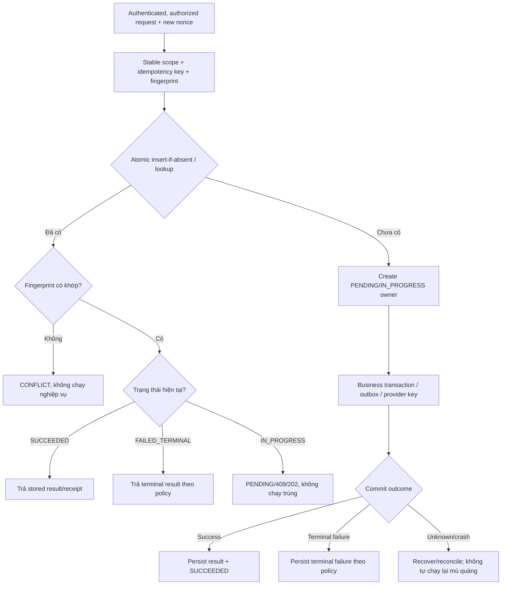
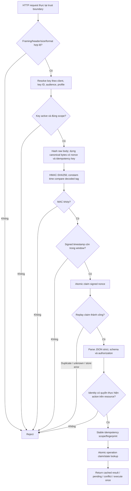

# Retry an toàn trong hệ thống HTTP HMAC và Idempotency

> **Chương:** Idempotency  
> **Bài học:** Retry an toàn — gửi lại một thao tác HTTP khi kết quả lần gửi trước không rõ, mà không phá cơ chế chống replay hoặc gây side effect lặp.  
> **Ngữ cảnh module:** `SECURITY_AUTHENTICATION_HMAC_REQUEST_AUTHENTICATION` thiết kế xác thực request bằng HMAC với shared secret và canonical request chứa HTTP method, URI, header hoặc body theo hợp đồng ký. Bài học kết nối việc ký lại từng attempt, timestamp/nonce, key rotation, proxy/gateway và phân biệt xác thực với phân quyền.

## 1. Vấn đề: timeout không đồng nghĩa thao tác thất bại

Một client gọi API chuyển tiền:

```http
POST /v1/transfers?mode=commit HTTP/1.1
Host: payments.example.test
Content-Type: application/json
X-Client-Id: partner-01
X-Key-Id: key-2026-11
X-Timestamp: 1795800000
X-Nonce: XmHBya_-SlqK4GWXmr09MQ
X-Idempotency-Key: transfer-101
X-Signature: <base64url-hmac-sha256>

{"transferId":"transfer-101","amountMinorUnits":100000}
```

Server có thể đã xác minh HMAC, claim nonce, ghi transaction thành công và gửi response. Nhưng response bị mất khi gateway đóng kết nối. Client chỉ thấy timeout và **không biết** server đã commit hay chưa.

Nếu gửi lại nguyên request đã ký, nonce cũ bị chặn bởi replay protection. Nếu ký một request mới với nonce khác mà không có idempotency, backend có thể **chuyển tiền hai lần**.

Hai kết quả sau đều nguy hiểm nếu hiểu sai:

- **Request không đến server:** retry là cần thiết để hoàn thành công việc.
- **Request đã commit nhưng response mất:** retry thiếu kiểm soát có thể nhân đôi side effect.

Retry an toàn đòi hỏi **hai quyết định độc lập**:

1. Mỗi network attempt được xác thực lại theo cơ chế HMAC: timestamp mới phù hợp, nonce mới, chữ ký mới; request vẫn mang đầy đủ method, target, headers và body đã ký.
2. Tất cả attempts thuộc **cùng một thao tác nghiệp vụ** dùng chung idempotency key và một hợp đồng request fingerprint ổn định; backend trả kết quả đã lưu hoặc báo đang xử lý, **không lặp tác động**.

**Tuyên bố cốt lõi:** *Nonce nhận diện một attempt đã ký; idempotency key nhận diện một operation nghiệp vụ.* Một cơ chế không thay thế cơ chế còn lại.

## 2. Ba lớp bảo vệ không được gộp làm một

| Lớp | Dữ liệu chính | Việc bảo vệ | Không tự bảo vệ |
| --- | --- | --- | --- |
| **HMAC authentication** | Shared secret, canonical request, tag | Toàn vẹn và xác thực bytes/identity trong phạm vi ký | Request đã được gửi trước đó hay chưa |
| **Replay protection** | Signed timestamp, signed nonce, atomic replay store | Chặn sử dụng lại cùng nonce trong cửa sổ hợp lệ | Hai attempts mới có nonce khác nhưng cùng giao dịch |
| **Business idempotency** | Signed idempotency key, authenticated scope, stable operation fingerprint, result | Không lặp side effect của cùng operation | Xác thực ai được quyền ra lệnh hoặc chặn phát lại nguyên request |

Ví dụ:

```text
Attempt A:
  timestamp = T1
  nonce = N1
  signature = HMAC(secret, canonical(...T1, N1, key=transfer-101...))
  idempotencyKey = transfer-101

Attempt B (retry cùng operation):
  timestamp = T2
  nonce = N2        // BẮT BUỘC MỚI
  signature = HMAC(secret, canonical(...T2, N2, key=transfer-101...))
  idempotencyKey = transfer-101  // GIỮ NGUYÊN
```

Server kiểm tra A và B là hai attempts riêng; business store kiểm tra chúng cùng một operation.

### 2.1 HTTP idempotent method không thay cho idempotency key

Theo ngữ nghĩa HTTP, GET, HEAD, PUT và DELETE thường được định nghĩa có tính *idempotent* ở cấp **hiệu ứng dự định lên tài nguyên** khi gửi cùng request nhiều lần; POST thường không có bảo đảm đó. Tuy vậy:

- Một `PUT` lặp có thể ghi log/audit hoặc kích hoạt hệ thống ngoài không được thiết kế tốt; cần phân tích triển khai thật.
- `DELETE` lặp có thể trả HTTP status khác dù trạng thái tài nguyên cuối giống nhau.
- `POST /transfers` dễ tạo giao dịch mới cho mỗi lần chạy.
- Một API POST có thể **thiết kế** idempotent với operation ID/idempotency key.

**Không kết luận "PUT luôn an toàn khi retry" hoặc "POST không thể retry".** Phải xét semantics thực, side effects, hợp đồng idempotency và các bước xác thực.

### 2.2 Idempotency khác exactly-once delivery

Không nên hứa "HTTP gửi đúng một lần" trong một mạng không đáng tin: client có thể gửi lại, proxy retry và response có thể mất. Mục tiêu khả thi là **xử lý side effect của một operation tối đa một lần theo scope và retention đã định**, kết hợp với khả năng tra cứu/trả lại kết quả.

Đối với external payment processor, email hoặc queue bên thứ ba, muốn đạt hiệu quả tương đương exactly-once còn phải dùng **transactional outbox**, idempotency key phía provider hoặc cơ chế dedupe tại hệ thống nhận. Chỉ thêm một row idempotency trong database nội bộ chưa bảo đảm một external side effect không bị thực hiện hai lần khi crash.

## 3. Phân biệt signed attempt và business operation

### 3.1 Những giá trị cần thay đổi khi retry

| Thành phần | Attempt đầu | Attempt retry cùng operation | Vì sao? |
| --- | --- | --- | --- |
| Client identity | `partner-01` | Giữ nguyên | Scope của quyền và idempotency |
| Audience | `payments-api-prod` | Giữ nguyên | Không đổi môi trường/đích tùy tiện |
| Method và target | `POST /v1/transfers?mode=commit` | Giữ nguyên | Cùng operation |
| Raw JSON body | Bytes B | Giữ **cùng bytes B** nếu profile yêu cầu | Fingerprint nghiệp vụ ổn định |
| `X-Idempotency-Key` | `transfer-101` | **Giữ nguyên** | Business operation identity |
| `X-Timestamp` | `T1` | Sinh mới theo clock (có thể cùng giây) | Bảo đảm nằm trong cửa sổ |
| `X-Nonce` | `N1` | **Sinh N2 khác N1** | Không tái dùng signed nonce |
| `X-Signature` | `M1` | **Tính lại M2** | Phải ký timestamp/nonce mới |
| `X-Key-Id` | `key-old` | Có thể chuyển `key-new` theo rotation policy | Chọn active secret; vẫn cùng business operation |
| Correlation/attempt ID | `attempt-1` | `attempt-2` | Trace được các lần gửi |

Timestamp của hai attempts có thể **bằng số nguyên** nếu cùng ký trong một giây. Điều kiện quan trọng là nonce khác nhau, request được ký lại và timestamp vẫn hợp lệ.

Key ID không nên là một phần của business idempotency scope nếu mục tiêu là tiếp tục cùng operation qua key rotation. Kẻ được xác thực ở phía server vẫn cần thuộc cùng client/tenant và policy.

### 3.2 Những giá trị không được âm thầm đổi

Một retry cùng idempotency key mà đổi `amountMinorUnits` từ `100000` thành `900000` là **xung đột operation**, không phải phiên bản mới của giao dịch cũ.

Tương tự, tự đổi target từ `mode=commit` thành `mode=preview`, đổi tenant, currency hoặc người thụ hưởng trong cùng idempotency key là lỗi hợp đồng. Server phải lưu **stable request fingerprint** và từ chối reuse key cho payload/operation khác.

Nếu người dùng thật sự muốn một giao dịch mới, cần operation ID/idempotency key mới và bước cấp quyền nghiệp vụ tương ứng.

### 3.3 Retry có thể gặp response khác nhưng cùng kết quả

Giả sử attempt A trả `201 Created` nếu response tới nơi. Attempt B có thể được trả:

- Response đã lưu, kể cả HTTP status/body hoặc receipt reference theo hợp đồng.
- `200 OK` kèm receipt của operation đã commit.
- `202 Accepted`/`409 Conflict` khi attempt đầu còn đang xử lý, kèm trạng thái/Retry-After theo API.
- Một endpoint tra cứu trạng thái nếu API không trả nguyên response cũ.

Không có quy tắc phổ quát rằng mọi API bắt buộc trả cùng status code khi retry; **hợp đồng phải nói rõ**, nhất là với lỗi, thay đổi version và các kết quả có dữ liệu nhạy cảm.

## 4. Timeline điển hình: server đã commit nhưng response mất

```mermaid
sequenceDiagram
    participant C as Client SDK
    participant G as Gateway
    participant V as HMAC verifier
    participant R as Replay store
    participant I as Idempotency / DB
    participant P as Business processor
    C->>C: Chốt body B, key=K
    C->>C: Sinh T1,N1, HMAC M1
    C->>G: Attempt A: K, T1,N1,M1, B
    G->>V: Forward signed request A
    V->>V: HMAC valid + timestamp valid
    V->>R: Claim nonce N1
    R-->>V: NEW
    V->>I: Atomic claim business key K + fingerprint F
    I-->>V: OWNER
    V->>P: Xử lý operation K
    P-->>I: Commit receipt / durable result
    Note over G,C: Response bị mất trên đường về
    C->>C: Không biết server đã xử lý chưa
    C->>C: Sinh T2,N2, HMAC M2; giữ K, B
    C->>G: Attempt B: K, T2,N2,M2, B
    G->>V: Forward signed request B
    V->>V: HMAC valid + timestamp valid
    V->>R: Claim nonce N2
    R-->>V: NEW
    V->>I: Lookup/claim K + fingerprint F
    I-->>V: Đã có kết quả của K
    V-->>C: Trả receipt/result đã lưu
```

Điểm khó là client **không biết kết quả attempt A**. Thay vì suy đoán từ timeout, client gửi attempt mới đúng hợp đồng và để business idempotency store quyết định.

### 4.1 Nếu gửi lại chính attempt A thì sao?

```text
Attempt A đầu tiên:
  signed nonce N1 -> replay claim NEW -> có thể xử lý

Attempt A lặp:
  signed nonce N1 -> replay claim ALREADY_USED -> REJECT
```

Đây là hành vi anti-replay đúng. Không bỏ qua nonce check chỉ vì idempotency key đã tồn tại. Nếu cần biết kết quả operation, client dùng **re-signed attempt** với nonce mới hoặc một endpoint GET/status riêng được xác thực và cấp quyền.

### 4.2 Nếu attempt A chưa bao giờ tới server?

Attempt B có nonce mới và cùng idempotency key sẽ được nhận lần đầu tại idempotency store. Server xử lý operation bình thường. Hai trường hợp “A chưa đến” và “A đã commit” được giải quyết bằng cùng giao thức retry mà không cần client đoán.

### 4.3 Nếu attempt A còn đang xử lý?

Store có thể trả `IN_PROGRESS`, `PENDING`, `202`, `409` hoặc một receipt để client poll tùy thiết kế. Quan trọng là **attempt B không được chạy cùng side effect song song**.

Nếu nhiều HTTP attempts cùng key đến đồng thời, các request có nonce mới riêng vẫn có thể qua anti-replay. Business store phải bảo đảm chỉ **một attempt giành quyền sở hữu operation**.

## 5. Idempotency key: sinh, scope và retention

### 5.1 Ai sinh key và format thế nào?

Client sinh hoặc nhận từ hệ thống nghiệp vụ một idempotency key bền vững cho **một operation** trước khi phát attempt đầu. Có thể dùng UUID ngẫu nhiên, một transaction ID ổn định hoặc định danh được server chấp thuận.

Ví dụ:

```http
X-Idempotency-Key: transfer-101
```

Không dùng một giá trị cố định cho **mọi** giao dịch; không dùng timestamp giây đơn thuần làm operation ID khi nhiều giao dịch có thể chạy cùng giây. Nếu dùng key do người dùng điều khiển, giới hạn chiều dài, charset và khả năng gây cardinality bất thường.

Ví dụ profile sử dụng ASCII:

```text
[A-Za-z0-9._-]{1,80}
```

Đây là grammar **minh họa**, không phải đặc tả chung của mọi API Idempotency-Key. Các API khác có thể dùng một standard field hoặc quy tắc riêng.

### 5.2 Scope của business key phải gắn danh tính đã xác thực

Một namespace thích hợp:

```text
(audience, authenticatedTenant, authenticatedClientId,
 operationType, idempotencyKey)
```

Trong đó:

- `authenticatedClientId` đến từ key đã qua HMAC, không chỉ từ header không được chứng thực.
- `authenticatedTenant`/account scope phải đến từ authorization đáng tin.
- `operationType` có thể là API route template, method hoặc một operation code.
- `idempotencyKey` gắn operation cụ thể.
- `keyId` và `nonce` **không** nên tự động xuất hiện trong business key, vì thay đổi chúng không tạo operation mới.

Một client A không được đọc response idempotency của client B chỉ vì biết key trùng. Sau khi MAC và quyền được xác minh, server mới tra/trả result thuộc đúng scope.

### 5.3 TTL idempotency không giống TTL replay store

| Chính sách | Replay nonce | Business idempotency |
| --- | --- | --- |
| Mục tiêu | Không chấp nhận một signed nonce lần thứ hai | Không lặp operation khi retry |
| Vòng đời | Theo signed timestamp validity window | Theo thời gian nghiệp vụ có thể retry/đối soát |
| Ví dụ minh họa | `PAST=300`, `FUTURE=60` → ≥360s + margin, ví dụ 420s | 24 giờ, 48 giờ hoặc lâu hơn **tùy hợp đồng** |
| Key | Client/audience/nonce | Tenant/client/operation/idempotency key |
| Durability | Phải đủ chống replay qua failover | Thường cần lưu bền vững với kết quả nghiệp vụ |
| Hết hạn | Sau khi request timestamp chắc chắn không còn hợp lệ | Chỉ hết hạn theo chính sách retention đã công bố |

**Không copy TTL nonce 420 giây làm TTL idempotency.** Client có thể retry sau 30 phút hoặc một ngày theo hợp đồng, và nếu kết quả nghiệp vụ đã commit nhưng idempotency record biến mất, rủi ro double-charge xuất hiện.

Retention phải đáp ứng cả yêu cầu an toàn, chi phí lưu trữ, dữ liệu cá nhân và vòng đời nghiệp vụ. Sau khi hết hạn, key có thể được coi là mới **nếu hợp đồng cho phép**; với giao dịch tài chính nên có transaction ID/business uniqueness độc lập để ngăn việc tạo lại ngoài retention.

## 6. Stable operation fingerprint: bảo vệ reuse key với payload khác

Một idempotency key chỉ có tác dụng nếu server biết **request thuộc operation nào**. Nếu server chỉ kiểm tra “key đã tồn tại” mà không so fingerprint, client có thể dùng lại key với payload khác và nhận kết quả sai.

### 6.1 Những thành phần nên đưa vào fingerprint

Tạo fingerprint từ các thành phần **ổn định giữa attempts của cùng nghiệp vụ**:

```text
businessFingerprint = SHA256(
    "idempotency-payload-v1" + LF
    + audience + LF
    + authenticatedClientId + LF
    + operationType + LF
    + HTTP method + LF
    + canonical business target + LF
    + Content-Type + LF
    + SHA256(rawBodyBytes) as lowercase hex
)
```

Các field thực tế phụ thuộc API. Nếu backend xử lý tenant ID, destination account, currency, content encoding hoặc signed business headers, chúng cần được phản ánh vào scope/fingerprint bằng quy tắc không nhập nhằng.

**Không đưa** các giá trị attempt-specific sau vào stable fingerprint:

- Timestamp;
- Nonce;
- Signature;
- Key ID khi rotate cùng client;
- Connection ID, proxy IP, trace attempt ID.

Nếu đưa nonce vào fingerprint, mỗi retry hợp lệ sẽ có fingerprint khác và bị báo conflict dù cùng operation.

### 6.2 Ký raw JSON bytes và conflict whitespace

Với raw-body signing, hai JSON documents sau có thể biểu đạt cùng object nghiệp vụ nhưng có bytes khác:

```json
{"amountMinorUnits":100000,"currency":"VND"}
```

```json
{ "currency": "VND", "amountMinorUnits": 100000 }
```

Nếu fingerprint dùng SHA-256 **raw body bytes**, server sẽ coi chúng **khác fingerprint** khi dùng cùng idempotency key và trả conflict. Đây là một chính sách hợp lệ và dễ kiểm toán.

Nếu ứng dụng muốn coi hai biểu diễn JSON tương đương, cần **schema-aware canonical JSON protocol** đã được đặc tả và kiểm thử, từ chối duplicate keys, xử lý số/Unicode đúng. Không tự parse rồi serialize lại tùy thư viện hoặc chọn cách nào giúp fingerprint khớp.

### 6.3 Ràng buộc fingerprint sau HMAC và authorization

Một raw body hash là digest **không có secret**. Nó chỉ đại diện bytes, không chứng minh sender được phép. Phải tra idempotency record theo **identity và tenant đã xác thực**, kiểm tra quyền rồi mới có thể trả lại receipt/response thuộc operation đó.

Không trả cached response của một client khác chỉ vì chúng gửi cùng idempotency key hoặc cùng body hash.

## 7. State machine của idempotency store

Một implementation production không chỉ là map `key → response`. Nó cần mô hình trạng thái để xử lý concurrent attempts, crash, external side effects và kết quả chưa xác định.



### 7.1 Các trạng thái cần hiểu

| Trạng thái | Ý nghĩa | Hành vi retry cùng key/fingerprint |
| --- | --- | --- |
| `NEW` | Chưa có operation record | Một attempt giành quyền tạo record |
| `IN_PROGRESS` | Đã có owner xử lý nhưng chưa commit kết quả | Trả pending hoặc cho client poll; **không chạy side effect mới** |
| `SUCCEEDED` | Side effect và receipt bền vững | Trả kết quả đã lưu theo policy |
| `FAILED_TERMINAL` | Lỗi nghiệp vụ cuối cùng được lưu | Trả lỗi đã lưu; không thực thi lại nếu policy cho đây là kết thúc |
| `FAILED_RETRYABLE` | Lỗi trước khi side effect/đã chứng minh an toàn retry | Có thể cho phép retry theo state transition rõ |
| `UNKNOWN` | Không rõ side effect đã commit hay chưa | Reconcile; **không coi là chưa xử lý** |
| `CONFLICT` | Same key nhưng fingerprint khác | Từ chối; yêu cầu operation ID mới nếu là nghiệp vụ mới |

Các trạng thái chỉ là một mô hình gợi ý. Điều quan trọng là **state transition nguyên tử** và dữ liệu phục hồi đủ để xử lý crash. Không tạo lại operation vì thấy `IN_PROGRESS` đã lâu mà chưa kiểm tra kết quả transaction/external provider.

### 7.2 Cơ chế ownership nguyên tử

Ý tưởng SQL:

```sql
CREATE TABLE idempotency_operations (
    tenant_id           VARCHAR(80) NOT NULL,
    client_id           VARCHAR(80) NOT NULL,
    operation_type      VARCHAR(80) NOT NULL,
    idempotency_key     VARCHAR(120) NOT NULL,
    request_fingerprint CHAR(64) NOT NULL,
    state               VARCHAR(32) NOT NULL,
    result_reference    VARCHAR(200),
    expires_at          TIMESTAMP WITH TIME ZONE NOT NULL,
    PRIMARY KEY (
        tenant_id, client_id, operation_type, idempotency_key
    )
);
```

Dùng unique constraint hoặc atomic insert-if-absent để một request trở thành **owner**. Một luồng khác thấy conflict/đã tồn tại rồi kiểm tra fingerprint và state.

**Không** viết:

```text
if idempotencyKey not found:
    executeTransfer()
    insertIdempotencyRecord()
```

Hai requests đồng thời có thể cùng thấy key chưa tồn tại, cùng chuyển tiền, rồi tranh chấp ở bước insert — **quá muộn**.

### 7.3 DB transaction và side effect phải gắn với nhau

Nếu side effect là ghi một bảng nội bộ, lý tưởng thực hiện trong **một transaction** cùng cập nhật trạng thái/result idempotency (với khóa và isolation phù hợp). Nếu gọi payment provider bên ngoài, database transaction nội bộ không thể rollback cuộc gọi ngoài đã thành công. Khi đó cần:

- Provider-side idempotency key gắn operation;
- Transactional outbox để phát event ít nhất một lần nhưng consumer dedupe;
- Correlation ID và cơ chế tra cứu/reconcile trạng thái;
- Lease/owner token có fencing để tránh worker cũ và worker mới cùng commit;
- Trạng thái `UNKNOWN` sau timeout, không coi là “chắc chắn thất bại”;
- Chính sách không tự xóa idempotency record khi side effect có thể đã xảy ra.

Một exception ở giữa “side effect thành công” và “lưu result” là lỗ hổng kinh điển. **Chỉ lưu key trước side effect không đủ**, cần xử lý trường hợp crash/recovery.

### 7.4 Có nên lưu response lỗi?

Phụ thuộc hợp đồng:

- Lỗi business terminal (ví dụ giao dịch bị từ chối do tài khoản bị khóa) có thể được lưu và trả lại nhất quán.
- Lỗi validation/authentication trước khi operation được tiếp nhận thường không nên chiếm idempotency key nghiệp vụ, nhưng nonce HMAC vẫn phải theo policy.
- Lỗi hạ tầng `503` xảy ra trước khi có side effect có thể retry nếu có bằng chứng an toàn.
- Timeout sau khi gọi provider nhưng chưa biết kết quả phải ghi `UNKNOWN` và reconcile, **không chạy lại mù quáng**.

Không tuyên bố mọi lỗi `5xx` đều có thể retry, hoặc mọi `4xx` đều không retry. Phải dựa vào trạng thái nghiệp vụ và policy riêng.

## 8. Thứ tự server xử lý một retry đã ký

Một HTTP HMAC verifier an toàn nên đi qua các ranh giới:



Một số hệ thống chọn thứ tự parse/schema/authorization khác để tiết kiệm tài nguyên hoặc chống DoS; dù chọn cách nào, không được thực hiện side effect trước các kiểm tra bảo mật bắt buộc, không được cấp quyền bằng header chưa xác thực và không được bỏ qua nonce gate vì idempotency key đã có.

**HMAC đúng không tự cấp quyền**: client được nhận diện bởi shared secret vẫn phải có quyền thực hiện chuyển tiền từ tài khoản/tenant mục tiêu.

### 8.1 Replay store và idempotency store không dùng cùng key

```text
Replay namespace:
  (audience, authenticatedClientId, nonce)

Idempotency namespace:
  (audience, authenticatedTenant, authenticatedClientId,
   operationType, idempotencyKey)
```

Đặt `nonce` vào business key sẽ khiến mỗi retry có một operation mới và phá idempotency. Đặt `idempotencyKey` vào replay key sẽ khiến attempt mới cùng nghiệp vụ bị coi là replay dù đã có nonce mới.

### 8.2 TTL nonce tính từ timestamp window

Với signed timestamp `t` được chấp nhận khi:

\[
now - PAST \le t \le now + FUTURE,
\]

thời gian request có thể còn hợp lệ từ lần claim sớm nhất đến hạn cuối là `PAST + FUTURE`.

Ví dụ `PAST=300` giây, `FUTURE=60` giây → tối đa **360 giây**, nên một TTL minh họa `420 giây` có thêm 60 giây dự phòng nếu đã đánh giá phù hợp. Đây là TTL **anti-replay**, không phải TTL idempotency.

Một lựa chọn atomic claim trên Redis primary:

```redis
SET hmac-replay:v1:payments-api-prod:partner-01:<nonce> 1 NX EX 420
```

`SET NX EX` bảo đảm atomic trên primary đó nhưng không mặc nhiên bảo đảm durability qua failover với replication bất đồng bộ hay uniqueness khi dùng nhiều primary ở nhiều region. Khi store không sẵn sàng hoặc kết quả không chắc chắn, **fail closed**.

## 9. Java 17: ký lại HTTP attempt và xử lý idempotency

Ví dụ dưới đây dùng **chỉ JDK 17** và không gọi mạng. Nó mô phỏng cả signer client, verifier HMAC và business idempotency gate. Những phần có thể kiểm tra trực tiếp:

1. Client chốt raw JSON body bytes và idempotency key.
2. Mỗi lần ký sinh nonce 16 bytes bằng `SecureRandom`, timestamp theo `Clock` và tag HMAC mới.
3. Server dựng canonical bytes từ fields mô phỏng, so MAC bằng `MessageDigest.isEqual`.
4. Server kiểm tra cửa sổ timestamp và claim signed nonce.
5. Sau đó business store dùng `ConcurrentHashMap.putIfAbsent` để tránh hai luồng cùng tạo operation.
6. Request cùng key và fingerprint nhận cached result; reuse key với body khác nhận conflict.
7. Test exact replay, tampered idempotency key, signed expired request, replay-store outage và concurrency.

**Giới hạn:** Đây là mô hình trong một JVM; không có HTTP parser, TLS, JSON parser, database transaction, crash recovery hay replay-store TTL. Mã này **không được dùng nguyên dạng để xử lý thanh toán production**. Mục tiêu là minh họa mối quan hệ giữa retry, nonce và idempotency.

Lưu thành `SafeRetryHmacDemo.java`:

```java
import java.nio.charset.StandardCharsets;
import java.security.GeneralSecurityException;
import java.security.MessageDigest;
import java.security.SecureRandom;
import java.time.Clock;
import java.time.Instant;
import java.time.ZoneOffset;
import java.util.Base64;
import java.util.HexFormat;
import java.util.Set;
import java.util.concurrent.Callable;
import java.util.concurrent.ConcurrentHashMap;
import java.util.concurrent.CountDownLatch;
import java.util.concurrent.ExecutorService;
import java.util.concurrent.Executors;
import java.util.concurrent.Future;
import java.util.concurrent.atomic.AtomicInteger;

import javax.crypto.Mac;
import javax.crypto.spec.SecretKeySpec;

public final class SafeRetryHmacDemo {
    private static final String PROFILE = "hmac-safe-retry-v1";
    private static final String AUDIENCE = "payments-api-prod";
    private static final String METHOD = "POST";
    private static final String TARGET =
            "/v1/transfers?mode=commit";
    private static final String CONTENT_TYPE = "application/json";
    private static final String CLIENT_ID = "partner-01";
    private static final String KEY_ID = "key-2026-11";
    private static final long MAX_PAST = 300;
    private static final long MAX_FUTURE = 60;

    private SafeRetryHmacDemo() {}

    enum Outcome {
        CREATED, CACHED, IN_PROGRESS, CONFLICT,
        BAD_FORMAT, BAD_SIGNATURE, EXPIRED,
        FUTURE_TIMESTAMP, REPLAY, REPLAY_STORE_UNAVAILABLE
    }

    record SignedAttempt(
            String method,
            String rawTarget,
            String contentType,
            String clientId,
            String keyId,
            String timestamp,
            String nonce,
            String idempotencyKey,
            byte[] body,
            String signature) {

        public SignedAttempt {
            body = body == null ? null : body.clone();
        }

        @Override
        public byte[] body() {
            return body == null ? null : body.clone();
        }
    }

    interface ReplayStore {
        boolean claimOnce(String key) throws StoreUnavailable;
    }

    static final class StoreUnavailable extends Exception {
        StoreUnavailable(String reason) {
            super(reason);
        }
    }

    // Chỉ minh họa atomicity trong một JVM. KHÔNG có TTL/durability.
    static final class MemoryReplayStore implements ReplayStore {
        private final Set<String> seen = ConcurrentHashMap.newKeySet();

        @Override
        public boolean claimOnce(String key) {
            return seen.add(key);
        }
    }

    static final class Entry {
        final String fingerprint;
        volatile String receipt;

        Entry(String fingerprint) {
            this.fingerprint = fingerprint;
        }
    }

    static final class MemoryIdempotencyStore {
        private final ConcurrentHashMap<String, Entry> operations =
                new ConcurrentHashMap<>();
        private final AtomicInteger sideEffects = new AtomicInteger();

        // Trả kết quả có sẵn hoặc mô phỏng một side effect.
        // Production cần DB transaction + crash recovery.
        Outcome executeOnce(String scopeKey, String fingerprint) {
            Entry proposed = new Entry(fingerprint);
            Entry existing = operations.putIfAbsent(scopeKey, proposed);

            if (existing == null) {
                // Chỉ một thread thắng putIfAbsent cho scopeKey.
                String receipt = "receipt-"
                        + sideEffects.incrementAndGet();
                proposed.receipt = receipt;
                return Outcome.CREATED;
            }

            if (!existing.fingerprint.equals(fingerprint)) {
                return Outcome.CONFLICT;
            }

            return existing.receipt == null
                    ? Outcome.IN_PROGRESS
                    : Outcome.CACHED;
        }

        int sideEffectCount() {
            return sideEffects.get();
        }
    }

    static String newNonce(SecureRandom rng) {
        byte[] bytes = new byte[16];
        rng.nextBytes(bytes);
        return Base64.getUrlEncoder().withoutPadding()
                .encodeToString(bytes);
    }

    static boolean validNonce(String nonce) {
        if (nonce == null
                || !nonce.matches("[A-Za-z0-9_-]{22}")) {
            return false;
        }
        try {
            byte[] raw = Base64.getUrlDecoder().decode(nonce);
            return raw.length == 16
                    && Base64.getUrlEncoder().withoutPadding()
                            .encodeToString(raw).equals(nonce);
        } catch (IllegalArgumentException malformed) {
            return false;
        }
    }

    static boolean validFields(SignedAttempt a) {
        return a != null
                && METHOD.equals(a.method())
                && TARGET.equals(a.rawTarget())
                && CONTENT_TYPE.equals(a.contentType())
                && CLIENT_ID.equals(a.clientId())
                && KEY_ID.equals(a.keyId())
                && a.timestamp() != null
                && a.timestamp().matches("[1-9][0-9]{9,11}")
                && validNonce(a.nonce())
                && a.idempotencyKey() != null
                && a.idempotencyKey()
                        .matches("[A-Za-z0-9._-]{1,80}")
                && a.body() != null
                && a.body().length > 0
                && a.body().length <= 1_048_576;
    }

    static String sha256Hex(byte[] bytes)
            throws GeneralSecurityException {
        return HexFormat.of().formatHex(
                MessageDigest.getInstance("SHA-256").digest(bytes));
    }

    static byte[] canonicalBytes(SignedAttempt a)
            throws GeneralSecurityException {
        if (!validFields(a)) {
            throw new IllegalArgumentException("Invalid signed fields");
        }

        String text = String.join("\n",
                PROFILE,
                AUDIENCE,
                a.method(),
                a.rawTarget(),
                a.contentType(),
                a.clientId(),
                a.keyId(),
                a.timestamp(),
                a.nonce(),
                a.idempotencyKey(),
                sha256Hex(a.body()));

        return text.getBytes(StandardCharsets.UTF_8);
    }

    static byte[] hmac(byte[] secret, byte[] message)
            throws GeneralSecurityException {
        Mac mac = Mac.getInstance("HmacSHA256");
        mac.init(new SecretKeySpec(secret, "HmacSHA256"));
        return mac.doFinal(message);
    }

    static SignedAttempt signNewAttempt(
            byte[] secret,
            byte[] serializedBody,
            String idempotencyKey,
            Clock clock,
            SecureRandom rng) throws GeneralSecurityException {

        if (secret == null || secret.length < 32
                || serializedBody == null || clock == null || rng == null) {
            throw new IllegalArgumentException("Bad signer input");
        }
        byte[] snapshot = serializedBody.clone();
        SignedAttempt draft = new SignedAttempt(
                METHOD, TARGET, CONTENT_TYPE,
                CLIENT_ID, KEY_ID,
                Long.toString(clock.instant().getEpochSecond()),
                newNonce(rng), idempotencyKey, snapshot, "");

        String tag = Base64.getUrlEncoder()
                .withoutPadding()
                .encodeToString(hmac(secret, canonicalBytes(draft)));

        return new SignedAttempt(
                draft.method(), draft.rawTarget(),
                draft.contentType(), draft.clientId(), draft.keyId(),
                draft.timestamp(), draft.nonce(),
                draft.idempotencyKey(), draft.body(), tag);
    }

    // Fingerprint CỐ Ý không chứa nonce, timestamp, key ID, signature.
    static String stableFingerprint(SignedAttempt a)
            throws GeneralSecurityException {
        String stableText = String.join("\n",
                "idempotency-payload-v1",
                AUDIENCE,
                a.clientId(),
                a.method(),
                a.rawTarget(),
                a.contentType(),
                sha256Hex(a.body()));
        return sha256Hex(stableText.getBytes(StandardCharsets.UTF_8));
    }

    static Outcome verifyAndExecute(
            byte[] resolvedSecret,
            SignedAttempt a,
            Clock serverClock,
            ReplayStore replay,
            MemoryIdempotencyStore business)
            throws GeneralSecurityException {

        if (resolvedSecret == null || resolvedSecret.length < 32
                || serverClock == null || replay == null
                || business == null || !validFields(a)
                || a.signature() == null
                || !a.signature().matches("[A-Za-z0-9_-]{43}")) {
            return Outcome.BAD_FORMAT;
        }

        final byte[] provided;
        try {
            provided = Base64.getUrlDecoder().decode(a.signature());
        } catch (IllegalArgumentException invalidBase64) {
            return Outcome.BAD_FORMAT;
        }

        if (provided.length != 32
                || !Base64.getUrlEncoder().withoutPadding()
                        .encodeToString(provided).equals(a.signature())) {
            return Outcome.BAD_FORMAT;
        }

        byte[] expected = hmac(resolvedSecret, canonicalBytes(a));
        if (!MessageDigest.isEqual(expected, provided)) {
            return Outcome.BAD_SIGNATURE;
        }

        // Timestamp đã được HMAC bảo vệ.
        long signedAt = Long.parseLong(a.timestamp());
        long now = serverClock.instant().getEpochSecond();
        final long oldest;
        final long newest;
        try {
            oldest = Math.subtractExact(now, MAX_PAST);
            newest = Math.addExact(now, MAX_FUTURE);
        } catch (ArithmeticException overflow) {
            return Outcome.BAD_FORMAT;
        }

        if (signedAt < oldest) return Outcome.EXPIRED;
        if (signedAt > newest) return Outcome.FUTURE_TIMESTAMP;

        // Production: shared atomic claim + TTL, fail closed.
        String replayKey = AUDIENCE + ":" + CLIENT_ID + ":" + a.nonce();
        try {
            if (!replay.claimOnce(replayKey)) {
                return Outcome.REPLAY;
            }
        } catch (StoreUnavailable unavailable) {
            return Outcome.REPLAY_STORE_UNAVAILABLE;
        }

        // Đây là demo. Production phải parse JSON nghiêm ngặt và
        // kiểm tra authorization trước khi truy cập business result.
        String scopeKey = AUDIENCE + ":" + CLIENT_ID
                + ":" + METHOD + ":" + TARGET
                + ":" + a.idempotencyKey();

        return business.executeOnce(scopeKey, stableFingerprint(a));
    }

    static SignedAttempt withIdempotencyKey(
            SignedAttempt a, String changedKey) {
        return new SignedAttempt(
                a.method(), a.rawTarget(), a.contentType(),
                a.clientId(), a.keyId(), a.timestamp(),
                a.nonce(), changedKey, a.body(), a.signature());
    }

    public static void main(String[] args) throws Exception {
        SecureRandom rng = new SecureRandom();
        byte[] secret = new byte[32];
        rng.nextBytes(secret);

        Clock clock = Clock.fixed(
                Instant.parse("2026-11-28T02:00:00Z"),
                ZoneOffset.UTC);

        byte[] bodyA = (
                "{\"transferId\":\"transfer-101\","
                + "\"amountMinorUnits\":100000}"
        ).getBytes(StandardCharsets.UTF_8);
        byte[] bodyChanged = (
                "{\"transferId\":\"transfer-101\","
                + "\"amountMinorUnits\":900000}"
        ).getBytes(StandardCharsets.UTF_8);

        ReplayStore replay = new MemoryReplayStore();
        MemoryIdempotencyStore business =
                new MemoryIdempotencyStore();

        SignedAttempt first = signNewAttempt(
                secret, bodyA, "transfer-101", clock, rng);
        System.out.println("First: "
                + verifyAndExecute(secret, first, clock, replay, business));
        System.out.println("Exact network replay: "
                + verifyAndExecute(secret, first, clock, replay, business));

        SignedAttempt retry = signNewAttempt(
                secret, bodyA, "transfer-101", clock, rng);
        System.out.println("Nonce changed: "
                + !first.nonce().equals(retry.nonce()));
        System.out.println("Re-signed retry: "
                + verifyAndExecute(secret, retry, clock, replay, business));

        SignedAttempt conflict = signNewAttempt(
                secret, bodyChanged, "transfer-101", clock, rng);
        System.out.println("Same key, changed body: "
                + verifyAndExecute(
                        secret, conflict, clock, replay, business));

        SignedAttempt tampered = withIdempotencyKey(
                first, "transfer-tampered");
        System.out.println("Tampered key, old signature: "
                + verifyAndExecute(
                        secret, tampered, clock, replay, business));

        Clock oldClock = Clock.offset(
                clock, java.time.Duration.ofSeconds(-301));
        SignedAttempt expired = signNewAttempt(
                secret, bodyA, "transfer-101", oldClock, rng);
        System.out.println("Signed expired attempt: "
                + verifyAndExecute(
                        secret, expired, clock, replay, business));

        ReplayStore unavailable = key -> {
            throw new StoreUnavailable("timeout");
        };
        SignedAttempt fresh = signNewAttempt(
                secret, bodyA, "transfer-101", clock, rng);
        System.out.println("Replay store outage: "
                + verifyAndExecute(
                        secret, fresh, clock, unavailable, business));

        byte[] bodyB = (
                "{\"transferId\":\"transfer-102\","
                + "\"amountMinorUnits\":100000}"
        ).getBytes(StandardCharsets.UTF_8);

        SignedAttempt parallelA = signNewAttempt(
                secret, bodyB, "transfer-102", clock, rng);
        SignedAttempt parallelB = signNewAttempt(
                secret, bodyB, "transfer-102", clock, rng);

        CountDownLatch start = new CountDownLatch(1);
        ExecutorService pool = Executors.newFixedThreadPool(2);
        Callable<Outcome> taskA = () -> {
            start.await();
            return verifyAndExecute(
                    secret, parallelA, clock, replay, business);
        };
        Callable<Outcome> taskB = () -> {
            start.await();
            return verifyAndExecute(
                    secret, parallelB, clock, replay, business);
        };

        try {
            Future<Outcome> a = pool.submit(taskA);
            Future<Outcome> b = pool.submit(taskB);
            start.countDown();
            Outcome resultA = a.get();
            Outcome resultB = b.get();
            long createdCount =
                    (resultA == Outcome.CREATED ? 1 : 0)
                    + (resultB == Outcome.CREATED ? 1 : 0);

            System.out.println("Parallel creates once: "
                    + (createdCount == 1
                            && business.sideEffectCount() == 2));
        } finally {
            pool.shutdownNow();
        }

        System.out.println("Total simulated side effects: "
                + business.sideEffectCount());
    }
}
```

Biên dịch/chạy:

```bash
javac -encoding UTF-8 SafeRetryHmacDemo.java
java SafeRetryHmacDemo
```

Kết quả kỳ vọng trong tình huống bình thường:

```text
First: CREATED
Exact network replay: REPLAY
Nonce changed: true
Re-signed retry: CACHED
Same key, changed body: CONFLICT
Tampered key, old signature: BAD_SIGNATURE
Signed expired attempt: EXPIRED
Replay store outage: REPLAY_STORE_UNAVAILABLE
Parallel creates once: true
Total simulated side effects: 2
```

Ở phép thử song song, request thua quyền tạo operation có thể thấy `CACHED` hoặc `IN_PROGRESS` tùy lịch chạy; cả hai đều **không tạo side effect mới**. Kết quả `Parallel creates once: true` dựa trên đúng một `CREATED` cho operation `transfer-102` và tổng hai operation được tạo trong demo.

### 9.1 Giải thích những điểm kỹ thuật quan trọng

- `SignedAttempt` sao chép byte array trong record constructor và accessor để tránh caller sửa body sau khi ký.
- `signNewAttempt` tạo timestamp/nonce mới, tính body hash rồi ký cả `X-Idempotency-Key`.
- `MessageDigest.isEqual` so sánh tag HMAC-SHA256 **nhị phân** đã decode; không dùng `String.equals` cho mục tiêu bảo mật.
- `verifyAndExecute` kiểm tra MAC **trước** timestamp, nonce claim và business execution. Nonce dùng lại khiến exact replay bị từ chối dù idempotency record đã có.
- `stableFingerprint` cố ý bỏ nonce, timestamp, key ID và signature, giúp retry cùng payload không trở thành conflict.
- `putIfAbsent` tránh hai threads trong **cùng JVM** cùng giành operation key. Nó không tạo persistence hoặc atomic transaction với hệ thống ngoài.
- `IN_PROGRESS` xuất hiện nếu request thứ hai thấy record owner đã được ghi nhưng receipt chưa được gán. Production phải có policy phản hồi/poll/recovery; không chờ vô hạn.
- `sideEffects.incrementAndGet()` chỉ mô phỏng side effect. Đây không phải một giao dịch tiền thật và không kiểm tra trạng thái ngân hàng.
- Hai retries với nonce khác nhau có thể cùng timestamp nếu được ký trong cùng giây: **đúng thiết kế**.

### 9.2 Những gì demo cố ý chưa triển khai

- HTTP server/parser thật, duplicate signed headers, TLS, request framing, URI percent-encoding, HTTP/2 pseudo headers.
- Strict JSON parser, duplicate object key rejection, schema validation và business authorization.
- Key resolver production, key rotation, secret vault hoặc active/revoked key policy.
- Distributed replay store với TTL/failover; idempotency database bền vững.
- Transactional commit, provider idempotency, outbox, crash recovery.
- HTTP client tự gửi/retry, exponential backoff, circuit breaker và cancellation.

**Không lấy kết quả demo làm bảo đảm exactly-once trong hệ thống phân tán.** Nó chỉ minh họa cấu trúc logic và các quyết định phải được thiết kế.

## 10. Cài đặt HTTP client: ký sát network attempt

Một lỗi thực tế là tạo signed request rồi để nó nằm trong queue quá lâu hoặc thư viện gửi lại chính signed request ở tầng dưới.

### 10.1 Quy trình client đề xuất

```text
createBusinessOperation():
    operationId = newStableIdempotencyKey()
    bodyBytes = serializeUtf8Once(payload)
    persist/log operation state safely

for each permittedNetworkAttempt:
    key = chooseActiveSecretAndKeyId()
    timestamp = currentEpochSeconds()
    nonce = CSPRNG(16 bytes)
    canonical = buildFromImmutableMethodTargetHeadersAndBody(
        timestamp, nonce, operationId)
    signature = HMAC(secret, canonical)
    sendExactlyThoseBytesAndSignedHeaders()
    handleResponseWithoutAssumingTimeoutMeansFailure()
```

Với `java.net.http.HttpClient` hoặc các HTTP SDK, cần kiểm tra redirect, retry nội bộ, việc chuyển Content-Type và body publisher. `BodyPublishers.ofByteArray(bodyBytes)` giúp gửi snapshot bytes đã ký, nhưng việc client tự retry ở tầng kết nối hoặc gateway có thể vẫn phát lại headers cũ. Chính sách cần nêu rõ điều đó.

### 10.2 Không ký ở lúc enqueue rồi gửi sau nhiều giờ

Nếu job vào queue trước và mạng được mở sau, timestamp ký ở lúc enqueue có thể đã quá hạn, key có thể đã rotate và nonce đã bị dùng bởi một lần gửi trước. Queue nên lưu **operation + body + idempotency key**, còn signer tạo timestamp/nonce/tag sát thời điểm phát mỗi network attempt.

Không giữ shared secret trong job payload, log hoặc thông điệp queue; lấy key từ nơi lưu an toàn lúc ký.

### 10.3 Không thay đổi signed target khi redirect

Nếu signed request được chuyển:

```text
https://payments.example.test/v1/transfers?mode=commit
    -> https://payments-backup.example.test/v1/transfers?mode=commit
```

cần xác định audience/authority và trust boundary đã ký. Không gửi chữ ký cũ sang host mới không được phép. Redirect có thể thay method hoặc target; nếu client được phép theo policy, phải chốt target mới và **ký lại** với nonce mới cho destination được tin cậy.

Đối với request có side effect như thanh toán, thường nên vô hiệu hóa **auto-redirect không kiểm soát** và chuyển hướng thông qua policy ứng dụng.

## 11. Retry policy: khi nào nên thử lại?

Retry an toàn không có nghĩa retry mọi lỗi đến khi thành công. Cần kết hợp **tính idempotent của operation**, trạng thái server và mức độ chắc chắn về side effect.

| Tình huống | Biết được điều gì? | Hành động khuyến nghị |
| --- | --- | --- |
| Kết nối thất bại trước khi gửi bytes | Có thể chưa tới server, nhưng phải kiểm tra lớp mạng/framework | Có thể retry với attempt ký mới |
| Timeout đọc response | **Không biết** server commit hay chưa | Retry bằng nonce/tag mới và cùng idempotency key; hoặc query status |
| HTTP `429 Too Many Requests` | Server đang rate-limit; có thể có `Retry-After` | Tôn trọng policy/backoff, giới hạn attempts |
| HTTP `503 Service Unavailable` | Dịch vụ không sẵn sàng, commit outcome có thể không rõ | Chỉ retry nếu idempotency contract hỗ trợ |
| HTTP `401/403` | Lỗi authentication/authorization | Không loop retry vô hạn; sửa key/clock/quyền |
| HTTP `400` validation | Payload sai | Không retry nguyên payload vô ích |
| HTTP `409` key conflict | Same key, different fingerprint | Không đổi key để né lỗi; xác định operation mong muốn |
| `202` hoặc `409` in-progress | Operation đang được xử lý | Poll/status endpoint hoặc retry có backoff theo hợp đồng |
| Nonce replay | Signed attempt được dùng lại | Không bypass replay; client cần attempt mới theo policy |
| Outcome `UNKNOWN` ở provider | Không biết external side effect thành công chưa | Reconcile với provider, không tự gọi lại mù quáng |

Mã HTTP status là dấu hiệu hỗ trợ, không phải chân lý về commit outcome. Một API cụ thể có thể có semantics khác; cần đọc hợp đồng response/idempotency của chính API đó.

### 11.1 Backoff, jitter và retry budget

Một chiến lược phổ biến là **exponential backoff with jitter**:

```text
delayCap(attempt) = min(maxDelay, baseDelay * 2^(attempt-1))
actualDelay = random(0, delayCap)
```

Ví dụ base delay 200 ms, maximum 5 s, tối đa 4 retries; mọi con số phải được điều chỉnh theo SLA và độ dài operation. Cần đặt **retry budget**, overall deadline và dừng khi có terminal error hoặc người dùng hủy.

Nguồn random dùng cho jitter không cần có thuộc tính mật mã như nonce; `ThreadLocalRandom` có thể phù hợp cho backoff, trong khi **nonce bắt buộc do `SecureRandom` tạo**. Không được dùng jitter RNG làm nonce vì tiện.

### 11.2 Không retry mù quáng một thao tác có side effect ngoài

Nếu lần gọi đầu đã gửi lệnh tới provider và nhận timeout, việc backend tự gửi lại bằng **provider key mới** có thể tạo hai lần thanh toán. Dùng **cùng provider idempotency key** hoặc query transaction status trước khi quyết định phát lệnh lần nữa.

Retry HTTP trên đường client → API và retry external provider trên đường backend → PSP là **hai lớp khác nhau**. Mỗi lớp cần hợp đồng idempotency riêng, liên kết bằng cùng business operation ID.

### 11.3 Cancellation và retry sau khi người dùng rời trang

Người dùng đóng màn hình hoặc hủy request không có nghĩa transaction đã rollback. Client cần hiển thị trạng thái “đang xử lý/không chắc chắn” và cho phép tra cứu, thay vì tạo giao dịch mới mỗi lần người dùng nhấn lại nút.

Đây là lý do cần operation ID ổn định vượt quá vòng đời một HTTP connection hoặc một UI component.

## 12. Proxy/gateway, HTTP/2 và retry tự động

Một request đi qua nhiều hop:

```text
Client SDK -> CDN -> API Gateway -> HMAC Verifier
          -> Business Service -> Database / External Provider
```

### 12.1 Gateway có thể phát lại cùng signed attempt

Gateway nhận attempt A, gửi tới backend. Nếu kết nối về backend lỗi, gateway tự gửi lại A với **cùng nonce và signature**.

Nếu lần đầu đã qua replay store thì lần thứ hai phải bị từ chối. Đây **không phải lỗi của replay store**. Tầng gateway không được tự đổi nonce để “sửa” replay nếu không có quyền và khả năng ký lại theo một giao thức riêng.

Một giao thức ký lại ở gateway phải xác định principal, key, audience, signed fields và trust boundary mới; không dùng chung client signature như thể chưa có biến đổi.

### 12.2 Những biến đổi khiến chữ ký sai

| Biến đổi | Rủi ro | Biện pháp |
| --- | --- | --- |
| Gateway rewrite path/query | Canonical target client/server khác | Xác định điểm ký/xác minh và policy rewrite |
| HTTP/2 `:method`/`:path` sang HTTP/1.1 | Wire format khác | Ký canonical semantics đã thỏa thuận |
| Percent-encoding URI thay đổi | `%2F` và `/` có thể được hiểu khác | Không tự normalize ngoài hợp đồng |
| Duplicate signed headers | Proxy chọn/gộp khác backend | Từ chối input nhập nhằng tại hop phù hợp |
| Content-Type thêm charset | Signed header khác bytes | Chốt header trước ký và thử qua gateway |
| JSON re-serialize | Raw body hash khác | Serialize một lần, gửi đúng bytes |
| Gzip giải nén | Hash bytes nén vs đã giải nén lệch | Quy định Content-Encoding và trust boundary |
| Host/audience đổi qua redirect | Replay/chuyển chữ ký sang môi trường khác | Audience/authority được ràng buộc |
| Proxy tự retry | Nonce bị tái sử dụng | Chính sách tránh auto replay hoặc xử lý thất bại đúng |
| Load balancer đổi instance | Replay/idempotency local store mất dấu | Shared durable state |
| Multi-region split-brain | Hai owner cùng operation key | Strong consistency/routing/fencing |

### 12.3 Mối quan hệ với HTTP message framing

Không hash HTTP/1.1 chunk delimiters hoặc HTTP/2 DATA frame boundaries một cách tùy tiện. Raw-body signing phải xác định payload bytes tại **trust boundary sau HTTP framing**; Content-Encoding là lựa chọn khác cần ràng buộc riêng.

Một verifier hash body khác với business handler sẽ tạo lỗi xác thực hoặc lỗ hổng parser differential. Đừng dùng một object JSON đã deserialize để tính lại body digest nếu profile yêu cầu raw bytes.

## 13. Key rotation khi retry đang diễn ra

Một retry có thể xảy ra đúng lúc shared secret được rotate:

```text
Attempt A (trước rotation):
  keyId = key-2026-11
  nonce = N1
  signature = HMAC(oldKey, ... N1 ... idempotencyKey K ...)

Attempt B (sau rotation):
  keyId = key-2026-12
  nonce = N2
  signature = HMAC(newKey, ... N2 ... idempotencyKey K ...)
```

Nếu cả hai attempts thuộc **cùng authenticated client/tenant và operation K**, business idempotency store phải nhận ra cùng operation dù key ID thay đổi. Key rotation không được tự tạo business transaction mới.

Server vẫn phải:

- Chọn secret theo `clientId + keyId + audience + signingProfile`.
- Từ chối key bị thu hồi/expired theo key policy.
- Không thử mọi key đến khi MAC khớp.
- Ký key ID hoặc ràng buộc nó chính xác để tránh confusion.
- Giữ replay uniqueness theo client/audience nếu profile yêu cầu, không tự tách theo key ID.
- Dùng TLS, least privilege và quy trình thu hồi khi secret bị lộ.

**Không có quy tắc** rằng retry được bỏ qua key policy vì attempt trước từng hợp lệ. Attempt mới phải được xác thực bằng key hiện được phép.

## 14. Bảo mật quanh cached response và key misuse

### 14.1 Cached result có thể chứa dữ liệu nhạy cảm

Giả sử response trả token, số tài khoản, địa chỉ hoặc receipt chứa PII. Nếu server dùng scope idempotency quá rộng và cho phép người khác gửi cùng key để lấy cached result, đó là **lỗi phân quyền nghiêm trọng**.

Trước khi trả cached response:

1. Xác thực request hiện tại với MAC/key policy.
2. Chống replay của chính attempt hiện tại.
3. Kiểm tra authorization hiện tại theo identity/resource/tenant.
4. Tra idempotency record trong scope của principal/tenant/operation đã chứng thực.
5. So fingerprint; chỉ trả result thuộc operation đó và theo data-access policy.
6. Xem xét response được lưu ở định dạng gì và có chứa dữ liệu nhạy cảm/phiên bản schema đã thay đổi hay không.

**Đừng dùng idempotency key như bearer token**. Chỉ biết key không đủ để truy cập result của người khác.

### 14.2 Không để attacker chiếm trước business key

Nếu server ghi idempotency record **trước HMAC/authorization**, attacker có thể tạo key trùng để ngăn client thật hoặc lấy/ảnh hưởng result. Cần xác minh identity và quyền trước khi tạo/sử dụng operation record.

Tương tự, replay nonce không được claim trước MAC; nếu không attacker có thể gửi nonce đoán được để làm đầy store hoặc chiếm nonce hợp lệ.

### 14.3 Đổi key để “né conflict” là sai

Khi backend trả `CONFLICT` vì cùng idempotency key nhưng payload khác, client **không nên tự sinh idempotency key mới rồi thử lại** nếu chưa xác nhận đây thực sự là một business operation mới. Việc đó có thể tạo giao dịch thứ hai thay vì sửa lỗi payload.

Một key ổn định chính là cơ chế bảo vệ người dùng khỏi thao tác hai lần khi thông tin mạng không chắc chắn.

## 15. Observability và xử lý sự cố

Khi retry tăng bất thường, cần phân loại rõ:

| Metric/event | Ý nghĩa | Cách sử dụng |
| --- | --- | --- |
| `hmac.signature_invalid` | MAC sai | Kiểm tra key/canonicalization, không gọi đó là idempotency hit |
| `hmac.timestamp_expired` | Signed attempt quá cũ | Tìm queue delay, clock skew |
| `hmac.nonce_replay` | Nonce đã được claim | Tìm client/gateway auto retry cùng signature |
| `hmac.replay_store_unavailable` | Không xác định trạng thái nonce | Fail closed, alert availability |
| `idempotency.created` | Operation owner mới | Theo dõi số operation bắt đầu |
| `idempotency.cached` | Retry đọc kết quả đã lưu | Đo hiệu quả chống side effect lặp |
| `idempotency.in_progress` | Operation chưa có kết quả cuối | Theo dõi stuck/lease/reconcile |
| `idempotency.conflict` | Same key, fingerprint khác | Phát hiện SDK/body bug hoặc lạm dụng |
| `idempotency.unknown` | Không chắc external side effect | Ưu tiên reconcile |
| `business.authorization_denied` | Identity thiếu quyền | Không nhầm với replay |

Metrics nên có labels cardinality thấp như result, route template, region, version và operation type; không dùng raw nonce, signature, full idempotency key hoặc request body làm labels.

Structured logs có thể lưu correlation ID, opaque client reference, operation type, attempt number, key ID, trạng thái replay/idempotency, thời gian xử lý và error category, theo chính sách bảo vệ dữ liệu. **Không log shared secret, expected MAC, toàn bộ body tài chính hoặc thông tin người thụ hưởng**.

### 15.1 Nếu side effect bị lặp dù có idempotency

Điều tra theo thứ tự:

1. Hai requests có dùng **cùng idempotency key** và cùng authenticated scope không?
2. Client có đổi business key khi timeout hoặc redirect không?
3. Idempotency record được ghi **trước hay sau** side effect? Có race không?
4. Giao dịch DB và cập nhật result có atomic không?
5. External provider có hỗ trợ idempotency key không, và backend có truyền **cùng key** ở mọi retry không?
6. Có crash giữa provider success và result persistence, khiến lần sau bị coi là “chưa xử lý” không?
7. TTL idempotency có hết hạn sớm hơn retry horizon không?
8. Có multi-region split-brain, restore/eviction hoặc cache-only store không?
9. Gateway auto retry request cũ có bypass một verifier hoặc authorization không?
10. Có client/key rotation, thay đổi route hoặc canonicalization dẫn đến tách scope không?

Không mặc định do attacker hoặc do HMAC. Cần phân tích toàn bộ pipeline và có transaction reconciliation.

## 16. Ma trận kiểm thử retry an toàn

| Ca thử | Điều kiện | Kỳ vọng |
| --- | --- | --- |
| Lần gửi đầu | MAC/time đúng, nonce mới, business key chưa có | Thực thi một lần, lưu result |
| Exact network replay | Cùng timestamp/nonce/tag/body | Replay store từ chối, không chạy business |
| Retry ký mới | Nonce mới, tag mới, same key/fingerprint | Cached result hoặc pending, không side effect mới |
| Retry cùng giây | Timestamp bằng, nonce khác | Vẫn là attempt mới hợp lệ |
| Retry với body khác | Same business key, body hash khác | Conflict, không thực thi |
| Retry với target khác | Same key, target/operation khác | Conflict hoặc scope policy rõ; không lẫn kết quả |
| Retry đổi tenant | Same idempotency text, tenant khác | Cách ly scope, không lộ cached result |
| Retry qua key rotation | Key ID mới active, same authenticated client/key nghiệp vụ | Vẫn cùng operation |
| Key đã thu hồi | HMAC có thể khớp key cũ | Key policy từ chối |
| Header idempotency bị sửa | Signature cũ | BAD_SIGNATURE |
| Header nonce bị sửa | Signature cũ | BAD_SIGNATURE |
| Timestamp quá cũ nhưng ký đúng | HMAC đúng | Time gate từ chối |
| Duplicate nonce header | HTTP parser nhập nhằng | Từ chối |
| Duplicate idempotency header | Hai giá trị hoặc khác casing | Từ chối |
| JSON reformat sau ký raw bytes | Body hash thay | MAC mismatch |
| Re-serialize JSON trước retry | Same semantic, raw bytes khác | Conflict nếu raw fingerprint |
| Replay store timeout | Claim không chắc chắn | Fail closed |
| Idempotency store timeout | Unknown owner/state | Không tự thực thi side effect mới |
| Hai attempts song song | Same business key, nonce khác | Chỉ một owner, attempt kia pending/cached |
| Two HTTP instances | Chung idempotency database | Một side effect |
| Multi-region failover | Hai vùng nhận cùng operation | Fencing/consistency ngăn hai owners |
| Crash sau insert PENDING | Trước side effect | Recovery/lease policy rõ |
| Crash sau external success | Trước result save | Reconcile/provider key, không gọi lại mù quáng |
| Retry sau retention hết hạn | Business key đã xóa | Theo contract, có guard bằng transaction ID nếu cần |
| HTTP client auto retry | Gửi y nguyên signed request | Có thể bị nonce replay; cần policy phù hợp |
| Redirect host | Target/authority đổi | Không gửi tag cũ tùy tiện, chỉ re-sign tới audience cho phép |
| 429/503 Retry-After | Error tạm thời | Backoff + retry budget + idempotency |
| 401/403 | Sai key/thiếu quyền | Không loop retry vô hạn |
| Cached response nhạy cảm | Client khác biết key | Không thể truy cập result của client khác |
| Retry đã ghi thành công nhưng response mất | Client tạo attempt mới | Trả receipt đã lưu, side effect vẫn một |
| Business request lặp cố ý | New operation ID | Chỉ được tạo mới theo quyền/policy |
| Negative test authorization | MAC và nonce đúng nhưng thiếu quyền | Từ chối trước business result |

### 16.1 Golden test vectors cho canonical/HMAC

Để kiểm thử tương thích Java/Go/Node, tạo vector cố định:

```text
profile: hmac-safe-retry-v1
algorithm: HmacSHA256
test_secret_hex: <32-byte-test-key>
audience: payments-api-prod
client_id: partner-01
key_id: key-2026-11
method: POST
raw_target: /v1/transfers?mode=commit
content_type: application/json
idempotency_key: transfer-101
timestamp_attempt_1: <fixed-epoch-seconds>
nonce_attempt_1: <base64url-22-chars>
timestamp_attempt_2: <fixed-epoch-seconds>
nonce_attempt_2: <different-base64url-22-chars>
body_utf8_hex: <exact-body-bytes>
body_sha256_hex: <64-lowercase-hex>
canonical_attempt_1_hex: <exact-canonical-bytes>
canonical_attempt_2_hex: <exact-canonical-bytes>
signature_attempt_1_base64url: <43-chars>
signature_attempt_2_base64url: <43-chars>
stable_business_fingerprint_hex: <64-lowercase-hex>
```

Đây là **định dạng gợi ý**, các `<...>` chỉ là placeholder, không phải vector có digest/tag đã tính. Trong test thật, dùng secret thử nghiệm cố định, giá trị nonce cố định chỉ trong unit test, điền tất cả bytes/tags từ implementation độc lập, kiểm tra cả negative vectors.

### 16.2 Test end-to-end phải gồm failure injection

Một bài test “client gửi một request và nhận 201” chưa kiểm chứng retry. Cần chèn các failure points:

- Mất kết nối **trước** server nhận.
- Mất response **sau khi** business commit.
- Store idempotency timeout sau insert owner.
- DB transaction rollback trước side effect.
- External provider success nhưng backend mất response.
- Một worker crash sau khi đặt `IN_PROGRESS`.
- Hai network attempts cùng key đua qua hai API instances.
- Failover giữa primary và replica.
- Client chuyển active key ID trong lúc retry.
- Gateway tự retry một signed attempt không re-sign.

Với mỗi test, đếm **side effects thực** và kiểm tra receipt/result, không chỉ HTTP status. Trạng thái chưa biết cần cơ chế reconciliation rõ.

## 17. Bài tập thực hành

**Bài 1 — Lập timeline:** Vẽ ba dòng thời gian khi attempt A (a) không tới server, (b) đang chạy, (c) đã commit nhưng response mất. Với mỗi trường hợp, nêu cách retry bằng nonce mới, cùng business key và kết quả store.

**Bài 2 — Replay vs idempotency:** Chạy `SafeRetryHmacDemo`. Giải thích vì sao exact network replay trả `REPLAY` nhưng request được ký lại với nonce mới trả `CACHED`.

**Bài 3 — Stable fingerprint:** Thêm một signed header `X-Tenant-Id` được authorization kiểm tra và một request fingerprint tương ứng. Vì sao không đưa nonce, timestamp và key ID vào business fingerprint?

**Bài 4 — Conflict:** Ký request mới với cùng idempotency key nhưng amount khác. Hãy thiết kế phản hồi lỗi và bảo đảm không xử lý lại side effect. Vì sao client không nên tự sinh key khác để vượt qua conflict?

**Bài 5 — Concurrent calls:** Dùng hai threads cùng operation key nhưng nonce khác, cho business handler ngủ ngẫu nhiên giữa claim và commit. Chứng minh chỉ một owner; attempt kia thấy `IN_PROGRESS`/`CACHED`, không tự xử lý.

**Bài 6 — Crash recovery:** Vẽ state machine khi service crash sau external provider success nhưng trước khi lưu result. Thiết kế provider idempotency, lookup trạng thái, outbox và lease/fencing.

**Bài 7 — TTL:** Đề xuất TTL nonce cho `PAST=300`, `FUTURE=60` và retention idempotency cho API thanh toán được phép retry trong 24 giờ. Giải thích vì sao hai TTL phải khác nhau.

**Bài 8 — Java HttpClient:** Tạo `HttpRequest` từ một byte array raw JSON đã serialize, ký sát network attempt; thiết kế retry wrapper kiểm soát redirect và không tự gửi lại request có nonce cũ. Không gửi tới hệ thống bên ngoài khi chưa có quyền.

**Bài 9 — Gateway:** Kiểm thử HTTP/2 → HTTP/1.1, proxy URI rewrite, Content-Encoding và gateway retries. Xác định hop nào được phép re-sign và nơi lưu replay/idempotency state.

**Bài 10 — Rotation:** Đặt attempt A dùng key ID cũ, attempt B dùng key ID mới, cùng authenticated tenant/client/idempotency key. Chứng minh business operation không bị tách thành hai bản ghi do key ID.

**Bài 11 — Phân quyền cached result:** Cho client A và B cùng sử dụng chuỗi key `transfer-101`. Thiết kế scope/authorization để B không thể lấy receipt nhạy cảm của A dù biết key.

**Bài 12 — Incident simulation:** Mô phỏng retry storm do `503` và lỗi idempotency store. Đề xuất retry budget, backoff+jitter, circuit breaker, admission control và telemetry không lộ secret.

## 18. Câu hỏi tự kiểm tra

1. Tại sao timeout đọc response không chứng minh side effect chưa xảy ra?
2. Nonce và idempotency key nhận diện những đơn vị công việc khác nhau nào?
3. Khi retry cùng operation, trường nào phải mới và trường nào phải ổn định?
4. Vì sao không gửi lại nguyên signed request đã được server claim nonce?
5. Vì sao HMAC hợp lệ và nonce mới vẫn có thể tạo double payment?
6. Cùng idempotency key nhưng body hash khác phải được xử lý thế nào?
7. Business fingerprint có nên chứa timestamp, nonce hoặc key ID không? Vì sao?
8. Tại sao idempotency store phải có atomic ownership trước khi side effect xảy ra?
9. Vì sao lưu idempotency row trước external call chưa bảo đảm exactly-once khi crash?
10. `IN_PROGRESS` và `UNKNOWN` khác nhau thế nào khi retry?
11. Tại sao retention idempotency thường dài hơn TTL của replay nonce?
12. Đổi key ID khi rotation có tự tạo operation nghiệp vụ mới không?
13. Gateway auto-retry cùng signature sẽ bị replay store xử lý như thế nào?
14. Khi nào nên dùng exponential backoff và retry budget?
15. Vì sao `ThreadLocalRandom` có thể dùng cho jitter nhưng không nên dùng làm nonce mật mã?
16. Tại sao client khác biết idempotency key không được đọc cached receipt?
17. Retry một operation POST có luôn bị cấm theo HTTP semantics không?
18. Một response `503` có chứng minh provider chưa thực hiện side effect không?
19. Tại sao cần kiểm thử crash giữa provider success và ghi idempotency result?
20. HMAC, nonce, idempotency đều đúng có nghĩa client được phép chuyển tiền từ mọi tenant không?

**Ghi nhớ:** *Retry an toàn* là **tạo signed HTTP attempt mới với timestamp/nonce/HMAC mới**, đồng thời **giữ nguyên idempotency key và nội dung operation** cho cùng nghiệp vụ. Server xác minh canonical request từ dữ liệu thực, kiểm tra active key, timestamp, atomic nonce claim và quyền, sau đó thực hiện **idempotency ownership nguyên tử và lưu kết quả bền vững**. Exact replay phải bị chặn, còn retry hợp lệ nhận kết quả đã có hoặc trạng thái pending mà không tạo thêm side effect. Với external providers, cần recovery/reconciliation/outbox hoặc provider idempotency; timeout không bao giờ là bằng chứng chắc chắn giao dịch chưa được commit.
