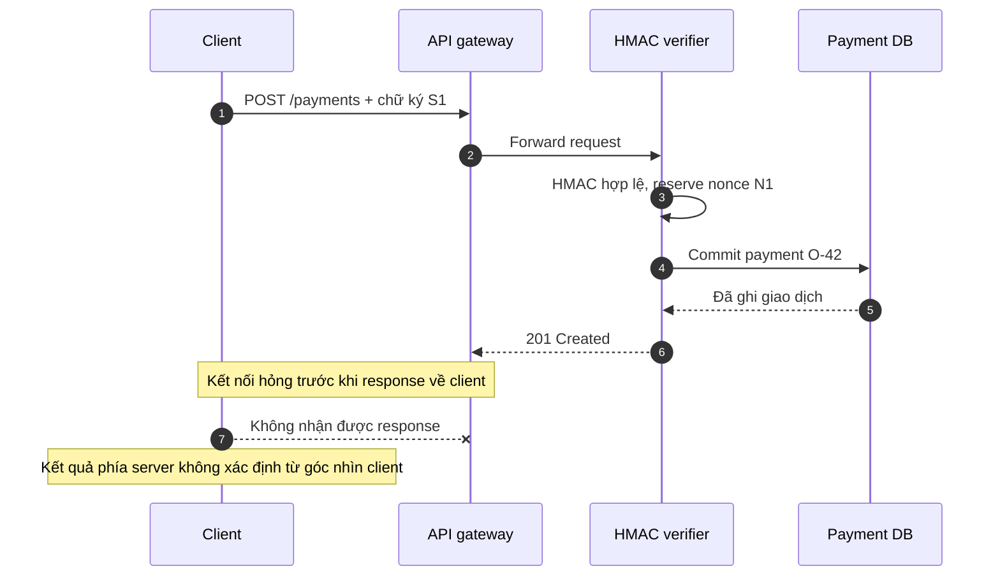
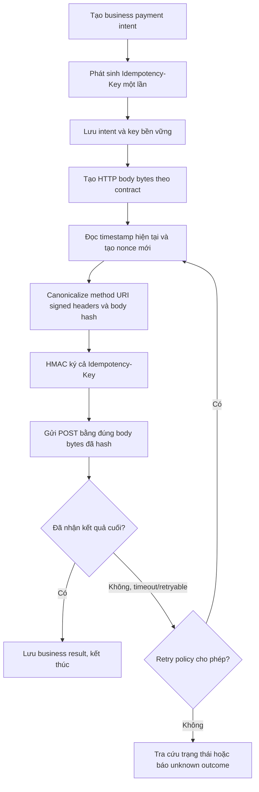
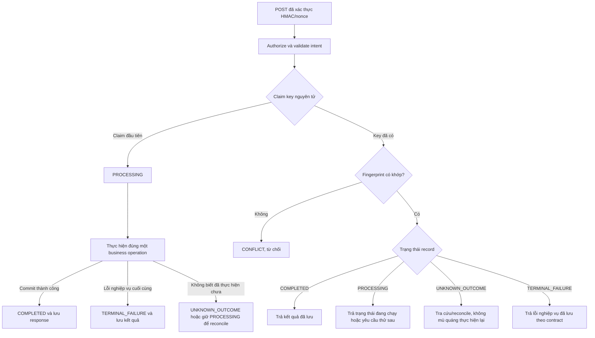
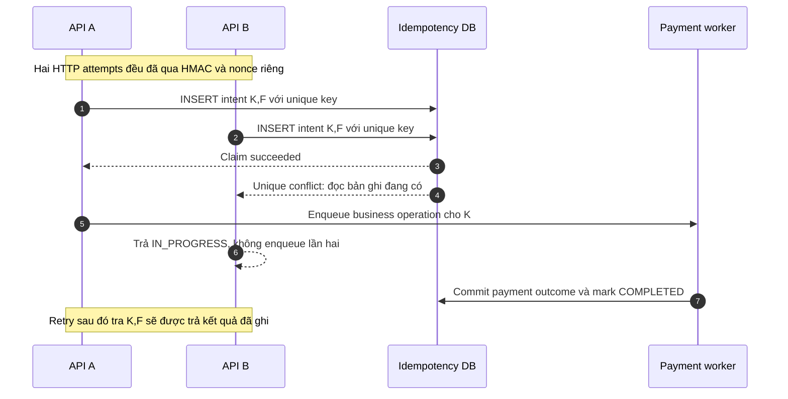
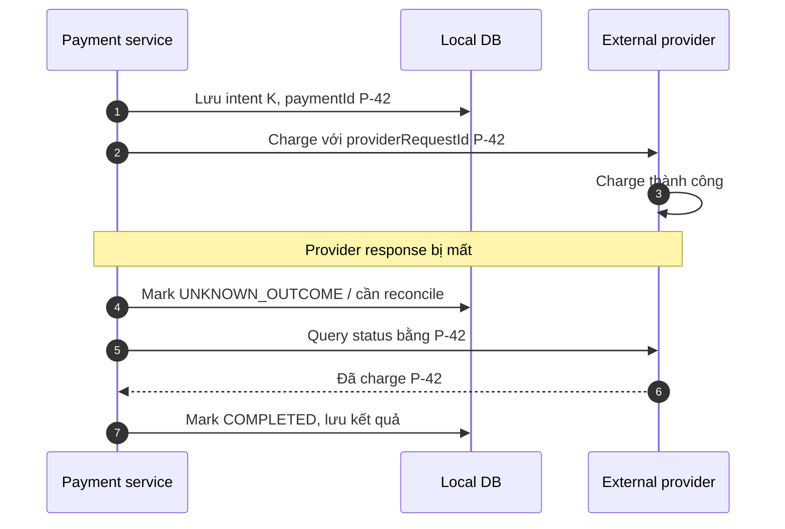
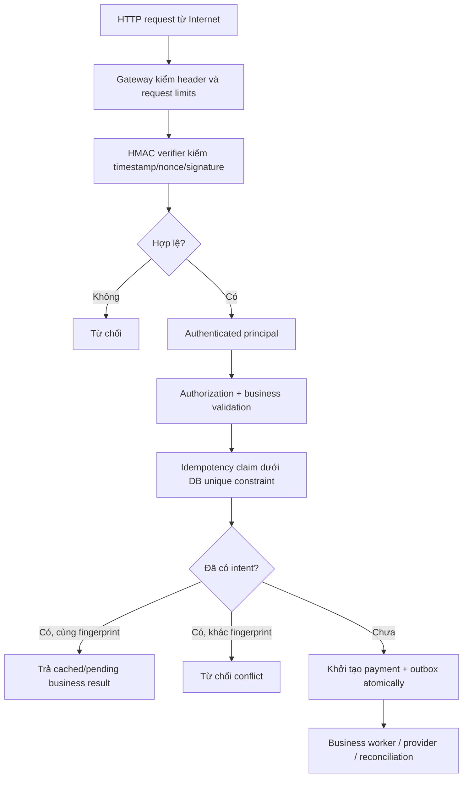

# POST và retry

## 1. Bài toán: một request POST có thể được gửi nhiều lần nhưng nghiệp vụ chỉ nên thực hiện một lần

Khi client gọi một HTTP API qua mạng, **không nhận được response không đồng nghĩa server chưa xử lý request**. Có thể kết nối đã đứt sau khi server ghi dữ liệu hoặc sau khi hệ thống thanh toán đã tạo giao dịch. Client buộc phải quyết định có **retry** hay không, nhưng gửi lại một request `POST` không có bảo đảm idempotency có thể tạo ra **hai tác dụng phụ**.

Ví dụ đối tác gửi yêu cầu tạo thanh toán:

```http
POST /v1/payments?merchantId=m-42 HTTP/1.1
Host: api.example.test
Content-Type: application/json
X-Client-Id: client-42
X-Key-Id: key-2026-11
X-Timestamp: 1795856400
X-Nonce: AAAAAAAAAAAAAAAAAAAAAA
Idempotency-Key: PAY-O42-20261128
X-Signature: <signature>

{"orderId":"O-42","amountMinor":250000,"currency":"VND"}
```

Mục tiêu hợp đồng idempotency: **nhiều lần gửi có cùng ý định tạo thanh toán** được hệ thống nhận diện là **một operation**, không tạo nhiều thanh toán vì client retry. Chữ ký HMAC trong ví dụ dùng timestamp/nonce/secret thuộc phạm vi xác thực, còn `Idempotency-Key` định danh **ý định nghiệp vụ**.

Bài **“POST và retry”** thuộc chương **Idempotency**, mô-đun **`SECURITY_AUTHENTICATION_HMAC_REQUEST_AUTHENTICATION`**. Phạm vi mô-đun: thiết kế xác thực HTTP request bằng HMAC với shared secret, canonical request chứa HTTP method, URI, headers và/hoặc body; xác minh chữ ký, chống replay bằng timestamp/nonce, quản lý key rotation, kiểm thử proxy/gateway, và **phân biệt xác thực với phân quyền**.

Bài học làm rõ một vấn đề quan trọng ở giao điểm của **HTTP, bảo mật và xử lý nghiệp vụ**:

> **Retry hợp lệ phải tạo request được HMAC ký mới và nonce mới, nhưng giữ idempotency key của cùng ý định nghiệp vụ.** Anti-replay từ chối bản request có nonce cũ; idempotency bảo đảm retry mới không tạo thêm tác dụng phụ.

Sau bài học, người học có thể:

- Phân biệt **HTTP method idempotency**, **request replay**, **client retry**, **business idempotency**.
- Thiết kế hợp đồng `POST` có `Idempotency-Key`, scope, expiry, fingerprint và response policy.
- Tạo **timestamp/nonce/signature mới** khi retry request HMAC nhưng giữ business key ổn định.
- Dùng **unique constraint và transaction** để giải quyết retry đồng thời từ nhiều API instances.
- Xử lý các trạng thái **in progress / succeeded / terminal failed / unknown outcome** và kết nối sang cổng thanh toán.
- Viết Java 17, JUnit và integration tests cho timeout, concurrency, crash, gateway, replay và key rotation.

## 2. Idempotency của POST khác gì GET, PUT và DELETE?

Theo ngữ nghĩa HTTP, một phương thức **idempotent** nếu nhiều lần gửi cùng request có **hiệu ứng dự kiến** tương đương gửi một lần. Điều này **không có nghĩa** response bytes phải giống nhau, logging/metrics không tăng hoặc server không làm thêm bất kỳ việc gì.

| Method | Safe theo ngữ nghĩa HTTP? | Idempotent theo ngữ nghĩa HTTP? | Liên hệ với retry |
| --- | --- | --- | --- |
| `GET` | Có | Có | Đọc cùng resource nhiều lần không nhằm thay đổi trạng thái resource |
| `HEAD` | Có | Có | Tương tự GET nhưng không trả nội dung response |
| `PUT` | Không | Có | Đặt cùng biểu diễn vào cùng URI nhiều lần có hiệu ứng dự kiến như một lần |
| `DELETE` | Không | Có | Xóa cùng target nhiều lần có hiệu ứng dự kiến như một lần; status có thể khác |
| `POST` | Không | **Không mặc định** | Có thể tạo nhiều resource/giao dịch; cần thiết kế riêng nếu muốn retry an toàn |

Ví dụ:

```http
POST /v1/payments
Content-Type: application/json

{"orderId":"O-42","amountMinor":250000,"currency":"VND"}
```

Nếu implementation cứ nhận mỗi lần `POST` rồi `INSERT payment` với một ID mới, hai lần gửi có thể tạo **hai giao dịch**, dù payload giống nhau.

Ngược lại, nếu API quy định `Idempotency-Key`, lưu trạng thái xử lý và không thực hiện lại action khi cùng operation được retry, **endpoint POST ấy có thể hỗ trợ retry một cách idempotent theo hợp đồng ứng dụng**. Điều đó **không biến mọi POST trên Internet thành idempotent**.

### 2.1. “Cùng request” cần được định nghĩa cụ thể

Trong giao thức HMAC, request retry hợp lệ **không** giống tuyệt đối về byte header:

```text
Lần đầu:
  X-Timestamp: T1
  X-Nonce: N1
  X-Signature: S1
  Idempotency-Key: PAY-O42

Retry:
  X-Timestamp: T2
  X-Nonce: N2
  X-Signature: S2
  Idempotency-Key: PAY-O42
```

Cả hai có thể đại diện cho **cùng một ý định nghiệp vụ**, nhưng là **hai lần gửi có chữ ký khác nhau**. Để kiểm idempotency, server không được yêu cầu `X-Signature` hoặc nonce giống hệt nhau. Thay vào đó, cần **stable business key + fingerprint của ý nghĩa request**.

### 2.2. Idempotency không có nghĩa “mọi lỗi đều thành công”

Nếu một POST đầu tiên thất bại do số tiền sai, retry y nguyên payload không được âm thầm thành công. Nếu một POST đang xử lý, retry có thể nhận `202` hoặc `409` theo hợp đồng thay vì khởi chạy lần thứ hai. Và nếu một POST đã commit, retry có thể nhận **cùng kết quả nghiệp vụ** hoặc một representation cập nhật của resource, tùy API contract.

## 3. Kịch bản nguy hiểm: server đã commit nhưng client chỉ thấy timeout

Một số điểm có thể xảy ra lỗi trong một request:



Client **không biết** đã có transaction hay chưa. Nếu gửi một POST mới **không có idempotency key**, server có thể tạo giao dịch thứ hai.

**Điểm cốt lõi:** network timeout là trạng thái **unknown outcome** đối với client, không phải xác nhận “operation failed”. Hệ thống cần một cơ chế tra cứu/lặp lại an toàn có khả năng trả lời “business operation này đã xử lý chưa?”.

### 3.1. Bốn thời điểm lỗi cần phân biệt

| Thời điểm lỗi | Điều server có thể đã làm | Rủi ro nếu retry không bảo vệ |
| --- | --- | --- |
| Trước khi server nhận request | Chưa xử lý | Retry có thể tạo một lần, thường mong muốn |
| Sau HMAC và trước khi ghi payment | Có thể đã reserve nonce | Retry với nonce cũ bị anti-replay từ chối |
| Sau khi ghi payment, trước response | Payment đã có | Retry có thể tạo payment thứ hai |
| Sau khi gọi cổng thanh toán bên ngoài | Provider có thể đã charge | Retry mù có thể charge thêm nếu provider không idempotent |

Không thể suy từ mã lỗi phía client rằng server đã dừng chính xác ở bước nào. API phải có **idempotency ledger**, **business identity**, hoặc giao thức đồng bộ/truy vấn trạng thái phù hợp.

## 4. Anti-replay HMAC và idempotency là hai cơ chế độc lập

Đây là sự khác biệt quan trọng nhất của bài.

| Khía cạnh | Anti-replay HMAC | Business idempotency |
| --- | --- | --- |
| Định danh | `timestamp + nonce` đã được ký | `Idempotency-Key` hoặc operation ID ổn định |
| Phạm vi | Một **lần gửi HTTP** | Một **ý định nghiệp vụ** |
| Kết quả khi thấy lại cùng ID | Từ chối bản request đã dùng nonce | Trả kết quả cũ hoặc trạng thái đang xử lý |
| Có thay đổi khi retry hợp lệ? | **Có**: timestamp/nonce/chữ ký mới | **Không**: giữ key của intent cũ |
| Lưu trữ | Nonce replay store, TTL theo timestamp window | Durable business idempotency store, TTL theo hợp đồng API |
| Tránh giả mạo? | HMAC xác thực bên nắm secret | Idempotency key **không** phải credential |
| Tránh tạo giao dịch hai lần? | Không bảo đảm | Cần ledger/transaction/business constraints |
| Cần authorization? | Có | Có; không trả cached response cho principal thiếu quyền |

**Ví dụ đúng:**

```text
Attempt #1: [T1, N1, HMAC1] + Idempotency-Key=PAY-O42
Attempt #2: [T2, N2, HMAC2] + Idempotency-Key=PAY-O42

HMAC verifier:
  Attempt #1 -> OK; nonce N1 mới
  Attempt #2 -> OK; nonce N2 mới

Idempotency handler:
  Attempt #1 -> lần đầu, tạo payment
  Attempt #2 -> cùng intent đã có, trả trạng thái/kết quả cũ
```

**Ví dụ sai:**

```text
Attempt #1: [T1, N1, HMAC1] + Key=PAY-O42
Attempt #2: [T1, N1, HMAC1] + Key=PAY-O42

Anti-replay handler:
  Attempt #1 -> OK
  Attempt #2 -> REPLAY, từ chối trước idempotency
```

Một số API có chính sách cho phép truy vấn kết quả mà không cần gửi lại POST, chẳng hạn `GET /v1/payments/by-idempotency-key` có phân quyền. Đây là một **giao diện thiết kế riêng**, không phải lý do để bỏ kiểm nonce cho POST.

## 5. Hợp đồng HTTP POST có Idempotency-Key

Một API muốn cho phép retry POST nên xuất bản **hợp đồng rõ ràng** chứ không chỉ thêm header rồi hy vọng database tự xử lý.

Ví dụ request:

```http
POST /v1/payments?merchantId=m-42 HTTP/1.1
Host: api.example.test
Content-Type: application/json
X-Client-Id: client-42
X-Key-Id: key-2026-11
X-Timestamp: <unix-seconds>
X-Nonce: <fresh-base64url-nonce>
Idempotency-Key: PAY-O42-20261128
X-Signature: <base64-hmac-sha256>

{"orderId":"O-42","amountMinor":250000,"currency":"VND"}
```

Giá trị ký và nonce là placeholder, không phải credential dùng thật.

Các điểm phải đặc tả:

1. **Bắt buộc hay tùy chọn?** Ví dụ `Idempotency-Key` **bắt buộc** cho POST tạo thanh toán có tác dụng phụ.
2. **Client tạo hay server tạo?** Trong ví dụ, client tạo **một lần khi tạo payment intent**, lưu và dùng lại cho mọi retry của intent đó.
3. **Định dạng và giới hạn:** ví dụ 1–128 ký tự ASCII từ alphabet cho phép, không newline/control char, case-sensitive.
4. **Uniqueness scope:** ví dụ `(authenticatedMerchantId, operationType, idempotencyKey)`; hai merchant khác nhau có thể dùng cùng key mà không va chạm.
5. **Payload matching:** cùng key nhưng nội dung nghiệp vụ khác phải **bị từ chối**, không dùng lại payment cũ.
6. **Response chính sách:** đã hoàn tất trả kết quả trước đó; đang xử lý trả trạng thái chờ; input khác trả conflict.
7. **Thời gian lưu:** ví dụ 24 giờ hoặc lâu hơn tùy nghiệp vụ, SLA retry và thời gian reconciliation; phải công bố rõ.
8. **Các lỗi được lưu:** quyết định có lưu response của lỗi nghiệp vụ terminal, lỗi validation trước execution, lỗi 5xx hay không.
9. **Authorization:** requester phải được kiểm quyền trước khi lộ kết quả cũ của intent.
10. **Tính toàn vẹn:** `Idempotency-Key` nên được **đưa vào signed headers/canonical HMAC** vì thay key có thể đổi kết quả POST.

### 5.1. Không dùng Idempotency-Key làm secret

`Idempotency-Key` không chứng minh client có quyền tạo payment; attacker có thể tự đặt key tùy ý. HMAC signature và principal mới là cơ chế xác thực; authorization quyết định principal có được phép với merchant/resource hay không.

Key nên đủ khó trùng giữa các intent — một UUID ngẫu nhiên hoặc mã operation ổn định có uniqueness tốt là lựa chọn phổ biến. Không nhất thiết key phải bí mật, nhưng **không chứa dữ liệu nhạy cảm** như thẻ thanh toán, token truy cập hoặc thông tin định danh cá nhân.

### 5.2. Có nên dùng body hash làm idempotency key?

Không mặc định. Hai giao dịch độc lập có thể có **cùng body** (ví dụ hai lần mua cùng mặt hàng với cùng số tiền) nhưng là hai intent khác nhau. Ngược lại, cùng intent được retry có thể có **biểu diễn JSON hơi khác** mà nghiệp vụ không đổi.

Nên định danh intent bằng **idempotency key độc lập**, rồi dùng **fingerprint** để phát hiện việc tái sử dụng cùng key cho một payload khác.

## 6. Client lifecycle: sinh key một lần cho intent, ký mới mỗi attempt

Một client backend an toàn nên quản lý hai loại state:

**State của ý định nghiệp vụ:**

```text
paymentIntent {
  merchantId: "m-42"
  orderId: "O-42"
  amountMinor: 250000
  currency: "VND"
  idempotencyKey: "PAY-O42-20261128"
}
```

**State của từng lần gửi:**

```text
attempt1 { timestamp: T1, nonce: N1, signature: S1 }
attempt2 { timestamp: T2, nonce: N2, signature: S2 }
attempt3 { timestamp: T3, nonce: N3, signature: S3 }
```

Một quy trình hợp lý:



Đừng tạo idempotency key **mới** ở mỗi lần HTTP retry. Đừng giữ `X-Timestamp`/`X-Nonce`/`X-Signature` của lần gửi trước để cố resend y nguyên; verifier anti-replay có thể đã tiêu thụ nonce trước đó.

### 6.1. Nếu retry với body khác thì sao?

Nếu client phát hiện amount/currency/order đã sai, đó thường là **một request intent khác**, không phải retry cùng payment. Cần tạo **idempotency key mới** và xử lý quyền/điều kiện nghiệp vụ.

Nếu chỉ thay khoảng trắng JSON hoặc thứ tự field, hợp đồng fingerprint quyết định có coi là cùng intent không. Đừng để client tự ý “đổi vài byte” sau khi tính HMAC: mỗi attempt phải ký **đúng raw body bytes được gửi**.

### 6.2. Key phải sống lâu hơn một process

Nếu ứng dụng client restart sau timeout và sinh key khác, server không biết hai attempt là cùng intent. Client nên lưu **key cùng business operation** ở database/outbox hoặc durable queue; không chỉ giữ trong biến local của một thread.

## 7. Bảo vệ Idempotency-Key trong canonical HMAC request

Nếu key không nằm trong tập trường được ký, một trung gian có thể sửa nó và khiến server tra **intent khác** trong idempotency store mà HMAC của các trường còn lại vẫn đúng.

Ví dụ:

```http
Idempotency-Key: PAY-O42-20261128
```

Hợp đồng ký có thể định nghĩa một phiên bản:

```text
HMAC-SHA256-PAYMENT-V1
POST
/v1/payments
merchantId=m-42
content-type:application/json
x-client-id:client-42
x-key-id:key-2026-11
x-timestamp:<unix-seconds>
x-nonce:<base64url-nonce>
idempotency-key:PAY-O42-20261128
<body-sha256-lowercase-hex>
```

**Đây là hợp đồng minh họa mới cho endpoint thanh toán**; không nhầm với một định dạng canonical 10 dòng khác không có `Idempotency-Key`. Cả client và verifier phải triển khai **cùng version và thứ tự dòng**. Các placeholder phải được thay bằng giá trị thật trước khi tính HMAC.

HMAC signing:

```text
bodyBytes = bytes thực sự gửi đi
contentHash = lowerHex(SHA-256(bodyBytes))
canonicalBytes = UTF8(canonical request gồm Idempotency-Key)
tag = HMAC-SHA256(sharedSecret, canonicalBytes)
signatureHeader = Base64.Basic.Padded(tag)
```

**Server không được** lấy `Idempotency-Key`, body hash hoặc target URI từ header `X-Original-*` do Internet tự khai rồi tin là đã bảo vệ. Nó phải dựng canonical request từ dữ liệu HTTP thực nhận tại đúng trust boundary.

### 7.1. Nếu Idempotency-Key thay đổi nhưng HMAC vẫn hợp lệ?

Trong một retry **được ký lại hợp lệ**, client có secret nên có thể cố tình dùng key khác — nhưng đó là **intent khác về mặt giao thức idempotency**. HMAC không tự biết hai key ứng với cùng đơn hàng. Business layer cần ràng buộc **orderId/clientReference** hoặc các unique constraints bổ sung nếu phải ngăn double charge trên cùng order ngay cả khi client gửi nhiều key.

Trong trường hợp **attacker không có secret**, sửa key mà giữ tag cũ phải làm HMAC sai nếu key được ký. Đây là nguyên nhân cần đưa key vào canonical request.

### 7.2. HMAC trên raw body và fingerprint của intent là hai giá trị khác nhau

Raw body SHA-256 dùng trong HMAC bảo vệ **byte payload thực tế**. Fingerprint của idempotency có thể được thiết kế theo **ngữ nghĩa nghiệp vụ ổn định**. Chúng không bắt buộc là cùng một digest:

```text
HMAC body hash:
  SHA-256(exact raw JSON bytes of this HTTP attempt)

Idempotency fingerprint:
  SHA-256(canonical semantic representation of validated intent)
```

Nếu dùng semantic fingerprint, phải định nghĩa rõ quy tắc canonical hóa field, type, duplicate JSON properties, số và giá trị mặc định. Không coi mọi parser/serializer tự động tương đương, và không tự “nới lỏng” dữ liệu bảo mật khi xử lý.

## 8. Fingerprint: cùng key nhưng payload khác phải bị từ chối

Giả sử client gửi:

```text
Key: PAY-O42
Operation: CREATE_PAYMENT
Merchant: m-42
Order: O-42
Amount: 250000
Currency: VND
```

Sau đó gửi lại:

```text
Key: PAY-O42
Operation: CREATE_PAYMENT
Merchant: m-42
Order: O-42
Amount: 999999
Currency: VND
```

Nếu server chỉ tra key và trả kết quả cũ, client có thể không biết request amount mới đã bị **bỏ qua**. Hợp đồng idempotency nên từ chối **key reuse với payload không trùng theo fingerprint policy**, ví dụ một HTTP `409 Conflict`.

### 8.1. Hai lựa chọn tạo fingerprint

**Lựa chọn A — raw-body fingerprint:**

```text
fingerprint = SHA-256(
    method || canonical target || rawBodyBytes
)
```

Ưu điểm: dễ xác định từng byte; phù hợp khi client sử dụng serialization ổn định. Nhược điểm: hai JSON tương đương về nghĩa nhưng khác thứ tự field hoặc whitespace vẫn khác fingerprint. Cần encoding không mơ hồ cho các thành phần ghép.

**Lựa chọn B — semantic fingerprint:**

```text
validated = {
    principalScope: "merchant:m-42",
    operation: "CREATE_PAYMENT",
    orderId: "O-42",
    amountMinor: 250000,
    currency: "VND"
}

fingerprint = SHA-256(
    deterministic canonical encoding of validated
)
```

Ưu điểm: retry không phụ thuộc whitespace JSON. Nhược điểm: phải xác định chính xác **schema, kiểu số, duplicate keys, unknown fields, Unicode normalization, null/default** và tránh khác biệt giữa verifier và business handler.

Với API thanh toán, lựa chọn B thường hữu ích khi đã có DTO đã validate và một contract fingerprint versioned. Nhưng mỗi attempt **vẫn phải được HMAC kiểm trên raw bytes** của lần gửi đó; fingerprint không thay thế HMAC.

### 8.2. Quy tắc ghi nhận fingerprint

| Bản gửi | Idempotency key | Fingerprint | Hành động |
| --- | --- | --- | --- |
| Attempt đầu | `K1` | `F1` | Claim key và xử lý |
| Retry cùng intent | `K1` | `F1` | Trả kết quả trước hoặc trạng thái đang xử lý |
| Reuse key với amount khác | `K1` | `F2` | **Conflict**, không tạo payment mới |
| Intent mới | `K2` | `F2` | Xử lý như operation mới nếu được phép |
| Retry body JSON khác bytes nhưng cùng ngữ nghĩa | `K1` | `F1` theo semantic contract | Được xem là cùng intent, sau khi HMAC của từng attempt hợp lệ |

**Điều không được làm:** so fingerprint chỉ với dữ liệu client tự khai trong một header unsigned, hoặc cho phép caller cung cấp fingerprint để bỏ qua server-side parsing/validation.

## 9. State machine cho POST idempotent

Một bảng idempotency đơn giản không chỉ cần “đã thấy key chưa” mà còn cần **trạng thái xử lý**.



### 9.1. Các trạng thái nên hiểu thế nào?

| State | Ý nghĩa | Cách xử lý retry cùng key + fingerprint |
| --- | --- | --- |
| **PROCESSING** | Đã nhận intent, một worker đang xử lý | Không tạo worker/payment thứ hai; có thể trả `202`/`409` theo hợp đồng |
| **COMPLETED** | Business operation đã commit; có result bền vững | Trả lại kết quả đã lưu hoặc trạng thái resource tương ứng |
| **TERMINAL_FAILURE** | Thất bại nghiệp vụ cuối cùng được quyết định và lưu | Trả cùng lỗi nghiệp vụ, không tự khởi động lại operation |
| **UNKNOWN_OUTCOME** | Không biết external provider đã xử lý hay chưa | Reconcile/query theo provider operation ID, không gọi charge mới mù quáng |

State `FAILED` chung chung thường **quá mơ hồ**: lỗi validation trước khi bắt đầu, lỗi nghiệp vụ cuối cùng và timeout sau khi gửi ra provider không nên có cùng retry policy.

### 9.2. Validation trước hay sau khi claim?

Có thể validate **cú pháp/schema và quyền cơ bản** trước khi tạo idempotency record để giảm chi phí cho request sai. Tuy nhiên, sau khi operation đã được claim, **mọi kết quả terminal** cần được ghi nhận nhất quán theo contract, đặc biệt khi nghiệp vụ có side effect.

Ví dụ contract: nếu JSON thiếu `amountMinor`, server trả `400` và **không claim key** vì operation chưa bắt đầu. Nếu đủ schema nhưng thiếu hạn mức và nghiệp vụ quyết định từ chối thanh toán, có thể lưu **terminal business failure** để retry không bất ngờ chuyển thành một thanh toán mới.

Cần công bố chính sách cụ thể, tránh tình trạng một số node cache `4xx` còn node khác xử lý lại.

## 10. Lưu trữ bền vững và atomic claim: database là điểm quyết định

Một triển khai sai:

```java
if (!repository.existsByIdempotencyKey(key)) {
    paymentService.charge(request);
    repository.saveIdempotencyKey(key);
}
```

Hai API instances có thể **đều thấy key chưa có**, cùng charge rồi cùng lưu. Đây là race condition.

Một thiết kế khả thi dùng **unique constraint** trong database:

```sql
CREATE TABLE payment_idempotency (
    principal_id        VARCHAR(100) NOT NULL,
    operation_type      VARCHAR(80)  NOT NULL,
    idempotency_key     VARCHAR(128) NOT NULL,
    fingerprint_version VARCHAR(20)  NOT NULL,
    request_fingerprint CHAR(64)     NOT NULL,
    state               VARCHAR(30)  NOT NULL,
    payment_id          VARCHAR(100),
    http_status         INTEGER,
    response_json       TEXT,
    created_at          TIMESTAMP NOT NULL,
    expires_at          TIMESTAMP NOT NULL,
    PRIMARY KEY (
        principal_id, operation_type, idempotency_key
    )
);
```

Đây là **schema minh họa**, chưa chọn dialect SQL, isolation level, encryption-at-rest, partitioning, migration hay index khác cho production. Nếu lưu response chứa thông tin nhạy cảm, cần cơ chế bảo vệ dữ liệu, retention và access control tương ứng.

### 10.1. Claim key không tách rời unique constraint

Pseudocode:

```text
function begin(principal, operation, key, fingerprint):
    try INSERT record(
        principal, operation, key, fingerprint,
        state = PROCESSING
    ) under unique constraint

    if INSERT succeeded:
        return FIRST_OWNER

    if unique constraint conflict:
        record = SELECT existing record
        if fingerprint != record.fingerprint:
            return CONFLICT
        if record.state == COMPLETED:
            return CACHED_RESULT
        if record.state == TERMINAL_FAILURE:
            return CACHED_FAILURE
        return IN_PROGRESS_OR_RECONCILIATION

    if database timeout/error:
        fail closed; outcome may be uncertain
```

Một lệnh **INSERT có unique constraint**, `INSERT ... ON CONFLICT` hoặc cơ chế **transactional compare-and-set** tương đương có thể làm “claim key” trở thành thao tác nguyên tử.

**Không đủ:** đặt một `synchronized` Java lock trong từng JVM. Nó chỉ điều phối threads cùng process, không ngăn hai pods ghi vào cùng database.

### 10.2. Transaction boundary với payment row

Có hai nhiệm vụ cần phối hợp:

1. Ghi idempotency state/claim.
2. Ghi payment business state hoặc **enqueue outbox event**.

Nếu là cùng một database, nên thiết kế các bước quyết định trong **một transaction** có constraint thích hợp. Nếu hệ thống tạo payment row rồi ghi idempotency record **sau**, crash giữa hai bước có thể khiến lần retry tưởng operation chưa chạy.

Một phương án đơn giản:

```text
DB transaction:
    claim idempotency key (unique)
    create payment row with unique business operation ID
    create outbox event for processing
    commit

Background worker:
    read outbox
    call provider using stable provider idempotency reference
    update payment and operation outcome
```

Không cần giữ một DB transaction mở trong suốt thời gian **HTTP call đến provider**. Điều đó tạo lock dài, timeout và giữ tài nguyên không cần thiết. Thay vào đó, dùng một **state machine bền vững**, outbox và reconciliation phù hợp.

### 10.3. “Exactly once” cần được diễn đạt thận trọng

Unique key giúp **một operation trong database** có một record đại diện duy nhất. Nó không tự bảo đảm **mọi tác dụng phụ bên ngoài** chỉ xảy ra đúng một lần, đặc biệt khi kết nối ra provider bị timeout sau khi provider đã xử lý.

Mức bảo đảm thực tế có thể là:

- **At-most-one business intent record** trong database theo unique key.
- **At-least-once delivery** của outbox events.
- **Idempotent consumer/provider operations** để duplicate delivery không tạo duplicate side effect.
- **Reconciliation** khi không chắc provider đã xử lý hay chưa.

Đừng viết tài liệu hoặc PR rằng chỉ thêm header `Idempotency-Key` là đạt **exactly-once distributed execution**.

## 11. Ví dụ Java 17: mô hình decision cho claim và retry

Để tập trung vào POST và retry, ta xây các kiểu dữ liệu Java mô tả **quyết định idempotency**. Repository thật phải thực hiện unique claim/transaction trong database; code minh họa dưới đây **không tự cung cấp JDBC hoặc Redis production**.

```java
import java.util.Objects;

public final class PaymentIdempotencyV1 {
    private PaymentIdempotencyV1() {}

    public record OperationKey(
            String authenticatedPrincipal,
            String operation,
            String idempotencyKey) {
        public OperationKey {
            Objects.requireNonNull(authenticatedPrincipal);
            Objects.requireNonNull(operation);
            Objects.requireNonNull(idempotencyKey);

            if (authenticatedPrincipal.isBlank()
                    || operation.isBlank()
                    || !idempotencyKey.matches(
                            "[A-Za-z0-9._:-]{1,128}")) {
                throw new IllegalArgumentException(
                        "Invalid operation idempotency key");
            }
        }
    }

    public record RequestFingerprint(
            String version, String sha256Hex) {
        public RequestFingerprint {
            if (version == null || version.isBlank()
                    || sha256Hex == null
                    || !sha256Hex.matches("[0-9a-f]{64}")) {
                throw new IllegalArgumentException(
                        "Invalid fingerprint");
            }
        }
    }

    public enum Decision {
        STARTED,
        COMPLETED,
        TERMINAL_FAILURE,
        IN_PROGRESS,
        UNKNOWN_OUTCOME,
        CONFLICT
    }

    public record StoredResult(
            int httpStatus,
            String responseJson,
            String paymentId) {}

    public record BeginResult(
            Decision decision,
            StoredResult storedResult) {}

    public interface Repository {
        // beginOrRead phải có unique/atomic claim ở data store thật.
        BeginResult beginOrRead(
                OperationKey key, RequestFingerprint fingerprint);

        // Cập nhật kết quả và business state phải có transaction
        // hoặc protocol đồng bộ bền vững phù hợp.
        void completeAtomically(
                OperationKey key, StoredResult result);

        void markUnknownForReconciliation(OperationKey key);
    }
}
```

**Lưu ý:** `authenticatedPrincipal` phải do tầng HMAC verifier và key resolver xác thực; không sử dụng trực tiếp một `X-Client-Id` tự khai làm danh tính đã được tin cậy.

### 11.1. Tính fingerprint xác định từ dữ liệu nghiệp vụ đã validate

Ví dụ business intent: merchant, order, amount in minor units và currency. Để giảm lỗi do phân cách chuỗi, dùng **length-prefixed encoding** thay vì nối `merchant + ":" + order` tùy ý.

```java
import java.nio.charset.StandardCharsets;
import java.security.MessageDigest;
import java.util.HexFormat;

public final class PaymentFingerprintV1 {
    private PaymentFingerprintV1() {}

    private static void append(StringBuilder out, String value) {
        // Giới hạn ví dụ: caller đã validate schema và độ dài.
        out.append(value.length())
           .append(':')
           .append(value);
    }

    public static PaymentIdempotencyV1.RequestFingerprint of(
            String merchantId,
            String orderId,
            long amountMinor,
            String currency) throws Exception {

        if (merchantId == null || merchantId.isBlank()
                || orderId == null || orderId.isBlank()
                || amountMinor <= 0
                || currency == null
                || !currency.matches("[A-Z]{3}")) {
            throw new IllegalArgumentException("Invalid payment intent");
        }

        StringBuilder canonical = new StringBuilder();
        append(canonical, "PAYMENT-FINGERPRINT-V1");
        append(canonical, merchantId);
        append(canonical, orderId);
        append(canonical, Long.toString(amountMinor));
        append(canonical, currency);

        byte[] bytes = canonical.toString()
                .getBytes(StandardCharsets.UTF_8);

        String sha256 = HexFormat.of().formatHex(
                MessageDigest.getInstance("SHA-256").digest(bytes));

        return new PaymentIdempotencyV1.RequestFingerprint(
                "PAYMENT-FINGERPRINT-V1", sha256);
    }
}
```

**Giới hạn của ví dụ:** dùng `String.length()` (số UTF-16 code units) làm length prefix vì sender và verifier của fingerprint chạy cùng Java. Nếu cần fingerprint **cross-language**, phải định nghĩa prefix theo **byte UTF-8** hoặc dùng một định dạng serialization canonical chuẩn được mọi implementation thống nhất. Bài này đang tính fingerprint nội bộ ở backend sau validation; không thay cho canonical HMAC request của client.

Nếu dữ liệu nghiệp vụ chứa nhiều field khác quyết định tác dụng phụ (merchant account, capture mode, currency exponent, beneficiary…), **phải** thêm những field đó vào fingerprint theo version đã định. Không lấy ví dụ 4 field làm fingerprint đầy đủ của mọi payment API.

### 11.2. Controller/adaptor nên dùng BeginResult thế nào?

Pseudocode (cố ý không phải một Spring Controller compile độc lập):

```java
// 1. HTTP adapter xác minh HMAC/timestamp/nonce trước.
//    key resolver trả authenticated principal nếu hợp lệ.
String principal = authenticateSignedRequest(httpRequest);

// 2. Kiểm quyền với merchant thực nhận; validate schema.
PaymentIntent intent = validateAndAuthorize(
        principal, httpRequest);

// 3. Dựng scope và fingerprint sau validation.
var opKey = new PaymentIdempotencyV1.OperationKey(
        principal, "CREATE_PAYMENT", idempotencyKeyFromRequest);

var fp = PaymentFingerprintV1.of(
        intent.merchantId(), intent.orderId(),
        intent.amountMinor(), intent.currency());

// 4. beginOrRead là thao tác atomic ở repository thật.
var begin = repository.beginOrRead(opKey, fp);

switch (begin.decision()) {
    case CONFLICT -> rejectConflict();
    case COMPLETED, TERMINAL_FAILURE ->
            returnStoredResponse(begin.storedResult());
    case IN_PROGRESS, UNKNOWN_OUTCOME ->
            returnPendingStatusOrReconciliationLink();
    case STARTED ->
            enqueuePaymentOperationAtomically(opKey, intent);
}
```

**Điểm quan trọng:** không gọi `charge()` trước khi kiểm `beginOrRead`. Nếu `beginOrRead` chỉ dùng `SELECT` rồi tự `INSERT` mà không unique constraint, hai request vẫn có thể cùng bắt đầu.

Trong triển khai transaction thật, `beginOrRead` và enqueue/row creation phải có protocol bền vững để xử lý crash giữa `STARTED` và ghi work item. Ví dụ transaction outbox có thể gắn claim và business work record vào cùng commit.

## 12. Đồng thời hai POST cùng key: một request thắng quyền khởi tạo

Khi mobile/backend client retry vì mạng chậm, **attempt mới có thể tới server trước khi attempt đầu kết thúc**. Server có thể thấy cùng idempotency key tại hai instance.



**Đúng:** nhiều nhất một **owner** được tạo cho `(principal,operation,key)`. Mỗi retry khác vẫn được xác thực HMAC với **timestamp và nonce riêng**, nhưng không có quyền khởi tạo side effect mới.

**Sai:** dùng một JVM local map để dedupe khi hệ thống có nhiều pods; request đến pod khác sẽ không nhìn thấy key cũ. Dùng unique constraint hoặc một primitive đồng bộ bền vững có tính nhất quán tương ứng với mức bảo đảm đã cam kết.

### 12.1. Timeout khi claim key có kết quả không chắc chắn

Giả sử database đã commit `INSERT` nhưng response tới API bị mất. API không biết claim thành công hay chưa. Không tự coi “timeout = insert không xảy ra” rồi thực hiện nghiệp vụ.

Nên:

- **Không tạo side effect** khi trạng thái claim chưa xác định.
- Đọc/reconcile theo operation key khi database có thể truy cập lại.
- Nếu client retry, nó tiếp tục dùng **cùng idempotency key** nhưng phải tạo **nonce/chữ ký mới**.
- Duy trì trạng thái cần thiết để giải quyết một lần gửi đã claim nhưng chưa được enqueue thành công.

## 13. External payment provider: cần idempotency xuyên ranh giới

Đây là tình huống hay bị đơn giản hóa. Server có thể bảo đảm **không tạo trùng payment record trong database**, nhưng vẫn vô tình gọi **provider charge** hai lần nếu worker retry khi provider đã xử lý nhưng response bị mất.



Nếu provider hỗ trợ **idempotency key / merchant reference** của riêng họ, dùng **một mã provider operation ổn định** giữa retries tới provider. Nó **không phải** timestamp/nonce của incoming HTTP request.

Nếu provider **không hỗ trợ** dedupe/reconciliation đáng tin, không được khẳng định “exactly once charge” chỉ dựa vào idempotency ledger ở API. Cần một business reconciliation protocol, ràng buộc thanh toán duy nhất hoặc quy trình xử lý thủ công với trạng thái uncertain.

### 13.1. Transactional outbox

Nếu payment service cần enqueue công việc tới queue sau khi ghi intent, một mẫu phổ biến:

```text
Transaction:
  INSERT idempotency record with unique key
  INSERT payment record / business operation ID
  INSERT outbox event linked to payment ID
Commit

Outbox publisher:
  publish events (có thể nhiều lần)

Consumer:
  dedupe bằng stable operation ID
  call provider dùng stable provider idempotency reference
  reconcile unknown outcome
```

Outbox giúp tránh trường hợp DB đã commit nhưng event chưa được enqueue. Nó không tự ngăn **duplicate event delivery**, nên consumer/provider cũng cần idempotency.

### 13.2. Lease và recovery cho PROCESSING

Một record `PROCESSING` có thể tồn tại mãi nếu worker crash. Nếu dùng **lease**, phải có owner token/version và **fencing** để worker cũ không ghi kết quả sau khi lease đã được chuyển cho worker mới.

Không tự quyết định “PROCESSING quá 30 giây thì bắt đầu charge lại” khi không biết provider đã charge chưa. Với external effect, cần **query/reconcile** trước khi retry charge.

## 14. Response policy cho retry POST: lựa chọn HTTP cần công bố

HTTP không định nghĩa một quy tắc chung buộc mọi API idempotency trả cùng status/body. Nên có một **contract rõ**, ví dụ:

| Tình huống | Ví dụ status | Điều kiện |
| --- | --- | --- |
| Lần đầu tạo thành công | `201 Created` | Tạo resource mới, có `Location` nếu phù hợp |
| Đã có kết quả thành công của cùng intent | `201` replayed hoặc `200 OK` | Chính sách trả result đã lưu hoặc resource representation |
| Operation đang chạy | `202 Accepted` hoặc `409 Conflict` | Không chạy side effect mới; có thể kèm `Retry-After` |
| Cùng key nhưng fingerprint khác | `409 Conflict` | Không dùng key đó cho payload khác |
| Missing/invalid idempotency key | `400 Bad Request` hoặc lỗi contract tương ứng | Từ chối trước execution |
| Validation/business refusal terminal | `4xx` theo domain | Có thể lưu kết quả terminal để retry nhất quán |
| Rate limited | `429 Too Many Requests` | Có thể có `Retry-After` |
| Transient server unavailable | `503 Service Unavailable` | Client quyết định retry theo policy |
| Unknown provider outcome | `202` với tracking resource, hoặc một status chờ cụ thể | Không mù quáng gọi provider lần nữa |

**Các mã trên là ví dụ lựa chọn API**, không phải chuẩn bắt buộc do idempotency áp đặt. Một API có thể lưu response status/body của lần đầu và trả lại nguyên business response; API khác có thể trả `200` với trạng thái payment hiện tại.

### 14.1. Có phải “cùng response bytes” mới là idempotent?

Không. Header `Date`, `Request-Id` và tracing metadata có thể thay đổi giữa attempts; mã trạng thái và body cũng có thể thay đổi theo contract. Điều cần bảo đảm là **không tạo thêm side effect nghiệp vụ ngoài ý định đã định**.

Nếu API công bố replay chính xác response đã cache, phải bảo vệ cách lưu response, chính sách expiry và dữ liệu riêng tư. Không để một principal không có quyền dùng key đoán được để lấy lại dữ liệu của người khác.

### 14.2. Header thông báo response replay

Một số API dùng metadata như `Idempotency-Replayed: true` hoặc response code riêng để giúp client hiểu đã đọc lại kết quả cũ. Đây là **quy ước sản phẩm**, không phải một header chuẩn bắt buộc. Nếu sử dụng, cần tài liệu rõ và tránh rò rỉ trạng thái người dùng/tenant qua khác biệt response.

## 15. Retry policy của client: không retry mọi lỗi một cách mù quáng

Idempotency server-side làm retry an toàn hơn, nhưng client vẫn cần **bounded retry policy** để tránh storm, quá tải provider hoặc giữ request ở trạng thái pending vô thời hạn.

Gợi ý phân loại:

| Tình huống | Có nên retry POST? | Cách tiếp cận |
| --- | --- | --- |
| Network timeout, connection reset, unknown outcome | Thường **có**, nếu endpoint có idempotency contract | Giữ key, ký mới, hoặc query operation status |
| `503` hoặc lỗi 5xx transient | Có thể, có giới hạn và backoff | Tôn trọng `Retry-After` khi có |
| `429` | Có thể, theo rate limit | Backoff hoặc `Retry-After` |
| `409` vì **đang xử lý** | Không tạo intent mới | Poll status hoặc retry cùng key sau delay theo contract |
| `409` vì **fingerprint conflict** | **Không retry cùng key với payload khác** | Sửa lỗi client hoặc tạo intent mới đúng nghiệp vụ |
| `400` vì input không hợp lệ | Thường **không** | Sửa request, không cố resend |
| `401` vì HMAC/timestamp sai | Không retry mù với cùng credential lỗi | Chẩn đoán key/clock/canonicalization; nếu chính sách cho phép mới ký lại |
| `403` vì thiếu quyền | Không | Authorization problem, không phải retry transient |
| Business terminal failure (hết hạn mức, trạng thái không cho phép) | Theo domain, thường không tự retry | Kiểm contract, không tạo double charge |
| Chưa chắc provider đã charge | Không gửi operation mới không qua reconcile | Dựa vào idempotency status + provider ID |

### 15.1. Exponential backoff và jitter

Một retry policy phổ biến sử dụng backoff tăng dần và jitter ngẫu nhiên:

```text
attempt 1: ngay
attempt 2: sau khoảng delay cơ sở, có jitter
attempt 3: delay dài hơn, có jitter
...
dừng khi đạt maximum attempts hoặc deadline
```

Ví dụ Java 17 trả delay minh họa, **không thực hiện sleep/network**:

```java
import java.time.Duration;
import java.util.concurrent.ThreadLocalRandom;

public final class BackoffPolicy {
    private BackoffPolicy() {}

    public static Duration fullJitterDelay(
            int retryIndex, long baseMillis, long capMillis) {
        if (retryIndex < 0 || retryIndex > 30
                || baseMillis <= 0 || capMillis <= 0) {
            throw new IllegalArgumentException("Bad retry policy");
        }
        long multiplier = 1L << retryIndex;
        long upper;
        if (baseMillis > Long.MAX_VALUE / multiplier) {
            upper = capMillis;
        } else {
            upper = Math.min(capMillis, baseMillis * multiplier);
        }

        if (upper == Long.MAX_VALUE) {
            throw new IllegalArgumentException("capMillis too large");
        }
        long delay = ThreadLocalRandom.current()
                .nextLong(upper + 1L);
        return Duration.ofMillis(delay);
    }
}
```

**Giới hạn của helper:** code từ chối cấu hình khiến `upper + 1L` overflow; production vẫn nên chặn `capMillis` ở một cận nghiệp vụ hợp lý (ví dụ vài phút). `ThreadLocalRandom` ở đây chỉ dùng cho **retry jitter**, **không** dùng tạo `X-Nonce` mật mã.

Nếu server gửi `Retry-After`, client cần parse và áp dụng theo hợp đồng/rate limit cùng overall deadline. Không lặp vô hạn hoặc tạo hàng nghìn request tại cùng thời điểm do tất cả clients retry đồng loạt.

### 15.2. Deadline và ngữ nghĩa retry

Client nên giữ **end-to-end deadline**. Ví dụ nếu payment API chưa xác định outcome sau một số lần thử hoặc sau 30 giây, client có thể chuyển sang **pending/reconciliation** thay vì phát sinh intent mới.

Nếu kết nối bị hỏng trước khi client chắc chắn request đã gửi, vẫn không nên assume server chưa nhận gì; idempotency key được thiết kế chính cho vùng bất định này.

## 16. Ví dụ Java 17: tạo signed retry với cùng Idempotency-Key

Ví dụ minh họa client backend Java tạo một payment intent ổn định, rồi mỗi attempt lấy timestamp và nonce mới. Code cố định URI/Content-Type để tập trung vào retry; signer production phải tính canonical request từ **chính dữ liệu sẽ gửi** và quản lý key qua secret manager.

### 16.1. Dữ liệu intent không đổi qua các attempt

```java
import java.nio.charset.StandardCharsets;

record PaymentIntent(
        String merchantId,
        String orderId,
        long amountMinor,
        String currency,
        String idempotencyKey) {}

PaymentIntent intent = new PaymentIntent(
        "m-42", "O-42", 250000L,
        "VND", "PAY-O42-20261128");

// Serialize CHỈ một lần cho ví dụ này, để cùng byte body
// được hash và phát qua HttpClient.
byte[] bodyBytes = (
        "{\"orderId\":\"O-42\",\"amountMinor\":250000,"
      + "\"currency\":\"VND\"}"
).getBytes(StandardCharsets.UTF_8);
```

Ở production, intent cùng idempotency key nên được lưu durable trước khi bắt đầu HTTP call. Nếu serialize lại cho attempt khác, signer phải ký **byte body mới**; idempotency fingerprint có thể giữ nguyên nếu ngữ nghĩa không đổi theo contract.

### 16.2. Một helper tạo HMAC signature có Idempotency-Key được ký

```java
import java.nio.charset.StandardCharsets;
import java.security.GeneralSecurityException;
import java.security.MessageDigest;
import java.util.Base64;
import java.util.HexFormat;
import java.util.Objects;
import javax.crypto.Mac;
import javax.crypto.spec.SecretKeySpec;

public final class PaymentPostSignerV1 {
    private PaymentPostSignerV1() {}

    public static String sign(
            byte[] secret,
            byte[] bodyBytes,
            String clientId,
            String keyId,
            String timestamp,
            String nonce,
            String idempotencyKey)
            throws GeneralSecurityException {

        Objects.requireNonNull(secret);
        Objects.requireNonNull(bodyBytes);

        if (secret.length == 0
                || clientId == null
                || !clientId.matches("[A-Za-z0-9._-]{1,80}")
                || keyId == null
                || !keyId.matches("[A-Za-z0-9._-]{1,80}")
                || timestamp == null
                || !timestamp.matches("[1-9][0-9]{0,11}")
                || nonce == null
                || !nonce.matches("[A-Za-z0-9_-]{22}")
                || idempotencyKey == null
                || !idempotencyKey.matches(
                        "[A-Za-z0-9._:-]{1,128}")) {
            throw new IllegalArgumentException(
                    "Invalid signing metadata");
        }

        String digest = HexFormat.of().formatHex(
                MessageDigest.getInstance("SHA-256")
                        .digest(bodyBytes));

        String canonical = String.join("\n",
                "HMAC-SHA256-PAYMENT-V1",
                "POST",
                "/v1/payments",
                "merchantId=m-42",
                "content-type:application/json",
                "x-client-id:" + clientId,
                "x-key-id:" + keyId,
                "x-timestamp:" + timestamp,
                "x-nonce:" + nonce,
                "idempotency-key:" + idempotencyKey,
                digest);

        Mac mac = Mac.getInstance("HmacSHA256");
        mac.init(new SecretKeySpec(secret, "HmacSHA256"));

        byte[] tag = mac.doFinal(
                canonical.getBytes(StandardCharsets.UTF_8));

        return Base64.getEncoder().encodeToString(tag);
    }
}
```

**Ràng buộc của ví dụ:** path/query là **cố định**; code chỉ minh họa ký endpoint `POST /v1/payments?merchantId=m-42`. Đừng dùng class này để ký mọi request khác hoặc tự bỏ query/path khi áp dụng. Verifier phải kiểm raw body bytes thực nhận, signed headers, nonce canonical format, timestamp window và HMAC theo **cùng version**, sau đó mới đưa operation qua idempotency handler.

### 16.3. Sinh mỗi attempt và tạo Java HttpRequest

```java
import java.net.URI;
import java.net.http.HttpRequest;
import java.security.SecureRandom;
import java.time.Instant;
import java.util.Base64;

final class PaymentAttemptFactory {
    private final SecureRandom secureRandom = new SecureRandom();

    HttpRequest createAttempt(
            PaymentIntent intent,
            byte[] stableBodyBytes,
            byte[] secret,
            String clientId,
            String keyId) throws Exception {

        String timestamp = Long.toString(
                Instant.now().getEpochSecond());

        byte[] nonceBytes = new byte[16];
        secureRandom.nextBytes(nonceBytes);
        String nonce = Base64.getUrlEncoder()
                .withoutPadding().encodeToString(nonceBytes);

        String signature = PaymentPostSignerV1.sign(
                secret, stableBodyBytes, clientId, keyId,
                timestamp, nonce, intent.idempotencyKey());

        return HttpRequest.newBuilder(URI.create(
                "https://api.example.test"
              + "/v1/payments?merchantId=m-42"))
                .header("Content-Type", "application/json")
                .header("X-Client-Id", clientId)
                .header("X-Key-Id", keyId)
                .header("X-Timestamp", timestamp)
                .header("X-Nonce", nonce)
                .header("Idempotency-Key",
                        intent.idempotencyKey())
                .header("X-Signature", signature)
                .POST(HttpRequest.BodyPublishers.ofByteArray(
                        stableBodyBytes))
                .build();
    }
}
```

Mỗi lần gọi `createAttempt` tạo **timestamp/nonce/signature mới** nhưng sử dụng **cùng `intent.idempotencyKey()`**. Caller phải giữ `stableBodyBytes` không thay đổi giữa lúc hash và lúc HTTP client gửi. Nếu body có thể mutate, clone và dùng snapshot khi tạo publisher.

**Không gửi từ trình duyệt với shared secret backend:** shared secret dài hạn trong JavaScript công khai không được giữ bí mật; nên ký ở backend tin cậy hoặc qua BFF. `SecureRandom` dùng cho nonce; không dùng `ThreadLocalRandom`.

### 16.4. Tại sao không tự động retry bằng HTTP client cũ?

Nếu một HTTP library/HTTP filter retry **nguyên object request đã ký** sau timeout, timestamp và nonce có thể được tái sử dụng. Anti-replay server sẽ từ chối nếu attempt đầu đã được accept.

Khi dùng retry middleware, **signing phải diễn ra lại trên mỗi attempt thực tế**, sau khi các middleware đã xác định method/URI/body/headers theo contract. Không chỉ gọi signer một lần rồi để HTTP transport phát lại byte cũ nhiều lần.

## 17. Security & authorization: không để idempotency thành lỗ hổng lộ dữ liệu

Một key đoán được không được cho phép một client lấy kết quả của client khác. Trước khi lấy cached response:

1. **Xác minh HMAC, timestamp, nonce** của attempt hiện tại.
2. Tra secret còn hiệu lực và thiết lập **authenticated principal**.
3. Kiểm **authorization** trên merchant/resource thực tế.
4. Xác định scope `(principal, operation, idempotencyKey)`.
5. So fingerprint để ngăn reuse key với payload khác.
6. Chỉ sau đó mới trả cached business result hoặc tình trạng xử lý.

**Không** thiết kế endpoint công khai `GET /idempotency/{key}` chỉ cần key để đọc payment result; phải xác thực/phân quyền như các API khác.

### 17.1. Key rotation và idempotency scope

Nếu một merchant xoay secret từ `key-old` sang `key-new`, các retry cùng business intent **phải dùng cùng idempotency key**, dù `X-Key-Id` và HMAC signature thay đổi.

Scope idempotency nên dùng **principal/merchant identity ổn định đã xác thực**, không dùng key ID đang ký làm phần phân biệt intent. Nếu scope bằng `(clientId,keyId,idempotencyKey)`, một retry qua key mới có thể tạo duplicate operation — trái mục tiêu.

Key resolver vẫn phải từ chối **key đã thu hồi** theo chính sách hiện tại. Một cached response không được trở thành đường vòng cho request HMAC sai hoặc dùng key không còn hiệu lực.

### 17.2. Key reuse cross-tenant

Hai merchant khác nhau có thể ngẫu nhiên dùng cùng `Idempotency-Key`:

```text
merchant m-42 + key PAY-O42 -> payment A
merchant m-99 + key PAY-O42 -> payment B
```

Đó là hai scopes khác nhau, miễn business contract cho phép. Nhưng nếu client `m-42` gửi request giả với merchant `m-99`, server phải **kiểm quyền** trước khi đọc/tạo operation trong scope `m-99`.

### 17.3. Replay key TTL và idempotency TTL là hai đồng hồ khác nhau

| Bộ lưu trạng thái | Chứa gì | TTL dựa trên gì? |
| --- | --- | --- |
| **Replay nonce store** | `(principal, nonce)` | Timestamp acceptance window + clock skew margin |
| **Idempotency store** | `(principal, operation, business key)` | Client retry horizon + thời gian xử lý/reconcile + retention policy |
| **Business transaction ledger** | Payment/order ID, financial result | Chính sách nghiệp vụ, kế toán, pháp lý; có thể rất lâu |

Không đặt idempotency TTL bằng **300 giây** chỉ vì HMAC timestamp window dài 300 giây. Client có thể cần retry một payment sau vài phút/giờ vì mạng hoặc provider reconciliation; nếu idempotency record hết hạn quá sớm, key cũ bị xem là mới và có thể tạo duplicate effect.

### 17.4. Kết quả terminal và dữ liệu nhạy cảm

Nếu lưu response JSON, cần giới hạn field, mã hóa dữ liệu nhạy cảm khi thích hợp, áp dụng ACL, xóa theo retention policy và không trả dữ liệu cho caller không còn quyền.

Không log full HMAC secret, signature có thể phát lại, hoặc thông tin thẻ thanh toán. Có thể log request ID và hash/key ID đã giảm thông tin nếu được chính sách cho phép.

## 18. Gateway, load balancer và retry tự động của hạ tầng

Ngay cả khi client không gọi retry, **proxy/gateway/service mesh** có thể gửi request lại khi upstream connection hỏng. Với POST tạo side effect, mọi dạng **automatic retry ở transport** cần được đánh giá cẩn thận.

```text
Client HMAC-signed POST
  -> CDN/WAF
  -> API Gateway
  -> Service mesh (có thể retry)
  -> HMAC verifier
  -> Idempotency DB
  -> Payment service / provider
```

| Tình huống | Rủi ro | Kiểm soát |
| --- | --- | --- |
| Gateway retry nguyên signed POST | Dùng lại nonce cũ nếu attempt đầu đã được reserve | Tắt retry mù, hoặc thiết kế retry/signing tại ranh giới tin cậy |
| Proxy đổi path/query trước verifier | HMAC không khớp hoặc ký nhầm target | Verify tại ingress trước rewrite hoặc bảo toàn canonical target đáng tin |
| Proxy format lại JSON | Body hash thay đổi | Hash đúng byte thực nhận; không rewrite sau ký |
| Gateway xóa `Idempotency-Key` | Không tìm được business operation | Không xóa signed header; từ chối nếu thiếu |
| Gateway tự thêm idempotency key sau ký | Không có trong MAC input của client | Sinh key **trước** khi ký hoặc dùng contract khác |
| Duplicate `Idempotency-Key` headers | Proxy/app chọn các value khác nhau | Từ chối duplicate trước khi merge |
| Load balancer gửi retry sang node khác | Local map không chứa key | DB/store dùng chung với unique atomic claim |
| Queue delay làm timestamp cũ | HMAC attempt hết freshness window | Ký gần thời điểm gửi ở nơi sở hữu secret |
| CORS preflight `OPTIONS` | Trình duyệt không ký request nghiệp vụ | Xử lý preflight theo CORS policy riêng |
| Multi-region eventual consistency | Hai regions cùng claim same key | Strong conditional write/ownership/fencing hoặc giảm claim bảo đảm |

### 18.1. HMAC verification và idempotency phải đúng trust boundary

Một mô hình phổ biến:



Nếu gateway xác minh và reserve nonce rồi chuyển request xuống backend, backend phải dùng **identity assertion đáng tin cậy** qua kênh nội bộ bảo vệ, không tin một `X-Authenticated-Client` do Internet tự đặt. Nó không nên reserve lại **cùng nonce** trong cùng replay scope, vì sẽ coi request hợp lệ là replay của chính nó.

## 19. Kiểm thử POST retry: unit, concurrency và failure injection

Đừng chỉ test “hai lần POST có cùng key trả cùng JSON”. Cần tách việc **xác thực attempt** khỏi **business deduplication**.

### 19.1. Unit test cho fingerprint

```java
import static org.junit.jupiter.api.Assertions.*;
import org.junit.jupiter.api.Test;

class PaymentFingerprintV1Test {
    @Test
    void sameIntentHasSameFingerprint() throws Exception {
        var a = PaymentFingerprintV1.of(
                "m-42", "O-42", 250000L, "VND");
        var b = PaymentFingerprintV1.of(
                "m-42", "O-42", 250000L, "VND");

        assertEquals(a, b);
    }

    @Test
    void changedAmountOrMerchantChangesFingerprint()
            throws Exception {
        var original = PaymentFingerprintV1.of(
                "m-42", "O-42", 250000L, "VND");

        assertNotEquals(original,
                PaymentFingerprintV1.of(
                        "m-42", "O-42", 999999L, "VND"));

        assertNotEquals(original,
                PaymentFingerprintV1.of(
                        "m-99", "O-42", 250000L, "VND"));
    }
}
```

Một fingerprint test không chứng minh business effect at-most-once. Nó chỉ kiểm tính ổn định và nhạy cảm với những trường đã chọn trong fingerprint version.

### 19.2. Test concurrency cho atomic claim

Một fake repository dùng `ConcurrentHashMap.putIfAbsent` có thể test ý tưởng trong **một JVM**:

```java
import static org.junit.jupiter.api.Assertions.*;
import java.util.concurrent.*;
import java.util.concurrent.atomic.AtomicInteger;
import org.junit.jupiter.api.Test;

class IdempotentClaimConcurrencyTest {

    @Test
    void onlyOneAttemptClaimsAnIntent() throws Exception {
        ConcurrentMap<String, Boolean> claims =
                new ConcurrentHashMap<>();

        int contenders = 32;
        ExecutorService pool =
                Executors.newFixedThreadPool(contenders);
        CountDownLatch start = new CountDownLatch(1);
        AtomicInteger started = new AtomicInteger();

        try {
            var futures = new java.util.ArrayList<Future<?>>();
            for (int i = 0; i < contenders; i++) {
                futures.add(pool.submit(() -> {
                    start.await();
                    boolean won = claims.putIfAbsent(
                            "m-42|CREATE_PAYMENT|PAY-O42",
                            true) == null;
                    if (won) started.incrementAndGet();
                    return null;
                }));
            }
            start.countDown();
            for (Future<?> future : futures) future.get();

            assertEquals(1, started.get());
        } finally {
            pool.shutdownNow();
        }
    }
}
```

**Lưu ý:** `ConcurrentHashMap` này không bền vững và không chia sẻ giữa pods. Test production phải chạy **nhiều API instances kết nối cùng database**, thực sự cạnh tranh `INSERT` vào unique constraint, xác nhận **một** business operation được tạo và những attempts còn lại đọc đúng record.

### 19.3. Test xuyên HMAC nonce và idempotency

Giả lập hai attempts tới cùng key `PAY-O42`:

```text
Attempt #1:
  Idempotency-Key = PAY-O42
  timestamp = T1
  nonce = N1
  signature = HMAC(... T1, N1, PAY-O42, body ...)
  -> HMAC OK; reserve N1; claim K -> STARTED; tạo payment P-42

Attempt #2:
  Idempotency-Key = PAY-O42
  timestamp = T2
  nonce = N2
  signature = HMAC(... T2, N2, PAY-O42, body ...)
  -> HMAC OK; reserve N2; đọc K -> COMPLETED; trả P-42

Attacker copy Attempt #1:
  Idempotency-Key = PAY-O42
  timestamp = T1
  nonce = N1
  signature = S1
  -> replay store từ chối trước business handler
```

Cả **Attempt #2** và **replay** đều có cùng idempotency key. Khác biệt là **nonce HMAC hợp lệ và chưa dùng hay đã dùng**, cho thấy hai cơ chế không thể thay thế nhau.

### 19.4. Test Idempotency-Key được ký và mỗi retry có chữ ký mới

Test này tập trung vào khác biệt giữa **business identity ổn định** và **authentication của từng attempt**. Hai lần retry có key giống nhau nhưng timestamp/nonce mới phải tạo signature khác; nếu key bị sửa sau khi ký, expected signature cũng khác. Nonce toàn ký tự `A` là **fixture encoding**, không dùng production.

```java
import static org.junit.jupiter.api.Assertions.*;
import java.nio.charset.StandardCharsets;
import org.junit.jupiter.api.Test;

class PaymentPostSignerV1Test {
    private static final byte[] SECRET = (
            "0123456789abcdef0123456789abcdef"
    ).getBytes(StandardCharsets.US_ASCII);

    private static final byte[] BODY = (
            "{\"orderId\":\"O-42\",\"amountMinor\":250000,"
          + "\"currency\":\"VND\"}"
    ).getBytes(StandardCharsets.UTF_8);

    private static String sign(String timestamp, String nonce,
                               String idempotencyKey)
            throws Exception {
        return PaymentPostSignerV1.sign(
                SECRET, BODY, "client-42", "key-2026-11",
                timestamp, nonce, idempotencyKey);
    }

    @Test
    void sameIntentNewAttemptUsesNewMac() throws Exception {
        String first = sign("1795856400",
                "AAAAAAAAAAAAAAAAAAAAAA", "PAY-O42");
        String retry = sign("1795856401",
                "AAAAAAAAAAAAAAAAAAAAAQ", "PAY-O42");

        assertNotEquals(first, retry);
        // Cả hai cùng chọn một business idempotency key.
    }

    @Test
    void changingIdempotencyKeyChangesSignature() throws Exception {
        String original = sign("1795856400",
                "AAAAAAAAAAAAAAAAAAAAAA", "PAY-O42");
        String tampered = sign("1795856400",
                "AAAAAAAAAAAAAAAAAAAAAA", "PAY-O43");

        assertNotEquals(original, tampered);
        // Verifier không được chấp nhận signature cũ
        // với Idempotency-Key bị thay sau khi ký.
    }
}
```

Những assertion này kiểm **ràng buộc dữ liệu ký và thay đổi MAC**, không chứng minh một database thực hiện atomic claim. Vì thế vẫn cần concurrency/integration tests ở mục kế tiếp.

### 19.5. Ma trận kiểm thử tích hợp

| ID | Tình huống | Kỳ vọng |
| --- | --- | --- |
| I01 | POST đầu với key K1 và fingerprint F1 | Một operation được tạo |
| I02 | Retry K1/F1 với timestamp/nonce/signature mới | Trả result/pending, không tạo thêm payment |
| I03 | Retry K1 với fingerprint F2 khác | Conflict, không sửa result cũ |
| I04 | Retry K1 nhưng giữ nonce cũ | Anti-replay từ chối |
| I05 | Sửa `Idempotency-Key` nhưng giữ signature cũ | HMAC không khớp |
| I06 | POST thiếu key dù endpoint bắt buộc | Input bị từ chối |
| I07 | Header key rỗng, quá dài hoặc ký tự control | Từ chối |
| I08 | Duplicate `Idempotency-Key` khác case header | Từ chối tại ingress |
| I09 | Hai POST đồng thời cùng scope/K/F | Unique claim chỉ một winner |
| I10 | Hai POST cùng K nhưng khác principal | Hai scopes riêng; không lộ cached result |
| I11 | Cùng principal, K trùng, operation khác | Phân biệt theo contract operation scope |
| I12 | Crash sau DB claim nhưng trước enqueue | Recovery/outbox xử lý, không tạo phantom operation |
| I13 | Crash sau business commit trước response | Retry nhận result cũ |
| I14 | Crash sau provider charge trước update DB | Reconciliation, không charge mù lần hai |
| I15 | Provider timeout với unknown outcome | Giữ trạng thái uncertain, query provider |
| I16 | Worker retry outbox event nhiều lần | Provider/idempotent consumer không tạo duplicate |
| I17 | Key HMAC rotate từ A sang B, idem key giữ nguyên | Đọc cùng intent; key cũ bị revoke thì từ chối |
| I18 | Cached response thuộc merchant khác | Authorization/scope từ chối |
| I19 | API gateway retry nguyên signed request | Không tạo thêm side effect, nonce re-use bị phát hiện |
| I20 | Proxy đổi method/URI/body/idempotency key | HMAC không khớp khi field được ký |
| I21 | DB idempotency store timeout | Fail closed hoặc trả trạng thái không chắc; không charge |
| I22 | Expiry của idem record trước retry horizon | Test phát hiện nguy cơ tạo mới sau TTL |
| I23 | Key reuse sau expiry | Hành vi theo contract; có business constraint tránh duplicate |
| I24 | `429` kèm `Retry-After` | Client backoff có giới hạn |
| I25 | `409` vì IN_PROGRESS | Client không tạo key mới, chờ/poll |
| I26 | `409` vì fingerprint conflict | Client không retry y nguyên mà chẩn đoán |
| I27 | JSON cùng nghĩa nhưng whitespace khác | Theo semantic/raw fingerprint policy đã công bố |
| I28 | JSON duplicate field, numeric representation khác | Parser/fingerprint phải có policy rõ, tránh ambiguity |
| I29 | Thay orderId cùng key | Fingerprint conflict |
| I30 | Idempotency key xuất hiện trong canonical HMAC | Signed-header test xác nhận |
| I31 | Nonce replay TTL hết quá sớm | Security test phát hiện replay gap |
| I32 | Retry qua nhiều region eventual consistency | Test conflict/race và giới hạn bảo đảm |
| I33 | Recovery PROCESSING lease với hai workers | Fencing/CAS ngăn worker cũ commit lại |
| I34 | Query cached result khi mất quyền | Authorization từ chối |
| I35 | Response replay chứa PII | Không lộ sang principal khác; retention được áp dụng |
| I36 | Idempotency record không còn nhưng payment row còn | Business unique constraint/reconciliation ngăn double charge |

**Độ ưu tiên:** trước hết test **đúng kết quả nghiệp vụ** khi retry sau unknown outcome, **atomic claim**, **fingerprint conflict**, **HMAC nonce mới** và **authorization**. Sau đó thêm fault injection ở DB, provider, gateway và multi-region.

### 19.6. Test không nên dựa vào việc `Thread.sleep` nhiều giờ

TTL idempotency có thể là 24 giờ hoặc hơn. Unit test dùng fake clock hoặc injected clock để dịch thời gian; integration test cần một số ca TTL thực tế và test logic expiry separately. Không chờ hết TTL thật trong mọi CI run.

## 20. Các lỗi thiết kế phổ biến và cách code review

| Anti-pattern | Vì sao nguy hiểm? | Cách sửa |
| --- | --- | --- |
| “POST mặc nhiên idempotent” | Retry có thể tạo resource mới | Thiết kế idempotency contract riêng |
| Retry tạo idempotency key mới | Server coi là intent mới | Giữ key cùng intent |
| Retry tái dùng timestamp/nonce/signature | Anti-replay có thể từ chối | Ký lại mỗi attempt |
| Không ký `Idempotency-Key` | Attacker có thể sửa business intent selector | Đưa key vào signed headers |
| Key chỉ unique theo key ID HMAC | Rotation làm tách intent | Scope theo principal/operation |
| Chỉ lưu key, không lưu fingerprint | Reuse key với amount khác không phát hiện | Fingerprint request semantics |
| Chỉ dùng hash của raw body làm intent identity | Hai intent hợp lệ cùng body bị gộp nhầm | Dùng stable idempotency key riêng |
| `SELECT` rồi `INSERT` không constraint | Race 2 pods | Unique atomic claim |
| Chỉ dùng `synchronized` | Không đồng bộ nhiều JVM | Database/strongly consistent store |
| Gọi provider trước khi claim idempotency | Timeout/race tạo duplicate charge | Claim/ledger trước, stable provider ID |
| Mark `COMPLETED` trước khi business commit | Cached result nói thành công khi chưa có giao dịch | Atomic state transition/transaction |
| Mọi timeout đều trả `FAILED` và charge lại | Provider có thể đã xử lý | UNKNOWN_OUTCOME và reconciliation |
| PROCESSING record hết lease thì charge lại | Old worker/provider có thể vẫn đang chạy | Fencing, query outcome, idempotent provider |
| Idem TTL bằng nonce TTL | Retry dài hạn bị coi là operation mới | Retention theo business retry horizon |
| Cached response không kiểm quyền | Lộ dữ liệu tenant khác | AuthN/AuthZ trước lookup/result |
| Database lỗi thì bỏ qua key check | Fail open tạo double charge | Không thực hiện side effect khi ledger uncertain |
| Gateway retry POST mù | Có thể phát lại nonce cũ hoặc double send | Điều chỉnh gateway retry policy |
| Không bảo vệ payload qua HMAC | Có thể thay body dù key giống | HMAC canonical raw body/hash; fingerprint separately |
| Hứa “exactly once” chỉ vì có header | Không giải quyết distributed external effects | Outbox/constraints/reconciliation |
| Dùng `ThreadLocalRandom` cho nonce HMAC | Không phải CSPRNG | `SecureRandom` |

### 20.1. Checklist review một PR có POST retry

Một reviewer nên xác minh theo thứ tự: **contract**, **scope**, **authentication**, **claim atomicity**, **fingerprint**, **business state**, **retry policy** và **failure recovery**.

- [ ] Endpoint xác định rõ POST nào được retry bằng idempotency key.
- [ ] Client sinh và lưu idempotency key **một lần cho mỗi intent**.
- [ ] Mỗi HTTP attempt có **timestamp, nonce và HMAC signature mới**.
- [ ] `Idempotency-Key` được ký nếu nó ảnh hưởng đến semantics request.
- [ ] Server validate key format và từ chối duplicate headers.
- [ ] Server verify HMAC + nonce trước khi dùng key quyết định nghiệp vụ.
- [ ] Authorization được kiểm trên authenticated principal/resource trước khi trả cached result.
- [ ] Scope key ổn định qua key rotation và phù hợp tenancy.
- [ ] Fingerprint có version và chứa mọi trường quyết định tác dụng phụ.
- [ ] Key trùng nhưng fingerprint khác **bị từ chối**, không trả cached success một cách âm thầm.
- [ ] Claim là **atomic unique operation**, không phải `exists/put` rời rạc.
- [ ] Recovery xử lý được crash giữa claim và enqueue/commit.
- [ ] External provider có stable operation reference/idempotency hoặc reconciliation.
- [ ] PROCESSING/UNKNOWN_OUTCOME không bị coi là “an toàn để charge lại”.
- [ ] TTL idempotency đủ cho retry horizon; nonce TTL tính độc lập.
- [ ] Lỗi data store/provider không bị bắt rồi cho phép business xử lý tiếp.
- [ ] Integration test có concurrency, timeout sau commit, restart/failover và gateway.
- [ ] Monitoring/logging bảo vệ secret, signature và dữ liệu thanh toán.

## 21. Bài tập thực hành: API POST thanh toán có thể retry an toàn

Bạn đang thiết kế một API backend-to-backend cho hệ thống thanh toán. Client gửi `POST /v1/payments`, ký HMAC-SHA-256 với timestamp/nonce và có thể timeout sau khi server đã commit. Hệ thống chạy trên nhiều API instances, một relational database và một cổng thanh toán bên ngoài.

**Bài toán:**

1. Vì sao hai lần POST giống body không tự bảo đảm hiệu ứng nghiệp vụ chỉ một lần?
2. Tại sao client timeout không đủ chứng minh server chưa tạo payment?
3. Khi retry cùng intent, bốn trường `Idempotency-Key`, `X-Timestamp`, `X-Nonce`, `X-Signature` nên giữ/đổi thế nào?
4. Vì sao anti-replay sẽ chặn một bản sao nguyên request nhưng không nên chặn retry được ký mới?
5. Idempotency key có nên là secret hoặc authentication token không? Vì sao?
6. Tại sao nên đưa `Idempotency-Key` vào HMAC canonical request?
7. Nếu cùng key `PAY-O42` được retry với số tiền `250000` và `999999`, server phải làm gì?
8. Nếu JSON bytes khác nhau do whitespace nhưng nghiệp vụ không đổi, hai lựa chọn fingerprint xử lý ra sao?
9. Vì sao `if (!exists(key)) { charge(); save(key); }` không an toàn với hai API nodes?
10. Unique constraint ở database giúp bảo đảm điều gì, và **không tự** bảo đảm điều gì với external provider?
11. Đề xuất state machine cho `PROCESSING`, `COMPLETED`, `TERMINAL_FAILURE`, `UNKNOWN_OUTCOME`.
12. Nếu provider đã charge nhưng response về worker bị mất, làm sao xử lý retry mà không charge mù?
13. Idempotency key dùng được trong 24 giờ nhưng nonce có TTL chỉ vài phút. Vì sao hai TTL khác nhau?
14. Client đổi key HMAC khi rotation, có nên thay idempotency key của payment intent cũ không?
15. Hai merchant khác nhau tình cờ dùng cùng idempotency key; scope nên thiết kế ra sao?
16. Gateway retry nguyên request HMAC đã ký có thể gây tình huống gì?
17. Một request HMAC đúng và có idempotency key hợp lệ nhưng caller không có quyền với merchant yêu cầu. Có được trả cached payment response không?
18. Tại sao `409` có thể biểu thị **in-progress** hoặc **fingerprint conflict**, và client phải phân biệt hai trường hợp theo contract?
19. Viết test concurrency với **32 POST cùng key và fingerprint** qua hai hoặc nhiều API instances, kiểm số payment rows và provider calls.
20. Thiết kế một test fault injection ở điểm “DB commit thành công nhưng client không nhận được response”, kỳ vọng hành vi retry và kết quả cuối.

**Gợi ý trả lời:** (1) POST không mặc định idempotent; (2) response có thể mất sau commit; (3) giữ Idempotency-Key, thay timestamp/nonce/signature; (4) anti-replay chặn nonce đã dùng, retry mới dùng nonce mới; (5) key không chứng minh danh tính; (6) ngăn sửa operation selector sau ký; (7) fingerprint conflict, từ chối; (8) raw fingerprint có thể khác, semantic fingerprint có thể giống nếu contract định nghĩa; (9) race check-then-insert; (10) tạo một claim/row đại diện, không giải quyết provider unknown outcome; (11) lưu trạng thái bền vững và không xử lý lại mù; (12) reconcile bằng stable provider reference; (13) nonce gắn timestamp window, idem key gắn business retry horizon; (14) không, dùng scope principal; (15) `(principal,operation,key)`; (16) replay nonce cũ hoặc double-send; (17) không, authorization bắt buộc; (18) tùy domain status/body, xử lý khác nhau; (19) unique claim, không tạo duplicate effect; (20) client retry cùng key với chữ ký mới và nhận lại kết quả đã commit.

## 22. Tổng kết

**POST và retry** là bài toán **giữ một ý định nghiệp vụ qua nhiều lần thử gửi HTTP**. POST không mặc nhiên idempotent; nếu server xử lý mỗi lần gửi như operation mới, timeout/retry có thể tạo payment hoặc giao dịch trùng.

Trong hệ thống dùng HMAC request authentication, **mỗi attempt phải có timestamp mới, nonce mới và signature mới**, còn **Idempotency-Key của cùng business intent phải giữ nguyên**. Anti-replay kiểm soát **lần gửi HTTP**; idempotency kiểm soát **tác dụng phụ nghiệp vụ**. Key nên được ký trong canonical request, scope theo principal/operation ổn định qua key rotation, và gắn fingerprint để phát hiện reuse sai payload.

Phía server cần **atomic unique claim**, trạng thái xử lý bền vững, transaction/outbox, xử lý **unknown provider outcome** bằng reconciliation, retention thích hợp, kiểm quyền trước khi trả cached result và chính sách **fail closed** khi không thể xác định trạng thái. Gateway/proxy không được phá canonical request hoặc retry POST mù. Độ đúng cần được chứng minh bằng **unit tests, concurrency đa node, fault injection, provider reconciliation và authorization tests**, thay vì chỉ kiểm hai response HTTP có giống nhau hay không.

Một hệ thống đáng tin cậy phải kết hợp **HMAC + timestamp/nonce chống replay + Idempotency-Key + atomic business ledger + key rotation + authorization + retry policy**. Những cơ chế đó bổ sung cho nhau; không cơ chế đơn lẻ nào thay thế tất cả phần còn lại.

