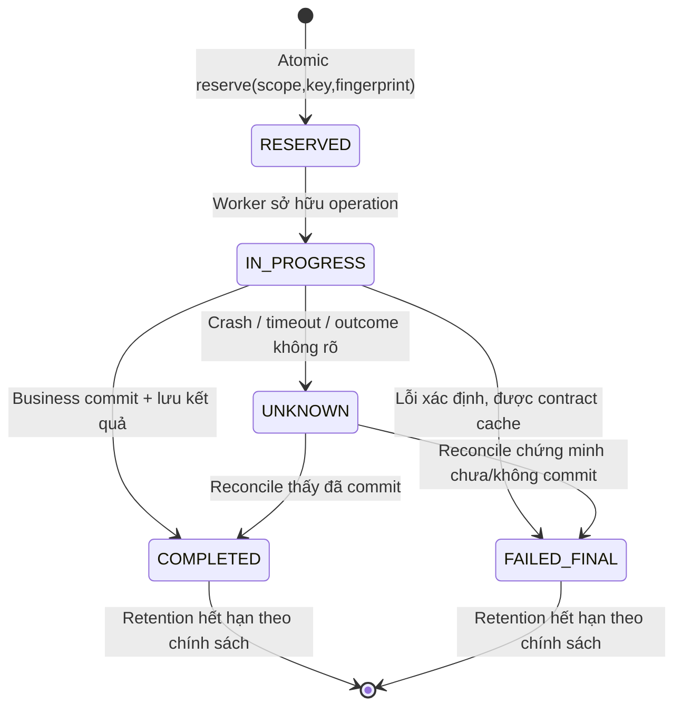
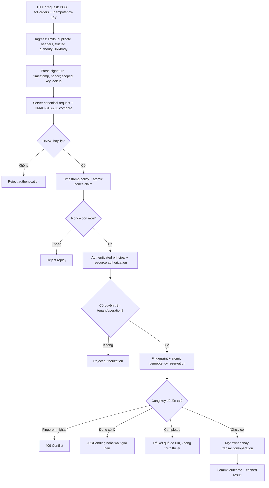

# Duplicate request trong Idempotency của HTTP HMAC Request Authentication

## Mục tiêu học tập

Sau bài học, bạn có thể:

- Định nghĩa **duplicate request** ở ba mức: bản sao HTTP request, lần retry của cùng **ý định nghiệp vụ**, và hai thao tác trông giống nhau nhưng thực sự độc lập.
- Giải thích vì sao **HMAC**, **timestamp/nonce chống replay** và **idempotency** giải quyết các vấn đề khác nhau; nonce mới không khiến một thao tác nghiệp vụ cũ trở thành thao tác mới.
- Thiết kế hợp đồng `Idempotency-Key` **ổn định qua retries**, nằm trong canonical request có HMAC, và **request fingerprint** ràng buộc key với nội dung, principal, tenant, endpoint và các điều kiện nghiệp vụ.
- Phân biệt trạng thái `IN_PROGRESS`, `COMPLETED`, `FAILED_FINAL` và `UNKNOWN` của một idempotency ledger; quyết định trả kết quả cũ, báo đang xử lý, từ chối key reuse hay từ chối an toàn khi trạng thái commit chưa rõ.
- Xử lý **hai bản sao đồng thời** bằng unique constraint/atomic reservation, hiểu tại sao cache cục bộ, `GET` rồi `SET` và replication không nhất quán không đủ.
- Viết Java 17 mô phỏng ledger có atomic claim, fingerprint, chia sẻ kết quả cho các request cùng key và kiểm tra side effect chỉ chạy một lần; biết giới hạn của demo in-memory.
- Thiết kế kết hợp **database transaction**, outbox hoặc idempotency phía hệ thống ngoài, lưu giữ kết quả, TTL/retention và chính sách retry sau timeout.
- Kiểm thử end-to-end qua HTTP client, proxy/gateway, HMAC verifier, nonce store, idempotency store và backend, bao gồm key rotation và **authorization độc lập**.

**Ngữ cảnh module:** Bài thuộc chương **Idempotency** của `SECURITY_AUTHENTICATION_HMAC_REQUEST_AUTHENTICATION`. Module thiết kế xác thực HTTP request bằng **shared secret** và **canonical request** gồm method, URI, headers hoặc body; sau đó xác minh HMAC, chống replay bằng timestamp/nonce, quản lý key rotation, kiểm thử proxy/gateway và phân biệt authentication với authorization. Chủ đề trực tiếp của bài là **Duplicate request** — khi một hành động được yêu cầu nhiều lần vì retry, truyền thông mạng hoặc race, làm thế nào để backend **không tạo side effect trùng** trong khi vẫn bảo vệ từng request bằng HMAC?

> Giao thức `orders-idem-v1`, endpoint, tên header và chính sách phản hồi trong bài là **profile minh họa do chúng ta định nghĩa**. Các ví dụ Redis/SQL/Java chỉ chứng minh những phần có thể kiểm thử, không tự động tạo ra bảo đảm exactly-once cho một hệ thống phân tán.

## 1. Duplicate request là gì?

Một HTTP request có thể được gửi lại bởi client SDK, reverse proxy, load balancer, job worker, hoặc người dùng bấm nút nhiều lần. Từ “duplicate” có thể chỉ **cùng bytes**, **cùng ý định**, hoặc **cùng dữ liệu**; ba khái niệm không đồng nhất.

### 1.1. Ba kiểu “trùng”

| Kiểu | Ví dụ | Có chắc là cùng nghiệp vụ? | Cách xử lý |
|---|---|---|---|
| **Exact replay** | Gửi lại đúng method, URI, headers, timestamp, nonce, signature và body | Là bản sao của cùng request đã ký | **Replay gate** từ chối nonce đã dùng |
| **Retry của cùng ý định** | Client giữ `Idempotency-Key` và payload, nhưng tạo timestamp/nonce/HMAC mới | Có, nếu fingerprint và scope khớp hợp đồng | **Idempotency ledger** trả cùng kết quả hoặc chờ xử lý |
| **Hai ý định độc lập có payload giống nhau** | Cùng khách hàng thực sự đặt hai đơn giống hệt, mỗi đơn có idempotency key khác | Không thể suy ra là trùng chỉ từ body | Không được tự gộp chỉ vì JSON giống |

Ví dụ khách hàng nhấn “Đặt hàng”, server đã tạo đơn, nhưng response `201 Created` bị mất. SDK không biết server đã commit hay chưa và thử gửi lại. Lần thử này có thể chứa nonce mới và HMAC mới — **không phải replay nguyên văn**, nhưng vẫn là **duplicate logical operation**.

Ngược lại, khách hàng chủ động đặt **hai đơn hàng giống nhau** trong hai ngày là hai ý định hợp lệ. Cơ chế idempotency phải phân biệt chúng, không được “deduplicate” toàn bộ request có body giống nhau mãi mãi.

### 1.2. Idempotency và tính chất HTTP method

Trong HTTP semantics, một method là **idempotent** khi hiệu ứng dự kiến của nhiều request giống nhau có cùng tác dụng mong muốn như một request đơn (ví dụ `PUT` thay thế state tại một URI xác định; `DELETE` xóa tài nguyên). `GET` còn thuộc nhóm **safe** về ngữ nghĩa ứng dụng. `POST` thông thường **không idempotent** theo mặc định vì mỗi lần có thể tạo tài nguyên mới.

Cần cẩn thận:

- `PUT /v1/settings/theme` đặt theme thành `dark` nhiều lần thường có cùng state cuối, nhưng log, audit hoặc các side effect phụ có thể vẫn được ghi nhiều lần; thiết kế phải nói rõ mục tiêu tránh trùng nào.
- `DELETE /v1/orders/O-42` có thể trả `204` ở lần đầu và `404` ở lần sau mà vẫn có ngữ nghĩa idempotent; **response giống nhau không phải định nghĩa duy nhất**.
- `POST /v1/orders` có thể được **làm idempotent ở cấp API** bằng `Idempotency-Key` cùng ledger.
- Một response `5xx` không chứng minh thao tác chưa diễn ra; lỗi có thể xảy ra **sau commit nhưng trước khi client nhận response**.

**Đích thiết kế:** đảm bảo cùng **logical operation identity** không gây side effect trùng ngoài chính sách, đồng thời cho phép hai logical operations độc lập có payload giống nhau.

## 2. Kịch bản mất response: vì sao retry có thể nhân đôi kết quả?

```mermaid
sequenceDiagram
    autonumber
    participant C as Client SDK
    participant G as Gateway
    participant V as HMAC + Replay Verifier
    participant D as Idempotency Ledger
    participant B as Orders Service
    C->>C: Tạo key I cho 1 ý định đặt hàng
    C->>C: Sinh timestamp T1, nonce N1 và HMAC tag S1
    C->>G: POST /v1/orders; Idempotency-Key I
    G->>V: Forward signed request
    V->>V: HMAC valid; claim nonce N1
    V->>D: Reserve(scope,I,fingerprint)
    D-->>V: First request: reserved
    V->>B: Tạo order O-42
    B->>D: Commit kết quả cho I
    B--xC: Response 201 bị mất trên đường truyền
    C->>C: Retry cùng key I và cùng nghiệp vụ
    C->>C: Sinh T2, nonce N2, HMAC tag S2
    C->>G: POST /v1/orders; Idempotency-Key I
    G->>V: Forward retry
    V->>V: HMAC valid; claim nonce N2
    V->>D: Lookup(scope,I,fingerprint)
    D-->>V: COMPLETED: trả kết quả đã lưu
    V-->>C: Replay kết quả order O-42, không tạo O-43
```

Lần thứ hai **được phép vượt qua replay gate** vì nonce N2 mới và HMAC S2 được tính lại chính xác. Nhưng idempotency ledger trả kết quả đã có vì **key I cùng fingerprint trong cùng scope**.

### Điều gì xảy ra nếu không có ledger?

1. Server tạo đơn O-42, commit thành công.
2. Response thất lạc do network timeout, client hiểu “không biết kết quả”.
3. Client ký request mới với nonce mới.
4. HMAC và nonce checks đều pass.
5. Backend không biết đây là cùng ý định, tạo O-43.

Đây không phải lỗi của HMAC — HMAC làm đúng nhiệm vụ chứng thực request — mà là **thiếu nhận diện duplicate logical operation**.

### Một giả định quan trọng

Client **không được đổi idempotency key mỗi lần retry của cùng ý định**. Nếu key mới, backend có cơ sở xem đó là operation mới. Việc “thử tạo lại key cho chắc” khi timeout thường làm **tăng** nguy cơ duplicate side effect.

## 3. Phân biệt replay protection và idempotency

| Thuộc tính | Replay protection (nonce) | Idempotency (logical operation key) |
|---|---|---|
| Bảo vệ trước | Phát lại **signed request** đã dùng | Thực thi trùng **cùng nghiệp vụ** |
| Định danh | `(client scope, nonce)` | `(principal/tenant/operation scope, Idempotency-Key)` |
| Giá trị từ client | **Nonce mới cho mỗi lần ký/gửi mới** | **Key giữ nguyên khi retry cùng ý định** |
| Có cần HMAC bao phủ? | Có, nonce và timestamp phải được ký | Có, idempotency key và dữ liệu điều kiện phải được ký |
| Server lưu gì? | Nonce đã claim + TTL | Fingerprint, trạng thái xử lý, kết quả hoặc liên kết resource |
| Thời gian giữ | Theo timestamp acceptance window | Theo **retry horizon** và cam kết nghiệp vụ, thường dài hơn |
| Request không khớp | Nonce trùng → reject | Key trùng + fingerprint khác → conflict |
| Request khớp | Nonce mới → có thể cho qua | Key trùng + fingerprint giống → không chạy nghiệp vụ lần nữa |
| Nhiều replica | Atomic shared nonce claim | Atomic shared business reservation/transaction |
| Bảo đảm tuyệt đối “exactly once”? | Không | Không, nếu state và side effect không được phối hợp an toàn |

Từ đó có ba quy tắc:

1. **Không dùng `X-Nonce` làm `Idempotency-Key`.** Nonce thay đổi theo từng lần gửi, idempotency key giữ ổn định theo ý định.
2. **Không dùng `Idempotency-Key` thay cho nonce.** Cùng key có thể được gửi lại với chữ ký cũ; nếu thiếu replay gate, việc phát lại signed request không bị nhận diện đúng.
3. **Không gộp hai store theo một TTL duy nhất.** Nonce cần retention che phủ cửa sổ time validity; idempotency cần retention che phủ khoảng thời gian client có thể retry và trạng thái side effect có thể được kiểm tra.

### Retry cùng ý định phải re-sign

```text
Logical operation: place-order-123
  Idempotency-Key = I     // GIỮ NGUYÊN giữa các attempts
  JSON payload     = P    // GIỮ NGUYÊN theo hợp đồng
  Request 1: (timestamp T1, nonce N1, signature S1)
  Request 2: (timestamp T2, nonce N2, signature S2)
  Request 3: (timestamp T3, nonce N3, signature S3)
```

Ba request đều có thể là **HTTP requests mới được xác thực**, nhưng chỉ một **business operation** được commit.

## 4. Hợp đồng `orders-idem-v1` cho `POST /v1/orders`

Để tránh đoán semantics, giả sử chúng ta định nghĩa API server-to-server:

```http
POST /v1/orders HTTP/1.1
Host: api.example.test
Content-Type: application/json
Idempotency-Key: <key-stable-cua-1-order>
X-Client-Id: partner-17
X-Key-Id: k2
X-Timestamp: <unix-seconds>
X-Nonce: <22-char-base64url>
X-Signature: <43-char-base64url>

{"orderId":"client-order-123","amountMinor":120000,"currency":"VND"}
```

Các chuỗi `<...>` là placeholder. Ví dụ body được gửi dưới dạng **raw UTF-8 bytes không có newline cuối**.

### 4.1. Phần xác thực

| Trường | Quy định ví dụ |
|---|---|
| Method | `POST` |
| Raw request-target | Chính xác `/v1/orders`, không query ở version này |
| Public authority | `api.example.test` từ ingress đáng tin |
| `Content-Type` | Chính xác `application/json` |
| `X-Client-Id` / `X-Key-Id` | ASCII, chọn secret theo `(environment, clientId, keyId, audience)` |
| `X-Timestamp` | Unix epoch seconds decimal canonical, được ký |
| `X-Nonce` | 16 byte CSPRNG → Base64URL không padding 22 ký tự, được ký |
| `X-Signature` | 32-byte HMAC-SHA256 → Base64URL không padding 43 ký tự |
| Body | Exact raw bytes được hash SHA-256 và đưa vào canonical request |
| `Idempotency-Key` | **Được ký**, xuất hiện đúng một lần; ổn định cho một logical operation |

Hợp đồng ký:

```text
orders-idem-v1
POST
/v1/orders
host:api.example.test
content-type:application/json
idempotency-key:<stable-key>
x-client-id:partner-17
x-key-id:k2
x-timestamp:<unix-seconds>
x-nonce:<nonce-22-char-base64url>
body-sha256:<base64url-sha256-of-raw-body>
```

Nối các dòng bằng **LF** (`0x0A`), không có LF cuối, encode UTF-8 không BOM. Tính:

```text
bodyDigest  = SHA256(exactRawBodyBytes)
message     = UTF8(canonicalRequest)
tagBytes    = HMAC-SHA256(secretKeyBytes, message)
X-Signature = Base64URL_NoPadding(tagBytes)
```

**HMAC không ký chính `X-Signature`** để tránh tự tham chiếu; nhưng ký **Idempotency-Key**, timestamp và nonce. Verifier phải lấy mọi signed field từ request thực nhận, không dùng một chuỗi canonical do client tự cung cấp.

### 4.2. Phần idempotency

| Chính sách | Giá trị minh họa |
|---|---|
| Key | Từ client, chỉ ASCII theo grammar xác định; có thể sinh từ CSPRNG 16 byte → Base64URL 22 ký tự |
| Ý nghĩa | **Một key cho một logical order**, không phải một key cho mỗi HTTP attempt |
| Header cardinality | Chỉ một `Idempotency-Key`; reject duplicate, empty, comma-joined |
| Ledger scope | `(environment, audience, authenticated principal, tenant, operation, key)` |
| Fingerprint | Ràng buộc method, target/operation, tenant, content type, **raw body bytes** và mọi tham số nghiệp vụ có ảnh hưởng |
| Reuse cùng key, fingerprint giống | Trả lại kết quả cũ hoặc trạng thái đang xử lý; **không chạy side effect nữa** |
| Reuse cùng key, fingerprint khác | **409 Conflict** trong profile minh họa |
| Retention | Ví dụ **24 giờ từ khi tạo record**, hoặc lâu hơn theo retry horizon/SLA nghiệp vụ |
| Pending khi request trùng đến | Ví dụ `202 Accepted` + polling hoặc chờ có giới hạn; không spawn side effect thứ hai |
| Commit | Kết quả idempotency và side effect phải được phối hợp **atomically**, không để khoảng trống hai lần xử lý |

**24 giờ** chỉ là một quyết định ví dụ. Hệ thống thanh toán hoặc tạo đơn có retry dài, delayed queue hay reconciliation có thể cần retention dài hơn; một key hết hạn **không còn bảo vệ khỏi duplicate** nếu client tiếp tục retry cùng ý định sau thời điểm đó.

### 4.3. Sinh key ở client

```java
import java.security.SecureRandom;
import java.util.Base64;

SecureRandom random = new SecureRandom();
byte[] logicalOperationBytes = new byte[16];
random.nextBytes(logicalOperationBytes);
String idempotencyKey = Base64.getUrlEncoder()
        .withoutPadding()
        .encodeToString(logicalOperationBytes);
// idempotencyKey dài 22 ký tự; lưu ổn định cho operation này.
```

Không bắt buộc mọi API phải chọn format 22 ký tự; một số API dùng UUID hoặc client-generated operation IDs. Điểm quan trọng là **duy nhất theo logical operation**, có grammar và scope rõ, và key phải đủ khó va chạm trong môi trường thực tế.

**Không sinh lại key khi retry** cùng order. Nếu client có thể khởi động lại, key cần được lưu trong state của job/order để worker khác tiếp tục cùng ý định sử dụng lại đúng key.

## 5. Fingerprint: cùng key phải gắn với cùng thao tác

**Idempotency-Key một mình không đủ.** Nếu client vô tình hoặc cố ý dùng lại một key với body khác, backend phải ngăn việc lấy kết quả của thao tác cũ gán cho một thao tác mới.

Giả sử:

```text
Attempt A:
  Idempotency-Key: I
  POST /v1/orders
  body: {"orderId":"O-42","amountMinor":120000,"currency":"VND"}

Attempt B:
  Idempotency-Key: I
  POST /v1/orders
  body: {"orderId":"O-42","amountMinor":900000,"currency":"VND"}
```

Nếu server chỉ thấy key I đã tồn tại và trả kết quả cũ mà **không kiểm tra payload**, SDK có thể tưởng rằng amount mới đã được áp dụng. Trong hệ thống tiền tệ, lỗi này đặc biệt nguy hiểm.

### 5.1. Fingerprint gồm những gì?

Một lựa chọn an toàn, dễ kiểm thử ở profile này:

```text
fingerprint = SHA256(
    lengthPrefixed("orders-idem-v1") ||
    lengthPrefixed(method) ||
    lengthPrefixed(effectiveTarget) ||
    lengthPrefixed(contentType) ||
    lengthPrefixed(tenantId) ||
    lengthPrefixed(rawBodyBytes)
)
```

Principal/tenant/operation đã là thành phần của **ledger scope**, nhưng ta vẫn có thể đưa các trường ngữ cảnh vào fingerprint như một lớp ràng buộc bổ sung.

**Không** đưa những trường thay đổi trên mỗi lần gửi vào fingerprint nghiệp vụ:

- `X-Timestamp` mới.
- `X-Nonce` mới.
- `X-Signature` mới.
- `X-Key-Id` thay đổi khi rotate nhưng vẫn cùng owner và operation.
- Hop-by-hop headers hoặc các giá trị truyền tải ngẫu nhiên.

Nếu fingerprint chứa nonce hoặc chữ ký, **retry hợp lệ luôn trông khác** và bị trả conflict dù cùng ý định.

### 5.2. Raw body fingerprint hay semantic fingerprint?

Hai JSON body:

```json
{"orderId":"O-42","amountMinor":120000,"currency":"VND"}
```

```json
{ "currency":"VND", "amountMinor":120000, "orderId":"O-42" }
```

có thể được một JSON parser diễn giải thành đối tượng nghiệp vụ tương đương, nhưng **raw bytes khác**.

Hai lựa chọn hợp lệ nếu đặc tả đúng:

1. **Strict raw-body fingerprint (bài này chọn):** cùng key và byte-level payload khác → conflict. Client phải tái sử dụng exact serialized payload khi retry; đơn giản, không có JSON canonicalization ngầm.
2. **Semantic fingerprint:** parse bằng một parser/schema có kiểm soát, chuẩn hóa có phiên bản, tính fingerprint từ giá trị nghiệp vụ đã kiểm tra. Cần định nghĩa duplicate JSON keys, charset, Unicode normalization, số thập phân, null/missing, thứ tự array, và bảo đảm backend **thực thi chính semantics đã fingerprint**.

Không chỉ hash `Map.toString()` hoặc serialize lại JSON tùy tiện. Cũng không tự coi mọi request có body giống nhau nhưng **khác Idempotency-Key** là cùng ý định; hệ thống có thể cần hai đơn giống nhau thật.

### 5.3. Trường nghiệp vụ ngoài body cũng phải ràng buộc

Nếu handler dùng `X-Tenant-Id`, `Currency`, `If-Match`, query parameter, destination account hay resource ID, những trường này phải được **bảo vệ bởi HMAC** và **ràng buộc với fingerprint/scope** phù hợp. Không để attacker thay header không được ký khiến verifier HMAC request A, nhưng backend thực thi B.

Khi một giao thức có nhiều endpoint dùng cùng key namespace, thêm **operation/endpoint** vào scope để key của `POST /orders` không bị nhầm với `POST /refunds`.

## 6. Một state machine cho idempotency ledger

Một bản ghi idempotency không chỉ có `key exists`. Nó cần mô tả **tiến độ và kết quả** của operation, nhất là khi request đồng thời hoặc backend bị crash.



Bảng quyết định:

| State của cùng `(scope,key)` | Fingerprint giống | Phản ứng với duplicate |
|---|---|---|
| **Không có record** | — | Atomic reserve, request thắng race được thực thi |
| `RESERVED`/`IN_PROGRESS` | Có | Không thực thi lại; `202 Accepted`/polling hoặc chờ có giới hạn |
| `COMPLETED` | Có | Trả **kết quả đã lưu** hoặc tham chiếu resource tương ứng |
| `FAILED_FINAL` | Có | Trả lỗi đã lưu **nếu hợp đồng quy định cache lỗi này** |
| `UNKNOWN` | Có | Không chạy lại mù quáng; reconciliation hoặc trả trạng thái chưa xác định |
| Bất kỳ state nào | **Không** | `409 Conflict`: key reuse cho payload khác |

**Chú ý:** các tên state và HTTP status là lựa chọn thiết kế. Một số API định nghĩa retry khi pending là `409` với mã `request_in_progress`; API khác dùng `202`. Điều quan trọng là client hiểu **không có side effect mới** được tạo và có thể tra cứu trạng thái.

### Cần phân loại lỗi theo thời điểm

- **Lỗi validation chắc chắn trước khi reserve/side effect:** có thể trả `400` và không lưu idempotency record, nếu đã quy định.
- **Lỗi nghiệp vụ xác định đã commit kết quả** (ví dụ bị từ chối hạn mức trong một giao dịch đã kết thúc): có thể lưu `FAILED_FINAL` và trả cùng kết quả theo policy.
- **Lỗi hạ tầng sau khi có thể đã commit:** phải ghi/giữ trạng thái `UNKNOWN` và reconcile; **không đơn giản xóa key** để request sau chạy lại.

Một `500` trả về client có thể xảy ra **sau commit**. Quy tắc “xóa idempotency key khi HTTP status là 500” có thể tạo duplicate side effect.

## 7. Atomic reservation: tránh hai request cùng thắng

Nếu hai request cùng key và cùng fingerprint được gửi gần như đồng thời:

```text
Replica A: SELECT key I -> not found
Replica B: SELECT key I -> not found
Replica A: execute createOrder() -> O-42
Replica B: execute createOrder() -> O-43
Replica A: INSERT idempotency record I
Replica B: INSERT idempotency record I -> duplicate error (đã quá muộn)
```

Mặc dù ledger cuối cùng có một record, **hai đơn đã được tạo**. Lỗi nằm ở chỗ business side effect chạy **trước khi giành quyền xử lý duy nhất**.

### 7.1. Reservation với unique constraint

Bảng ví dụ PostgreSQL:

```sql
CREATE TABLE idempotency_records (
    environment    VARCHAR(32) NOT NULL,
    audience       VARCHAR(64) NOT NULL,
    principal_id   VARCHAR(128) NOT NULL,
    tenant_id      VARCHAR(128) NOT NULL,
    operation      VARCHAR(64) NOT NULL,
    idem_key       VARCHAR(128) NOT NULL,
    request_hash   BYTEA NOT NULL,
    state          VARCHAR(20) NOT NULL,
    response_code  INTEGER,
    response_body  BYTEA,
    resource_id    VARCHAR(128),
    created_at     TIMESTAMPTZ NOT NULL,
    expires_at     TIMESTAMPTZ NOT NULL,
    PRIMARY KEY (
        environment, audience, principal_id,
        tenant_id, operation, idem_key
    ),
    CHECK (state IN (
        'RESERVED', 'IN_PROGRESS', 'COMPLETED',
        'FAILED_FINAL', 'UNKNOWN'
    ))
);
```

Một reservation minh họa:

```sql
INSERT INTO idempotency_records (
    environment, audience, principal_id, tenant_id,
    operation, idem_key, request_hash, state,
    created_at, expires_at
)
VALUES (
    :env, :audience, :principal, :tenant,
    :operation, :key, :fingerprint, 'RESERVED',
    CURRENT_TIMESTAMP, CURRENT_TIMESTAMP + INTERVAL '24 hours'
)
ON CONFLICT DO NOTHING
RETURNING state;
```

- Có hàng được `RETURNING` → caller này đã reserve thành công.
- Không có hàng → đã có request khác giữ key; **đọc record đã commit và so fingerprint**, không tiếp tục tạo đơn.
- Nếu có race với transaction đang chờ commit, truy vấn đọc record có thể cần đợi và/hoặc **retry truy vấn** theo isolation semantics của PostgreSQL; không suy từ một `SELECT` rỗng sau conflict rằng key chưa tồn tại.
- Khi `request_hash` khác, **reject conflict**, không trả kết quả cũ như thể payload tương đương.
- Đừng đọc bản ghi từ replica eventual-consistent rồi cho chạy side effect vì “chưa thấy record”.

Unique constraint giúp **một key chỉ có một reservation được commit trong miền database đó**, nhưng **không tự liên kết** reservation với transaction tạo đơn và không tự đảm bảo an toàn khi dữ liệu bị mất qua failover.

### 7.2. Reservation và business commit phải phối hợp

Giả sử:

```text
TX1: INSERT idempotency RESERVED; COMMIT
TX2: INSERT orders O-42; COMMIT
CRASH trước khi UPDATE idempotency COMPLETED
```

Retry thấy `RESERVED` nhưng không biết O-42 đã được tạo hay chưa. Nếu hệ thống tự xóa record sau timeout và tạo lại order, có thể nhân đôi.

Với **một database có thể chứa cả idempotency record và business state**, phương án mạnh là thiết kế **một transaction** bảo đảm:

- Có một điểm quyết định duy nhất cho `(scope,key)`.
- Thực thi business state change và ghi kết quả/idempotency outcome cùng transaction.
- Nếu transaction rollback, cả business change và idempotency outcome rollback theo thiết kế.
- Nếu transaction commit, cả hai được nhìn thấy nhất quán.

Tùy mức độ trễ và throughput, transaction có thể khóa/reserve record hoặc dùng unique business constraint và state machine để phối hợp. Không giữ transaction mở vô hạn khi gọi dịch vụ bên ngoài hoặc chờ HTTP response của client.

## 8. External side effect: outbox và provider idempotency

Với chuyển tiền, gửi email hoặc gọi payment provider, một database transaction nội bộ **không thể tự atomic** với dịch vụ bên ngoài.

Tình huống khó:

1. Server gửi yêu cầu thanh toán tới provider.
2. Provider đã ghi nhận tiền, nhưng connection giữa server và provider timeout.
3. Server không biết provider đã commit hay chưa.
4. Server thử gọi lần nữa → có nguy cơ thanh toán hai lần.

Khi xử lý external side effect:

- Dùng **outbox pattern**: cùng transaction với business intent và idempotency state, ghi một outbox command có **stable operation ID**.
- Worker xử lý outbox có thể bị retry; gửi tới provider với **idempotency key ổn định** nếu provider hỗ trợ, gắn với cùng logical operation.
- Lưu provider transaction ID và trạng thái reconciliation; nếu outcome unknown, **tra cứu kết quả** thay vì gửi side effect mới một cách mù quáng.
- Dùng unique constraint/business invariant ở các điểm có thể kiểm soát.
- Định nghĩa rõ thời gian retention của provider idempotency key có phù hợp retry horizon của hệ thống hay không.

```mermaid
sequenceDiagram
    autonumber
    participant C as Client
    participant A as API + HMAC Verifier
    participant D as Transactional DB
    participant W as Outbox Worker
    participant P as External Provider
    C->>A: POST same Idempotency-Key I; fresh nonce
    A->>A: HMAC verify + nonce claim + authz
    A->>D: TX: reserve I + persist intent + outbox(I)
    D-->>A: COMMIT
    A-->>C: 202 processing + operation ID
    W->>D: Claim outbox job I
    W->>P: Process with provider idempotency key I
    alt Provider success
        P-->>W: provider transaction ID
        W->>D: Mark operation/result COMPLETED
    else Provider timeout/unknown
        P--xW: Outcome unclear
        W->>D: Mark/retain UNKNOWN, schedule reconciliation
    end
    C->>A: Retry same I; fresh nonce + tag
    A->>D: Read idem record
    D-->>A: Pending/completed/unknown outcome; no new intent
    A-->>C: Existing status/result
```

**At-least-once delivery của outbox** là bình thường; bảo vệ khỏi duplicate nằm ở stable command identity, provider idempotency (nếu có) và reconciliation. Không hứa “exactly once cross-system” nếu không có cơ chế phối hợp và bằng chứng từ cả hai hệ thống.

## 9. Java 17: ledger mô phỏng duplicate request và race

Ví dụ này tập trung vào **idempotency sau khi HMAC authentication/replay verification đã thành công**. `VerifiedOrder` chỉ là DTO cho **context nội bộ đáng tin**; trong sản phẩm thật nó phải được tạo bởi security pipeline, không nhận principal/tenant từ header do client tự khai.

Đoạn mã mô phỏng một ledger trong **một JVM**, sử dụng `ConcurrentHashMap.putIfAbsent` để **chỉ một request sở hữu** việc gọi `createOrder` cho một key. Các request đồng thời có cùng fingerprint chờ cùng một `CompletableFuture` và nhận kết quả như nhau.

### 9.1. Mã đầy đủ

```java
import java.nio.ByteBuffer;
import java.nio.charset.StandardCharsets;
import java.security.MessageDigest;
import java.security.NoSuchAlgorithmException;
import java.util.ArrayList;
import java.util.Base64;
import java.util.List;
import java.util.concurrent.CompletableFuture;
import java.util.concurrent.ConcurrentHashMap;
import java.util.concurrent.CountDownLatch;
import java.util.concurrent.ExecutionException;
import java.util.concurrent.ExecutorService;
import java.util.concurrent.Executors;
import java.util.concurrent.Future;
import java.util.concurrent.atomic.AtomicInteger;
import java.util.function.Supplier;
import java.util.regex.Pattern;

public final class DuplicateOrdersDemo {
    private static final Pattern KEY =
            Pattern.compile("[A-Za-z0-9][A-Za-z0-9._-]{0,79}");
    private static final String VERSION = "orders-idem-v1";
    private static final String CONTENT_TYPE = "application/json";
    private static final String METHOD = "POST";
    private static final String TARGET = "/v1/orders";

    private DuplicateOrdersDemo() {}

    public record VerifiedOrder(
            String environment, String audience,
            String principal, String tenant,
            String idempotencyKey, byte[] rawBody) {

        public VerifiedOrder {
            if (rawBody == null) {
                throw new IllegalArgumentException("Missing body");
            }
            rawBody = rawBody.clone();
        }

        @Override
        public byte[] rawBody() {
            return rawBody.clone();
        }
    }

    public record HttpResult(
            int status, String resourceId, String responseJson) {}

    public record Outcome(HttpResult result, boolean fromCache) {}

    public static final class Conflict extends RuntimeException {
        public Conflict(String message) {
            super(message); // HTTP adapter có thể map sang 409.
        }
    }

    private static final class Slot {
        final byte[] fingerprint;
        final CompletableFuture<HttpResult> completed =
                new CompletableFuture<>();

        Slot(byte[] fingerprint) {
            this.fingerprint = fingerprint.clone();
        }
    }

    private final ConcurrentHashMap<String, Slot> slots =
            new ConcurrentHashMap<>();

    private static void checkRequest(VerifiedOrder r) {
        if (r == null ||
                r.environment() == null || r.environment().isEmpty() ||
                r.audience() == null || r.audience().isEmpty() ||
                r.principal() == null || r.principal().isEmpty() ||
                r.tenant() == null || r.tenant().isEmpty() ||
                r.idempotencyKey() == null ||
                !KEY.matcher(r.idempotencyKey()).matches() ||
                r.rawBody().length == 0 ||
                r.rawBody().length > 16 * 1024) {
            throw new IllegalArgumentException("Invalid verified order");
        }
    }

    // Length-prefix: dữ liệu a|bc và a + bc không tạo cùng scope.
    private static String field(String s) {
        return s.length() + ":" + s;
    }

    private static String scopeKey(VerifiedOrder r) {
        return field(r.environment()) +
                field(r.audience()) +
                field(r.principal()) +
                field(r.tenant()) +
                field(METHOD + " " + TARGET) +
                field(r.idempotencyKey());
    }

    private static void addField(MessageDigest digest, String text) {
        addBytes(digest, text.getBytes(StandardCharsets.UTF_8));
    }

    private static void addBytes(MessageDigest digest, byte[] bytes) {
        byte[] size = ByteBuffer.allocate(4)
                .putInt(bytes.length)
                .array();
        digest.update(size);
        digest.update(bytes);
    }

    // HMAC đã bảo vệ raw body/Idempotency-Key ở tầng trước.
    // Fingerprint NHIỆM VỤ không có nonce, timestamp, signature.
    private static byte[] fingerprint(VerifiedOrder r) {
        try {
            MessageDigest digest = MessageDigest.getInstance("SHA-256");
            addField(digest, VERSION);
            addField(digest, METHOD);
            addField(digest, TARGET);
            addField(digest, CONTENT_TYPE);
            addField(digest, r.tenant());
            addBytes(digest, r.rawBody());
            return digest.digest();
        } catch (NoSuchAlgorithmException impossibleInNormalJdk) {
            throw new IllegalStateException(impossibleInNormalJdk);
        }
    }

    // Một JVM: demo atomic claim và share future, KHÔNG durable/multi-node.
    public Outcome handle(
            VerifiedOrder verified, Supplier<HttpResult> createOrder) {
        checkRequest(verified);
        byte[] requestHash = fingerprint(verified);
        String key = scopeKey(verified);

        Slot mine = new Slot(requestHash);
        Slot existing = slots.putIfAbsent(key, mine);

        if (existing == null) {
            // Chỉ owner này được gọi business side effect.
            try {
                HttpResult result = createOrder.get();
                if (result == null) {
                    throw new IllegalStateException("Missing operation result");
                }
                mine.completed.complete(result);
                return new Outcome(result, false);
            } catch (RuntimeException failure) {
                // Outcome có thể UNKNOWN nếu side effect đã commit.
                // KHÔNG xóa slot và retry tự động.
                mine.completed.completeExceptionally(failure);
                throw failure;
            }
        }

        // Cùng key nhưng request khác phải bị conflict, không lấy result cũ.
        if (!MessageDigest.isEqual(
                existing.fingerprint, requestHash)) {
            throw new Conflict(
                    "Idempotency-Key reused with different request");
        }

        // Demo chỉ chờ Future; production cần timeout/polling/PENDING state.
        // Không gọi createOrder ở nhánh duplicate.
        try {
            HttpResult oldResult = existing.completed.get();
            return new Outcome(oldResult, true);
        } catch (InterruptedException interrupted) {
            Thread.currentThread().interrupt();
            throw new IllegalStateException("Interrupted while waiting");
        } catch (ExecutionException unknownOutcome) {
            throw new IllegalStateException(
                    "Operation outcome uncertain; reconcile first",
                    unknownOutcome.getCause());
        }
    }

    public static void main(String[] args) throws Exception {
        DuplicateOrdersDemo ledger = new DuplicateOrdersDemo();
        AtomicInteger businessWrites = new AtomicInteger();

        VerifiedOrder operation = new VerifiedOrder(
                "production", "orders-api", "partner-17", "tenant-17",
                "order-2026-001",
                "{\"orderId\":\"O-42\",\"amountMinor\":120000}"
                        .getBytes(StandardCharsets.UTF_8));

        // Tám signed HTTP attempts giả định đều đã qua HMAC,
        // timestamp, nonce gate và authorization độc lập.
        int attempts = 8;
        ExecutorService pool = Executors.newFixedThreadPool(attempts);
        CountDownLatch start = new CountDownLatch(1);
        List<Future<Outcome>> futures = new ArrayList<>();

        try {
            for (int i = 0; i < attempts; i++) {
                futures.add(pool.submit(() -> {
                    start.await();
                    return ledger.handle(operation, () -> {
                        int id = businessWrites.incrementAndGet();
                        return new HttpResult(
                                201, "O-42",
                                "{\"id\":\"O-42\",\"attempt\":" + id + "}");
                    });
                }));
            }

            start.countDown();
            for (Future<Outcome> future : futures) {
                Outcome outcome = future.get();
                if (outcome.result().status() != 201 ||
                        !"O-42".equals(outcome.result().resourceId())) {
                    throw new AssertionError("Unexpected result");
                }
            }
        } finally {
            pool.shutdown();
        }

        if (businessWrites.get() != 1) {
            throw new AssertionError("Duplicate business side effect");
        }

        // Cùng key + payload khác: conflict, không tạo order mới.
        VerifiedOrder changed = new VerifiedOrder(
                operation.environment(), operation.audience(),
                operation.principal(), operation.tenant(),
                operation.idempotencyKey(),
                "{\"orderId\":\"O-42\",\"amountMinor\":900000}"
                        .getBytes(StandardCharsets.UTF_8));
        try {
            ledger.handle(changed, () -> {
                businessWrites.incrementAndGet();
                return new HttpResult(201, "O-43", "{}");
            });
            throw new AssertionError("Key reuse should be conflict");
        } catch (Conflict expected) {
            // PASS.
        }
        if (businessWrites.get() != 1) {
            throw new AssertionError("Conflict executed side effect");
        }

        // Repeated same key + payload returns stored result.
        Outcome replay = ledger.handle(operation, () -> {
            throw new AssertionError("Should not execute duplicate");
        });
        if (!replay.fromCache() ||
                !"O-42".equals(replay.result().resourceId())) {
            throw new AssertionError("Failed to reuse prior result");
        }

        System.out.println("Duplicate request idempotency demo: PASS");
    }
}
```

### 9.2. Demo đã chứng minh gì?

- `putIfAbsent` là **atomic owner election trong một JVM** cho cùng ledger scope; các request cùng key không đồng thời tạo đơn.
- Request thứ hai với **fingerprint giống** chỉ chờ kết quả cũ; không gọi lại `createOrder`.
- Request thứ hai với **fingerprint khác** bị từ chối (`Conflict`); không dùng lại kết quả không tương ứng.
- Fingerprint **không chứa nonce/timestamp/tag HMAC**, nên việc re-sign mỗi HTTP attempt không làm một logical operation thành operation khác.
- `MessageDigest.isEqual` so digest bytes; đây là một cách so phù hợp, dù fingerprint không phải secret như expected HMAC tag.
- Test cạnh tranh xác nhận **tám calls trong cùng JVM chỉ có một business callback**.

### 9.3. Giới hạn cần nêu đúng

Đây **không phải production idempotency service**. Nó không có:

- Persistent ledger; restart JVM làm mất mọi slot.
- TTL/expiration và chính sách xoá record, recovery khi owner chết.
- Atomicity giữa ledger và database business.
- Đồng bộ giữa verifier replicas, vùng triển khai hoặc shard.
- Lease/fencing token, timeout hoặc reconciliation cho `IN_PROGRESS`/`UNKNOWN`.
- Kiểm soát response cache bảo vệ PII, authorization, provider idempotency hoặc transactional outbox.
- HTTP parser, HMAC verifier và shared nonce store thật. `VerifiedOrder` chỉ là kiểu DTO trong demo; không phải bằng chứng bảo mật nếu để caller Internet tự tạo giá trị principal/tenant.

Đặc biệt, **sau khi business callback ném exception**, demo giữ slot thất bại và các duplicate sau không tự chạy lại. Đó là cách an toàn hơn việc tự xóa slot khi **không biết** callback đã commit hay chưa, nhưng production cần trạng thái `UNKNOWN`, reconciliation và quy tắc trả lời client rõ ràng.

**Không chuyển ví dụ này thành production bằng cách chỉ thay `ConcurrentHashMap` thành Redis cache**. Cần thiết kế atomically consistent business-state transition, retention, multi-region và xử lý failure modes thực tế.

## 10. Tích hợp HMAC, nonce và Idempotency-Key đúng thứ tự

Giao thức HMAC trong module bảo vệ tính toàn vẹn request, nhưng kết quả idempotency **phải dựa trên authenticated principal**, không dựa trên client ID khai báo chưa verify.



Một số hệ thống làm time-window prefilter **trước HMAC** để giảm tải. Điểm không được phá vỡ là:

- Không tin client/key ID thành principal trước verify.
- Không claim nonce trước HMAC đúng.
- Không trả cached idempotency result của principal/tenant khác.
- Không thực thi business side effect trước khi atomic reservation/authorization.
- Không gửi cached response chứa dữ liệu nhạy cảm cho caller không còn được cấp quyền.

### Khi retry cùng idempotency key, nonce mới hay nonce cũ?

Đối với **lần HTTP attempt mới** trong profile này, client tạo **nonce mới**, timestamp hiện tại, tính chữ ký HMAC mới. `Idempotency-Key` **giữ nguyên** và body/signed business fields **giữ nguyên**. Việc phát lại y nguyên nonce/tag sẽ bị replay gate chặn trước khi idempotency ledger trả kết quả.

Vì vậy SDK nên cung cấp hai tầng riêng:

```text
Logical operation context:
  idempotencyKey, immutable business payload, tenant/resource

Per-attempt signing context:
  fresh timestamp, fresh nonce, key version, HMAC tag
```

Nếu client đổi payload sau timeout, không được âm thầm sử dụng lại key cũ. Cần xác định đó là **new logical operation** hay xử lý conflict một cách có chủ đích.

## 11. Phản hồi HTTP cho duplicate request

Một API cần công bố rõ cách trả lời khi duplicate xuất hiện. Profile `orders-idem-v1` minh họa:

| Điều kiện | Response ví dụ | Cần giải thích với client |
|---|---|---|
| Lần đầu tạo order thành công | `201 Created`, body chứa order ID, `Location` | Đã commit |
| Retry cùng key/payload sau thành công | **Cùng kết quả đã lưu**, ví dụ `201` và cùng resource ID | Không tạo order mới |
| Duplicate trong khi operation pending | `202 Accepted` + operation/status URL; có thể `Retry-After` | Chưa chạy thêm side effect |
| Cùng key, fingerprint khác | `409 Conflict` + mã `idempotency_key_reused` | Không được đổi payload nhưng giữ key |
| Outcome không xác định | Error/status pending để client tra cứu hoặc reconcile | Không retry vô điều kiện với key mới |
| Authentication không hợp lệ | `401 Unauthorized` theo scheme | Không đọc cache theo key chưa xác thực |
| Authenticated nhưng ngoài quyền | `403 Forbidden` (theo policy) | Không làm lộ kết quả của tenant khác |

**Có thể trả lại chính response gốc**, gồm status `201` và body. Một số API thay đổi response thành `200` cho replay thành công; lựa chọn nào cũng được nếu được **đặc tả và test**. Điều bắt buộc là **cùng logical operation không sinh thêm side effect**.

### Không cache response tùy tiện

Response có thể chứa thông tin khách hàng, số tiền, token hoặc header nhạy cảm. Idempotency ledger cần:

- Phân quyền scope trước khi trả cached result.
- Mã hóa/giới hạn truy cập dữ liệu lưu, giữ retention tối thiểu phù hợp.
- Không cache nguyên `Set-Cookie`, `Authorization`, các header hop-by-hop hoặc thông tin hết hạn nếu không có policy.
- Có thể chỉ lưu `resourceId` và trạng thái, sau đó tái dựng response an toàn bằng quyền truy cập hiện tại.
- Quy định cached lỗi nào được trả lại và lỗi nào chỉ là **UNKNOWN** cần reconciliation.

Không để raw idempotency key trong cache key công khai không có scope; dù key không phải secret, khả năng đọc record của principal khác vẫn là lỗ rò rỉ dữ liệu.

## 12. TTL và lifecycle của idempotency record

Nonce store và idempotency ledger có **retention khác nhau**.

Giả sử timestamp window là `±300s`; nonce TTL cố định có thể cần ít nhất `2W + margin`, ví dụ `605s` trong lab. Nhưng idempotency key của một đơn hàng có thể cần được nhận diện trong **24 giờ** hoặc theo thời gian retry của đối tác.

```text
Nonce protection:
    khoảng request đã ký còn hợp lệ, quy mô phút

Idempotency:
    khoảng client có thể retry một logical operation, quy mô giờ/ngày
    hoặc lâu hơn theo nghiệp vụ và reconciliation
```

### Hết hạn idempotency record có ý nghĩa gì?

Nếu server **đã xóa key I**, một request mới dùng lại I sau retention có thể bị xem là operation mới và tạo side effect mới. Đây là lý do API phải công bố:

- Retry horizon tối đa mà key được bảo vệ.
- Cách client tra cứu kết quả khi đã quá hạn retention.
- Liệu operation ID ổn định hoặc unique business constraint có bảo vệ lâu hơn không.
- Chính sách dọn record `IN_PROGRESS`/`UNKNOWN`, **không được xóa sớm** khi side effect còn chưa reconcile xong.

Đối với thanh toán hay order creation, một **business unique ID** (ví dụ client order ID được enforce unique theo tenant) có thể bổ sung bảo vệ dài hạn vượt quá thời gian lưu cache response.

### TTL và high throughput

Một idempotency record thường **lớn hơn** nonce record vì chứa fingerprint, state, result và metadata. Ước lượng sơ bộ:

```text
active_records ≈ new_logical_operations_per_second * retention_seconds
```

Nếu 100 logical operations mới mỗi giây và retention 24 giờ:

```text
100 * (24 * 60 * 60) = 8,640,000 records
```

Đây là **ước lượng dung lượng**, không phải giới hạn giao thức. Cần sizing chỉ mục, storage, partition, cleanup, response data, encryption và khả năng phục hồi, không chỉ tạo một Redis key vô hạn.

## 13. Multi-replica, multi-region và sự cố failover

### Vấn đề với in-memory cache

Một client gửi hai request cùng key I tới hai replica A và B. Nếu mỗi replica có `ConcurrentHashMap` riêng:

```text
Replica A: I not found -> create O-42
Replica B: I not found -> create O-43
```

Dù mỗi cache local thread-safe, **global idempotency bị phá vỡ**.

### Vấn đề với eventual consistency

Hai region có thể cùng nhận I, mỗi region ghi vào database local rồi replicate **sau**. Trong khoảng trước khi đồng bộ, cả hai region đều tin mình là owner. Nếu yêu cầu chỉ một business side effect trên toàn hệ thống, cần:

1. Một **claim domain** có tính nhất quán đủ mạnh cho cùng `(scope,key)`.
2. Hoặc định tuyến mọi operation của cùng scope tới một **writer owner ổn định**, với failover/fencing đúng.
3. Hoặc ràng buộc bằng unique business constraints/transaction ở nơi side effect thực sự được commit.

**Không** lấy eventual replication làm bằng chứng “tối đa một operation toàn cầu”. Khi store không thể xác nhận claim (network partition, timeout hoặc failover), endpoint nhạy cảm nên **fail closed** hoặc trả `UNKNOWN/pending` để reconcile; không tự chạy nghiệp vụ mới.

### Failover có thể mất record đã được xác nhận

Nếu ledger claim I và business commit đã thành công, nhưng idempotency record bị mất khi chuyển primary, retry có thể thấy key chưa tồn tại. Vì vậy cần đánh giá cả:

- Durability của reservation và outcome.
- Transaction atomicity với business state.
- Replica acknowledgment/consensus hoặc cơ chế bảo đảm phù hợp.
- Recovery từ backup, rollback snapshot và reconciliation sau failover.
- Thời gian client được phép retry và TTL ở từng vùng.

Phát biểu “dùng Redis `SET NX`/SQL unique nên exactly-once” là quá mạnh. **Đúng thao tác nguyên tử trong một miền dữ liệu chưa đồng nghĩa đúng toàn chuỗi phân tán.**

## 14. Proxy/gateway và request canonicalization có thể phá idempotency

HMAC request authentication phụ thuộc việc **signed bytes = dữ liệu verifier xác nhận = semantics handler thực thi**. Idempotency tiếp tục phụ thuộc việc fingerprint thực sự biểu diễn **cùng logical operation**.

| Tình huống | Nguy cơ | Cách xử lý |
|---|---|---|
| Gateway xóa `Idempotency-Key` | Retry không được nhận diện | Yêu cầu và ký header; reject nếu thiếu |
| Header trùng hoặc bị gộp | Verifier/backend chọn first/last khác nhau | Reject duplicate tại ingress |
| Proxy đổi raw path/query | Request được route/lookup scope khác với bản client ký | Chốt target theo contract, original target từ nguồn tin cậy |
| `Host` public thành internal | HMAC ký authority sai | Trusted public Host context hoặc verify ở edge |
| Header tenant không được ký | Key có thể được dùng với tenant khác | Ràng buộc tenant bằng signed fields và authz context |
| Gateway đổi JSON whitespace/field order | Raw HMAC body digest/fingerprint khác | Serialize payload một lần, bảo toàn exact body |
| Retry middleware giữ nguyên nonce/tag | Replay gate reject trước idempotency | SDK re-sign mỗi HTTP attempt |
| Retry middleware sinh **Idempotency-Key mới** | Operation mới, có thể tạo duplicate | Stable key trong logical operation context |
| Proxy tự động retry POST | Có thể gọi backend nhiều lần khi timeout | Chỉ retry khi policy và backend idempotency hỗ trợ |
| Gateway lưu cached response không scope | Lộ kết quả cho caller khác | Principal/tenant/operation in cache scope và authz |
| HTTP framing/parser không nhất quán | Các hop thấy body/headers khác nhau | Reject ambiguous `Content-Length`/`Transfer-Encoding`, header conflicts |
| HTTP/2 `:authority` khác Host | Routing/audience mismatch | Chính sách đối chiếu authority rõ ràng |

**Thử nghiệm quan trọng:** retry phải đi qua **đường đi HTTP thật**, không chỉ gọi hàm xử lý trong unit test. Client library, reverse proxy và backend serializer có thể tự thêm header, chuẩn hóa URI hoặc đọc body stream nhiều lần làm dữ liệu thay đổi.

### Key rotation có làm mất idempotency không?

Không nên. Nếu client chuyển từ `keyId=k1` sang `keyId=k2` nhưng cùng **authenticated principal** và cùng logical operation, idempotency scope **không tự đổi theo key version**. HMAC tag và nonce thay đổi theo lần ký, còn key I và business fingerprint vẫn tương ứng một ý định.

Tất nhiên key bị revoke phải bị từ chối ở **authentication layer**; một request với chữ ký từ revoked key không được “đi tắt” vào idempotency cache để nhận kết quả riêng tư.

## 15. Authorization, idempotency và an toàn dữ liệu

**Không có bước nào trong idempotency cho phép bỏ authorization.**

Giả sử `partner-17` có HMAC hợp lệ, nonce mới và một idempotency key I đã từng được dùng. Backend lưu kết quả cho `tenant-17`. Kẻ khác biết I và gửi request có principal `partner-42`:

- Không được trả cached result của `tenant-17` chỉ vì chuỗi key trùng.
- Ledger scope phải gồm **authenticated principal/tenant/audience/operation**, hoặc có ràng buộc tương đương.
- Backend phải kiểm tra quyền hiện tại trước khi đọc/trả kết quả có dữ liệu nhạy cảm.
- Một principal mất quyền trong khoảng từ lần gửi đầu tới lần retry **không được mặc nhiên tiếp tục xem dữ liệu** chỉ vì trước đó đã có quyền.

### HMAC không thay đổi business duplicate rule

Một request có HMAC đúng, nonce mới và idempotency key mới vẫn có thể xung đột unique business ID `client-order-123`. Do đó có thể cần cả:

- HMAC authentication.
- Replay protection.
- Idempotency ledger theo key I.
- Business unique constraints theo order/client reference.
- Authorization theo principal/tenant/resource.
- Transaction và reconciliation.

**Không tin một chuỗi `principal` hoặc `tenant` từ header do client tự gửi**. Tài khoản đã xác thực phải xuất phát từ key record đã verify; tenant cần được xác định từ context có kiểm soát và kiểm tra quyền.

## 16. Ma trận kiểm thử Duplicate request

| Case | Hành vi | Kỳ vọng |
|---|---|---|
| First request | HMAC đúng, nonce mới, key I chưa có | Reserve và thực thi một lần |
| Replay nguyên HTTP request | Giữ nguyên timestamp/nonce/tag | Replay gate reject |
| Retry cùng ý định | Giữ I/body, timestamp/nonce/tag mới | HMAC pass; trả kết quả cũ, không tạo đơn mới |
| Duplicate đồng thời | 20 request cùng I/fingerprint, mỗi attempt ký hợp lệ | **Tối đa một** business commit |
| Key trùng, body khác | Cùng I nhưng `amountMinor` đổi | `409 Conflict`; không thực thi request mới |
| Key trùng, Content-Type khác | Parse semantics thay đổi | Reject/409 theo contract, không dùng cached result tùy tiện |
| Key trùng, tenant khác | Khác authenticated tenant | Scope khác, không rò rỉ response của tenant trước |
| Key trùng, principal khác | Caller mới biết key cũ | Không được truy cập cached result của principal cũ |
| Key trùng, endpoint khác | `/orders` vs `/refunds` | Namespace/operation tách biệt |
| Same body, key khác | Hai ý định độc lập | Cho phép nếu business policy cho phép |
| Same body, key khác nhưng cùng client order ID | Business unique constraint | Chặn duplicate theo business invariant |
| Header thiếu | Không có `Idempotency-Key` ở POST yêu cầu key | Reject trước side effect |
| Header trùng | Hai `Idempotency-Key` khác case | Reject tại HTTP parser |
| Ký thiếu idempotency key | Attacker thay I mà giữ HMAC | Test phải phát hiện bypass, sửa canonical |
| Chữ ký sai | HMAC không khớp | Không đọc/trả cached result cho caller chưa authn |
| Nonce trùng | Retry giữ nonce cũ | Reject replay, chưa chạm ledger |
| Key rotation | `k1 → k2`, key I và principal không đổi | Replay gate có nonce mới; ledger vẫn nhận ra I |
| Revoked HMAC key | Tag đúng bằng secret bị revoke | Authentication reject, không trả cache |
| Pending | Request đầu chưa hoàn thành, retry same I | Pending/wait, **không chạy lại** |
| Crash sau business commit | Ledger state chưa cập nhật | Reconcile, không tạo duplicate |
| Database timeout khi reserve | Không biết owner | Fail closed, không tự tạo order |
| Redis/SQL failover mất state | Record I đã ack nhưng biến mất | Chaos test phát hiện; thiết kế durability/transaction |
| Two-region race | Cùng I qua hai region chưa sync | Chỉ một claim global hoặc fail closed |
| Retention hết hạn | Client retry I sau TTL | Contract nói rõ rủi ro duplicate; status/business ID hỗ trợ |
| External provider timeout | Side effect có thể đã diễn ra | Query/reconcile/provider idem, không gửi lại mù |
| Response cũ chứa dữ liệu nhạy cảm | Caller đã mất quyền | Authz hiện tại kiểm soát việc trả response |
| Gateway reserialize body | Raw fingerprint/HMAC mismatch | Reject hoặc client re-sign theo contract |
| Retry tự động qua redirect | Chuyển Host/authority | Không forward credential cũ sang origin khác |
| Idempotency cache trả kết quả khác payload | Lỗi fingerprint check | Phải `409`, không silently return old result |

### Kiểm thử race bằng một bất biến rõ ràng

```text
Cho 20 attempts cùng logical key I,
mỗi attempt có timestamp/nonce/HMAC hợp lệ,
cùng authenticated principal và fingerprint.

assert reservationOwners == 1
assert businessCommits <= 1
assert allCompletedResponsesReferenceSameResource
assert noConflictingFingerprintWasExecuted
```

Điều kiện `businessCommits <= 1` chỉ có thể khẳng định end-to-end nếu callback side effect **thực sự gắn với ledger/unique business constraint**. Đếm số lần `putIfAbsent` trả success trong unit test **không đủ** nếu backend có đường gọi bypass.

### Các cấp kiểm thử cần có

1. **Unit:** fingerprint ổn định qua nonce mới, đổi body gây conflict, state transitions, response replay.
2. **Integration:** unique reservation, transaction, pending lease/recovery, SQL/Redis persistence và TTL.
3. **E2E:** HTTP client qua proxy/gateway, HMAC, nonce store, authz, idempotency ledger, backend và external provider giả lập.
4. **Chaos:** kill process sau reserve, sau business commit, trước response; network partition, failover, store outage, lost provider response.

## 17. Bài tập thực hành: không tạo duplicate order khi retry

Hệ thống `orders-api` dùng HMAC-SHA256 với shared secret theo client/key ID, hai replica và một API gateway. Client gọi `POST /v1/orders` tạo đơn. Sau khi server đã commit, response đôi khi mất, dẫn đến retry. Key rotation `k1 → k2` đang diễn ra. Timestamp window là `±300s`, nonce store dùng chung có TTL được thiết kế đúng.

**Yêu cầu triển khai:**

1. **Phân loại duplicate:** mô tả exact replay, retry của cùng order và hai order độc lập có body giống nhau. Vẽ hai timeline: retry trước commit và retry sau commit bị mất response.
2. **Hợp đồng HMAC:** định nghĩa canonical string có method, raw URI, trusted Host, Content-Type, `Idempotency-Key`, client/key ID, timestamp, nonce và SHA-256 raw body. Chốt LF, UTF-8, Base64URL.
3. **Client SDK:** sinh một `Idempotency-Key` khi user bắt đầu logical order, lưu nó khi queue/restart. Mỗi HTTP attempt sinh **timestamp/nonce mới**, ký lại, nhưng giữ key và business payload.
4. **Fingerprint:** triển khai SHA-256 trên length-prefixed method/target/Content-Type/tenant/raw body, không chứa nonce/timestamp/tag/key version. Kiểm tra same key + changed amount trả `409`.
5. **Ledger:** thiết kế bảng có unique key `(env,audience,principal,tenant,operation,idemKey)`, fingerprint, state, outcome và expiry. Dùng atomic reserve trước side effect.
6. **Transaction:** chứng minh khi process crash giữa tạo order và ghi result, hệ thống **không tự tạo thêm order**. Đề xuất cách commit atomic hoặc reconcile theo business unique ID.
7. **Concurrency:** chạy ít nhất 20 request same key qua hai replica, xác nhận một owner/commit và tất cả request hợp lệ còn lại nhận pending hoặc cùng resource.
8. **Provider bên ngoài:** tích hợp outbox có stable command ID, provider idempotency key và reconciliation khi response không rõ.
9. **Retention:** chọn retry horizon, TTL và policy sau expiry; không dùng nonce TTL vài phút để thay idempotency retention nhiều giờ.
10. **Authorization:** caller A và B có cùng chuỗi key nhưng khác tenant không được nhìn thấy kết quả nhau; caller A bị thu hồi quyền thì không được bypass authz vì kết quả đã cache.
11. **Key rotation:** retry cùng logical operation khi ký bằng `k2` sau request đầu bằng `k1`; nếu principal không đổi và key còn hợp lệ, ledger vẫn nhận ra cùng key I.
12. **End-to-end:** test proxy rewrite Host/URI/body, duplicate `Idempotency-Key` header, nonce replay, store unavailable, multi-region split-brain và retry sau response loss.

**Tiêu chí hoàn thành:** Người học có bằng chứng cho chuỗi **HMAC verification → nonce chống replay → authenticated principal/authorization → atomic idempotency reservation → một business operation outcome**, trong đó request retry **có HMAC mới** nhưng **idempotency key không đổi**. Phải giải thích được rằng **một request được ký hợp lệ không đồng nghĩa được xử lý đúng một lần** nếu thiếu ledger và transaction/reconciliation thích hợp.

---

## Ghi nhớ

Trong module `SECURITY_AUTHENTICATION_HMAC_REQUEST_AUTHENTICATION`, **Duplicate request** thường phát sinh khi client hoặc proxy **retry một ý định nghiệp vụ** sau timeout hay response loss. HMAC bảo vệ tính toàn vẹn request, **nonce** chặn phát lại **đúng signed request**, còn **Idempotency-Key** giữ ổn định qua retries giúp nhận ra **cùng logical operation** dù timestamp/nonce/HMAC thay đổi. Hãy ký `Idempotency-Key`, scope ledger theo **principal/tenant/operation đã xác thực**, ràng buộc cùng key với fingerprint, reserve nguyên tử trước side effect, lưu kết quả và phối hợp transaction/outbox khi cần. Idempotency không thay thế replay protection, key rotation, nhất quán qua proxy/gateway hay **authorization theo tài nguyên**.
