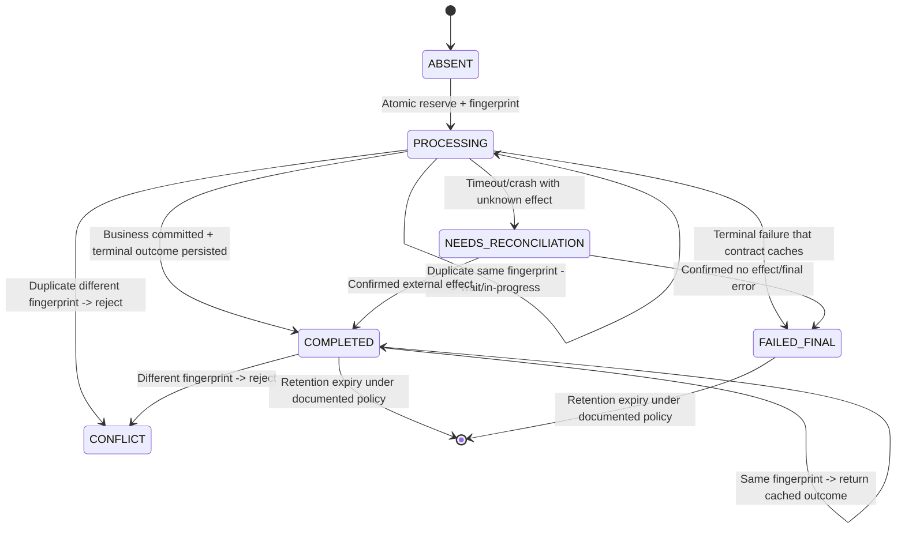
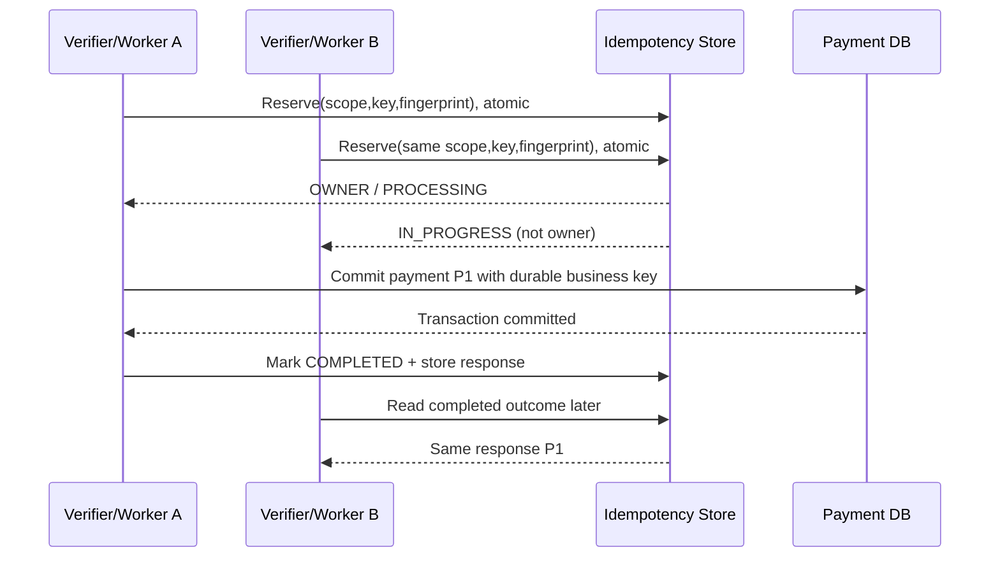
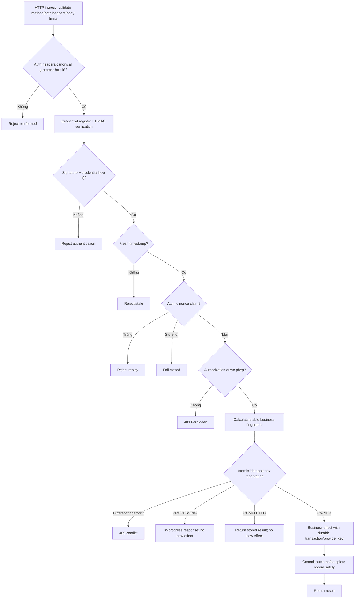

# Idempotency store: lưu kết quả để POST HMAC retry mà không nhân đôi nghiệp vụ

> **Chương:** Idempotency  
> **Bài học:** Idempotency store  
> **Phạm vi:** `SECURITY_AUTHENTICATION_HMAC_REQUEST_AUTHENTICATION` — thiết kế xác thực HTTP request bằng HMAC với shared secret và canonical request có method, URI, header hoặc body được ký. Bài này tập trung vào **idempotency store** giúp client retry một thao tác ghi khi phản hồi bị mất, phối hợp với HMAC, signed timestamp/nonce, replay database, key rotation, proxy/gateway và authorization.

## 1. Vì sao một HTTP API có HMAC vẫn cần idempotency store?

Giả sử client gửi request tạo thanh toán:

```http
POST /v1/tenants/merchant-a/payments?orderId=42 HTTP/1.1
Host: api.example.test
Content-Type: application/json
Idempotency-Key: pay-order-42
X-Key-Id: merchant-a-k2
X-Timestamp: 1767225600
X-Nonce: 87a3d56ea72d40af89f5b68cb3e831d4
X-Signature: v1=<HMAC_SHA256_TAG_BASE64URL>

{"amount":100000,"currency":"VND"}
```

Server xác minh HMAC, kiểm timestamp, claim nonce và **tạo thanh toán thành công**. Nhưng kết nối đứt **sau khi giao dịch đã commit, trước khi client nhận response**.

Client không biết lệnh đã thực hiện chưa. Nếu client gọi POST lần nữa với **timestamp/nonce mới, HMAC mới**, request thứ hai vẫn là một request **xác thực hợp lệ và không phải replay cùng nonce**. Nếu backend cứ thấy POST hợp lệ là tạo bản ghi mới, nó có thể tạo **hai thanh toán cho cùng một đơn hàng**.

**Idempotency store** là kho lưu quyết định/kết quả theo một **khóa idempotency gắn với ý định nghiệp vụ**, giúp request retry có cùng ý định **không gây thêm tác động**. Nó trả lại trạng thái hoặc kết quả đã được tạo, theo hợp đồng API.

### Hai cách lặp cần phân biệt

```text
Attempt A (lần đầu):
  Idempotency-Key = pay-order-42
  nonce = N1; timestamp = T1; signature = HMAC(K, request N1)
  → authenticated → nonce mới → tạo payment P1
  → response bị mất trên đường về

Attempt B (phát lại nguyên request A):
  Idempotency-Key = pay-order-42
  nonce = N1; timestamp = T1; signature = cùng tag
  → replay database từ chối N1

Attempt C (retry hợp lệ của cùng ý định):
  Idempotency-Key = pay-order-42
  nonce = N2; timestamp = T2; signature = HMAC(K, request N2)
  → authenticated → nonce mới
  → idempotency store phát hiện ý định đã xử lý
  → trả lại kết quả P1, KHÔNG tạo P2
```

**Mấu chốt:** Replay database chặn **cùng signing attempt**, còn idempotency store chặn **cùng business intent được gửi lại bằng attempt mới**. Cả hai đều cần thiết khi API có nguy cơ tạo tác động lặp.

## 2. Idempotency là gì và store bảo đảm điều gì?

Một thao tác được gọi là **idempotent** nếu thực hiện nó nhiều lần có cùng tác động mong muốn lên trạng thái hệ thống như thực hiện một lần, trong phạm vi hợp đồng.

Ví dụ:

- `GET` có ngữ nghĩa safe và idempotent theo HTTP, nhưng vẫn cần kiểm quyền/canonicalization nếu được ký.
- `PUT` có ngữ nghĩa idempotent theo phương thức HTTP khi triển khai đúng; không đồng nghĩa mọi hiệu ứng phụ như gửi email đều tự idempotent.
- `POST /payments` thường **không tự idempotent**. Muốn hỗ trợ retry an toàn, API có thể yêu cầu `Idempotency-Key` và store trạng thái/kết quả tương ứng.

Idempotency store có thể bảo đảm **một thao tác logic chỉ được khởi tạo/commit một lần** nếu khóa, fingerprint, reservation và side effects được phối hợp đúng. Nhưng **một bảng idempotency riêng lẻ không tự đảm bảo exactly-once execution** khi có network calls, external PSP, message brokers và crash.

| Thuộc tính | Được đảm bảo bởi | Không tự có |
| --- | --- | --- |
| Request được ký bằng đúng credential | HMAC + canonical request + credential registry | HMAC không bảo đảm nonce mới hoặc không lặp nghiệp vụ. |
| Request không bị phát lại nguyên attempt | Timestamp + signed nonce + atomic replay store | Không chặn retry được ký lại bằng nonce mới. |
| Retry cùng thao tác không tạo thêm payment | Idempotency key + fingerprint + atomic state/result + business transaction policy | Không do ký HMAC hoặc nonce một mình. |
| Request thuộc tenant/hành động được phép | Authorization dựa trên principal đã xác thực | Không do idempotency key hay credential text caller tự gửi. |
| Dữ liệu business commit nhất quán | DB transaction/outbox/provider idempotency/reconciliation | Không chỉ do cache response. |

## 3. Các trường trong giao thức: cái nào được ký, cái nào được lưu?

Một custom HMAC API thường có những dữ liệu sau:

| Trường | Ý nghĩa | Có trong HMAC? | Có trong khóa idempotency? |
| --- | --- | --- | --- |
| HTTP method và operation | Ví dụ `POST /payments` | Có, nếu ảnh hưởng action. | Có trong **operation scope**. |
| Tenant/resource/URI/query | Tài nguyên thực sẽ bị tác động. | Có hoặc được bảo vệ tương đương. | Gắn với scope/fingerprint. |
| Raw body hoặc body digest | Số tiền, currency, người nhận. | Có trong signing input. | Có trong fingerprint của ý định. |
| `Idempotency-Key` | Định danh business intent/retry series. | **Có** trong ví dụ. | **Có**, là một thành phần chính. |
| `X-Key-Id` | Chọn credential/secret. | **Có** trong ví dụ. | Không mặc nhiên: dùng **principal identity ổn định**. |
| `X-Timestamp` | Freshness của từng signing attempt. | **Có**. | **Không**: retry hợp lệ thường có timestamp khác. |
| `X-Nonce` | Dùng một lần để chống replay. | **Có**. | **Không**: retry hợp lệ phải có nonce mới. |
| `X-Signature` | HMAC tag đã encode. | Là **đầu ra**, không ký chính nó. | Không; tag đổi ở mỗi retry. |
| HMAC secret | Khóa bí mật đã cấp cho credential. | Dùng tính MAC, không truyền. | Không lưu vào idempotency store. |

**Sai lầm dễ mắc:** `idempotencyKey = signature` hoặc `idempotencyKey = nonce`. Hai giá trị đó **thay đổi mỗi lần ký lại**; store sẽ không nhận ra cùng một ý định nghiệp vụ.

### Header idempotency phải được ràng buộc bằng chữ ký

Nếu `Idempotency-Key` không nằm trong signing input, attacker hoặc một proxy thiếu tin cậy có thể sửa khóa idempotency mà không làm HMAC sai, khiến hệ thống xử lý một ý định theo khóa khác.

Vì vậy, trong hợp đồng minh họa của bài:

```text
signedHeaders = content-type;
                idempotency-key;
                x-key-id;
                x-nonce;
                x-timestamp
```

Tên header được canonicalize lower-case theo hợp đồng; **giá trị idempotency key phân biệt ký tự** nếu grammar quy định vậy.

## 4. Chọn scope của idempotency key

Một header đơn lẻ:

```http
Idempotency-Key: pay-order-42
```

**không đủ** để dùng làm khóa duy nhất trên toàn hệ thống. Hai client hoặc hai tenant có thể sử dụng cùng chuỗi `pay-order-42` nhưng là những thao tác hoàn toàn khác nhau.

Một lựa chọn cho API thanh toán:

```text
storeKey = (
    authenticatedPrincipalId,
    tenantId,
    logicalOperation,
    idempotencyKey
)

logicalOperation = "POST:/v1/tenants/{tenant}/payments"
```

**Nguồn tin cậy:**

- `authenticatedPrincipalId` lấy từ credential đã vượt HMAC/registry, **không** lấy từ header caller tự khai.
- `tenantId` lấy từ target resource sau khi kiểm authorization hoặc từ mapping đáng tin đã ràng buộc request.
- `logicalOperation` cố định bởi routing/endpoint semantics, không chỉ dùng raw path tùy tiện.
- `idempotencyKey` là input client tạo với grammar/kích thước đã chốt và **được HMAC ký**.

| Cách tạo store key | Vấn đề |
| --- | --- |
| Chỉ `Idempotency-Key` | Hai khách hàng độc lập đụng khóa nhau. |
| `(tenant, idempotencyKey)` | Có thể phù hợp nếu tenant là security boundary và key dùng trên mọi operation; cần chính sách rõ. |
| `(principal, tenant, operation, idempotencyKey)` | Tách customer và action, phù hợp nhiều API đa tenant. |
| `(keyId, idempotencyKey)` | **Nguy cơ khi key rotation**: cùng client đổi k1→k2 sẽ có namespace khác, có thể tạo trùng payment. |
| `(nonce, idempotencyKey)` | Sai retry semantics: nonce mới tạo store key mới. |
| `(timestamp, idempotencyKey)` | Sai retry semantics tương tự. |

**Đề xuất:** dùng identity ổn định của khách hàng/principal và operation/tenant rõ ràng. Khi rotation credential, **same logical identity** vẫn tìm thấy record idempotency cũ. Nếu quyền sở hữu tài nguyên thay đổi, phải định nghĩa rõ dữ liệu store nào có thể được truy xuất sau authorization.

### Thời điểm tra idempotency store

Đừng truy vấn trả lại kết quả đã cache **trước khi xác thực và phân quyền request mới**. Nếu làm vậy, attacker chỉ cần biết hoặc đoán `Idempotency-Key` là có thể đọc response của người khác dù không có secret hoặc không có quyền nữa.

Một pipeline an toàn cho API nhạy cảm:

```text
Validate request grammar/limits
→ Verify HMAC and active credential
→ Check signed timestamp freshness
→ Atomic claim signed nonce in replay store
→ Authorization(principal, tenant, operation, resource)
→ Lookup/reserve idempotency record in scoped store
→ Execute business at most once according to transaction policy
→ Persist terminal outcome
→ Return stored response or in-progress/conflict decision
```

Ở đây **replay store** và **idempotency store** là hai kho/logic độc lập; có thể cùng backing database nhưng không nên đồng nhất semantics.

## 5. Fingerprint của ý định nghiệp vụ: cùng key nhưng body khác thì sao?

Nếu caller dùng lại cùng `Idempotency-Key` cho **hai payload khác nhau**, server không được tự động trả response cũ mà bỏ qua khác biệt:

```http
# Lần đầu
Idempotency-Key: pay-order-42

{"amount":100000,"currency":"VND"}
```

```http
# Lần sau
Idempotency-Key: pay-order-42

{"amount":900000,"currency":"VND"}
```

Cùng idempotency key nhưng số tiền khác là **conflict**, không phải retry hợp lệ.

Cần lưu một **request fingerprint** để ràng buộc record với đúng business intent, ví dụ:

```text
fingerprint = SHA256(
    UTF8("PAYMENT-INTENT-V1\n") ||
    canonicalMethod ||
    canonicalLogicalOperation ||
    canonicalTenantAndResource ||
    canonicalBusinessQuery ||
    canonicalContentType ||
    SHA256(rawBodyBytes)
)
```

Trong ví dụ, dùng `SHA-256(rawBodyBytes)` vì hợp đồng ký raw-body. Hệ thống khác có thể chọn canonical semantic JSON, nhưng phải đặc tả và kiểm nghiêm ngặt: field order, số, null, Unicode, duplicate keys và schema defaults. Không tự coi “JSON parse ra gần giống” là fingerprint bằng nhau.

### Phần phải nằm trong fingerprint

- Method và **logical operation**.
- Tenant và target resource (trong chính sách đã xác định).
- Query ảnh hưởng business (ví dụ orderId, recipient, amount query).
- Body hoặc các trường nghiệp vụ đã canonicalize theo một hợp đồng nhất quán.
- Header ảnh hưởng cách parse/diễn giải (ví dụ `Content-Type`, business currency header).

### Phần nên loại khỏi fingerprint retry

- Timestamp/nonce/signature của từng signing attempt.
- Key ID nếu rotation không đổi business identity.
- Correlation/request ID chỉ phục vụ tracing và không ảnh hưởng nghiệp vụ.
- Header transport như traceparent, User-Agent, nếu không ảnh hưởng business logic.

**Không loại bỏ các trường có ảnh hưởng tới authorization hoặc đối tượng bị thao tác.** Một fingerprint quá “lỏng” có thể gộp hai ý định khác nhau. Một fingerprint quá “chặt” khi chứa timestamp/nonce lại làm mọi retry thành conflict. Hãy **version fingerprint contract** và dùng fixtures độc lập.

## 6. State machine của idempotency record

Một idempotency store đúng cần lưu **trạng thái**, không chỉ lưu cặp `key → response` sau khi xử lý xong.



Đây là **state machine khái niệm**. `CONFLICT` không nhất thiết là trạng thái được lưu: nó thường chỉ là kết quả của một request cố sử dụng lại key sai fingerprint. Một hệ thống có thể mở rộng `FAILED_RETRYABLE`, `PENDING_PROVIDER`, `CANCELLED` tùy nghiệp vụ.

| Trạng thái record | Ý nghĩa | Khi request cùng key và fingerprint tới |
| --- | --- | --- |
| Không có record | Chưa có owner cho business intent. | Một request **atomically reserve** thành `PROCESSING`. |
| `PROCESSING` | Đã có owner đang xử lý/đang chờ xác định kết quả. | **Không chạy nghiệp vụ lần hai**; trả in-progress hoặc wait theo policy. |
| `COMPLETED` | Kết quả nghiệp vụ đã commit và outcome có thể replay. | Trả response/kết quả đã lưu, không tạo giao dịch mới. |
| `FAILED_FINAL` | Lỗi cuối cùng được contract quy định cache. | Trả lại outcome đã lưu, không lặp side effect. |
| `NEEDS_RECONCILIATION` | Không chắc external effect đã thực hiện hay chưa. | Không đoán “chưa xảy ra”; kiểm trạng thái/reconcile trước takeover. |
| Fingerprint khác | Caller dùng cùng key cho ý định khác. | **Conflict**, dù record đang ở trạng thái nào. |

**Không cache mọi lỗi giống nhau.** Ví dụ malformed request/failed HMAC xảy ra trước reservation thì **không tạo record idempotency**. Lỗi 5xx do hạ tầng trước khi business bắt đầu có thể cho phép retry theo policy. Ngược lại, một response lỗi phát sinh **sau khi** external payment được tạo có thể không an toàn để chạy lại. Hợp đồng phải phân biệt **terminal outcome**, **retryable failure** và **unknown commit**.

## 7. Atomic reservation: tại sao `SELECT` rồi `INSERT` chưa đủ?

Hai request hợp lệ, cùng idempotency key, đến đồng thời:

```text
Instance A: SELECT idem key -> absent
Instance B: SELECT idem key -> absent
Instance A: create payment P1
Instance B: create payment P2
Instance A: INSERT idem response
Instance B: INSERT idem response (trùng hoặc lỗi quá muộn)
```

Lúc unique constraint báo trùng, **hai payment có thể đã được tạo**. Vì vậy phải **giành quyền xử lý trước** khi tạo side effect, bằng **một thao tác atomic reservation**.

### Mô hình đúng



Trong triển khai thực, cần bảo đảm **đường commit business và việc mark COMPLETED không tạo cửa sổ duplicate**; nếu chúng ở hai transaction khác nhau, phải có cơ chế recovery khi process crash giữa hai thao tác. Phần sau sẽ đi sâu.

**Reservation có ba kết quả cơ bản:**

1. **OWNER:** record mới được tạo; request hiện tại là người duy nhất có quyền chạy business.
2. **EXISTS_SAME:** record cùng fingerprint đã có; nếu COMPLETED trả kết quả cũ, nếu PROCESSING xử lý in-progress.
3. **EXISTS_DIFFERENT:** cùng scope/key nhưng fingerprint khác; trả conflict và không chạy business.

Lỗi storage, ambiguous commit hoặc timeout **không được biến thành OWNER**.

## 8. Thiết kế bảng PostgreSQL cho idempotency store

Ví dụ schema có chủ đích cho thanh toán POST:

```sql
CREATE TABLE payment_idempotency (
    principal_id       VARCHAR(128) NOT NULL,
    tenant_id          VARCHAR(128) NOT NULL,
    operation_id       VARCHAR(128) NOT NULL,
    idempotency_key    VARCHAR(128) NOT NULL,
    fingerprint_sha256 CHAR(64) NOT NULL,
    state              VARCHAR(32) NOT NULL,
    owner_token        UUID NOT NULL,
    response_status    INTEGER,
    response_body      BYTEA,
    business_ref       VARCHAR(128),
    created_at         TIMESTAMPTZ NOT NULL DEFAULT clock_timestamp(),
    updated_at         TIMESTAMPTZ NOT NULL DEFAULT clock_timestamp(),
    expires_at         TIMESTAMPTZ NOT NULL,

    CONSTRAINT pk_payment_idempotency PRIMARY KEY (
        principal_id, tenant_id, operation_id, idempotency_key
    ),
    CONSTRAINT ck_payment_idempotency_state
        CHECK (state IN (
            'PROCESSING', 'COMPLETED',
            'FAILED_FINAL', 'NEEDS_RECONCILIATION'
        )),
    CONSTRAINT ck_payment_idempotency_fingerprint
        CHECK (fingerprint_sha256 ~ '^[0-9a-f]{64}$'),
    CONSTRAINT ck_payment_idempotency_response
        CHECK (state <> 'COMPLETED' OR response_status IS NOT NULL)
);

CREATE INDEX idx_payment_idempotency_expiry
    ON payment_idempotency (expires_at);
```

Đây là **PostgreSQL DDL minh họa**. Với hệ thống thật, cần kiểm partitioning, index/storage cost, response privacy, migration và status vocabulary theo business semantics.

### 8.1. Chọn khóa và ràng buộc

- `PRIMARY KEY` cưỡng chế uniqueness giữa nhiều app instances sử dụng **cùng authoritative database**.
- `fingerprint_sha256` ràng buộc key với một ý định; nó **không** phải HMAC tag và không được dùng để xác thực client.
- `owner_token` là ID **server sinh ra** cho attempt đang xử lý. Nó giúp chống worker cũ hoàn thành nhầm sau khi ownership đã thay đổi.
- `state` ghi tiến trình xử lý, **không** quyết định quyền authentication.
- `response_status`/`response_body` phải có retention, encryption/masking và quyền truy cập phù hợp; có thể chỉ lưu `business_ref` và tạo lại response ổn định nếu API cho phép.
- `expires_at` thuộc **hợp đồng idempotency**, không được nhầm với expiry nonce hoặc freshness timestamp.

**Thời điểm giữ record:** Với thanh toán, record thường cần sống dài hơn rất nhiều so với nonce replay window vài phút, vì client có thể retry sau timeout hoặc kết nối mạng kém theo SLA. Chọn retention theo nghiệp vụ/điều khoản API, không mặc định lấy `T+300`.

### 8.2. Atomic insert owner

```sql
INSERT INTO payment_idempotency (
    principal_id, tenant_id, operation_id,
    idempotency_key, fingerprint_sha256,
    state, owner_token, expires_at
) VALUES (
    ?, ?, ?, ?, ?, 'PROCESSING', ?, ?
)
ON CONFLICT (
    principal_id, tenant_id, operation_id, idempotency_key
) DO NOTHING
RETURNING owner_token;
```

Các dấu `?` là placeholder được bind qua JDBC. Kết quả:

- Một row trả về → **đã reserve được** key mới (chờ transaction commit).
- Không có row → **đã có record**, phải đọc record hiện tại ở primary/transaction thích hợp để so fingerprint và state.
- Lỗi/timeout → **unknown**, fail closed; không chạy business vì chưa chứng minh ownership.

Nếu dùng database transaction, **đợi commit reservation thành công** rồi mới khởi động side effect không thể rollback. Không cho một HTTP request chạy business chỉ vì `executeUpdate()` trả 1 trước khi transaction reserve có cơ hội rollback.

### 8.3. Đọc record đã tồn tại

```sql
SELECT fingerprint_sha256, state, response_status,
       response_body, business_ref, expires_at
FROM payment_idempotency
WHERE principal_id = ?
  AND tenant_id = ?
  AND operation_id = ?
  AND idempotency_key = ?;
```

Diễn giải:

- **Fingerprint khác:** trả conflict (ví dụ HTTP 409), không dùng response cũ.
- **PROCESSING/NEEDS_RECONCILIATION:** trả pending/in-progress hoặc chờ có giới hạn, **không** khởi tạo một payment mới.
- **COMPLETED:** phục hồi response đã lưu theo chính sách.
- **Record không xuất hiện ngay sau conflict** do transaction đang commit/rollback hoặc consistency/read replica: retry đọc ở authority; **không tự suy owner**.

Với PostgreSQL `INSERT ... ON CONFLICT`, concurrency còn liên quan isolation level, row locks và transaction visibility. Không coi một câu `SELECT` từ read replica với replication lag là nguồn để cấp quyền chạy business.

### 8.4. Atomic update kết quả, có kiểm owner

```sql
UPDATE payment_idempotency
SET state = 'COMPLETED',
    response_status = ?,
    response_body = ?,
    business_ref = ?,
    updated_at = clock_timestamp()
WHERE principal_id = ?
  AND tenant_id = ?
  AND operation_id = ?
  AND idempotency_key = ?
  AND owner_token = ?
  AND fingerprint_sha256 = ?
  AND state = 'PROCESSING';
```

Phải kiểm `rowsUpdated == 1`. Nếu bằng 0, owner có thể đã đổi, state đã bị sửa hoặc fingerprint không trùng; **không tự trả “đã thành công”**.

Điều kiện owner token là một dạng **fencing** đơn giản khi có cơ chế takeover: worker cũ không được ghi đè kết quả sau khi quyền sở hữu đã được chuyển. Với external side effects, fencing tại store **chưa đủ** nếu provider không hỗ trợ idempotency/fencing; vẫn cần reconciliation.

## 9. Kết quả business và record idempotency phải nhất quán

**Thời điểm nguy hiểm nhất** không phải khi hai request cùng tới, mà khi server crash **giữa business commit và việc ghi kết quả vào idempotency store**.

```text
Reserve key → PROCESSING
Create payment P1 → COMMITTED
Process crashes
Mark COMPLETED → chưa chạy

Retry mới, nonce mới:
  idempotency record vẫn PROCESSING
  business payment P1 đã tồn tại
```

Nếu worker “cướp” ownership của record quá hạn rồi chạy payment lần nữa mà không đối chiếu P1, nó có thể tạo P2. Đây là nguyên nhân không thể tuyên bố **exactly-once** chỉ nhờ record idempotency.

### 9.1. Khi business và idempotency cùng một DB transaction

Nếu payment row và idempotency outcome có thể ghi **trong cùng một transaction**, có thể thiết kế một đường commit atomically:

```text
BEGIN TRANSACTION
  Lock/claim idempotency record with matching owner
  Validate fingerprint and operation
  INSERT payment (business uniqueness key, ...)
  UPDATE idempotency row to COMPLETED + business_ref + response snapshot
  INSERT outbox event if needed
COMMIT
```

Ưu điểm: nếu transaction commit, cả payment và idempotency completion cùng tồn tại; nếu rollback, không có partial payment row được xem là committed. Cần tách rõ transaction **reserve** và transaction **finalize** theo policy để không tạo lock kéo dài qua external calls.

**Không gọi cổng thanh toán bên ngoài** rồi giả định PostgreSQL rollback sẽ thu hồi giao dịch ở provider; database transaction chỉ atomic với dữ liệu nằm trong cùng transaction boundary.

### 9.2. Khi có external payment provider

Một API gửi tiền qua PSP, gọi REST service khác hoặc publish event là **distributed workflow**:

1. Reserve idempotency key trước business.
2. Ghi intent/durable operation ID vào DB.
3. Gọi provider với **provider idempotency key/business reference** được giữ ổn định.
4. Khi có kết quả xác định, cập nhật business record và idempotency outcome.
5. Nếu timeout/connection drop sau external call, đánh dấu `NEEDS_RECONCILIATION`, kiểm trạng thái provider trước khi retry side effect.
6. Dùng outbox/inbox/deduplication nếu có message broker.

**Không tự đánh dấu FAILED rồi chạy lại payment** chỉ vì HTTP 504 từ PSP; provider có thể đã xử lý thành công nhưng response bị mất.

### 9.3. Khi worker bị treo ở PROCESSING

Một TTL/lease cho owner chỉ nói rằng worker **có thể đã chết**, không chứng minh business effect **chưa xảy ra**.

Phương án recovery an toàn:

- Kiểm `business_ref` hoặc operation ID durable.
- Kiểm trạng thái giao dịch liên quan và outbox.
- Với external provider, truy vấn theo provider idempotency/business key.
- Chỉ khi đã biết chắc trạng thái cho phép, thực hiện takeover với **compare-and-swap/fencing token** và chính sách retry.
- Nếu không thể xác minh, giữ trạng thái cần hòa giải và trả pending/unavailable, không tạo effect lần nữa.

**Lease expiry ≠ permission to re-execute.** Đây là một bất biến quan trọng của idempotency store.

## 10. Quy tắc lưu và trả response của một request đã hoàn thành

Idempotency store thường giữ **outcome đã được cam kết**, không chỉ một cờ “đã thấy key”.

Có hai chính sách phổ biến:

1. **Store response snapshot:** lưu status, body và một tập headers an toàn; retry trả response nhất quán.
2. **Store business reference:** lưu payment ID/status, rồi dựng response từ trạng thái nguồn đáng tin theo hợp đồng.

Cần chốt rõ:

| Quyết định | Câu hỏi phải trả lời |
| --- | --- |
| HTTP status nào được cache? | Chỉ 2xx? 201? 4xx business terminal? 5xx đã có effect? |
| Những headers nào được replay? | `Content-Type`, business resource location, ETag... không tự sao chép `Date` hoặc auth headers nhạy cảm nếu không phù hợp. |
| Request hiện đang PROCESSING | Trả 409/202/425 tùy contract, hoặc chờ kết quả có timeout rõ. |
| Fingerprint khác | Trả conflict; không phục hồi response của ý định cũ như thể cùng payload. |
| Caller đã mất quyền sau lần đầu | Authorization hiện tại phải kiểm; không trả dữ liệu nhạy cảm cho principal không còn quyền. |
| Outcome quá lớn/nhạy cảm | Lưu reference thay body; mã hóa at rest, retention và access control. |
| Response phát sinh header per-attempt | Không cache session token hoặc correlation ID cũ một cách vô thức. |
| Record đã hết hạn | API phải định nghĩa late retry có được xem là new request, bị reject hay cần lookup business state. |

**Ví dụ:** Khi thanh toán đã được tạo, retry có thể trả lại cùng `paymentId` và trạng thái hiện tại, hoặc trả đúng response 201 ban đầu tùy API. Quan trọng nhất: **không tạo payment lần hai** và không tiết lộ kết quả cho caller chưa qua authentication/authorization mới.

### Một ví dụ response an toàn

```json
{
  "paymentId": "pay_42",
  "orderId": "42",
  "status": "CREATED",
  "idempotencyKey": "pay-order-42"
}
```

Đây là **response fixture**. Idempotency store không cần giữ raw shared secret, HMAC tag, signed nonce hoặc full request body nếu chỉ cần một fingerprint và business reference.

## 11. Kho idempotency lưu bao lâu?

Replay nonce store thường chỉ cần giữ record tới khi **timestamp không còn hợp lệ**, ví dụ `T+P+margin`. Ngược lại, idempotency record sống theo **retry window nghiệp vụ** và yêu cầu reconciliation.

| Store | Khóa | Retention / expiry |
| --- | --- | --- |
| Replay store | `(credentialIdentity, nonce)` | Ít nhất đến hết freshness của timestamp đã ký. |
| Idempotency store | `(principal,tenant,operation,Idempotency-Key)` | Theo **SLA retry**, thời gian có thể nhận duplicate business request và trạng thái external effects. |
| Business payment DB | Payment/business reference | Theo lifecycle, compliance và chính sách dữ liệu. |

Ví dụ bài học:

```text
Replay window:
  past=300 seconds, future=300 seconds
  nonce retention có thể cần ~600 seconds + margin

Business retry policy:
  cùng Idempotency-Key có thể retry trong 24 giờ

Idempotency record:
  không được xóa trước khi retry policy kết thúc
  không được xóa nếu operation vẫn PROCESSING/UNKNOWN
  retention có thể dài hơn 24 giờ theo policy
```

**24 giờ ở đây chỉ là ví dụ**, không phải giới hạn chung của mọi API/PSP.

### Rủi ro khi xóa record quá sớm

Client retry ở giờ thứ 23 nhưng record đã bị dọn ở giờ thứ 1:

```text
retry nonce mới → vượt HMAC/replay/authorization
idempotency record absent → server tạo payment mới
```

Đây là duplicate effect do retention sai. Cần kiểm deadline theo policy, giám sát cleanup, backup/restore, partitioning và time skew. Khi record hết hạn, không nên **lặng lẽ** coi same key là hoàn toàn mới nếu hợp đồng/ảnh hưởng nghiệp vụ không cho phép; có thể từ chối late retry hoặc tra business unique key.

### Lưu trạng thái PROCESSING không giới hạn cũng không an toàn

PROCESSING không được cleanup như COMPLETED, nhưng giữ vô hạn mà không reconciliation gây nghẽn toàn bộ retry. Cần metrics cho pending age, có service điều tra/takeover an toàn và giới hạn tài nguyên; không bỏ qua khóa để “giải phóng” request.

## 12. Thiết kế hợp đồng HMAC minh họa `IDEMPOTENCY-STORE-V1`

Để thực hành nhất quán, bài dùng một custom contract cố định:

```http
POST /v1/tenants/merchant-a/payments?orderId=42 HTTP/1.1
Host: api.example.test
Content-Type: application/json
Idempotency-Key: pay-order-42
X-Key-Id: merchant-a-k2
X-Timestamp: 1767225600
X-Nonce: 87a3d56ea72d40af89f5b68cb3e831d4
X-Signature: v1=<BASE64URL_HMAC_TAG>

{"amount":100000,"currency":"VND"}
```

Đây **không phải RFC 9421**; nó chỉ là một ví dụ làm rõ dữ liệu nào đã ký.

### Canonical signing input

```text
POST
api.example.test
/v1/tenants/merchant-a/payments
orderId=42
content-type:application/json
idempotency-key:pay-order-42
x-key-id:merchant-a-k2
x-nonce:87a3d56ea72d40af89f5b68cb3e831d4
x-timestamp:1767225600
content-type;idempotency-key;x-key-id;x-nonce;x-timestamp
<SHA256_RAW_BODY_AS_64_LOWERCASE_HEX>
```

Các dòng nối bằng LF `\n`, không có LF cuối toàn chuỗi; digest placeholder phải được thay bằng SHA-256 của **đúng raw body bytes**, không phải hash của object Java đã serialize theo cách khác.

```text
bytesToSign =
    UTF8("HMAC-SHA256/IDEMPOTENCY-STORE-V1\n" + canonicalRequest)

rawTag = HMAC-SHA256(secretForKeyId, bytesToSign)

X-Signature =
    "v1=" + Base64URLNoPadding(rawTag)  // 43 chars for 32 bytes
```

**Bắt buộc:**

- Idempotency key nằm trong signed headers nên attacker không thể đổi key mà giữ tag cũ.
- Key ID, timestamp, nonce cũng được ký.
- Server tự tính signing input từ request **thực nhận tại trust boundary**, không tin canonical string do client gửi.
- Mọi ảnh hưởng của URI/query/Content-Type/body tới business fingerprint phải nhất quán với cách business handler diễn giải.
- Không cho client tự chọn thuật toán yếu/`none` bằng header không được cho phép.
- Header authentication một giá trị phải bị reject nếu duplicate, kể cả tên khác case, trước khi map mất field occurrences.

### Thứ tự xử lý đề xuất



**Hai điểm claim khác nhau:** Claim nonce đánh dấu **attempt xác thực**, còn reserve idempotency key đánh dấu **ý định nghiệp vụ**. Việc claim nonce thành công **không** cho phép bỏ qua authorization.

## 13. Java 17+: idempotency store mô phỏng, HMAC và retry thật về mặt logic

Đoạn mã sau **chạy offline trên JDK 17+**, không cần PostgreSQL/Redis. Nó tách **replay store** và **idempotency store**:

1. `LocalReplayStore` claim `(keyId, nonce)` atomically với timestamp expiry, **chỉ trong một JVM**.
2. `LocalIdempotencyStore` reserve `(principal,tenant,operation,idempotencyKey)` và so fingerprint atomically.
3. Idempotency record có `PROCESSING` và `COMPLETED`; một owner token mới được sinh bởi server khi tạo attempt.
4. Fingerprint ràng buộc method, target, query, Content-Type và SHA-256 raw body, **không chứa timestamp/nonce/key ID**.
5. Server tự tính HMAC trên input có key ID, idempotency key, timestamp, nonce và body.
6. Retry với nonce mới: khi PROCESSING trả `IN_PROGRESS`; khi COMPLETED trả `REPLAYED` + response cũ.
7. Cùng key nhưng đổi amount → `CONFLICT`, không tạo effect mới.
8. Phân biệt replay nguyên attempt, HMAC sai, timestamp stale, key revoked, authorization deny và kho unavailable.
9. Concurrent attempts với hai nonce mới: **một owner, một in-progress**, không tạo hai owners.

**Giới hạn quan trọng:** Mã này chỉ minh họa **semantics** của store và verifier, **không thực thi thanh toán**. `complete(...)` trong demo được gọi bằng tay để mô phỏng business commit; production phải gắn completion với transaction/PSP reconciliation an toàn như các mục trước.

```java
import java.nio.charset.StandardCharsets;
import java.security.GeneralSecurityException;
import java.security.MessageDigest;
import java.time.Clock;
import java.time.Instant;
import java.time.ZoneOffset;
import java.util.Base64;
import java.util.HexFormat;
import java.util.Map;
import java.util.Objects;
import java.util.UUID;
import java.util.concurrent.Callable;
import java.util.concurrent.ConcurrentHashMap;
import java.util.concurrent.CountDownLatch;
import java.util.concurrent.ExecutorService;
import java.util.concurrent.Executors;
import java.util.concurrent.Future;
import java.util.concurrent.TimeUnit;
import java.util.concurrent.atomic.AtomicBoolean;
import java.util.concurrent.atomic.AtomicReference;
import javax.crypto.Mac;
import javax.crypto.spec.SecretKeySpec;

public final class IdempotencyStoreDemo {
    private static final HexFormat HEX = HexFormat.of();
    private static final long PAST = 300L;
    private static final long FUTURE = 300L;
    private static final long NONCE_MARGIN = 60L;
    private static final String PREFIX =
            "HMAC-SHA256/IDEMPOTENCY-STORE-V1\n";
    private static final String SIGNED_HEADERS =
            "content-type;idempotency-key;"
            + "x-key-id;x-nonce;x-timestamp";
    private static final String OPERATION =
            "POST:/v1/tenants/{tenant}/payments";

    private IdempotencyStoreDemo() {}

    record Request(
            String method, String authority, String path, String query,
            String contentType, String idempotencyKey, String keyId,
            String timestamp, String nonce, byte[] rawBody,
            String signature) {
        Request {
            Objects.requireNonNull(method);
            Objects.requireNonNull(authority);
            Objects.requireNonNull(path);
            Objects.requireNonNull(query);
            Objects.requireNonNull(contentType);
            Objects.requireNonNull(idempotencyKey);
            Objects.requireNonNull(keyId);
            Objects.requireNonNull(timestamp);
            Objects.requireNonNull(nonce);
            Objects.requireNonNull(rawBody);
            Objects.requireNonNull(signature);
            rawBody = rawBody.clone();
        }
        @Override public byte[] rawBody() {
            return rawBody.clone();
        }
    }

    record Credential(
            String principal, String tenant,
            byte[] secret, boolean active) {
        Credential {
            Objects.requireNonNull(principal);
            Objects.requireNonNull(tenant);
            Objects.requireNonNull(secret);
            secret = secret.clone();
        }
        @Override public byte[] secret() {
            return secret.clone();
        }
    }

    record Scope(
            String principal, String tenant, String operation,
            String idempotencyKey) {}

    enum Phase { PROCESSING, COMPLETED }

    record Stored(
            String fingerprint, Phase phase,
            String ownerToken, String response) {}

    enum ReservationKind { OWNER, IN_PROGRESS, REPLAYED, CONFLICT }

    record Reservation(ReservationKind kind, String response) {}

    interface IdempotencyStore {
        Reservation reserve(
                Scope scope, String fingerprint, String ownerToken);
        void complete(
                Scope scope, String fingerprint,
                String ownerToken, String response);
    }

    // Atomic trong 1 JVM; không có durability, TTL hoặc recovery.
    static final class LocalIdempotencyStore
            implements IdempotencyStore {
        private final ConcurrentHashMap<Scope, Stored> rows =
                new ConcurrentHashMap<>();

        @Override
        public Reservation reserve(
                Scope scope, String fingerprint, String ownerToken) {
            AtomicReference<Reservation> answer =
                    new AtomicReference<>();
            rows.compute(scope, (ignored, old) -> {
                if (old == null) {
                    answer.set(new Reservation(
                            ReservationKind.OWNER, null));
                    return new Stored(fingerprint,
                            Phase.PROCESSING, ownerToken, null);
                }
                if (!old.fingerprint().equals(fingerprint)) {
                    answer.set(new Reservation(
                            ReservationKind.CONFLICT, null));
                } else if (old.phase() == Phase.PROCESSING) {
                    answer.set(new Reservation(
                            ReservationKind.IN_PROGRESS, null));
                } else {
                    answer.set(new Reservation(
                            ReservationKind.REPLAYED, old.response()));
                }
                return old;
            });
            return answer.get();
        }

        @Override
        public void complete(
                Scope scope, String fingerprint,
                String ownerToken, String response) {
            Objects.requireNonNull(response);
            rows.compute(scope, (ignored, old) -> {
                if (old == null || old.phase() != Phase.PROCESSING
                        || !old.ownerToken().equals(ownerToken)
                        || !old.fingerprint().equals(fingerprint)) {
                    throw new IllegalStateException(
                            "Caller is not the current owner");
                }
                return new Stored(fingerprint, Phase.COMPLETED,
                        ownerToken, response);
            });
        }
    }

    interface ReplayStore {
        boolean claim(String key, long expiresAt, long now);
    }

    static final class LocalReplayStore implements ReplayStore {
        private final ConcurrentHashMap<String, Long> used =
                new ConcurrentHashMap<>();

        @Override
        public boolean claim(String key, long expiresAt, long now) {
            if (expiresAt <= now) {
                throw new IllegalStateException("Bad replay expiry");
            }
            AtomicBoolean acquired = new AtomicBoolean(false);
            used.compute(key, (ignored, previous) -> {
                if (previous == null || previous <= now) {
                    acquired.set(true);
                    return expiresAt;
                }
                return previous;
            });
            return acquired.get();
        }
    }

    enum Decision {
        NEW_OWNER, IN_PROGRESS, REPLAYED, CONFLICT,
        MALFORMED, UNAUTHENTICATED, STALE,
        REPLAY, FORBIDDEN, UNAVAILABLE
    }

    record Attempt(
            Decision decision, Scope scope, String fingerprint,
            String ownerToken, String response) {}

    private static Attempt failure(Decision decision) {
        return new Attempt(decision, null, null, null, null);
    }

    private static long parseTimestamp(String text) {
        if (!text.matches("[1-9][0-9]{9,10}")) {
            throw new IllegalArgumentException("Invalid epoch seconds");
        }
        return Long.parseLong(text);
    }

    // Contract được cố định để minh họa một endpoint.
    private static void validate(Request r) {
        if (!"POST".equals(r.method())
                || !"api.example.test".equals(r.authority())
                || !r.path().matches(
                        "/v1/tenants/[a-z0-9-]{1,32}/payments")
                || !"orderId=42".equals(r.query())
                || !"application/json".equals(r.contentType())
                || !r.idempotencyKey().matches(
                        "[A-Za-z0-9._-]{1,128}")
                || !r.keyId().matches("[A-Za-z0-9._-]{1,64}")
                || !r.nonce().matches("[0-9a-f]{32}")
                || r.rawBody().length > 64 * 1024) {
            throw new IllegalArgumentException("Invalid request contract");
        }
        parseTimestamp(r.timestamp());
    }

    private static String sha256Hex(byte[] bytes)
            throws GeneralSecurityException {
        return HEX.formatHex(MessageDigest
                .getInstance("SHA-256").digest(bytes));
    }

    private static String canonical(Request r)
            throws GeneralSecurityException {
        validate(r);
        return String.join("\n",
                r.method(),
                r.authority(),
                r.path(),
                r.query(),
                "content-type:" + r.contentType(),
                "idempotency-key:" + r.idempotencyKey(),
                "x-key-id:" + r.keyId(),
                "x-nonce:" + r.nonce(),
                "x-timestamp:" + r.timestamp(),
                SIGNED_HEADERS,
                sha256Hex(r.rawBody()));
    }

    private static byte[] computeTag(byte[] secret, Request r)
            throws GeneralSecurityException {
        Mac mac = Mac.getInstance("HmacSHA256");
        mac.init(new SecretKeySpec(secret, "HmacSHA256"));
        String signingText = PREFIX + canonical(r);
        return mac.doFinal(
                signingText.getBytes(StandardCharsets.UTF_8));
    }

    private static String encodeTag(byte[] tag) {
        if (tag.length != 32) {
            throw new IllegalArgumentException("Wrong HMAC length");
        }
        return "v1=" + Base64.getUrlEncoder()
                .withoutPadding().encodeToString(tag);
    }

    private static byte[] decodeTag(String text) {
        if (!text.matches("v1=[A-Za-z0-9_-]{43}")) {
            throw new IllegalArgumentException("Signature grammar");
        }
        String encoded = text.substring(3);
        byte[] tag = Base64.getUrlDecoder().decode(encoded);
        if (tag.length != 32
                || !encoded.equals(Base64.getUrlEncoder()
                        .withoutPadding().encodeToString(tag))) {
            throw new IllegalArgumentException(
                    "Noncanonical signature encoding");
        }
        return tag;
    }

    // Fingerprint chỉ phản ánh business intent; không chứa
    // keyId, nonce, timestamp hoặc HMAC tag của signing attempt.
    private static String fingerprint(Request r)
            throws GeneralSecurityException {
        String canonicalBusiness = String.join("\n",
                "PAYMENT-INTENT-V1",
                r.method(),
                r.authority(),
                r.path(),
                r.query(),
                r.contentType(),
                sha256Hex(r.rawBody()));
        return sha256Hex(
                canonicalBusiness.getBytes(StandardCharsets.UTF_8));
    }

    static Request unsigned(
            String keyId, String tenant, String idKey,
            String nonce, String timestamp, String json) {
        return new Request(
                "POST", "api.example.test",
                "/v1/tenants/" + tenant + "/payments",
                "orderId=42", "application/json",
                idKey, keyId, timestamp, nonce,
                json.getBytes(StandardCharsets.UTF_8), "");
    }

    static Request sign(Request r, byte[] secret)
            throws GeneralSecurityException {
        return new Request(
                r.method(), r.authority(), r.path(), r.query(),
                r.contentType(), r.idempotencyKey(), r.keyId(),
                r.timestamp(), r.nonce(), r.rawBody(),
                encodeTag(computeTag(secret, r)));
    }

    static Request tamperBody(Request r, String json) {
        return new Request(
                r.method(), r.authority(), r.path(), r.query(),
                r.contentType(), r.idempotencyKey(), r.keyId(),
                r.timestamp(), r.nonce(),
                json.getBytes(StandardCharsets.UTF_8), r.signature());
    }

    static Attempt verifyAndReserve(
            Request r, Map<String, Credential> registry,
            ReplayStore replayDb, IdempotencyStore idemDb,
            Clock clock) {
        try {
            validate(r);
            byte[] provided = decodeTag(r.signature());
            Credential credential = registry.get(r.keyId());
            if (credential == null || !credential.active()) {
                return failure(Decision.UNAUTHENTICATED);
            }

            byte[] expected = computeTag(credential.secret(), r);
            if (!MessageDigest.isEqual(expected, provided)) {
                return failure(Decision.UNAUTHENTICATED);
            }

            long signedAt = parseTimestamp(r.timestamp());
            long now = clock.instant().getEpochSecond();
            if (signedAt < now - PAST
                    || signedAt > now + FUTURE) {
                return failure(Decision.STALE);
            }
            if (!replayDb.claim(
                    r.keyId() + ":" + r.nonce(),
                    signedAt + PAST + NONCE_MARGIN, now)) {
                return failure(Decision.REPLAY);
            }

            // Tài nguyên tenant phải tương ứng với principal đã xác thực.
            if (!r.path().equals("/v1/tenants/"
                    + credential.tenant() + "/payments")) {
                return failure(Decision.FORBIDDEN);
            }

            Scope scope = new Scope(
                    credential.principal(), credential.tenant(),
                    OPERATION, r.idempotencyKey());
            String fp = fingerprint(r);
            String owner = UUID.randomUUID().toString();
            Reservation reservation =
                    idemDb.reserve(scope, fp, owner);

            return switch (reservation.kind()) {
                case OWNER -> new Attempt(
                        Decision.NEW_OWNER, scope, fp, owner, null);
                case IN_PROGRESS -> failure(Decision.IN_PROGRESS);
                case CONFLICT -> failure(Decision.CONFLICT);
                case REPLAYED -> new Attempt(
                        Decision.REPLAYED, scope, fp, null,
                        reservation.response());
            };
        } catch (IllegalArgumentException malformed) {
            return failure(Decision.MALFORMED);
        } catch (GeneralSecurityException cryptoFailure) {
            return failure(Decision.UNAVAILABLE);
        } catch (RuntimeException storeFailure) {
            return failure(Decision.UNAVAILABLE); // Fail closed.
        }
    }

    private static void expect(
            Decision actual, Decision expected) {
        if (actual != expected) {
            throw new AssertionError(
                    "Expected " + expected + " but got " + actual);
        }
    }

    public static void main(String[] args) throws Exception {
        // Public fixture keys. Không dùng trong production.
        byte[] key1 = HEX.parseHex(
                "000102030405060708090a0b0c0d0e0f"
              + "101112131415161718191a1b1c1d1e1f");
        byte[] key2 = HEX.parseHex(
                "f0e0d0c0b0a090807060504030201000"
              + "ffeeddccbbaa99887766554433221100");

        // Hai credentials trong giai đoạn key rotation nhưng
        // cùng principal và tenant -> cùng idempotency scope.
        Map<String, Credential> registry = Map.of(
                "merchant-a-k1",
                new Credential("principal-A", "merchant-a",
                        key1, true),
                "merchant-a-k2",
                new Credential("principal-A", "merchant-a",
                        key2, true));
        Clock fixed = Clock.fixed(
                Instant.ofEpochSecond(1767225600L), ZoneOffset.UTC);

        LocalIdempotencyStore idem = new LocalIdempotencyStore();
        LocalReplayStore nonceDb = new LocalReplayStore();
        String json = "{\"amount\":100000,\"currency\":\"VND\"}";

        Request first = sign(unsigned(
                "merchant-a-k1", "merchant-a",
                "pay-order-42",
                "aaaaaaaaaaaaaaaaaaaaaaaaaaaaaaaa",
                "1767225600", json), key1);
        Attempt a = verifyAndReserve(
                first, registry, nonceDb, idem, fixed);
        expect(a.decision(), Decision.NEW_OWNER);

        // Same business intent with a NEW nonce and NEW HMAC tag.
        Request retryDuringProcessing = sign(unsigned(
                "merchant-a-k1", "merchant-a",
                "pay-order-42",
                "bbbbbbbbbbbbbbbbbbbbbbbbbbbbbbbb",
                "1767225601", json), key1);
        expect(verifyAndReserve(retryDuringProcessing,
                registry, nonceDb, idem, fixed).decision(),
                Decision.IN_PROGRESS);

        // Business effect/commit được giả lập bằng complete() có owner.
        idem.complete(a.scope(), a.fingerprint(),
                a.ownerToken(), "201 CREATED payment=pay_42");

        Request retryAfterCompletion = sign(unsigned(
                "merchant-a-k1", "merchant-a",
                "pay-order-42",
                "cccccccccccccccccccccccccccccccc",
                "1767225602", json), key1);
        Attempt replayed = verifyAndReserve(
                retryAfterCompletion, registry, nonceDb, idem, fixed);
        expect(replayed.decision(), Decision.REPLAYED);
        if (!"201 CREATED payment=pay_42".equals(
                replayed.response())) {
            throw new AssertionError("Cached outcome changed");
        }

        // Same Idempotency-Key but different amount -> CONFLICT.
        Request changedIntent = sign(unsigned(
                "merchant-a-k1", "merchant-a",
                "pay-order-42",
                "dddddddddddddddddddddddddddddddd",
                "1767225603",
                "{\"amount\":900000,\"currency\":\"VND\"}"), key1);
        expect(verifyAndReserve(changedIntent,
                registry, nonceDb, idem, fixed).decision(),
                Decision.CONFLICT);

        // Replay of the same signing attempt is rejected
        // BEFORE consulting idempotency result.
        expect(verifyAndReserve(first, registry,
                nonceDb, idem, fixed).decision(), Decision.REPLAY);

        // Body changed but old tag: authentication fails; no new owner.
        expect(verifyAndReserve(tamperBody(first,
                "{\"amount\":900000}"), registry,
                new LocalReplayStore(), idem, fixed).decision(),
                Decision.UNAUTHENTICATED);

        // Key rotation: k2 signs a fresh request, but same principal/
        // tenant/operation/idempotency key -> same completed outcome.
        Request afterRotation = sign(unsigned(
                "merchant-a-k2", "merchant-a",
                "pay-order-42",
                "eeeeeeeeeeeeeeeeeeeeeeeeeeeeeeee",
                "1767225604", json), key2);
        expect(verifyAndReserve(afterRotation,
                registry, nonceDb, idem, fixed).decision(),
                Decision.REPLAYED);

        // Credential A signed request targeting another tenant.
        Request unauthorized = sign(unsigned(
                "merchant-a-k1", "merchant-b",
                "pay-other-tenant",
                "ffffffffffffffffffffffffffffffff",
                "1767225600", json), key1);
        expect(verifyAndReserve(unauthorized, registry,
                nonceDb, idem, fixed).decision(), Decision.FORBIDDEN);

        // Correctly signed but old timestamp.
        Request stale = sign(unsigned(
                "merchant-a-k1", "merchant-a", "pay-stale",
                "11111111111111111111111111111111",
                "1767225299", json), key1);
        expect(verifyAndReserve(stale, registry,
                nonceDb, idem, fixed).decision(), Decision.STALE);

        // Revoked key must not retrieve cached result.
        Map<String, Credential> revoked = Map.of(
                "merchant-a-k1",
                new Credential("principal-A", "merchant-a",
                        key1, false));
        expect(verifyAndReserve(first, revoked,
                new LocalReplayStore(), idem, fixed).decision(),
                Decision.UNAUTHENTICATED);

        // Idempotency store outage must fail closed.
        IdempotencyStore broken = new IdempotencyStore() {
            @Override
            public Reservation reserve(
                    Scope scope, String fp, String owner) {
                throw new IllegalStateException("Store unavailable");
            }
            @Override
            public void complete(
                    Scope scope, String fp,
                    String owner, String response) {
                throw new IllegalStateException("Store unavailable");
            }
        };
        Request outage = sign(unsigned(
                "merchant-a-k1", "merchant-a", "pay-outage",
                "22222222222222222222222222222222",
                "1767225600", json), key1);
        expect(verifyAndReserve(outage, registry,
                new LocalReplayStore(), broken, fixed).decision(),
                Decision.UNAVAILABLE);

        // Two distinct signed attempts race for ONE idempotency owner.
        LocalIdempotencyStore racingIdem =
                new LocalIdempotencyStore();
        LocalReplayStore racingReplay =
                new LocalReplayStore();
        Request r1 = sign(unsigned(
                "merchant-a-k1", "merchant-a", "pay-race",
                "33333333333333333333333333333333",
                "1767225600", json), key1);
        Request r2 = sign(unsigned(
                "merchant-a-k1", "merchant-a", "pay-race",
                "44444444444444444444444444444444",
                "1767225600", json), key1);

        ExecutorService pool = Executors.newFixedThreadPool(2);
        CountDownLatch ready = new CountDownLatch(2);
        CountDownLatch go = new CountDownLatch(1);
        Callable<Decision> t1 = () -> {
            ready.countDown();
            go.await();
            return verifyAndReserve(r1, registry, racingReplay,
                    racingIdem, fixed).decision();
        };
        Callable<Decision> t2 = () -> {
            ready.countDown();
            go.await();
            return verifyAndReserve(r2, registry, racingReplay,
                    racingIdem, fixed).decision();
        };
        try {
            Future<Decision> f1 = pool.submit(t1);
            Future<Decision> f2 = pool.submit(t2);
            if (!ready.await(5, TimeUnit.SECONDS)) {
                throw new AssertionError("Tasks not ready");
            }
            go.countDown();
            Decision d1 = f1.get(5, TimeUnit.SECONDS);
            Decision d2 = f2.get(5, TimeUnit.SECONDS);
            if (!((d1 == Decision.NEW_OWNER
                    && d2 == Decision.IN_PROGRESS)
                    || (d2 == Decision.NEW_OWNER
                    && d1 == Decision.IN_PROGRESS))) {
                throw new AssertionError("Atomic reservation race failed");
            }
        } finally {
            go.countDown();
            pool.shutdownNow();
        }

        System.out.println(
                "PASS: HMAC + nonce + idempotency store semantics");
    }
}
```

Lưu file đúng tên `IdempotencyStoreDemo.java` và chạy bằng JDK 17+:

```bash
javac IdempotencyStoreDemo.java
java IdempotencyStoreDemo
```

Nếu các assertion đạt khi bạn thực sự chạy, chương trình in:

```text
PASS: HMAC + nonce + idempotency store semantics
```

### 13.1. Vì sao demo không tạo payment thật?

`idem.complete(...)` trong demo **chỉ chuyển trạng thái trong bộ nhớ**, không gắn với DB transaction hoặc external PSP. Do đó:

- Nó kiểm **API contract và tính atomic cục bộ** của reservation.
- Nó **không chứng minh exactly-once business effects** hoặc durability khi crash.
- `ConcurrentHashMap` chỉ chia sẻ trong một JVM; **không** được dùng như idempotency DB cho nhiều pods.
- Không có TTL, record cleanup, background reconciliation, HTTP server, persistent payment, distributed lock hoặc rollback semantics.
- `UUID.randomUUID()` tạo server-side owner token minh họa; production cần ownership/fencing tương thích transaction và threat model.

**Không triển khai trực tiếp lớp local này cho thanh toán thật.** Cần thay bằng DB transaction/unique constraint và kiểm failover, recovery, provider idempotency.

### 13.2. Vì sao verifier lấy principal trước khi tìm response?

Vì cached response có thể chứa dữ liệu nhạy cảm. `Idempotency-Key` không phải token truy cập. Trong demo, credential bị revoke vẫn bị từ chối trước khi store được truy vấn; cùng key nhưng principal/tenant khác cũng có scope riêng.

### 13.3. Vì sao retry có nonce mới nhưng fingerprint vẫn trùng?

`fingerprint` cố ý không đưa vào `X-Timestamp`, `X-Nonce`, `X-Key-Id` và `X-Signature`. Những trường đó thuộc **signing attempt**, có thể thay đổi trên retry. Nhưng body, query, operation, tenant và Content-Type vẫn giống nhau.

Nếu thêm nonce vào fingerprint, retry hợp lệ sẽ bị báo conflict. Nếu bỏ amount khỏi fingerprint, hai thao tác khác giá trị có thể bị gộp sai.

## 14. Client Java: retry đúng cách khi HMAC, nonce và idempotency cùng tồn tại

Một SDK gửi thanh toán cần xác định hai khái niệm:

- **Operation identity:** idempotency key được tạo **một lần cho một business intent**, giữ nguyên qua các retries của cùng thao tác.
- **Signing attempt identity:** timestamp, nonce và signature được tạo **mới cho mỗi attempt có khả năng được gửi tới server**.

Pseudocode:

```java
String idempotencyKey = createOperationId(); // Một lần/ý định.
byte[] body = serializePaymentToStableBytes(payment);

for (int attempt = 0; attempt < maxAttempts; attempt++) {
    String timestamp = Long.toString(
            Instant.now(clock).getEpochSecond());
    String nonce = nonceFactory.newHex128(); // Mới mỗi attempt.

    // Chốt method, URI, headers, raw body trước khi HMAC.
    SignedRequest request = signHttpRequest(
            "POST",
            paymentUri,
            idempotencyKey,
            timestamp,
            nonce,
            body,
            currentCredential
    );

    Response response = send(request);
    if (response.isTerminal()) {
        return response;
    }

    // Retry chỉ với các lỗi được policy cho phép.
    // Không đổi idempotencyKey hoặc business fingerprint.
    backoffWithJitter();
}
```

Đây là **pseudocode minh họa**, không phải chương trình Java biên dịch độc lập; các hàm ứng dụng chưa được định nghĩa. Trong code thực cần có giới hạn số lần retry, timeout, circuit breaker, server backpressure, xử lý `Retry-After` và trạng thái `PROCESSING/UNKNOWN`.

### Những lỗi retry phổ biến

| Sai lầm | Hậu quả | Cách đúng |
| --- | --- | --- |
| Mỗi lần retry sinh **idempotency key mới**. | Mỗi attempt là business intent khác trong store; có thể tạo nhiều payment. | Giữ một key cho cùng operation. |
| Retry nguyên signed request với cùng nonce. | Replay store từ chối; không đến idempotency lookup. | Tạo nonce/timestamp/signature mới nếu request có thể đã được nhận. |
| Retry với body khác nhưng cùng key. | Fingerprint conflict. | Giữ cùng business intent hoặc tạo operation mới sau khi xử lý conflict. |
| Chỉ retry khi status 500 mà không xem kết quả unknown. | Có thể đã commit payment trước timeout. | Dựa trên idempotency/reconciliation và policy lỗi. |
| Đổi key ID sang credential mới mà đổi luôn idempotency scope. | Rotation có thể tạo duplicate. | Scope theo stable principal/tenant/operation. |
| Ký trước khi HTTP client serialize body. | HMAC mismatch. | Serialize/freeze body, sau đó ký. |
| Đổi path/query qua redirect tự động. | Signature trên mục tiêu cũ không còn hợp lệ. | Không tự forward credential/signature sang target khác; ký lại có kiểm soát. |

## 15. Key rotation: idempotency phải sống qua việc thay secret

Tình huống:

```text
Lần 1:
  keyId = merchant-a-k1
  principal = merchant-A
  idemKey = pay-order-42
  nonce = N1
  payment P1 đã được tạo

Sau rotation:
  keyId = merchant-a-k2
  principal = merchant-A
  idemKey = pay-order-42
  nonce = N2
  client ký bằng secret mới
```

Nếu idempotency key trong database là `(keyId, idemKey)`, lần sau có thể không tìm thấy record cũ và tạo P2. Thay vào đó chọn:

```text
(principal=merchant-A,
 tenant=merchant-a,
 operation=POST:/payments,
 idemKey=pay-order-42)
```

Khi HMAC với k2 hợp lệ và principal được xác thực là cùng một business identity, retry có thể nhận lại P1. **Key rotation không nên reset lịch sử idempotency**.

Tuy nhiên phải phân biệt:

- Nếu credential k1 đã revoked, một request **mới dùng k1** vẫn bị từ chối; không được truy cập cache response bằng key cũ.
- Nếu user/tenant thực sự thay đổi chủ sở hữu hoặc scope, không tự dùng record cũ chỉ vì key text trùng.
- Nếu hai key IDs là alias credential, replay nonce namespace cần được thiết kế để không tạo bypass, còn idempotency scope vẫn gắn với **logical principal/operation**.
- Secret manager và credential registry phải đảm bảo đúng key được chọn, HMAC kiểm trước lookup kết quả.

Java `Mac.reset()` **không đổi secret**; key rotation yêu cầu `Mac.init(newKey)` hoặc instance `Mac` khác.

## 16. Proxy/gateway và boundary của idempotency store

Một API có thể triển khai:


**Vị trí store:** Nên đặt idempotency decision gần business transaction hoặc trong workflow có quyền kiểm business outcome. Gateway có thể verify HMAC và nonce, nhưng một gateway cache response đơn giản **không đủ** để bảo đảm thanh toán không bị tạo hai lần nếu downstream effect đã commit trước khi gateway ghi cache.

| Tình huống | Rủi ro | Kiểm soát |
| --- | --- | --- |
| Gateway bỏ `Idempotency-Key`. | Backend coi request là operation mới/không có khóa. | Fail closed theo hợp đồng endpoint; bảo toàn signed headers. |
| Gateway đổi key sau client ký. | HMAC mismatch. | Không sửa covered headers sau signing. |
| Duplicate `Idempotency-Key`, tên header khác case. | Verifier/backend đọc first/last khác nhau. | Reject tại ingress trước khi framework gộp. |
| Proxy rewrite URI/query. | Client ký target khác; business fingerprint khác. | Chốt logical operation/target tại trust boundary. |
| Gateway reserialize body. | Raw body fingerprint đổi hoặc handler hiểu khác. | Ký/fingerprint cùng representation mà business sử dụng. |
| Gateway verify HMAC xong backend nhận principal do caller giả. | Có thể đọc response store của khách hàng khác. | Strip/overwrite trusted identity headers, bảo vệ kênh nội bộ. |
| Hai API pods dùng local idempotency cache. | Hai pods cùng thấy key absent và tạo hai effects. | Authoritative atomic DB/store chung. |
| Multi-region eventual replication. | Hai region cùng reserve key trước đồng bộ. | Consistent owner/strongly consistent claim hoặc routing có fencing. |
| HTTP/1.1 → HTTP/2. | Header framing/case biến đổi. | Canonical signing theo semantic components, không ký raw framing. |
| Business service gọi thẳng bỏ gateway. | Bypass HMAC, replay và quyền. | Bảo vệ đường nội bộ, enforce authn/authz tại trust boundary. |

**Một request chỉ được xử lý với đúng dữ liệu mà verifier đã bảo vệ.** Nếu gateway ký/verify trên amount A nhưng business handler parse amount B do parser differential, idempotency fingerprint cũng có nguy cơ lưu sai ý định.

## 17. Error handling: duplicate hợp lệ không phải lỗi authentication

Các lỗi khác nhau cần decision khác nhau.

| Tình huống | Ý nghĩa | Response có thể áp dụng |
| --- | --- | --- |
| HMAC sai, credential revoked | Caller chưa được xác thực hợp lệ. | Lỗi auth phù hợp, thường 401 theo contract. |
| Nonce bị replay | Cùng signed attempt bị dùng lại. | Lỗi replay/auth theo policy; không tra cached response bằng bypass. |
| Principal thiếu quyền | Authenticated nhưng không authorized. | 403 hoặc chính sách truy cập tương ứng. |
| Idempotency key thiếu/sai grammar | Sai hợp đồng endpoint. | 400/4xx theo API. |
| Cùng key, fingerprint khác | Ý định nghiệp vụ xung đột. | **409 Conflict** là một lựa chọn phổ biến. |
| Cùng key/fingerprint đang PROCESSING | Owner khác đang xử lý. | 202, 409 hoặc response in-progress có `Retry-After` theo policy. |
| Cùng key/fingerprint COMPLETED | Retry hợp lệ. | Trả lại stored outcome/reference, không chạy payment mới. |
| Idempotency store/DB unavailable | Không thể bảo đảm không lặp effect. | 503/lỗi dịch vụ thích hợp, **fail closed**. |
| External provider timeout, unknown effect | Không rõ payment đã xảy ra. | Pending/reconciliation, không tự khởi tạo effect mới. |
| Rate limit vượt ngưỡng | Throttle tài nguyên/abuse. | 429 và policy retry phù hợp. |

**Lưu ý:** HTTP 401 gắn với HTTP authentication challenge (`WWW-Authenticate`) theo HTTP semantics. Custom header `X-Signature` cần có response/challenge contract rõ ràng; bảng này là đề xuất, không phải quy tắc tuyệt đối cho mọi API.

### Không tiết lộ kết quả cached trước khi authorize

Ngay cả khi `Idempotency-Key` rất khó đoán, nó **không phải access token**. Một attacker không có HMAC hợp lệ hoặc một principal bị thu hồi quyền không được dùng key để lấy:

```json
{"paymentId":"pay_42","recipient":"sensitive-account"}
```

Trả response nên kiểm **principal, tenant, resource và quyền hiện tại** theo chính sách. Error messages công khai không nên lộ key existence của tenant khác.

## 18. Khi store lỗi: fail closed và kiểm trạng thái mơ hồ

### 18.1. Database timeout trước reservation

Không biết có record không → **không thực thi business**. Đừng fallback sang in-memory map riêng của mỗi pod và không coi timeout là “record absent”.

### 18.2. Timeout sau reservation

Có thể database đã ghi `PROCESSING` dù caller không nhận response. Request hiện tại không được tự cho mình quyền owner khi kết quả reservation không rõ. Retry với nonce mới có thể tra trạng thái; recovery phải xác định owner hợp lệ.

### 18.3. Timeout sau external effect

Provider có thể đã tạo payment nhưng response bị mất. Idempotency record có thể đang PROCESSING. Giữ `businessRef/providerKey` đủ tin cậy để reconcile; không tự khởi tạo lại tác động.

### 18.4. Failover hoặc mất acknowledged write

Nếu database đã báo reserve/COMPLETED nhưng replica mới sau failover thiếu record, một duplicate có thể được xem là new request. **Durability và consistency khi failover là một phần của bảo đảm idempotency**. Cần test topology thật và fail closed ở thời điểm store state không đáng tin cậy.

### 18.5. Data expiry và restore backup

Khôi phục backup cũ có thể làm mất record mới đã hoàn tất trong retry window. Hệ thống cần recovery/reconciliation từ business truth, policy tạm dừng xử lý nếu cần và đảm bảo không coi các key bị mất là operation mới một cách mù quáng.

## 19. Ma trận kiểm thử idempotency store đầy đủ

Bộ test phải đi qua **unit signer/store**, database integration, concurrency nhiều instances, end-to-end qua gateway và test recovery/failover trong môi trường cho phép. Dùng fixtures không chứa secret production.

| # | Tình huống | Kỳ vọng |
| --- | --- | --- |
| 1 | POST HMAC đúng, nonce mới, idempotency key mới. | Atomically reserve OWNER trước business effect. |
| 2 | Cùng idempotency key/fingerprint sau khi COMPLETED, nonce mới. | REPLAYED/stored outcome; không tạo effect mới. |
| 3 | Cùng key/fingerprint khi PROCESSING, nonce mới. | IN_PROGRESS, không có owner thứ hai. |
| 4 | Cùng key nhưng body amount khác, HMAC mới đúng. | CONFLICT, không tạo payment. |
| 5 | Cùng key nhưng khác recipient/currency. | CONFLICT nếu fields thuộc fingerprint. |
| 6 | Cùng key nhưng khác tenant. | Scope khác; authorization/tenant policy riêng, không rò dữ liệu. |
| 7 | Hai principals dùng cùng chuỗi key. | Không đụng record nếu scope theo principal. |
| 8 | Cùng key nhưng operation khác. | Không gộp ý định; operation nằm trong scope. |
| 9 | Idempotency key bị thiếu. | Reject theo endpoint contract. |
| 10 | Idempotency key quá dài, Unicode/control ngoài grammar. | Reject sớm; không ghi store. |
| 11 | Hai `Idempotency-Key` headers, kể cả tên khác case. | Reject duplicate ở ingress. |
| 12 | Idempotency key bị sửa nhưng giữ tag HMAC. | Reject authentication; key đã được ký. |
| 13 | Body bị sửa nhưng giữ tag HMAC. | Reject authentication; không reserve. |
| 14 | Method/path/query bị sửa giữ tag. | Reject HMAC/contract. |
| 15 | Signature sai Base64URL hoặc padding ngoài contract. | Reject malformed/authentication. |
| 16 | Credential revoked nhưng biết idempotency key cũ. | Reject authentication; không trả cached response. |
| 17 | Principal authenticated nhưng không có quyền tenant. | Reject authorization trước idempotency lookup/response. |
| 18 | Replay nguyên request với cùng nonce. | Replay store reject, không tới idempotency operation. |
| 19 | Retry cùng nghiệp vụ nhưng nonce mới, timestamp/HMAC mới. | Có thể vào idempotency store và nhận outcome cũ. |
| 20 | Timestamp stale dù idem record COMPLETED. | Reject freshness; không dùng store để bypass. |
| 21 | Timestamp/nonce sửa nhưng giữ tag cũ. | HMAC mismatch. |
| 22 | Hai requests đồng thời trên một JVM, cùng idem scope/key. | Chỉ một OWNER. |
| 23 | Hai API pods cùng DB unique primary key. | Chỉ một reservation commit thành công. |
| 24 | Dùng `SELECT` rồi `INSERT` không unique constraint. | Concurrency test phát hiện double-owner. |
| 25 | PostgreSQL `ON CONFLICT DO NOTHING RETURNING`. | 1 owner, loser đọc trạng thái/fingerprint từ authority. |
| 26 | Read replica lag sau conflict. | Không suy key absent để chạy business. |
| 27 | Fingerprint khác nhưng record đang PROCESSING. | CONFLICT, không lấy ownership. |
| 28 | Fingerprint khác nhưng record COMPLETED. | CONFLICT, không trả response cũ như cùng ý định. |
| 29 | Fingerprint giống mà timestamp/nonce/keyID khác. | Same business intent được nhận diện đúng. |
| 30 | JSON khác whitespace/field order nhưng raw-body fingerprint. | CONFLICT theo raw-byte contract, nếu key trùng. |
| 31 | JSON semantic fingerprint được thiết kế riêng. | Cross-language canonical fixtures khớp; reject duplicate fields mơ hồ. |
| 32 | Header Content-Type đổi nhưng body giống. | Signature/fingerprint/policy phát hiện khác diễn giải. |
| 33 | Payment commit và idempotency COMPLETED cùng transaction. | Atomic outcome theo DB semantics. |
| 34 | Payment commit nhưng app crash trước mark COMPLETED. | Recovery/reconcile, không tạo P2. |
| 35 | App crash sau reserve nhưng trước business. | PROCESSING có recovery an toàn, không blindly re-execute. |
| 36 | Lease hết hạn nhưng external call chưa rõ. | Không takeover không fencing/reconciliation. |
| 37 | Worker cũ gọi `complete` sau khi owner đổi. | Rejected bằng owner token/fencing. |
| 38 | Provider timeout sau khi thực hiện giao dịch. | Không tự retry side effect với key khác. |
| 39 | Provider hỗ trợ idempotency key ổn định. | Cùng provider key cho retries; business reconcile. |
| 40 | Duplicate event từ message broker. | Inbox/outbox/consumer idempotency chặn effect lặp. |
| 41 | Idempotency record chưa hết retention nhưng cleanup chạy. | Không xóa; late retry vẫn được nhận diện. |
| 42 | Completed record hết hạn theo documented policy. | Hệ thống thực thi chính sách late retry rõ ràng. |
| 43 | PROCESSING chưa xong nhưng TTL vượt ngưỡng. | Không xóa/được tự chạy lại; cảnh báo và reconcile. |
| 44 | Key rotation k1→k2, same principal/tenant/operation/key. | Tìm được stored outcome cũ, không tạo P2. |
| 45 | k1 đã revoke, request dùng k1 để tra response. | Reject authentication. |
| 46 | Key alias cùng principal, khác key IDs. | Scope không phụ thuộc alias text, không nhân đôi. |
| 47 | Gateway bỏ/sửa signed Idempotency-Key. | Reject hoặc sửa contract, không bypass. |
| 48 | Gateway rewrite path/query dẫn tới fingerprint khác. | Test phát hiện mismatch và bảo vệ business target. |
| 49 | HTTP/1.1↔HTTP/2, header name đổi case. | Canonical HMAC/idempotency input nhất quán. |
| 50 | Store unavailable/timeout trong reserve. | Fail closed, không tạo payment. |
| 51 | Store timeout sau insert đã commit nhưng chưa ack. | Không tự coi requester là owner. |
| 52 | Failover làm mất acknowledged idempotency write. | Chaos test phát hiện rủi ro; durability/consistency policy. |
| 53 | Restore backup cũ làm thiếu completed record. | Reconcile từ business truth, không tự chạy lại. |
| 54 | Two-region eventual replication cùng reserve key. | Test phát hiện double-owner; cần single authority/consistency. |
| 55 | Duplicate result cached có thông tin nhạy cảm. | Authorization mới được kiểm, không lộ response. |
| 56 | Response chứa per-attempt headers. | Không replay nhầm token/correlation ID cũ. |
| 57 | Retry POST cùng idem key nhưng tăng backoff. | Không đổi business intent; áp Retry-After và retry budget. |
| 58 | Idempotency key khác cho cùng business order. | Hợp đồng phải có business uniqueness nếu cần; store không thể tự gộp. |
| 59 | Replay store lỗi nhưng idem record COMPLETED. | Không dùng idem cache để bypass replay/authentication. |
| 60 | Business 403 dù signature/nonce đúng. | Không tạo idempotency record hoặc side effect trước authorize. |

### Assertions bắt buộc trong test concurrency

Đừng chỉ assert HTTP status:

- **Một** record owner được reserve và commit cho mỗi scoped idempotency key.
- Các request đồng thời còn lại không khởi tạo payment thứ hai.
- Response replay khớp `businessRef` hoặc snapshot theo contract.
- Fingerprint khác phải conflict **dù record đang PROCESSING hay COMPLETED**.
- HMAC sai/replay nonce/stale/forbidden không được tạo reservation.
- DB timeout/unknown commit không được fallback tạo payment.
- Sau crash và takeover, **không** có duplicate external effect.
- Key rotation vẫn giữ idempotency scope, nhưng credential bị thu hồi vẫn không thể truy cập result.
- Expiry/cleanup không xóa record trước khi retry window hoặc recovery kết thúc.

## 20. Quan sát và capacity planning cho idempotency store

Không chỉ theo dõi số record. Các chỉ số hữu ích:

| Metric | Để phát hiện |
| --- | --- |
| `idempotency_reserve_owner_total` | Lưu lượng business intent mới. |
| `idempotency_replayed_total` | Tỷ lệ retry nhận stored result. |
| `idempotency_in_progress_total` | Request trùng trong lúc owner đang xử lý. |
| `idempotency_conflict_total` | Client tái dùng key cho payload khác hoặc bug fingerprint. |
| `idempotency_store_unavailable_total` | Lỗi DB, timeout, partition, fail closed. |
| `idempotency_processing_age_seconds` | Record PROCESSING treo cần reconcile. |
| `idempotency_reconciliation_pending` | Unknown external effect đang chờ xử lý. |
| `idempotency_retention_expired_total` | Cleanup và late retries ngoài SLA. |
| `idempotency_owner_takeover_total` | Recovery/takeover, cần audit và fencing. |
| `idempotency_response_bytes` | Storage pressure và chi phí lưu response. |

Ước lượng số record sống:

\[
\text{activeRecords} \approx \text{newBusinessIntentsPerSecond} \times \text{retentionSeconds}
\]

Ví dụ: 50 ý định mới/giây, giữ 24 giờ (86.400 giây) → khoảng **4,32 triệu records** trước metadata, index và replication. Tỷ lệ retry không nhất thiết làm tăng record mới; **mỗi business intent mới** mới chiếm thêm một scope/key.

Nếu record lưu full response, dung lượng còn phụ thuộc bytes mỗi outcome. Cần phân vùng/cleanup, indexing, access control, encryption và backup. **Không dùng eviction ngẫu nhiên để giải phóng record vẫn trong retry window.**

### Logging và an toàn dữ liệu

- Không log shared secret hay full HMAC tag.
- Tránh log raw body/payment information và toàn bộ idempotency key nếu lộ key làm tăng khả năng tương quan thông tin khách hàng.
- Có thể log hash đã phân vùng của scoped key, correlation ID, phase, decision và thời gian xử lý.
- Nội bộ phân biệt `auth_failure`, `nonce_replay`, `idempotency_conflict`, `in_progress`, `store_unavailable` và `forbidden`.
- Chặn caller/tenant chưa được authorize khỏi truy vấn record của bên khác.

## 21. Những anti-pattern nguy hiểm

| Anti-pattern | Vì sao sai | Cách thay thế |
| --- | --- | --- |
| Coi HMAC đúng nghĩa là POST không bị lặp. | Hai attempts có nonce khác vẫn xác thực thành công. | Idempotency store riêng. |
| Dùng nonce làm idempotency key. | Nonce phải đổi khi retry. | Operation idempotency key ổn định. |
| Đưa timestamp/nonce vào business fingerprint. | Mọi retry hợp lệ có fingerprint khác. | Chỉ fingerprint dữ liệu ảnh hưởng business intent. |
| Dùng Idempotency-Key một mình làm khóa DB global. | Có thể xung đột/rò response xuyên khách hàng. | Scope bằng principal/tenant/operation đáng tin. |
| Dùng raw key ID làm scope duy nhất. | Key rotation có thể tạo record khác cho cùng operation. | Stable authenticated business identity. |
| Lookup cached response trước HMAC/authorization. | Có thể lộ dữ liệu bằng cách đoán key. | Authn + replay + authz trước truy vấn. |
| Hai threads `SELECT` absent rồi cùng execute business. | Double payment trước khi DB báo conflict. | Atomic reserve trước side effect. |
| Cache response chỉ sau khi payment hoàn thành, không reserve. | Hai requests cùng xử lý trước cache. | State PROCESSING + ownership. |
| Nhìn PROCESSING timeout rồi chạy payment lần hai. | External effect có thể đã commit. | Reconcile/fencing/provider idempotency. |
| Xóa PROCESSING tự động theo TTL ngắn. | Làm mất ownership, tạo duplicate effect. | Recovery state machine theo business truth. |
| Coi database insert success trước commit là owner chắc chắn. | Transaction có thể rollback. | Chờ commit/atomic transaction semantics. |
| DB unavailable thì chạy payment “cho nhanh”. | Mất duplicate protection. | Fail closed. |
| Dùng local map cho multi-pod. | Hai pods cùng tạo owner. | Shared authoritative DB/consistency. |
| Hai region active-active eventual sync để reserve. | Cả hai region có thể nhận cùng key. | Single authority hoặc consistency được chứng minh. |
| Cache mọi lỗi 500 giống nhau. | Có thể che nguyên nhân unknown commit hoặc ngăn recovery. | Error taxonomy, terminal/unknown outcome policy. |
| Cache full sensitive response không giới hạn. | Rò dữ liệu và storage pressure. | Response ref, encryption, retention/access controls. |
| Đồng nhất idempotency với exactly-once external call. | Network/PSP side effects nằm ngoài DB transaction. | Provider key, outbox/reconciliation, business uniqueness. |

## 22. Bài tập thực hành

### Bài tập A — Thiết kế scope và fingerprint

Với POST `/v1/tenants/A/payments?orderId=42` và body:

```json
{"amount":100000,"currency":"VND","recipient":"acct-1"}
```

Hãy định nghĩa store key và fingerprint sao cho:

- Retry nonce mới/timestamp mới nhận cùng fingerprint.
- Key rotation k1→k2 của cùng principal vẫn tìm record cũ.
- Đổi amount, recipient, currency, tenant, orderId hoặc operation đều không bị coi là cùng intent.
- Client B không thể lấy response của A chỉ vì dùng cùng Idempotency-Key.

**Tiêu chí đạt:** Scope theo principal/tenant/operation, fingerprint ràng buộc business fields, HMAC ký key và request, authorization không bị bỏ qua.

### Bài tập B — Atomic reserve với PostgreSQL

Dùng schema và `INSERT ... ON CONFLICT DO NOTHING RETURNING` để cho hai JDBC clients cùng reserve một scoped key.

**Tiêu chí đạt:** chỉ một transaction reserve thành công; loser đọc fingerprint/state và không gọi payment service. Kết quả timeout/SQLException không được coi là absent record.

### Bài tập C — Phục hồi khi crash

Mô phỏng:

```text
1. Idempotency state = PROCESSING
2. Payment provider đã ghi nhận external transaction
3. Server crash trước khi update COMPLETED
4. Client retry nonce mới, same idempotency key
```

Thiết kế recovery job truy vấn business reference/provider key, kiểm owner fencing, cập nhật kết quả và trả cùng payment ID.

**Tiêu chí đạt:** không có payment thứ hai dù server crash ở bất kỳ bước nào; nếu effect chưa thể xác minh, không blindly re-execute.

### Bài tập D — Retry qua gateway và key rotation

Cho client đang dùng k1, gateway xác minh HMAC và nonce rồi chuyển request về backend. Giữa hai attempts, client chuyển sang k2.

Kiểm:

- Gateway không sửa Idempotency-Key đã ký, hoặc phải ký lại bằng contract có chủ đích.
- Retry k2 có nonce/tag mới, principal vẫn là cùng merchant.
- Backend idempotency store trả kết quả attempt k1 đã hoàn thành.
- k1 bị revoke không còn truy cập response; client B thiếu quyền không được lấy record của A.

**Tiêu chí đạt:** authentication, replay, authorization và idempotency có assertions riêng, không có bypass qua gateway.

### Bài tập E — Thử đồng thời và multi-region

Tạo 100 requests cùng idempotency key/fingerprint, mỗi request ký đúng bằng **nonce riêng**. Gửi đồng thời tới nhiều pods/regions.

**Tiêu chí đạt:** một owner mới, các request còn lại in-progress/replayed; business side effect được tạo đúng một lần. Giả lập network partition/failover phải không tạo hai owners; nếu không thể bảo đảm, fail closed.

## 23. Câu hỏi tự kiểm tra

**Câu 1.** Vì sao replay database không thay idempotency store?

*Đáp án:* Replay database chặn cùng nonce của một attempt; retry hợp lệ có nonce mới và tag mới, nhưng vẫn là cùng thao tác nghiệp vụ. Idempotency store nhận diện ý định qua key và fingerprint ổn định.

**Câu 2.** Idempotency-Key có được thay khi client retry một POST bị timeout không?

*Đáp án:* Không đối với cùng business intent. Giữ cùng key và fingerprint, nhưng tạo timestamp, nonce và chữ ký mới cho signing attempt.

**Câu 3.** Vì sao Idempotency-Key phải được HMAC ký?

*Đáp án:* Để attacker/proxy thiếu tin cậy không thể đổi định danh nghiệp vụ mà vẫn dùng HMAC tag cũ.

**Câu 4.** Tại sao không scope idempotency store chỉ theo `X-Key-Id`?

*Đáp án:* Key ID thay đổi khi rotation; cùng principal/tenant/operation có thể vô tình tạo hai namespaces và hai payment. Nên scope theo identity ổn định sau authentication.

**Câu 5.** Hai requests có cùng key nhưng amount khác nhau phải làm sao?

*Đáp án:* Fingerprint khác → conflict; không chạy payment mới và không trả response cũ như thể cùng business intent.

**Câu 6.** Vì sao cần state `PROCESSING` trước khi có response?

*Đáp án:* Nếu chỉ ghi response sau khi business xong, hai requests concurrent đều có thể tạo payment trước khi store có record.

**Câu 7.** `SELECT absent` rồi `INSERT` đủ để bảo đảm một owner không?

*Đáp án:* Không nếu thiếu atomic reservation/unique constraint/transaction. Hai concurrent requests có thể cùng thấy absent và chạy business.

**Câu 8.** Cùng key/fingerprint đang PROCESSING thì request thứ hai có được gọi PSP không?

*Đáp án:* Không. Nó phải chờ, nhận in-progress response hoặc tham gia recovery có fencing/reconciliation theo policy, không tự chạy side effect lần hai.

**Câu 9.** Nếu payment đã commit nhưng server crash trước khi mark COMPLETED, có được xóa idempotency row rồi retry không?

*Đáp án:* Không. Phải reconcile business effect đã xảy ra, cập nhật outcome và dùng provider idempotency/transaction state để không tạo payment thứ hai.

**Câu 10.** Tại sao idempotency record không nên có TTL bằng nonce freshness window?

*Đáp án:* Client có thể retry sau nhiều giờ trong khi nonce chỉ cần được nhớ vài phút. Retention của idempotency phụ thuộc retry SLA và lifecycle của business effect.

**Câu 11.** Một cached response có thể được trả cho client chưa xác thực chỉ vì biết key không?

*Đáp án:* Không. HMAC, replay/freshness và authorization hiện tại phải được kiểm trước khi tra/trả outcome nhạy cảm.

**Câu 12.** `Mac.reset()` có tự dùng secret k2 sau key rotation không?

*Đáp án:* Không. Phải init với secret mới hoặc tạo Mac instance mới. Idempotency scope vẫn có thể giữ nguyên principal khi key đổi.

**Câu 13.** Idempotency store có bảo đảm mọi external PSP call thực thi đúng một lần trong mạng phân tán không?

*Đáp án:* Không một mình. Cần provider idempotency key, trạng thái bền vững, reconciliation/fencing và/hoặc outbox tùy kiến trúc.

**Câu 14.** Khi idempotency DB mất kết nối, có nên tạo payment nếu HMAC và nonce đã đúng?

*Đáp án:* Không với endpoint yêu cầu idempotency. Không thể chứng minh đây không phải retry duplicate, nên fail closed/503 theo policy.

**Câu 15.** Fingerprint nên bao gồm nonce không?

*Đáp án:* Không. Nonce đổi ở mỗi signing attempt; nếu nằm trong fingerprint thì retry hợp lệ không khớp. Nhưng nonce **phải** được HMAC ký và được replay store kiểm riêng.

**Câu 16.** HTTP 409 luôn có nghĩa “same key, different fingerprint” không?

*Đáp án:* Không bắt buộc. API có thể dùng 409 cho operation in-progress hoặc resource conflict. Phải có error code/contract rõ để client biết có nên retry bằng cùng key hay không.

---

## Tài liệu tham khảo

- [RFC 9110 — HTTP Semantics](https://www.rfc-editor.org/rfc/rfc9110): ý nghĩa safe/idempotent HTTP methods, status codes và authentication.
- [RFC 2104 — HMAC: Keyed-Hashing for Message Authentication](https://www.rfc-editor.org/rfc/rfc2104): HMAC dùng khóa bí mật, không tự cung cấp idempotency.
- [RFC 4231 — HMAC-SHA-224/256/384/512 Test Vectors](https://www.rfc-editor.org/rfc/rfc4231): known-answer tests cho HMAC-SHA256.
- [RFC 3986 — URI Generic Syntax](https://www.rfc-editor.org/rfc/rfc3986): path/query và percent-encoding có ảnh hưởng business fingerprint.
- [RFC 9421 — HTTP Message Signatures](https://www.rfc-editor.org/rfc/rfc9421): chuẩn ký HTTP khác custom `IDEMPOTENCY-STORE-V1`.
- [RFC 4648 — Base16, Base32, and Base64 Data Encodings](https://www.rfc-editor.org/rfc/rfc4648): hex và Base64URL khi truyền HMAC tag.
- [IETF HTTPAPI — Idempotency-Key header field (Internet-Draft)](https://datatracker.ietf.org/doc/draft-ietf-httpapi-idempotency-key-header/): nguồn tham khảo thiết kế idempotency key, fingerprint, expiry và xử lý duplicate; kiểm phiên bản/status mới nhất khi triển khai chuẩn.
- [PostgreSQL — INSERT / ON CONFLICT](https://www.postgresql.org/docs/current/sql-insert.html): atomic reservation bằng unique constraint.
- [PostgreSQL — Constraints](https://www.postgresql.org/docs/current/ddl-constraints.html): primary/unique key và invariant lưu trữ.
- [Oracle Java SE 17 — `javax.crypto.Mac`](https://docs.oracle.com/en/java/javase/17/docs/api/java.base/javax/crypto/Mac.html): tính tag HMAC-SHA256 cho request.
- [Oracle Java SE 17 — `MessageDigest`](https://docs.oracle.com/en/java/javase/17/docs/api/java.base/java/security/MessageDigest.html): SHA-256 business fingerprint/body digest và so tag.
- [Oracle Java SE 17 — `ConcurrentHashMap`](https://docs.oracle.com/en/java/javase/17/docs/api/java.base/java/util/concurrent/ConcurrentHashMap.html): atomic compute chỉ trong một JVM.
- [Oracle Java SE 17 — `Clock`](https://docs.oracle.com/en/java/javase/17/docs/api/java.base/java/time/Clock.html): test freshness window bằng thời gian cố định.

**Ghi nhớ:** **Idempotency store là bộ nhớ của một ý định nghiệp vụ, không phải bộ nhớ nonce**. Hãy scope `Idempotency-Key` theo principal/tenant/operation đáng tin, gắn với fingerprint gồm các dữ liệu thực sự tạo business effect, **reserve atomically trước side effect**, ghi outcome bền vững và có recovery/reconciliation khi trạng thái chưa rõ. Trong HTTP HMAC, mỗi retry dùng **nonce/timestamp/signature mới nhưng giữ idempotency key**, vẫn phải vượt **authentication, replay protection và authorization**. Idempotency không tự giải quyết distributed exactly-once; transaction, outbox/provider key và fail-closed khi store lỗi là các phần không thể bỏ qua.
