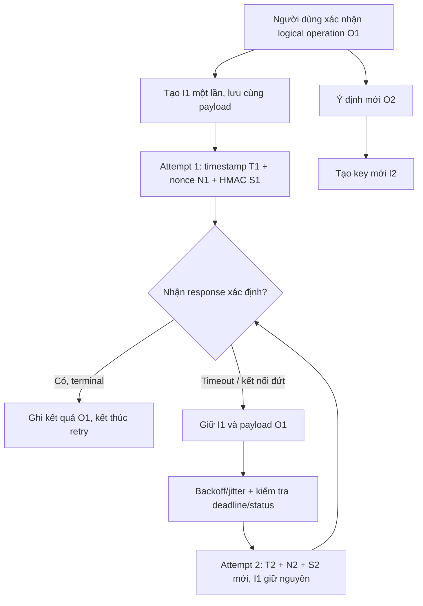
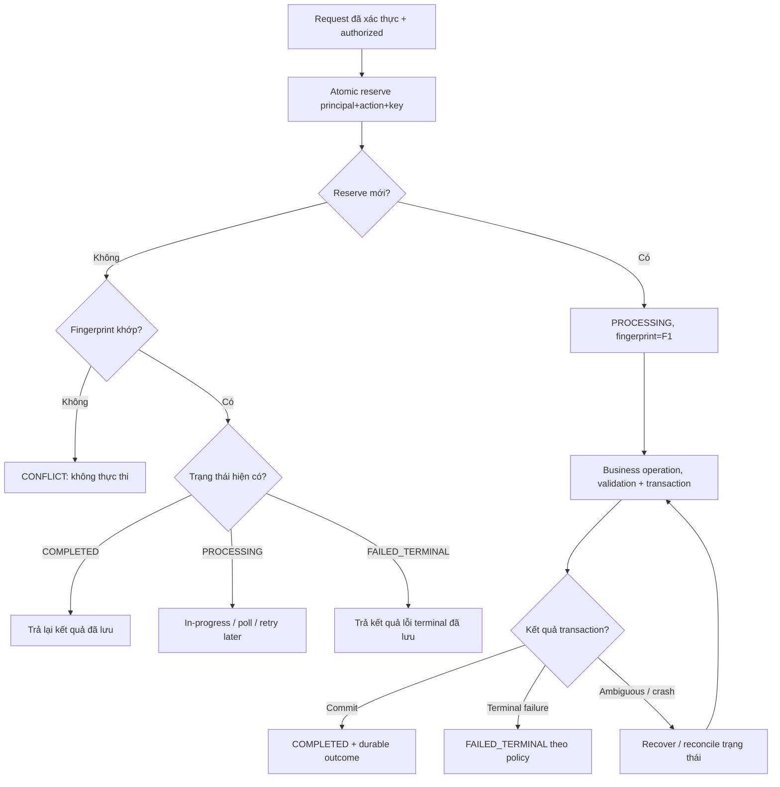
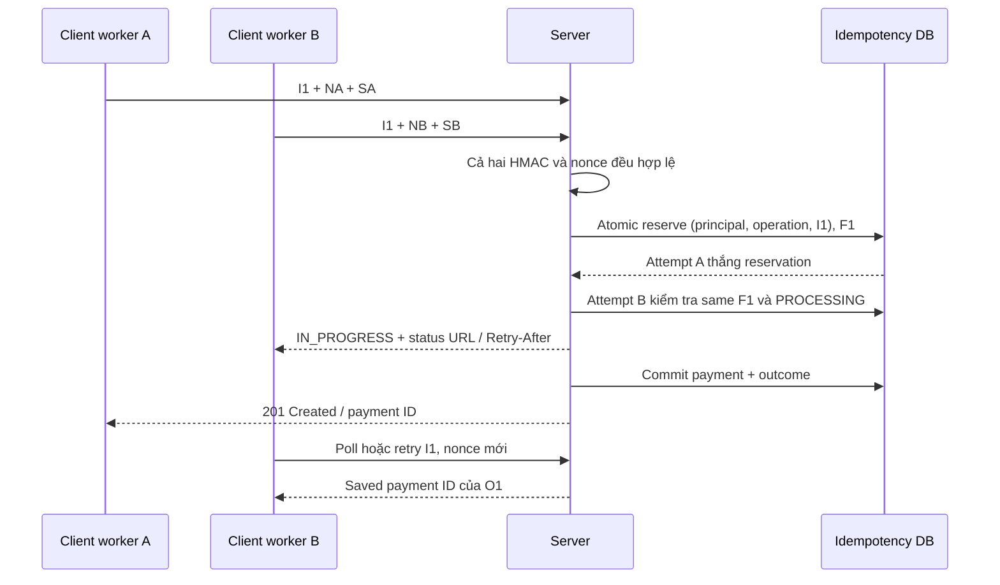

# Idempotency theo client: gửi lại lệnh an toàn khi xác thực request bằng HMAC

## 1. Tại sao client cần idempotency?

Giả sử một ứng dụng gọi API tạo thanh toán:

```http
POST /v1/payments HTTP/1.1
Host: api.example.test
Content-Type: application/json
Idempotency-Key: 5c4dc2ca-c902-477f-b38f-8a4ca6c43e41
X-Key-Id: merchant-a-2026-11
X-Signature-Version: hmac-idem-v1
X-Timestamp: 2026-11-28T09:59:00Z
X-Nonce: 2QPBtoWEFdpx7YIl2lXAp1HV90mD5RGf
X-Signature: <64 ký tự hex thường>

{"account":"A123","amount":150000,"currency":"VND"}
```

Server đã tạo thanh toán thành công, nhưng response bị mất vì kết nối đứt. Client **không thể phân biệt** “server chưa nhận request” với “server đã commit nhưng chưa trả lời”. Nếu ứng dụng gửi lại cùng POST như một thao tác hoàn toàn mới, khách hàng có thể bị thanh toán hai lần.

**Idempotency theo client** là quy ước **client tự tạo và giữ một idempotency key ổn định cho cùng một ý định nghiệp vụ (logical operation)** qua mọi lần thử gửi. Server dùng key đó để nhận biết đây là **yêu cầu thực hiện lại cùng một thao tác**, đối chiếu payload và trạng thái đã xử lý, rồi tránh tạo side effect lần hai.

Bài **Idempotency theo client** thuộc chương **Idempotency** trong module `SECURITY_AUTHENTICATION_HMAC_REQUEST_AUTHENTICATION`. Phạm vi module là thiết kế xác thực HTTP request bằng **HMAC với shared secret**, ký canonical request từ method, URI, header hoặc body theo hợp đồng; thực hành xác minh chữ ký, chống replay bằng timestamp/nonce, quản lý key rotation, kiểm thử proxy/gateway và phân biệt **authentication** với **authorization**. Vì vậy, bài này giải thích cả **trách nhiệm client trong retry** lẫn **hợp đồng idempotency phía server** khi mỗi HTTP attempt phải có chữ ký HMAC hợp lệ.

### Mục tiêu học tập

- Phân biệt **logical operation**, **HTTP attempt**, **idempotency key**, **nonce HMAC** và **request ID để tracing**.
- Tạo key phía client **một lần trên mỗi ý định nghiệp vụ**, lưu bền qua retry/restart, không dùng chung giữa các thao tác khác nhau.
- Giữ nguyên idempotency key và payload nghiệp vụ khi retry, nhưng **tạo timestamp, nonce và chữ ký HMAC mới** cho từng HTTP attempt.
- Thiết kế contract để server ràng buộc idempotency key với **caller đã xác thực, route/operation và fingerprint của request**, xử lý trùng lặp bằng thao tác nguyên tử.
- Xử lý timeout, request đang chạy, response bị mất, payload khác nhưng cùng key, TTL hết hạn và side effect đã commit nhưng response chưa được lưu.
- Kiểm thử Java 17+, proxy/gateway, cache/replay store và sự khác nhau giữa authentication và authorization.

## 2. Hai lớp “không lặp” khác nhau: nonce và idempotency key

Với HMAC request authentication, một request có **chữ ký đúng** vẫn có thể bị phát lại nguyên vẹn trong cửa sổ timestamp. Module sử dụng **timestamp và nonce**, được HMAC ký, để ngăn việc phát lại request đã xác thực.

Nhưng khi client muốn **retry hợp lệ** sau timeout, nó phải ký một HTTP request mới. Một nonce mới sẽ vượt qua replay cache, trong khi **idempotency key cũ** cho server biết ý định nghiệp vụ vẫn là một.

| Thuộc tính | HMAC nonce | Idempotency key phía client |
| --- | --- | --- |
| Đơn vị nhận diện | **Một HTTP request attempt** được ký. | **Một logical operation** như “tạo payment P”. |
| Ai tạo? | Client / signer, thường bằng CSPRNG. | Client / ứng dụng, khi hình thành ý định nghiệp vụ. |
| Khi retry sau timeout | **Tạo nonce mới**, timestamp mới, HMAC mới. | **Giữ nguyên key cũ** cho cùng thao tác. |
| Phạm vi lưu ở server | Replay cache theo credential/scope + nonce. | Idempotency store theo caller/scope + key. |
| Mục tiêu | Chặn gửi lại một signed request đã được chấp nhận. | Tránh xử lý **cùng một hành động nghiệp vụ** nhiều lần. |
| TTL | Bao phủ time window của timestamp + future skew + biên. | Theo hợp đồng nghiệp vụ, thường dài hơn đáng kể so với nonce TTL. |
| Điều kiện thành công | Claim nonce nguyên tử sau HMAC/freshness. | Reserve/commit thao tác nguyên tử, so fingerprint và trạng thái/kết quả. |

Hai khái niệm không thể hoán đổi:

```text
Attempt 1: logical operation O1, idemKey=I1, nonce=N1,
           timestamp=T1, signature=S1
Attempt 2: logical operation O1, idemKey=I1, nonce=N2,
           timestamp=T2, signature=S2    <- retry an toàn

Attempt 3: logical operation O2, idemKey=I2, nonce=N3,
           timestamp=T3, signature=S3    <- hành động mới
```

`S1` và `S2` thường **khác nhau** vì timestamp/nonce khác; idempotency key **giống nhau**. Server được phép xác thực cả hai HTTP attempts, nhưng **chỉ một lần** thực hiện ý định O1 trong giới hạn guarantee của hợp đồng idempotency.

### HTTP POST không tự trở thành idempotent

Trong ngữ nghĩa HTTP, những method như `GET` và `PUT` có đặc tính idempotent theo định nghĩa method, còn **`POST` không được mặc định idempotent**. Thêm `Idempotency-Key` vào một POST **không tự biến server thành an toàn**: client và server phải có **contract và triển khai backend** tương ứng. Cũng không coi GET/PUT mặc định miễn nhiễm với tất cả lỗi retry, auth, side effects ngoài ý muốn hoặc logic ứng dụng sai.

## 3. “Theo client” nghĩa là ai chịu trách nhiệm việc gì?

Client chịu trách nhiệm **khởi tạo và duy trì một định danh ổn định cho ý định nghiệp vụ**. Server chịu trách nhiệm **thực thi guarantee** bằng dữ liệu có trạng thái và transaction.

<escape>**Client chịu trách nhiệm:**</escape>

1. Khi người dùng xác nhận “Tạo thanh toán này”, tạo **một UUID ngẫu nhiên** hoặc opaque key có entropy/uniqueness đủ tốt.
2. Gắn key với **logical operation ID và payload bất biến**, lưu ở nơi bền phù hợp (database client, outbox, durable job record; tùy bối cảnh).
3. Với mọi lần thử HTTP cho cùng thao tác, đặt **cùng một `Idempotency-Key`**.
4. Với mỗi attempt, tạo **timestamp và nonce mới**, dựng lại canonical request và ký HMAC từ **cùng body bytes nghiệp vụ**.
5. Khi response không rõ kết quả, sử dụng **retry policy có giới hạn**, backoff/jitter, deadline và kênh tra cứu trạng thái nghiệp vụ nếu có.
6. Không đổi payload/route/merchant/currency một cách âm thầm trong khi giữ key cũ; nếu đó là ý định khác, phải tạo operation mới và key mới.

<escape>**Server chịu trách nhiệm:**</escape>

1. Xác minh HTTP/HMAC, timestamp, nonce, credential status/scope; không tin key chỉ vì client gửi đúng format.
2. Xây **idempotency scope từ identity đã xác thực** và operation, không chỉ từ header caller tự khai.
3. Tính **request fingerprint** theo hợp đồng từ method/route/payload hoặc canonical business fields, có version rõ.
4. **Reserve key một cách nguyên tử** để chỉ một request được quyền bắt đầu xử lý logic tạo side effect.
5. Với cùng scope/key/fingerprint, trả kết quả đã commit hoặc trạng thái đang xử lý theo contract; với **cùng key nhưng fingerprint khác**, từ chối conflict.
6. Bảo đảm trạng thái idempotency, giao dịch nghiệp vụ và phản hồi **không bị race hoặc mất nhất quán** khi crash, timeout, deploy và failover.

### Idempotency key không phải token xác thực

Một key là dữ liệu do client sinh và truyền qua HTTP, **không phải shared secret**, bearer token, API key hay bằng chứng quyền hạn. Nếu server cho phép truy cập kết quả thanh toán chỉ bằng cách biết idempotency key, có thể gây rò rỉ giữa các khách hàng.

**Server phải xác thực lại mọi retry**, kiểm tra authorization và chỉ tra kết quả trong phạm vi identity được xác minh. Trong profile HMAC của bài, idempotency key còn phải **được đưa vào canonical request đã ký** để không bị sửa trong lúc chuyển tiếp.

## 4. Vòng đời của một client-generated idempotency key

Một key cần sống cùng **ý định** thay vì cùng **HTTP request object**:



Ví dụ vòng đời trong ứng dụng di động:

```text
Local operation:
    operationId = "checkout-2026-00042"
    idempotencyKey = "5c4dc2ca-c902-477f-b38f-8a4ca6c43e41"
    payloadBytes = UTF8({"account":"A123","amount":150000,"currency":"VND"})
    status = PENDING

Attempt #1:
    timestamp = 2026-11-28T09:59:00Z
    nonce = N1
    signature = HMAC(secret, canonical(...I1, N1, T1, bodySHA256...))
    response = TIMEOUT

Attempt #2:
    timestamp = 2026-11-28T09:59:07Z
    nonce = N2
    signature = HMAC(secret, canonical(...I1, N2, T2, bodySHA256...))
    response = already-committed outcome of O1
```

**Không tạo key trong hàm HTTP retry** nếu hàm đó chạy lại sau mỗi attempt: như thế mỗi retry lại thành một ý định mới đối với server. Tạo key khi operation được hình thành, rồi đưa key vào đối tượng operation được persist.

### Hai lỗi đối xứng

- **Key mới cho retry cùng operation:** phá idempotency, có nguy cơ tạo thanh toán lần hai.
- **Dùng lại một key cho operation khác:** server nên phát hiện fingerprint khác và trả conflict; nếu server không đối chiếu fingerprint, có thể trả nhầm kết quả cũ hoặc bỏ qua một thao tác mới.

Key nên là **opaque value** không nhúng email, số tài khoản, token hoặc secret. UUID v4 tạo từ nguồn ngẫu nhiên phù hợp là một lựa chọn dễ triển khai; không mặc định yêu cầu mọi client phải dùng duy nhất UUID v4 nếu contract công bố một format khác.

## 5. Quy tắc retry ở client

Một retry policy an toàn không chỉ là `while(true) send()`. Mỗi loại kết quả đòi hỏi quyết định khác nhau:

| Kết quả một attempt | Phản ứng client hợp lý |
| --- | --- |
| `201 Created`/response terminal thành công | Lưu kết quả, ngừng retry operation. |
| Timeout **trước khi biết server đã nhận hay chưa** | Xem outcome là **unknown**, giữ idempotency key và payload; kiểm tra trạng thái hoặc retry bằng nonce/time/signature mới. |
| Đứt kết nối sau khi server đã commit | Retry cùng key để server trả kết quả đã lưu, không coi timeout là chứng minh chưa commit. |
| `202 Accepted`/operation vẫn đang chạy | Poll status endpoint hoặc retry theo contract và `Retry-After`; không tạo operation mới. |
| `409 Conflict` hoặc `422` cho cùng key nhưng payload khác | **Không tự thay key để “vượt lỗi”**; kiểm tra bug lập logical operation/fingerprint. |
| `401` do HMAC/timestamp/nonce sai | Sửa credential, UTC clock, signing hoặc cấp timestamp/nonce mới; không dùng lại signature cũ. |
| `403` thiếu quyền | Không retry mù; cần xử lý quyền/authorization trước. |
| `429` hoặc `503` tạm thời | Backoff + jitter theo policy, tôn trọng `Retry-After`, vẫn giữ key cho cùng operation. |
| `400` schema/body không hợp lệ | Sửa request trước khi tạo **operation mới** nếu nội dung nghiệp vụ thay đổi; không reuse key bừa bãi. |

Không có quy tắc bắt buộc “phải retry mọi 5xx”: một số lỗi là terminal, một số là tạm thời; một số timeout có thể xảy ra **sau commit**. Client phải có **timeout/deadline tổng**, giới hạn số attempts và cơ chế người dùng/worker tra trạng thái khi không chắc chắn. Thời gian retry phải **nằm trong retention của idempotency key** hoặc dùng status query; sau khi key hết hạn, server có thể không còn deduplicate được operation.

## 6. Hợp đồng HTTP và HMAC minh họa: HMAC-IDEM-V1

Để không trộn lẫn cơ chế ký với idempotency, bài dùng một profile **tự định nghĩa cho học tập**: `hmac-idem-v1`. Profile này **không tự động tương thích** với định dạng ký của mọi API hoặc một header `Idempotency-Key` bất kỳ.

```http
POST /v1/payments HTTP/1.1
Host: api.example.test
Content-Type: application/json
Idempotency-Key: 5c4dc2ca-c902-477f-b38f-8a4ca6c43e41
X-Key-Id: merchant-a-2026-11
X-Signature-Version: hmac-idem-v1
X-Timestamp: 2026-11-28T09:59:00Z
X-Nonce: 2QPBtoWEFdpx7YIl2lXAp1HV90mD5RGf
X-Signature: <64 lowercase hex characters>

{"account":"A123","amount":150000,"currency":"VND"}
```

Các điều khoản bắt buộc của profile:

| Thành phần | Quy tắc |
| --- | --- |
| HTTP method/target | `POST`, raw target `/v1/payments`; không tự đổi path/query khi verify. |
| Audience | `https://api.example.test` từ routing tin cậy; không tin bừa `Host` hoặc `X-Forwarded-Host` do client khai báo. |
| `Content-Type` | Chính xác một `application/json`; body bytes UTF-8 JSON, profile không hỗ trợ `Content-Encoding`. |
| `Idempotency-Key` | Đúng một field line, giá trị UUID v4 lowercase `8-4-4-4-12`; **được HMAC ký**. |
| `X-Key-Id` | Đúng một field line; chọn secret từ credential store, kiểm tra active, scope, rotation. |
| `X-Signature-Version` | `hmac-idem-v1`; chọn thuật toán/canonical schema cố định, không downgrade. |
| `X-Timestamp` | UTC `YYYY-MM-DDTHH:mm:ssZ`, ký trong canonical; max age 300s, future skew 30s. |
| `X-Nonce` | 24 byte ngẫu nhiên, Base64URL không padding, 32 ký tự, ký trong canonical; **nonce mới mỗi attempt**. |
| `X-Signature` | HMAC-SHA256 đầy đủ 32 byte → 64 lowercase hex, đúng một header; **không đưa chính signature vào canonical**. |
| Body | SHA-256 của **body bytes thực gửi/thực nhận sau bỏ transfer framing nhưng trước parse/reformat**; handler dùng cùng snapshot đã xác minh. |

Tất cả signed fields đều phải **đúng một field line** theo tên case-insensitive; thiếu, duplicate hoặc giá trị CR/LF/malformed phải bị từ chối tại HTTP adapter/ingress **trước khi mất thông tin do merge**.

Canonical message là các dòng sau nối bằng **LF (0A)**, encode UTF-8 và **không có LF cuối**:

```text
HMAC-IDEM-V1
POST
https://api.example.test
/v1/payments
content-type:application/json
idempotency-key:5c4dc2ca-c902-477f-b38f-8a4ca6c43e41
x-key-id:merchant-a-2026-11
x-signature-version:hmac-idem-v1
x-timestamp:2026-11-28T09:59:00Z
x-nonce:2QPBtoWEFdpx7YIl2lXAp1HV90mD5RGf
<64 lowercase hex characters of SHA-256(bodyBytes)>
```

Dòng cuối là **placeholder** phải thay bằng body digest thật, không ký dấu `<`/`>`. Chữ ký:

```text
bodyDigestHex = lowercaseHex(SHA-256(bodyBytes))
canonical     = UTF8(linesJoinedByLF)
signatureHex  = lowercaseHex(HMAC-SHA256(sharedSecretBytes, canonical))
```

Khi retry, `Idempotency-Key` và `bodyDigestHex` **giữ nguyên**, còn `timestamp` và `nonce` mới khiến **canonical và signature** thay đổi. Bên nhận phải **xác minh HMAC từng attempt**; không được xem “idempotency key đã biết” là lý do bỏ qua authentication hoặc anti-replay.

### Đâu là nơi idempotency key được kiểm tra?

**Sau khi xác minh credential/MAC/freshness/nonce**, server mới có một identity đáng tin để dựng scope idempotency và tra idempotency record. Có thể chọn thứ tự authorization trước hay sau idempotency lookup theo policy, nhưng **không trả cached response nhạy cảm cho caller chưa có quyền**. Để dễ hiểu, bài dùng luồng:

```text
HTTP parsing -> canonical HMAC verification -> timestamp -> nonce claim
             -> verified identity -> authorization
             -> atomic idempotency lookup/reserve -> business commit
```

Các bước trước idempotency lookup không được gây business side effect. Tất cả retry phải đi qua đường xác thực và kiểm tra quyền phù hợp, kể cả khi operation đã hoàn tất từ trước.

## 7. Thiết kế idempotency scope và request fingerprint

Nếu server dùng **chỉ idempotency key** làm primary key toàn cục mà không phân biệt caller, hai khách hàng vô tình hoặc cố ý dùng cùng value có thể ảnh hưởng nhau. Nếu dùng `X-Key-Id` làm scope idempotency thì một client **rotate secret sang key ID mới** có thể gửi lại cùng payment và bị coi là thao tác mới.

Vì vậy, trong bài chọn:

```text
identity = verifiedPrincipalId       // identity nội bộ ổn định qua key rotation
action   = "POST /v1/payments"        // operation/route tin cậy
key      = Idempotency-Key           // giá trị client tạo, đã được HMAC ký

idempotencyRecordKey = (identity, action, key)
```

`verifiedPrincipalId` phải được tra từ **credential đã xác minh**, không lấy từ `X-Tenant`, JSON `account` hoặc bất kỳ self-asserted header nào. Nếu cùng principal có nhiều project/merchant độc lập, contract có thể bổ sung **verified business scope** để cách ly. Key vẫn phải đủ ngẫu nhiên; scope không có nghĩa có thể dùng sequence dễ đoán để thay thế.

### Fingerprint phải phản ánh *ý định nghiệp vụ*, không phản ánh HTTP attempt

Mỗi retry có timestamp, nonce và signature khác nhau. Nếu fingerprint dựa trên **toàn bộ HTTP request bytes**, một retry hợp lệ sẽ bị nhận nhầm là payload khác.

Profile bài chọn fingerprint của operation:

```text
fingerprintInput =
    "IDEMPOTENCY-PAYMENT-V1" + LF
    + "POST" + LF
    + "/v1/payments" + LF
    + "application/json" + LF
    + lowercaseHex(SHA-256(bodyBytes))

fingerprint = SHA-256(UTF8(fingerprintInput))
```

**Được tính vào fingerprint:** method, logical action/route, content type và body bytes mang ý nghĩa nghiệp vụ. **Không tính vào fingerprint:** timestamp, nonce, signature, key ID của vòng rotation hay network tracing header. Verified principal và action đã nằm trong **record scope**, có thể thêm vào fingerprint nếu hợp đồng quy định.

Đây là lựa chọn **raw-body fingerprint**: JSON khác dấu cách hay thứ tự key sẽ có fingerprint khác dù có thể cùng object logic. Client nên serialize một lần và **persist body bytes** cho retry. Nếu sản phẩm muốn fingerprint theo **canonical JSON nghiệp vụ**, phải công bố chính xác schema/number/Unicode/duplicate-key handling và version riêng, không tùy tiện `Map.toString()`.

### Khi cùng key được dùng lại

| Record theo `(principal, action, key)` | Fingerprint request mới | Hành vi đúng |
| --- | --- | --- |
| **Chưa tồn tại** | F1 | Reserve nguyên tử và bắt đầu operation mới. |
| **PROCESSING** với F1 | F1 | Không tạo side effect thứ hai; trả `202`/in-progress hoặc chờ/poll theo contract. |
| **COMPLETED** với F1 | F1 | Trả kết quả đã lưu (và kiểm tra quyền) hoặc trạng thái kết quả tương ứng. |
| **FAILED_TERMINAL** với F1 | F1 | Trả kết quả lỗi đã được quyết định là terminal theo contract; không tự chạy lại tác vụ. |
| **COMPLETED/PROCESSING** với F1 | F2, F2 khác F1 | Từ chối **idempotency conflict**, ví dụ `409` hoặc `422` theo API contract. |
| Record đã hết retention/bị xóa | F1 | Có thể bị coi là operation mới; client không được mặc định guarantee còn hiệu lực. |

Không suy ra một HTTP status chung được bắt buộc cho mọi API idempotency. Có hệ thống lưu và lặp lại **status/body lỗi** đối với cả một số `5xx`, có hệ thống chỉ cache kết quả terminal khác. Điều bắt buộc là **định nghĩa chính xác** kết quả nào được persist, cách xử lý in-progress, thời gian retention và cách truy vấn outcome không chắc chắn.

## 8. State machine và reservation phía server

Một mô hình quản lý idempotency record có thể gồm:



**Tối quan trọng:** reservation phải bảo đảm hai request đồng thời cùng `(principal, action, key)` **không được cả hai thực thi side effect**. Dùng một kho có unique constraint hoặc atomic compare-and-set theo business scope. `SELECT nếu chưa có, rồi INSERT` bằng hai câu lệnh không khóa là một race giống hệt `GET rồi SET` trong replay cache.

Với các giao dịch nghiệp vụ trong **cùng một database**, có thể reserve key, ghi payment và lưu result trong **một database transaction**. Với việc gọi dịch vụ bên ngoài, gửi email hoặc charge thẻ ở payment provider khác, một transaction local **không thể tự tạo atomicity across systems**; cần downstream idempotency, transactional outbox/inbox hoặc recovery/reconciliation theo mô hình nghiệp vụ.

### Một bảng SQL minh họa

```sql
-- Ví dụ schema PostgreSQL mang tính thiết kế, không phải migration
-- cần áp dụng nguyên xi vào production.
CREATE TABLE idempotency_operations (
    principal_id      text        NOT NULL,
    operation_name    text        NOT NULL,
    idempotency_key   uuid        NOT NULL,
    fingerprint       bytea       NOT NULL,
    state             text        NOT NULL
                      CHECK (state IN ('PROCESSING',
                                      'COMPLETED', 'FAILED_TERMINAL')),
    http_status       integer,
    response_body     bytea,
    created_at        timestamptz NOT NULL,
    expires_at        timestamptz NOT NULL,
    PRIMARY KEY (principal_id, operation_name, idempotency_key)
);
```

Trong một transaction, có thể:

```sql
BEGIN;

INSERT INTO idempotency_operations
    (principal_id, operation_name, idempotency_key,
     fingerprint, state, created_at, expires_at)
VALUES
    (:verified_principal, 'POST /v1/payments', :key,
     :fingerprint_bytes, 'PROCESSING', now(), :retention_end)
ON CONFLICT DO NOTHING;

-- Nếu INSERT thắng: thực thi ghi payment + durable outcome
-- trong CÙNG transaction, rồi UPDATE state='COMPLETED'.
-- Nếu INSERT không thắng: SELECT record hiện có với locking/
-- consistent read theo isolation của DB; so fingerprint, state.
-- Không tiếp tục tạo payment lần hai.

COMMIT;
```

Pseudocode trên mô tả **hai nhánh tách biệt**, không phải SQL có thể chạy và tự biết nhánh thắng: code application phải kiểm tra **row count/RETURNING** của `INSERT` để quyết định. Nếu toàn bộ side effect và cập nhật `COMPLETED` diễn ra trong cùng transaction DB, một transaction bị crash trước commit sẽ rollback cả reservation lẫn payment. Nếu có **external call** giữa các bước, không được coi các comment trên là bảo đảm exactly-once; cần thiết kế explicit `PROCESSING` lease và quy trình reconcile.

## 9. Vì sao chỉ một Redis idempotency cache thường chưa đủ?

Replay cache cho nonce có mục tiêu **chặn attempt giống nhau trong vài phút**, nên atomic `SET NX EX` có thể phù hợp nếu storage bảo đảm TTL, consistency và độ bền cần thiết. Idempotency lại có nhiệm vụ liên quan tới **side effect tài chính hoặc nghiệp vụ dài hạn**:

- Nếu idempotency entry bị evict sau khi payment đã commit, cùng key có thể bị coi là mới và gây thanh toán lần nữa.
- Nếu app claim key thành công rồi crash trước commit, entry `PROCESSING` có thể bị treo mà không biết outcome.
- Nếu app commit payment nhưng crash trước khi ghi `COMPLETED`, retry có thể thực thi lần hai nếu không có unique business constraint hoặc reconciliation.
- Nếu hai region có bản sao eventually consistent, mỗi nơi có thể nghĩ mình reserve key trước.

Chọn database unique constraint và transaction/outbox hoặc một durable conditional-write store phù hợp với rủi ro. **Không coi việc dùng `ConcurrentHashMap`, Redis hoặc unique index riêng lẻ là bằng chứng tuyệt đối “exactly once”** nếu side effect nằm ngoài cùng atomic boundary.

## 10. Java 17+: client tạo một operation, ký lại từng HTTP attempt

Chương trình dưới đây là một ví dụ **tự chứa**, tên file Java tương ứng là `ClientSideIdempotencyDemo.java`. Nó kết hợp ba lớp nhỏ:

1. **Client:** `LogicalOperation` lưu idempotency key và body snapshot; mỗi lần `signAttempt` sinh nonce mới và ký canonical request.
2. **HMAC verifier giả lập:** server kiểm tra route, MAC, timestamp, credential, nonce; xuất verified principal chứ không dùng key ID làm business identity.
3. **Idempotency store giả lập:** dùng `ConcurrentHashMap.putIfAbsent` để reserve một record **trong cùng JVM**, đối chiếu fingerprint và trả kết quả cũ hoặc `IN_PROGRESS`. Counter minh họa một side effect, **không phải payment production**.

**Giới hạn:** Client phải lưu `LogicalOperation` **bền vững** trong app thật; demo chỉ lưu memory. HMAC verifier giả định HTTP adapter đã reject duplicate signed header, malformed framing, Content-Encoding, proxy rewrite và cung cấp body snapshot/target đáng tin. Replay cache mẫu chỉ tồn tại trong một JVM và không có TTL. Idempotency store mẫu **không bền vững, không xử lý crash/failover hoặc external side effects**, nên chỉ dùng để minh họa semantics, không dùng cho thanh toán production.

```java
import java.nio.charset.StandardCharsets;
import java.security.GeneralSecurityException;
import java.security.MessageDigest;
import java.security.SecureRandom;
import java.time.Clock;
import java.time.Duration;
import java.time.Instant;
import java.time.ZoneOffset;
import java.time.temporal.ChronoUnit;
import java.util.Base64;
import java.util.HexFormat;
import java.util.Objects;
import java.util.Optional;
import java.util.Set;
import java.util.UUID;
import java.util.concurrent.CompletableFuture;
import java.util.concurrent.ConcurrentHashMap;
import java.util.concurrent.atomic.AtomicInteger;
import javax.crypto.Mac;
import javax.crypto.spec.SecretKeySpec;

public final class ClientSideIdempotencyDemo {
    private static final String VERSION = "hmac-idem-v1";
    private static final String ORIGIN = "https://api.example.test";
    private static final String TARGET = "/v1/payments";
    private static final String CONTENT_TYPE = "application/json";
    private static final HexFormat HEX = HexFormat.of();
    private static final Duration MAX_AGE = Duration.ofSeconds(300);
    private static final Duration FUTURE_SKEW = Duration.ofSeconds(30);

    // Một logical operation: được tạo MỘT LẦN, giữ body bytes qua retry.
    public record LogicalOperation(String idempotencyKey, byte[] body) {
        public LogicalOperation {
            if (idempotencyKey == null || body == null) {
                throw new IllegalArgumentException("Missing operation");
            }
            body = body.clone();
        }
        @Override public byte[] body() { return body.clone(); }
    }

    // HTTP attempt: tách biệt với logical operation.
    public record SignedAttempt(
            String method, String target, String trustedOrigin,
            String contentType, String idempotencyKey,
            String keyId, String version, String timestamp,
            String nonce, byte[] body, String signatureHex) {
        public SignedAttempt {
            body = body == null ? null : body.clone();
        }
        @Override public byte[] body() {
            return body == null ? null : body.clone();
        }
    }

    public record Credential(
            String keyId, String verifiedPrincipalId,
            byte[] secret, boolean active, Set<String> versions) {
        public Credential {
            secret = secret == null ? null : secret.clone();
        }
        @Override public byte[] secret() {
            return secret == null ? null : secret.clone();
        }
    }

    // Chỉ được tạo sau khi HMAC, freshness và nonce check thành công.
    public record Verified(
            String principalId, String method, String target,
            String contentType, String idempotencyKey, byte[] body) {
        public Verified {
            body = body.clone();
        }
        @Override public byte[] body() { return body.clone(); }
    }

    public record Receipt(String state, String paymentId, int httpStatus) {}

    // Client: UUID.randomUUID() là UUID v4 sinh ngẫu nhiên.
    public static LogicalOperation createOperation(byte[] serializedBody) {
        return new LogicalOperation(
                UUID.randomUUID().toString(), serializedBody);
    }

    private static String sha256Hex(byte[] bytes)
            throws GeneralSecurityException {
        return HEX.formatHex(
                MessageDigest.getInstance("SHA-256").digest(bytes));
    }

    private static byte[] canonicalBytes(SignedAttempt attempt)
            throws GeneralSecurityException {
        String canonical = String.join("\n",
                "HMAC-IDEM-V1",
                attempt.method(),
                ORIGIN,
                attempt.target(),
                "content-type:" + attempt.contentType(),
                "idempotency-key:" + attempt.idempotencyKey(),
                "x-key-id:" + attempt.keyId(),
                "x-signature-version:" + attempt.version(),
                "x-timestamp:" + attempt.timestamp(),
                "x-nonce:" + attempt.nonce(),
                sha256Hex(attempt.body()));
        return canonical.getBytes(StandardCharsets.UTF_8);
    }

    private static byte[] hmac(
            byte[] secret, byte[] canonical)
            throws GeneralSecurityException {
        Mac mac = Mac.getInstance("HmacSHA256");
        mac.init(new SecretKeySpec(secret, "HmacSHA256"));
        return mac.doFinal(canonical);
    }

    // Một logical operation, nhưng MỖI attempt có T/N/HMAC riêng.
    public static SignedAttempt signAttempt(
            LogicalOperation operation, Credential credential,
            Instant now, SecureRandom random)
            throws GeneralSecurityException {
        byte[] nonceBytes = new byte[24];
        random.nextBytes(nonceBytes);
        String nonce = Base64.getUrlEncoder().withoutPadding()
                .encodeToString(nonceBytes);
        String timestamp = now.truncatedTo(ChronoUnit.SECONDS).toString();

        SignedAttempt unsigned = new SignedAttempt(
                "POST", TARGET, ORIGIN, CONTENT_TYPE,
                operation.idempotencyKey(), credential.keyId(),
                VERSION, timestamp, nonce, operation.body(), "");
        String signature = HEX.formatHex(
                hmac(credential.secret(), canonicalBytes(unsigned)));
        return new SignedAttempt(
                unsigned.method(), unsigned.target(),
                unsigned.trustedOrigin(), unsigned.contentType(),
                unsigned.idempotencyKey(), unsigned.keyId(),
                unsigned.version(), unsigned.timestamp(),
                unsigned.nonce(), unsigned.body(), signature);
    }

    // Server-side HMAC + replay verifier giả lập.
    public static final class Verifier {
        private final Set<String> consumedNonces =
                ConcurrentHashMap.newKeySet();

        public Optional<Verified> verify(
                SignedAttempt a, Credential credential, Clock clock)
                throws GeneralSecurityException {
            if (a == null || credential == null || clock == null
                    || a.body() == null || a.signatureHex() == null
                    || a.timestamp() == null || a.nonce() == null
                    || a.idempotencyKey() == null
                    || a.keyId() == null
                    || credential.keyId() == null) return Optional.empty();

            if (!"POST".equals(a.method())
                    || !TARGET.equals(a.target())
                    || !ORIGIN.equals(a.trustedOrigin())
                    || !CONTENT_TYPE.equals(a.contentType())
                    || !VERSION.equals(a.version())
                    || !a.keyId().equals(credential.keyId())
                    || !credential.active()
                    || credential.versions() == null
                    || !credential.versions().contains(VERSION)
                    || credential.verifiedPrincipalId() == null
                    || credential.secret() == null
                    || credential.secret().length < 32
                    || !a.idempotencyKey().matches(
                            "[0-9a-f]{8}-[0-9a-f]{4}-4[0-9a-f]{3}-"
                          + "[89ab][0-9a-f]{3}-[0-9a-f]{12}")
                    || !a.nonce().matches("[A-Za-z0-9_-]{32}")
                    || !a.signatureHex().matches("[0-9a-f]{64}")
                    || a.body().length == 0
                    || a.body().length > 1_048_576) {
                return Optional.empty();
            }

            byte[] nonceBytes;
            try {
                nonceBytes = Base64.getUrlDecoder().decode(a.nonce());
            } catch (IllegalArgumentException invalid) {
                return Optional.empty();
            }
            if (nonceBytes.length != 24
                    || !a.nonce().equals(Base64.getUrlEncoder()
                            .withoutPadding().encodeToString(nonceBytes))) {
                return Optional.empty();
            }

            Instant issuedAt;
            try {
                issuedAt = Instant.parse(a.timestamp());
            } catch (RuntimeException invalid) {
                return Optional.empty();
            }
            if (issuedAt.getNano() != 0
                    || !issuedAt.toString().equals(a.timestamp())) {
                return Optional.empty();
            }

            byte[] expected = hmac(
                    credential.secret(), canonicalBytes(a));
            byte[] received = HEX.parseHex(a.signatureHex());
            if (!MessageDigest.isEqual(expected, received)) {
                return Optional.empty();
            }

            Instant serverNow = clock.instant();
            if (issuedAt.isBefore(serverNow.minus(MAX_AGE))
                    || issuedAt.isAfter(serverNow.plus(FUTURE_SKEW))) {
                return Optional.empty();
            }
            String nonceKey = credential.keyId() + ":" + a.nonce();
            // Trong DEMO chỉ nguyên tử một JVM; production dùng
            // shared atomic cache, TTL đủ bao phủ time window.
            if (!consumedNonces.add(nonceKey)) {
                return Optional.empty();
            }
            return Optional.of(new Verified(
                    credential.verifiedPrincipalId(), a.method(),
                    a.target(), a.contentType(),
                    a.idempotencyKey(), a.body()));
        }
    }

    // Demo server store: một reservation trong một JVM, không durable.
    public static final class IdempotencyStore {
        private record Scope(
                String principalId, String operationName,
                String idempotencyKey) {}
        private record Entry(
                String fingerprint, CompletableFuture<Receipt> outcome) {}

        private final ConcurrentHashMap<Scope, Entry> operations =
                new ConcurrentHashMap<>();
        private final AtomicInteger createdPayments = new AtomicInteger();

        private static String fingerprint(Verified r)
                throws GeneralSecurityException {
            String input = String.join("\n",
                    "IDEMPOTENCY-PAYMENT-V1",
                    r.method(), r.target(), r.contentType(),
                    sha256Hex(r.body()));
            return sha256Hex(input.getBytes(StandardCharsets.UTF_8));
        }

        // Chỉ gọi sau authentication + authorization hợp lệ.
        public Receipt process(Verified r)
                throws GeneralSecurityException {
            Objects.requireNonNull(r, "verified request");
            // Principal ổn định qua key rotation.
            Scope scope = new Scope(
                    r.principalId(), "POST /v1/payments",
                    r.idempotencyKey());
            String fp = fingerprint(r);
            Entry newEntry = new Entry(fp, new CompletableFuture<>());
            Entry existing = operations.putIfAbsent(scope, newEntry);

            if (existing != null) {
                if (!existing.fingerprint().equals(fp)) {
                    return new Receipt("CONFLICT", "", 409);
                }
                // Nonblocking demo: production có in-progress policy,
                // durable outcome, deadline và reconciliation.
                Receipt completed = existing.outcome().getNow(null);
                if (completed == null) {
                    return new Receipt("IN_PROGRESS", "", 202);
                }
                return new Receipt(
                        "REUSED_RESULT",
                        completed.paymentId(), completed.httpStatus());
            }

            // Counter này CHỈ mô phỏng tạo payment trong một JVM.
            // Không làm side effect ngoài DB bên trong map operation
            // mà không có transaction/outbox và recovery.
            int serial = createdPayments.incrementAndGet();
            Receipt result = new Receipt(
                    "CREATED", "pay-" + serial, 201);
            newEntry.outcome().complete(result);
            return result;
        }

        public int sideEffectCount() {
            return createdPayments.get();
        }
    }

    private static void require(boolean condition, String message) {
        if (!condition) throw new AssertionError(message);
    }

    public static void main(String[] args) throws Exception {
        SecureRandom random = new SecureRandom();
        byte[] secretNovember = new byte[32];
        byte[] secretDecember = new byte[32];
        random.nextBytes(secretNovember);
        random.nextBytes(secretDecember);

        Credential keyNovember = new Credential(
                "merchant-a-2026-11", "principal-merchant-a",
                secretNovember, true, Set.of(VERSION));
        Credential keyDecember = new Credential(
                "merchant-a-2026-12", "principal-merchant-a",
                secretDecember, true, Set.of(VERSION));

        // Client serialize MỘT LẦN và giữ payload/key của operation.
        byte[] stableBody = (
                "{\"account\":\"A123\",\"amount\":150000,"
                + "\"currency\":\"VND\"}")
                .getBytes(StandardCharsets.UTF_8);
        LogicalOperation operation = createOperation(stableBody);
        Verifier verifier = new Verifier();
        IdempotencyStore server = new IdempotencyStore();
        Instant t1 = Instant.parse("2026-11-28T10:00:00Z");
        Clock clock1 = Clock.fixed(t1, ZoneOffset.UTC);

        SignedAttempt first = signAttempt(
                operation, keyNovember, t1, random);
        Verified verified1 = verifier.verify(
                first, keyNovember, clock1).orElseThrow();
        Receipt result1 = server.process(verified1);
        require("CREATED".equals(result1.state()), "first create");

        // Giả lập response thứ nhất bị mất.
        // Retry dùng cùng operation body/key, nonce và MAC mới.
        Instant t2 = t1.plusSeconds(7);
        Clock clock2 = Clock.fixed(t2, ZoneOffset.UTC);
        SignedAttempt retry = signAttempt(
                operation, keyNovember, t2, random);
        require(first.idempotencyKey().equals(retry.idempotencyKey()),
                "Idempotency key must stay stable");
        require(!first.nonce().equals(retry.nonce()),
                "Fresh nonce per attempt");
        require(!first.signatureHex().equals(retry.signatureHex()),
                "Fresh signed canonical message");

        Verified verified2 = verifier.verify(
                retry, keyNovember, clock2).orElseThrow();
        Receipt result2 = server.process(verified2);
        require("REUSED_RESULT".equals(result2.state()),
                "retry must reuse prior outcome");
        require(result1.paymentId().equals(result2.paymentId()),
                "same payment id");
        require(server.sideEffectCount() == 1,
                "only one logical payment");

        // Phát lại NGUYÊN attempt #1: nonce cũ -> HMAC replay reject.
        require(verifier.verify(
                first, keyNovember, clock2).isEmpty(),
                "identical HTTP attempt must be rejected");

        // Cùng key nhưng payload khác: nếu được ký lại hợp lệ,
        // HMAC vẫn có thể đúng, nhưng idempotency fingerprint phải FAIL.
        LogicalOperation changedBody = new LogicalOperation(
                operation.idempotencyKey(),
                ("{\"account\":\"A123\",\"amount\":250000,"
                 + "\"currency\":\"VND\"}")
                    .getBytes(StandardCharsets.UTF_8));
        SignedAttempt changedAttempt = signAttempt(
                changedBody, keyNovember, t2.plusSeconds(1), random);
        Verified changedVerified = verifier.verify(
                changedAttempt, keyNovember,
                Clock.fixed(t2.plusSeconds(1), ZoneOffset.UTC))
                .orElseThrow();
        Receipt conflict = server.process(changedVerified);
        require("CONFLICT".equals(conflict.state()),
                "same idempotency key + different payload must conflict");

        // Key rotation: credential key ID mới, verified principal cũ.
        SignedAttempt rotatedAttempt = signAttempt(
                operation, keyDecember, t2.plusSeconds(2), random);
        Verified rotatedVerified = verifier.verify(
                rotatedAttempt, keyDecember,
                Clock.fixed(t2.plusSeconds(2), ZoneOffset.UTC))
                .orElseThrow();
        Receipt rotatedResult = server.process(rotatedVerified);
        require("REUSED_RESULT".equals(rotatedResult.state()),
                "same principal + operation + key across rotation");
        require(server.sideEffectCount() == 1,
                "rotation cannot create another payment");

        System.out.println("First: " + result1);
        System.out.println("Retry: " + result2);
        System.out.println("Changed payload: " + conflict);
        System.out.println("Key rotation retry: " + rotatedResult);
        System.out.println("Simulated created payments: "
                + server.sideEffectCount());
    }
}
```

### Đọc kết quả demo

```text
First:             CREATED, paymentId=pay-1
Retry:             REUSED_RESULT, paymentId=pay-1
Changed payload:   CONFLICT, không ghi payment mới
Key rotation retry: REUSED_RESULT, paymentId=pay-1
Simulated created payments: 1
```

Output mô tả **ý nghĩa**; định dạng thực tế do `record.toString()` quyết định. Demo tạo secret ngẫu nhiên trong memory và **không ghi secret ra console**. Nó chứng minh hai thuộc tính riêng: **HMAC nonce khác nhau ở mỗi HTTP attempt** và **idempotency record chỉ gắn một lần với cùng logical operation**.

### Những gì đoạn Java không được dùng để suy ra

- `ConcurrentHashMap.putIfAbsent` chỉ nguyên tử **trong một JVM**, không lưu bền khi crash, không chia sẻ giữa nhiều instance và **không tự giao dịch với payment gateway**.
- `CompletableFuture` chỉ mô phỏng record đang xử lý; trong hệ thống thực phải có **retention, lease/recovery, durable outcome, timeout, audit và reconciliation**.
- `Verifier` dùng local `Set` cho replay; production phải dùng **atomic shared nonce store với TTL**, fail closed khi kho lỗi.
- `SignedAttempt` là dữ liệu đã qua adapter: không được dùng trực tiếp một request DTO do client gửi mà chưa kiểm tra duplicate headers, HTTP framing, raw target và gateway transformations.
- `verifiedPrincipalId` phải xuất phát từ **credential lookup phía server**, không từ tham số tự khai trong request; trong demo truyền `Credential` chỉ để minh họa.
- Kết quả demo **không có nghĩa đã thực hiện kiểm thử e2e**, không thay thế authorization/transaction/idempotency backend.

## 11. Triển khai client Java 17 dùng HTTP client thật

Java `java.net.http.HttpClient` hỗ trợ gửi cùng body bytes đã ký bằng `BodyPublishers.ofByteArray`. Phần dưới minh họa **cách xây request**, không kết nối mạng hoặc gửi đi trong tài liệu:

```java
import java.net.URI;
import java.net.http.HttpRequest;
import java.time.Duration;

// operation và signed là dữ liệu đã tạo bởi SDK signer của profile.
// signed.body() trả đúng snapshot byte[] dùng khi tính HMAC.
HttpRequest request = HttpRequest.newBuilder()
    .uri(URI.create("https://api.example.test/v1/payments"))
    .timeout(Duration.ofSeconds(10))
    .header("Content-Type", signed.contentType())
    .header("Idempotency-Key", signed.idempotencyKey())
    .header("X-Key-Id", signed.keyId())
    .header("X-Signature-Version", signed.version())
    .header("X-Timestamp", signed.timestamp())
    .header("X-Nonce", signed.nonce())
    .header("X-Signature", signed.signatureHex())
    .POST(HttpRequest.BodyPublishers.ofByteArray(signed.body()))
    .build();
```

Với code thực tế, cần đặt builder/canonical signer trong cùng SDK để không vô tình sửa method/URI/header hoặc body sau khi ký. Nếu thêm query, redirect hoặc content compression, profile phải định nghĩa cách ký và kiểm thử. **Không tự động chuyển `X-Signature`, key ID hoặc metadata auth sang origin khác khi redirect**; cần xác thực đích và ký request mới phù hợp. Việc `HttpClient` tái truyền ở tầng kết nối cũng không cho phép app coi nonce cũ là retry nghiệp vụ mới.

### Durable outbox ở phía client

Một mobile app hoặc backend service gọi payment API nên lưu operation trước khi gửi. Dữ liệu mô hình:

```text
client_operations
  operation_id       // ID nội bộ để tìm trong app
  idempotency_key    // UUID sinh một lần cho operation
  endpoint_operation // POST /v1/payments
  body_bytes         // snapshot hoặc reference bảo vệ đúng bytes
  status             // PENDING | IN_FLIGHT | SUCCEEDED | UNKNOWN | FAILED
  created_at
  retry_deadline
  next_retry_at
  last_attempt_at
  last_http_status
  server_payment_id
```

Khi process khởi động lại, worker đọc **operation đã lưu**, không sinh key mới cho operation đang `UNKNOWN`. Một attempt mới sinh timestamp/nonce mới và ký trên **body snapshot cũ**. Secret/key ID có thể rotate giữa các attempts; nếu principal không đổi, idempotency scope server phải giữ nhất quán.

Khi người dùng nhấn nút “Thanh toán” nhiều lần, client có thể vô hiệu hóa nút trong lúc một operation đang chạy; tuy nhiên đây chỉ là **UX mitigation**, không phải guarantee. App crash, retry của hệ điều hành, nhiều tab/device hoặc network retries vẫn có thể tạo yêu cầu trùng. Cần có **operation ID được chia sẻ/kiểm soát** nếu nhiều thiết bị cùng phát sinh **cùng ý định**, và server luôn phải thực thi contract idempotency.

## 12. Phân tích lỗi và khả năng phục hồi từ hai phía

Idempotency trở nên quan trọng nhất đúng lúc mạng và hệ thống có thể trả **kết quả không xác định**. Hãy xét từng điểm crash trong một giao dịch:

```mermaid
sequenceDiagram
    participant C as Client
    participant A as API verifier
    participant I as Idempotency DB
    participant P as Payment operation

    C->>A: POST + key I1 + nonce N1 + HMAC S1
    A->>A: Verify MAC, timestamp, nonce, authorization
    A->>I: Reserve (principal, action, I1) với fingerprint F1
    I-->>A: Owner của reservation
    A->>P: Create/charge payment
    P-->>A: Success
    A->>I: Persist COMPLETED + outcome
    Note over C,A: Connection mất ngay trước HTTP response
    C->>A: Retry I1, nonce N2, signature S2 mới
    A->>A: Verify HMAC attempt mới, replay claim N2
    A->>I: Lookup I1/F1
    I-->>A: COMPLETED + saved outcome
    A-->>C: Trả kết quả payment cũ; KHÔNG charge lần nữa
```

Đây là trường hợp lý tưởng khi payment và idempotency result được commit nhất quán. Nhưng các điểm crash khác nhau cần chính sách:

| Thời điểm xảy ra sự cố | Trạng thái có thể quan sát | Cách recovery đúng |
| --- | --- | --- |
| Client crash **trước lần gửi đầu**. | Operation đã lưu trong client outbox, server có thể chưa biết. | Đọc operation cũ và key I1 khi app khởi động, ký attempt mới. |
| Client timeout **trước khi biết backend nhận**. | Không xác định request có tới hay không. | Giữ I1, check status hoặc retry theo contract; không tự tạo I2. |
| Server HMAC verify thất bại. | Không có authenticated operation. | Từ chối, không reserve idempotency record hay chạy nghiệp vụ. |
| Replay cache claim nonce thất bại. | HTTP attempt không đạt replay protection. | Từ chối, không đi tới business. Client retry bằng nonce mới theo policy. |
| Server reserve I1 rồi crash **trước business commit**. | `PROCESSING` treo, hoặc toàn bộ DB transaction rollback. | Lease/recovery/quy tắc retry owner; xác minh chưa có side effect trước khi chạy tiếp. |
| Server commit payment, crash **trước khi ghi idempotency COMPLETED**. | Nguy cơ backend nghĩ I1 chưa xử lý và charge lại. | Cùng transaction nếu một DB; với external PSP phải có downstream idempotency / reconciliation. |
| Server đã commit outcome, response mất. | Record `COMPLETED` chứa payment ID. | Retry I1/F1 trả outcome cũ, không tạo payment mới. |
| Hai retries đồng thời gửi I1/F1. | Một owner, một duplicate đến khi owner đang chạy. | Unique atomic reserve; trả `IN_PROGRESS`/poll cho request thứ hai. |
| Hai request cùng I1 nhưng payload F1/F2 khác. | Operation identity bị dùng lại sai. | Từ chối conflict; **không ghi thanh toán F2**. |
| Key đã hết thời gian retention. | Server có thể đã xóa record, không còn biết I1. | Client ngừng retry mù, tra trạng thái theo business ID hoặc yêu cầu cơ chế dedup lâu hơn. |

### External payment provider: hai miền giao dịch

Giả sử backend gọi cổng thanh toán bên ngoài:

```text
Backend idempotency DB (transaction X)
          |
          | HTTP call charge(account, amount)
          v
External PSP (transaction Y)
```

Ngay cả khi backend đã reserve `I1` nguyên tử, **transaction X không thể rollback giao dịch Y** một cách tự động. Một timeout giữa X và Y có thể dẫn đến charge thành công nhưng backend không nhận response.

Các cách thiết kế an toàn có thể kết hợp:

1. Gửi **idempotency key theo operation** tới PSP nếu PSP hỗ trợ; scope và retention phải phù hợp. Không dùng HMAC nonce làm PSP idempotency key.
2. Dùng **transactional outbox**: lưu business intent và outbox event cùng transaction; worker gửi ra PSP với **stable downstream idempotency key**.
3. Dùng **inbox/deduplication** cho callback/webhook PSP; các callback có thể đến trùng và không nên tự động tạo business effect lần nữa.
4. Khi response không rõ, **tra cứu/reconcile transaction ở PSP** theo operation ID ổn định trước khi kết luận thất bại và gửi lệnh mới.
5. Dùng **lease/fencing token** cho worker owner nếu có retry processing job; worker cũ bị timeout không được phép tự ý commit kết quả đè worker mới.

Đây là những yêu cầu bổ sung để tiến gần **exactly-once business effect**. Không thể dùng riêng HMAC, nonce hoặc client idempotency key để chứng minh exactly-once trên toàn hệ thống phân tán.

## 13. Lưu kết quả idempotency thế nào cho đúng?

Khi operation đạt trạng thái terminal, store cần biết **điều gì sẽ được trả về cho retry**, không chỉ đánh dấu “seen”.

Một bản ghi thiết kế có thể chứa:

```text
scope:
    verified_principal_id
    operation_name
    idempotency_key

request:
    fingerprint_version
    fingerprint_sha256
    created_at
    expires_at

execution:
    state                      // PROCESSING / COMPLETED / FAILED_TERMINAL
    owner_lease / fencing      // nếu dùng worker async
    payment_id / business_id
    result_version
    http_status
    sanitized_response_body
    retry_after / status_url   // nếu operation đang chạy
```

### Cached outcome không được bỏ qua quyền truy cập

Nếu `I1` đã từng tạo payment cho merchant A, một request retry đến từ merchant B **không thể lấy dữ liệu payment của A** chỉ vì biết key I1. Namespace phải gắn **verified principal**, và khi trả kết quả cũ cần xét policy quyền hiện tại, đặc biệt nếu user role/tenant membership đã thay đổi hoặc thông tin trong kết quả là dữ liệu nhạy cảm.

Đối với nhiều API, trả **cùng HTTP status code và body terminal** là hợp đồng tiện lợi. Một hệ thống khác có thể trả `200 OK` thay cho `201 Created`, hoặc `202` trong lúc operation đang tiến hành. Điều quan trọng là client biết chính xác nên diễn giải **replayed response** như thế nào và không vô tình coi `IN_PROGRESS` là đã commit.

**Response headers cần chọn lọc:** không cache/replay những header hop-by-hop, cookie session, tracing ID, token tạm, header nhạy cảm hết hạn hoặc chữ ký HTTP response cũ mà không có contract phù hợp. Response storage có thể cần encryption, access controls và retention policy; không lưu body nhạy cảm vô hạn chỉ để hỗ trợ retry.

### Retention và TTL của idempotency khác nonce TTL

Ví dụ chính sách ứng dụng:

```text
HMAC request freshness = 5 phút
Replay nonce retention = 6 phút (theo future skew + margin)
Idempotency retention = 24 giờ (VÍ DỤ theo contract nghiệp vụ)
Client retry deadline = dưới 24 giờ, hoặc tra cứu trạng thái khi muộn
```

**24 giờ chỉ là một ví dụ**, không có thời gian mặc định cho tất cả idempotency APIs. Chọn retention theo thời lượng retry tối đa, job async, đặc điểm thanh toán, thời gian reconciliation, lưu trữ, pháp lý và rủi ro trùng side effect.

Nếu record bị xóa sau TTL nhưng hệ thống vẫn cho cùng idempotency key đi qua như một operation mới, một client muộn có thể tạo payment lần nữa. Với nghiệp vụ quan trọng, nên có thêm **business unique transaction ID** tồn tại lâu dài và status lookup; không dựa hoàn toàn vào cache TTL để bảo vệ khỏi double spend.

### Khi client “quên” key cũ

Nếu client lưu idempotency key **chỉ trong memory** và crash sau khi gửi thanh toán, lần restart sẽ không tìm lại được I1. Nó có thể sinh I2 cho cùng ý định và khiến server coi đó là lệnh mới. Đó là lỗi **ở hợp đồng client-side idempotency** dù backend reserve đúng.

Client có thể persist **operation ID + idempotency key + body snapshot** trước attempt đầu, hoặc dựa vào outbox/service durable state. Nếu hai thiết bị có thể gửi **cùng một logical operation**, chúng cần chia sẻ operation identity ở tầng nghiệp vụ hoặc phải có **business-level uniqueness**; hai key độc lập không thể được server tự đoán là cùng ý định chỉ vì số tiền trùng nhau.

## 14. Xử lý đồng thời: nhiều attempts, một logical operation

Giả sử hai worker của cùng một client service nhìn thấy một pending operation O1 và cùng gửi request:

```text
HTTP attempt A: idemKey=I1, nonce=NA, HMAC=SA
HTTP attempt B: idemKey=I1, nonce=NB, HMAC=SB
```

Cả hai HMAC có thể hợp lệ, **nonce đều mới**, replay cache đều cho qua. Server phải đảm bảo chỉ một attempt được thực thi:



Không làm như sau:

```java
// SAI nếu hai thread/node đọc cùng một lúc:
if (!idempotencyStore.exists(principal, operation, key)) {
    paymentProvider.charge(...);
    idempotencyStore.put(principal, operation, key, result);
}
```

Hai request cùng có thể thấy `exists=false` và charge hai lần. Thao tác reserve phải **atomic** và được ràng buộc với durable business execution. Không cố sửa race bằng cách sleep ngẫu nhiên hoặc dựa vào load balancer sticky session.

### Client có nên tự chặn attempts đồng thời?

**Có thể và nên**, để tiết kiệm tài nguyên: một client outbox nên có lease/claim riêng theo operation ID, giới hạn số worker đang gửi cùng thao tác. Nhưng đây là **optimization**, không phải thay thế server-side idempotency. Nhiều client instance, failover, retry của HTTP library hoặc callback lệch thời gian vẫn có thể tạo concurrent attempts.

Khi nhận `IN_PROGRESS`, client có thể tôn trọng `Retry-After` hoặc polling endpoint đã được xác thực; **không** gọi một payment POST mới với idempotency key mới chỉ để tránh đợi.

## 15. Gateway, key rotation và sự nhất quán từ client tới server

Idempotency theo client cần được thực thi trên **đúng request đã được ký**. Proxy/gateway có thể vô tình hoặc cố ý làm thay đổi header/URI/body khiến một HTTP attempt hợp lệ không còn xác minh được, hoặc idempotency fingerprint khác nhau giữa các tầng.

| Tình huống | Rủi ro | Yêu cầu bảo vệ |
| --- | --- | --- |
| Client ký `Idempotency-Key: I1`, gateway **bỏ header**. | Backend không biết key để deduplicate, hoặc dùng default key nguy hiểm. | Từ chối request thiếu signed header; bảo toàn header theo contract. |
| Gateway **đổi I1 thành I2**. | HMAC cũ không còn hợp lệ; nếu bỏ key khỏi signature có thể gây duplicate payment. | Đưa idempotency key vào canonical HMAC; không biến đổi signed fields. |
| Hai `Idempotency-Key` khác case trong HTTP request. | Một tầng dùng I1, tầng khác dùng I2. | Reject duplicate field lines theo tên case-insensitive **trước merge**. |
| HTTP/1.1 ↔ HTTP/2 mapping thay path, authority hoặc query. | MAC mismatch hoặc fingerprint được tính trên route khác. | Canonical target và trusted audience phải nhất quán xuyên ingress/backend. |
| Gateway decompress gzip hoặc serialize lại JSON. | Body digest/fingerprint khác, handler có thể xử lý body khác chữ ký. | Cố định body snapshot, version hóa Content-Encoding nếu hỗ trợ. |
| API gateway verify HMAC rồi truyền `X-Verified-Principal`. | Backend có thể bị caller Internet giả mạo header nếu không strip/chặn bypass. | Gateway strip untrusted identity headers, xác thực nội bộ và bảo vệ đường truyền đến backend. |
| Backend verify sau gateway. | Gateway có thể làm mất raw header lines và metadata URI. | Reject duplicate ở ingress; chuyển trusted request snapshot/route theo contract. |
| Client rotate secret từ K1 sang K2. | Nếu idempotency scope dựa vào key ID, cùng operation có thể chạy lại. | Scope bằng **verified principal ID ổn định**, key ID chỉ dùng cho HMAC/replay. |
| Client bị revoke giữa các attempts. | Một retry I1 không còn đủ quyền. | Không bỏ qua HMAC/key scope/authorization dù record I1 đã tồn tại. |
| Client gửi lại request sau redirect sang host khác. | Credential/signature có thể bị lộ hoặc signed audience sai. | Không tự forward authentication headers; xác minh destination và ký request mới nếu được phép. |
| CDN/cache trả response trước khi authorization. | Có thể rò dữ liệu payment hoặc trạng thái theo I1. | Không cache response riêng tư theo URL/key công khai; xem xét `Cache-Control: no-store` và enforcement tại edge. |
| Rolling deploy thay fingerprint normalization. | Retry I1 có thể bị coi là F2 dù body không đổi. | Version hóa fingerprint và giữ compat trong toàn bộ retention window. |

### Khi verify HMAC tại gateway

Nếu HMAC và nonce được xác minh ở gateway, backend không nên nhận request **chỉ với key ID do caller tự khai** để thực hiện payment. Gateway chuyển **verified principal, verified idempotency key, trusted route và body snapshot** qua kênh nội bộ đáng tin; backend phải chặn truy cập trực tiếp từ Internet và không chấp nhận các metadata đó nếu chưa được gateway chứng thực.

### Khi verify HMAC tại backend

Gateway phải chuyển nguyên signed header, URI semantics và body bytes theo contract. Nếu API gateway rewrite `/public/payments` sang `/v1/payments`, cả client và backend phải ký/xác minh theo **cùng canonical target được công bố**; không dựa vào một `X-Original-URI` do caller tự gắn. HMAC đúng trên dữ liệu gateway kiểm tra nhưng handler dùng dữ liệu khác là lỗi *parser differential/TOCTOU* cần kiểm thử.

### Rotation không được chia lại idempotency namespace

Ví dụ:

```text
Before rotation:
  signed keyId = merchant-a-2026-11
  verified principal = merchant-a
  idem scope = (merchant-a, POST /v1/payments, I1)

After rotation:
  signed keyId = merchant-a-2026-12
  verified principal = merchant-a
  idem scope = (merchant-a, POST /v1/payments, I1)
```

Vì scope idempotency **giống nhau**, retry sau rotation vẫn lấy kết quả của operation cũ. Ngược lại, **replay cache của HMAC nonce** có thể scope theo credential ID khác nhau vì nó xử lý một signed attempt cụ thể. Không trộn hai quy tắc namespace.

## 16. Phân quyền và an toàn dữ liệu khi trả lại kết quả cũ

Một nguy cơ ít được chú ý là **“cached response bypass”**:

```text
Request retry:
  Idempotency-Key = I1
  Principal = client B

Backend:
  tìm thấy I1 trong store
  trả lại payment result của client A
  (không xác thực/kiểm tra scope)
```

Đó là lỗi nghiêm trọng. Idempotency key không phải bearer credential và cũng **không chứng minh quyền đọc kết quả**. Quy trình nên:

1. Xác thực HMAC cho **attempt hiện tại**, không chỉ attempt đầu.
2. Kiểm tra timestamp/nonce, credential active và route/audience đúng scope.
3. Xác định principal từ **server-side credential mapping**, không tự khai.
4. Kiểm tra authorization để principal hiện tại có quyền thao tác hoặc xem operation/result.
5. Tra bản ghi bằng `(verified principal, operation, idempotency key)` rồi đối chiếu fingerprint/trạng thái.
6. Trả outcome cũ hoặc trạng thái theo policy; loại bỏ metadata response đã hết hiệu lực.

Nếu quyền đã bị thu hồi sau lần tạo payment đầu, idempotency vẫn phải bảo vệ **không tạo payment thứ hai**, nhưng việc **có trả đầy đủ kết quả cũ hay không** phụ thuộc authorization hiện tại. Không được mở một đường đọc trái phép chỉ vì đang là retry.

### Giới hạn việc client tự đặt key

Server nên kiểm tra độ dài, định dạng và quota idempotency key. Dữ liệu quá dài, xuống dòng, dấu phân cách tùy ý hoặc nội dung PII có thể gây:

- Database index amplification và chiếm bộ nhớ.
- Log injection hoặc rò thông tin qua tracing.
- Trùng key do client dùng thời gian/sequence dễ đoán, hoặc key không đủ uniqueness.
- Lỗi parser khi gateway ghép duplicate headers.

Profile demo chỉ chấp nhận **UUID v4 lowercase**; hệ thống khác có thể chấp nhận chuỗi opaque dài tối đa một giới hạn cố định, nhưng phải công bố grammar, normalization và storage policy. **Không xem uniqueness của UUID là authorization**.

## 17. Ma trận kiểm thử idempotency theo client

Golden fixtures nên ghi rõ **logical operation** tách khỏi **HTTP attempts**: key I1, body bytes và fingerprint F1, key ID/secret thử nghiệm, signed timestamp/nonce/MAC của từng attempt, principal đã xác minh, trạng thái idempotency store, business side effect count và response kỳ vọng.

| Ca kiểm thử | Kỳ vọng |
| --- | --- |
| POST đầu tiên với I1/F1, HMAC đúng, nonce mới. | Reserve thành công, tạo một payment, lưu outcome. |
| Retry sau mất response: I1/F1, timestamp/nonce/HMAC mới. | Authentication PASS; trả payment ID cũ, **không tạo payment thứ hai**. |
| Retry **nguyên HTTP request** với nonce cũ. | Replay protection từ chối, dù idempotency key đúng. |
| Client phát sinh I2 cho một attempt retry của O1. | Test phải phát hiện bug client; backend có nguy cơ coi là operation mới. |
| Client tạo O2 thật sự, sinh I2 mới và payload mới. | Server có thể thực hiện operation mới nếu authorization hợp lệ. |
| Client giữ I1 nhưng sửa amount/body thành F2 và ký lại HMAC hợp lệ. | **Idempotency conflict**, không thực hiện F2. |
| Client giữ I1/F1, chỉ đổi thứ tự/whitespace JSON raw bytes. | Theo raw-body fingerprint của demo, F2 khác → conflict; không tự normalize. |
| Client retry I1 với cùng body nhưng timestamp mới. | Fingerprint **không đổi**, chữ ký thay đổi. |
| Client retry I1 với cùng body nhưng nonce mới. | Replay cache có thể claim nonce mới, idempotency store reuse outcome. |
| Key rotation từ key ID K1 sang K2, cùng verified principal. | I1 vẫn trỏ tới **cùng idempotency record**. |
| Key K1 revoked, retry bằng K1. | Authentication/key policy từ chối, không dùng cached result để bypass. |
| Verified principal B đoán được I1 của principal A. | Không truy cập được record/response A; scope và authorization chặn. |
| Hai identical logical attempts đồng thời với nonce N1/N2 khác nhau. | Cả hai có thể HMAC PASS, nhưng chỉ **một business execution**. |
| Hai requests cùng I1 nhưng fingerprint khác nhau đến đồng thời. | Một fingerprint sở hữu record; request còn lại conflict, không tạo effect thứ hai. |
| Server trả `IN_PROGRESS`. | Client poll hoặc retry theo backoff, giữ I1, không tạo I2. |
| Server commit payment nhưng HTTP response mất. | Retry I1 trả lại **outcome đã commit**, không charge lại. |
| Server crash trước DB commit (nếu cùng transaction). | Reservation và payment rollback nhất quán; recovery xử lý lại theo contract. |
| Server crash sau external PSP charge nhưng trước lưu outcome. | Test recovery/reconciliation; không gọi PSP charge lần hai một cách mù quáng. |
| Idempotency DB timeout trước hoặc sau reserve. | Không coi outcome unknown là chưa chạy; fail safe và reconcile. |
| Redis/local cache bị eviction trong khi operation đã commit. | Không được giả định key mới: cần durable business uniqueness hoặc store đúng retention. |
| Client crash sau gửi, restart và đọc outbox O1. | Dùng **I1** và same body; tạo timestamp/nonce/HMAC mới. |
| Client mất I1 do chỉ lưu trong memory. | Test phát hiện không thể retry an toàn; cần durable operation state. |
| Two devices cùng tạo operation thực sự chung nhưng I1/I2 khác nhau. | Client workflow/business uniqueness phải phối hợp; idempotency keys khác không tự deduplicate. |
| Client dùng `Idempotency-Key` từ header chưa được HMAC ký. | Security test phát hiện nguy cơ bị sửa I1 thành I2; profile phải ký field này. |
| Hai `Idempotency-Key` field lines khác case. | Reject duplicate trước canonicalization/lookup. |
| Gateway xóa `Idempotency-Key`. | Reject missing signed field, không tạo key mặc định. |
| Proxy rewrite body hoặc signed target. | MAC mismatch hoặc contract validation từ chối. |
| Body vượt giới hạn hoặc sai Content-Type. | Reject trước business; không reserve/tạo payment. |
| Timestamp cũ quá 300 giây, nonce chưa dùng. | Reject freshness; không gọi idempotency handler. |
| Request HMAC đúng nhưng thiếu quyền với account. | Authorization từ chối, không thể đọc cache outcome trái quyền. |
| Business operation vượt hạn mức hoặc sai dữ liệu. | Validation/authorization từ chối; cách lưu terminal error phải được contract định nghĩa. |
| Retry sau khi idempotency record hết retention. | Không bảo đảm dedup; dùng status lookup hoặc durable business ID để tránh double charge. |
| Hai region có replication trễ và cùng reserve I1. | Test phát hiện race; yêu cầu unique/conditional write consistency phù hợp. |
| Response terminal chứa token đã hết hạn hoặc header nhạy cảm. | Không replay metadata nguy hiểm; lưu/trả response theo contract được kiểm soát. |

### Kiểm thử client retry bằng một operation bất biến

Một test Java 17 đơn giản có thể dựa vào `LogicalOperation` và `signAttempt` của ví dụ:

```java
var operation = ClientSideIdempotencyDemo.createOperation(bodyBytes);
var a1 = ClientSideIdempotencyDemo.signAttempt(
        operation, credential, time1, random);
var a2 = ClientSideIdempotencyDemo.signAttempt(
        operation, credential, time2, random);

assert a1.idempotencyKey().equals(a2.idempotencyKey());
assert java.util.Arrays.equals(a1.body(), a2.body());
assert !a1.nonce().equals(a2.nonce());
assert !a1.signatureHex().equals(a2.signatureHex());
```

Đây là **fragment cho test**, giả định `bodyBytes`, `credential`, `time1`, `time2` và `random` được tạo trong fixture. Với Java assertions cần chạy `-ea` hoặc dùng một assertion framework; kiểm tra kết quả **server thực sự chỉ tạo một business record** bằng integration test, không chỉ kiểm tra chuỗi key ở client.

## 18. Bài tập thực hành theo tình huống

### Bài tập A: client retry sau timeout

Thiết kế một ứng dụng backend gửi thanh toán. Client đã lưu:

```text
operationId     = checkout-0042
idempotencyKey  = 5c4dc2ca-c902-477f-b38f-8a4ca6c43e41
body            = {"account":"A123","amount":150000,"currency":"VND"}
status          = UNKNOWN
attempt1Nonce   = N1
attempt1Time    = 2026-11-28T09:59:00Z
```

Hãy trình bày:

1. Khi retry, trường nào **phải giữ nguyên** và trường nào **phải tạo mới**?
2. Nếu backend đã commit payment nhưng response mất, bản ghi idempotency được dùng như thế nào?
3. Nếu Idempotency-Key cũ không được persist qua restart, rủi ro gì xảy ra?
4. Nếu retry sau 48 giờ trong khi API chỉ giữ idempotency 24 giờ, client nên xử lý ra sao?

**Gợi ý đánh giá:** giữ idempotency key và body bytes; tạo timestamp, nonce và MAC mới; tra trạng thái khi retention không còn bảo đảm, không coi “timeout = chưa thực thi”.

### Bài tập B: cùng key, khác payload

Hai signed HTTP attempts đều có HMAC hợp lệ:

```text
Attempt #1:
  Principal=merchant-a, key=I1, amount=150000, nonce=N1

Attempt #2:
  Principal=merchant-a, key=I1, amount=250000, nonce=N2
```

Hãy tính **fingerprint khác nhau** theo hợp đồng raw-body và giải thích vì sao attempt #2 phải trả conflict, dù nonce N2 mới và MAC đúng. Không khắc phục bằng cách đổi I1 thành I2 mà không hỏi lại **đó có phải một logical operation mới được người dùng xác nhận**.

### Bài tập C: replay và retry là hai đường xử lý khác nhau

Cho:

```text
R1: I1, N1, T1, S1
R2: I1, N1, T1, S1
R3: I1, N2, T2, S2
```

`R2` là bản sao nguyên vẹn của `R1`, còn `R3` là attempt mới của cùng operation. Hãy lập bảng kết quả dự kiến cho HMAC, timestamp, nonce claim, fingerprint lookup và business side-effect count. Kết luận: **R2 phải bị replay cache chặn**, còn **R3 có thể vượt authentication nhưng phải reuse outcome I1**.

### Bài tập D: xoay secret khi client đang retry

Lần đầu dùng key ID `merchant-a-2026-11`. Sau timeout, client nhận key ID `merchant-a-2026-12` do rotation. Hai key IDs cùng ánh xạ về **verified principal `merchant-a`**.

Hãy thiết kế hai namespace riêng:

```text
Replay nonce key:
    (credentialId, nonce)

Business idempotency key:
    (verifiedPrincipalId, operationName, idempotencyKey)
```

Nếu đặt `keyId` của vòng rotation vào business idempotency namespace, điều gì có thể xảy ra với thanh toán I1? Điều gì phải được kiểm tra nếu key cũ đã revoked?

### Bài tập E: concurrency và crash recovery

Hai worker A/B cùng nhận một operation I1. Cả hai tạo nonce và MAC hợp lệ rồi gọi server ở cùng thời điểm. Hãy:

1. Đề xuất một **unique key hoặc conditional insert** chỉ cho một attempt sở hữu operation I1.
2. Mô tả cách trả `IN_PROGRESS` cho attempt đến sau.
3. Xử lý trường hợp owner crash trước commit, và trường hợp PSP bên ngoài đã charge nhưng backend chưa persist kết quả.
4. Chứng minh chỉ dựa vào `ConcurrentHashMap.putIfAbsent` trên hai JVM **không đủ**.

### Bài tập F: proxy rewrite signed idempotency header

Gửi request có `Idempotency-Key: I1` nhưng gateway vô tình biến nó thành `I2`. Hãy chỉ ra:

- Nếu header nằm trong canonical HMAC, server phải phát hiện thay đổi bằng cách nào?
- Nếu header không nằm trong canonical, kẻ tấn công có thể phá idempotency ra sao?
- Tại điểm nào cần kiểm tra header lặp và ràng buộc trusted principal?
- Cần thêm những golden fixtures nào cho HTTP/1.1, HTTP/2 và đường truyền gateway/backend?

## 19. Checklist triển khai idempotency theo client

- [ ] **Một key cho một logical operation**, không phải một key cho mỗi HTTP attempt.
- [ ] Key được tạo **trước lần gửi đầu**, đủ ngẫu nhiên/unique, có grammar và độ dài rõ; không chứa secret, PII hoặc bearer token.
- [ ] Client persist **idempotency key, operation ID, request body snapshot và retry state** để khôi phục sau crash/restart.
- [ ] Client giữ **method, action/route, body nghiệp vụ, idempotency key** ổn định khi retry cùng operation; payload khác phải tạo operation mới theo ý định thực tế.
- [ ] Mỗi HTTP attempt sinh **timestamp và nonce mới** và ký HMAC lại trên canonical request cuối cùng; không copy nguyên `X-Signature`/nonce cũ để retry.
- [ ] `Idempotency-Key` nằm trong **signed headers** hoặc được ràng buộc cryptographically theo signature profile; không để gateway/client sửa sau signing.
- [ ] HMAC canonical request bao gồm method, URI/target, trusted audience, signed headers, body digest, key ID, signature version, timestamp, nonce đúng schema/version.
- [ ] HTTP ingress từ chối **signed header thiếu/trùng**, signed values malformed, framing nhập nhằng, body transform không theo contract và raw URI không nhất quán.
- [ ] Verifier tra shared secret/key status từ server-side credential store; không tự thử nhiều key hoặc downgrade signature version.
- [ ] Timestamp freshness và **atomic replay nonce claim** hoàn tất trước khi backend idempotency reserve và side effects.
- [ ] Server xác định **verified principal ID ổn định qua key rotation**, không dùng key ID tạm hoặc tenant tự khai làm business idempotency scope.
- [ ] Idempotency record key chứa **principal + operation/action + idempotency key**, có uniqueness/atomic reservation toàn phạm vi triển khai.
- [ ] Fingerprint được version hóa, gắn với **ý định nghiệp vụ**, không tính timestamp, nonce, signature hay key ID của attempt; cùng key khác fingerprint phải conflict.
- [ ] Xử lý rõ các trạng thái **PROCESSING, COMPLETED, FAILED_TERMINAL và UNKNOWN/recovery**, kèm timeout/lease và phản hồi phù hợp.
- [ ] Business side effect được bảo vệ bởi transaction/durable unique constraint, hoặc downstream idempotency/outbox/reconciliation nếu tác động ngoài cùng DB.
- [ ] Response terminal được lưu/trả lại theo contract, với kiểm tra **authorization hiện tại**, redaction, encryption/access controls và retention.
- [ ] Client có **retry deadline**, exponential backoff + jitter, giới hạn attempts, tôn trọng `Retry-After` và tra cứu trạng thái khi outcome không rõ.
- [ ] Retention idempotency đủ dài cho retry và tác vụ bất đồng bộ; không coi TTL nonce là TTL idempotency; sau expiry cần business ID/status lookup để tránh duplicate.
- [ ] Không coi local cache, sticky sessions hoặc replication eventually consistent là guarantee toàn multi-node/region; kiểm thử race/failover thực tế.
- [ ] Key rotation/revocation không làm tái thực hiện cùng operation, đồng thời không cho credential bị thu hồi truy cập cached outcome trái quyền.
- [ ] Gateway và CDN không strip/rewrite signed idempotency key, body, target hoặc cung cấp cached private response trước authentication/authorization.
- [ ] Có idempotency metrics: reservations mới, reuse, conflicts, in-progress, recovery stuck, latency, retention expiry và business duplicate attempts; không log raw secrets/full signatures hoặc thông tin thanh toán nhạy cảm.
- [ ] Có tests cho lost response, restart outbox, concurrent retries, changed payload, nonce replay, rotated credentials, unauthorized lookup, storage outage, external PSP timeout và cache eviction.
- [ ] HMAC/idempotency không thay thế **HTTPS/TLS, authorization, business validation, hạn mức, fraud detection** và transaction controls.

## 20. Tổng kết

**Idempotency theo client** bắt đầu từ quyết định: **mỗi ý định nghiệp vụ được gán đúng một key ổn định**, được lưu qua retry và restart. Bất kỳ HTTP attempt mới nào cho cùng ý định đều có thể thay timestamp/nonce/chữ ký HMAC, nhưng **không được tự sinh lại idempotency key hoặc đổi payload**.

Server phải triển khai nửa còn lại của hợp đồng: xác thực HMAC cho **mọi attempt**, kiểm tra timestamp/nonce, xác định verified principal, reserve idempotency key nguyên tử trong scope đúng, đối chiếu fingerprint, xử lý trạng thái `PROCESSING`/terminal và lưu kết quả nghiệp vụ một cách có thể phục hồi. Với thanh toán hoặc hệ thống phân tán, idempotency còn cần transaction/outbox, downstream deduplication và reconciliation để xử lý failure ở ranh giới commit.

**Điểm cần nhớ:** **HMAC nonce mới cho mỗi lần thử; idempotency key cũ cho cùng logical operation.** HMAC xác thực *attempt*, replay cache chặn *request phát lại*, idempotency store chống *thực thi trùng ý định nghiệp vụ*. Ba lớp bổ sung cho nhau, không thay thế nhau; **authorization** luôn quyết định caller đã xác thực có quyền thực hiện hoặc xem kết quả của operation đó hay không.
