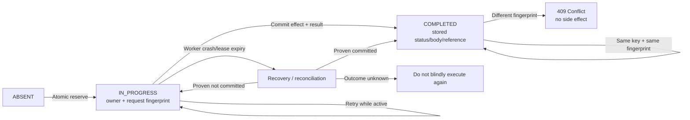

# Kiểm thử idempotency trong HTTP request đã ký HMAC

Một client gọi `POST /v1/orders` để tạo đơn, server đã commit đơn nhưng response bị mất trên mạng. Client **không biết** đơn đã được tạo hay chưa nên gửi lại request. Trong hệ thống HMAC có chống replay, request thứ hai **phải có timestamp, nonce và chữ ký mới**; nếu dùng lại nguyên request cũ, nonce store sẽ từ chối. Nhưng nếu request mới đã xác thực thành công, backend có thể **tạo một đơn thứ hai** khi không có cơ chế idempotency.

Đó là lý do **kiểm thử idempotency** phải đi xa hơn câu hỏi “chữ ký HMAC đúng chưa?”. Cần chứng minh một **ý định nghiệp vụ** được thực hiện tối đa một lần theo hợp đồng idempotency, kể cả khi client retry, hai request đến đồng thời, một gateway trả timeout sau commit hoặc hệ thống bị failover.

Bài thuộc chương **Idempotency**, module `SECURITY_AUTHENTICATION_HMAC_REQUEST_AUTHENTICATION`: thiết kế xác thực HTTP request bằng **HMAC với shared secret**, canonical request bao gồm method, URI, signed headers hoặc raw body; xác minh signature, chống replay bằng timestamp/nonce, key rotation, kiểm thử proxy/gateway và phân biệt **authentication** với **authorization**. Chủ đề trực tiếp của bài là **Kiểm thử idempotency** — thiết kế test oracle, dữ liệu, concurrency/fault scenarios và tiêu chí chứng minh hiệu quả ở tầng nghiệp vụ.

## 1. Mục tiêu học tập

Sau bài học, bạn có thể:

1. Phân biệt **HMAC authentication**, **replay protection** và **business idempotency** bằng kết quả kiểm thử quan sát được.
2. Định nghĩa hợp đồng `Idempotency-Key`: phạm vi theo principal/tenant, cùng key + cùng fingerprint, cùng key + payload khác, retention và response replay.
3. Thiết kế test cho **POST/PATCH có side effect**: retry sau timeout, request đồng thời, cùng key khác payload, khóa hết hạn, key rotation, lỗi kho lưu và lỗi transaction.
4. Giải thích vì sao nonce phải **mới theo từng HTTP attempt** còn idempotency key phải **giữ nguyên theo cùng ý định nghiệp vụ**.
5. Tích hợp `Idempotency-Key` vào **canonical HMAC request** để ngăn client/intermediary thay value mà giữ signature.
6. Viết một demo Java 17 độc lập dùng HMAC-SHA256, nonce store giả lập và idempotency store in-memory có atomic critical section; thử retry, replay, conflict, concurrency và key rotation.
7. Xây tiêu chí kiểm thử production ở mức **DB transaction/outbox, multi-instance, TTL, storage failure, gateway và authorization**.
8. Báo cáo test theo bất biến có thể chứng minh: **số side effect**, **response semantics**, **scope khóa** và **không tạo principal/side effect khi authentication fail**.

## 2. Idempotency là gì và kiểm thử điều gì?

Theo nghĩa toán học, một phép toán `f` được gọi là idempotent nếu áp dụng lại không làm thay đổi kết quả so với áp dụng một lần:

\[
f(f(x))=f(x).
\]

Trong HTTP, ý nghĩa idempotent của method liên quan đến **hiệu quả dự định trên server** khi nhiều request giống nhau được gửi; không đồng nghĩa mọi response đều có cùng status hay server không ghi audit log. `GET`, `PUT` và `DELETE` có idempotent semantics theo HTTP khi được thực hiện đúng ý nghĩa; `POST` **không mặc nhiên** idempotent. Một API có thể xây **idempotency contract** cho `POST` hoặc `PATCH` bằng khóa riêng và lưu kết quả.

**Idempotency ở tầng nghiệp vụ** trong ví dụ tạo đơn:

> Với cùng authenticated principal, cùng idempotency key và cùng fingerprint hành động, backend chỉ tạo **một đơn**, đồng thời các retry hợp lệ có thể đọc lại kết quả của lần đầu.

Kiểm thử cần quan sát **cả response lẫn trạng thái bền vững**:

| Phép kiểm tra | Điều có thể khẳng định | Điều chưa đủ để kết luận |
| --- | --- | --- |
| Hai HTTP responses đều `201` và cùng `orderId`. | Có dấu hiệu trả lại kết quả trước đó. | Chưa chắc chỉ có **một** DB commit nếu layer trả response giả hoặc business side effect bên ngoài lặp. |
| `COUNT(orders WHERE intent_id = X) = 1`. | Có một đơn tương ứng ý định trong bảng đã kiểm. | Chưa chứng minh email/payment/event chỉ phát một lần. |
| Idempotency record có trạng thái `COMPLETED`. | Kết quả đã được ghi nhận trong kho idempotency. | Nếu record và business commit không nguyên tử, vẫn có nguy cơ trùng. |
| Hai request đồng thời nhưng chỉ một hiệu ứng commit. | Concurrency test pass cho topology được kiểm. | Chưa chứng minh failover hoặc multi-region nếu test chỉ chạy trong một JVM. |
| Request HMAC đúng nhưng nonce cũ bị `401`. | Replay protection đang chặn **cùng HTTP attempt**. | Chưa kiểm chứng idempotency cho **attempt mới với nonce mới**. |

**Mục tiêu không phải “chỉ chấp nhận đúng một HTTP request”.** Hai retry với nonce mới có thể đều được xác thực; idempotency làm cho chúng cùng tham chiếu **một ý định và một kết quả nghiệp vụ**.

## 3. Ba giá trị cần tách biệt trong mỗi test

| Trường | Phạm vi và vòng đời | Khi client retry cùng ý định? | Kiểm tra ở tầng nào? |
| --- | --- | --- | --- |
| `X-Timestamp` | Thời điểm chuẩn bị một attempt, ký bằng HMAC. | **Mới**, nằm trong freshness window. | Authentication/freshness. |
| `X-Nonce` | Giá trị dùng một lần theo credential/audience, ký bằng HMAC. | **Mới**, không được reuse. | Authentication/replay store. |
| `Idempotency-Key` | Định danh **một ý định nghiệp vụ** của principal/tenant trong retention policy. | **Giữ nguyên**. | Authorization xong rồi đến idempotency/business transaction. |
| `X-Signature` | MAC trên method, target, headers được ký và body digest. | **Tính lại** khi nonce/timestamp đổi. | Authentication. |

Ví dụ hai attempt hợp lệ cho **cùng đơn hàng**:

```text
Attempt A
  X-Timestamp:    2026-11-28T02:00:00Z
  X-Nonce:        <random-A>
  Idempotency-Key: 75f0b6ac-d133-46b0-8f9d-d82d78529114
  X-Signature:    v1=<HMAC-A>
  Result:         201 {"orderId":42}

Attempt B, retry sau timeout
  X-Timestamp:    2026-11-28T02:00:07Z
  X-Nonce:        <random-B>
  Idempotency-Key: 75f0b6ac-d133-46b0-8f9d-d82d78529114
  X-Signature:    v1=<HMAC-B>
  Result:         201 {"orderId":42}  (theo contract minh họa)
```

Các chuỗi trong dấu `<...>` là placeholder. Attempt B **không dùng lại** signature A vì signed timestamp/nonce đã thay đổi. Cả hai attempt có thể vượt HMAC/nonce; kết quả thứ hai phải chỉ đến **đơn đã tạo**, không tạo đơn mới.

Nếu client gửi lại **nguyên Attempt A**, hệ thống chống replay phải từ chối vì nonce A đã được claim, **trước** khi idempotency trả cached response. Điều này là bình thường: idempotency không được làm lối tắt bỏ qua authentication.

## 4. Hợp đồng idempotency phải rõ trước khi viết test

Bài sử dụng contract **minh họa** cho `POST /v1/orders?channel=partner`. Đây không phải quy tắc bắt buộc của mọi HTTP API.

| Thuộc tính | Chính sách test V2 |
| --- | --- |
| Header | `Idempotency-Key` duy nhất, giá trị UUID chuẩn lowercase (36 ký tự). |
| Scope của key | `(audience, authenticatedClientId, tenantId, idempotencyKey)`. Không lấy client ID hay tenant tùy ý từ header. |
| Request fingerprint | Method + **raw target** + Content-Type + SHA-256(raw body bytes) theo biểu diễn canonical. |
| Lần đầu cùng key | Atomic reserve hoặc insert, xử lý nghiệp vụ, lưu kết quả thành công. |
| Retry key + fingerprint giống | Không tạo side effect mới; trả **cùng status và response body** đã được lưu theo contract. |
| Cùng key nhưng fingerprint khác | `409 Conflict` (hoặc mã riêng theo API), **không** thực thi payload mới. |
| Key đang `IN_PROGRESS` | Hợp đồng có thể trả `409/425/202` hoặc chờ kết quả; demo chọn **đợi**. |
| Retention | Ví dụ **24 giờ** từ lần đầu được chấp nhận; sau đó key có thể được dùng lại theo chính sách, và client phải biết giới hạn. |
| Lỗi xác thực/phân quyền | Không reserve key khi request chưa được authenticated hoặc chưa được authorized. |
| Business result | Quy định loại kết quả nào được cache (thành công, 4xx cuối cùng, 5xx). Demo **chỉ** mô phỏng tạo đơn thành công. |
| Durable guarantee | Idempotency record và side effect liên quan phải được bảo vệ bằng transaction hoặc cơ chế recovery/outbox được chứng minh. |

**Retention 24 giờ chỉ là giá trị ví dụ.** Trong nghiệp vụ thanh toán/đơn hàng, yêu cầu chống tạo trùng có thể kéo dài lâu hơn nhiều, thậm chí cần unique business constraint độc lập với TTL idempotency. Khi key hết retention, server có thể coi nó là key mới; test phải xác minh chính sách đó được công bố và không gây bất ngờ nguy hiểm.

### Hai chính sách conflict dễ bị lẫn

- **Same key, same fingerprint:** cho phép trả lại kết quả của lần đầu.
- **Same key, different fingerprint:** phải từ chối hoặc yêu cầu tạo **idempotency key khác** cho ý định mới; không tùy tiện ghi đè payload và chạy operation thứ hai.

Không dùng `Idempotency-Key` làm secret hay bằng chứng danh tính. Ai có thể gửi một key string chưa chắc có quyền đối với bản ghi của principal khác.

## 5. Canonical HMAC request phải ký idempotency key

Nếu `Idempotency-Key` quyết định backend có tạo đơn mới hay trả lại cached result, header đó **ảnh hưởng hành vi nghiệp vụ** và cần được ràng buộc với HMAC. Nếu không ký, một bên trung gian có thể thay key của request đã ký, khiến backend dedupe sai dù MAC vẫn hợp lệ.

Hợp đồng minh họa mới `HMAC-SHA256-V2` mở rộng V1 để ký thêm `Idempotency-Key`; đây là **thay đổi version có chủ đích**.

```http
POST /v1/orders?channel=partner HTTP/1.1
Host: api.example.test
Content-Type: application/json
X-Key-Id: partner-a-202611
X-Timestamp: 2026-11-28T02:00:00Z
X-Nonce: Zq8DxKtUokcwPGNj3d_yvQ
Idempotency-Key: 75f0b6ac-d133-46b0-8f9d-d82d78529114
X-Signature: v2=<BASE64_FULL_HMAC_SHA256>

{"sku":"BK-42","quantity":2}
```

Canonical string (LF giữa các dòng, không LF cuối):

```text
HMAC-SHA256-V2
orders-api-prod
POST
/v1/orders?channel=partner
content-type:application/json
x-key-id:partner-a-202611
x-timestamp:2026-11-28T02:00:00Z
x-nonce:Zq8DxKtUokcwPGNj3d_yvQ
idempotency-key:75f0b6ac-d133-46b0-8f9d-d82d78529114
sha256:<LOWERCASE_SHA256_HEX_OF_RAW_BODY>
```

Các chuỗi `<...>` là placeholder, không phải chữ ký/digest thật. Chính sách:

- `HmacSHA256`, full tag 32 byte, Base64 **chuẩn có padding** (44 ký tự), prefix `v2=` nên wire value dài **47 ký tự**.
- Header nonce dùng Base64URL **không padding** của 16 byte CSPRNG (22 ký tự).
- Timestamp UTC `YYYY-MM-DDTHH:mm:ssZ`, signed, freshness ±300 giây.
- Method chính xác `POST`, target được ký ở dạng raw `/v1/orders?channel=partner`.
- `Content-Type` đúng `application/json`; không chấp nhận `Content-Encoding` trong hợp đồng V2 minh họa.
- Server lấy raw body bytes **trước parse JSON**, tính SHA-256 và dựng canonical string từ request thực nhận.
- `X-Key-Id` phải ánh xạ đúng credential ACTIVE/audience/version; không thử nhiều secret/algorithm để được MAC khớp.
- `Idempotency-Key` là một header **duy nhất** và **được ký**, không sửa sau khi ký.

Phép ký:

\[
d=\operatorname{SHA256}(\mathrm{rawBodyBytes}),\quad
T=\operatorname{HMAC}_{\mathrm{SHA256}}(K,\operatorname{UTF8}(C)),\quad
S=\texttt{v2=}\Vert\operatorname{Base64}(T).
\]

**Tại sao cần version mới?** Trong V1 của các ví dụ không có `Idempotency-Key` trong canonical string. Tự thêm header rồi giữ tên V1 khiến SDK cũ/nhà cung cấp hiểu khác nhau. V2 minh họa ràng buộc key mới, có test vector và rollout rõ ràng. Production cần version negotiation được **policy cho phép**, không tự “thử V1 nếu V2 sai”.

## 6. Một pipeline kiểm thử end-to-end đúng thứ tự

```mermaid
sequenceDiagram
    participant C as Client
    participant G as Gateway / HMAC Verifier
    participant N as Shared nonce store
    participant I as Idempotency store
    participant D as Business DB / Outbox

    C->>G: POST + new nonce N1 + idemKey K + HMAC V2
    G->>G: Format, credential, canonical HMAC, timestamp
    G->>N: Atomic claim (audience,keyId,N1)
    N-->>G: INSERTED
    G->>G: Authenticated -> Authorize client/tenant/scope
    G->>I: Reserve (principal,K) + fingerprint F
    I-->>G: Owner; first intent
    G->>D: Commit order + idempotency result atomically
    D-->>G: orderId=42
    G-->>C: 201 {"orderId":42}
    Note over C,G: Response có thể bị mất sau khi commit
    C->>G: Retry POST + new nonce N2 + same K/F + HMAC V2 mới
    G->>N: Atomic claim (...,N2)
    N-->>G: INSERTED
    G->>G: Authenticated -> Authorize
    G->>I: Lookup/reserve (principal,K) + F
    I-->>G: COMPLETED; cached result
    G-->>C: 201 {"orderId":42}; không commit thêm
```

**Bất biến quan trọng:**

1. **Authentication phải chạy cho mọi attempt**, kể cả retry muốn đọc cached response. Không bỏ qua HMAC hay nonce chỉ vì Idempotency-Key đã có trong store.
2. **Authorization phải chạy với principal đã xác thực** trước khi truy xuất kết quả của idempotency key. Nếu principal bị thu hồi quyền, policy có thể từ chối dù trước đây đã được phép; phải công bố hành vi này.
3. Idempotency key phải được **scope theo principal/tenant/audience** để không trả cached response của người khác.
4. Phải kiểm tra **fingerprint request** trước khi trả kết quả cũ; nếu khác, báo conflict chứ không chạy payload mới.
5. Reserve/complete/result và effect phải có cơ chế atomic/recovery phù hợp. Không trả lời thành công nếu backend chưa commit.
6. Khi hệ thống không biết kết quả claim/reserve/commit vì lỗi store, **không được chạy lại operation mù**.

## 7. Thiết kế test oracle: quan sát cái gì?

Một test idempotency tốt không dừng ở `assertEquals(201, status)`. Nên có **ba lớp oracle**:

| Lớp | Điều cần chứng minh | Bằng chứng |
| --- | --- | --- |
| HTTP | Status/response body, key conflict, in-progress response, retry behavior. | Captured HTTP responses, request ID, API contract. |
| Security | Mỗi attempt có nonce mới; MAC V2 ký idempotency key; principal thực là ai; key revoked, replay, 401/403. | Trusted verifier events, nonce claim outcomes. |
| Business | **Một và chỉ một effect theo intent** trong điều kiện hợp đồng, không phát duplicate payment/event. | DB rows, ledger, outbox, unique constraint, idempotency record. |

Ví dụ assert đúng cho hai request cùng intent:

```text
attemptA.status == 201
attemptB.status == 201
attemptA.responseBody == attemptB.responseBody
attemptA.orderId == attemptB.orderId
ordersCommittedForIntent(K, principal) == 1
outboxMessagesForIntent(K, principal) == 1
attemptA.nonce != attemptB.nonce
attemptA.signature != attemptB.signature
attemptA.idempotencyKey == attemptB.idempotencyKey
```

`attemptA.signature != attemptB.signature` là kết quả dự kiến với nonce/timestamp khác trong HMAC; nếu cùng tag trong fixture ngẫu nhiên, cần kiểm tra test wiring. Không dựa vào việc response body “trông giống nhau” để khẳng định không có side effect thứ hai.

### Kết quả nào được cache?

Không có một đáp án áp dụng cho mọi API. Có API cache **response đầu tiên kể cả lỗi**, có API cache **kết quả thành công và một số lỗi cuối cùng**, có API cho phép retry những lỗi hạ tầng `5xx` chưa commit. Test phải dựa vào **quy tắc được công bố**:

- Nếu validation thất bại trước khi reserve, key có thể chưa bị tiêu thụ; lần gửi sau với payload sửa vẫn phải là một attempt mới được ký và còn phụ thuộc contract.
- Nếu side effect đã commit nhưng HTTP response thất lạc, retry phải trả **kết quả commit cũ** hoặc truy vấn kết quả một cách an toàn.
- Nếu work đang `IN_PROGRESS`, tuyệt đối không chạy work thứ hai vì chưa thấy `COMPLETED`.

## 8. State machine và concurrency: nơi bug thường ẩn

Một idempotency store production có thể mô hình:



### Lỗi check-then-insert

```java
// SAI trong nhiều thread/process:
if (!idempotencyStore.exists(scope, key)) {
    createOrder();                  // Có thể commit 2 lần
    idempotencyStore.put(scope, key, response);
}
```

Hai worker cùng thấy key chưa tồn tại rồi chạy business. **Atomic reserve** phải xảy ra **trước khi** nghiệp vụ bắt đầu, và quá trình complete/result cần gắn với một cơ chế transaction/outbox hoặc recovery chống lặp side effect.

### In-progress không đồng nghĩa failed

Request thứ hai đến khi owner đang xử lý. Các hành vi contract hợp lệ có thể là:

- **Wait/join:** đợi owner hoàn tất trong giới hạn timeout, sau đó trả cùng result.
- **Return conflict/in-progress:** `409 Conflict` hoặc mã trạng thái riêng theo hợp đồng, có thể kèm `Retry-After` nếu thích hợp. Không lạm dụng `425 Too Early` vốn dành cho tình huống HTTP early data.
- **Return accepted for asynchronous job:** `202` kèm operation ID/status URL.

Không có phương án duy nhất cho mọi API; quan trọng là **request thứ hai không được tạo side effect khác**. Nếu owner chết, system cần reconciliation state thay vì tự xóa entry để retry chạy lại khi chưa rõ DB đã commit hay chưa.

### Transaction và outbox

Lý tưởng, với DB transaction phù hợp:

```text
BEGIN TRANSACTION
  claim hoặc lock idempotency row theo (scope,key)
  kiểm tra fingerprint và trạng thái
  INSERT order (unique business intent)
  INSERT outbox event (unique event intent)
  UPDATE idempotency row = COMPLETED + response reference
COMMIT
```

Đây là **pseudocode kiến trúc**, không phải SQL có thể chạy trên mọi database. Với external payment provider/email, DB transaction không tự bao trùm network call; cần **provider idempotency key**, transactional outbox, deduplication ở consumer và reconciliation. Cần test crash ở các điểm giữa các bước.

## 9. Bộ trường hợp kiểm thử bắt buộc

| Test ID | Đầu vào/cách thực hiện | Expected |
| --- | --- | --- |
| `IDEM-01` | Một POST HMAC V2, key mới, nonce mới. | `201`, tạo đúng một order và một idempotency record. |
| `IDEM-02` | Retry **nonce/timestamp/signature mới**, cùng key và raw body. | Cùng orderId/status/body, không tăng số effect. |
| `IDEM-03` | Replay **nguyên request**, cùng nonce/signature. | Authentication từ chối replay (`401` hoặc contract), không trả cached result như bypass. |
| `IDEM-04` | Cùng key/principal nhưng body khác, ký lại đúng HMAC. | `409 Conflict`, không tạo effect mới. |
| `IDEM-05` | Cùng key nhưng method/target khác (endpoint nhiều route). | Conflict hoặc scope theo method/target **đúng contract**, không nhận nhầm cached result. |
| `IDEM-06` | Hai POST cùng key/fingerprint đến **đồng thời**, hai nonce khác. | Một effect; cả hai kết quả tuân contract in-progress/replay result. |
| `IDEM-07` | Hai gateway đến hai instances/regions, cùng key. | Cùng bất biến một effect theo consistency policy; không local-only store. |
| `IDEM-08` | Response bị drop **sau commit**. | Retry lấy lại kết quả cũ; không commit thêm. |
| `IDEM-09` | Owner chết **sau reserve trước business**. | Recovery đúng, không giữ khóa vô hạn; không chạy duplicate. |
| `IDEM-10` | Owner chết **sau business commit trước complete**. | Reconcile được effect; không tạo lần hai. |
| `IDEM-11` | Idempotency store timeout/lỗi. | Fail closed/đúng trạng thái unavailable, không chạy business mù. |
| `IDEM-12` | Nonce store timeout. | Authentication không thành công; không reserve business key. |
| `IDEM-13` | Credential revoked hoặc HMAC sai. | `401`, không đọc cached response và không tạo effect. |
| `IDEM-14` | HMAC hợp lệ nhưng không có scope/tenant. | `403`; không lộ kết quả của principal khác. |
| `IDEM-15` | Hai principal/tenant khác dùng cùng chuỗi idempotency key. | Hai scope độc lập; không tiết lộ dữ liệu của nhau. |
| `IDEM-16` | Rotation từ key A sang key B của **cùng client** rồi retry. | Tùy scope theo client: nên nhận ra cùng intent và trả kết quả cũ. |
| `IDEM-17` | TTL hết theo contract rồi key được dùng lại. | Hành vi **đúng policy**; không khẳng định at-most-once vĩnh viễn. |
| `IDEM-18` | Key thiếu/sai format hoặc duplicate `Idempotency-Key`. | Từ chối trước side effect; không tự chọn first/last. |
| `IDEM-19` | Same key nhưng `Content-Type`/body encoding thay đổi. | Fingerprint conflict hoặc policy rejection, không reserialize để cho qua. |
| `IDEM-20` | Proxy retry/redirect làm đổi target hoặc bỏ signed key. | HMAC mismatch hoặc policy rejection, không bypass. |
| `IDEM-21` | Hai attempts khác nonce nhưng cùng intent, concurrency cao. | Metrics effect count bằng một; atomicity vẫn giữ. |
| `IDEM-22` | Một request trả validation error rồi client sửa payload cùng key. | Theo contract cache/reserve; test explicit, không đoán. |
| `IDEM-23` | Cùng key với response body do backend serialize khác. | Result replay dùng bản kết quả đã lưu/canonical representation theo contract. |
| `IDEM-24` | Response lặp dù đã authorization thay đổi giữa retries. | Re-authorize theo policy trước khi trả cached result; không rò rỉ dữ liệu. |

**Không chỉ test happy path.** Các ca `IDEM-06`–`IDEM-12` mới trực tiếp phơi bày lỗi race/crash/lost response; `IDEM-13`–`IDEM-16` bảo đảm idempotency không phá trust boundary của authentication.

## 10. Java 17: demo tự chứa kiểm thử HMAC, nonce và idempotency

Chương trình sau **dùng JDK 17**, không cần framework. Nó mô hình hóa **request fields sau khi ingress đã parse**, không gửi socket HTTP thật, để tập trung vào bất biến giữa hai tầng:

- Mỗi attempt có timestamp UTC, nonce 16 byte CSPRNG Base64URL không padding, và `Idempotency-Key` UUID lowercase.
- `HMAC-SHA256-V2` ký **idempotency key cùng timestamp/nonce, method, raw target và body digest**.
- Verifier kiểm tra credential ACTIVE/audience, full tag bằng `MessageDigest.isEqual`, freshness ±300s và claim nonce nguyên tử.
- Business store scope key theo **authenticated client/tenant/audience**, không theo key ID; do đó key rotation không làm mất idempotency.
- Business store kiểm tra **fingerprint** và dùng `synchronized` để **tránh chạy business hai lần trong cùng JVM demo**.
- Test replay nguyên request, retry có nonce mới, key conflict, scope theo principal, rotation, MAC tamper, nonce-store outage và **hai luồng đồng thời**.

**Giới hạn:** `synchronized` và `HashMap` không làm idempotency bền vững trên nhiều node hoặc qua crash. Demo không triển khai database transaction/outbox, TLS/HTTP parser, distributed nonce store hay recovery; các phần này cần test integration/chaos riêng.

Lưu file `IdempotencyHmacV2TestDemo.java`:

```java
import java.nio.charset.StandardCharsets;
import java.security.GeneralSecurityException;
import java.security.MessageDigest;
import java.security.SecureRandom;
import java.time.Clock;
import java.time.Instant;
import java.time.ZoneOffset;
import java.time.format.DateTimeParseException;
import java.time.temporal.ChronoUnit;
import java.util.Arrays;
import java.util.Base64;
import java.util.HashMap;
import java.util.HexFormat;
import java.util.Map;
import java.util.Set;
import java.util.UUID;
import java.util.concurrent.Callable;
import java.util.concurrent.CountDownLatch;
import java.util.concurrent.ExecutorService;
import java.util.concurrent.Executors;
import java.util.concurrent.Future;
import javax.crypto.Mac;
import javax.crypto.spec.SecretKeySpec;

public final class IdempotencyHmacV2TestDemo {
    private static final String VERSION = "HMAC-SHA256-V2";
    private static final String AUDIENCE = "orders-api-prod";
    private static final String TARGET = "/v1/orders?channel=partner";
    private static final String TYPE = "application/json";
    private static final String SIG_PREFIX = "v2=";
    private static final long WINDOW = 300;
    private static final long MARGIN = 30;

    private IdempotencyHmacV2TestDemo() {}

    public record Credential(
            String keyId, String clientId, String tenantId,
            boolean active, String audience, byte[] secret,
            Set<String> scopes) {
        public Credential {
            secret = secret.clone();
            scopes = Set.copyOf(scopes);
        }
        @Override
        public byte[] secret() {
            return secret.clone();
        }
    }

    public record Principal(
            String clientId, String tenantId, Set<String> scopes) {
        public Principal {
            scopes = Set.copyOf(scopes);
        }
    }

    public record SignedRequest(
            String method, String rawTarget, String contentType,
            String keyId, String timestamp, String nonce,
            String idempotencyKey, byte[] body, String signature) {
        public SignedRequest {
            if (body != null) {
                body = body.clone();
            }
        }
        @Override
        public byte[] body() {
            return body == null ? null : body.clone();
        }
    }

    public enum AuthStatus {
        AUTHENTICATED, BAD_REQUEST, INVALID_CREDENTIAL,
        INVALID_SIGNATURE, NOT_FRESH, REPLAY, UNAVAILABLE
    }

    public record AuthResult(AuthStatus status, Principal principal) {
        public AuthResult {
            if ((status == AuthStatus.AUTHENTICATED)
                    != (principal != null)) {
                throw new IllegalArgumentException("Principal invariant");
            }
        }
        static AuthResult deny(AuthStatus status) {
            return new AuthResult(status, null);
        }
        static AuthResult allow(Principal principal) {
            return new AuthResult(AuthStatus.AUTHENTICATED, principal);
        }
    }

    public static class StoreUnavailable extends Exception {}

    public interface NonceStore {
        boolean claim(String key, Instant expiresAt, Instant now)
                throws StoreUnavailable;
    }

    /** Test only: atomic within ONE JVM, not distributed. */
    public static final class LocalNonceStore implements NonceStore {
        private final Map<String, Instant> records = new HashMap<>();

        @Override
        public synchronized boolean claim(
                String key, Instant expiresAt, Instant now) {
            records.entrySet().removeIf(
                    e -> !e.getValue().isAfter(now));
            if (!expiresAt.isAfter(now) || records.containsKey(key)) {
                return false;
            }
            records.put(key, expiresAt);
            return true;
        }
    }

    private static boolean validUuid(String key) {
        if (key == null || key.length() != 36) {
            return false;
        }
        try {
            return UUID.fromString(key).toString().equals(key);
        } catch (IllegalArgumentException invalid) {
            return false;
        }
    }

    private static String newNonce(SecureRandom random) {
        byte[] bytes = new byte[16];
        random.nextBytes(bytes);
        return Base64.getUrlEncoder().withoutPadding()
                .encodeToString(bytes);
    }

    private static boolean validNonce(String nonce) {
        if (nonce == null || nonce.length() != 22) {
            return false;
        }
        try {
            byte[] bytes = Base64.getUrlDecoder().decode(nonce);
            return bytes.length == 16
                    && Base64.getUrlEncoder().withoutPadding()
                            .encodeToString(bytes).equals(nonce);
        } catch (IllegalArgumentException invalid) {
            return false;
        }
    }

    private static Instant strictTimestamp(String timestamp) {
        if (timestamp == null || !timestamp.matches(
                "[0-9]{4}-[0-9]{2}-[0-9]{2}T"
                + "[0-9]{2}:[0-9]{2}:[0-9]{2}Z")) {
            throw new IllegalArgumentException("Bad timestamp syntax");
        }
        try {
            Instant instant = Instant.parse(timestamp);
            if (!instant.truncatedTo(ChronoUnit.SECONDS)
                    .toString().equals(timestamp)) {
                throw new IllegalArgumentException("Noncanonical time");
            }
            return instant;
        } catch (DateTimeParseException invalid) {
            throw new IllegalArgumentException("Invalid timestamp", invalid);
        }
    }

    private static boolean validShape(SignedRequest r) {
        if (r == null
                || !"POST".equals(r.method())
                || !TARGET.equals(r.rawTarget())
                || !TYPE.equals(r.contentType())
                || r.keyId() == null
                || !r.keyId().matches("[A-Za-z0-9_-]{1,80}")
                || !validNonce(r.nonce())
                || !validUuid(r.idempotencyKey())
                || r.body() == null || r.body().length > 8192) {
            return false;
        }
        try {
            strictTimestamp(r.timestamp());
            return true;
        } catch (IllegalArgumentException malformed) {
            return false;
        }
    }

    private static String bodySha256(byte[] bytes)
            throws GeneralSecurityException {
        return HexFormat.of().formatHex(
                MessageDigest.getInstance("SHA-256").digest(bytes));
    }

    private static byte[] canonicalBytes(SignedRequest r)
            throws GeneralSecurityException {
        String canonical = String.join("\n",
                VERSION, AUDIENCE, r.method(), r.rawTarget(),
                "content-type:" + r.contentType(),
                "x-key-id:" + r.keyId(),
                "x-timestamp:" + r.timestamp(),
                "x-nonce:" + r.nonce(),
                "idempotency-key:" + r.idempotencyKey(),
                "sha256:" + bodySha256(r.body()));
        return canonical.getBytes(StandardCharsets.UTF_8);
    }

    private static byte[] hmac(byte[] secret, byte[] message)
            throws GeneralSecurityException {
        if (secret == null || secret.length < 32) {
            throw new GeneralSecurityException("Invalid test credential");
        }
        Mac mac = Mac.getInstance("HmacSHA256");
        mac.init(new SecretKeySpec(secret, "HmacSHA256"));
        return mac.doFinal(message);
    }

    private static byte[] decodeTag(String wire) {
        if (wire == null || wire.length() != 47
                || !wire.startsWith(SIG_PREFIX)) {
            return null;
        }
        String encoded = wire.substring(SIG_PREFIX.length());
        if (!encoded.matches("[A-Za-z0-9+/]{43}=")) {
            return null;
        }
        try {
            byte[] bytes = Base64.getDecoder().decode(encoded);
            return bytes.length == 32
                    && Base64.getEncoder().encodeToString(bytes)
                            .equals(encoded) ? bytes : null;
        } catch (IllegalArgumentException invalid) {
            return null;
        }
    }

    public static SignedRequest signForTest(
            Credential c, String timestamp, String nonce,
            String idemKey, byte[] body)
            throws GeneralSecurityException {
        SignedRequest draft = new SignedRequest(
                "POST", TARGET, TYPE, c.keyId(), timestamp,
                nonce, idemKey, body, null);
        if (!validShape(draft)) {
            throw new IllegalArgumentException("Invalid test request");
        }
        String sig = SIG_PREFIX + Base64.getEncoder().encodeToString(
                hmac(c.secret(), canonicalBytes(draft)));
        return new SignedRequest(
                draft.method(), draft.rawTarget(), draft.contentType(),
                draft.keyId(), timestamp, nonce, idemKey, body, sig);
    }

    public static final class Verifier {
        private final Map<String, Credential> registry;
        private final NonceStore nonces;
        private final Clock clock;

        Verifier(Map<String, Credential> registry,
                NonceStore nonces, Clock clock) {
            this.registry = registry;
            this.nonces = nonces;
            this.clock = clock;
        }

        AuthResult authenticate(SignedRequest r) {
            if (!validShape(r)) {
                return AuthResult.deny(AuthStatus.BAD_REQUEST);
            }
            Credential c = registry.get(r.keyId());
            if (c == null || !c.active()
                    || !AUDIENCE.equals(c.audience())
                    || !r.keyId().equals(c.keyId())) {
                return AuthResult.deny(AuthStatus.INVALID_CREDENTIAL);
            }
            byte[] supplied = decodeTag(r.signature());
            if (supplied == null) {
                return AuthResult.deny(AuthStatus.INVALID_SIGNATURE);
            }
            try {
                byte[] expected = hmac(c.secret(), canonicalBytes(r));
                if (!MessageDigest.isEqual(expected, supplied)) {
                    return AuthResult.deny(AuthStatus.INVALID_SIGNATURE);
                }
            } catch (GeneralSecurityException providerError) {
                return AuthResult.deny(AuthStatus.UNAVAILABLE);
            }

            Instant now = clock.instant();
            Instant signedTime = strictTimestamp(r.timestamp());
            if (signedTime.isBefore(now.minusSeconds(WINDOW))
                    || signedTime.isAfter(now.plusSeconds(WINDOW))) {
                return AuthResult.deny(AuthStatus.NOT_FRESH);
            }
            String replayKey = AUDIENCE + ":" + c.keyId() + ":" + r.nonce();
            Instant expiresAt = signedTime.plusSeconds(WINDOW + MARGIN);
            try {
                if (!nonces.claim(replayKey, expiresAt, now)) {
                    return AuthResult.deny(AuthStatus.REPLAY);
                }
            } catch (StoreUnavailable error) {
                return AuthResult.deny(AuthStatus.UNAVAILABLE);
            }
            Principal principal = new Principal(
                    c.clientId(), c.tenantId(), c.scopes());
            return AuthResult.allow(principal);
        }
    }

    public record Response(int status, String body, boolean reused) {}

    public record Scope(
            String audience, String clientId, String tenantId, String key) {}

    private record Saved(
            String fingerprint, int status, String body) {}

    /**
     * Demonstrates an atomic critical section INSIDE ONE JVM.
     * In production, use a database transaction/unique constraint
     * and an outbox or recovery strategy for external effects.
     */
    public static final class IdempotentOrders {
        private final Map<Scope, Saved> results = new HashMap<>();
        private int orderCount = 0;

        public synchronized Response create(
                Principal principal, SignedRequest request) {
            Scope scope = new Scope(
                    AUDIENCE, principal.clientId(),
                    principal.tenantId(), request.idempotencyKey());
            String fingerprint;
            try {
                fingerprint = String.join("\n",
                        request.method(), request.rawTarget(),
                        request.contentType(), bodySha256(request.body()));
            } catch (GeneralSecurityException error) {
                throw new IllegalStateException("SHA-256 unavailable", error);
            }

            Saved old = results.get(scope);
            if (old != null) {
                if (!old.fingerprint().equals(fingerprint)) {
                    return new Response(
                            409, "{\"error\":\"idempotency_conflict\"}", false);
                }
                return new Response(old.status(), old.body(), true);
            }

            // Both the simulated side effect and its result are under
            // one synchronized critical section, ONLY in this JVM.
            int id = ++orderCount;
            String resultBody = "{\"orderId\":" + id + "}";
            Saved saved = new Saved(fingerprint, 201, resultBody);
            results.put(scope, saved);
            return new Response(201, resultBody, false);
        }

        public synchronized int committedOrders() {
            return orderCount;
        }
    }

    public static final class Gateway {
        private final Verifier verifier;
        private final IdempotentOrders orders;

        Gateway(Verifier verifier, IdempotentOrders orders) {
            this.verifier = verifier;
            this.orders = orders;
        }

        Response handle(SignedRequest request) {
            AuthResult auth = verifier.authenticate(request);
            if (auth.status() != AuthStatus.AUTHENTICATED) {
                int status = auth.status() == AuthStatus.UNAVAILABLE ? 503
                        : auth.status() == AuthStatus.BAD_REQUEST ? 400 : 401;
                return new Response(
                        status, "{\"error\":\"authentication_failed\"}", false);
            }
            if (!auth.principal().scopes().contains("orders:create")) {
                return new Response(
                        403, "{\"error\":\"forbidden\"}", false);
            }
            // Only authenticated AND authorized principal reaches store.
            return orders.create(auth.principal(), request);
        }
    }

    private static void expect(
            int status, Response response, String description) {
        if (response.status() != status) {
            throw new AssertionError(description
                    + ": expected " + status + ", got " + response.status());
        }
    }

    public static void main(String[] args) throws Exception {
        byte[] keyA = new byte[32];
        byte[] keyRotated = new byte[32];
        byte[] keyB = new byte[32];
        Arrays.fill(keyA, (byte) 0x4a);
        Arrays.fill(keyRotated, (byte) 0x4b);
        Arrays.fill(keyB, (byte) 0x4c);

        Credential partnerA = new Credential(
                "partner-a-202611", "partner-a", "tenant-42",
                true, AUDIENCE, keyA, Set.of("orders:create"));
        Credential rotatedA = new Credential(
                "partner-a-202702", "partner-a", "tenant-42",
                true, AUDIENCE, keyRotated, Set.of("orders:create"));
        Credential partnerB = new Credential(
                "partner-b-202611", "partner-b", "tenant-99",
                true, AUDIENCE, keyB, Set.of("orders:create"));
        Map<String, Credential> registry = Map.of(
                partnerA.keyId(), partnerA,
                rotatedA.keyId(), rotatedA,
                partnerB.keyId(), partnerB);

        Clock fixed = Clock.fixed(
                Instant.parse("2026-11-28T02:00:30Z"), ZoneOffset.UTC);
        SecureRandom random = new SecureRandom();
        LocalNonceStore nonces = new LocalNonceStore();
        IdempotentOrders business = new IdempotentOrders();
        Gateway gateway = new Gateway(
                new Verifier(registry, nonces, fixed), business);

        byte[] body = "{\"sku\":\"BK-42\",\"quantity\":2}"
                .getBytes(StandardCharsets.UTF_8);
        String timestamp = "2026-11-28T02:00:00Z";
        String intentKey = UUID.randomUUID().toString();

        SignedRequest first = signForTest(
                partnerA, timestamp, newNonce(random), intentKey, body);
        Response committed = gateway.handle(first);
        expect(201, committed, "first attempt");
        if (committed.reused() || business.committedOrders() != 1) {
            throw new AssertionError("Initial commit invariant failed");
        }

        // Simulate lost HTTP response AFTER commit: ignore committed,
        // then send a NEW signed attempt with same business intent key.
        SignedRequest retry = signForTest(
                partnerA, timestamp, newNonce(random), intentKey, body);
        Response cached = gateway.handle(retry);
        expect(201, cached, "retry after lost response");
        if (!cached.reused()
                || !cached.body().equals(committed.body())
                || business.committedOrders() != 1) {
            throw new AssertionError("Retry caused duplicate effect");
        }

        // Replaying the exact same signed request is an AUTH failure.
        expect(401, gateway.handle(first), "same nonce replay");
        if (business.committedOrders() != 1) {
            throw new AssertionError("Replay reached business");
        }

        // Same principal + key but different body must conflict.
        byte[] changed = "{\"sku\":\"BK-42\",\"quantity\":3}"
                .getBytes(StandardCharsets.UTF_8);
        SignedRequest conflict = signForTest(
                partnerA, timestamp, newNonce(random), intentKey, changed);
        expect(409, gateway.handle(conflict), "changed payload");
        if (business.committedOrders() != 1) {
            throw new AssertionError("Key conflict created order");
        }

        // A different authenticated principal has an independent scope.
        SignedRequest otherPrincipal = signForTest(
                partnerB, timestamp, newNonce(random), intentKey, body);
        expect(201, gateway.handle(otherPrincipal), "other principal");
        if (business.committedOrders() != 2) {
            throw new AssertionError("Cross-principal scope failure");
        }

        // Rotation should NOT turn the same principal's intent into
        // a new order when idempotency scope is clientId+tenantId.
        SignedRequest afterRotation = signForTest(
                rotatedA, timestamp, newNonce(random), intentKey, body);
        Response rotatedRetry = gateway.handle(afterRotation);
        expect(201, rotatedRetry, "credential rotation retry");
        if (!rotatedRetry.reused()
                || !rotatedRetry.body().equals(committed.body())
                || business.committedOrders() != 2) {
            throw new AssertionError("Rotation bypassed idempotency");
        }

        // Tamper with signed body while retaining the signature.
        SignedRequest tampered = new SignedRequest(
                first.method(), first.rawTarget(), first.contentType(),
                first.keyId(), first.timestamp(), newNonce(random),
                first.idempotencyKey(), changed, first.signature());
        expect(401, gateway.handle(tampered), "tampered signature");
        if (business.committedOrders() != 2) {
            throw new AssertionError("Tampered request reached business");
        }

        // Nonce store outage => fail closed, before idempotency lookup.
        NonceStore offline = (key, until, now) -> {
            throw new StoreUnavailable();
        };
        Gateway unavailableGateway = new Gateway(
                new Verifier(registry, offline, fixed), business);
        SignedRequest fresh = signForTest(
                partnerA, timestamp, newNonce(random),
                UUID.randomUUID().toString(), body);
        expect(503, unavailableGateway.handle(fresh),
                "nonce storage outage");
        if (business.committedOrders() != 2) {
            throw new AssertionError("Store outage reached business");
        }

        // Concurrent NEW attempts of the SAME business intent:
        // their nonces differ, but the order must be created once.
        String concurrentKey = UUID.randomUUID().toString();
        SignedRequest concurrentA = signForTest(
                partnerA, timestamp, newNonce(random), concurrentKey, body);
        SignedRequest concurrentB = signForTest(
                partnerA, timestamp, newNonce(random), concurrentKey, body);
        ExecutorService pool = Executors.newFixedThreadPool(2);
        CountDownLatch start = new CountDownLatch(1);
        Callable<Response> taskA = () -> {
            start.await();
            return gateway.handle(concurrentA);
        };
        Callable<Response> taskB = () -> {
            start.await();
            return gateway.handle(concurrentB);
        };
        try {
            Future<Response> fa = pool.submit(taskA);
            Future<Response> fb = pool.submit(taskB);
            start.countDown();
            Response ra = fa.get();
            Response rb = fb.get();
            expect(201, ra, "concurrent A");
            expect(201, rb, "concurrent B");
            if (!ra.body().equals(rb.body())
                    || ra.reused() == rb.reused()
                    || business.committedOrders() != 3) {
                throw new AssertionError("Concurrent idempotency failed");
            }
        } finally {
            pool.shutdownNow();
        }

        System.out.println(
                "HMAC, nonce, retry, conflict, rotation, concurrency passed.");
        System.out.println("Business orders committed = "
                + business.committedOrders());
    }
}
```

### Kết quả mong đợi

```text
HMAC, nonce, retry, conflict, rotation, concurrency passed.
Business orders committed = 3
```

Ba đơn trong test tương ứng với: một ý định của partner A, một ý định **độc lập** của partner B dù dùng cùng key string, và một ý định khác được gửi song song bởi partner A. Những lần retry, conflict, tamper, replay hay lỗi nonce store **không tạo đơn thêm**.

### Ý nghĩa và giới hạn của ví dụ

- `LocalNonceStore` và `IdempotentOrders` dùng `synchronized` trong một JVM; đây chỉ là bằng chứng **đúng khi các request đi qua cùng object trong một process**.
- `Response.reused` chỉ là cờ nội bộ giúp test. Wire response production không bắt buộc có cờ này; hợp đồng ở đây yêu cầu **status/body** trùng bản lưu.
- `Gateway.handle` xác thực rồi phân quyền **trước khi** kiểm tra/cấp phát idempotency record; không cho principal khác lấy cached result.
- `Scope` chứa audience + clientId + tenantId + key, thay vì key ID. Nhờ vậy hai credential ACTIVE của cùng principal trong rotation cùng nhìn thấy một business intent.
- Fingerprint bao gồm method, raw target, content type, SHA-256(raw body). Việc đổi JSON whitespace cũng đổi fingerprint theo hợp đồng **raw bytes**; nếu muốn semantic JSON equivalence, phải định nghĩa canonical JSON version riêng, không tự parse/re-serialize tùy SDK.
- Test MAC tamper cho thấy **idempotency cache không được trả kết quả trước authentication**.
- Test lost-response minh họa server đã commit và client làm retry **với attempt mới**; nó không mô phỏng mạng thật hay crash/persistence.
- Test concurrency chứng minh **một effect trong một JVM**. Muốn chứng minh production, phải dùng nhiều process, storage thật và fault injection.
- HTTP ingress của demo được giả lập bằng `SignedRequest`, nên chưa kiểm duplicate header, HTTP/2 `:path`, path rewrites, content coding, TLS hay framing. Đây là nhiệm vụ của integration test.
- `secret` là byte giả dùng cho test; credential production cần secret manager/HSM, policy ACTIVE/expiry/revoke và không bao giờ log secret.

## 11. Thử nghiệm concurrency đúng với hệ phân tán

Một bài kiểm thử “hai thread Java gọi chung một HashMap synchronized” hữu ích để học, **nhưng chưa đủ** để tuyên bố idempotency bảo đảm trên hệ nhiều instance.

### Thiết kế integration test đa instance

1. Triển khai tối thiểu **hai gateway/verifier** và **hai business instances** sử dụng cùng nonce store/idempotency database theo topology thực.
2. Tạo **một business intent** có idempotency key mới, chuẩn bị `N` signed attempts với **nonce khác nhau**, **HMAC hợp lệ**, cùng principal, raw target và payload.
3. Cho các attempt đến **đồng thời** (barrier), phân phối qua load balancer hoặc gọi từng instance/region được phép.
4. Ghi lại `requestId`, verifier node, nonce claim, idempotency reserve outcome, business transaction ID, order ID, outbox ID và HTTP response.
5. Assert **một side effect** trong DB/ledger; số attempt còn lại chờ/cached/in-progress theo contract, không có hai owner cùng commit.
6. Lặp lại với **10, 100, 1.000** attempts theo capacity test plan, trong giới hạn an toàn của môi trường thử nghiệm.
7. Lặp lại khi rolling deploy, autoscaling và failover — **không** nhầm capacity test pass với chaos test pass.

**Không chạy một khối lượng lớn mutation trên production** chỉ để đo concurrency. Sử dụng environment test với mock payment/email hoặc dữ liệu vô hại, thiết lập cleanup và giới hạn tải.

### Cửa sổ race cần chủ động mở rộng

Để test race đáng tin, đặt barrier hoặc fault injection **ngay sau reserve và trước commit**, không chỉ kích hoạt hai request “gần như cùng lúc” rồi hy vọng đụng race.

```text
Worker A: reserve(K,F) -> OWNER
Worker B: reserve(K,F) -> IN_PROGRESS / JOIN
Worker A: BEGIN TRANSACTION
Worker A: INSERT order
Worker A: COMMIT order + idem result
Worker B: GET same completed result
Expected: COMMITTED effects count = 1
```

Nếu quan sát:

```text
Worker A: reserve(K,F) -> OWNER
Worker B: reserve(K,F) -> OWNER
```

đây là tín hiệu **critical** cần điều tra uniqueness, namespace, database isolation hoặc failover. Nhưng trước khi kết luận, hãy kiểm tra các log event có thực sự phản ánh **hai claim khác request**, không phải event pipeline phát trùng.

## 12. Kiểm thử lỗi mạng và crash tại đúng điểm cắt

Idempotency cần đối phó trạng thái **không chắc chắn** khi client hoặc backend mất kết nối. Dùng fault injection có kiểm soát:

| Điểm ngắt | Dấu hiệu | Bất biến cần kiểm tra |
| --- | --- | --- |
| Trước khi server nhận request. | Client connection error. | Không có side effect; retry mới có thể chạy lần đầu. |
| Sau HMAC/nonce claim, trước reserve. | Attempt failed, nonce đã dùng. | Retry có nonce mới; không tạo order trước reserve. |
| Sau reserve `IN_PROGRESS`, trước ghi DB. | Owner chết/timeout. | Recovery bảo đảm không deadlock vĩnh viễn; có quyền xác minh chưa commit. |
| Sau DB order insert nhưng trước DB commit. | Transaction rollback. | Không có order commit mồ côi nếu transaction thực sự rollback. |
| **Sau commit order, trước save idempotency COMPLETED** nếu khác transaction. | Trạng thái mâu thuẫn. | **Không** thực thi lại mù; phải reconcile theo business intent/unique constraints. |
| Sau **atomic commit order + idempotency result**, trước response HTTP. | Client thấy timeout nhưng DB đã commit. | Retry với nonce mới cùng key trả cached result; một order. |
| Sau DB outbox commit, trước external worker send. | Pending event. | Consumer idempotent hoặc provider dedupe; không phát external side effect hai lần. |
| Sau external provider chấp nhận payment, trước response/ack. | Outcome ở provider không rõ. | Truy vấn provider bằng idempotency reference; không charge lại mù. |
| Redis/DB failover giữa hai concurrent requests. | Timeout/unknown claim. | Fail closed hoặc recovery bảo vệ uniqueness; không có hai commits. |
| Restart toàn bộ service nhưng database vẫn còn. | Cache memory trống. | Retry vẫn idempotent theo **durable store**, không phụ thuộc process. |

**Test “commit rồi mất response” là ca bắt buộc.** Client không thể nhìn thấy server đã commit, nên chỉ có idempotency record hoặc truy vấn theo business intent mới khôi phục chính xác.

### Phân biệt hai loại TTL

- **Nonce TTL:** phải giữ đến sau khi signed timestamp không còn fresh, ví dụ `signedTimestamp + allowedPast + safetyMargin`, có thể dài gần **600 giây** từ lần nhận sớm nhất khi window ±300s.
- **Idempotency retention:** policy nghiệp vụ, ví dụ 24 giờ, 7 ngày hoặc lâu hơn; dựa vào rủi ro tạo trùng/khả năng client retry và quy định dữ liệu.

Không dùng chung một TTL cho hai cơ chế chỉ vì cả hai đều có khóa. Nonce TTL ngắn hơn có thể làm **replay cũ được chấp nhận**; idempotency TTL ngắn hơn nhu cầu nghiệp vụ có thể khiến **retry tạo đơn mới** sau khi record bị xóa.

## 13. Kiểm thử security boundary: HMAC và authorization không bị bypass

Khi triển khai idempotency middleware, dễ mắc lỗi:

```java
// SAI: lookup cached result TRƯỚC authentication/authorization.
Response cached = idempotencyCache.get(idempotencyKey);
if (cached != null) {
    return cached;
}
return authenticateAndExecute(request);
```

Một caller không biết shared secret nhưng đoán/biết idempotency key có thể lấy response của principal khác. Đây là **lỗ hổng phân quyền hoặc lộ dữ liệu**, không chỉ là bug idempotency.

Thứ tự đúng:

```text
HTTP parse + signed fields validation
  → credential lookup ACTIVE + canonical MAC verify
  → timestamp freshness + atomic nonce claim
  → trusted principal
  → authorize method/resource/tenant/scope
  → lookup/reserve (principal-scoped idempotency key)
  → fingerprint match / wait / cached result / execute
```

Những ca đặc biệt cần test:

1. **Request MAC sai + key của order có thật:** không trả cached order; authentication fail.
2. **Principal B dùng key giống A:** không thấy response/data của A; scope độc lập.
3. **Principal A bị revoke:** không thể tiếp tục lấy cached response bằng credential bị revoke.
4. **Principal A đã authenticated nhưng mất scope `orders:create`:** kiểm tra theo chính sách trước khi trả cached result, không tự cấp quyền từ result lưu trước đó.
5. **Tenant đổi giữa các lần gửi:** xác minh mapping tenant từ registry; nếu principal/tenant khác, không đọc record cũ sai scope.
6. **Credential key rotation A→B:** nếu principal vẫn cùng client/tenant, một ý định phải được nhận dạng như cũ; không scope theo key ID một cách vô thức.
7. **Gateway inject principal header:** backend phải tin context do gateway đáng tin tạo qua kênh bảo vệ, không tin `X-Authenticated-Client` do Internet gửi.

**Authorization vs authentication:** HMAC chứng minh sở hữu secret và tính toàn vẹn signed fields, nonce/timestamp bảo vệ freshness, còn authorization quyết định client được thao tác trên **resource, tenant, scope và field** nào. Idempotency chỉ giúp tránh side effect lặp, không cấp quyền.

## 14. Key rotation, proxy và HTTP details cần test

### 14.1. Credential rotation

Trong overlap, `partner-a-202611` (secret A) và `partner-a-202702` (secret B) cùng ACTIVE, đều ánh xạ đến `clientId=partner-a, tenantId=tenant-42`. Nếu client tạo order bằng A rồi retry bằng B, idempotency store **theo principal** vẫn phải trả kết quả cũ, nếu đó là contract. Replay store **theo key ID** thì hai nonce có scope khác nhau — không mâu thuẫn vì chúng bảo vệ tầng khác.

Credential REVOKED vẫn phải bị từ chối ở authentication **trước khi** tra cached result. Không thử secret cũ khi MAC dưới key ID mới sai.

### 14.2. Proxy/gateway biến đổi request

| Biến đổi | Kỳ vọng kiểm thử |
| --- | --- |
| HTTP/1.1 → HTTP/2/3 chỉ lowercase **tên header**. | Header vẫn cùng nghĩa; MAC không đổi nếu canonical hóa tên đúng. |
| Gateway đổi **value** `Idempotency-Key` hoặc `X-Nonce`. | MAC mismatch; không được tạo bản ghi với key mới bị sửa. |
| Proxy xóa một `Idempotency-Key` trong duplicate headers. | Ingress từ chối duplicate trước khi gộp; không “chọn first/last”. |
| Proxy rewrite raw URI/query. | Nếu method/target được ký raw, MAC mismatch hoặc xác minh tại edge và truyền trusted context. |
| Proxy reserialize JSON/đổi UTF-8 hoặc nén body. | Body digest khác hoặc content-coding policy từ chối. |
| CDN tự retry POST lên upstream. | Không tạo thêm side effect dù attempt có thể cùng nonce hoặc nonce mới. |
| Gateway xác minh rồi gửi sang backend không cùng principal/route. | Backend reject trust mismatch; không đọc cached result sai tenant. |
| Proxy giữ connection nhưng backend reset sau commit. | Client có thể thấy 502/504; retry cùng key trả cùng business result. |

Không dùng `X-Original-URI`/`X-Forwarded-*` do client khai làm bằng chứng gốc để “sửa chữ ký”. Nếu gateway xác minh trước rewrite, phải ràng buộc effective route/resource và truyền authenticated principal trên kênh nội bộ được bảo vệ.

### 14.3. Phân biệt HTTP status

| Kết quả | Ý nghĩa |
| --- | --- |
| `201 Created` | Lần tạo đầu thành công; demo trả lại cùng `201` khi retry. |
| `200 OK` | Một số API có thể chọn dùng status này cho cached result, nếu contract công bố. |
| `202 Accepted` | Tác vụ bất đồng bộ đã được tiếp nhận; test status/operation ID. |
| `409 Conflict` | Có thể là **cùng key nhưng fingerprint khác**, hoặc in-progress theo policy; phân biệt bằng mã lỗi. |
| `401 Unauthorized` | HMAC/credential/freshness/replay failure; không đọc cache để bypass. |
| `403 Forbidden` | Authenticated nhưng không đủ quyền; không rò rỉ cached result. |
| `422 Unprocessable Content` | Payload có cấu trúc hợp lệ nhưng nghiệp vụ không chấp nhận; cache policy phải rõ. |
| `429/503` | Rate limit hoặc dịch vụ tạm lỗi; retry có backoff, nonce mới và idempotency theo contract. |

Nếu dùng `401` cho HMAC tự định nghĩa, API cần định nghĩa challenge `WWW-Authenticate` phù hợp HTTP authentication semantics và giao thức. Không phản hồi ngoài bằng thông tin nhạy cảm như “key B tồn tại nhưng signature sai tại byte số 7”.

## 15. Kiểm thử retention, cleanup và business uniqueness

Một idempotency record thường chứa `principalScope`, `idempotencyKey`, `requestFingerprint`, `state`, `resultReference`, `createdAt` và `expiresAt`.

### Ba mốc cần kiểm

1. **Trước retention expiry:** cùng key/fingerprint phải trả cached result, không tạo effect.
2. **Đúng mốc expiry:** contract định nghĩa rõ biên; nếu cleanup bất đồng bộ, không được có hai owner do expire race.
3. **Sau expiry:** nếu cho phép reuse key, phải hiểu nguy cơ tạo business intent mới; với nghiệp vụ không được tạo trùng trong nhiều ngày, cần một khóa nghiệp vụ bền vững khác.

**Không đánh đồng “idempotency cache TTL 24h” với bảo đảm “một đơn suốt đời”.** Nếu business yêu cầu duy nhất `merchantOrderReference`, hãy thêm unique constraint hoặc ledger business-level. TTL là thời gian hỗ trợ retry theo API, không tự định nghĩa trọn đời giao dịch.

### SQL schema minh họa

```sql
-- Pseudocode DDL cho một RDBMS kiểu PostgreSQL.
CREATE TABLE idempotency_records (
    audience          TEXT NOT NULL,
    client_id         TEXT NOT NULL,
    tenant_id         TEXT NOT NULL,
    idem_key          TEXT NOT NULL,
    request_fp        TEXT NOT NULL,
    state             TEXT NOT NULL,
    result_ref        TEXT,
    created_at        TIMESTAMPTZ NOT NULL,
    expires_at        TIMESTAMPTZ NOT NULL,
    PRIMARY KEY (audience, client_id, tenant_id, idem_key)
);

-- Business-level uniqueness phải do domain xác định.
CREATE UNIQUE INDEX uniq_orders_external_reference
    ON orders(tenant_id, merchant_order_reference);
```

Bảng `orders` giả định đã tồn tại — đây là **mẫu kiến trúc**, không phải migration chạy được nguyên vẹn trong một DB trống. Trong thực tế, cần thiết kế transaction isolation, index, cleanup, encryption/PII và ownership/recovery `IN_PROGRESS`.

### Truy vấn kiểm tra side effect

```sql
-- Với schema order có idempotency scope hoặc external reference.
SELECT tenant_id, merchant_order_reference, COUNT(*) AS created_count
FROM orders
WHERE merchant_order_reference = 'fixture-order-742'
GROUP BY tenant_id, merchant_order_reference;
```

Test pass khi **count = 1** cho fixture cần độc nhất. Nếu có outbox/payment records, phải **kiểm tra thêm** số event hoặc giao dịch ngoài, không chỉ số order rows.

## 16. Lập kế hoạch fault injection và CI

Một chiến lược nhiều tầng:

| Tầng test | Chạy khi nào | Trường hợp ưu tiên |
| --- | --- | --- |
| Unit | Mỗi commit/PR | Fingerprint, scope, UUID format, key mismatch, state machine, response replay, MAC signed key. |
| Component | Mỗi PR hoặc nightly | Real DB/Redis test container, uniqueness, concurrency, TTL, transaction retry. |
| API integration | Mỗi release | HTTPS + HMAC V2 + real gateway/HTTP client; 401/403/409, duplicate headers, proxy behavior. |
| Fault-injection/chaos | Nightly hoặc trước thay đổi hạ tầng | Kill worker sau reserve/commit, drop response, Redis failover, DB primary switch, clock skew. |
| Load/soak | Theo SLO/định kỳ | 10–1000 parallel attempts trên một intent ở môi trường test; leak/latency/store pressure. |
| Disaster recovery | Trước rollout kiến trúc | Khôi phục store/DB, replication lag, retention và idempotency sau restart. |

### Test data phải tách môi trường

- Tạo test credential/secret riêng, không copy production shared secret.
- Sinh intent ID/Idempotency-Key mới cho từng test, tránh các ca cũ làm test tương tác.
- Với cùng intent, giữ key ổn định **trong một test** và dùng nonce khác nhau cho mỗi attempt.
- Với test collision, dùng cùng key, đổi đúng một field trong fingerprint, ký lại.
- Inject `Clock.fixed` trong unit test; trên integration cần có cách giả lập freshness và kiểm tra NTP/clock drift.
- Reset **chỉ** fixture test, không xóa nonce/idempotency store production để “cho test chạy lại”.
- Thu thập test evidence: request IDs, key fingerprint, principal, HTTP status/body, order IDs, DB transaction IDs, outbox IDs, claim/reserve outcomes, failure injection point.

**Không dùng `Thread.sleep(24h)` để test retention.** Sử dụng injectable clock và expiry service ở unit/component, kiểm tra boundary, rồi chạy một integration test rút ngắn retention trên môi trường cô lập.

### Những invariant nên đưa vào CI

```text
All attempts were authenticated independently.
Every new attempt has a fresh nonce and signature.
Same principal + same key + same fingerprint:
    committedBusinessEffects <= 1
Different fingerprint under same principal + key:
    no additional business commit; explicit conflict
Different authenticated principal:
    cannot read other principal's cached response
Crash after commit + lost response:
    retry cannot create duplicate business effect
Storage unknown:
    fail closed or recover safely; never run blind duplicate
```

Không khẳng định “exactly once delivery” chỉ dựa trên các invariant này; các kết nối mạng và event buses có thể gửi lại thông điệp. Hợp đồng thực tế bảo vệ **tối đa một side effect theo intent trong phạm vi consistency/retention**, cùng khả năng đọc lại kết quả.

## 17. Bài tập thực hành

### Bài 1 — Nonce có thể thay Idempotency-Key không?

Client gửi POST, server commit và response mất. Client tạo nonce mới rồi ký lại cùng body. Có chắc server không tạo đơn thứ hai?

**Gợi ý:** Không. Nonce mới chỉ là request attempt mới, có thể vượt authentication. Cần giữ cùng Idempotency-Key cho cùng intent và có backend dedupe/transaction.

### Bài 2 — Giữ nonce cũ để trả cached response

Middleware xem request có key cũ nên bỏ qua nonce check, trả response cache luôn. Vì sao sai?

**Gợi ý:** Bỏ qua HMAC, freshness, replay hoặc quyền có thể rò dữ liệu, cho attacker phát lại request cũ vô hạn. **Mỗi attempt** phải authenticated/authorized trước idempotency lookup.

### Bài 3 — Same key khác body

Client A gửi body `{"sku":"BK-42","quantity":2}` với key `K`. Lần sau A gửi body có `quantity:3` nhưng giữ `K` và ký HMAC đúng. Server nên làm gì?

**Gợi ý:** So fingerprint đã lưu; trả `409 Conflict` theo contract minh họa, không tạo order thứ hai, không âm thầm dùng key cho intent mới.

### Bài 4 — Race giữa hai instance

Gateway A và B nhận hai request mới cùng Idempotency-Key, nonce khác, HMAC đều đúng. Cả hai cùng `SELECT` thấy chưa có bản ghi, rồi `INSERT order`. Lỗi ở đâu?

**Gợi ý:** Check-then-act race ở idempotency. Dùng atomic reserve/unique constraint, transaction hoặc lock có scope; cùng fingerprint cần join/return stored result và chỉ một side effect commit.

### Bài 5 — Crash sau commit

Worker A tạo đơn thành công, sau đó chết trước khi lưu trạng thái `COMPLETED` vào idempotency table. Request B đến và thấy `IN_PROGRESS` hết lease. Có được xóa entry và chạy lại không?

**Gợi ý:** Không chạy lại mù. Phải reconcile theo unique business intent/order transaction/outbox, hoặc lưu order + idem record trong cùng DB transaction để tránh trạng thái mồ côi.

### Bài 6 — Rotation và scope

Client `partner-a` tạo đơn bằng credential A, retry bằng credential B mới; cùng principal/tenant, cùng Idempotency-Key và body. Nếu idempotency store scope theo key ID thì sao?

**Gợi ý:** Hai key ID khác nhau có thể tạo hai records/effects. Nếu hợp đồng cần idempotency xuyên rotation, scope theo **authenticated clientId/tenant/audience**, không theo credential key ID.

### Bài 7 — 403 nhưng cache có order

Credential hợp lệ nhưng thiếu quyền `orders:create`, nó đoán được một Idempotency-Key đã dùng bởi client khác. Middleware trả cached `201` trước authorization. Sai ở đâu?

**Gợi ý:** Vi phạm trust boundary; idempotency lookup phải scope theo principal/tenant và đặt sau authentication/authorization. Không được lộ order của người khác.

### Bài 8 — TTL có nghĩa gì?

Idempotency-Key được giữ 24 giờ rồi xóa; một client retry sau 30 giờ và tạo đơn mới. Đây có chắc là bug không?

**Gợi ý:** Phải dựa vào contract; nếu retention 24h được công bố, server có thể coi key là mới. Nhưng nghiệp vụ yêu cầu một order theo merchant reference cần uniqueness/ledger bền hơn TTL.

## 18. Checklist triển khai và tổng kết

Trước khi đánh dấu tính năng **idempotency tested**:

- [ ] Có contract phiên bản rõ: key format, scope principal/tenant/audience, fingerprint, conflict, in-progress, result cache và retention.
- [ ] `Idempotency-Key` được đưa vào **canonical HMAC request** và chỉ có một header value; không dùng protocol version cũ chưa ký key.
- [ ] Mỗi HTTP attempt xác thực riêng bằng credential ACTIVE, HMAC full tag, timestamp signed và nonce mới/claim nguyên tử.
- [ ] Không lookup hoặc trả cached result **trước authentication và authorization**; principal lấy từ registry tin cậy, không từ header tự khai.
- [ ] Cùng key/fingerprint trả đúng result đã lưu, không tạo side effect thêm, dù mất response hoặc client retry.
- [ ] Cùng key nhưng fingerprint khác bị conflict, không xử lý payload khác.
- [ ] Cùng key string ở principal/tenant khác không rò cache và scope đúng; rotation key ID không gây duplicate nếu principal không đổi.
- [ ] Reservation và completion dùng atomic operation hoặc transactional protocol; không check-then-insert.
- [ ] Recovery sau crash giữa reserve/effect/complete có cơ chế reconciliation, DB uniqueness hoặc outbox, không chạy lại mù.
- [ ] Outbox, consumer và external payment/email được dedupe nếu business yêu cầu; chỉ kiểm order rows là chưa đủ.
- [ ] Nonce TTL và idempotency retention được thiết kế **riêng**; clock/failover/eviction không mở lại replay hoặc tạo trùng.
- [ ] Test đồng thời trên ít nhất hai service instances và database thực; test local synchronized chỉ chứng minh phạm vi demo.
- [ ] Fault injection bao phủ **commit rồi mất response**, crash sau reserve, crash sau commit, store timeout và failover.
- [ ] Kiểm thử HTTP gateway: raw URI, JSON bytes, signed headers, duplicate Idempotency-Key, HTTP/1.1↔HTTP/2, proxy retry.
- [ ] Credential rotation/revoke, audience, tenant, resource và scope vẫn được kiểm soát; authentication không thay authorization.
- [ ] Có metric và audit phù hợp: reserve owner, conflict, in-progress, cache hit, commit count, duplicate intent, store errors.
- [ ] Không log secret, full signature, raw body nhạy cảm hoặc Idempotency-Key production không cần thiết; dùng fingerprint/audit policy.
- [ ] Kết quả CI có cả HTTP response assertions và **DB/outbox/business effect assertions**.

**Kết luận:** **Kiểm thử idempotency không phải kiểm thử replay protection.** HMAC bảo vệ method, URI, signed headers và body; timestamp/nonce giới hạn việc chấp nhận lại **cùng HTTP attempt**; còn Idempotency-Key được ký và scope theo principal giúp backend nhận ra **cùng ý định nghiệp vụ** qua **những attempt mới hợp lệ**. Chỉ có thể coi idempotency đáng tin khi đã kiểm chứng **same key/same fingerprint, conflict, concurrent races, commit-then-timeout, crash/failover, retention và authorization**, dựa trên **số side effect thực sự**, không chỉ dựa trên status code.
