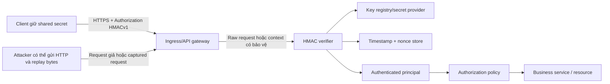

# Thiết kế authorization scheme cho HMAC request authentication

## 1. Vì sao phải thiết kế một authorization scheme thay vì tự thêm một chữ ký rời rạc?

Module `SECURITY_AUTHENTICATION_HMAC_REQUEST_AUTHENTICATION` nghiên cứu cách **xác thực HTTP request bằng HMAC** dựa trên shared secret và canonical request, bao gồm method, URI, signed headers hoặc raw body digest. Một hệ thống an toàn còn phải xác minh chữ ký phía server, chống replay với timestamp/nonce, quản lý key rotation, xử lý proxy/gateway và **phân biệt authentication với authorization**.

Chủ đề **“Thiết kế authorization scheme”**, thuộc chương **“Authorization header”**, đặt một câu hỏi rất cụ thể: *Client sẽ chuyển thông tin định danh key, timestamp, nonce và chữ ký HMAC qua header `Authorization` theo quy tắc nào để server parse, xác minh và nâng cấp giao thức được?*

Một hệ thống tự thiết kế thiếu hợp đồng có thể tạo ra các request như sau:

```http
Authorization: abc123
Authorization: HMAC <some-random-parameters>
X-Signature: ...
X-Key-Id: ...
X-Algorithm: SHA-1
```

Các cách làm trên mơ hồ: `abc123` là gì, encoding nào, tên scheme nào, có cần timestamp/nonce không, header nào được ký, HMAC tính từ raw URI hay decoded URI, có cho client đổi algorithm không, và server xử lý duplicate `Authorization` như thế nào? Nếu mỗi SDK và gateway tự hiểu một kiểu, rất dễ có **signature mismatch**, **parser differential** hoặc **authentication bypass**.

HTTP đã có khuôn khổ để mang credentials: header `Authorization` gồm **authentication scheme** và dữ liệu credentials theo scheme ấy. Ta có thể định nghĩa một scheme riêng, ví dụ `HMACv1`, với cú pháp tham số, semantic và quy tắc HMAC chính xác.

Ví dụ định dạng mục tiêu của bài:

```http
POST /v1/tenants/t-42/payments?mode=instant HTTP/1.1
Host: api.example.test
Content-Type: application/json
Authorization: HMACv1 keyid="merchant-42:k3", timestamp="1767268800", nonce="7d46b2dd65d618a32ba74de99da88d80", signedheaders="content-type", signature="<padded-base64-hmac-sha256>"

{"amountMinor":125000,"currency":"VND"}
```

Đoạn trên là **minh họa**, `signature` là placeholder và timestamp tương ứng một thời điểm fixture lịch sử, không thể gửi nguyên dạng để xác minh HMAC trong production. Bài sẽ giải thích cách biến ý tưởng này thành một **wire contract hoàn chỉnh**, có code Java 17+ và kiểm thử.

> **Phân biệt cốt lõi:** Header tên `Authorization` chủ yếu **chuyển credentials phục vụ authentication**. Việc client gửi `Authorization: HMACv1 ...` và server xác minh thành công **không có nghĩa client đã được authorization** để đọc/ghi tài nguyên. Quyền được xác định riêng theo principal đã xác thực, action và resource thực tế.

### Mục tiêu học tập

Sau bài này, bạn có thể:

1. Phân biệt HTTP **auth-scheme**, `Authorization`, `WWW-Authenticate`, `Proxy-Authorization` và quyết định authorization của ứng dụng.
2. Thiết kế tên scheme, bộ auth-param bắt buộc, cú pháp encoding và cách xử lý parameter trùng/thiếu/không rõ.
3. Ràng buộc scheme `HMACv1` với **canonical version, HMAC algorithm, key policy, audience và signed headers** do server kiểm soát.
4. Định nghĩa những phần của `Authorization` được **đưa vào canonical bytes**, tránh ký chính `signature` gây phụ thuộc vòng.
5. Viết Java 17+ cho parser auth-param, canonical builder, client signer và lắp ghép verifier không tự bỏ qua kiểm soát bảo mật.
6. Xử lý HTTP 401/403/407, challenge, lỗi malformed credentials, nhiều scheme và key rotation.
7. Kiểm thử request qua proxy, HTTP/2 gateway, TLS termination, duplicate headers, timestamp/nonce/replay, và authorization.

## 2. HTTP authentication framework: bốn khái niệm thường bị gọi chung là “authorization”

HTTP dùng thuật ngữ **authentication scheme** để phân loại cách credentials được gửi trong `Authorization`. Ví dụ quen thuộc:

```http
Authorization: Basic <base64-user-colon-password>
Authorization: Bearer <access-token>
Authorization: HMACv1 keyid="merchant-42:k3", timestamp="...", nonce="...", signedheaders="content-type", signature="..."
```

Các scheme này **khác cơ chế**:

- **Basic** truyền cặp username/password qua một dạng encoding; Base64 **không mã hóa bí mật**.
- **Bearer** dùng token sở hữu: ai có token và đáp ứng policy có thể trình token đó; không mặc định có HMAC ràng buộc HTTP request/body.
- **HMACv1** trong bài đòi phía client **tính MAC riêng cho từng HTTP request**, từ shared secret và canonical bytes; không gửi shared secret.

Bản thân tên `HMACv1` chỉ là **nhãn scheme** để verifier chọn parser/contract. Nó không làm HMAC mạnh hơn hoặc tự chặn replay. Sức mạnh đến từ HMAC algorithm đúng, secret đủ entropy, signed fields nhất quán, freshness, nonce state và phân quyền.

### 2.1 Authorization header và authorization decision không giống nhau

| Thành phần | Vai trò | Chưa đủ để chứng minh điều gì? |
| --- | --- | --- |
| `Authorization: HMACv1 ...` | Mang credentials và tham số ký của request | Chưa chứng minh MAC hợp lệ, key còn hiệu lực hoặc có quyền. |
| `keyid` | Cho server tìm đúng key metadata/secret | Chỉ là định danh **do client khai**, chưa phải principal. |
| `signature` | HMAC tag được encode để gửi trên HTTP | Chưa hợp lệ nếu chưa được server tự tính expected MAC. |
| `timestamp` và `nonce` | Cung cấp dữ liệu chống replay, được đưa vào HMAC | Timestamp không tự chứng minh đúng giờ; nonce không tự chứng minh chưa dùng. |
| **Authenticated principal** | Danh tính gắn với key metadata **sau verify** | Chưa chứng minh có quyền trên mọi tenant/resource. |
| **Authorization policy** | Quyết định principal có thể thực hiện action trên resource | Không thay HMAC authentication và chống replay. |

Ví dụ merchant `merchant-42` dùng HMAC đúng để gọi `POST /v1/tenants/t-99/payments`. Chữ ký có thể hoàn toàn hợp lệ vì merchant biết secret. Tuy nhiên nếu merchant chỉ được phép truy cập `t-42`, backend **phải trả lỗi thiếu quyền**. Việc path đã được ký không làm path trở thành một **grant**.

### 2.2 Những HTTP header và mã lỗi cần biết

| HTTP thành phần | Công dụng |
| --- | --- |
| `Authorization` (request) | Credentials của client dành cho origin server hoặc hệ thống đứng vai trò verifier. |
| `WWW-Authenticate` (response) | Server đưa ra challenge cho scheme được hỗ trợ, thường dùng cùng `401 Unauthorized`. |
| `401 Unauthorized` | Dù tên lịch sử có chữ “Unauthorized”, thực chất dùng cho tình huống **thiếu hoặc chưa hợp lệ credentials**. Response `401` theo HTTP authentication framework cần challenge phù hợp. |
| `403 Forbidden` | Server hiểu request nhưng từ chối thực hiện, thường do **không đủ quyền** sau authentication. |
| `Proxy-Authenticate` và `Proxy-Authorization` | Authentication giữa client và **HTTP proxy** theo HTTP framework, không phải credentials origin-server HMAC mặc định. |
| `407 Proxy Authentication Required` | Proxy yêu cầu proxy authentication, không nhầm với `401` của API origin. |

Ví dụ challenge tổng quát:

```http
HTTP/1.1 401 Unauthorized
WWW-Authenticate: HMACv1 realm="payments-api"
Cache-Control: no-store
Content-Type: application/problem+json

{"type":"authentication_required","detail":"Valid request authentication is required"}
```

`realm` chỉ là nhãn vùng bảo vệ do server định nghĩa, **không** chứa shared secret, key ID tồn tại, expected signature, salt hay danh tính người dùng. Scheme HMAC thường cần tài liệu hợp đồng/provisioning bên ngoài challenge; đừng nhét secret hoặc nội dung canonical vào `WWW-Authenticate`.

**Lưu ý:** Không phải mọi lỗi đều cần trả thông tin phân biệt `unknown_key`, `revoked_key`, `bad_mac` hoặc `nonce_replayed` cho client. Trả lỗi xác thực chung và ghi telemetry nội bộ giúp hạn chế key enumeration; tuy vậy lỗi dependency như vault/nonce store unavailable có thể cần phản hồi 503 theo policy **fail-closed**.

## 3. Threat model và yêu cầu đối với HMAC Authorization scheme

Thiết kế scheme cần bắt đầu từ các khả năng của người gửi và hệ thống trung gian.

### 3.1 Đối tượng và bề mặt tấn công



Attacker có thể:

- Gửi một `Authorization` header tự chế với key ID ngẫu nhiên, chữ ký giả, tham số lạ, duplicate params hoặc chuỗi rất dài;
- Gửi hai header `Authorization` khác case hoặc một header có danh sách giá trị mà framework tự gộp;
- Thay method, URL, query, body, `Content-Type` hoặc một tham số auth **không được ký**;
- Copy nguyên một request đã ký rồi **replay** trong time window;
- Tác động qua proxy/gateway làm rewrite raw URI/query, HTTP/2 `:path` hoặc header;
- Thử dùng một key hợp lệ ở **audience/tenant khác**;
- Thử ép verifier hỗ trợ một scheme/algorithm/canonical version yếu;
- Đọc được log/APM khi `Authorization` vô tình bị ghi ra ngoài.

Một client **hợp lệ** còn có thể chủ ý ký request tới tài nguyên ngoài quyền được cấp. Vì vậy phải có lớp authorization sau authentication. Nếu shared secret bị lộ, attacker có thể **ký request mới**, không chỉ replay request cũ: cần revoke key và audit.

### 3.2 Các yêu cầu không thể bỏ qua

1. **Một scheme định danh rõ:** dùng `HMACv1`, không suy algorithm hoặc version từ một chuỗi tự do do client khai.
2. **Đúng một `Authorization` header:** từ chối duplicate ở ingress trước khi framework mất thông tin occurrences.
3. **Strict grammar, bounded input:** parser giới hạn độ dài, ASCII/control characters, auth-param names/values; reject duplicate, unknown hoặc thiếu required params.
4. **Metadata quyết định key:** key ID chỉ là selector; secret, principal, audience, algorithm, canonical version và trạng thái key từ registry đáng tin.
5. **Canonical byte contract độc lập:** method, raw URI, signed header values, Authorization params và body được đưa vào **đúng byte**.
6. **Không ký nguyên header `Authorization`:** trường `signature` là kết quả HMAC nên sẽ gây phụ thuộc vòng; ký **những auth params cần thiết** theo dòng canonical.
7. **MAC bytes được so timing-safe:** decode Base64, yêu cầu full HMAC-SHA256 32 byte, so bằng `MessageDigest.isEqual`.
8. **Chống replay:** timestamp được ký, nonce được ký và reserve nguyên tử trong kho chung; clock health/TTL đúng.
9. **Không lộ credentials:** HTTPS, lọc log, quản lý secret, cache HTTP response đúng policy.
10. **Authentication không cấp quyền:** authorization đọc resource thực tế sau routing và kiểm tra principal/current policy.

## 4. Chọn wire format: `Authorization: HMACv1 ...`

HTTP authentication framework có dạng khái niệm:

```abnf
Authorization = credentials
credentials   = auth-scheme [ SP ( token68 / #auth-param ) ]
```

Trong bài, scheme `HMACv1` sử dụng **danh sách auth-param** (`name=value`, giá trị được quote) chứ không dùng `token68` đơn. Đây là **scheme tự định nghĩa để giảng dạy**, không phải chuẩn công khai mà một server bất kỳ bắt buộc hiểu.

### 4.1 Dạng gửi đề xuất

```http
Authorization: HMACv1 keyid="merchant-42:k3", timestamp="1767268800", nonce="7d46b2dd65d618a32ba74de99da88d80", signedheaders="content-type", signature="<base64-padded-tag>"
```

Các thành phần:

| Auth-param | Bắt buộc? | Format hợp đồng | Ý nghĩa |
| --- | --- | --- | --- |
| `keyid` | Có | `[A-Za-z0-9._:-]{1,100}` | Exact lookup key metadata; **không** phải secret. |
| `timestamp` | Có | `(0|[1-9][0-9]{0,11})` | Unix epoch **seconds**, không phải milliseconds. |
| `nonce` | Có | `[0-9a-f]{32}` | 16 byte ngẫu nhiên, encoded lowercase hex; mới cho mỗi attempt. |
| `signedheaders` | Có | Chính xác `content-type` trong AUTHZ-V1 | Khai báo tập signed HTTP headers đã được server ghim. |
| `signature` | Có | Base64 chuẩn có padding của **32 byte** HMAC-SHA256 | HMAC tag cuối; **không đưa nguyên value này vào canonical**. |

Hợp đồng này dùng tên auth-param **lowercase khi client serialize**. HTTP auth-param names và auth-scheme được xử lý **không phân biệt ASCII hoa/thường**; server normalize tên để kiểm tra, nhưng **không lowercase values** (key ID có thể phân biệt case). Thứ tự các auth-param không mang ý nghĩa mật mã; parser có thể chấp nhận thứ tự khác nếu mỗi param duy nhất và đúng format. Canonical request dùng **thứ tự cố định** do version, **không** dùng thứ tự xuất hiện trên wire.

### 4.2 Vì sao dùng quoted-string cho giá trị?

Ví dụ signature Base64 có thể chứa `+`, `/` và dấu `=` padding. Khi đặt trong dấu nháy kép, scheme dễ định nghĩa một biểu diễn transport rõ ràng. Nhưng **quoted-string có quy tắc escaping riêng**; không được vô tư `split(",")` hoặc `split("=")` cho mọi dạng header.

AUTHZ-V1 cố ý yêu cầu:

- Mỗi giá trị nằm trong một cặp dấu `"..."`.
- Chỉ chấp nhận các ký tự thuộc **allowlist riêng của từng tham số** sau parse.
- Không có comma, quote, backslash, CRLF, ký tự control hoặc UTF-8 mở rộng trong các giá trị AUTHZ-V1.
- Parser có thể reject `quoted-pair` có backslash, kể cả HTTP grammar rộng hơn cho phép; đó là **ràng buộc phiên bản scheme**.
- Cho phép dấu comma phân cách **các auth-param bên ngoài chuỗi quote**, với optional SP/HTAB đã kiểm soát.
- Không nhận parameter thừa, lặp, rỗng hoặc token68 không có key-value.

Đừng nhầm HTTP auth-param với **HTTP Structured Fields**: `Authorization` ở đây thuộc HTTP authentication framework và scheme-defined grammar; không tự áp một thư viện parser Structured Fields rồi mặc định kết quả tương đương.

### 4.3 Không để client tự khai algorithm hoặc canonical version

Đừng thêm:

```http
Authorization: HMACv1 keyid="merchant-42:k3", algorithm="HmacSHA1", canonical="legacy-v0", ...
```

Nếu client điều khiển algorithm/version, attacker có thể thử đường downgrade hoặc tìm một canonicalizer cũ bỏ qua body/header quan trọng. Trong bài, `HMACv1` ánh xạ đến **hợp đồng AUTHZ-V1** và **HmacSHA256**; key metadata phía server phải khớp cả hai. Muốn thay đổi cơ chế, thiết kế `HMACv2` với golden vectors, migration policy và key pinning rõ ràng.

**Không có “default secret”** nếu key ID không tồn tại. Không thử lần lượt nhiều key để tìm cái nào verify pass. Một key ID tương ứng **đúng một key record** có principal/audience và trạng thái verify.

### 4.4 Một số cách encode nên tránh

| Cách làm | Vấn đề |
| --- | --- |
| `Authorization: HMAC <base64(secret:signature)>` | Có nguy cơ **gửi secret** lên wire; Base64 không mã hóa. |
| `Authorization: HMACv1 a=b,c=d` nhưng parser tự split tùy tiện | Dễ sai với quoted value/escaping hoặc duplicate param. |
| `Authorization: HMACv1 <keyid>:<signature>` | Cần hợp đồng escaping/delimiter phức tạp, thiếu timestamp/nonce. |
| `Authorization: Bearer <hmac-tag>` | Trộn hai authentication semantics; HMAC tag không mặc nhiên là bearer token độc lập. |
| `X-HMAC-Signature` không ràng buộc scheme/key policy | Khó versioning, dễ nhầm khi gateway/Bearer middleware song song. |
| `Authorization` có hai occurrences | Một lớp chọn first, lớp khác chọn last → parser differential. |
| Giữ lại `signature` trong chính canonical header | Phụ thuộc vòng, không có cách tính nhất quán. |

## 5. Xử lý nhiều scheme, nhiều header và challenge

Một API có thể chấp nhận `Bearer` cho người dùng và `HMACv1` cho đối tác, nhưng nên quyết định **theo endpoint/trust policy**, không “thử mọi cách cho đến khi xác thực được”.

### 5.1 Lựa chọn scheme là một quyết định bảo mật

Ví dụ chính sách:

```text
POST /v1/tenants/{tenant}/payments
  required authentication scheme: HMACv1
  version: AUTHZ-V1
  key metadata audience: payments-api/prod

GET /v1/me
  required authentication scheme: Bearer
  token issuer/audience/scopes: server-side policy
```

Nếu client gửi Bearer token tới endpoint yêu cầu HMAC, server **từ chối** theo route policy. Không tự downgrade `Bearer → Basic → HMAC cũ`, không tự cho một header thay thế như `X-API-Key` đủ để bypass ký body.

### 5.2 Header duplicate và comma coalescing

HTTP field names không phân biệt ASCII hoa/thường. Hãy từ chối:

```http
Authorization: HMACv1 keyid="merchant-42:k3", ...
authorization: Bearer abcdef
```

Một HTTP adapter chỉ trả một `String` hoặc tự gộp headers có thể đã mất thông tin quan trọng. Tầng ingress nên lấy **số occurrences của Authorization**, yêu cầu **đúng một** và cấm trường hợp comma-joined credentials giả mạo. Trong ví dụ của bài, dấu comma hợp lệ chỉ là **dấu phân cách auth-param bên trong một credential**, không phải phép nối hai `Authorization` credentials.

Đừng dựa vào `getFirst()` khi chưa kiểm tra duplicate. Nếu framework/gateway không cho quan sát multiple occurrences, đặt kiểm tra tại **earliest trusted HTTP parser** rồi chuyển một biểu diễn đã validated vào verifier.

### 5.3 401, 403 và 407 không nên bị trộn

```text
Header thiếu/sai scheme:
  401 + WWW-Authenticate: HMACv1 realm="payments-api"

MAC sai, key không hợp lệ, timestamp/nonce replay:
  lỗi authentication theo policy, thường 401 + challenge chung

HMAC/time/nonce pass nhưng principal thiếu quyền tenant:
  403 hoặc 404 tùy resource-disclosure policy

Proxy cần credential để client dùng proxy:
  407 + Proxy-Authenticate; KHÔNG thay scheme origin-server HMAC
```

Một phản hồi 401 **không được** gửi kèm expected MAC, raw canonical request chứa dữ liệu nhạy cảm, danh sách key IDs hoặc thông điệp “key bị thu hồi lúc ...”. Phân loại chi tiết có thể ghi trong telemetry nội bộ đã được bảo vệ. `WWW-Authenticate` có thể có nhiều challenges nếu server thật sự hỗ trợ nhiều schemes, nhưng endpoint nhạy cảm nên hạn chế ambiguity/downgrade.

## 6. Contract AUTHZ-V1: những bytes nào được ký?

Đây là hợp đồng mẫu hoàn chỉnh dùng cho bài học, tên canonical là `HMAC-REQUEST/AUTHZ-V1` và wire scheme là `HMACv1`. **Hai nhãn có ý nghĩa khác nhau:** wire scheme chọn parser; canonical version phân tách domain chữ ký và ghim thứ tự/delimiters.

### 6.1 Quy tắc từng thành phần

| Thuộc tính | Quy tắc AUTHZ-V1 |
| --- | --- |
| Method | `POST` đúng method thực gửi, không method override. |
| Raw target | Origin-form `/v1/tenants/t-42/payments?mode=instant`; **không** mang scheme/host/fragment. |
| URI/query canonicalization | Giữ raw path/query đúng percent-encoding và thứ tự; validate/reject ambiguous paths/duplicate security-sensitive query. |
| Audience | `payments-api/prod` **lấy từ server config và key metadata**, không tin `Host` hoặc `X-Forwarded-Host` do client tự khai. |
| Signed HTTP headers | Chính xác `content-type` trong AUTHZ-V1; header singleton, canonical value `application/json`. |
| Authorization auth params | `keyid`, `timestamp`, `nonce`, `signedheaders` đều có dòng canonical; `signature` **không**. |
| Body | Raw application bytes sau HTTP framing, trước mọi content transform; mẫu **từ chối Content-Encoding**. |
| Body size | Số byte thực tế `bodyBytes.length`, decimal ASCII. |
| Body digest | SHA-256(raw body bytes), 64 lowercase hex. |
| HMAC | `HmacSHA256`, raw tag **32 byte**; JCA `Mac`. |
| Signature text | Base64 standard padded, đúng 44 ASCII ký tự, strict decode/re-encode. |
| Timestamp | Unix epoch seconds ASCII canonical, signed, có policy cửa sổ [-300s,+30s] minh họa. |
| Nonce | 128-bit CSPRNG, 32 hex lowercase, signed, reserve nguyên tử theo principal+audience. |
| Canonical bytes | UTF-8, **12 dòng** nối bằng LF `0x0A`, **không thêm LF cuối**. |

**Không ký cả header Authorization dạng raw text.** Auth-param names/ordering/OWS là cú pháp vận chuyển có thể khác nhau; verifier parse ra **giá trị đã validate**, rồi đưa đúng chúng vào các dòng canonical cố định. Scheme case-insensitive hợp lệ vẫn ánh xạ tới cùng canonical version nếu key policy cho phép.

### 6.2 Canonical request: chính xác 12 dòng

```text
HMAC-REQUEST/AUTHZ-V1
HMAC-SHA256
POST
/v1/tenants/t-42/payments?mode=instant
audience:payments-api/prod
content-type:application/json
auth-keyid:merchant-42:k3
auth-timestamp:1767268800
auth-nonce:7d46b2dd65d618a32ba74de99da88d80
auth-signedheaders:content-type
body-size:<so-byte-body-thuc>
body-sha256:<sha256-hex-cua-body-thuc>
```

Hai dòng `body-size`/`body-sha256` ở trên chỉ là **template**; trước khi ký phải thay placeholder bằng giá trị **tính từ raw body bytes** đã đóng băng. Không thêm số thứ tự, space đầu/cuối, dấu CR, BOM hoặc newline cuối. Tên các dòng `auth-...` là cố định theo version; không phụ thuộc cách viết hoa tên auth-param trên wire.

### 6.3 Tại sao không ký `signature`?

Nếu đưa raw header `Authorization` gồm `signature=S` vào chính canonical, ta cần:

```text
S = HMAC(secret, canonical(..., S, ...))
```

Đây là quan hệ **tự tham chiếu** không thuộc hợp đồng HMAC request signing bình thường. Thay vào đó:

```text
1) Freeze method, raw URI, Content-Type, body, keyid, timestamp, nonce.
2) Canonicalize vào đúng 12 dòng (KHÔNG có signature).
3) HMAC-SHA256(secret, canonicalBytes) -> raw tag 32 bytes.
4) Base64 padded -> signature text.
5) Đặt signature text vào Authorization header.
6) Server parse header, tự canonicalize request thực nhận và so tag.
```

Mặt khác, **key ID và timestamp/nonce vẫn phải được ký**. Nếu chỉ ký method/URI/body rồi để timestamp hoặc nonce ngoài MAC, attacker có thể sửa giá trị đó để né chính sách replay.

### 6.4 Nếu service cần ký thêm header

Giả sử API dùng `X-Tenant-Id`, `Idempotency-Key`, `X-Target-Account` hoặc header đổi phương thức/hành vi:

- Nếu chúng ảnh hưởng **resource, tenant, side effect hay kết quả**, phải được bảo vệ theo canonical contract hoặc bị cấm/kiểm soát an toàn tương đương.
- Hợp đồng AUTHZ-V1 **không** cho các header nghiệp vụ như vậy ở ví dụ thanh toán; tenant nằm trong **raw target** đã ký, nhưng **vẫn phải authorization theo principal**.
- Khi thêm header mới, ban hành một **version mới** với signed header manifest và golden vectors cập nhật.
- Đừng cho client tự chọn `signedheaders="content-type"` để loại bỏ một header bắt buộc; server cần **pin manifest** theo version/key.

**Đặc biệt:** Header `Idempotency-Key` không được dùng để trả kết quả nghiệp vụ cũ khi nó chưa được ký/ràng buộc. Nếu API hỗ trợ retry thanh toán an toàn, nâng sang contract có signed idempotency key hoặc cơ chế server-side được thiết kế đầy đủ.

## 7. Đi từng bước qua một request HMACv1

### 7.1 Request snapshot

Client định gửi:

```http
POST /v1/tenants/t-42/payments?mode=instant HTTP/1.1
Host: api.example.test
Content-Type: application/json
Authorization: HMACv1 keyid="merchant-42:k3", timestamp="1767268800", nonce="7d46b2dd65d618a32ba74de99da88d80", signedheaders="content-type", signature="<computed-padded-base64>"

{"amountMinor":125000,"currency":"VND"}
```

Client cần serialize body **một lần**, thu byte UTF-8 đúng như gửi. Không hash một Java `Map`/object rồi để thư viện HTTP serialize lại với whitespace/order khác.

### 7.2 Chuẩn bị body digest

```java
import java.nio.charset.StandardCharsets;
import java.security.MessageDigest;
import java.util.HexFormat;

byte[] body = "{\"amountMinor\":125000,\"currency\":\"VND\"}"
        .getBytes(StandardCharsets.UTF_8);

int bodySize = body.length;
String digest = HexFormat.of().formatHex(
        MessageDigest.getInstance("SHA-256").digest(body));
```

`bodySize` đếm **byte**, không phải `String.length()` của Java. Body có tiếng Việt/emoji sẽ có byte count khác số Java UTF-16 code units; body nhị phân vẫn hash raw bytes.

### 7.3 Canonical không có raw Authorization header

Sau khi tính digest, canonical request:

```text
HMAC-REQUEST/AUTHZ-V1
HMAC-SHA256
POST
/v1/tenants/t-42/payments?mode=instant
audience:payments-api/prod
content-type:application/json
auth-keyid:merchant-42:k3
auth-timestamp:1767268800
auth-nonce:7d46b2dd65d618a32ba74de99da88d80
auth-signedheaders:content-type
body-size:<thay-bang-body.length>
body-sha256:<thay-bang-hex-SHA256-body>
```

Hai placeholder chỉ là chú thích. Không dùng nguyên chuỗi này để ký. Trong code thực tế:

```text
canonicalText  = String.join("\n", exactly12Lines)
canonicalBytes = canonicalText.getBytes(UTF_8)
macBytes       = HMAC_SHA256(secretBytes, canonicalBytes)
signatureText  = Base64.getEncoder().encodeToString(macBytes)
```

### 7.4 Server verify một cách độc lập

1. Ingress xác nhận **đúng một** Authorization header và body size/framing hợp lệ.
2. Parser nhận `HMACv1` và đúng năm auth params; reject duplicate, unknown, malformed.
3. Server tra `keyid` **exact** để lấy key metadata/secret, version `AUTHZ-V1`, algorithm `HmacSHA256`, audience `payments-api/prod`, key status và principal.
4. Server lấy HTTP method, **raw target**, `Content-Type` và raw body **thực nhận**. Dựng đúng 12 canonical lines bằng rule của mình, không tin canonical text từ client.
5. Strict-decode `signature` thành đúng 32 byte; tính expected HMAC và so bằng `MessageDigest.isEqual`.
6. Kiểm tra time window theo clock đáng tin, trạng thái key chưa bị revoke, reserve nonce bằng atomic store.
7. Chỉ sau đó mới tạo authenticated principal và kiểm tra **authorization trên tenant/resource thực tế**.

**Không thử** nhiều canonical formats, nhiều secrets hoặc bỏ body hash để làm request pass khi lỗi do gateway/encoding. Mọi thay đổi hợp đồng cần version rõ ràng.

## 8. Java 17+: parser chặt cho auth-param của HMACv1

Mã sau viết một parser **giới hạn vào AUTHZ-V1**, không nhằm thay thế một thư viện HTTP grammar tổng quát. Nó:

- Nhận **một** header value; caller đã phải reject duplicate `Authorization` occurrences.
- Chấp nhận scheme và **tên tham số không phân biệt ASCII hoa/thường**.
- Parse `name="value"` với comma separators và optional SP/HTAB, **không** làm `split(",")` đơn giản.
- Reject quote/backslash/control/newline/Unicode mở rộng, duplicate/unknown/missing params.
- Validate giá trị theo allowlist và yêu cầu signature đúng 44 ký tự Base64 standard padded.
- Không kết luận HMAC hợp lệ: đây mới là **syntax parser**.

### 8.1 `HmacAuthorizationV1`

```java
import java.util.HashMap;
import java.util.Locale;
import java.util.Map;
import java.util.Set;

public final class HmacAuthorizationV1 {
    private HmacAuthorizationV1() {}

    public record Credentials(
            String keyId,
            String timestamp,
            String nonce,
            String signedHeaders,
            String signature) {}

    private static final Set<String> REQUIRED =
            Set.of("keyid", "timestamp", "nonce",
                   "signedheaders", "signature");

    public static Credentials parse(String input) {
        if (input == null || input.isEmpty() || input.length() > 1024) {
            throw new IllegalArgumentException("Bad Authorization size");
        }
        // Bản AUTHZ-V1 cố ý chỉ nhận ASCII không control.
        for (int k = 0; k < input.length(); k++) {
            char c = input.charAt(k);
            if (c == '\r' || c == '\n' || c < 0x20 || c > 0x7e) {
                if (c != '\t') {
                    throw new IllegalArgumentException(
                            "Invalid Authorization character");
                }
            }
        }

        int pos = 0;
        // Scheme HMACv1: token ASCII, đối chiếu case-insensitive.
        while (pos < input.length()
                && (asciiAlphaNum(input.charAt(pos))
                    || input.charAt(pos) == '-')) pos++;

        if (!"HMACv1".equalsIgnoreCase(input.substring(0, pos))) {
            throw new IllegalArgumentException("Wrong authentication scheme");
        }
        if (pos == input.length() || input.charAt(pos) != ' ') {
            throw new IllegalArgumentException("Missing scheme separator");
        }

        pos = skipOws(input, pos);
        Map<String, String> params = new HashMap<>();
        while (pos < input.length()) {
            int nameStart = pos;
            if (!asciiLetter(input.charAt(pos))) {
                throw new IllegalArgumentException("Missing auth-param name");
            }
            pos++;
            while (pos < input.length()
                    && (asciiAlphaNum(input.charAt(pos))
                        || input.charAt(pos) == '-')) pos++;

            String name = input.substring(nameStart, pos)
                    .toLowerCase(Locale.ROOT);
            if (!REQUIRED.contains(name) || params.containsKey(name)) {
                throw new IllegalArgumentException(
                        "Unknown/duplicate auth-param");
            }

            pos = skipOws(input, pos);
            if (pos >= input.length() || input.charAt(pos++) != '=') {
                throw new IllegalArgumentException("Missing equals");
            }
            pos = skipOws(input, pos);
            if (pos >= input.length() || input.charAt(pos++) != '"') {
                throw new IllegalArgumentException("Expected quoted value");
            }

            int valueStart = pos;
            while (pos < input.length() && input.charAt(pos) != '"') {
                char ch = input.charAt(pos++);
                // Contract values cannot contain commas/escaping/OWS.
                if (ch < 0x21 || ch > 0x7e
                        || ch == '\\' || ch == ',') {
                    throw new IllegalArgumentException("Bad value character");
                }
            }
            if (pos >= input.length()) {
                throw new IllegalArgumentException("Unclosed quoted value");
            }
            String value = input.substring(valueStart, pos++);
            params.put(name, value);

            pos = skipOws(input, pos);
            if (pos == input.length()) break;
            if (input.charAt(pos++) != ',') {
                throw new IllegalArgumentException("Expected comma");
            }
            pos = skipOws(input, pos);
            if (pos == input.length()) {
                throw new IllegalArgumentException("Trailing comma");
            }
        }

        if (!params.keySet().equals(REQUIRED)) {
            throw new IllegalArgumentException("Missing auth-param");
        }

        String key = params.get("keyid");
        String time = params.get("timestamp");
        String nonce = params.get("nonce");
        String signed = params.get("signedheaders");
        String sig = params.get("signature");

        if (!key.matches("[A-Za-z0-9._:-]{1,100}")
                || !time.matches("(0|[1-9][0-9]{0,11})")
                || !nonce.matches("[0-9a-f]{32}")
                || !"content-type".equals(signed)
                || !sig.matches("[A-Za-z0-9+/]{43}=")) {
            throw new IllegalArgumentException("Invalid auth-param format");
        }

        return new Credentials(key, time, nonce, signed, sig);
    }

    private static int skipOws(String value, int pos) {
        while (pos < value.length()
                && (value.charAt(pos) == ' '
                    || value.charAt(pos) == '\t')) pos++;
        return pos;
    }

    private static boolean asciiLetter(char ch) {
        return ch >= 'A' && ch <= 'Z' || ch >= 'a' && ch <= 'z';
    }

    private static boolean asciiAlphaNum(char ch) {
        return asciiLetter(ch) || ch >= '0' && ch <= '9';
    }
}
```

**Giới hạn và điều kiện vận hành của parser:**

- Parser này **không** nhận đầy đủ mọi dạng `quoted-string` mà HTTP authentication grammar có thể cho phép; nó cố ý dùng **subset an toàn** của AUTHZ-V1. Khi nâng version cần cập nhật và kiểm thử riêng, không âm thầm “parse rộng hơn”.
- Scheme `HMACv1` và param names được đối chiếu không phân biệt ASCII case; values vẫn **case-sensitive**. `merchant-42:k3` và `Merchant-42:k3` là **hai key ID** nếu registry quy định vậy.
- Dấu tab chỉ được chấp nhận ở vùng **OWS**, không nằm trong giá trị quoted-string.
- Chữ ký regex có đúng độ dài và alphabet nhưng parser **chưa xác minh padding bits canonical**. Bước verify vẫn cần Base64 decode + re-encode để chỉ chấp nhận một biểu diễn.
- Parser được gọi **sau** kiểm tra số Authorization header occurrences; không tự sửa hoặc gộp duplicate headers.
- Các control characters, obs-fold/CRLF, escaped quotes, comma bên trong value, unknown param và trailing comma đều bị reject thay vì đoán.
- Việc parse strict là **tiền xử lý trên input chưa xác thực**. Không dùng `Credentials.keyId()` làm principal cho business và không log toàn bộ `input`.

### 8.2 Thử parser bằng vài dữ liệu đầu vào

```java
String good =
    "HMACv1 keyid=\"merchant-42:k3\", "
  + "timestamp=\"1767268800\", "
  + "nonce=\"7d46b2dd65d618a32ba74de99da88d80\", "
  + "signedheaders=\"content-type\", "
  + "signature=\"AAAAAAAAAAAAAAAAAAAAAAAAAAAAAAAAAAAAAAAAAAA=\"";

HmacAuthorizationV1.Credentials c =
        HmacAuthorizationV1.parse(good);

if (!c.keyId().equals("merchant-42:k3")
        || !c.signedHeaders().equals("content-type")
        || c.signature().length() != 44) {
    throw new AssertionError("Parser contract mismatch");
}

// Cố ý thiếu nonce => IllegalArgumentException.
String bad =
    "HMACv1 keyid=\"merchant-42:k3\", "
  + "timestamp=\"1767268800\", signedheaders=\"content-type\", "
  + "signature=\"AAAAAAAAAAAAAAAAAAAAAAAAAAAAAAAAAAAAAAAAAAA=\"";
```

Chuỗi `good` chứa **signature giả đúng format**, không phải HMAC hợp lệ. `parse` pass chỉ chứng minh syntax; nếu dùng secret thật mà signature này không khớp expected MAC, verifier **bắt buộc từ chối**.

## 9. Java 17+: canonical builder và client signer HMACv1

Để test chính xác “những byte nào được ký”, ta tách:

- `AuthzCanonicalV1.build(...)`: server/client có thể dùng contract **về mặt mô tả** nhưng implementation cần test độc lập.
- `AuthzRequestSignerV1.sign(...)`: client chuẩn bị snapshot và tạo `Authorization` value.

Mã dưới là mẫu học thuật tương thích Java 17. Endpoint cố định và giới hạn raw URI; production cần HTTP adapter có khả năng lấy đúng **raw request target ở trust boundary** và chống parser differential.

### 9.1 `AuthzCanonicalV1`: 12 dòng UTF-8/LF

```java
import java.net.URI;
import java.nio.charset.StandardCharsets;
import java.security.GeneralSecurityException;
import java.security.MessageDigest;
import java.util.HexFormat;
import java.util.Objects;

public final class AuthzCanonicalV1 {
    public static final String AUDIENCE = "payments-api/prod";
    public static final String SIGNED_HEADERS = "content-type";

    private AuthzCanonicalV1() {}

    public static byte[] build(
            String method,
            String rawTarget,
            String contentType,
            String keyId,
            String timestamp,
            String nonce,
            byte[] bodyBytes) {

        Objects.requireNonNull(bodyBytes, "bodyBytes");
        if (!"POST".equals(method)
                || !"application/json".equals(contentType)
                || keyId == null
                || !keyId.matches("[A-Za-z0-9._:-]{1,100}")
                || timestamp == null
                || !timestamp.matches("(0|[1-9][0-9]{0,11})")
                || nonce == null
                || !nonce.matches("[0-9a-f]{32}")) {
            throw new IllegalArgumentException("Invalid signed input");
        }

        validateTarget(rawTarget);

        final String digest;
        try {
            digest = HexFormat.of().formatHex(
                    MessageDigest.getInstance("SHA-256")
                            .digest(bodyBytes));
        } catch (GeneralSecurityException unavailable) {
            throw new IllegalStateException(
                    "SHA-256 not available", unavailable);
        }

        String canonicalText = String.join("\n",
                "HMAC-REQUEST/AUTHZ-V1",
                "HMAC-SHA256",
                method,
                rawTarget,
                "audience:" + AUDIENCE,
                "content-type:" + contentType,
                "auth-keyid:" + keyId,
                "auth-timestamp:" + timestamp,
                "auth-nonce:" + nonce,
                "auth-signedheaders:" + SIGNED_HEADERS,
                "body-size:" + bodyBytes.length,
                "body-sha256:" + digest);

        return canonicalText.getBytes(StandardCharsets.UTF_8);
    }

    private static void validateTarget(String rawTarget) {
        if (rawTarget == null
                || rawTarget.length() > 4096
                || !rawTarget.startsWith("/")
                || rawTarget.startsWith("//")
                || rawTarget.chars().anyMatch(ch ->
                       ch < 0x21 || ch > 0x7e
                       || ch == '#' || ch == '\\')) {
            throw new IllegalArgumentException("Bad raw target");
        }
        // URI parser chỉ dùng kiểm tra syntax và raw representation.
        // Không dùng getPath()/getQuery() để tạo dữ liệu ký.
        URI parsed = URI.create(rawTarget);
        if (parsed.isAbsolute()
                || parsed.isOpaque()
                || parsed.getRawAuthority() != null
                || parsed.getRawFragment() != null
                || parsed.getRawPath() == null) {
            throw new IllegalArgumentException(
                    "Not an origin-form request target");
        }
        String reconstructed = parsed.getRawPath()
                + (parsed.getRawQuery() == null
                        ? "" : "?" + parsed.getRawQuery());
        if (!rawTarget.equals(reconstructed)) {
            throw new IllegalArgumentException("Target was rewritten");
        }
    }
}
```

**Cần nhớ:**

- `getRawPath()`/`getRawQuery()` được dùng chỉ để **đối chiếu input raw đã nhận**, không thay bằng `getPath()`/`getQuery()` có thể decode.
- `URI.create` không tự chứng minh path an toàn cho router/authorizer. Production phải kiểm tra duplicate query keys nếu ảnh hưởng security, percent-encoding bất thường, dot segments, encoded slash, double decoding và ranh giới gateway.
- `body-size` được tính từ `bodyBytes.length`, không từ chuỗi hoặc `Content-Length` do client khai.
- Domain/audience được ghim: production verifier phải đối chiếu metadata key và endpoint, không dùng `Host` chưa được tin để thay.
- `String.join("\n", ...)` tạo **đúng 12 dòng**; không có CRLF hoặc LF cuối.
- `Content-Type` cố định `application/json`; nếu muốn cho phép charset parameter hoặc các media type khác, phải ghi rule vào version mới, không thêm sau khi ký.

### 9.2 `AuthzRequestSignerV1`: ký và định dạng credentials

```java
import java.security.GeneralSecurityException;
import java.security.SecureRandom;
import java.time.Clock;
import java.util.Base64;
import java.util.HexFormat;
import java.util.Objects;
import javax.crypto.Mac;
import javax.crypto.SecretKey;

public final class AuthzRequestSignerV1 {
    private static final SecureRandom RNG = new SecureRandom();

    private AuthzRequestSignerV1() {}

    public record SignedRequest(
            String rawTarget,
            byte[] bodyBytes,
            String authorizationValue) {

        public SignedRequest {
            bodyBytes = Objects.requireNonNull(bodyBytes).clone();
            Objects.requireNonNull(rawTarget);
            Objects.requireNonNull(authorizationValue);
        }

        @Override
        public byte[] bodyBytes() {
            return bodyBytes.clone();
        }
    }

    public static SignedRequest sign(
            String rawTarget,
            byte[] sourceBody,
            String keyId,
            SecretKey sharedSecret,
            Clock clientClock) {

        Objects.requireNonNull(sourceBody);
        Objects.requireNonNull(sharedSecret);
        Objects.requireNonNull(clientClock);

        byte[] body = sourceBody.clone();
        byte[] randomNonce = new byte[16];
        RNG.nextBytes(randomNonce);

        String nonce = HexFormat.of().formatHex(randomNonce);
        String timestamp = Long.toString(
                clientClock.instant().getEpochSecond());

        byte[] canonical = AuthzCanonicalV1.build(
                "POST", rawTarget, "application/json",
                keyId, timestamp, nonce, body);

        final String base64;
        try {
            Mac mac = Mac.getInstance("HmacSHA256");
            mac.init(sharedSecret);
            byte[] macBytes = mac.doFinal(canonical);
            base64 = Base64.getEncoder().encodeToString(macBytes);
        } catch (GeneralSecurityException cryptoError) {
            throw new IllegalStateException(
                    "Unable to compute HMAC", cryptoError);
        }

        String authorization =
                "HMACv1 keyid=\"" + keyId
              + "\", timestamp=\"" + timestamp
              + "\", nonce=\"" + nonce
              + "\", signedheaders=\"content-type\""
              + ", signature=\"" + base64 + "\"";

        return new SignedRequest(rawTarget, body, authorization);
    }
}
```

Đây là một **signer cho một endpoint/contract cụ thể**, không phải bộ ký HMAC vạn năng. Hàm clone body để byte được hash chính là byte sẽ được gửi. `SecretKey` phải được lấy từ kho an toàn của client, metadata profile phải tương ứng với `keyId`, thuật toán `HmacSHA256`, `AUTHZ-V1` và audience. Không hardcode secret production trong source hoặc log `authorizationValue`.

### 9.3 Gửi signed snapshot bằng Java `HttpClient`

```java
import java.net.URI;
import java.net.http.HttpClient;
import java.net.http.HttpRequest;
import java.net.http.HttpResponse;
import java.nio.charset.StandardCharsets;
import java.time.Clock;
import java.time.Duration;

byte[] body = "{\"amountMinor\":125000,\"currency\":\"VND\"}"
        .getBytes(StandardCharsets.UTF_8);

AuthzRequestSignerV1.SignedRequest signed =
        AuthzRequestSignerV1.sign(
                "/v1/tenants/t-42/payments?mode=instant",
                body,
                "merchant-42:k3",
                sharedSecret, // SecretKey cấp qua secure config
                Clock.systemUTC());

HttpClient client = HttpClient.newBuilder()
        .followRedirects(HttpClient.Redirect.NEVER)
        .build();

HttpRequest request = HttpRequest.newBuilder(
        URI.create("https://api.example.test"
                + signed.rawTarget()))
        .timeout(Duration.ofSeconds(15))
        .header("Content-Type", "application/json")
        .header("Authorization", signed.authorizationValue())
        .POST(HttpRequest.BodyPublishers.ofByteArray(
                signed.bodyBytes()))
        .build();

HttpResponse<String> response = client.send(
        request, HttpResponse.BodyHandlers.ofString());
```

**Java 17:** `HttpClient` không phải `AutoCloseable` theo API Java 17, nên không đưa vào `try-with-resources`. Nên tái sử dụng instance client theo lifecycle ứng dụng. Code chỉ minh họa một request; caller cần xử lý `IOException`, `InterruptedException`, backoff và retry theo chính sách.

Nếu retry vì timeout, phải cân nhắc **server có thể đã xử lý xong**. Ký attempt mới với timestamp/nonce mới vẫn có thể tạo side effect lần hai; với payment cần **idempotency contract riêng** đã ký/ràng buộc an toàn. Không tái dùng nonce theo mặc định và không tự biến mỗi retry thành một giao dịch mới.

### 9.4 Kiểm tra byte representation tại HTTP ingress

`URI.create` hoặc `HttpClient` có thể điều chỉnh cách URL được biểu diễn; API gateway cũng có thể rewrite path, query và header. Vì vậy phải test rằng **raw target nhận tại điểm HMAC verify** là `/v1/tenants/t-42/payments?mode=instant`, body bytes khớp và `Content-Type` không bị đổi.

`Host`/HTTP/2 `:authority` có thể khác do gateway/TLS termination. AUTHZ-V1 không ký raw Host vì audience đã ghim theo metadata, nhưng gateway vẫn phải kiểm tra authority hợp lệ và không route một request được verify cho service khác. Nếu hệ thống cần ký authority, phải có contract canonicalization riêng cho scheme/host/port/HTTP2.

## 10. Java 17+: server xác minh tag mà không tin input từ client

Parser và canonical builder **không thay thế** thành phần verifier. Server còn phải chọn đúng secret/key metadata, kiểm tra HMAC, timestamp, nonce và quyền.

### 10.1 Strict Base64 và constant-time comparison

```java
import java.security.GeneralSecurityException;
import java.security.MessageDigest;
import java.util.Arrays;
import java.util.Base64;
import javax.crypto.Mac;
import javax.crypto.SecretKey;

public final class AuthzMacVerifierV1 {
    private AuthzMacVerifierV1() {}

    public static boolean verify(
            SecretKey trustedSecret,
            byte[] canonicalBytes,
            String signatureText) {

        if (trustedSecret == null || canonicalBytes == null
                || signatureText == null
                || !signatureText.matches("[A-Za-z0-9+/]{43}=")) {
            return false;
        }

        final byte[] supplied;
        try {
            supplied = Base64.getDecoder().decode(signatureText);
        } catch (IllegalArgumentException invalid) {
            return false;
        }

        if (supplied.length != 32
                || !Base64.getEncoder().encodeToString(supplied)
                        .equals(signatureText)) {
            Arrays.fill(supplied, (byte) 0);
            return false;
        }

        final byte[] expected;
        try {
            Mac mac = Mac.getInstance("HmacSHA256");
            mac.init(trustedSecret);
            expected = mac.doFinal(canonicalBytes);
        } catch (GeneralSecurityException failure) {
            Arrays.fill(supplied, (byte) 0);
            // Lỗi crypto provider là lỗi hạ tầng, KHÔNG bypass auth.
            throw new IllegalStateException("HMAC unavailable", failure);
        }

        try {
            // expected HMAC-SHA256 full tag đứng trước, cố định 32 bytes.
            return expected.length == 32
                    && MessageDigest.isEqual(expected, supplied);
        } finally {
            Arrays.fill(expected, (byte) 0);
            Arrays.fill(supplied, (byte) 0);
        }
    }
}
```

Lớp này kiểm tra **full HMAC tag**, không chấp nhận truncation tùy tiện. `MessageDigest.isEqual` thích hợp hơn `String.equals` hoặc vòng lặp thoát sớm theo byte đầu khác. `String.equals` được dùng trong đoạn re-encode chỉ để đối chiếu **format Base64 công khai do attacker gửi** với chính nó, không so expected MAC bí mật.

**Zeroization caveat:** Xóa mảng MAC tạm là best effort; JVM/JCA provider có thể giữ bản sao. Không tự tuyên bố mọi secret đã bị xóa khỏi process memory; production có thể cần HSM/KMS verify MAC hoặc hardening runtime.

### 10.2 Đường server tổng thể (pseudocode)

```java
// PSEUDOCODE: các service này thuộc ứng dụng, không phải JDK.
ValidatedHttpRequest req = ingress.readStrictly(http);

// Phải kiểm tra số occurrences trước khi mất thông tin.
// Authorization chỉ được xuất hiện CHÍNH XÁC một lần.
String authValue = req.onlyAuthorizationHeader();
HmacAuthorizationV1.Credentials cred =
        HmacAuthorizationV1.parse(authValue);

// Chỉ dùng keyId làm selector, CHƯA tạo principal.
KeyMetadata key = keyRegistry.lookupExact(cred.keyId());
if (key == null
        || !key.canVerifyNow()
        || !"AUTHZ-V1".equals(key.canonicalVersion())
        || !"HmacSHA256".equals(key.algorithm())
        || !"payments-api/prod".equals(key.audience())) {
    rejectAuthenticationGeneric();
    return;
}

// Header manifest bị ghim bởi canonical version.
if (!"content-type".equals(cred.signedHeaders())) {
    rejectAuthenticationGeneric();
    return;
}

byte[] canonical = AuthzCanonicalV1.build(
        req.method(),
        req.rawOriginFormTarget(),
        req.onlyContentType(),
        cred.keyId(),
        cred.timestamp(),
        cred.nonce(),
        req.rawBodyBytes());

SecretKey secret = secretProvider.loadByTrustedRef(
        key.secretReference());  // KHÔNG nối path từ cred.keyId()

if (!AuthzMacVerifierV1.verify(
        secret, canonical, cred.signature())) {
    rejectAuthenticationGeneric();
    return;
}

// Verify-time freshness + clock health + recheck key status.
if (!clockHealth.isHealthy()
        || !timestampPolicy.accepts(cred.timestamp(), clock.instant())
        || !keyRegistry.stillCurrentAndVerifiable(key)) {
    rejectAuthenticationOrUnavailable();
    return;
}

// Chỉ sau HMAC/time pass mới reserve nonce chống replay.
// Atomic store dùng chung giữa replicas, outage => fail-closed.
NonceResult result = nonceStore.reserve(
        key.principalId(), key.audience(),
        cred.nonce(), nonceTtlSeconds);
if (result != NonceResult.INSERTED) {
    rejectReplayOrUnavailable(result);
    return;
}

AuthenticatedPrincipal principal =
        identity.fromVerifiedKeyMetadata(key);

if (!authorization.canCreatePayment(
        principal, req.actualTenant(), req.actualResource())) {
    rejectForbidden();
    return;
}

// Hợp đồng AUTHZ-V1 không ký Idempotency-Key từ client.
// Không dùng unsigned header để quyết định effect/result.
paymentsService.processVerifiedPayment(principal, req);
```

Một application thật còn phải xử lý resource limits, streaming body, key cache/revocation và idempotency. Trong pseudocode, `req.rawBodyBytes()` là body snapshot đã được ingress kiểm soát; với upload lớn, dùng streaming digest và spool an toàn để tránh OOM và TOCTOU, không chạy controller side effect trước HMAC verify.

### 10.3 Mã lỗi và lỗi hạ tầng

| Tình huống | Hành vi |
| --- | --- |
| Header thiếu, sai scheme, auth-param malformed/duplicate | Reject authentication, không tạo principal. |
| Key ID không tồn tại hoặc sai audience/version | Reject, không tìm secret fallback. |
| Secret store timeout/không thể kiểm tra key status | **Fail-closed**, có thể trả 503 riêng theo chính sách. |
| Full HMAC tag sai | Authentication reject; không reserve nonce. |
| Timestamp quá cũ/quá tương lai | Authentication reject, dù MAC đúng. |
| Nonce đã được reserve trước | Reject replay; không coi HMAC đúng là có thể chạy tiếp. |
| Nonce store lỗi/unknown result | **Fail-closed**; không fallback local cache khi multi-replica. |
| HMAC/nonce pass nhưng principal thiếu quyền | Authorization reject (403/404 theo policy). |
| Side effect cần retry/idempotency | Chỉ bật khi signed/ràng buộc idempotency contract phù hợp. |

## 11. Các lỗi parser và canonicalization dễ gặp nhất

### 11.1 Đầu vào “hợp lệ HTTP” nhưng không hợp lệ scheme

Một HTTP stack có thể chấp nhận một quoted-string rộng hơn contract, bao gồm escaping, comma, OWS hoặc các ký tự non-ASCII. **Không có nghĩa ứng dụng HMAC phải tự chấp nhận mọi cách biểu diễn đó**. AUTHZ-V1 yêu cầu một subset có thể kiểm tra độc lập. Từ chối unknown/duplicate params tốt hơn đoán cách normalize.

Ví dụ:

```http
Authorization: HMACv1 keyid="merchant-42:k3", keyid="attacker:k1", ...
Authorization: HMACv1 keyid="merchant-42:k3", signature="x", signature="y", ...
Authorization: HMACv1 keyid="merchant-42:k3", timestamp="001767268800", ...
Authorization: HMACv1 keyid="merchant-42:k3", nonce="UPPERCASE-HEX", ...
Authorization: HMACv1 keyid="merchant-42:k3", signature="a,b", ...
Authorization: HMACv1 keyid="merchant-42:k3", unknown="x", ...
```

Tất cả đều phải bị từ chối theo contract thay vì lấy “giá trị đầu/giá trị cuối” hoặc cố sửa input. Với HTTP/2, header names luôn lowercase trên wire, nhưng **auth-param names trong header value** vẫn phải parse theo auth scheme và phát hiện duplicate sau normalize tên.

### 11.2 Không tự ký raw Authorization header

Những thay đổi sau **không nên** ảnh hưởng HMAC nếu parser chấp nhận và tạo cùng params canonical:

```text
HMACv1 keyid="merchant-42:k3", timestamp="...", nonce="...", ...
hmacv1 Nonce="...", KeyId="merchant-42:k3", TimeStamp="...", ...
```

Hai dòng trên chỉ minh họa việc scheme/param names case-insensitive và param order không quan trọng; chúng chưa phải headers hợp lệ hoàn chỉnh vì sử dụng dấu `...`. HMAC thực tế vẫn phải phụ thuộc **giá trị** nonce/keyId/timestamp và canonical bytes. Đừng lowercase raw values hoặc tự gộp whitespace tùy ý khi canonicalizing.

Nếu muốn yêu cầu client serialize theo một thứ tự cố định để debug/interop, có thể quy định **client SHOULD emit** thứ tự `keyid, timestamp, nonce, signedheaders, signature`, còn server parse theo grammar đã công bố. Phần **ký** chỉ nhận các giá trị đã chuẩn hóa theo version.

### 11.3 URI và body không giống nhau sau gateway

```text
Client signs:
  POST /v1/tenants/t-42/payments?ref=a%2Fb

Gateway rewrites:
  POST /v1/tenants/t-42/payments?ref=a/b
```

Trong raw-target contract, `%2F` và `/` là hai biểu diễn byte khác nhau. Nếu verifier sau gateway chỉ nhìn thấy target đã đổi, MAC mismatch. **Không dùng decoded path hoặc thử nhiều canonical versions** để “cứu” chữ ký.

Cũng vậy, body `{"a":1}` và `{"a":1}\n` khác raw bytes. Nếu SDK hash body A nhưng HTTP publisher gửi B, signature mismatch; không dùng JSON semantic equality để nhận một request có body hash khác.

### 11.4 Request smuggling/duplicate headers là lỗi trước HMAC

Nếu ingress chấp nhận framing không nhất quán (`Content-Length`/`Transfer-Encoding` nhập nhằng), hai tầng có thể không đồng ý body nào đã được ký. Nếu `Content-Type` bị gửi hai lần, một tầng ký bản đầu còn downstream parse bản cuối. Phải validate **HTTP parser/framing/header occurrences** trước việc xây canonical. HMAC không sửa được mismatch ở trust boundary.

## 12. Timestamp, nonce và TTL cho scheme HMACv1

### 12.1 Vì sao timestamp/nonce trong Authorization phải được ký?

Giả sử một request đã được ký thành công nhưng signature chỉ bảo vệ method/path/body. Attacker có bản sao request có thể đổi `timestamp` thành “giờ hiện tại” và `nonce` thành chuỗi mới nếu chúng không nằm trong canonical. Vậy replay store không còn phân biệt đúng.

AUTHZ-V1 ràng buộc:

```text
auth-keyid:<key ID>
auth-timestamp:<Unix epoch seconds>
auth-nonce:<32 lowercase hex chars>
auth-signedheaders:content-type
```

Nếu đổi bất kỳ value này mà không tính MAC mới bằng secret tương ứng, HMAC fail. Tuy nhiên client hợp lệ **biết secret** vẫn có thể tự ký một request mới với nonce mới; đó là lý do cần authorization và idempotency nghiệp vụ riêng.

### 12.2 Cửa sổ freshness mẫu

Với `maxPastAge=300s` và `maxFutureAllowance=30s`, server chấp nhận:

```text
serverNow - 300 <= signedTimestamp <= serverNow + 30
```

Hai biên đều inclusive theo hợp đồng bài. Thời gian timestamp biểu diễn bằng **epoch seconds**, không milliseconds; server kiểm tra bằng **Clock** có time sync/health, không lấy thời gian hiện tại từ header client hoặc tự cộng client-supplied offset.

Nếu verifier kiểm tra timestamp **sau khi đọc đủ body** (verify-time policy), upload dài có thể khiến timestamp hết hạn giữa ingress và EOF. Cần timeout/body quota, streaming/spool hợp lý, không tự nới window vô hạn.

### 12.3 Nonce scope và TTL

Hợp đồng chọn replay domain:

```text
(authenticatedPrincipalId, audience, nonce)
```

Không dùng raw `keyid` để chia nonce namespace khi key rotation, nếu muốn chặn cùng nonce xuyên keys của một principal; không dùng tenant claim chưa được xác minh để tạo scope.

Nếu server clock có sai số tối đa ±5 giây và safety margin 20 giây:

```text
minimumNonceTtl
  >= maxPastAge + maxFutureAllowance
     + 2 * maxServerClockError + safetyMargin

  >= 300 + 30 + 2*5 + 20 = 360 seconds
```

Đây là **mô hình bảo thủ dựa trên giả định**, không phải chứng minh cho mọi thiết kế store. Nonce store phải giữ reservation không bị mất sớm do eviction, failover hoặc asynchronous replication. Nếu clock health không đạt hoặc store unavailable, **fail-closed**.

Ví dụ Redis atomic reservation:

```redis
SET hmac:nonce:v1:<domain-hash> 1 NX EX 360
```

`NX` tạo nonce record chỉ khi chưa tồn tại; `EX` đặt TTL trong cùng thao tác. Kết quả duplicate khác timeout/unknown outcome; khi Redis không trả kết quả chắc chắn, **không cho request qua**. Không dùng `GET` rồi `SET` riêng biệt và không fallback in-memory trên từng replica.

### 12.4 Retry không được bỏ anti-replay

Retry **nguyên HMACv1 Authorization header** dùng cùng timestamp/nonce/signature có thể bị replay guard từ chối — ngay cả khi request đầu đã commit mà client mất response. Retry **ký lại nonce/timestamp mới** có thể pass HMAC nhưng có nguy cơ thực thi cùng payment intent hai lần.

Nếu endpoint cần retry an toàn, hãy triển khai signed `Idempotency-Key` trong **version mới** hoặc một cơ chế server-side tương đương, với durable record/fingerprint/unique constraint và authorization trước khi trả cached result. Không coi nonce chính là idempotency key.

## 13. Key rotation, versioning và khả năng tương thích scheme

### 13.1 Scheme version khác key version

Ví dụ các metadata records:

```text
keyId = merchant-42:k3
  secret = secretRef:v3
  status = VERIFY_ONLY
  algorithm = HmacSHA256
  canonicalVersion = AUTHZ-V1
  audience = payments-api/prod
  principal = merchant-42

keyId = merchant-42:k4
  secret = secretRef:v4
  status = ACTIVE
  algorithm = HmacSHA256
  canonicalVersion = AUTHZ-V1
  audience = payments-api/prod
  principal = merchant-42
```

Đổi từ k3 sang k4 là **key rotation**: thay secret/key ID nhưng có thể giữ nguyên scheme `HMACv1` và canonical format `AUTHZ-V1`. Server tra **đúng một key theo keyid**, không thử k3 rồi k4 để tìm tag nào khớp. Trong thời gian migration, key cũ có thể verify-only theo expiry; khi bị REVOKED phải từ chối dù MAC cũ đúng.

### 13.2 Khi nào cần HMACv2 / AUTHZ-V2?

Một canonical/wire contract version mới là cần thiết khi thay đổi:

- Cú pháp, tên hoặc semantics của các auth-param;
- Danh sách signed headers (ví dụ thêm `Idempotency-Key`, tenant header hoặc HTTP authority);
- Raw query signing → query normalization/sorting;
- Body hash SHA-256 → SHA-512 hoặc ký payload theo schema;
- HMAC algorithm/tag encoding/length;
- Cách xử lý timestamp, nonce, audience hoặc các byte delimiter;
- Cách chọn/chốt canonical format qua scheme.

**Chống downgrade:** Server gắn mỗi key ID với allowed algorithm/version/audience. Không cho client ghi `version=legacy` hoặc gửi `HMACv0` rồi verifier tự fallback “cho tương thích” khi key policy chỉ cho v1/v2. Nếu hỗ trợ đồng thời hai versions, phải xác định **endpoint/key-level allowlist**, test migration và quy tắc revoke rõ ràng.

### 13.3 Nên đăng ký/public scheme như thế nào?

Trong tài liệu nội bộ/đối tác, cần có:

- Tên scheme, cú pháp/ABNF hoặc parser contract;
- Danh sách auth params bắt buộc/tùy chọn, character set, encoding, case rules;
- Thuật toán HMAC, tag length, Base64 variant, canonical version/line order;
- Key provisioning/rotation/revocation/audience;
- Timestamp/nonce uniqueness và replay store assumptions;
- Quy tắc 401 challenge, lỗi, 403, rate limits;
- Golden test vectors, ví dụ từ **hai implementation độc lập**;
- HTTP/2/proxy compatibility, TLS, logging/caching/privacy và version migration.

Nếu xây scheme để dùng rộng rãi ngoài một hệ thống nội bộ, cần kiểm tra **trùng tên với scheme đã có**, yêu cầu tương thích HTTP authentication framework và quy trình đăng ký/tiêu chuẩn hóa thích hợp. **`HMACv1` trong bài là tên mẫu**, không khẳng định đã được tiêu chuẩn hóa/đăng ký toàn cầu.

## 14. Proxy/gateway, TLS và logging: scheme không chỉ là cú pháp

### 14.1 Bảo vệ credential trên đường truyền

Dù `Authorization` chứa **MAC** chứ không chứa shared secret, một header đã ký bị lộ **có thể bị replay** trong thời gian timestamp còn hợp lệ nếu nonce chưa được dùng hoặc kho replay sai. Vì vậy:

- Bắt buộc HTTPS/TLS đúng cấu hình và quản lý CA/certificate phía client;
- Hạn chế redirects, đặc biệt redirect sang origin khác; không forward Authorization sang host lạ;
- Không gửi Authorization vào URL/query, log request đầy đủ, exception report hoặc APM không được lọc;
- Với response cá nhân/nhạy cảm, cấu hình `Cache-Control: no-store`/`private` theo chính sách, không để shared cache tiết lộ dữ liệu authenticated;
- Quản lý lưu trữ shared secret trong client và server, giới hạn lifetime/backup/dump;
- Key ID không phải secret nhưng vẫn có thể là thông tin định danh nhạy cảm; tránh metric labels cardinality không giới hạn.

### 14.2 Gateway verify trước hoặc sau rewrite

Có hai kiến trúc phổ biến:

```text
A) Verify tại gateway TRƯỚC path/body transform:
   client -> gateway(HMAC verify + replay) ->
   authenticated context qua trusted channel ->
   backend(authorization + business)

B) Verify tại backend:
   client -> gateway giữ raw signed data hoặc truyền
   original target có integrity/provenance protection ->
   backend(HMAC verify + replay + authorization)
```

Ở cách A, gateway phải strip/overwrite các header identity do Internet gửi, như `X-Verified-Principal`/`X-Tenant-Id`, và backend chỉ tin **kênh nội bộ xác thực**. Backend vẫn phải kiểm tra **resource thực tế** được thực thi, không chỉ tin rằng gateway đã xác minh một request raw khác route sau rewrite.

Ở cách B, proxy phải bảo toàn/đảm bảo provenance của raw target/header/body đã ký. Không lấy một `X-Original-URI` do client tự khai làm source-of-truth. HTTP/2 chuyển `:path`/`:authority` sang HTTP/1.1 có thể thay representation; cần integration golden vectors trên đường thật.

### 14.3 Những header làm thay đổi semantics

AUTHZ-V1 chỉ ký `Content-Type` trong nhóm HTTP headers, nhưng chính quyền/operation còn được ràng buộc bằng method, raw target, audience và body digest. Nếu ứng dụng dùng header khác để quyết định tenant, actor, idempotency hoặc method override, **không được âm thầm tin những header đó** sau khi MAC pass.

Ví dụ nguy hiểm:

```http
Authorization: HMACv1 ...
X-Tenant-Id: t-99
X-HTTP-Method-Override: DELETE
Idempotency-Key: other-person-operation
Content-Encoding: gzip
```

Trong hợp đồng mẫu, từ chối những field không được hỗ trợ hoặc nâng protocol để ký/ràng buộc đúng. Tuy nhiên **ngay cả khi ký `X-Tenant-Id`**, principal vẫn không được cấp quyền truy cập tenant đó chỉ bằng việc ký request: authorization phải xét grant hiện tại.

## 15. Kiểm thử theo contract, không chỉ kiểm tra signature pass

Một `HMACv1` SDK và verifier tốt cần test ở bốn lớp:

1. **Wire parser tests**: scheme/param syntax, duplicate, unknown, OWS, quoted values, length limits.
2. **Canonical/HMAC golden vectors**: raw request bytes, canonical 12 dòng, digest/HMAC raw tag/Base64, verified independently.
3. **Security pipeline**: key metadata, clock, nonce, rotation, authorization, 401/403 và fail-closed.
4. **Full-path integration**: HTTP/1.1/HTTP/2, gateway/proxy rewrite, TLS, redirects, concurrent replay và business side effects.

### 15.1 Ma trận kiểm thử HMAC Authorization scheme

| Case | Tình huống | Kết quả kỳ vọng |
| --- | --- | --- |
| A01 | `Authorization: HMACv1` với đủ 5 auth params, MAC hợp lệ, key ACTIVE. | Parse/verify pass, đến freshness và replay guard. |
| A02 | Scheme `hmacv1` hoặc `HMACV1`. | Parse thành cùng scheme theo ASCII case-insensitive; policy vẫn chọn AUTHZ-V1. |
| A03 | Tên `KeyId`/`TimeStamp`/`Nonce` khác case. | Được normalize thành tên param; **giá trị** giữ nguyên. |
| A04 | Đảo thứ tự các auth params ngoài wire. | Canonical 12 dòng không đổi nếu values như cũ. |
| A05 | Bỏ `signature` hoặc `nonce`. | Parser reject missing param. |
| A06 | Gửi `keyid` hai lần với tên khác case. | Reject duplicate, không first/last-wins. |
| A07 | Gửi thêm `algorithm="HmacSHA1"`. | Reject unknown param; không downgrade. |
| A08 | Gửi `signature` không có dấu nháy kép. | Reject vì AUTHZ-V1 yêu cầu quoted value. |
| A09 | Giá trị có escaped quote/backslash/comma. | Reject theo subset grammar phiên bản này. |
| A10 | Header có CRLF/obs-fold/injection. | Reject ở ingress/parser; không tạo auth context. |
| A11 | Header dài trên 1024 ký tự. | Reject sớm, không cấp tài nguyên decode lớn. |
| A12 | Hai `Authorization` HTTP field occurrences khác case. | Reject ở ingress; không gộp credentials. |
| A13 | `Authorization: Bearer ...` tại endpoint yêu cầu HMACv1. | Reject theo endpoint policy; không fallback. |
| A14 | `Proxy-Authorization` mà thiếu origin `Authorization`. | Không coi là HMAC credential của API. |
| A15 | Missing credentials → `401` có challenge `WWW-Authenticate: HMACv1 ...`. | Đúng authentication semantics, không lộ secret/key existence. |
| A16 | HMAC hợp lệ nhưng principal thiếu quyền tenant. | Authorization reject `403`/`404` theo policy. |
| A17 | Key ID chưa đăng ký. | Generic authentication reject, không dùng secret mặc định. |
| A18 | Key bị REVOKED, MAC tính bằng secret cũ đúng. | Reject theo key status hiện tại. |
| A19 | Key đang VERIFY_ONLY chưa hết hạn. | Có thể verify nếu migration policy cho phép. |
| A20 | Key có canonical version khác AUTHZ-V1. | Reject, không thử nhiều versions. |
| A21 | Key metadata có audience khác service. | Reject cross-service misuse. |
| A22 | Raw method `POST` bị proxy/middleware thực thi thành `DELETE`. | Reject method override hoặc ràng buộc action chính xác. |
| A23 | URI `%2F` bị gateway decode thành `/`. | Canonical mismatch/reject, không normalize ngầm. |
| A24 | Query parameter order thay đổi qua proxy. | Raw-target HMAC mismatch. |
| A25 | Query duplicate security-sensitive keys được parser hai tầng hiểu khác. | Reject ambiguity; không dùng principal/resource sai. |
| A26 | `Content-Type` khác `application/json` hoặc duplicate. | Reject theo signed-header policy. |
| A27 | Body có newline/whitespace JSON khác sau khi ký. | Digest/HMAC mismatch dù semantic JSON tương tự. |
| A28 | Raw body rỗng (nếu endpoint có policy cho phép). | Body-size 0 và SHA-256 empty-vector chính xác. |
| A29 | Client gửi Base64URL hoặc hex tag thay Base64 padded. | Reject signature transport. |
| A30 | Base64 có padding bits noncanonical nhưng decode cùng bytes. | Re-encode check reject. |
| A31 | HMAC-SHA256 chỉ có 16-byte truncated tag. | Reject, không tự cho truncation. |
| A32 | Chỉnh nonce trong Authorization nhưng giữ MAC cũ. | MAC fail vì auth-nonce được ký. |
| A33 | Chỉnh timestamp trong Authorization nhưng giữ MAC cũ. | MAC fail vì auth-timestamp được ký. |
| A34 | Chỉnh key ID và giữ signature. | Key policy/MAC mismatch; không chọn fallback key. |
| A35 | Timestamp lệch -300s với window [-300,+30]. | Pass biên quá khứ nếu MAC và clock healthy. |
| A36 | Timestamp lệch -301s. | Reject too old. |
| A37 | Timestamp lệch +30s. | Pass biên tương lai. |
| A38 | Timestamp lệch +31s. | Reject too far in future. |
| A39 | Cùng signed request gửi lần thứ hai. | Atomic nonce store reject replay. |
| A40 | Hai replicas reserve cùng nonce đồng thời. | Chỉ một reservation thành công trong store có consistency đúng. |
| A41 | Redis timeout/unknown outcome. | Fail-closed, không bypass replay. |
| A42 | TTL nonce 300 giây với window 300+30. | Test phát hiện TTL thiếu; sửa config. |
| A43 | Rotate key k3→k4, principal/audience không đổi. | Key ID chọn đúng secret, nonce namespace theo principal. |
| A44 | Cache key status stale sau revoke. | Revalidate/invalidate, không accept vượt revocation SLO. |
| A45 | Java client gửi qua HTTP/2 gateway rồi backend verify. | Canonical bytes đúng, không sai do rewrite. |
| A46 | Gateway tin header `X-Verified-Principal` từ client. | Test chặn/strip header, identity chỉ qua trusted context. |
| A47 | Client redirect sang host khác. | Không gửi lại Authorization HMAC của origin ban đầu. |
| A48 | Header `Idempotency-Key` ảnh hưởng payment nhưng không được ký. | Không sử dụng; cần version mới/kênh bảo vệ tương đương. |
| A49 | Retry attempt mới với nonce mới, same payment intent. | Authentication có thể pass; idempotency nghiệp vụ riêng ngăn double effect. |
| A50 | Golden vector Java/Go/Node trên cùng request. | Canonical 12 dòng, raw HMAC bytes và Base64 nhất quán. |

### 15.2 Golden vector cần có những gì?

```text
scheme               = HMACv1
canonicalVersion     = AUTHZ-V1
algorithm            = HmacSHA256
audience             = payments-api/prod
keyId                = merchant-42:k3
testSecretBytes      = exact_test_only_bytes
method               = POST
rawTarget            = /v1/tenants/t-42/payments?mode=instant
contentType          = application/json
timestamp            = 1767268800
nonce                = 7d46b2dd65d618a32ba74de99da88d80
signedHeaders        = content-type
rawBodyBytes         = UTF8(exact_json_without_final_newline)
bodySize             = actual_byte_count
bodySha256Hex        = actual_lowercase_sha256_hex
canonicalBytes       = exactly_12_lines_UTF8_LF_no_final_LF
expectedMacBytes     = HMAC_SHA256(testSecretBytes, canonicalBytes)
expectedSignature    = padded_base64_of_exact_32_bytes
expectedAuthorization= scheme + five_params_as_quoted_values
```

Đây là mô tả **cấu trúc fixture**, không phải vector MAC đã được tính cụ thể: các placeholder phải được thay bằng giá trị thực trong bộ test. **Tránh test vòng tròn** client gọi signer rồi verifier dùng chính cùng một hàm canonical builder: hai phía có thể **cùng sai hợp đồng**. Cần golden vectors độc lập và integration test qua HTTP ingress thực tế.

### 15.3 Thử nghiệm parser không được suy ra HMAC đúng

Ví dụ:

```text
parse("HMACv1 keyid=..., timestamp=..., nonce=..., ...")
   -> Credentials hợp lệ về syntax.

verifyHmac(Credentials, rawRequest, trustedKey)
   -> MAC pass/fail về mật mã.

checkClockAndReserveNonce(Credentials, principal)
   -> freshness/replay pass/fail.

authorize(principal, action, resource)
   -> permission pass/fail.
```

Một unit test parser pass không chứng minh key tồn tại, secret đúng, nonce chưa dùng hoặc principal có quyền. Nếu component contract chỉ trả boolean `true` quá sớm sau parse, đó là một lỗi authentication thiết kế.

## 16. Tình huống thực hành: nâng từ X-Signature rời rạc sang Authorization HMACv1

**Bối cảnh:** Một API trước đây dùng hai header:

```http
X-Partner-Key: merchant-42
X-Signature: <hex-hmac>
```

Client ký method + decoded path + JSON string. Backend tra secret bằng cách ghép tên file từ `X-Partner-Key`, cho phép thuật toán do `X-Algorithm` khai và trả `200` khi chữ ký khớp, không lưu nonce. Khi chuyển sang API gateway, team muốn thêm một scheme `HMACv1` vào `Authorization` nhưng vẫn fallback xác minh theo headers cũ nếu `Authorization` bị thiếu hoặc sai. Gateway còn rewrite `%2F` thành slash và chuyển một header `X-Verified-Tenant` từ client vào backend. Sau đó một khách hàng có key hợp lệ thử truy cập thanh toán tenant `t-99`.

**Các vấn đề:**

1. **Scheme fallback không an toàn:** Nếu endpoint đã yêu cầu `HMACv1`, không cho client quay về đường `X-Signature` cũ bỏ timestamp/nonce/body hash. Migration phải có chính sách endpoint/key-level tường minh, hạn cuối và test chống downgrade.
2. **Key reference từ input không an toàn:** Không nối raw key ID vào đường dẫn filesystem/vault. Registry server cần exact lookup ra secretRef đáng tin, principal/audience/algorithm/version/status.
3. **Algorithm do client quyết định:** Chấp nhận `X-Algorithm: SHA1` hoặc legacy format không do server policy pin có thể tạo đường downgrade. Ghim `HmacSHA256` và `AUTHZ-V1` theo key.
4. **Không có nonce → replay:** Một signed request đã dùng có thể được phát lại khi không có atomic nonce store. Scheme mới phải ký timestamp/nonce và kiểm tra freshness/replay trên kho chung.
5. **Canonical mismatch sau gateway:** Ký decoded path ở client nhưng backend thấy path đã rewrite có thể tạo parser differential. Phải thống nhất raw origin-form canonical contract, điểm verify và route/resource context.
6. **Signature transport không rõ:** Hex và Base64 là hai encoding khác nhau. AUTHZ-V1 chọn Base64 chuẩn padded của 32-byte HMAC-SHA256; server chỉ nhận một dạng, không đoán theo độ dài.
7. **Duplicate Authorization và param parsing:** Phải reject duplicate header/params, unknown scheme và malformed quoted-string; không `split(",")` ngây thơ rồi lấy tham số cuối.
8. **Forwarded identity giả:** Gateway phải strip/overwrite `X-Verified-Tenant` từ Internet. Backend chỉ nhận identity đã được verify từ kênh tin cậy, nhưng vẫn phải authorization trên **tenant/resource thực tế**.
9. **HMAC không thay authorization:** `merchant-42` có thể tạo MAC hợp lệ cho path tenant `t-99` vì biết secret. Nếu không có grant trên `t-99`, backend phải từ chối.
10. **Retry side effect:** Nonce trùng bị từ chối; nonce mới chưa bảo vệ nghiệp vụ khỏi thanh toán hai lần. Nếu cần client-supplied `Idempotency-Key`, đưa vào signed contract mới và có durable idempotency state.
11. **Lưu trữ/log:** `Authorization` chứa MAC có thể bị replay; dùng TLS, redaction, cache control, không in secret/Authorization/full canonical chứa PII.
12. **Test migration:** Cả clients cũ/mới, key rotation, revoked keys, proxy rewrite, HTTP/2, clock skew, Redis failover, unauthorized tenant và cached result đều phải được test trên đường thật.

### Câu hỏi tự kiểm tra

1. `Authorization` header khác **authorization policy decision** ở điểm nào?
2. Vai trò của authentication scheme `HMACv1` là gì? Scheme name có tự chứng minh HMAC mạnh không?
3. Khi nào dùng `401`, `403` và `407`? `WWW-Authenticate` mang thông tin gì?
4. `Authorization: Basic`, `Bearer` và `HMACv1` có cùng security model không?
5. Vì sao parser không nên dùng `split(",")` một cách mù quáng cho auth-param?
6. Tên auth-param case-insensitive nhưng key ID/value cần xử lý case ra sao?
7. Vì sao cần reject duplicate `Authorization` headers ngay tại ingress?
8. Trong AUTHZ-V1 có bao nhiêu auth params bắt buộc, các params ấy là gì?
9. Vì sao `signature` không được đưa raw vào canonical bytes, trong khi `keyid`, `timestamp` và `nonce` bắt buộc phải ký?
10. Vì sao canonical request dùng version line và audience từ metadata server?
11. HMAC-SHA256 full tag có bao nhiêu bytes, Base64 padded dài bao nhiêu ký tự?
12. Tại sao `MessageDigest.isEqual` phù hợp hơn `String.equals` để so tag HMAC?
13. Nếu proxy đổi `%2F` thành slash, có được thử thêm decoded-path canonicalization cho pass không?
14. HTTP/2 `:path` và origin-form raw target có thể khác nhau ở bước gateway nào?
15. Vì sao có thể chấp nhận thứ tự auth-param trên wire khác mà canonical vẫn giống nhau?
16. Khi key k3→k4 rotation, có nhất thiết đổi scheme HMACv1 không?
17. Nếu key đã REVOKED, timestamp trước thời điểm revoke có hợp thức hóa key không?
18. Với freshness [-300,+30], nonce TTL 300 giây có đủ không? Vì sao?
19. Tại sao một client có HMAC hợp lệ vẫn phải được authorization trên tenant/resource thật?
20. Nếu API thêm `Idempotency-Key`, vì sao phải thay đổi contract hoặc ràng buộc server-side?
21. Nêu bốn loại kiểm thử khác nhau cần có ngoài parser unit test.
22. Một 401 challenge có nên tiết lộ expected HMAC hoặc key status không?

**Ghi nhớ:** **Thiết kế authorization scheme** cho HMAC nghĩa là thiết kế **HTTP credentials protocol đầy đủ**, không chỉ chọn tên header. `Authorization: HMACv1` cần auth-param grammar chặt, key ID chỉ làm selector, timestamp/nonce/signed-header manifest và body digest đi vào **canonical HMAC có version**, còn `signature` là **kết quả**, không được tự ký chính nó. Verifier phải parse một header duy nhất, tra đúng secret/algorithm/audience từ metadata server, tái tạo canonical bytes từ request thực tế, so full MAC timing-safe, kiểm tra clock/nonce chống replay và quản lý rotation. Proxy/gateway phải bảo vệ cùng resource semantics; cuối cùng **authentication pass vẫn chưa phải authorization pass** trên tài nguyên mà backend thực thi.

