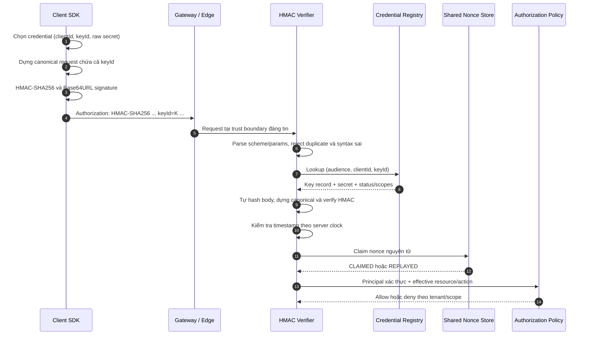

# Key identifier field trong Authorization header khi xác thực HTTP request bằng HMAC

## Mục tiêu học tập

Trong chương **Authorization header**, bài **Key identifier field** tập trung vào trường định danh khóa, ký hiệu `keyId`, được gửi kèm chữ ký HMAC để server xác định **khóa bí mật đã được cấp cho client nào** cần dùng khi xác minh request. `keyId` không phải khóa bí mật, không phải chữ ký và cũng không phải bằng chứng rằng request có quyền truy cập tài nguyên.

Bài nằm trong module `SECURITY_AUTHENTICATION_HMAC_REQUEST_AUTHENTICATION`: thiết kế xác thực HTTP request bằng **HMAC với shared secret** và **canonical request** bao gồm method, URI, header hoặc body theo hợp đồng ký; thực hành xác minh chữ ký, chống replay bằng timestamp/nonce, quản lý key rotation, kiểm thử proxy/gateway và phân biệt **authentication** với **authorization**.

Sau bài học, bạn có thể:

- Giải thích đúng vai trò của `Authorization` HTTP field, authentication scheme, `keyId`, `clientId`, raw shared secret và signature.
- Thiết kế cú pháp `keyId` trong một **HTTP Authorization scheme tùy chỉnh**, phân biệt nó với `Bearer`, `Basic` và `Proxy-Authorization`.
- Tra credential bằng bộ khóa `(audience, clientId, keyId)`, bảo đảm `keyId` không bị dùng như mật khẩu hoặc chứng cứ quyền.
- Đưa **chính giá trị `keyId` đã parse** vào canonical request HMAC, tránh nhầm key, aliasing, key substitution và downgrade khi rotation.
- Xử lý các lỗi: thiếu `keyId`, lặp tham số, khác kiểu chữ hoa/thường, ký tự không hợp lệ, header trùng, scheme không được hỗ trợ hoặc gateway sửa `Authorization`.
- Viết Java 17 minh họa tạo và kiểm tra header, strict-decode HMAC, tra registry, kiểm tra timestamp/nonce, key status và authorization.
- Thiết kế kiểm thử qua proxy/gateway, rotation, nhiều client trùng key ID, replay và các request có MAC đúng nhưng không đủ quyền.

## 1. Authorization header và key identifier field

### 1.1. Authorization trong HTTP dùng để mang credentials

HTTP có field `Authorization` để user agent gửi thông tin xác thực (*credentials*) đến origin server. Một giá trị có thể bắt đầu bằng **authentication scheme** như `Basic` hoặc `Bearer`. Với HMAC tự thiết kế, một service có thể định nghĩa **scheme riêng** để gửi thông tin nhận diện khóa và chữ ký.

Ví dụ minh họa **không phải một scheme HMAC tiêu chuẩn đã được đăng ký dùng chung**:

```http
POST /v1/reports?tenant=merchant-42 HTTP/1.1
Host: reports.example.test
Content-Type: application/json
Authorization: HMAC-SHA256 clientId="report-worker-prod", keyId="key-2026-11", timestamp="1700000000", nonce="BVLOV3evw9S3Zewpz5JgYQ", signature="<43-char-base64url>"
X-Content-SHA256: <body-sha256-base64url>

{"reportType":"monthly"}
```

Ở đây:

- **`HMAC-SHA256`:** tên scheme của API ví dụ, xác định cách đọc credential; bản thân tên scheme chưa chứng minh chữ ký.
- **`clientId`:** định danh client đã được cấp quyền dùng một hoặc nhiều credential.
- **`keyId`:** định danh **phiên bản/bản ghi khóa** của client, ví dụ `key-2026-11`, giúp server tìm raw shared secret đúng.
- **`timestamp`:** Unix epoch seconds do client ký để server kiểm tra request có đủ mới.
- **`nonce`:** giá trị ngẫu nhiên được ký, phải được claim tối đa một lần trong cửa sổ anti-replay.
- **`signature`:** biểu diễn Base64URL không padding của raw HMAC-SHA256 MAC (32 byte → 43 ký tự).
- **`X-Content-SHA256`:** digest SHA-256 của **exact HTTP body bytes**, server phải tự tính lại để đối chiếu.

`1700000000` và các chuỗi `<...>` là **test fixture/placeholder**, không phải request có thể gửi vào production. Timestamp thực phải tương ứng lúc ký; nonce và signature phải được sinh từ dữ liệu thực.

**Điểm mấu chốt:** `Authorization` là **nơi mang credential**. Nó không đồng nghĩa backend đã cấp quyền. Sau khi HMAC hợp lệ và chống replay thành công, server mới có căn cứ lập authenticated principal, rồi kiểm tra **authorization theo scope, tenant, resource và action**.

### 1.2. Authentication scheme custom là một hợp đồng cụ thể

HTTP cung cấp cú pháp chung cho `Authorization`, nhưng **không định nghĩa sẵn** rằng một chữ ký HMAC tùy chỉnh phải dùng chính tên `HMAC-SHA256`, `keyId` hay thứ tự tham số ở ví dụ này. Các hệ thống có thể chọn:

```http
Authorization: HMAC-SHA256 clientId="C", keyId="K", timestamp="T", nonce="N", signature="S"
```

hoặc một scheme và grammar hoàn toàn khác. Phía gửi và phía xác minh phải **cùng tuân một contract đã công bố**, gồm cách canonicalize, algorithm, encoding, trường được ký, cú pháp nhận và chính sách replay.

Đừng nhầm ví dụ này với **HTTP Message Signatures (RFC 9421)**, **AWS Signature Version 4** hay các scheme của dịch vụ khác. Chúng có hợp đồng, field và cách canonicalize riêng; không thể đổi tên header rồi coi các giao thức tương thích.

### 1.3. `Authorization` khác `Proxy-Authorization` và authorization nghiệp vụ

| Khái niệm | Chức năng | Điều không được suy ra |
| --- | --- | --- |
| HTTP field `Authorization` | Chuyển credentials tới origin/server theo một scheme. | Không tự cấp quyền thao tác mọi resource. |
| `Proxy-Authorization` | Credentials dành cho một **HTTP proxy** khi proxy yêu cầu. | Không dùng thay `Authorization` của origin API. |
| `WWW-Authenticate` | Challenge do server dùng khi cần authentication, nhất là response 401. | Không chứa raw shared secret của server. |
| `keyId` | Chỉ ra một credential record cần tra. | Không phải secret, MAC, bearer token hay scope. |
| **Authorization (phân quyền)** | Quyết định principal đã xác thực có được phép hành động không. | Không được chỉ dựa vào header `keyId` do client tự khai. |

Một response `401 Unauthorized` theo HTTP semantics liên quan đến authentication challenge; API custom cần công bố cách trả lỗi/challenge phù hợp, ví dụ trong một deployment có thể dùng:

```http
HTTP/1.1 401 Unauthorized
WWW-Authenticate: HMAC-SHA256 realm="reports-api-prod"
```

Đây chỉ là **challenge của scheme minh họa**, không phải lời khẳng định client HTTP phổ biến tự hiểu cách ký HMAC này. `403 Forbidden` thường phù hợp khi credential đã được xác thực nhưng principal không có quyền theo policy.

## 2. `keyId` là định danh công khai, không phải shared secret

### 2.1. Chuỗi `keyId` giúp tìm khóa nào?

Giả sử hệ thống cấp cho client `report-worker-prod` hai credential trong giai đoạn rotation:

| Audience | Client ID | Key ID | Trạng thái | Secret tại server |
| --- | --- | --- | --- | --- |
| `reports-api-prod` | `report-worker-prod` | `key-2026-10` | RETIRING | Raw secret A, lưu bảo mật. |
| `reports-api-prod` | `report-worker-prod` | `key-2026-11` | ACTIVE | Raw secret B **độc lập**. |
| `reports-api-prod` | `other-worker-prod` | `key-2026-11` | ACTIVE | Raw secret C **khác**. |
| `reports-api-staging` | `report-worker-prod` | `key-2026-11` | ACTIVE | Raw secret D ở môi trường khác. |

Key ID `key-2026-11` có thể xuất hiện ở **nhiều client/audience** nếu hệ thống cho phép. Nó chỉ có ý nghĩa trong **namespace credential** tương ứng. Vì vậy server nên tra ít nhất:

```text
credential = registry.lookup(
    expectedAudience,
    claimedClientId,
    claimedKeyId
)
```

`expectedAudience` là service identity/realm **do server biết**, không được lấy từ trường client tự khai mà chưa kiểm tra.

Nếu registry không có bản ghi đúng hoặc key bị thu hồi/hết hạn, server **không được** thử key ngẫu nhiên của client khác hoặc coi `keyId` là chứng cứ đã authenticated.

### 2.2. Dòng dữ liệu signer và verifier



Những trường `clientId` và `keyId` **chưa đáng tin khi mới parse**. Chúng chỉ là *routing hints cho việc tra credential*. Chỉ khi bản ghi hợp lệ, HMAC đúng và replay policy đạt, server mới tạo authenticated principal theo registry.

### 2.3. Không dùng `keyId` làm HMAC key

Sai:

```java
// Sai: lấy byte UTF-8 của ID công khai làm HMAC secret.
byte[] wrongSecret = keyId.getBytes(StandardCharsets.UTF_8);
mac.init(new SecretKeySpec(wrongSecret, "HmacSHA256"));
```

Đúng:

```java
// Đúng: tra credential rồi lấy RAW SECRET BYTES của bản ghi.
CredentialRecord credential = registry.lookup(audience, clientId, keyId);
byte[] rawSecretBytes = credential.loadSecretBytesFromProtectedStore();
mac.init(new SecretKeySpec(rawSecretBytes, "HmacSHA256"));
```

Đoạn thứ hai là **pseudocode**, không phải một API JDK có sẵn: `CredentialRecord` và `registry` do ứng dụng tự triển khai.

Nếu secret được provision dưới dạng **Base64URL trong secret manager**, cần **decode thành raw secret bytes** trước khi dùng với `SecretKeySpec`. Lấy UTF-8 của chuỗi Base64URL thay vì decode sẽ tạo **key khác**.

### 2.4. `keyId`, `nonce` và `Idempotency-Key` không thay thế nhau

| Trường | Vòng đời | Câu hỏi được trả lời |
| --- | --- | --- |
| **`keyId`** | Có thể ổn định qua nhiều request cho đến rotation/revoke. | Dùng bản ghi shared secret nào để xác minh attempt này? |
| **`nonce`** | Mới trên **mỗi signed attempt**. | Signed attempt này đã bị dùng lại trong replay window chưa? |
| **`Idempotency-Key`** | Ổn định cho **một logical business operation**, kể cả nhiều retry. | Các attempt khác nhau có phải cùng thao tác cần tránh side effect trùng không? |
| **`signature`** | Tính mới cho mỗi signed attempt từ canonical bytes và secret. | MAC có khớp request và credential không? |

Không dùng `keyId` làm replay key hoặc Idempotency-Key: hàng nghìn request có thể dùng **cùng keyId** nhưng phải có nonce riêng và có thể thuộc nhiều operation khác nhau.

## 3. Thiết kế cú pháp `keyId` trong Authorization

### 3.1. Contract ví dụ dùng các auth-params bắt buộc

Hợp đồng `authorization-keyid-v1` quy định:

```http
Authorization: HMAC-SHA256 clientId="report-worker-prod", keyId="key-2026-11", timestamp="1700000000", nonce="BVLOV3evw9S3Zewpz5JgYQ", signature="<valid43characters>"
```

Để đơn giản, phiên bản này **chỉ cho giá trị ASCII thuộc allowlist**; không hỗ trợ ký tự Unicode, dấu phẩy bên trong quoted-string, dấu gạch chéo, ký tự escape `\"` hay `\\` trong các auth-param. Đây là **tập con có chủ đích** của grammar auth-param tổng quát. Một parser generic có thể hỗ trợ quoted-string phức tạp hơn, nhưng verifier của API này cần **từ chối** giá trị ngoài contract, không tự xử lý theo những diễn giải khác nhau.

| Tham số | Grammar giá trị | Ràng buộc |
| --- | --- | --- |
| `clientId` | `[A-Za-z0-9_-]{1,64}` | Định danh client được cấp credential. |
| **`keyId`** | **`[A-Za-z0-9_-]{1,64}`** | Giá trị case-sensitive, được ký và dùng tra registry. |
| `timestamp` | `[1-9][0-9]{0,11}` | Unix epoch seconds decimal không dấu/zero đầu; độ dài là chính sách demo. |
| `nonce` | `[A-Za-z0-9_-]{22}` | Base64URL không padding, decode đúng 16 byte. |
| `signature` | `[A-Za-z0-9_-]{43}` | Base64URL không padding, decode đúng 32 byte MAC. |

Các **tên** auth-param được nhận diện **không phân biệt hoa/thường** theo HTTP authentication syntax; nhưng **giá trị** `keyId`, `clientId`, `nonce` và `signature` là **case-sensitive**. Ví dụ `key-2026-11` và `KEY-2026-11` là **hai định danh khác nhau** nếu registry định nghĩa như vậy. Không tự lowercase giá trị trước khi lookup hoặc trước khi ký.

Authentication scheme name cũng được nhận diện không phân biệt hoa/thường. Ví dụ `hmac-sha256` và `HMAC-SHA256` có thể cùng chỉ scheme minh họa; **client signer** nên phát canonical spelling thống nhất, còn **verifier** phân tích scheme theo quy tắc HTTP đã chọn.

### 3.2. Thứ tự auth-param so với thứ tự canonical

```http
Authorization: HMAC-SHA256 keyId="key-2026-11", clientId="report-worker-prod", nonce="BVLOV3evw9S3Zewpz5JgYQ", signature="<valid43characters>", timestamp="1700000000"
```

Thứ tự tham số trên wire **không phải** thứ tự ký. Nếu grammar của scheme hỗ trợ auth-params không phụ thuộc thứ tự, server phải:

1. Parse ra **bộ trường có tên rõ ràng**, không lấy bằng `split(",")[2]`.
2. Từ chối tên lặp, kể cả `keyId` và `KEYID` cùng có mặt.
3. Từ chối tham số lạ nếu contract không mở rộng.
4. Validate **giá trị** từng tham số theo allowlist đã công bố.
5. Dựng canonical request theo **thứ tự cố định của contract**, không theo thứ tự xuất hiện của header.

Client có thể phát theo một thứ tự chuẩn để dễ debug; backend không nên dựa vào vị trí tham số như thể `keyId` luôn đứng thứ hai. Trong Java example ở phần sau, parser chấp nhận thứ tự và hoa/thường của tên tham số, nhưng không tự sửa giá trị.

### 3.3. Header trùng và comma-joining

`Authorization` không được xem như một field dạng list có thể tự do gộp giá trị bằng dấu phẩy. Nếu request có **hai field line Authorization**, server nên reject ở lớp HTTP adapter trước khi chuyển sang verifier.

```http
Authorization: HMAC-SHA256 clientId="C", keyId="K1", ...
Authorization: HMAC-SHA256 clientId="C", keyId="K2", ...
```

Không lấy **header đầu tiên**, **header cuối cùng**, gộp hai chuỗi vào một text hoặc để gateway và backend chọn khác nhau. Đây là điểm quan trọng vì hai tầng có thể diễn giải khác `keyId`, từ đó tạo **credential confusion**.

Tương tự, phải từ chối:

```text
keyId="key-A", keyId="key-B"          # trùng cùng tên
keyId="key-A", KEYID="key-B"          # trùng theo case-insensitive name
keyId=""                              # rỗng ngoài grammar
keyId="../secrets/prod"               # không thuộc allowlist
keyId="key-A%2Fkey-B"                 # không tự percent-decode
keyId=" key-A "                       # space nằm trong value
keyId="key-A", unknownParam="x"       # tham số ngoài contract
```

Với các giá trị ký tự hạn chế, parser có thể tách danh sách auth-params theo dấu phẩy **sau khi** bảo đảm dấu phẩy không được phép nằm trong quoted value. Nếu API tương lai hỗ trợ giá trị quoted phức tạp, cần viết parser đúng grammar thay vì áp dụng `split(",")` mù quáng.

### 3.4. Dữ liệu nhận ở edge phải có giới hạn

Không cho kẻ gửi gửi header `Authorization` dài hàng MB hoặc hàng nghìn auth-params để làm tiêu hao CPU/bộ nhớ của verifier. Lớp edge cần:

- Giới hạn tổng HTTP header bytes và riêng `Authorization`.
- Chặn CR/LF injection và ký tự điều khiển; xử lý OWS (space/tab ở nơi được phép) nhất quán.
- Reject duplicate field và duplicate auth-param **trước credential lookup**.
- Không tự động URL-decode, Unicode-normalize, trim **bên trong giá trị**, hoặc case-fold `keyId`.
- Bảo đảm chỉ đúng một scheme được phép trên endpoint; không fallback từ `HMAC-SHA256` sang `Basic`/`Bearer` vì một chữ ký không khớp.

Các kiểm tra cú pháp không thay thế signature verification. Một `keyId` đúng grammar chỉ cho thấy chuỗi có hình dạng hợp lệ.

## 4. Ràng buộc `keyId` bằng HMAC: tránh nhầm khóa và thuật toán

### 4.1. Key ID được chọn trước khi MAC đúng — tại sao vẫn an toàn?

Để tính expected HMAC, server phải **biết secret cần dùng**. Vì vậy nó thường lấy `clientId`/`keyId` từ header **chưa xác thực** để tra credential. Đây là một kiểu **bootstrap** của xác thực:

```text
1. Parse keyId dưới dạng dữ liệu CHƯA ĐÁNG TIN.
2. Lookup một credential record trong registry theo scope rõ.
3. Kiểm tra record: audience, client, status, algorithm/contract.
4. Dùng raw secret của record tính expected MAC trên canonical request.
5. So sánh với MAC client gửi.
6. Chỉ sau đó tin danh tính client được ràng buộc với record.
```

Điều quan trọng là **keyId phải nằm trong canonical request đã ký**. Khi kẻ tấn công đổi `keyId` sau khi client ký, expected MAC phải đổi, hoặc lookup dẫn tới secret khác và MAC không khớp.

### 4.2. Canonical request mẫu `authorization-keyid-v1`

Endpoint minh họa:

```http
POST /v1/reports?tenant=merchant-42 HTTP/1.1
Content-Type: application/json
Authorization: HMAC-SHA256 clientId="report-worker-prod", keyId="key-2026-11", timestamp="1700000000", nonce="BVLOV3evw9S3Zewpz5JgYQ", signature="<signature>"
X-Content-SHA256: <body-sha256-base64url>

{"reportType":"monthly"}
```

Contract dùng **11 dòng UTF-8**, nối bằng LF (`\n`), **không có LF cuối**:

```text
HMAC-SHA256
authorization-keyid-v1
reports-api-prod
report-worker-prod
key-2026-11
POST
/v1/reports?tenant=merchant-42
application/json
<body-sha256-base64url>
1700000000
BVLOV3evw9S3Zewpz5JgYQ
```

| Dòng | Trường | Quy tắc |
| --- | --- | --- |
| 1 | `HMAC-SHA256` | Algorithm label cố định theo contract/registry. |
| 2 | `authorization-keyid-v1` | Phiên bản canonicalization và encoding. |
| 3 | `reports-api-prod` | Audience do verifier biết, bắt buộc khớp credential. |
| 4 | `clientId` | **Giá trị** đã parse từ Authorization, chưa tin trước verify. |
| **5** | **`keyId`** | **Giá trị** đã parse từ Authorization, được MAC ràng buộc. |
| 6 | Method | `POST` exact theo endpoint. |
| 7 | Raw request-target | `/v1/reports?tenant=[A-Za-z0-9_-]{1,64}` exact. |
| 8 | Content-Type | `application/json` exact; contract không nhận charset suffix. |
| 9 | Body hash | Base64URL không padding của SHA-256 trên **exact body bytes**. |
| 10 | Timestamp | Unix epoch seconds decimal canonical. |
| 11 | Nonce | Base64URL không padding của 16 byte CSPRNG. |

Công thức:

```text
bodyHashBytes = SHA256(exactHttpBodyBytes)
bodyHashText = Base64URL_NoPadding(bodyHashBytes)

canonicalText = join("\n", 11 signed fields)
canonicalBytes = UTF8(canonicalText)

rawMac = HMAC_SHA256(registeredRawSecretBytes, canonicalBytes)
signatureText = Base64URL_NoPadding(rawMac)  # 32 bytes -> 43 chars
```

**Không đưa nguyên chuỗi `Authorization` vào canonical request**, vì nó chứa chính `signature` dẫn tới quan hệ vòng. Thay vào đó, parse thành từng **trường có tên**, ký `clientId`/`keyId`/timestamp/nonce, algorithm và version cùng request data. `signature` là **kết quả**, không phải đầu vào tính chính nó.

### 4.3. Vì sao nên ký `keyId` ngay cả khi key khác thường có secret khác?

Nếu client đổi `keyId=key-A` thành `keyId=key-B`, phần lớn hệ thống dùng secret độc lập sẽ khiến MAC kiểm tra bằng key-B không khớp. Nhưng **không nên dựa duy nhất** vào giả định mọi record khác đều có key khác:

- Có thể có legacy alias trỏ tới cùng secret.
- Một lỗi provision có thể dùng lại raw secret cho hai key IDs.
- Hệ thống migration/rotation có thể có những tên khóa khác nhau nhưng cùng key material vì cấu hình chưa đúng.
- Một service có thể dùng credential registry không nhất quán giữa gateway/backend.
- Nếu `keyId` không được ký, audit/mapping key sử dụng có thể không được mật mã ràng buộc với request.

**Đưa keyId vào canonical** đảm bảo việc thay key ID sau khi ký làm thay đổi dữ liệu MAC, kể cả trong trường hợp **secret hai record vô tình trùng nhau**. Tuy nhiên điều đó **không sửa được việc dùng lại secret**: phải provision secret độc lập, bảo vệ registry và giới hạn permission.

### 4.4. Không cho phép thuật toán do client tự chọn

Nếu API đưa thêm `algorithm="..."` trong Authorization, đó là một **yêu cầu giao thức** chứ không phải sự cho phép bất kỳ thuật toán nào. Verifier phải kiểm tra algorithm thuộc **allowlist của contract và credential**, không làm:

```text
if signedAlgorithm fails:
  try HMAC-SHA1
  try HMAC-SHA256
  try SHA256-without-key
  try every available key...
```

Không downgrade về phép hash không khóa, so sánh signature thiếu độ dài hoặc bỏ qua key status để “giúp request qua được”. Bài minh họa **pin HMAC-SHA256** ở scheme và canonical line đầu. Nếu thay algorithm hay cách canonicalize, công bố **version mới**, quy tắc migration và test vector tương ứng.

## 5. Key rotation: giữ danh tính ổn định, thay đúng bản ghi khóa

### 5.1. Chu kỳ của keyId

```text
PROVISIONED --> ACTIVE --> RETIRING --> REVOKED
                     \               /
                      \--> REVOKED --/
```

Đây là một lifecycle minh họa. Mỗi record nên có metadata:

```text
audience
clientId
keyId
algorithm + contractVersion
secretReference (không in raw secret trong logs)
status (ACTIVE, RETIRING, REVOKED)
notBefore / notAfter hoặc rotation deadlines
scopes / permitted tenants / resource policies
createdAt / rotatedAt / revokedAt
```

Một key mới nên được sinh **raw secret độc lập có entropy phù hợp**; đổi ID hoặc Base64-encode lại secret cũ **không tạo key mới**.

### 5.2. Hai key có thể cùng hợp lệ trong overlap hữu hạn

Ví dụ:

```text
2026-11:
    key-2026-10 -> RETIRING, chỉ chấp nhận tới deadline
    key-2026-11 -> ACTIVE

Sau deadline:
    key-2026-10 -> REVOKED
    key-2026-11 -> ACTIVE
```

Client phải chọn `keyId` tương ứng **đúng secret**; server phải tra record và trạng thái. Khi client chuyển sang key mới, `Authorization` gửi key ID mới và signature mới. Hợp đồng canonical và cách decode MAC có thể **giữ nguyên** nếu algorithm/version không đổi.

**Key revoked:** Dù một attacker còn biết secret cũ, tự tạo HMAC đúng với key cũ và timestamp hiện tại, verifier phải **từ chối** vì registry đã đánh dấu `REVOKED`. Đúng về mặt toán học không đồng nghĩa credential còn được cấp quyền xác thực.

### 5.3. Retry trong lúc rotation

```text
Logical operation: K (nếu API hỗ trợ Idempotency-Key)

Attempt 1:
  clientId=C, keyId=key-old, timestamp=T1, nonce=N1, MAC1

Attempt 2 sau timeout:
  clientId=C, keyId=key-new, timestamp=T2, nonce=N2, MAC2
```

Với retry có side effect, cần:

- Giữ **method, effective URI, body bytes, semantic headers và operation key** ổn định cho **cùng logical operation**.
- Sinh timestamp/nonce mới và **ký lại** bằng secret của key ID mới.
- Registry phải xác định cả hai key (trước và sau rotation) thuộc **cùng authenticated principal/audience** nếu dự định là cùng client.
- Idempotency store nên scope theo **principal/audience/operation key**, không chỉ theo key ID để tránh tạo side effect mới khi rotation.
- Nonce replay scope có thể dùng **(audience, authenticatedPrincipal, nonce)** thay vì phân vùng theo key ID, để không làm trùng nonce được chấp nhận chỉ vì đổi key.
- Nếu operation là `POST` tạo mới, **không tự retry** khi outcome chưa rõ nếu API chưa hỗ trợ idempotency/reconciliation.

Đừng thử mọi secret đang ACTIVE/REVOKED đến khi một chữ ký khớp. `keyId` đã được cấp và được ký nhằm **chỉ định chính xác record** nào cần xác minh; fallback nhiều key làm phức tạp threat model và khả năng dò đoán key/credential.

### 5.4. Public metadata và bảo mật vận hành

`keyId` thường **không bí mật**, nhưng vẫn là **metadata có giá trị** đối với việc liệt kê credential. Vì vậy:

- Không log **toàn bộ Authorization header**, raw secret, expected MAC hay payload nhạy cảm.
- Có thể log client/key ID **đã kiểm tra cú pháp và có chính sách masking/hash**, kèm correlation ID và lý do nội bộ, thay vì tiết lộ metadata cho mọi log consumer.
- Với lỗi key ID không tồn tại, key đã revoked hoặc MAC không khớp, có thể trả **thông điệp xác thực công khai thống nhất** theo contract; log nội bộ phân biệt nguyên nhân.
- Đặt rate limit, quota, input size limit và alert cho credential lookup thất bại để giảm enumeration và DoS.
- Không dùng `keyId` làm token truy cập có thể đoán: ID chỉ là tên bản ghi, không có khả năng xác thực độc lập.

## 6. Java 17: đọc keyId trong Authorization và xác minh chữ ký

Ví dụ `AuthorizationKeyIdDemo.java` sử dụng **JDK 17+** và không cần framework. Nó minh họa `keyId` như một *untrusted lookup hint* trước xác thực và một **trường bắt buộc trong canonical request** sau khi parse. Các tình huống thử nghiệm gồm: key đang ACTIVE, key mới sau rotation, key REVOKED, đổi `keyId` sau khi ký, auth-param trùng, header trùng, scheme/tên tham số đổi hoa–thường, replay và thiếu quyền tenant.

Chương trình có ba ranh giới:

- **Client signer:** chọn credential `clientId + keyId + rawSecret`, dựng canonical, tạo header `Authorization` chứa signature.
- **Verifier:** parse chặt header, tra đúng registry record, kiểm tra body hash, timestamp và MAC; chỉ sau đó mới claim nonce.
- **Policy:** từ authenticated principal kiểm tra tenant thực; MAC đúng không tự cho phép truy cập tài nguyên.

**Lưu ý:** Registry và nonce store của demo là **trong một JVM**, chỉ dùng để dạy học; không phải hệ thống đa node và không xử lý đầy đủ HTTP framing, header duplicate ngoài `Authorization`, key expiration deadline hay idempotency khi `POST`.

### 6.1. Mã nguồn Java hoàn chỉnh

```java
import java.nio.charset.StandardCharsets;
import java.security.GeneralSecurityException;
import java.security.MessageDigest;
import java.security.SecureRandom;
import java.time.Clock;
import java.time.Instant;
import java.time.ZoneOffset;
import java.util.Arrays;
import java.util.Base64;
import java.util.HashMap;
import java.util.List;
import java.util.Locale;
import java.util.Map;
import java.util.Objects;
import java.util.Set;
import java.util.concurrent.ConcurrentHashMap;
import java.util.regex.Matcher;
import java.util.regex.Pattern;
import javax.crypto.Mac;
import javax.crypto.spec.SecretKeySpec;

public final class AuthorizationKeyIdDemo {
    private static final String AUDIENCE = "reports-api-prod";
    private static final String CLIENT = "report-worker-prod";
    private static final long PAST_SECONDS = 300;
    private static final long FUTURE_SECONDS = 60;

    private static final Pattern TARGET = Pattern.compile(
            "/v1/reports\\?tenant=[A-Za-z0-9_-]{1,64}");
    private static final Pattern ID = Pattern.compile(
            "[A-Za-z0-9_-]{1,64}");
    private static final Pattern TIMESTAMP = Pattern.compile(
            "[1-9][0-9]{0,11}");
    private static final Pattern SCHEME = Pattern.compile(
            "(?i)^HMAC-SHA256[ \\t]+(.+)$");
    private static final Pattern PARAM = Pattern.compile(
            "^[ \\t]*([A-Za-z][A-Za-z0-9_-]*)[ \\t]*=[ \\t]*"
            + "\"([A-Za-z0-9_-]+)\"[ \\t]*$");

    private static final Base64.Encoder ENCODER =
            Base64.getUrlEncoder().withoutPadding();
    private static final Base64.Decoder DECODER =
            Base64.getUrlDecoder();

    private AuthorizationKeyIdDemo() {}

    record RequestData(
            String method, String rawTarget,
            String contentType, byte[] body) {
        RequestData {
            body = Objects.requireNonNull(body).clone();
        }

        @Override public byte[] body() {
            return body.clone();
        }
    }

    record AuthFields(
            String clientId, String keyId, String timestamp,
            String nonce, String signature) {}

    record WireHeaders(String authorization, String bodyHash) {}

    record CredentialId(
            String audience, String clientId, String keyId) {}

    record Credential(
            String audience, String clientId, String keyId,
            String status, byte[] rawSecret) {
        Credential {
            rawSecret = Objects.requireNonNull(rawSecret).clone();
        }

        @Override public byte[] rawSecret() {
            return rawSecret.clone();
        }
    }

    static final class Registry {
        private final Map<CredentialId, Credential> entries =
                new HashMap<>();

        void put(Credential credential) {
            entries.put(new CredentialId(
                    credential.audience(),
                    credential.clientId(),
                    credential.keyId()), credential);
        }

        Credential lookup(String audience, String client, String key) {
            return entries.get(new CredentialId(audience, client, key));
        }
    }

    static final class DemoNonceStore {
        private final Set<String> claimed =
                ConcurrentHashMap.newKeySet();

        boolean claim(String audience, String principal, String nonce) {
            return claimed.add(audience + "|" + principal + "|" + nonce);
        }
        // Không có TTL, durability hay cross-node consistency.
    }

    enum Verdict {
        ACCEPTED, INVALID_REQUEST, INVALID_CREDENTIAL,
        OUTSIDE_WINDOW, BAD_MAC, REPLAYED, FORBIDDEN
    }

    static boolean matches(Pattern pattern, String value) {
        return value != null && pattern.matcher(value).matches();
    }

    static byte[] strictBase64Url(String text, int textSize, int byteSize) {
        if (text == null || text.length() != textSize ||
                !text.matches("[A-Za-z0-9_-]+")) {
            throw new IllegalArgumentException("Base64URL syntax");
        }
        byte[] raw = DECODER.decode(text);
        if (raw.length != byteSize ||
                !ENCODER.encodeToString(raw).equals(text)) {
            throw new IllegalArgumentException("Noncanonical Base64URL");
        }
        return raw;
    }

    static AuthFields parseAuthorization(List<String> headers) {
        // HTTP adapter không được tự gộp hai Authorization field lines.
        if (headers == null || headers.size() != 1
                || headers.get(0) == null) {
            throw new IllegalArgumentException(
                    "Exactly one Authorization header required");
        }
        String input = headers.get(0);
        if (input.length() > 512) {
            throw new IllegalArgumentException("Header too large");
        }
        for (int i = 0; i < input.length(); i++) {
            char c = input.charAt(i);
            if (c > 126 || (c < 32 && c != '\t')) {
                throw new IllegalArgumentException("Header control char");
            }
        }

        Matcher scheme = SCHEME.matcher(input);
        if (!scheme.matches()) {
            throw new IllegalArgumentException("Wrong auth scheme");
        }

        // Contract CHỈ cho [A-Za-z0-9_-]+ trong quoted values,
        // do đó dấu phẩy chỉ có thể là dấu ngăn các auth-params.
        String[] pieces = scheme.group(1).split(",", -1);
        if (pieces.length != 5) {
            throw new IllegalArgumentException("Five params required");
        }

        Map<String, String> params = new HashMap<>();
        Set<String> allowed = Set.of(
                "clientid", "keyid", "timestamp", "nonce", "signature");
        for (String piece : pieces) {
            Matcher param = PARAM.matcher(piece);
            if (!param.matches()) {
                throw new IllegalArgumentException("Bad auth-param");
            }
            String name = param.group(1).toLowerCase(Locale.ROOT);
            if (!allowed.contains(name)) {
                throw new IllegalArgumentException("Unknown param");
            }
            if (params.putIfAbsent(name, param.group(2)) != null) {
                throw new IllegalArgumentException("Duplicate param");
            }
        }

        AuthFields auth = new AuthFields(
                params.get("clientid"), params.get("keyid"),
                params.get("timestamp"), params.get("nonce"),
                params.get("signature"));
        if (!matches(ID, auth.clientId()) ||
                !matches(ID, auth.keyId()) ||
                !matches(TIMESTAMP, auth.timestamp())) {
            throw new IllegalArgumentException("Bad ID/timestamp");
        }
        strictBase64Url(auth.nonce(), 22, 16);
        strictBase64Url(auth.signature(), 43, 32);
        return auth;
    }

    static void validateRequest(RequestData request) {
        if (request == null ||
                !"POST".equals(request.method()) ||
                !"application/json".equals(request.contentType()) ||
                !matches(TARGET, request.rawTarget())) {
            throw new IllegalArgumentException("Method/URI/Content-Type");
        }
        if (request.body().length == 0 ||
                request.body().length > 1_048_576) {
            throw new IllegalArgumentException("Body size");
        }
    }

    static byte[] sha256(byte[] bytes)
            throws GeneralSecurityException {
        return MessageDigest.getInstance("SHA-256").digest(bytes);
    }

    static String canonical(
            RequestData request, AuthFields auth, String bodyHash) {
        validateRequest(request);
        if (!matches(ID, auth.clientId()) ||
                !matches(ID, auth.keyId()) ||
                !matches(TIMESTAMP, auth.timestamp())) {
            throw new IllegalArgumentException("Canonical auth field");
        }
        strictBase64Url(auth.nonce(), 22, 16);
        strictBase64Url(bodyHash, 43, 32);

        return String.join("\n",
                "HMAC-SHA256",
                "authorization-keyid-v1",
                AUDIENCE,
                auth.clientId(),
                auth.keyId(), // Quan trọng: keyId nằm trong MAC.
                request.method(),
                request.rawTarget(),
                request.contentType(),
                bodyHash,
                auth.timestamp(),
                auth.nonce());
        // 11 dòng UTF-8, LF, không LF cuối.
    }

    static byte[] hmac(byte[] secret, String canonicalText)
            throws GeneralSecurityException {
        Mac mac = Mac.getInstance("HmacSHA256");
        mac.init(new SecretKeySpec(secret, "HmacSHA256"));
        return mac.doFinal(
                canonicalText.getBytes(StandardCharsets.UTF_8));
    }

    static String formatAuthorization(AuthFields auth) {
        return "HMAC-SHA256 "
                + "clientId=\"" + auth.clientId() + "\", "
                + "keyId=\"" + auth.keyId() + "\", "
                + "timestamp=\"" + auth.timestamp() + "\", "
                + "nonce=\"" + auth.nonce() + "\", "
                + "signature=\"" + auth.signature() + "\"";
    }

    static String freshNonce(SecureRandom random) {
        byte[] bytes = new byte[16];
        random.nextBytes(bytes);
        return ENCODER.encodeToString(bytes);
    }

    static WireHeaders sign(
            RequestData request, Credential credential,
            Clock clock, SecureRandom random)
            throws GeneralSecurityException {
        String time = Long.toString(
                Instant.now(clock).getEpochSecond());
        String nonce = freshNonce(random);
        String bodyHash = ENCODER.encodeToString(sha256(request.body()));

        AuthFields unsigned = new AuthFields(
                credential.clientId(), credential.keyId(),
                time, nonce, "");
        String macText = ENCODER.encodeToString(
                hmac(credential.rawSecret(),
                     canonical(request, unsigned, bodyHash)));
        AuthFields signed = new AuthFields(
                unsigned.clientId(), unsigned.keyId(),
                time, nonce, macText);
        return new WireHeaders(formatAuthorization(signed), bodyHash);
    }

    static Verdict verify(
            RequestData request, List<String> authorizationHeaders,
            String bodyHashHeader, Registry registry,
            Clock clock, DemoNonceStore nonceStore)
            throws GeneralSecurityException {
        try {
            validateRequest(request);
            AuthFields auth = parseAuthorization(authorizationHeaders);

            // Chưa authenticated: clientId/keyId chỉ để định vị key.
            Credential credential =
                    registry.lookup(AUDIENCE, auth.clientId(), auth.keyId());
            if (credential == null ||
                    !"ACTIVE".equals(credential.status())) {
                return Verdict.INVALID_CREDENTIAL;
            }

            long now = Instant.now(clock).getEpochSecond();
            long t = Long.parseLong(auth.timestamp());
            if (t < Math.subtractExact(now, PAST_SECONDS) ||
                    t > Math.addExact(now, FUTURE_SECONDS)) {
                return Verdict.OUTSIDE_WINDOW;
            }

            byte[] actualBodyHash = sha256(request.body());
            byte[] declaredBodyHash =
                    strictBase64Url(bodyHashHeader, 43, 32);
            if (!MessageDigest.isEqual(actualBodyHash, declaredBodyHash)) {
                return Verdict.BAD_MAC;
            }

            // Không lấy canonical text từ client; tự dựng từ request.
            String bodyHash = ENCODER.encodeToString(actualBodyHash);
            byte[] expectedMac = hmac(
                    credential.rawSecret(),
                    canonical(request, auth, bodyHash));
            byte[] suppliedMac =
                    strictBase64Url(auth.signature(), 43, 32);
            if (!MessageDigest.isEqual(expectedMac, suppliedMac)) {
                return Verdict.BAD_MAC;
            }

            // Nonce chỉ được claim sau MAC đã được xác minh.
            if (!nonceStore.claim(
                    AUDIENCE, credential.clientId(), auth.nonce())) {
                return Verdict.REPLAYED;
            }

            // Authorization dùng principal từ registry, không dùng keyId.
            if (!"/v1/reports?tenant=merchant-42"
                    .equals(request.rawTarget())) {
                return Verdict.FORBIDDEN;
            }
            return Verdict.ACCEPTED;
        } catch (IllegalArgumentException | ArithmeticException ex) {
            return Verdict.INVALID_REQUEST;
        }
    }

    static RequestData withTarget(RequestData r, String target) {
        return new RequestData(
                r.method(), target, r.contentType(), r.body());
    }

    public static void main(String[] args)
            throws GeneralSecurityException {
        Clock clock = Clock.fixed(
                Instant.ofEpochSecond(1_700_000_000L), ZoneOffset.UTC);
        SecureRandom random = new SecureRandom();

        byte[] a = new byte[32];
        byte[] b = new byte[32];
        byte[] revokedBytes = new byte[32];
        random.nextBytes(a);
        random.nextBytes(b);
        random.nextBytes(revokedBytes);

        Credential oldKey = new Credential(
                AUDIENCE, CLIENT, "key-2026-11", "ACTIVE", a);
        Credential rotatedKey = new Credential(
                AUDIENCE, CLIENT, "key-2026-12", "ACTIVE", b);
        Credential revokedKey = new Credential(
                AUDIENCE, CLIENT, "key-2026-09", "REVOKED",
                revokedBytes);
        Registry registry = new Registry();
        registry.put(oldKey);
        registry.put(rotatedKey);
        registry.put(revokedKey);
        DemoNonceStore store = new DemoNonceStore();

        RequestData request = new RequestData(
                "POST", "/v1/reports?tenant=merchant-42",
                "application/json",
                "{\"reportType\":\"monthly\"}"
                        .getBytes(StandardCharsets.UTF_8));

        WireHeaders first = sign(request, oldKey, clock, random);
        System.out.println("Valid keyId + HMAC: "
                + verify(request, List.of(first.authorization()),
                        first.bodyHash(), registry, clock, store));
        System.out.println("Replay original: "
                + verify(request, List.of(first.authorization()),
                        first.bodyHash(), registry, clock, store));

        String changedKey = first.authorization()
                .replace("keyId=\"key-2026-11\"",
                         "keyId=\"key-2026-12\"");
        System.out.println("Changed keyId, old MAC: "
                + verify(request, List.of(changedKey),
                        first.bodyHash(), registry, clock, store));

        WireHeaders newKeyAttempt = sign(
                request, rotatedKey, clock, random);
        System.out.println("Rotated key: "
                + verify(request, List.of(newKeyAttempt.authorization()),
                        newKeyAttempt.bodyHash(), registry, clock, store));

        WireHeaders revokedAttempt = sign(
                request, revokedKey, clock, random);
        System.out.println("Revoked key: "
                + verify(request, List.of(revokedAttempt.authorization()),
                        revokedAttempt.bodyHash(), registry, clock, store));

        WireHeaders repeated = sign(request, oldKey, clock, random);
        System.out.println("Repeated keyId param: "
                + verify(request,
                        List.of(repeated.authorization()
                                + ", KEYID=\"key-2026-11\""),
                        repeated.bodyHash(), registry, clock, store));

        WireHeaders duplicate = sign(request, oldKey, clock, random);
        System.out.println("Two Authorization fields: "
                + verify(request, List.of(
                        duplicate.authorization(),
                        duplicate.authorization()),
                        duplicate.bodyHash(), registry, clock, store));

        WireHeaders caseTest = sign(request, oldKey, clock, random);
        String differentCase = caseTest.authorization()
                .replace("HMAC-SHA256 ", "hmac-sha256 ")
                .replace("keyId=", "KEYID=");
        System.out.println("Scheme/param name case: "
                + verify(request, List.of(differentCase),
                        caseTest.bodyHash(), registry, clock, store));

        RequestData anotherTenant = withTarget(
                request, "/v1/reports?tenant=merchant-99");
        WireHeaders forbidden = sign(
                anotherTenant, oldKey, clock, random);
        System.out.println("Valid MAC, wrong tenant: "
                + verify(anotherTenant, List.of(forbidden.authorization()),
                        forbidden.bodyHash(), registry, clock, store));

        Arrays.fill(a, (byte) 0);
        Arrays.fill(b, (byte) 0);
        Arrays.fill(revokedBytes, (byte) 0);
    }
}
```

Kết quả kỳ vọng:

```text
Valid keyId + HMAC: ACCEPTED
Replay original: REPLAYED
Changed keyId, old MAC: BAD_MAC
Rotated key: ACCEPTED
Revoked key: INVALID_CREDENTIAL
Repeated keyId param: INVALID_REQUEST
Two Authorization fields: INVALID_REQUEST
Scheme/param name case: ACCEPTED
Valid MAC, wrong tenant: FORBIDDEN
```

**Tại sao ví dụ chưa có `RETIRING`?** Để đơn giản, `verify` chỉ chấp nhận `ACTIVE`. Trong production có thể chấp nhận `RETIRING` **trong một khoảng overlap hữu hạn**, phải kiểm tra `notBefore/notAfter` và policy, không tự coi mọi key RETIRING là ACTIVE mãi mãi.

### 6.2. Parser cố định schema, không dựa vào vị trí substring

Anti-pattern:

```java
// Không dùng: phụ thuộc vị trí, dễ sai với duplicate/escape.
String keyId = authorization.substring(
        authorization.indexOf("keyId=") + 6,
        authorization.indexOf(", timestamp="));
```

Một string như `keyId="K1", KEYID="K2"`, hoặc thứ tự `nonce`/`timestamp` khác, có thể khiến code substring lấy nhầm. Parser ở trên thực hiện:

- Kiểm tra **đúng một Authorization field line** và giới hạn 512 ký tự.
- Kiểm tra ASCII, cấm CR/LF và ký tự điều khiển nguy hiểm.
- Parse **scheme** rồi từng **tên tham số**, chuẩn hóa **tên** với `Locale.ROOT`, không chuẩn hóa **giá trị `keyId`**.
- Reject tham số lạ, lặp (kể cả `keyId` với `KEYID`), rỗng, quote sai và Base64URL noncanonical.
- Dựng lại canonical theo thứ tự **hợp đồng**, không theo thứ tự xuất hiện của params.

Việc `split(",")` trong demo chỉ hợp lệ vì contract **không cho dấu phẩy bên trong quoted values**. Nếu mở rộng grammar cho dấu phẩy/escape/Unicode, phải thay bằng parser HTTP authentication đầy đủ đã kiểm thử, không giữ mẹo tách chuỗi này.

### 6.3. Ranh giới của ví dụ Java

`DemoNonceStore` chỉ ghi nonce trong một `ConcurrentHashMap.newKeySet()` của một tiến trình, **không có TTL hoặc durability**, nên không thể dùng cho multi-pod/region. Mô hình production cần atomic claim + expiration trong shared store có consistency guarantee phù hợp, ví dụ Redis `SET ... NX EX` với hiểu biết về failover/replication hoặc transactional database/linearizable service.

`Registry` chỉ là `HashMap` trong bộ nhớ, chưa có secret manager, TTL credential, kiểm soát thay đổi key giữa nhiều node, quota, audit hoặc chính sách phân quyền động. `RequestData` đã được tách trường sẵn, **không phải parser HTTP thực**: phần nhận HTTP thật còn phải chặn duplicate `Content-Type`, `X-Content-SHA256`, Content-Encoding khác contract, chunk framing mơ hồ và route normalization.

Ví dụ POST còn **không có Idempotency-Key**, do đó **không được tự động retry** sau timeout không rõ kết quả nếu side effect có thể xảy ra. Một API production tạo report job cần bổ sung Idempotency-Key **được ký** và lưu kết quả/operation atomically để tránh tạo hai job khi client ký attempt mới.

### 6.4. Vì sao `keyId` vẫn là dữ liệu chưa được tin trước HMAC?

Code nhận `keyId` từ header **trước** khi tính HMAC, nhưng không cấp quyền từ nó. Server:

1. Dùng ID để **định vị** credential theo `AUDIENCE` và client.
2. Từ chối trạng thái key không được phép.
3. Tự tính expected MAC với raw secret thuộc record.
4. Chỉ khi MAC hợp lệ mới dùng client principal của record cho nonce store và authorization.

Nếu giá trị `keyId` bị sửa, validator/registry hoặc HMAC từ canonical sẽ phát hiện. Nếu key tồn tại nhưng principal không có quyền tenant đích, cuối cùng vẫn phải từ chối **authorization**.

### 6.5. Test trường hợp cùng keyId ở hai client

Trong hệ thống thật, hãy thêm credential:

```text
(reports-api-prod, report-worker-prod, key-2026-11) -> secret A
(reports-api-prod, other-worker-prod,  key-2026-11) -> secret B
```

Hai bản ghi có **cùng keyId** nhưng **khác clientId**. Một request ký bằng secret A nhưng sửa `clientId` thành `other-worker-prod` phải bị reject vì canonical có `clientId` mới và registry tra secret B. Ngược lại, request thực sự được client thứ hai ký bằng secret B có thể đạt **authentication**, rồi vẫn phải áp chính sách authorization riêng của nó. Không tra mỗi `keyId` mà bỏ qua client/audience.

## 7. Key identifier field qua proxy, gateway và các lớp HTTP

### 7.1. Header có thể bị xóa hoặc thay dù HMAC đúng ở client

Một số gateway có cơ chế authentication built-in chỉ hiểu `Bearer`, tự loại `Authorization`, thay bằng credential riêng, hoặc chuyển thông tin authentication sang header nội bộ. Nếu client ký một request cho scheme `HMAC-SHA256` nhưng backend nhận:

```http
Authorization: Bearer <gateway-token>
```

thì backend **không thể** xác minh MAC HMAC gốc bằng cách parse text này như `keyId`. Cần quyết định architecture **trước khi triển khai**:

- **Gateway là HMAC verifier:** gateway nhận `Authorization: HMAC-SHA256 ...`, parse/lookup/verify đúng contract, kiểm tra replay, rồi chuyển principal đã xác thực tới backend qua kênh nội bộ được bảo vệ. Backend không tự tin header `X-Authenticated-Client` do người ngoài gửi.
- **Backend là HMAC verifier:** gateway phải bảo toàn **Authorization value** và toàn bộ signed method/raw request-target/header/body cần thiết; hoặc truyền nguyên dữ liệu đã ký qua metadata đáng tin được ràng buộc với request.
- **Hai tầng dùng cơ chế khác nhau:** cần hợp đồng delegation/credential translation rõ ràng. Không tự suy ra Bearer token của gateway và HMAC `keyId` là cùng một authentication scheme.

Trong mọi mô hình, client không được tự đổi `keyId` hoặc scheme tại gateway rồi mong raw signature cũ vẫn hợp lệ.

### 7.2. Không nhầm tên header với giá trị đã ký

`Authorization` và `authorization` là tên HTTP field **không phân biệt chữ hoa/thường**. Cách đặt chữ hoa/thường của tên field có thể thay đổi giữa HTTP/1.1, HTTP/2, HTTP/3 và framework.

Ngược lại, **`keyId="key-2026-11"`** chứa **giá trị có phân biệt hoa/thường** theo contract; `KEY-2026-11` không được tự coi như cùng key. Chữ ký Base64URL cũng phân biệt hoa/thường. Parser phải phân biệt:

```text
authorization     ~ Authorization       # Cùng field name theo HTTP
KEYID             ~ keyId               # Cùng auth-param name
HMAC-SHA256       ~ hmac-sha256         # Cùng scheme name

"key-2026-11"     != "KEY-2026-11"      # Giá trị keyId khác
signatureTextA    != signatureTextB     # Không lower-case MAC text
```

Nếu một API thực tế **quy định key ID không phân biệt hoa/thường**, điều đó phải được định nghĩa cùng lúc ở signer, registry và canonicalization. Hợp đồng bài này cố định key ID **case-sensitive** để loại nhập nhằng.

### 7.3. Gateway rewrite URI, chuyển Content-Encoding, hoặc normalize header

```text
Client ký:
POST /public/v1/reports?tenant=merchant-42
Authorization: HMAC-SHA256 keyId="key-2026-11", ...
Body bytes = B1

Gateway chuyển:
POST /internal/v1/reports?tenant=merchant-42
Body bytes = B2 sau transformation
```

Ngay cả khi `keyId` vẫn nguyên vẹn, expected HMAC ở backend có thể khác vì raw URI/body không còn giống dữ liệu đã ký. **Không khắc phục bằng cách chỉ ký keyId + timestamp**, bỏ method/URI/body khỏi MAC. Cần thống nhất **nơi xác minh** và **identity/effective operation** giữa gateway và backend.

Các điểm kiểm tra:

| Thay đổi ở tầng trung gian | Ảnh hưởng |
| --- | --- |
| Chuyển `Authorization` thành `Bearer` | Scheme HMAC mất, backend không có trường keyId và signature gốc. |
| Gộp hai `Authorization` | Có thể tạo ambiguity; phải reject, không chọn một giá trị. |
| Lowercase **tên** `authorization` | Hợp lệ theo HTTP; không làm đổi giá trị. |
| Lowercase **giá trị** `keyId` | Lookup hoặc canonical sai, có thể dẫn đến MAC mismatch. |
| Xóa/tự thay `keyId` | Khác secret/khác canonical; phải reject. |
| Rewrite raw path/query | HMAC mismatch nếu signer/verifier nhìn target khác. |
| Biến đổi JSON body | Body SHA-256 khác; phải dùng exact byte snapshot đã ký. |
| Thêm `Content-Type` suffix | Header được ký thay; kiểm tra policy và canonicalization. |
| Tự retry request cũ | Nonce từng claim có thể bị chặn; signer phải tạo attempt mới. |
| Gửi request tới audience/host khác | Không tự dùng lại keyId/secret, signature; cần kiểm tra đích và ký lại đúng contract. |

### 7.4. Credential trong header và logging/caching

`Authorization` có thể chứa chữ ký, ID và metadata nhạy cảm về hoạt động xác thực. Dù `keyId` không phải secret, **không nên log raw Authorization header**, bởi nó còn chứa signature/nonce và có thể bị replay nếu các điều kiện khác cho phép.

Khi dùng HTTP caches/shared intermediaries, response của request có `Authorization` có các quy tắc cache đặc thù theo HTTP (ví dụ shared cache cần những directive cho phép rõ ràng trong các trường hợp phù hợp). Không tự coi mọi response có HMAC là cacheable chỉ vì method là GET, và không đưa key ID vào cache key công khai rồi coi đó là kiểm soát truy cập. Bảo mật cache và phân quyền phải được thiết kế độc lập.

## 8. Key identifier field trong anti-replay, retry và kiểm soát trạng thái

### 8.1. Key ID có thể sống lâu hơn một signed attempt

`keyId` thường đại diện một credential record tồn tại qua nhiều requests, ví dụ hàng ngày hoặc hàng tháng. Ngược lại:

```text
Request #1: keyId=K, timestamp=T1, nonce=N1, MAC1
Request #2: keyId=K, timestamp=T2, nonce=N2, MAC2
Request #3: keyId=K, timestamp=T3, nonce=N3, MAC3
```

Một key ID có thể được dùng **nhiều lần**; nonce thì **mỗi signed attempt phải mới**. Không triển khai “key ID đã dùng rồi thì reject” vì như vậy một client chỉ gửi được một request cho mỗi credential.

### 8.2. Nonce replay store có phạm vi nào khi rotation?

Hợp đồng ví dụ dùng:

```text
replayKey = (audience, authenticatedPrincipal, nonce)
```

Để minh họa, chọn `past=300s`, `future=60s`, và nonce TTL khoảng **370 giây** (300 + 60 + 10 giây biên). Kho nonce dùng chung phải áp dụng **atomic claim-once**, có TTL che phủ toàn bộ thời gian timestamp có thể hợp lệ; nếu store lỗi phải fail closed.

Nếu chỉ lưu `(keyId, nonce)`:

- Hai client có cùng `keyId` dễ xung đột chéo.
- Key rotation tạo namespace nonce mới cho **cùng principal**, làm chính sách khó kiểm toán.
- Khi một key ID bị sử dụng lại sai cách, replay key có thể bị diễn giải nhầm.

Chọn scope theo **authenticated principal** sau MAC, không theo raw `clientId` do request tự khai mà chưa được xác thực.

### 8.3. Retry và Idempotency-Key

Giả sử một request tạo report job có thể gây side effect. Nếu response bị mất, client phải có **retry policy** và business idempotency rõ:

```text
Logical operation:
    Idempotency-Key = OP-123   # Giữ nguyên, nếu API hỗ trợ.

Attempt 1:
    keyId = K1, timestamp = T1, nonce = N1, MAC = M1

Attempt 2 sau retry (có thể qua rotation):
    keyId = K2, timestamp = T2, nonce = N2, MAC = M2
    Idempotency-Key = OP-123   # Không sinh mới cho cùng operation.
```

**Nếu API dùng Idempotency-Key để điều khiển side effect, key đó phải được bảo vệ bởi canonical HMAC.** Hợp đồng `authorization-keyid-v1` ở bài này **chưa ký Idempotency-Key**, nên chỉ có thể dùng cho minh họa chữ ký và key selection; để triển khai idempotent POST thực tế, cần mở rộng version/contract và ràng buộc Idempotency-Key cùng operation fingerprint, atomic store và transaction.

Không kết luận retry an toàn chỉ vì MAC mới đúng: hai attempt với nonce khác nhau có thể cùng tạo report job nếu server không có business deduplication. Không đổi keyId hoặc gửi thêm `Idempotency-Key` tùy tiện sau khi ký nếu contract không bảo vệ trường đó.

### 8.4. Authentication khác authorization

Ví dụ key ID `key-2026-11` thuộc `report-worker-prod`, được registry cho phép gọi API tạo báo cáo trong tenant `merchant-42`. Client có secret thật vẫn có thể tự ký request cho tenant `merchant-99`.

HMAC với đúng key ID có thể xác thực **client đã ký request đó**, nhưng **không tự cấp quyền trên tenant mới**. Server phải kiểm tra:

- Principal lấy từ **credential record đã xác minh**.
- Scope/permission áp dụng cho `reports:create`, `reports:read` hoặc action thực.
- Tenant và resource **effective** backend sẽ truy cập, không chỉ chuỗi raw URI đã ký trước rewrite.
- Quota, state và chính sách dữ liệu riêng; Idempotency-Key hoặc nonce không phải entitlement.
- Quyền hiện tại khi trả lại stored result từ một retry, không chỉ quyền tại attempt đầu.

`Authorization` là tên HTTP header, nhưng **authorization quyết định quyền** vẫn là một bước chính sách độc lập.

## 9. Những anti-pattern với `keyId` và hướng khắc phục

| Sai lầm | Hậu quả | Thiết kế đúng |
| --- | --- | --- |
| Dùng `keyId.getBytes(UTF_8)` làm secret | Key công khai, MAC có thể bị giả mạo. | Dùng raw secret bytes từ credential record. |
| Tra registry chỉ bằng `keyId` | Lẫn client/audience, cross-tenant credential confusion. | Lookup theo `(audience, clientId, keyId)`. |
| Tin `keyId` đồng nghĩa client đã xác thực | Không ai chứng minh nắm secret. | Chỉ tạo principal sau verify HMAC/key policy. |
| Không ký `keyId` trong canonical request | Key ID không được ràng buộc vào MAC. | Ký exact value của keyId đã parse. |
| Đổi hoa/thường value keyId | Lookup và canonical mất nhất quán. | Giữ exact case của giá trị. |
| Bắt buộc tên auth-param đúng một kiểu chữ | Có thể mâu thuẫn cú pháp HTTP authentication. | Nhận tên case-insensitive; không đổi value. |
| Đọc theo vị trí `split(",")[1]` | Nhận sai keyId khi thứ tự params đổi. | Parse auth-param theo tên, reject duplicates. |
| Nhận nhiều `Authorization` và chọn header cuối | Parser/gateway có thể hiểu khác nhau. | Reject trước credential lookup. |
| Fallback từ Bearer sang HMAC khi MAC sai | Downgrade/mix-up scheme và principal. | Pin scheme theo route và hợp đồng. |
| Thử tất cả key trong registry | Tăng CPU, key enumeration/oracle và lẫn trạng thái revoke. | Dùng đúng composite keyId lookup. |
| Chấp nhận key `REVOKED` vì HMAC đúng | Credential đã thu hồi vẫn có quyền xác thực. | Enforce status/deadline, fail closed. |
| Rotation chỉ đổi keyId mà giữ secret | Không có key material rotation thực. | Sinh secret độc lập và revoke cũ. |
| Log nguyên `Authorization` | Lộ chữ ký, metadata và nguy cơ replay. | Redact raw header, log ID có kiểm soát. |
| Gateway strip header rồi backend vẫn verify | Thiếu keyId/signature hoặc sai canonical. | Chọn HMAC trust boundary và hợp đồng forwarding. |
| Sửa timestamp/nonce sau khi ký | Signature mismatch hoặc cơ chế replay bị vô hiệu. | Ký lại attempt mới bằng raw secret hợp lệ. |
| Dùng `keyId` làm Idempotency-Key | Mọi request dùng cùng key, không phân biệt operation. | Idempotency-Key độc lập, bảo vệ bằng MAC. |
| Đọc scope tự khai trong Authorization như quyền | Client có thể tự nâng quyền. | Lấy scopes/tenants từ registry/policy. |
| So sánh chữ ký bằng `String.equals` | Không phải primitive MAC timing-safe thích hợp. | Strict Base64URL decode và `MessageDigest.isEqual`. |

### 9.1. Không giải quyết lỗi bằng cách “bỏ qua keyId”

Nếu verifier không tìm thấy key ID client gửi, đừng thử secret mặc định toàn dịch vụ hoặc bỏ kiểm tra key ID để chữ ký “qua được”. Hệ thống cần phân biệt lỗi dữ liệu, credential đã rotate/revoke và cấu hình không đồng nhất qua các node.

Ví dụ client chọn key mới nhưng một gateway chưa được đồng bộ registry: phải đồng bộ config/rollout một cách có kiểm soát, không làm HMAC verifier chấp nhận mọi key hoặc dùng một secret chung “fallback”.

### 9.2. Không cho phép authorization header điều khiển quyền trực tiếp

Kể cả khi hợp đồng bổ sung `scope="admin"` và có ký field này, client nắm secret có thể tự ký `admin` nếu key được cấp cho quyền thấp hơn. Server vẫn phải kiểm tra scope được yêu cầu có thuộc **credential policy/entitlement** thực hay không. “Được ký” chứng minh **nguồn gốc** của claim; không chứng minh claim **được policy cho phép**.

## 10. Ma trận kiểm thử Key identifier field

Dùng cả **unit test parser**, **test credential registry** và **HTTP integration test qua gateway/proxy**.

| Ca kiểm thử | Đầu vào | Kết quả mong đợi |
| --- | --- | --- |
| Key ID hợp lệ | `keyId="key-2026-11"`, HMAC đúng, key ACTIVE | Nhận authentication nếu timestamp/nonce/body đạt. |
| Key ID bị thiếu | Không có auth-param `keyId` | Reject schema, không lookup key mặc định. |
| Key ID rỗng | `keyId=""` | Reject theo grammar. |
| Key ID sai alphabet | `keyId="../secret"` | Reject, không dùng làm path/tên file secret. |
| Key ID quá dài | Trên 64 ký tự | Reject trước registry lookup. |
| Key ID khác case | `KEY-2026-11` thay `key-2026-11` | Lookup khác hoặc MAC fail; không lowercase value. |
| Tên `keyId` khác case | `KEYID="key-2026-11"` | Parser nhận diện cùng tên; HMAC đúng nếu value giữ nguyên. |
| Scheme name khác case | `hmac-sha256` | Cùng scheme theo HTTP authentication syntax. |
| Params đảo thứ tự | `keyId` đứng trước `clientId` | Parser theo tên, dựng canonical theo thứ tự cố định. |
| Duplicate params | `keyId=K1` và `KEYID=K2` | Reject, không chọn K1/K2. |
| Duplicate Authorization field | Hai field lines | Reject trước khi flatten/parse. |
| Scheme khác | `Bearer` hoặc `Basic` | Reject cho endpoint này; không tự fallback. |
| Unknown param | `alg="none"` hoặc `scope="admin"` | Reject nếu không thuộc contract. |
| CR/LF trong header | Header injection hoặc obs-fold | Reject ở parser/edge. |
| Key ID thay sau ký | Từ K1 sang K2, MAC cũ | Reject vì MAC/canonical/secret không còn khớp. |
| Key ID trùng qua client | C1/K, C2/K có secrets khác nhau | Tra theo client/audience, không lẫn credential. |
| Audience không khớp | Key chỉ dùng staging nhưng request prod | Không xác thực sang prod. |
| Key REVOKED | MAC tính đúng bằng secret cũ | Reject theo credential policy. |
| Key RETIRING trong overlap | Deadline còn hiệu lực | Có thể accept nếu policy cho phép và MAC đúng. |
| Key RETIRING sau deadline | Hết overlap | Reject, không nới timestamp window để cứu. |
| Key ID tồn tại, MAC sai | Header đúng grammar, MAC khác | Reject; response không tiết lộ secret/byte sai. |
| Signature Base64URL có padding | 44 ký tự có `=` | Reject vì contract yêu cầu 43 không padding. |
| Body hash khác payload | Byte body đã thay sau ký | Reject theo body digest/HMAC. |
| Raw URI bị gateway rewrite | Signer/verifier nhìn hai target khác nhau | Reject hoặc verify đúng trust boundary đã chọn. |
| Authorization header bị gateway strip | Backend không còn HMAC credential | Không bypass, cần gateway verify/delegation rõ. |
| Nonce phát lại | Same signed attempt đã claim | Reject replay, dù HMAC còn đúng. |
| Retry sau key rotation | New keyId + secret + nonce + signature | Có thể verify; idempotency giữ cùng operation nếu hỗ trợ. |
| Tenant ngoài quyền | HMAC đúng, principal thiếu scope | Authentication có thể đạt; authorization trả 403. |

### 10.1. Test vector giữa nhiều SDK

Khi tích hợp Java, Go, Node.js hoặc gateway SDK khác nhau, cần công bố một tập vector **chỉ dùng test secret**, gồm:

1. Audience, client ID, **key ID**, algorithm và contract version.
2. Raw shared secret giả (hex hoặc Base64URL) và **raw byte length**.
3. Method, raw URI/path/query, Content-Type, exact body bytes và body SHA-256.
4. Timestamp/nonce, canonical request **11 dòng UTF-8**, LF không LF cuối.
5. Raw HMAC-SHA256 32 byte, signature Base64URL không padding 43 ký tự.
6. Authorization header ví dụ với **tham số đảo thứ tự/case tên khác nhau nhưng cùng values**, đều cần cho cùng MAC.
7. Vector reject đổi keyId/clientId/audience, key revoked, header trùng, invalid padding, query rewrite và authorization denied.

Một lỗi không có cùng expected MAC raw bytes nên được debug theo thứ tự: **raw secret → canonical bytes → digest body → algorithm → Base64URL text → HTTP transport**, không chỉ so hai chuỗi Authorization hiển thị rồi đoán.

## 11. Bài thực hành: tạo credential registry và bộ xác minh Authorization

Xây dựng một API thử nghiệm nhận `POST /v1/reports?tenant={tenantId}` và xác thực bằng scheme `HMAC-SHA256` trong `Authorization`.

1. **Định nghĩa key namespace:** registry lưu `(audience, clientId, keyId)`, status, algorithm/version, raw secret reference và policy. Cấp hai key IDs khác nhau cho cùng client trong giai đoạn rotation, cùng key ID cho một client khác để thử collision namespace.
2. **Cấp raw secret an toàn:** tạo mỗi secret 32 byte bằng `SecureRandom`, bảo quản trong secret manager của môi trường test; nếu lưu dạng Base64URL, decode thành raw bytes trước khi dùng `SecretKeySpec`.
3. **Định nghĩa `Authorization` contract:** scheme `HMAC-SHA256`, auth-params `clientId`, `keyId`, `timestamp`, `nonce`, `signature`; tên case-insensitive, giá trị case-sensitive, whitelist ASCII, không duplicate.
4. **Viết parser:** giữ được số field lines, giới hạn kích thước, chặn CR/LF/unknown params, rồi trả `AuthFields` có tên rõ ràng; không dùng `String.substring` theo vị trí.
5. **Viết canonical builder:** `authorization-keyid-v1` 11 dòng, có **keyId exact** và clientId, method/raw URI, Content-Type, body SHA-256, timestamp, nonce, audience.
6. **Viết signer:** chọn keyId + raw secret đúng, tạo nonce 16 byte CSPRNG, Unix epoch seconds, SHA-256 body và HMAC-SHA256. Chuyển MAC thành Base64URL không padding 43 ký tự.
7. **Viết verifier:** lookup theo 3 thành phần, kiểm tra key ACTIVE/RETIRING đúng deadline, tự dựng canonical, strict-decode signature, `MessageDigest.isEqual`, timestamp freshness và atomic nonce claim.
8. **Kiểm thử keyId substitution:** sửa `keyId` trên header sau khi ký nhưng giữ nguyên signature; chứng minh authentication fail.
9. **Kiểm thử tên tham số:** đổi `keyId` thành `KEYID`, đảo thứ tự auth-params; xác minh parser vẫn lấy cùng giá trị key ID và canonical không đổi.
10. **Kiểm thử duplicate:** hai Authorization fields hoặc hai tên key ID khác case; reject trước MAC.
11. **Kiểm thử rotation:** key mới ACTIVE, key cũ RETIRING tới deadline rồi REVOKED. Cùng `clientId` nhưng khác keyId/secret; kết quả theo policy, không fallback revoked key.
12. **Kiểm thử proxy/gateway:** bật chức năng strip/replace Authorization, path rewrite, body transform, duplicate header; xác nhận nơi xác minh và dữ liệu được ký trùng nhau.
13. **Kiểm thử replay và retry:** request cũ đã claim nonce bị reject, attempt mới dùng nonce/HMAC mới. Với `POST` có side effect, thiết kế thêm Idempotency-Key **được ký** trước khi cho automatic retry.
14. **Kiểm thử phân quyền:** client có secret hợp lệ nhưng chỉ được `merchant-42`; ký request khác tenant và xác nhận authorization từ chối sau authentication.
15. **Review monitoring:** log mã nguyên nhân nội bộ và correlation ID, không log raw Authorization, secret, expected MAC hoặc payload nhạy cảm; alert khi nhiều key lookups thất bại.

**Câu hỏi tự đánh giá:**

- Tại sao server cần biết `keyId` **trước** khi kiểm tra HMAC, nhưng không được tin giá trị đó như chứng cứ authenticated?
- Vì sao `keyId` **không** nên là raw shared secret hoặc một token cho phép truy cập chỉ cần biết ID?
- Nếu `keyId="key-A"` và `keyId="key-B"` trỏ cùng secret do lỗi provision, việc ký `keyId` trong canonical còn ích lợi gì?
- Vì sao registry nên tra `(audience, clientId, keyId)` thay vì chỉ `keyId`?
- Khi `keyId` đổi từ thường sang hoa, khi nào phép lookup/canonical có thể khác? Khi **tên auth-param** đổi case thì sao?
- Vì sao không đưa **toàn bộ Authorization string có signature** vào HMAC canonical input?
- Nếu gateway thay Authorization thành Bearer, backend có còn đủ thông tin để tự verify HMAC gốc không?
- Tại sao key đã REVOKED vẫn bị reject dù client tạo MAC toán học đúng bằng secret cũ?
- Tại sao `Authorization` header không đồng nghĩa client có quyền trên mọi tenant?
- Nếu retry POST với keyId mới sau rotation, Idempotency-Key nên giữ hay đổi, và có cần được ký không?

## 12. Tài liệu tham khảo

- **RFC 9110 — HTTP Semantics:** `Authorization`, `WWW-Authenticate`, `Proxy-Authorization`, authentication schemes, auth-param syntax, HTTP field handling, 401 và 403.
- **RFC 4648 — The Base16, Base32, and Base64 Data Encodings:** Base64URL cho MAC, nonce/body digest và canonical encoding.
- **RFC 2104 — HMAC: Keyed-Hashing for Message Authentication:** phép MAC dùng shared secret.
- **RFC 4231 — Identifiers and Test Vectors for HMAC-SHA Algorithms:** test vector HMAC-SHA256 khi đối chiếu thuật toán độc lập với HTTP parsing.
- **RFC 9421 — HTTP Message Signatures:** một cách chuẩn hóa HTTP message signatures **khác** với scheme HMAC tùy chỉnh của bài này; không tự coi tương thích.
- **Java SE 17 API — `javax.crypto.Mac`, `javax.crypto.spec.SecretKeySpec`, `java.security.MessageDigest`, `java.security.SecureRandom`, `java.util.Base64`, `java.util.regex.Pattern`:** JCA MAC, binary-to-text và parse cấu trúc.
- **Tài liệu về credential manager, API gateway và reverse proxy đang dùng:** các nền tảng có thể xử lý Authorization forwarding, header normalization, key rotation, security policies hoặc caching khác nhau; phải kiểm tra kiến trúc thực tế và test qua các tầng.

## 13. Tổng kết

**Key identifier field** trong `Authorization` chỉ nên làm một việc quan trọng: **chỉ ra chính xác credential record nào được phép dùng để kiểm tra HMAC**. Hãy parse field chặt chẽ, từ chối ambiguity, tra credential theo **audience + clientId + keyId**, kiểm tra trạng thái khóa và **ký chính giá trị keyId vào canonical request**. Secret thực phải lấy từ registry/secret manager, không từ text ID.

Một `keyId` hợp lệ, HMAC đúng và Authorization header đúng cú pháp vẫn chưa đủ để thực thi nghiệp vụ: còn timestamp/nonce replay protection, trust boundary qua gateway, key rotation, authorization theo principal/tenant/resource và idempotency khi retry. Chỉ khi các ranh giới đó rõ ràng, HTTP Authorization header mới hỗ trợ **xác thực request đáng tin** thay vì trở thành nguồn nhầm lẫn khóa hoặc quyền.


