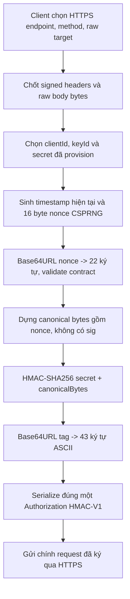

# Nonce field trong Authorization header khi xác thực HTTP request bằng HMAC

## Mục tiêu học tập

Sau bài học, bạn có thể:

- Giải thích **`nonce` là một authentication parameter bên trong header `Authorization`** của một HMAC scheme tự định nghĩa, khác với nonce ở query string, trong JSON body hoặc một header `X-Nonce` riêng.
- Thiết kế cú pháp `Authorization: HMAC-V1 ... nonce="..." ...` có **một nonce field bắt buộc**, quy tắc quote, alphabet, độ dài, phát hiện tham số trùng và cách xử lý tên scheme/parameter không phân biệt hoa thường.
- Phân biệt **16 byte nonce ngẫu nhiên**, **128 bit không gian giá trị**, **22 ký tự Base64URL không padding**, và biết tại sao kiểm tra đúng 22 ký tự **chưa đủ** nếu không decode/re-encode canonical.
- Hiểu việc **parse nonce chưa chứng minh nó hợp lệ về bảo mật**: chỉ sau khi nonce đã được đưa vào canonical request, HMAC khớp và nonce store claim thành công mới kết luận request đã vượt qua replay gate.
- Viết Java 17+ để **tạo và parse Authorization header**, tính lại HMAC-SHA256 từ incoming request, kiểm tra format và so MAC bằng `MessageDigest.isEqual`.
- Chặn các sai lệch do **duplicate Authorization/nonce parameter**, proxy/gateway làm mất header hoặc rewrite signed fields, nonce replay giữa nhiều replica, TTL không đủ và namespace bị tách khi rotate key.
- Phân biệt **authentication**, **replay protection**, **idempotency** và **authorization**, đưa ra ma trận kiểm thử từ parser đến backend.

**Bối cảnh:** Bài thuộc chương **Authorization header**, chủ đề **Nonce field**, của module `SECURITY_AUTHENTICATION_HMAC_REQUEST_AUTHENTICATION`. Module nghiên cứu xác thực HTTP request bằng **HMAC với shared secret**, canonical request gồm method, URI, header và/hoặc body theo hợp đồng, xác minh chữ ký, timestamp/nonce chống replay, key rotation, kiểm thử proxy/gateway và phân biệt xác thực với phân quyền. Bài này tập trung vào **vị trí, cú pháp và ngữ nghĩa nonce trong chính Authorization header** — không chỉ dạy sinh nonce hoặc dùng nonce store.

> **Quy ước:** `HMAC-V1` và các `auth-param` dưới đây là **giao thức minh họa tự thiết kế**, không phải wire format chuẩn chung của mọi HMAC API. Client và verifier phải cùng dùng một hợp đồng được công bố; không mặc định một SDK hay gateway sẽ tự hiểu `HMAC-V1`.

## 1. Vì sao nonce có thể nằm ngay trong Authorization header?

HTTP `Authorization` dùng để mang thông tin xác thực của client theo một **authentication scheme**. Ví dụ, một scheme riêng có thể đặt tất cả thông tin HMAC trong **một header**:

```http
POST /v1/orders HTTP/1.1
Host: api.example.test
Content-Type: application/json
Idempotency-Key: order-2026-001
Authorization: HMAC-V1 client="partner-17", keyid="k2", ts="<unix-seconds>", nonce="<22-char-base64url>", sig="<43-char-base64url>"

{"orderId":"O-42","amountMinor":120000}
```

Các chuỗi có `<...>` là **placeholder**, không phải request đã ký hợp lệ.

Phần nonce là **tham số** trong credential của Authorization:

```text
Authorization: HMAC-V1 client="...", keyid="...", ts="...", nonce="...", sig="..."
                   │         │           │         │          │          │
                   │         │           │         │          │          └─ HMAC tag
                   │         │           │         │          └─ nonce field
                   │         │           │         └─ thời điểm ký
                   │         │           └─ phiên bản khóa
                   │         └─ client claim (chưa đáng tin trước HMAC)
                   └─ authentication scheme
```

**Nonce không phải mật khẩu hay secret.** Nó là một giá trị phân biệt lần gửi, do client chọn, được **ràng buộc bằng HMAC** và được **nonce store** ghi nhớ sau xác minh. Nếu toàn bộ Authorization bị lộ trong cửa sổ hợp lệ, attacker có thể thử phát lại request nguyên vẹn; **không log nguyên header** chỉ vì nonce là dữ liệu không bí mật.

### Hai kiểu bố trí hợp lệ nếu có hợp đồng

| Bố trí | Ví dụ | Điều phải thống nhất |
|---|---|---|
| **Trong Authorization** (bài này) | `Authorization: HMAC-V1 ... nonce="N" ...` | Parser scheme/auth-param, parameter duy nhất, nonce text đưa vào canonical |
| Header riêng | `X-Nonce: N` cùng `X-Signature: S` | Header cardinality, case của field name, cách ký các header riêng |

Hai giao thức **không tự tương thích**. Nếu client gửi nonce trong Authorization, verifier không được âm thầm lấy `X-Nonce` bên ngoài như một nguồn thay thế. Ngược lại, một middleware tự sao chép nonce từ Authorization ra `X-Nonce` nhưng backend lại ưu tiên header ngoài có thể tạo **parser differential**.

### Một nonce field thực sự mang ý nghĩa gì?

Khi client gửi `nonce="N"`, nó đang khẳng định: “Đây là giá trị nonce mà tôi đưa vào dữ liệu ký cho request này.” Server phải kiểm tra **N có cùng canonical representation**, **HMAC thực sự bao phủ N** và **N chưa được chấp nhận trong replay namespace**. Không có bước nào trong ba bước được suy ra chỉ từ việc field xuất hiện.

## 2. Định nghĩa wire contract `HMAC-V1` cho nonce field

Để tránh cách hiểu nhập nhằng, ta chọn một **profile hẹp có phiên bản**:

```text
Authorization: HMAC-V1 client="<client-id>", keyid="<key-id>", ts="<epoch-seconds>", nonce="<nonce-b64url>", sig="<tag-b64url>"
```

Các giới hạn cụ thể:

| Thành phần | Quy tắc |
|---|---|
| Header name | `Authorization`; **đúng một occurrence** trên incoming HTTP request |
| Authentication scheme | `HMAC-V1`; **case-insensitive** đối với tên scheme, khi ký chuẩn hóa thành `hmac-v1` |
| Parameter names | `client`, `keyid`, `ts`, `nonce`, `sig`; **case-insensitive** về tên, canonical hóa semantic names |
| Số parameter | **Chính xác 5**, không thiếu, không thêm, không duplicate kể cả tên khác case |
| Thứ tự | Profile serializer/parser nhận thứ tự cố định `client, keyid, ts, nonce, sig` |
| Phân cách | Chính xác `, ` (dấu phẩy rồi một dấu cách), một dấu cách sau scheme |
| Giá trị | **Quoted value** với dấu `"`; allowlist ASCII hẹp, cấm escape/backslash/CR/LF |
| `client` và `keyid` | `[A-Za-z0-9][A-Za-z0-9._-]{0,63}`; **giá trị phân biệt hoa/thường** |
| `ts` | Unix epoch seconds dạng ASCII decimal `[1-9][0-9]{0,11}`, trong cửa sổ clock server |
| **`nonce`** | **16 raw bytes CSPRNG → Base64URL không padding đúng 22 ký tự**, decode/re-encode canonical |
| `sig` | HMAC-SHA256 **32 byte** → Base64URL không padding đúng 43 ký tự, canonical |
| Shared secret | **Không bao giờ xuất hiện trong Authorization**; tra từ key store/KMS đúng scope |
| Algorithm | `HmacSHA256` cố định theo server policy; không có `alg=none` từ client |

**Phân biệt rõ quy tắc HTTP và quy tắc profile:** theo HTTP authentication, tên scheme và auth-param không phân biệt hoa/thường, và các cú pháp auth-param tổng quát có thể chấp nhận khoảng trắng/thứ tự/quoted-string linh hoạt hơn. Bài **cố tình giới hạn một serialization duy nhất** (ngoài case tên) để dễ kiểm thử và loại parser ambiguity. **Không** suy từ profile này rằng HTTP nói chung cấm mọi dạng thứ tự tham số hay optional whitespace khác.

### Nonce field không thể xuất hiện hai lần

Các chuỗi sau **phải bị từ chối**:

```http
Authorization: HMAC-V1 client="partner-17", keyid="k2", ts="1700000000", nonce="N1", nonce="N2", sig="S"
Authorization: HMAC-V1 client="partner-17", keyid="k2", ts="1700000000", nonce="N1", NONCE="N2", sig="S"
Authorization: HMAC-V1 client="partner-17", keyid="k2", ts="1700000000", sig="S"
```

`N1`, `N2` và `S` là placeholder. Không chọn nonce đầu/nonce cuối. Một verifier lấy `nonce=N1` nhưng replay store lấy `nonce=N2` có thể **xác minh một giá trị nhưng claim giá trị khác**, làm mất ý nghĩa chống replay.

**Yêu cầu hệ thống:** parser trả về **một cấu trúc immutable** gồm một nonce text đã validate; cả canonical builder và nonce store đều dùng **đúng cùng giá trị** đó.

## 3. Độ dài nonce field: 16 byte ≠ 22 ký tự

Profile dùng **CSPRNG** sinh **16 byte** và mã hóa Base64URL không padding.

```text
new SecureRandom().nextBytes(rawNonce[16])
                |
                v
rawNonce: 16 bytes = 128 bits ngẫu nhiên (nếu RNG tốt)
                |
                v
Base64URL without padding
                |
                v
nonceText: 22 ASCII characters
                |
                v
Authorization: ... nonce="<nonceText>" ...
```

**Vì sao 22 ký tự?** 16 byte gồm 5 nhóm 3 byte và 1 byte dư: 5×4 + 2 = **22** ký tự Base64 không padding. Nếu có padding, sẽ là **24 ký tự với `==`**, bị cấm bởi profile.

| Dữ liệu | Độ dài raw | Biểu diễn Base64URL không padding | Vai trò |
|---|---:|---:|---|
| Nonce profile này | **16 byte** | **22 ký tự** | Dữ liệu ngẫu nhiên duy nhất theo cửa sổ/scope |
| Nonce 12 byte | 12 byte | 16 ký tự | Không thuộc profile, dù entropy có thể phù hợp giao thức khác |
| Nonce 24 byte | 24 byte | 32 ký tự | Không thuộc profile |
| Tag HMAC-SHA256 | **32 byte** | **43 ký tự** | Kết quả HMAC dùng để xác minh |
| Nonce hex của 16 byte | 16 byte | 32 ký tự hex | Không được chấp nhận nếu contract chọn Base64URL |

Đừng nhầm **độ dài field** với **entropy**. Một nonce 22 ký tự được sinh bằng counter hoặc timestamp có thể rất dễ dự đoán; độ dài text không chứng minh ngẫu nhiên. Một UUIDv4 biểu diễn 16 byte nhưng chỉ khoảng **122 bit ngẫu nhiên** do bit version/variant cố định, và UUID text 36 ký tự có dấu `-` không thuộc grammar này.

### Một nonce hợp lệ về encoding không nhất thiết là nonce được sinh đúng

Ví dụ nonce toàn zero:

```text
AAAAAAAAAAAAAAAAAAAAAA
```

Nó có **22 chữ A**, decode thành **16 bytes giá trị 0** và thỏa grammar. Nhưng nếu client dùng giá trị này ở mọi lần ký, request mới thứ hai sẽ bị replay gate reject. Verifier không thể “nhìn” nonce text rồi chứng minh client đã dùng CSPRNG; nó kiểm tra format, chữ ký, **và uniqueness đã quan sát**.

## 4. Kiểm tra Base64URL canonical cho nonce parameter

Chỉ regex `[A-Za-z0-9_-]{22}` là chưa đủ. Vì 16 bytes khi encode Base64 dư một byte, **4 bit thấp** trong ký tự Base64 cuối phải bằng 0 theo encoding canonical. Một decoder dễ dãi có thể decode hai chuỗi text khác nhau thành **cùng 16 bytes**.

Ví dụ:

```text
Canonical, 16 bytes toàn 00:
AAAAAAAAAAAAAAAAAAAAAA

Noncanonical pad bits, có thể decode ra cùng bytes:
AAAAAAAAAAAAAAAAAAAAAB
```

Một validator tốt:

1. Kiểm tra input **không null**, chính xác 22 ký tự ASCII trong alphabet Base64URL.
2. Decode Base64URL, yêu cầu **chính xác 16 bytes**.
3. Encode lại bằng Base64URL không padding.
4. Bắt buộc text sau encode lại **bằng chính xác** text trong field.
5. **Không normalize** bằng cách sửa noncanonical text rồi đưa bản sửa vào canonical HMAC. Phải **reject**.

Đối với 16 bytes, ký tự cuối canonical chỉ có thể là một trong **`A`, `Q`, `g`, `w`** (do chỉ có 2 bit dữ liệu ở vị trí cuối). Đây là tính chất cấu trúc của format, **không phải** bằng chứng RNG yếu.

### Java strict decoder

```java
import java.util.Base64;
import java.util.regex.Pattern;

public final class NonceAuthParamFormat {
    private static final Pattern NONCE =
            Pattern.compile("[A-Za-z0-9_-]{22}");
    private static final Base64.Encoder BASE64URL =
            Base64.getUrlEncoder().withoutPadding();

    public static byte[] decode16Bytes(String nonceText) {
        if (nonceText == null || !NONCE.matcher(nonceText).matches()) {
            throw new IllegalArgumentException("Invalid nonce auth-param");
        }
        final byte[] bytes;
        try {
            bytes = Base64.getUrlDecoder().decode(nonceText);
        } catch (IllegalArgumentException invalid) {
            throw new IllegalArgumentException("Invalid Base64URL encoding");
        }
        if (bytes.length != 16 ||
                !BASE64URL.encodeToString(bytes).equals(nonceText)) {
            throw new IllegalArgumentException("Noncanonical nonce");
        }
        return bytes;
    }
}
```

**Quan trọng:** `String.equals` trong phép **re-encode check** chỉ so **biểu diễn public của nonce**, không phải so MAC bí mật. Đến bước xác minh HMAC, so **tag bytes** bằng `MessageDigest.isEqual`.

### Sai format khác với nonce đã dùng

- `nonce=""`: thiếu giá trị → **reject format**.
- `nonce="abc"`: quá ngắn → **reject format**.
- `nonce="<22 chars noncanonical>"`: sai pad bits → **reject format**.
- `nonce="<22 chars canonical>"` mà đã có trong nonce store → **reject replay**, dù format và HMAC có thể đúng.
- Nonce 22 chars canonical mới nhưng `sig` sai → **reject authentication**, **không claim nonce**.

Chính sự phân biệt này giúp thiết kế metrics, xử lý HTTP status và debug chính xác.

## 5. Parse Authorization: đừng để nonce bị hiểu khác nhau

HTTP authentication header có thể chứa nhiều `auth-param`, có dấu phẩy, dấu nháy, tên không phân biệt hoa/thường. Một số parser đơn giản dùng:

```java
String[] fields = authorizationHeader.split(",");
```

Cách làm ấy dễ sai với **quoted-string** hoặc parameter có escape trong giao thức tổng quát. Nếu hai tầng parser khác nhau, một bên có thể ký `nonce=N1`, bên kia ghi `nonce=N2`.

Trong **profile hạn chế** của bài:

- Client **luôn tạo** đúng 5 auth-param theo thứ tự cố định.
- Mỗi giá trị phải match allowlist ASCII hẹp; **không hỗ trợ escaped quote, backslash, dấu phẩy trong value**.
- Verifier dùng một parser khớp **toàn chuỗi** (full match) hoặc một state-machine có kiểm tra duplicate và grammar tương đương.
- Tên scheme/parameter có thể khác case, nhưng **giá trị** nonce, client ID, key ID **phân biệt case**.
- Không có extra parameter `nonce2` hoặc `algorithm` làm verifier đổi chính sách.

### Những input có hại hoặc nhập nhằng

| Input | Vì sao reject? |
|---|---|
| Hai header `Authorization` | Một hop chọn first, hop khác chọn last; không được hợp nhất |
| Hai `nonce` trong một Authorization | Ambiguity giữa canonical builder và store |
| `nonce` và `NONCE` cùng xuất hiện | Tên auth-param case-insensitive, thực chất duplicate |
| `nonce=N` không quote | Profile yêu cầu `nonce="N"` |
| `nonce="N,extra=..."` | Dấu phẩy trong value nằm ngoài allowlist |
| `nonce="N\\"other"` | Backslash/escape nằm ngoài grammar |
| `nonce=""` | Nonce rỗng, không có dữ liệu |
| `nonce="N" , sig="S"` | Spacing ngoài serialization profile |
| `nonce="N"` có CR/LF | Header injection hoặc invalid wire value |
| `nonce="N="` | Padding bị cấm |
| `nonce` text 32 ký tự hex | Không thuộc Base64URL 22 ký tự |
| `nonce` đúng định dạng nhưng không ký | Có thể bị thay để bypass replay store |

**Đây là yêu cầu của profile, không phải kết luận chung rằng một HTTP auth-param hợp lệ không bao giờ có escape hoặc có thể đổi thứ tự.** Nếu hệ thống cần parser linh hoạt hơn, phải viết grammar/normalization cho mọi biến thể và kiểm thử tương thích.

### Tách ba loại đồng nhất

1. **Header name identity:** `Authorization` và `authorization` là cùng HTTP header (so không phân biệt case).
2. **Auth-param name identity:** `nonce` và `NONCE` là cùng tên tham số.
3. **Nonce value identity:** `Abc...` và `abc...` là **hai giá trị khác**; không lowercase hoặc normalize value.

Nhầm lẫn 2 và 3 là một cách rất phổ biến để tạo lỗi canonicalization hoặc replay detection.

## 6. Nonce field phải được đưa vào canonical request như thế nào?

Nếu server chỉ ký method, URI và body mà **không ký nonce**, attacker có thể thay `nonce` bên trong Authorization thành giá trị mới trong khi giữ tag HMAC cũ. Khi ấy nonce store nhìn thấy giá trị mới chưa dùng và có thể cho cùng request chạy lại.

**Cách đúng:** sau khi parse Authorization, verifier đưa **chính nonce text đã được validate** vào canonical request, bên cạnh các trường đã ký khác.

Hợp đồng `hmac-authorization-nonce-v1` cho endpoint `POST /v1/orders`:

```text
hmac-authorization-nonce-v1
POST
/v1/orders
host:api.example.test
content-type:application/json
idempotency-key:order-2026-001
auth-scheme:hmac-v1
client:partner-17
keyid:k2
ts:<unix-seconds>
nonce:<base64url-22-chars>
body-sha256:<base64url-sha256-exact-raw-body>
```

**Quy tắc bytes:**

- Nối dòng bằng một byte **LF** (`0x0A`), không thêm LF cuối.
- Encode canonical text bằng **UTF-8 không BOM**.
- Tên dòng cố định và chữ thường. `hmac-v1` đã được canonical hóa từ tên scheme, không tự cho phép client ép dùng thuật toán khác.
- `client`, `keyid`, `ts` và **`nonce`** là **giá trị đã parse**, không kèm dấu quote/comma của Authorization serialization.
- `sig` **không nằm trong thông điệp ký** để tránh vòng lặp tự tham chiếu.
- `body-sha256` được tính từ **exact raw body bytes** của request mà backend dùng, không tin body hash do client gửi.
- Method, target, Host/authority, Content-Type và Idempotency-Key được ký vì chúng tác động tới đích xử lý/operation.
- Verifier **tự dựng canonical bytes** từ request thực nhận cộng AuthClaims đã parse; không nhận một chuỗi “canonical” do client gửi rồi ký lại chuỗi ấy.

### Ví dụ sửa đúng một ký tự nonce

```text
Client đã ký:
nonce:Abc...A
sig:Base64URL(HMAC(secret, canonicalWithNonceA))

Attacker sửa Authorization:
nonce:Abc...Q
sig:giữ nguyên giá trị cũ
```

Nếu nonce mới vẫn hợp format, canonical bytes phía server sẽ khác, expected HMAC tag khác và verifier **từ chối trước khi claim nonce mới**. Đây là bảo đảm của việc ký nonce. Đừng “verify HMAC trước với nonce đã được chuẩn hóa từ input cũ” hoặc cho nonce store dùng giá trị khác với giá trị đã ký.

## 7. Quy trình client tạo Authorization với nonce field

Client cần **tạo nonce trước khi tính chữ ký**, bởi nonce là một input của HMAC.



**Quy trình chi tiết:**

1. Chọn method/URI công khai từ cấu hình tin cậy. Nếu gateway rewrite path/Host, phải có hợp đồng xác định vị trí verify và nguồn dữ liệu original đáng tin.
2. Serialize body một lần. Giữ nguyên `byte[]` dùng cho hash và HTTP sending; không để interceptor đổi JSON, whitespace, charset sau ký.
3. Lấy client/key ID và secret đã provision từ secret manager/config của client; không gửi secret trong Authorization.
4. Dùng `SecureRandom.nextBytes(new byte[16])`. Không dùng timestamp, `Random`, UUID text hoặc counter lặp như một thay thế tùy tiện cho nonce CSPRNG profile.
5. Encode nonce bằng `Base64.getUrlEncoder().withoutPadding()`; lấy timestamp Unix epoch seconds.
6. Dựng canonical text, bao gồm `nonce:` + nonce text; tính HMAC-SHA256 bằng `Mac`.
7. Encode raw tag 32 byte thành Base64URL không padding 43 ký tự và gắn vào `sig`.
8. Serialize **một** Authorization header. Không thêm `X-Nonce` ngoài profile và không để HTTP client tự copy `Authorization` sang origin khác khi redirect.
9. Với **mỗi HTTP attempt được ký lại**, tạo timestamp/nonce/tag mới. Nếu là retry cùng *logical operation*, giữ nguyên `Idempotency-Key` và business payload theo hợp đồng.

### Nonce mới và Idempotency-Key ổn định có mâu thuẫn?

Không. Hai giá trị phục vụ hai mục đích:

```text
Logical operation "create-order-123":
  Idempotency-Key = I               // giữ nguyên qua retries
  body             = P               // giữ nguyên

HTTP attempt 1:
  nonce = N1, timestamp = T1, sig = S1

HTTP attempt 2 (client re-sign sau timeout):
  nonce = N2, timestamp = T2, sig = S2
```

Replay gate nhận diện **attempt bị phát lại nguyên văn**, còn idempotency ledger nhận diện **cùng ý định nghiệp vụ**, kể cả attempt có chữ ký mới.

## 8. Server verify nonce field theo thứ tự nào?

```mermaid
sequenceDiagram
    autonumber
    participant C as HMAC Client
    participant G as Gateway / Ingress
    participant V as HMAC Verifier
    participant K as Scoped Key Store
    participant N as Shared Nonce Store
    participant B as Backend
    C->>C: Sinh nonce N, ký cả nonce, tạo Authorization HMAC-V1
    C->>G: HTTPS request + Authorization
    G->>G: Reject duplicate Authorization; HTTP/URI/body limits
    G->>V: Trusted request snapshot + một Authorization value
    V->>V: Parse scheme, client/keyid/ts/nonce/sig và strict formats
    V->>V: Time-window prefilter theo clock server
    V->>K: Lookup(env, clientId, keyId, audience)
    K-->>V: Key record + secret + principal + key state
    V->>V: Canonicalize incoming method/URI/Host/headers/body + nonce
    V->>V: Compute HMAC; compare full 32-byte tags
    alt Invalid key, format hoặc MAC
        V-->>G: Reject authentication, không claim nonce
        G-->>C: Error
    else HMAC hợp lệ
        V->>N: Atomic claim(env,audience,client,nonce,TTL)
        alt Nonce đã dùng hoặc store lỗi
            V-->>G: Reject replay / fail closed
            G-->>C: Error
        else Fresh nonce
            N-->>V: Claimed
            V->>B: Authenticated principal + verified request snapshot
            B->>B: Resource authorization + idempotency + transaction
            B-->>G: Business outcome
            G-->>C: HTTPS response
        end
    end
```

### Các kiểm tra riêng cho nonce field

| Thời điểm | Cần kiểm tra | Vì sao |
|---|---|---|
| HTTP parser | Có **một** Authorization header, không duplicate hoặc nhập nhằng | Verifier và backend phải nhìn cùng credential |
| Authorization parser | Scheme đúng, có **một** `nonce` param | Không có parser differential |
| Format | 22 Base64URL chars, decode 16 bytes, canonical re-encode | Không nhiều biểu diễn cùng một nonce |
| Canonical builder | Chính nonce text đó nằm trong HMAC message | Không cho attacker thay nonce giữ sig cũ |
| HMAC verifier | Secret đúng scope, tag đủ 32 bytes, `MessageDigest.isEqual` | Chứng minh nonce được client có key ký |
| Replay gate | Claim nonce nguyên tử trong shared store với TTL đúng | Phát hiện nonce đã dùng |
| Backend | Principal đã verify + authorization/idempotency | Nonce mới không đồng nghĩa được phép thực thi |

**Không claim nonce trước HMAC.** Nếu ghi nonce do attacker tự khai trước khi xác minh tag, attacker có thể chiếm nonce của request hợp lệ và gây DoS. Mặt khác, HMAC đúng cũng không tự chứng minh nonce chưa dùng; **cần state**.

## 9. Java 17+: tạo, parse và xác minh Authorization nonce field

Đoạn mã tự chứa dưới đây có phần **client serializer**, **strict Authorization parser**, **canonical HMAC** và **server verifier**. Nó chỉ áp dụng cho profile `POST /v1/orders` với Host, Content-Type và target cố định để tập trung vào nonce field; HTTP adapter thực tế vẫn phải xử lý header cardinality, framing và trust boundary.

### 9.1. Mã Java đầy đủ

```java
import java.nio.charset.StandardCharsets;
import java.security.GeneralSecurityException;
import java.security.MessageDigest;
import java.security.SecureRandom;
import java.time.Clock;
import java.time.Instant;
import java.time.ZoneOffset;
import java.util.Base64;
import java.util.Optional;
import java.util.Set;
import java.util.concurrent.ConcurrentHashMap;
import java.util.regex.Matcher;
import java.util.regex.Pattern;
import javax.crypto.Mac;
import javax.crypto.spec.SecretKeySpec;

public final class AuthorizationNonceV1 {
    private static final String VERSION = "hmac-authorization-nonce-v1";
    private static final String HOST = "api.example.test";
    private static final String TARGET = "/v1/orders";
    private static final String CONTENT_TYPE = "application/json";
    private static final String AUDIENCE = "orders-api";
    private static final long WINDOW_SECONDS = 300;
    private static final long NONCE_TTL_SECONDS = 605;
    private static final long MAX_EPOCH_SECONDS = 253402300799L;

    private static final Base64.Encoder B64 =
            Base64.getUrlEncoder().withoutPadding();
    private static final Pattern ID =
            Pattern.compile("[A-Za-z0-9][A-Za-z0-9._-]{0,63}");
    private static final Pattern IDEMPOTENCY =
            Pattern.compile("[A-Za-z0-9][A-Za-z0-9._-]{0,79}");
    private static final Pattern TS =
            Pattern.compile("[1-9][0-9]{0,11}");
    private static final Pattern NONCE =
            Pattern.compile("[A-Za-z0-9_-]{22}");
    private static final Pattern SIG =
            Pattern.compile("[A-Za-z0-9_-]{43}");

    // Toàn chuỗi: scheme và PARAMETER NAMES case-insensitive,
    // values giữ nguyên case; dấu phẩy/space/quotes cố định.
    private static final Pattern AUTH = Pattern.compile(
            "(?i:HMAC-V1) (?i:client)=\"([A-Za-z0-9][A-Za-z0-9._-]{0,63})\", " +
            "(?i:keyid)=\"([A-Za-z0-9][A-Za-z0-9._-]{0,63})\", " +
            "(?i:ts)=\"([1-9][0-9]{0,11})\", " +
            "(?i:nonce)=\"([A-Za-z0-9_-]{22})\", " +
            "(?i:sig)=\"([A-Za-z0-9_-]{43})\"");

    private AuthorizationNonceV1() {}

    public record Claims(
            String clientId, String keyId, String timestamp, String nonce) {}

    public record Parsed(Claims claims, byte[] receivedTag) {}

    // Cấu trúc do trusted HTTP adapter tạo; body được clone.
    public record Request(
            String method, String rawTarget, String verifiedPublicHost,
            String contentType, String idempotencyKey, byte[] rawBody) {
        public Request {
            if (rawBody == null) {
                throw new IllegalArgumentException("Missing body");
            }
            rawBody = rawBody.clone();
        }
        @Override
        public byte[] rawBody() {
            return rawBody.clone();
        }
    }

    public record KeyRecord(
            String environment, String clientId, String keyId,
            String audience, String principal, boolean canVerify,
            byte[] secret) {}

    public interface KeyStore {
        Optional<KeyRecord> lookup(
                String environment, String clientId,
                String keyId, String audience);
    }

    // Production: atomic insert-if-absent + TTL, shared qua replicas.
    public interface NonceStore {
        boolean claim(
                String environment, String audience,
                String authenticatedClientId, String nonce, long ttlSeconds);
    }

    public static String newNonce(SecureRandom csprng) {
        byte[] raw = new byte[16];
        csprng.nextBytes(raw);
        return B64.encodeToString(raw); // 22 characters.
    }

    private static byte[] decodeCanonical(
            String text, Pattern grammar, int requiredBytes) {
        if (text == null || !grammar.matcher(text).matches()) {
            throw new IllegalArgumentException("Invalid auth-param format");
        }
        final byte[] bytes;
        try {
            bytes = Base64.getUrlDecoder().decode(text);
        } catch (IllegalArgumentException malformed) {
            throw new IllegalArgumentException("Invalid Base64URL");
        }
        if (bytes.length != requiredBytes ||
                !B64.encodeToString(bytes).equals(text)) {
            throw new IllegalArgumentException("Noncanonical Base64URL");
        }
        return bytes;
    }

    private static long validateTimestamp(String text) {
        if (text == null || !TS.matcher(text).matches()) {
            throw new IllegalArgumentException("Invalid timestamp text");
        }
        long timestamp = Long.parseLong(text);
        if (timestamp > MAX_EPOCH_SECONDS) {
            throw new IllegalArgumentException("Unsupported timestamp");
        }
        return timestamp;
    }

    private static void validateClaims(Claims claims) {
        if (claims == null || claims.clientId() == null ||
                !ID.matcher(claims.clientId()).matches() ||
                claims.keyId() == null ||
                !ID.matcher(claims.keyId()).matches()) {
            throw new IllegalArgumentException("Invalid client/key ID");
        }
        validateTimestamp(claims.timestamp());
        decodeCanonical(claims.nonce(), NONCE, 16);
    }

    public static Parsed parse(String headerValue) {
        // HTTP adapter TRƯỚC ĐÓ phải reject duplicate Authorization.
        if (headerValue == null || headerValue.length() > 512) {
            throw new IllegalArgumentException("Invalid Authorization");
        }
        Matcher match = AUTH.matcher(headerValue);
        if (!match.matches()) {
            throw new IllegalArgumentException("Invalid Authorization");
        }
        Claims claims = new Claims(
                match.group(1), match.group(2),
                match.group(3), match.group(4));
        validateClaims(claims);
        byte[] tag = decodeCanonical(match.group(5), SIG, 32);
        return new Parsed(claims, tag);
    }

    private static byte[] canonical(Request request, Claims claims)
            throws GeneralSecurityException {
        validateClaims(claims);
        if (request == null ||
                !"POST".equals(request.method()) ||
                !TARGET.equals(request.rawTarget()) ||
                !HOST.equals(request.verifiedPublicHost()) ||
                !CONTENT_TYPE.equals(request.contentType()) ||
                request.idempotencyKey() == null ||
                !IDEMPOTENCY.matcher(request.idempotencyKey()).matches() ||
                request.rawBody().length == 0 ||
                request.rawBody().length > 16384) {
            throw new IllegalArgumentException("Invalid signed request");
        }

        byte[] bodyHash = MessageDigest.getInstance("SHA-256")
                .digest(request.rawBody());
        String canonicalText = String.join("\n",
                VERSION,
                "POST",
                TARGET,
                "host:" + request.verifiedPublicHost(),
                "content-type:" + request.contentType(),
                "idempotency-key:" + request.idempotencyKey(),
                "auth-scheme:hmac-v1",
                "client:" + claims.clientId(),
                "keyid:" + claims.keyId(),
                "ts:" + claims.timestamp(),
                "nonce:" + claims.nonce(),
                "body-sha256:" + B64.encodeToString(bodyHash));

        return canonicalText.getBytes(StandardCharsets.UTF_8);
    }

    private static byte[] computeTag(
            byte[] secret, Request request, Claims claims)
            throws GeneralSecurityException {
        Mac mac = Mac.getInstance("HmacSHA256");
        mac.init(new SecretKeySpec(secret, "HmacSHA256"));
        return mac.doFinal(canonical(request, claims)); // 32 bytes.
    }

    // Client: tạo header SAU khi đã chốt signed request fields.
    public static String createAuthorization(
            byte[] secret, Request request, Claims claims)
            throws GeneralSecurityException {
        String signature = B64.encodeToString(
                computeTag(secret, request, claims));
        return "HMAC-V1 client=\"" + claims.clientId() +
               "\", keyid=\"" + claims.keyId() +
               "\", ts=\"" + claims.timestamp() +
               "\", nonce=\"" + claims.nonce() +
               "\", sig=\"" + signature + "\"";
    }

    // Server: chỉ trả principal sau MAC valid và nonce claim thành công.
    public static Optional<String> authenticate(
            Request received, String authorizationValue,
            String serverEnvironment, Clock clock,
            KeyStore keys, NonceStore nonces)
            throws GeneralSecurityException {

        final Parsed auth;
        try {
            auth = parse(authorizationValue);
            canonical(received, auth.claims()); // Validate signed fields.
        } catch (IllegalArgumentException malformed) {
            return Optional.empty();
        }

        long timestamp = validateTimestamp(auth.claims().timestamp());
        long now = clock.instant().getEpochSecond();
        if (now < 0 || now > MAX_EPOCH_SECONDS ||
                timestamp - now < -WINDOW_SECONDS ||
                timestamp - now > WINDOW_SECONDS) {
            return Optional.empty();
        }

        // Chỉ dùng clientId/keyId từ header để tra key ứng viên.
        Optional<KeyRecord> candidate = keys.lookup(
                serverEnvironment, auth.claims().clientId(),
                auth.claims().keyId(), AUDIENCE);
        if (candidate.isEmpty()) return Optional.empty();

        KeyRecord key = candidate.get();
        if (!key.canVerify() ||
                !serverEnvironment.equals(key.environment()) ||
                !AUDIENCE.equals(key.audience()) ||
                !auth.claims().clientId().equals(key.clientId()) ||
                !auth.claims().keyId().equals(key.keyId()) ||
                key.principal() == null ||
                key.secret() == null ||
                key.secret().length < 32) {
            return Optional.empty();
        }

        byte[] expected = computeTag(
                key.secret(), received, auth.claims());
        if (!MessageDigest.isEqual(expected, auth.receivedTag())) {
            return Optional.empty();
        }

        // Sau MAC mới claim nonce. Scope KHÔNG chứa keyId.
        final boolean fresh;
        try {
            fresh = nonces.claim(
                    serverEnvironment, AUDIENCE,
                    key.clientId(), auth.claims().nonce(),
                    NONCE_TTL_SECONDS);
        } catch (RuntimeException storeFailure) {
            return Optional.empty(); // Fail closed; operational alert.
        }
        if (!fresh) return Optional.empty();

        return Optional.of(key.principal()); // Authn; chưa phải authz.
    }

    public static void main(String[] args)
            throws GeneralSecurityException {
        SecureRandom rng = new SecureRandom();
        byte[] secret = new byte[32];
        rng.nextBytes(secret);
        Clock fixed = Clock.fixed(
                Instant.parse("2026-11-28T00:00:00Z"), ZoneOffset.UTC);

        Claims claims = new Claims(
                "partner-17", "k2",
                Long.toString(fixed.instant().getEpochSecond()),
                newNonce(rng));
        Request request = new Request(
                "POST", TARGET, HOST, CONTENT_TYPE, "order-2026-001",
                "{\"orderId\":\"O-42\",\"amountMinor\":120000}"
                        .getBytes(StandardCharsets.UTF_8));
        String header = createAuthorization(secret, request, claims);

        Parsed parsed = parse(header);
        if (!claims.nonce().equals(parsed.claims().nonce()) ||
                parsed.receivedTag().length != 32) {
            throw new AssertionError("Parser changed nonce or MAC");
        }

        KeyStore keys = (env, client, keyId, audience) ->
                "production".equals(env) &&
                "partner-17".equals(client) &&
                "k2".equals(keyId) &&
                AUDIENCE.equals(audience)
                ? Optional.of(new KeyRecord(
                    env, client, keyId, audience,
                    "partner-17", true, secret))
                : Optional.empty();

        // TEST ONLY: local, không TTL, không durable/multi-replica.
        Set<String> seen = ConcurrentHashMap.newKeySet();
        NonceStore store = (env, audience, client, nonce, ttl) ->
                seen.add(env + "|" + audience + "|" + client + "|" + nonce);

        if (!"partner-17".equals(authenticate(
                request, header, "production", fixed,
                keys, store).orElse(null))) {
            throw new AssertionError("Valid header rejected");
        }
        if (authenticate(request, header, "production",
                fixed, keys, store).isPresent()) {
            throw new AssertionError("Replay accepted");
        }

        // Sửa nonce, giữ signature cũ: HMAC không được khớp.
        byte[] changedBytes = decodeCanonical(claims.nonce(), NONCE, 16);
        changedBytes[0] ^= 1;
        String changedNonce = B64.encodeToString(changedBytes);
        String tampered = header.replace(
                "nonce=\"" + claims.nonce() + "\"",
                "nonce=\"" + changedNonce + "\"");
        Parsed changed = parse(tampered);
        if (MessageDigest.isEqual(
                computeTag(secret, request, changed.claims()),
                changed.receivedTag())) {
            throw new AssertionError("Changed nonce kept valid MAC");
        }

        // Tên auth scheme/param khác case vẫn được parse;
        // GIÁ TRỊ nonce không được tự lowercase.
        String otherCase = header.replace(
                "HMAC-V1 client=", "hmac-v1 CLIENT=");
        if (!parse(otherCase).claims().nonce().equals(claims.nonce())) {
            throw new AssertionError("Param case changed nonce");
        }

        for (String malformed : new String[] {
                header.replace("nonce=\"" + claims.nonce() + "\"",
                               "nonce=\"AAAAAAAAAAAAAAAAAAAAAB\""),
                header.replace("nonce=\"" + claims.nonce() + "\"",
                               "nonce=\"" + claims.nonce() +
                               "\", NONCE=\"" + claims.nonce() + "\""),
                header.replace("nonce=\"" + claims.nonce() + "\"",
                               "nonce=\"" + claims.nonce() + "==\"")
        }) {
            try {
                parse(malformed);
                throw new AssertionError("Malformed auth-param accepted");
            } catch (IllegalArgumentException expected) {
                // PASS.
            }
        }
        System.out.println("Authorization nonce field: PASS");
    }
}
```

### 9.2. Những bảo đảm ví dụ thể hiện

- **Client:** `newNonce` dùng `SecureRandom` để tạo 16 raw bytes, Base64URL không padding thành 22 ký tự. `createAuthorization` chỉ chạy sau khi đã chốt signed request.
- **Parser:** một regex full match cho profile hạn chế; scheme và parameter names case-insensitive, **values case-sensitive**, đúng 5 tham số và thứ tự/spacing cố định. `nonce` phải decode đúng 16 bytes và re-encode canonical.
- **Canonical:** nonce được đưa vào `nonce:...`, cùng timestamp, client/key ID, method, Host, Content-Type, Idempotency-Key và raw body digest. `sig` không xuất hiện trong canonical text.
- **Cryptographic verification:** key tra theo `environment + clientId + keyId + audience`, HMAC-SHA256 trả full 32-byte MAC; `MessageDigest.isEqual` dùng để so raw tag bytes.
- **Replay protection:** `NonceStore.claim` **sau** MAC; scope chứa client/audience/environment nhưng không chứa key ID để duy trì uniqueness khi key rotation.
- **Negative cases:** replay nguyên header bị chặn, sửa nonce vẫn giữ tag bị chặn, duplicate `nonce` kể cả khác case bị chặn, Base64URL noncanonical/padded bị chặn.
- **Authorization:** trả principal sau MAC và nonce gate; **không** xác nhận quyền với tenant, order hoặc operation.

### 9.3. Những việc code không thể thay HTTP adapter

`parse(String headerValue)` chỉ nhận **một giá trị header** mà HTTP adapter đưa vào. Nó **không thể tự biết** upstream đã nhận **hai Authorization header**, hai giá trị bị gộp, Host/`:authority` mâu thuẫn hoặc method override. Adapter phải:

1. Đọc **toàn bộ header occurrences** và reject duplicate `Authorization` trước khi chuyển thành một String.
2. Kiểm soát raw request-target, public authority, Content-Type, Idempotency-Key và body framing/size; không lấy Host từ `X-Forwarded-Host` chưa tin cậy.
3. Chốt **raw body bytes** ở điểm ký đã thỏa thuận, không parse/serialize lại trước hash.
4. Bảo vệ hop nội bộ đến verifier/backend, không cho client tự khai `X-Authenticated-Principal` hoặc bypass verifier.
5. Dùng key store production có trạng thái/rotation/revocation; nonce store **shared across replicas**, atomic claim + TTL/durability được kiểm thử.
6. Có policies rate limiting, safe error responses và log redaction.

`ConcurrentHashMap.newKeySet()` ở `main` **chỉ là fixture trong một JVM**; không có TTL, không chia sẻ replica, không chứng minh chống replay trong sản phẩm thực.

## 10. Tại sao phải claim nonce sau khi xác minh HMAC?

Một request có header `Authorization: HMAC-V1 ... nonce="N" ...` **chưa chứng minh N được người có secret ký**. Kẻ tấn công có thể tạo một nonce hợp cú pháp, tự khai client ID/key ID và gửi tag ngẫu nhiên.

Nếu server ghi nonce **trước** khi so HMAC:

```text
Attacker gửi nonce N + signature sai
Server claim N trong store
Client hợp lệ gửi request chứa nonce N với HMAC đúng
Server thấy N đã dùng -> từ chối request hợp lệ
```

Đây là rủi ro **nonce preemption/DoS**. Thứ tự đúng:

```text
1. HTTP parse + Authorization parse strict
2. Validate timestamp/nonce/signature formats
3. Scoped key lookup + key state
4. Server canonical request + HMAC comparison
5. Atomic claim nonce (phải thành công)
6. Principal + authorization + business side effect
```

Time-window prefilter có thể chạy sớm. Nhưng **nonce chỉ được claim sau khi MAC khớp**, và **side effect chỉ chạy sau claim**.

### Điều gì nếu attacker có nguyên request đã ký?

Attacker có thể gửi **chính xác** request và nonce N trước khi request gốc đến server; một trong hai request có thể thắng claim. “First accepted claim wins” bảo đảm **không xử lý hai lần** trong replay window (khi store đúng), nhưng **không bảo đảm client hợp lệ thắng race**. TLS, kiểm soát log và hop nội bộ giúp giảm khả năng lấy bản sao.

**HMAC đúng + nonce mới chưa phải authorization thành công.** Backend vẫn kiểm tra principal có quyền thao tác trên resource/tenant đã ký hay không.

## 11. Nonce store: namespace, atomicity và TTL

Chọn scope được dùng chung cho mọi replica có thể nhận request:

```text
(environment, audience, authenticatedClientId, nonce)
```

`authenticatedClientId` phải lấy từ **key record sau khi verify**, không lấy client claim rồi coi là principal. Khóa `keyId` được dùng để chọn secret nhưng **không nên chia nonce namespace theo key version** nếu cùng client có thể xoay k1→k2.

### 11.1. Atomic insert-if-absent

Một thao tác Redis minh họa:

```redis
SET replay:<scope-encoded>:<nonce> 1 NX EX 605
```

Trong SQL, unique constraint trên `(environment, audience, client_id, nonce)` có thể hỗ trợ atomic claim khi nhiều transaction cùng insert. Nếu dùng Redis, lưu ý **replication/failover bất đồng bộ** có thể làm mất claim đã ack; nếu dùng SQL nhiều primary, unique constraint chỉ bảo vệ miền có consistency phù hợp.

**Không**:

```text
if (redis.GET(key) == null) redis.SET(key, "1")
```

Hai replica có thể cùng thấy `null` và xử lý request. Cần một **quyết định nguyên tử** và chính sách fail-closed khi không nhận được kết quả claim đáng tin cậy.

### 11.2. TTL phải che phủ time window

Với timestamp `t`, verifier clock `now` và cửa sổ đối xứng `±W`:

\[
now-W\le t\le now+W
\]

Cùng timestamp có thể được chấp nhận từ `now=t-W` đến `now=t+W`: tổng thời gian **`2W`**. Nếu claim nonce lúc đến sớm nhất mà store TTL chỉ là `W`, nonce có thể bị xóa trong khi signature vẫn còn nằm trong time window.

Chính sách lab:

```text
W = 300 seconds
fixed nonce TTL >= 2*W + safetyMargin
                  >= 600 + 5 = 605 seconds
```

Đây **không phải giá trị chuẩn cho mọi hạ tầng**: phải xét sai lệch đồng hồ giữa replica/store, độ chính xác expiration, network delay, restart/failover. Một phương án khác lưu expiry theo `t+W+margin` khi có nguồn clock tin cậy và đánh giá worst-case skew.

### 11.3. Có cần store nonce gốc không?

Có thể lưu **nonce canonical text** cùng scope, hoặc hash đủ dài của một tuple có cấu trúc đã phân cách rõ. Không cắt nonce còn vài ký tự làm store key vì dễ collision false-positive. Nếu dùng ghép chuỗi `|` mà các giá trị có thể chứa `|`, cần **length-prefix** hoặc cấu trúc tuple để tránh va chạm serialize.

Nonce không phải shared secret, nhưng khi chứa client ID, timestamp và ngữ cảnh vẫn nên được kiểm soát truy cập và retention. Không mở quyền xóa nonce store cho client — việc xóa bản ghi trước hạn có thể cho phép replay.

## 12. Replay, retry, idempotency và key rotation

### Replay nguyên Authorization

Một request gửi lại y nguyên `nonce`, `ts`, `sig` và body trong time window thường vẫn **HMAC đúng**. Nonce store phải reject vì nonce đã claim. Đừng chỉ so MAC rồi cho side effect chạy.

### Retry cùng ý định với một Authorization mới

Sau timeout, client có thể tạo timestamp/nonce/signature mới:

```text
Logical operation: create order O-42
  Idempotency-Key: order-2026-001    // GIỮ NGUYÊN

Attempt A:
  nonce=N1, ts=T1, sig=S1

Attempt B:
  nonce=N2, ts=T2, sig=S2            // HMAC mới
```

Attempt B có thể **qua replay gate** vì N2 mới. Nhưng nếu server đã tạo order O-42 trong attempt A, không được tự tạo order O-43. Backend cần **idempotency ledger** có scope theo authenticated principal, tenant và operation, request fingerprint và atomic reservation/transaction.

**Nonce không phải Idempotency-Key.** Một giá trị được đổi trên mỗi lần gửi; giá trị kia giữ ổn định theo *logical operation*. Idempotency-Key phải nằm trong signed semantics khi backend dùng nó.

### Key rotation

Khi chuyển `k1` sang `k2`:

- `keyid` là một **Authorization auth-param** và phải được HMAC ký trong canonical request.
- Verifier tra đúng `(environment, clientId, keyId, audience)`; không thử toàn bộ secret để tìm HMAC khớp.
- Trong overlap hữu hạn, có thể chấp nhận cả hai secret theo key lifecycle; sau revoke phải từ chối key cũ trên mọi replica.
- Nonce namespace nên dựa trên **authenticated client/audience**, không reset chỉ vì key ID đổi.
- Nếu secret bị lộ, attacker có thể tạo **nonce mới, timestamp mới và signature mới**. Nonce store không ngăn người có secret tạo request hợp lệ; phải revoke/rotate secret.

### Phân quyền không bắt nguồn từ nonce field

Một client có `nonce` hợp format, signature đúng và nonce chưa từng dùng vẫn có thể yêu cầu sửa order của tenant khác. Principal từ key record đã xác minh cần qua **authorization** theo action/resource/tenant; `Authorization` header là nơi mang credentials, không phải giấy phép thao tác mọi tài nguyên.

## 13. Proxy/gateway, log và các điểm nhập nhằng với Authorization

`Authorization` thường được HTTP stack đặc biệt xử lý: chặn, redact, chuyển tiếp hoặc bị bỏ khi redirect. Điều này ảnh hưởng trực tiếp tới **nonce field**.

| Tình huống | Nguy cơ | Hành vi đúng |
|---|---|---|
| Gateway loại bỏ `Authorization` | Verifier không thể lấy nonce/claims/tag | Reject và sửa forward policy |
| Hai `Authorization` headers | Một bên dùng first, bên khác dùng last | Reject ở ingress trước parser |
| Gộp Authorization bằng dấu phẩy | Parameter nonce có thể bị parse sai | Reject serialization ngoài contract |
| Filter mặc định chỉ hiểu `Bearer` | HMAC scheme bị bỏ qua hoặc fallback | Route endpoint vào HMAC verifier đúng scheme |
| `nonce` param trùng/chữ hoa khác nhau | Tầng xử lý lựa chọn N1/N2 khác | Reject duplicates case-insensitive |
| Gateway tự tạo `X-Nonce` | Backend nhìn nguồn nonce khác Authorization | Không dùng header ngoài profile |
| Proxy thay Host public bằng host nội bộ | Canonical Host khác client | Trusted public authority context |
| Rewrite path/query | Request-target ký khác target handler | Verify trước rewrite hoặc trusted original-target metadata |
| Middleware reserialize JSON body | SHA-256 body thay đổi | Hash exact raw representation bytes |
| Automatic redirect sang host lạ | Authorization có thể bị gửi sai nơi | Không forward credential sang origin khác; re-sign có kiểm soát |
| Automatic retry giữ nonce cũ | Bị nonce store chặn như replay | Re-sign một attempt mới, giữ Idempotency-Key |
| Hệ thống log nguyên Authorization | Lộ signature/nonce/client metadata | Redact, hạn chế access, không log raw secret |
| Gateway cho bypass tới backend | Caller giả internal principal | Bảo vệ hop nội bộ, không tin client headers |
| HTTP/2 `:authority` khác HTTP/1.1 `Host` | Audience/canonical confusion | Validate authority theo ingress contract |

**Chốt trust boundary:** verifier lấy **nonce từ đúng một Authorization value đã parse**, lấy method/target/Host/headers/body từ **request snapshot đáng tin**, tra secret bằng key record hợp scope, rồi claim nonce sau MAC. Backend phải dùng **đúng signed semantics** hoặc request context được bảo vệ, không tự thay đổi đích/tenant từ header không được ký.

### Header auth và phản hồi lỗi

Khi thiếu hoặc không hợp lệ credentials, API có thể dùng `401 Unauthorized`. Theo HTTP semantics, phản hồi `401` phải gửi một `WWW-Authenticate` challenge áp dụng cho tài nguyên; với scheme riêng, ví dụ:

```http
HTTP/1.1 401 Unauthorized
WWW-Authenticate: HMAC-V1 realm="orders-api"
Cache-Control: no-store
Content-Type: application/json

{"error":"authentication_failed"}
```

Khi đã xác thực nhưng **không có quyền**, trả lỗi theo authorization policy (thường là `403 Forbidden`). Một số API dùng `409` hoặc mã riêng cho replay/idempotency conflict; cần hợp đồng nhất quán và không tiết lộ key existence, raw HMAC bytes hoặc nội dung nội bộ của nonce store.

## 14. Ma trận kiểm thử cho nonce field trong Authorization

| Test | Input/thao tác | Kỳ vọng |
|---|---|---|
| Happy path | Một Authorization có `nonce` 22-char canonical, HMAC đúng, nonce mới | Authentication + claim pass |
| Nonce thiếu | Chỉ có `client,keyid,ts,sig` | Reject parser |
| Nonce rỗng | `nonce=""` | Reject |
| Nonce short | 21 ký tự | Reject |
| Nonce long | 23 ký tự | Reject |
| Nonce padded | Base64URL thêm `==` | Reject |
| Nonce hex | 32 ký tự hex của 16 bytes | Reject format |
| Nonce UUID text | UUID với dấu `-` | Reject format |
| Nonce noncanonical | 21 chữ `A` + `B`, pad bits sai | Reject decode/re-encode |
| Nonce zero canonical | 22 chữ `A` | Pass format; không chứng minh CSPRNG |
| Duplicate nonce param | `nonce=N1, nonce=N2` | Reject |
| Duplicate khác case | `nonce=N1, NONCE=N2` | Reject |
| Unquoted | `nonce=N` | Reject theo serializer profile |
| Escaped quote | `nonce="N\\"..."` | Reject profile |
| Comma in value | `nonce="N,extra"` | Reject |
| Extra parameter | `nonce2="N"` | Reject |
| Tham số đảo thứ tự | Đưa `nonce` sau `sig` | Reject profile |
| Scheme case variant | `hmac-v1` | Parse được; canonical scheme vẫn `hmac-v1` |
| Parameter name case variant | `NONCE="..."` đúng vị trí | Parse được; value giữ nguyên |
| Nonce value case tampering | Chỉ lowercase giá trị nonce | HMAC mismatch |
| Duplicate Authorization header | Hai header cùng tên | Reject ingress |
| Header bị gộp | Hai values được nối bằng dấu phẩy | Reject |
| Wrong signature format | Tag 31 bytes, Base64 padded/noncanonical | Reject format |
| Wrong signature bytes | 32 bytes khác tag tính lại | HMAC mismatch |
| Nonce bị sửa sau ký | Thay nonce N1→N2, giữ `sig` | HMAC fail; không claim N2 |
| Timestamp bị sửa | Thay `ts`, giữ `sig` | HMAC fail hoặc time-window reject |
| Replay lần hai | Gửi lại nguyên Authorization + request | HMAC vẫn đúng, nonce claim fail |
| Race giữa hai replica | Cùng nonce/scope trên hai verifier | **Tối đa một** claim thành công |
| Key rotation | k1→k2 cùng client/audience | Nonce scope không reset theo keyId |
| Key đã revoke | HMAC đúng bằng revoked secret | Reject trước nonce claim |
| Nonce store lỗi | Timeout/partition/không biết kết quả claim | Fail closed |
| TTL quá ngắn | Nonce hết hạn trước time window | Test phát hiện nguy cơ replay |
| Host/path/body bị proxy đổi | Signed semantics không còn trùng | HMAC mismatch hoặc reject |
| Redirect sang origin lạ | Client tự forward Authorization | Không được chuyển credential cũ |
| Retry với nonce mới | Re-sign cùng Idempotency-Key và body | Qua replay gate nếu mới; ledger tránh nghiệp vụ trùng |
| Sai tenant | HMAC đúng, nonce mới, principal không có quyền | Authentication pass, **authorization deny** |

### Kiểm thử parser độc lập với kiểm thử HMAC

- `parse()` chỉ chứng minh **wire grammar và format** đúng; một tag 43 ký tự bất kỳ **không tự trở thành HMAC hợp lệ**.
- `MessageDigest.isEqual` chỉ chứng minh raw tag bytes khớp với HMAC dự kiến cho message/key đang dùng; nó **không** kiểm tra nonce đã dùng.
- Shared nonce store phải được kiểm thử bằng **hai tiến trình/replica thực sự**, không chỉ hai thread trong một JVM.
- E2E tests phải kiểm tra **Authorization không bị mất/gộp/rewrite** và backend không thực thi side effect trước replay gate.

### Test canary cho tính canonical Base64URL

Có thể dùng:

```text
canonical:    AAAAAAAAAAAAAAAAAAAAAA  // 22 chữ A, 16 bytes zero
noncanonical: AAAAAAAAAAAAAAAAAAAAAB  // 21 chữ A + B
```

Decoder có thể trả **cùng raw bytes** cho hai chuỗi; parser phải reject biến thể noncanonical bằng re-encode. Cả hai chuỗi đều **không phải nonce CSPRNG nên dùng trong request thật**; đây chỉ là fixture kiểm thử format.

## 15. Bài tập thực hành: thiết kế nonce auth-param cho HMAC Orders API

Giả sử hệ thống có client Java gửi `POST /v1/orders` qua HTTPS tới API gateway, tiếp tục tới ba verifier replicas và một backend đa tenant. Mỗi client có `clientId` và `keyId`, shared secret HMAC-SHA256. Timestamp window `±300 giây`, nonce store dùng chung. Giao thức quy định `Authorization: HMAC-V1 ... nonce="..." ...`.

**Yêu cầu:**

1. **Công bố wire contract:** chọn `HMAC-V1`, các param `client,keyid,ts,nonce,sig`, thứ tự, quote, phân cách, case của names/values, đủ/missing/duplicate, giới hạn toàn header và scheme allowlist.
2. **Sinh nonce:** Java `SecureRandom` sinh **16 bytes**, Base64URL không padding → đúng 22 ký tự; không lấy timestamp/UUID text/`Random` làm thay thế tự phát.
3. **Parser:** strict full-match, **một nonce auth-param**, reject `nonce`/`NONCE` duplicate, thiếu quote, escaped values, padding, sai độ dài và pad bits noncanonical.
4. **Canonical:** ràng buộc `auth-scheme:hmac-v1`, client/key ID, **nonce text**, timestamp, method, raw request-target, trusted Host, Content-Type, Idempotency-Key và SHA-256 raw body, LF/UTF-8.
5. **Client ký và gửi:** serialize body một lần, tạo nonce trước HMAC, tính HMAC-SHA256, Base64URL 43 ký tự rồi serialize Authorization. Gửi đúng bytes đã ký.
6. **Verifier:** parse từ **một Authorization value**, tra key theo `(env,clientId,keyId,audience)`, xác minh full tag bằng `MessageDigest.isEqual`, chỉ **sau đó** claim nonce atomically.
7. **Replay store:** dùng Redis atomic `SET NX EX` hoặc SQL unique constraint với shared namespace; TTL ≥ `2W+margin` cho fixed TTL, có chính sách durability/failover và fail-closed.
8. **Race:** gửi cùng signed request đến hai replica; chứng minh chỉ một claim thành công. Thử store timeout và tái khởi động.
9. **Tampering:** đổi `nonce` trong Authorization mà không đổi `sig`, đổi key ID, timestamp, signed Host/URI/body. Không case nào được bypass HMAC.
10. **Proxy:** thử hai Authorization headers, client `X-Nonce` ngoài profile, Host rewrite, header auth bị strip, HTTP/2 authority conflict, redirect sang host khác và gateway reserialization.
11. **Key rotation:** k1→k2 ở cùng client, cùng audience, giữ nonce namespace xuyên key versions và reject revoked key.
12. **Idempotency/authorization:** retry với nonce mới nhưng cùng Idempotency-Key không tạo order trùng; principal A ký đúng vẫn không được truy cập order tenant B.

**Tiêu chí hoàn thành:** chứng minh được chuỗi **CSPRNG 16 byte → nonce 22-char Base64URL canonical → Authorization auth-param duy nhất → nonce trong HMAC canonical request → MAC verified → atomic nonce claim → principal → authorization/idempotency**. Không có parser ambiguity hoặc nonce field không được ký, không có lần xử lý side effect thứ hai cho cùng nonce trong window.

---

## Ghi nhớ

Trong chương **Authorization header** của `SECURITY_AUTHENTICATION_HMAC_REQUEST_AUTHENTICATION`, **Nonce field** là một **tham số xác thực** trong `Authorization: HMAC-V1 ... nonce="..." ...`. Hợp đồng phải quy định **duy nhất một field**, grammar/quotes/case/encoding chuẩn: **16 bytes CSPRNG → 22 ký tự Base64URL không padding**, decode/re-encode canonical. Verifier phải đưa **chính nonce text đã parse** vào **server-side canonical request**, xác minh HMAC-SHA256 bằng secret đúng scope rồi mới **atomic claim nonce** trong shared store đủ TTL. Nonce trong Authorization không tự cấp quyền; request còn phải qua **key rotation policy, proxy/gateway integrity, idempotency và authorization theo tài nguyên**.
