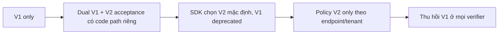

# Version field

## 1. Version field trong Authorization header để làm gì?

Trong hệ thống **xác thực HTTP request bằng HMAC**, client và server phải đồng ý về **hợp đồng ký**: phương thức HTTP, URI, những header được chọn, body hoặc digest body, thứ tự canonicalization, charset, cách tính HMAC và cách biểu diễn chữ ký. Chỉ thay đổi một quy tắc cũng có thể tạo chữ ký khác dù hai bên dùng cùng shared secret.

Để có thể nâng cấp hợp đồng mà không đoán phiên bản từ hình dạng signature, một API có thể thiết kế **Version field** bên trong header `Authorization`. Ví dụ của bài:

```http
POST /v1/invoices?currency=VND HTTP/1.1
Host: api.example.test
Content-Type: application/json
X-Timestamp: 1790000015
X-Nonce: ICEiIyQlJicoKSorLC0uLw
Authorization: HMAC Version=1,ClientId=merchant-42,KeyId=key-2026-b,Signature=r-ZKVheTUVfxxzhZAXd_SB4lPivFVGfg2rDLBfikUv8

{"invoiceId":"inv-809","amount":340000}
```

Ở đây `Version=1` là **tham số của một scheme xác thực HMAC do API định nghĩa**, không phải một header HTTP chuẩn mang tên `Version`. Nó nói với verifier: “Hãy đọc và kiểm tra request theo chính xác hợp đồng ký phiên bản 1.” Nó **không phải** quyền truy cập, key ID, số phiên bản API hay HTTP/1.1.

Bài **Version field** nằm trong chương *Authorization header* của module `SECURITY_AUTHENTICATION_HMAC_REQUEST_AUTHENTICATION`. Phạm vi module là thiết kế xác thực request HMAC với shared secret và canonical request từ method, URI, header/body; xác minh signature, chống replay bằng timestamp/nonce, quản lý key rotation, kiểm thử proxy/gateway và phân biệt **authentication** với **authorization**.

Mục tiêu:

- Giải thích Version field là **protocol selector**, không phải bằng chứng đã xác thực.
- Thiết kế cú pháp `Authorization` gồm auth scheme, version, client/key ID và tag mà **không tạo parser ambiguity**.
- **Ràng buộc cryptographically phiên bản** với canonical request để ngăn đổi phiên bản sau ký, cross-protocol confusion và downgrade.
- Phân biệt **authentication protocol version**, **API version**, **HTTP version**, **algorithm** và **credential/key version**.
- Xây bảng xử lý version được hỗ trợ/không hỗ trợ, migration, deprecation, key policy, header duplicate và error response.
- Lập trình Java 17 parser + verifier có **đúng một code path per version**, raw HMAC comparison và timestamp/nonce protection.
- Kiểm thử golden vector độc lập, thay `Version` nhưng giữ tag, gateway/proxy, HTTP/2/3, key rotation và authorization.

**Nguyên tắc số một:** không tự bỏ `Version` và “thử v1 nếu v2 không khớp”. Version selector là **dữ liệu đầu vào chưa xác thực cho tới khi MAC khớp**, nhưng chính lựa chọn phiên bản phải được **đưa vào thông điệp được ký**.

## 2. Những “version” dễ bị nhầm lẫn

| Loại phiên bản | Ví dụ | Thay đổi điều gì? | Do ai kiểm soát? |
| --- | --- | --- | --- |
| **HMAC auth protocol version** | `Version=1` | Canonical fields, format, algorithm policy, nonce và signature contract | Cả hai phía theo server contract |
| **HTTP protocol version** | HTTP/1.1, HTTP/2, HTTP/3 | Framing, transport/header field representation | HTTP stack, gateway |
| **API/resource version** | `/v1/invoices` | Endpoint và schema nghiệp vụ | API router/product |
| **Key ID/key version** | `KeyId=key-2026-b` | Bản ghi shared secret đang dùng | Server credential store, client SDK |
| **Algorithm** | `HmacSHA256` | Phép mật mã tạo MAC | Server/version policy |
| **Application/SDK version** | `client-sdk/4.2.0` | Release phần mềm client | Đơn vị phát triển SDK |

Ví dụ một client dùng `POST /v1/invoices HTTP/2`, ký theo `Authorization: HMAC Version=1,...` với `KeyId=key-2026-b` là hoàn toàn bình thường. Không có quy tắc nào buộc mọi con số này phải trùng nhau.

Đặc biệt:

- `/v1/` trong URI là **API version**, không tự chọn thuật toán HMAC.
- HTTP/2 thường trình bày **tên field lowercase**, không có nghĩa auth protocol `Version=2`.
- `KeyId=key-2026-b` là selector của secret trong rotation; **đổi secret không bắt buộc đổi Version field**.
- `Version=1` không phải `Algorithm=HmacSHA1`, không được suy ra thuật toán bằng cách cắt chuỗi version hoặc cho caller tự chọn bất kỳ JCA algorithm nào.
- Tên header `Authorization` là nơi chở thông tin xác thực, **không tự cho biết user có quyền với một resource**; authorization nghiệp vụ vẫn cần sau khi verify.

### 2.1. Phân biệt scheme với version field

Có ít nhất hai kiểu thiết kế hợp lệ về mặt ý tưởng:

```text
Cách A:  Authorization: HMAC Version=1,ClientId=...,KeyId=...,Signature=...
Cách B:  Authorization: HMAC-V1 Credential=...,Signature=...
```

Bài này chọn **Cách A** vì mục tiêu là học chính **Version field**. Không chấp nhận đồng thời A và B trên cùng endpoint để “tăng tương thích” nếu không có version/route migration được quản lý rõ.

`HMAC` là auth scheme tùy biến trong ví dụ; không phải cú pháp chuẩn mặc định mà mọi gateway/JDK hiểu được. Tên tham số và grammar cũng do **hợp đồng ứng dụng** định nghĩa. Một API thật cần tài liệu chính thức về version, không đoán từ các ví dụ HTTP bất kỳ.

## 3. Version field nằm trong cấu trúc HTTP Authorization như thế nào?

### 3.1. Auth scheme và auth parameters

Hình dạng của header trong `HTTP-HMAC-AUTHZ-V1`:

```text
Authorization: HMAC Version=1,ClientId=merchant-42,KeyId=key-2026-b,Signature=<43-char-Base64url>
               └─┬─┘ └──┬───┘ └──────┬────────┘ └──────┬───────┘ └──────┬────────────┘
                scheme   version   client selector    key selector       HMAC tag
```

Trong HTTP authentication, auth scheme và **tên** tham số nhận dạng là không phân biệt chữ hoa/thường theo cú pháp HTTP; tuy nhiên **giá trị** `ClientId`, `KeyId` và `Signature` trong hợp đồng này là case-sensitive. Ví dụ `merchant-42` và `Merchant-42` có thể là hai client IDs khác nhau.

Phân tách:

| Thành phần | Ví dụ | Ý nghĩa |
| --- | --- | --- |
| Header name | `Authorization` | Vùng chở credentials của HTTP |
| Auth scheme | `HMAC` | Chọn họ cơ chế xác thực tùy biến |
| Auth param `Version` | `1` | Chọn canonicalization / verification V1 |
| `ClientId` | `merchant-42` | Chọn tenant/client candidate (chưa xác thực) |
| `KeyId` | `key-2026-b` | Chọn secret version candidate |
| `Signature` | `r-ZKV...Uv8` | HMAC-SHA256 tag đã encode, cần xác minh |

**Không gửi shared secret trong Authorization.** Header chỉ có selector và output MAC. Secret nằm trong credential store phía server và hệ thống provisioning an toàn của client.

### 3.2. Hợp đồng lab chọn một dạng canonical wire form

Để có test dễ tái lập, bài cố định **dạng không quoted-string** và **thứ tự tham số**:

```text
HMAC Version=<version>,ClientId=<clientId>,KeyId=<keyId>,Signature=<tag>
```

Chi tiết:

1. Có đúng **một** `Authorization` field occurrence; phát hiện duplicate ở HTTP parser/ingress trước khi gộp.
2. Tên auth scheme `HMAC` và các tên auth params `Version`, `ClientId`, `KeyId`, `Signature` không phân biệt case theo HTTP. Serializer SDK dùng cách viết được minh họa, verifier có thể chấp nhận biến thể case của **tên**.
3. Có **đúng một** dấu cách ASCII giữa scheme và tham số đầu; giữa các tham số có một dấu phẩy **không có khoảng trắng**. Đây là **subset chặt** của cú pháp auth-param HTTP để lab không cần parser quoted-string tổng quát.
4. Có **chính xác bốn tham số theo thứ tự này**. Không được thêm/thiếu, lặp Version, lặp Signature, lặp KeyId hay bỏ qua unknown params.
5. `Version` có dạng thập phân canonical `[1-9][0-9]{0,3}`. **V1 hỗ trợ duy nhất giá trị `1`**. `01`, `1.0`, `v1` và `+1` bị từ chối vì sai grammar; `2` đúng grammar nhưng **chưa được hỗ trợ**.
6. `ClientId` và `KeyId` thuộc `[A-Za-z0-9._-]{1,64}`; giá trị không được lowercase, trim hoặc Unicode normalize tùy tiện.
7. `Signature` thuộc `[A-Za-z0-9_-]{43}` và phải decode thành **32 raw bytes** rồi Base64url re-encode bằng no-padding để từ chối noncanonical alias.
8. Không chứa dấu `=` padding, `+`, `/`, quoted-string, escape sequence, CR/LF, internal SP/HTAB hoặc dấu phẩy ở giá trị trong giao thức V1.
9. HTTP parser xử lý OWS cú pháp ở biên header một cách đúng tiêu chuẩn. Verifier không tự `trim()` để che header injection hay chuyển một input sai thành hợp lệ.
10. Với request hợp lệ, cả client và server sử dụng đúng một representation **semantic** cho tham số, thay vì ký nguyên text Authorization chứa `Signature`.

**Đây không phải một parser Authorization phổ quát.** Cú pháp HTTP cho auth params có thể rộng hơn (ví dụ khoảng trắng quanh delimiter hoặc quoted-string). Nếu sản phẩm chọn hỗ trợ cú pháp rộng, cần parser tuân thủ grammar đầy đủ, kiểm soát duplicate/quoted commas/escaping và ký representation canonical đã xác định. Không được tuyên bố mọi header Authorization hợp lệ theo HTTP đều khớp subset lab.

### 3.3. Tại sao `String.split(",")` dễ gây lỗi?

Nếu một giao thức cho phép quoted-string:

```http
Authorization: HMAC Version="1",ClientId="merchant,west",KeyId="a",Signature="..."
```

dấu phẩy trong quote **không** phải delimiter tham số. Một parser dùng `split(",")` sẽ hiểu sai. Một trường lặp như:

```http
Authorization: HMAC Version=1,Version=2,ClientId=merchant-42,KeyId=key-2026-b,Signature=...
```

có thể làm gateway chọn `Version=1` nhưng service chọn `Version=2` nếu hai parser khác nhau. V1 **reject hoàn toàn** cả hai input trên do không thuộc canonical subset.

**Giải pháp lab:** dùng một regex được anchor chặt cho đúng wire grammar, validate đủ field và format. **Giải pháp production nếu grammar rộng:** parser auth-param có trạng thái, test duplicate/quotes/OWS/escaping và test cross-component. Không “cứ thêm một split” để hỗ trợ các trường hợp phức tạp.

## 4. Version là selector chưa đáng tin, cần được ký và áp policy

### 4.1. Tại sao chỉ nhìn Version field chưa đủ?

Một attacker có thể sửa:

```text
Authorization: HMAC Version=2,ClientId=...,KeyId=...,Signature=...
                                      ↓ đổi phiên bản
Authorization: HMAC Version=1,ClientId=...,KeyId=...,Signature=...
```

Nếu server dùng cùng canonical input và chỉ chọn các checks khác nhau theo `Version`, việc đổi một chữ số ở ngoài MAC có thể khiến verifier **bỏ các trường v2 yêu cầu**, áp timestamp window yếu hơn hoặc bỏ nonce. Đó là **downgrade/cross-protocol confusion**, ngay cả khi HMAC tag ban đầu được tạo hợp lệ theo một code path khác.

Version phải được gắn **cryptographically** với dữ liệu đã ký, thường qua **domain separation** trong string-to-sign:

```text
HTTP-HMAC-AUTHZ-V1
auth-version:1
...
```

Client ký đúng những bytes này; server cũng chỉ tính lại theo contract V1. Không có đường “thử v2 rồi fallback v1”, không bỏ version khỏi input, không chấp nhận chữ ký tính trên contract khác.

### 4.2. Hai lớp ràng buộc phiên bản

Hợp đồng bài dùng **cả hai**:

1. **Version-specific domain prefix**: dòng đầu `HTTP-HMAC-AUTHZ-V1` phân cách giao thức V1 với V2, signed URL hay token/callback khác.
2. **Canonicalized version field**: dòng `auth-version:1` ràng buộc giá trị `Version` mà parser đã đọc từ Authorization.

Nhờ đó, việc đổi `Version=1` thành `Version=2` không thể được chấp nhận bởi verifier V1 chỉ vì phần method/URI/body giống nhau. Verifier V2 nếu tồn tại phải có **prefix và quy tắc signed fields khác theo thiết kế v2**, được review độc lập.

**Không đưa nguyên văn toàn bộ `Authorization` vào HMAC input**, vì nó chứa `Signature` là chính output đang được tính, tạo vòng phụ thuộc. Chỉ đưa những **auth params cần được bảo vệ** vào canonical input, cùng fixed protocol context.

### 4.3. Chống confusion giữa các endpoint và mục đích

Domain prefix chỉ phân cách phiên bản/giao thức; nó **không tự bảo vệ endpoint/resource** nếu canonical request không ký method/URI/body. V1 ký đầy đủ:

- Exact method `POST`.
- Raw path `/v1/invoices` và raw query `currency=VND` theo hợp đồng.
- Trusted external authority `api.example.test`.
- `content-type`, `x-timestamp` và `x-nonce`.
- `ClientId` và `KeyId` lấy từ Authorization, mỗi giá trị chỉ là selector trước verification.
- SHA-256 digest của exact body bytes, được encode lowercase hex.

Với ứng dụng nhiều tenant hoặc nhiều operation nhạy cảm, các giá trị khác có thể ảnh hưởng routing/authorization (account ID, action, role-like metadata) **cũng phải được ký hoặc tới từ trusted security context**, không chỉ tin chữ ký chung.

## 5. Version field có quan hệ gì với thuật toán và key rotation?

### 5.1. Version quy định thuật toán, client không chọn ngẫu nhiên

V1 của bài:

```text
Version field: 1
HMAC algorithm: HmacSHA256 (JCA)
MAC tag: full 32 bytes
Signature encoding: Base64url without padding
Encoded length: exactly 43 ASCII characters
Time window: past 300s, future 30s
Nonce: 16 random raw bytes -> Base64url 22 chars
```

Không cung cấp `Algorithm=HmacSHA1` như một lựa chọn tự do trong Authorization. Nếu một ngày chuyển sang thuật toán/canonicalization khác, hãy định nghĩa phiên bản mới và policy cấp credential/endpoint phù hợp.

Nếu server cho caller tự gửi `Algorithm`, attacker có thể thử đổi sang thuật toán yếu/không tương thích, tạo **algorithm confusion hoặc downgrade**. Algorithm policy phải được xác định bởi **version đã được xác nhận là được phép** và credential store tin cậy; tuyệt đối không gọi `Mac.getInstance(userProvidedAlgorithm)` mà không kiểm soát.

### 5.2. Key ID khác Version field

Ví dụ client `merchant-42` có:

```text
(environment, clientId, keyId)                 key status
(prod, merchant-42, key-2026-a)               ACTIVE (migration)
(prod, merchant-42, key-2026-b)               ACTIVE
(prod, merchant-42, key-2025-revoked)         REVOKED
```

Tất cả có thể sử dụng **Version=1** nếu policy cho phép. Client đổi `KeyId` và secret khi rotation; không cần đổi `Version`. Trái lại, nếu một credential V1 bị revoked thì tag toán học có đúng vẫn phải **reject**.

Nếu một phiên bản mới chỉ cho một tập credentials hoặc scopes nhất định, server phải kiểm tra **allowedVersions** trong bản ghi credential và policy endpoint. Không cho bất kỳ key ID V1 nào tự động bật V2 chỉ vì header khai `Version=2`.

### 5.3. Khi V1 và V2 cùng được chấp nhận

Một migration có thể có giai đoạn:

```text
Parser: nhận cú pháp Version=1 hoặc Version=2
Dispatch:
  V1 -> verifier V1, chỉ khi route/key policy còn cho phép V1
  V2 -> verifier V2, chỉ khi route/key policy cho phép V2
  others -> reject

Không bao giờ:
  try V2; nếu mismatch -> try V1
  treat missing Version as 1
  accept V1 on an endpoint marked V2_ONLY
  decode tag using every algorithm until one matches
```

Đối với hành động nhạy cảm, kế hoạch nâng cấp thường cần **deadline và minimum allowed version** per client/endpoint. Có thể cho phép cả hai phiên bản trong thời gian ngắn nhưng không duy trì đường V1 yếu vô thời hạn. Việc nâng cấp phải có metrics theo version được xác thực, thử nghiệm xuyên SDK và cách thu hồi V1 có kiểm soát.

## 6. Golden vector HTTP-HMAC-AUTHZ-V1

Bài chọn một **hợp đồng minh họa độc lập**, không giả định đây là giao thức HMAC chuẩn của bất kỳ sản phẩm cụ thể nào.

### 6.1. Request fixture và quy tắc canonicalization

```http
POST /v1/invoices?currency=VND HTTP/1.1
Host: api.example.test
Content-Type: application/json
X-Timestamp: 1790000015
X-Nonce: ICEiIyQlJicoKSorLC0uLw
Authorization: HMAC Version=1,ClientId=merchant-42,KeyId=key-2026-b,Signature=r-ZKVheTUVfxxzhZAXd_SB4lPivFVGfg2rDLBfikUv8

{"invoiceId":"inv-809","amount":340000}
```

Quy định fixture:

- Method, raw path/query, trusted authority là đúng các component mà gateway/server dùng để xử lý, không tự normalize path/query ngoài contract.
- Body là exact UTF-8 bytes của chuỗi JSON trên **không có LF cuối**; SHA-256 digest được encode lowercase hex.
- `X-Timestamp` là epoch seconds dạng canonical `[1-9][0-9]{0,18}`; `X-Nonce` là 16-byte raw nonce encode Base64url no-padding thành 22 ký tự.
- `Version=1` được parser xác nhận, `ClientId` và `KeyId` được lookup từ trusted credential store. Dù cùng thuộc Authorization, các giá trị này **chưa được coi là identity** trước khi HMAC khớp.
- HMAC input có **12 dòng**, nối bằng LF byte `0x0A`, UTF-8, **không thêm LF cuối**.
- `Signature` **không** nằm trong canonical input; nó được strict-decode thành 32 bytes rồi so với HMAC server tính.

### 6.2. Canonical request đúng 12 dòng

```text
HTTP-HMAC-AUTHZ-V1
auth-version:1
POST
/v1/invoices
currency=VND
authority:api.example.test
content-type:application/json
client-id:merchant-42
key-id:key-2026-b
x-timestamp:1790000015
x-nonce:ICEiIyQlJicoKSorLC0uLw
11d314083dd177285e7ec09a39e07825a7305e92ca860df2b1b0b12548854e2d
```

Dòng 12 là `SHA-256(body)`, không phải HMAC của body. Toàn bộ string-to-sign là **280 byte UTF-8**. Không được đổi LF thành CRLF, thêm dòng trống, sort lại thứ tự hoặc đổi case giá trị `ClientId`/`KeyId`.

### 6.3. Expected bytes được tính độc lập

Secret test **công khai**, tuyệt đối không dùng production:

```text
Test secret (32 raw bytes, hex):
000102030405060708090a0b0c0d0e0f101112131415161718191a1b1c1d1e1f

Nonce raw bytes, hex:
202122232425262728292a2b2c2d2e2f

Nonce encoded Base64url no padding (22 chars):
ICEiIyQlJicoKSorLC0uLw

Exact body:
{"invoiceId":"inv-809","amount":340000}
Exact body UTF-8 byte count: 39

SHA-256(body) lowercase hex:
11d314083dd177285e7ec09a39e07825a7305e92ca860df2b1b0b12548854e2d

Canonical input: 12 lines, 280 UTF-8 bytes

HMAC-SHA256 raw tag lowercase hex (32 bytes):
afe64a5617935157f1c7385901777f481e253e2bc55467e0dab0cb05f8a452ff

Encoded signature Base64url no padding (43 chars):
r-ZKVheTUVfxxzhZAXd_SB4lPivFVGfg2rDLBfikUv8
```

Server clock test fixture có thể đặt `now=1790000000` (2026-09-21 14:13:20 UTC), `signedTs=1790000015` (+15 giây). Cửa sổ V1 cho quá khứ 300 giây, tương lai 30 giây nên **timestamp có thể pass tại clock test**, nhưng còn phụ thuộc HMAC, active credential, nonce và authorization. Đừng dùng timestamp cố định này cho request thực ở ngày khác.

**4 assertions cần có:**

1. Exact body hash khớp digest công bố.
2. String-to-sign có **12 dòng / 280 bytes**, byte LF ở giữa, không trailing LF.
3. HMAC-SHA256 với key test khớp raw tag hex.
4. Base64url no-pad của tag khớp chính xác `r-ZKVheTUVfxxzhZAXd_SB4lPivFVGfg2rDLBfikUv8`.

Một test chỉ gọi `sign()` và `verify()` cùng class có thể pass dù cả hai cùng **quên ký Version field**. Golden vector độc lập và tampering tests là bắt buộc.

## 7. Xử lý version được hỗ trợ, không hỗ trợ và error response

### 7.1. Bảng quyết định

| Tình huống | Quyết định |
| --- | --- |
| `HMAC Version=1`, header/credential đúng, HMAC/time/nonce đúng | Có thể authentication thành công; vẫn cần authorization |
| Không có `Authorization` | Không có credential; từ chối authn |
| Authorization xuất hiện **hai lần** | Từ chối tại ingress trước coalescing |
| `Authorization: Basic ...` | Scheme khác, không được đi vào HMAC V1 verifier |
| `HMAC` nhưng thiếu `Version` | Từ chối; không mặc định V1 |
| `Version=01`, `Version=v1` hoặc `Version=1.0` | Malformed, từ chối |
| `Version=2` đúng schema nhưng hệ thống chỉ hỗ trợ V1 | **Unsupported version**; từ chối, không fallback |
| `Version=9999` chưa được enable | Từ chối; không auto-negotiate |
| Hai `Version` params trong một Authorization | Reject duplicate, không chọn first/last |
| Tham số lạ hoặc thứ tự sai trong V1 subset | Reject theo V1 grammar |
| `ClientId` / `KeyId` thay sau khi ký | Credential miss hoặc HMAC mismatch |
| `Version` thay sau khi ký | Không thể dùng tag cũ xác thực dưới version khác |
| Version được hỗ trợ nhưng key `REVOKED` | Authn reject dù MAC có thể khớp |
| MAC đúng nhưng timestamp/nonce sai | Authn/freshness reject |
| MAC đúng nhưng thiếu quyền truy cập invoice | Authorization deny, thường `403` |
| Credential store/JCA/nonce store lỗi | Fail-closed, phân loại lỗi hạ tầng |

### 7.2. Có nên trả danh sách versions cho client?

Đối với yêu cầu `Version=2` không được hỗ trợ, server có thể ghi metric/log nội bộ `UNSUPPORTED_AUTH_VERSION`. Bên ngoài, nội dung phản hồi phải tránh tiết lộ thông tin nhạy cảm về key ID, tenant, trạng thái credential hay đường lùi yếu. Một API có thể dùng `401 Unauthorized` cho credential không hợp lệ và header challenge `WWW-Authenticate` phù hợp với custom scheme nếu đã định nghĩa; malformed HTTP syntax có thể là `400`. Không dùng `426 Upgrade Required` một cách máy móc — nó dành cho yêu cầu nâng cấp giao thức truyền tải, không phải lúc nào cũng phù hợp với HMAC auth version.

**Không cần giấu tên mọi phiên bản một cách tuyệt đối.** Thông tin versions công khai trong tài liệu SDK là bình thường. Điều cần tránh là **tự động thương lượng xuống version yếu hơn dựa trên lỗi** hoặc trả thông tin về credential owner/key state cho caller chưa xác thực.

### 7.3. Không để lỗi phiên bản thành timing/format oracle

Lỗi khác nhau có thể dẫn tới response shape, latency, `WWW-Authenticate` hoặc body khác. Một request `Version=999` có thể bị reject sớm, còn `Version=1` với key sai có thể đi qua lookup và HMAC; đây là khác biệt đường đi. Không nên tuyên bố toàn endpoint constant-time chỉ vì so MAC bằng `MessageDigest.isEqual`.

Biện pháp thiết thực: input size limits, rate limiting, error public response thống nhất cho nhóm credential nhạy cảm, không leak key existence, internal metrics hợp lý, và đánh giá timing theo threat model. **Không chạy dummy HMAC cho mọi malformed Authorization header** nếu làm mở rộng nguy cơ DoS.

## 8. Java 17: đọc Authorization và Version field an toàn

Ví dụ Java 17 bên dưới tập trung vào **một protocol version** với wire grammar cố định. Mọi signed component đều có thể quan sát và kiểm thử; `Version` chỉ được phép chọn **V1**.

Các lớp trách nhiệm:

1. **HTTP adapter/ingress** phải parse framing, giới hạn kích thước và giữ từng header occurrence trước khi gộp.
2. **Version parser** kiểm tra auth scheme, đúng số lượng/tên/thứ tự params và version schema; không có fallback.
3. **Credential lookup** chỉ dùng `(environment, clientId, keyId)`; secret thực tế do server quản lý.
4. **MAC verifier** dựng canonical request V1 có `auth-version:1`, tính HMAC-SHA256 rồi so raw tag bytes.
5. **Replay/freshness** kiểm tra epoch seconds và claim nonce nguyên tử sau MAC hợp lệ.
6. **Authorization** nằm **ngoài class verifier**, dùng verified principal và quyền của resource/action.

Mã minh họa giả định request chỉ có một route và một content type để tránh lệch khỏi chủ đề Version field; không phải bộ HTTP parser/canonicalizer toàn diện.

### 8.1. Class AuthorizationVersionVerifierV1

```java
import java.nio.charset.StandardCharsets;
import java.security.GeneralSecurityException;
import java.security.MessageDigest;
import java.time.Clock;
import java.util.ArrayList;
import java.util.Base64;
import java.util.HashMap;
import java.util.HexFormat;
import java.util.List;
import java.util.Map;
import java.util.Optional;
import java.util.regex.Matcher;
import java.util.regex.Pattern;
import javax.crypto.Mac;
import javax.crypto.spec.SecretKeySpec;

public final class AuthorizationVersionVerifierV1 {
    private static final String CONTEXT = "HTTP-HMAC-AUTHZ-V1";
    private static final String HMAC_ALGORITHM = "HmacSHA256";
    private static final long PAST_SECONDS = 300;
    private static final long FUTURE_SECONDS = 30;
    private static final long NONCE_MARGIN_SECONDS = 60;

    // Contract LAB: đúng thứ tự, chính xác 1 dấu SP sau scheme,
    // không có quoted strings/OWS nội bộ, 4 auth params.
    // Chỉ case của scheme/param names được xem tương đương.
    // Group values được giữ nguyên, KHÔNG lowercase.
    private static final Pattern AUTH = Pattern.compile(
        "^HMAC Version=([1-9][0-9]{0,3}),"
      + "ClientId=([A-Za-z0-9._-]{1,64}),"
      + "KeyId=([A-Za-z0-9._-]{1,64}),"
      + "Signature=([A-Za-z0-9_-]{43})$",
        Pattern.CASE_INSENSITIVE
    );

    private static final List<String> REQUIRED = List.of(
        "authorization", "content-type", "x-timestamp", "x-nonce"
    );

    public record Header(String name, String value) {}

    public record Request(
        String method, String rawPath, String rawQuery,
        String trustedAuthority,
        List<Header> headerOccurrences,
        byte[] exactBodyBytes
    ) {}

    public record AuthParams(
        String version, String clientId,
        String keyId, String signature
    ) {}

    public record Parsed(
        String contentType, String timestamp,
        String nonce, AuthParams authorization
    ) {}

    public record Credential(
        String ownerClientId, String keyId, String algorithm,
        boolean active, long notBefore, long expiresAt,
        byte[] secret
    ) {}

    public record VerifiedPrincipal(
        String clientId, String protocolVersion
    ) {}

    public interface CredentialStore {
        Optional<Credential> find(
            String environment, String clientId, String keyId);
    }

    public interface NonceStore {
        // Implementation PHẢI atomic/shared giữa replicas.
        // Timeout/unknown outcome là lỗi, không fail-open.
        boolean claim(
            String environment, String verifiedClientId,
            byte[] rawNonce, long expiresAtEpochSeconds);
    }

    private AuthorizationVersionVerifierV1() {}

    private static String lowerHttpToken(String name) {
        if (name == null || name.isEmpty() || name.length() > 128) {
            throw new IllegalArgumentException("Bad HTTP field name");
        }
        String punctuation = "!#$%&'*+-.^_`|~";
        StringBuilder result = new StringBuilder(name.length());
        for (int i = 0; i < name.length(); i++) {
            char c = name.charAt(i);
            boolean upper = c >= 'A' && c <= 'Z';
            boolean lower = c >= 'a' && c <= 'z';
            boolean digit = c >= '0' && c <= '9';
            if (!upper && !lower && !digit
                    && punctuation.indexOf(c) < 0) {
                throw new IllegalArgumentException("Invalid HTTP token");
            }
            result.append(upper ? (char) (c + 32) : c);
        }
        return result.toString();
    }

    // Đầu vào phải là occurrences do HTTP parser/ingress cung cấp.
    // Map đã coalesce từ trước KHÔNG thể phát hiện duplicate.
    public static Parsed parse(Request request) {
        if (request == null
                || request.headerOccurrences() == null
                || request.headerOccurrences().size() > 100
                || request.exactBodyBytes() == null
                || request.exactBodyBytes().length > 1_048_576) {
            throw new IllegalArgumentException("Invalid request size");
        }

        Map<String, String> values = new HashMap<>();
        for (Header header : request.headerOccurrences()) {
            if (header == null) {
                throw new IllegalArgumentException("Null header occurrence");
            }
            String name = lowerHttpToken(header.name());
            if (!REQUIRED.contains(name)) continue;

            String value = header.value();
            if (value == null || value.isEmpty()
                    || value.length() > 512) {
                throw new IllegalArgumentException("Invalid signed header");
            }

            // Authorization cần đúng 1 SP giữa scheme và params.
            // Các signed fields còn lại không được có SP/HTAB/CR/LF.
            int min = "authorization".equals(name) ? 0x20 : 0x21;
            for (int i = 0; i < value.length(); i++) {
                char c = value.charAt(i);
                if (c < min || c > 0x7e) {
                    throw new IllegalArgumentException(
                        "Non-ASCII or control char in signed header");
                }
            }
            if (values.putIfAbsent(name, value) != null) {
                throw new IllegalArgumentException(
                    "Duplicate signed header: " + name);
            }
        }

        for (String required : REQUIRED) {
            if (!values.containsKey(required)) {
                throw new IllegalArgumentException(
                    "Missing signed header: " + required);
            }
        }

        String contentType = values.get("content-type");
        String timestamp = values.get("x-timestamp");
        String nonce = values.get("x-nonce");
        if (!"application/json".equals(contentType)
                || !timestamp.matches("[1-9][0-9]{0,18}")) {
            throw new IllegalArgumentException("Bad content type/time");
        }
        try {
            Long.parseLong(timestamp);
        } catch (NumberFormatException invalid) {
            throw new IllegalArgumentException(
                "Timestamp outside signed long", invalid);
        }
        strictDecode(nonce, 22, 16, "nonce");

        Matcher match = AUTH.matcher(values.get("authorization"));
        if (!match.matches()) {
            throw new IllegalArgumentException(
                "Authorization grammar not canonical");
        }

        // Version=2 có grammar hợp lệ, nhưng chưa được enable ở V1.
        // Reject thay vì tự thử V1 bằng tag của caller.
        AuthParams auth = new AuthParams(
            match.group(1), match.group(2),
            match.group(3), match.group(4)
        );
        strictDecode(auth.signature(), 43, 32, "signature");
        return new Parsed(contentType, timestamp, nonce, auth);
    }

    public static byte[] strictDecode(
            String encoded, int encodedLength,
            int rawLength, String field) {
        if (encoded == null
                || encoded.length() != encodedLength
                || !encoded.matches("[A-Za-z0-9_-]+")) {
            throw new IllegalArgumentException(
                "Invalid " + field + " format");
        }
        final byte[] raw;
        try {
            raw = Base64.getUrlDecoder().decode(encoded);
        } catch (IllegalArgumentException invalid) {
            throw new IllegalArgumentException(
                "Malformed " + field, invalid);
        }
        String canonical =
            Base64.getUrlEncoder().withoutPadding()
                .encodeToString(raw);
        if (raw.length != rawLength
                || !canonical.equals(encoded)) {
            throw new IllegalArgumentException(
                "Noncanonical " + field + " encoding");
        }
        return raw;
    }

    private static void validateRoute(Request request) {
        if (!"POST".equals(request.method())
                || !"/v1/invoices".equals(request.rawPath())
                || !"currency=VND".equals(request.rawQuery())
                || !"api.example.test".equals(
                    request.trustedAuthority())) {
            throw new IllegalArgumentException(
                "Unsupported method/path/query/authority");
        }
    }

    public static byte[] canonicalBytes(Request request, Parsed p)
            throws GeneralSecurityException {
        validateRoute(request);
        if (!"1".equals(p.authorization().version())) {
            throw new IllegalArgumentException(
                "Unsupported authentication version");
        }
        String bodyHash = HexFormat.of().formatHex(
            MessageDigest.getInstance("SHA-256")
                .digest(request.exactBodyBytes())
        );

        // Version vừa chọn đúng verifier, vừa nằm trong MAC input.
        String canonical = String.join("\n",
            CONTEXT,
            "auth-version:" + p.authorization().version(),
            request.method(),
            request.rawPath(),
            request.rawQuery(),
            "authority:" + request.trustedAuthority(),
            "content-type:" + p.contentType(),
            "client-id:" + p.authorization().clientId(),
            "key-id:" + p.authorization().keyId(),
            "x-timestamp:" + p.timestamp(),
            "x-nonce:" + p.nonce(),
            bodyHash
        );
        return canonical.getBytes(StandardCharsets.UTF_8);
    }

    private static byte[] computeHmac(
            byte[] secret, byte[] canonical)
            throws GeneralSecurityException {
        if (secret == null || secret.length < 32) {
            throw new IllegalStateException(
                "Server credential secret missing or weak");
        }
        // Mac không được share singleton trên nhiều thread.
        Mac mac = Mac.getInstance(HMAC_ALGORITHM);
        mac.init(new SecretKeySpec(secret, HMAC_ALGORITHM));
        return mac.doFinal(canonical);
    }

    // Chỉ cho lab; signer thật phải quản lý secret/key rotation riêng.
    public static String signForTest(
            Request request, byte[] secret)
            throws GeneralSecurityException {
        Parsed p = parse(request);
        byte[] tag = computeHmac(
            secret, canonicalBytes(request, p));
        return Base64.getUrlEncoder().withoutPadding()
            .encodeToString(tag);
    }

    public static Optional<VerifiedPrincipal> verify(
            Request request,
            String environment,
            CredentialStore credentials,
            NonceStore nonceStore,
            Clock trustedClock
    ) throws GeneralSecurityException {
        Parsed p = parse(request);
        AuthParams auth = p.authorization();

        // Version là selector, chưa phải bằng chứng xác thực.
        // V2 dù đúng cú pháp vẫn KHÔNG được fallback sang V1.
        if (!"1".equals(auth.version())) {
            return Optional.empty();
        }

        byte[] received = strictDecode(
            auth.signature(), 43, 32, "signature");
        byte[] canonical = canonicalBytes(request, p);

        Optional<Credential> found = credentials.find(
            environment, auth.clientId(), auth.keyId());
        if (found.isEmpty()) return Optional.empty();

        Credential c = found.get();
        long now = trustedClock.instant().getEpochSecond();
        if (!c.active()
                || !auth.clientId().equals(c.ownerClientId())
                || !auth.keyId().equals(c.keyId())
                || !"HmacSHA256".equals(c.algorithm())
                || now < c.notBefore()
                || now >= c.expiresAt()) {
            return Optional.empty();
        }

        byte[] expected = computeHmac(c.secret(), canonical);
        if (!MessageDigest.isEqual(expected, received)) {
            return Optional.empty();
        }

        long ts = Long.parseLong(p.timestamp());
        final long oldest, newest, nonceExpiry;
        try {
            oldest = Math.subtractExact(now, PAST_SECONDS);
            newest = Math.addExact(now, FUTURE_SECONDS);
            nonceExpiry = Math.addExact(
                ts, PAST_SECONDS + NONCE_MARGIN_SECONDS);
        } catch (ArithmeticException overflow) {
            throw new IllegalStateException(
                "Cannot evaluate trusted freshness window", overflow);
        }

        if (ts < oldest || ts > newest) return Optional.empty();

        byte[] nonce = strictDecode(p.nonce(), 22, 16, "nonce");
        if (!nonceStore.claim(
                environment, c.ownerClientId(), nonce, nonceExpiry)) {
            return Optional.empty();
        }

        // Principal đến từ stored credential, KHÔNG từ Version/ClientId
        // do caller tự khai; authorization xử lý ở lớp nghiệp vụ.
        return Optional.of(
            new VerifiedPrincipal(c.ownerClientId(), "1"));
    }
}
```

### 8.2. Điểm nào thuộc ví dụ và điểm nào bắt buộc trong sản phẩm thực?

Class minh họa có thể làm rõ **giới hạn trust boundary**:

- `Request.headerOccurrences` phải được tạo sau khi HTTP parser đã giới hạn header count/size và bảo toàn occurrences; `Map<String,String>` do gateway đã gộp không thể chứng minh absence of duplicates.
- Parser chỉ nhận **một canonical subset** của HTTP auth-param; nếu muốn hỗ trợ optional whitespace hoặc quoted-string hợp chuẩn, cần parser tổng quát và bộ test riêng. Không thêm `split(",")` để “hỗ trợ thêm”.
- `Pattern.CASE_INSENSITIVE` áp lên **scheme/param names**, còn captured client/key IDs và tag **không bị sửa case**. Wire value `Version=01` bị reject, `Version=2` được parse nhưng là **unsupported**.
- `canonicalBytes` chưa hỗ trợ mọi URI và query canonicalization; production phải hợp đồng hóa percent encoding, duplicate query parameters, authority sau proxy và body content coding.
- `CredentialStore.find` phải scope theo environment/client/key ID từ trusted store, kiểm tra owner, trạng thái, not-before, expiry, revocation và policy allowed versions. Record chỉ có `active` là mô hình giản lược.
- `NonceStore.claim` chỉ là interface. Implementation thật phải **atomic**, shared giữa replicas, TTL đến `signedTs+pastTolerance+margin` và fail-closed khi outcome unknown.
- `verify` từ chối bad version/credential/MAC/replay nhưng không thực hiện **authorization**. Service phải kiểm tra scope, owner/resource, action và business limits.
- Lỗi KMS, credential store, nonce backend hoặc `Mac.getInstance`/`mac.init` là lỗi hạ tầng xác minh, không được catch rồi tạo principal.

**Không sao chép nguyên class làm filter production** nếu chưa bổ sung parser HTTP thật, key rotation policy, replay store bền và giao thức lỗi. Nó minh họa **đường đi byte-level của Version field** để học và test.

## 9. Java 17: golden vector và version tampering tests

Dưới đây là một test harness dùng clock cố định. Nó chứng minh:

1. Chuỗi canonical với Version=1 có đúng **280 byte** và HMAC tag khớp golden độc lập.
2. `Authorization: HMAC Version=2` không được verify bằng V1 dù tag v1 vẫn hiện diện.
3. `Version=01`, thiếu Version hoặc Version trùng sẽ bị parser từ chối.
4. Cùng request đã được xác thực chỉ claim nonce **một lần**, gửi lại là replay.
5. Thay method/nonce/key ID khi không ký lại sẽ bị từ chối.

### 9.1. Class AuthorizationVersionChecksV1

```java
import java.nio.charset.StandardCharsets;
import java.time.Clock;
import java.time.Instant;
import java.time.ZoneOffset;
import java.util.ArrayList;
import java.util.Base64;
import java.util.HexFormat;
import java.util.List;
import java.util.Optional;
import java.util.Set;
import java.util.concurrent.ConcurrentHashMap;
import java.util.concurrent.atomic.AtomicInteger;

public final class AuthorizationVersionChecksV1 {
    private static final String GOLDEN =
        "r-ZKVheTUVfxxzhZAXd_SB4lPivFVGfg2rDLBfikUv8";
    private static final String RAW_TAG_HEX =
        "afe64a5617935157f1c7385901777f48"
      + "1e253e2bc55467e0dab0cb05f8a452ff";

    private static final Clock FIXED_CLOCK = Clock.fixed(
        Instant.ofEpochSecond(1790000000L), ZoneOffset.UTC
    );

    private static byte[] testKey() {
        return HexFormat.of().parseHex(
            "000102030405060708090a0b0c0d0e0f"
          + "101112131415161718191a1b1c1d1e1f");
    }

    private static String authorization(String version, String tag) {
        return "HMAC Version=" + version
            + ",ClientId=merchant-42"
            + ",KeyId=key-2026-b"
            + ",Signature=" + tag;
    }

    private static AuthorizationVersionVerifierV1.Request request(
            String authValue) {
        return new AuthorizationVersionVerifierV1.Request(
            "POST", "/v1/invoices", "currency=VND",
            "api.example.test",
            List.of(
                new AuthorizationVersionVerifierV1.Header(
                    "Content-Type", "application/json"),
                new AuthorizationVersionVerifierV1.Header(
                    "X-Timestamp", "1790000015"),
                new AuthorizationVersionVerifierV1.Header(
                    "X-Nonce", "ICEiIyQlJicoKSorLC0uLw"),
                new AuthorizationVersionVerifierV1.Header(
                    "Authorization", authValue)
            ),
            "{\"invoiceId\":\"inv-809\",\"amount\":340000}"
                .getBytes(StandardCharsets.UTF_8)
        );
    }

    private static AuthorizationVersionVerifierV1.CredentialStore
            credentials() {
        return (env, clientId, keyId) ->
            "test".equals(env)
            && "merchant-42".equals(clientId)
            && "key-2026-b".equals(keyId)
            ? Optional.of(
                new AuthorizationVersionVerifierV1.Credential(
                    "merchant-42", "key-2026-b", "HmacSHA256",
                    true, 1789990000L, 1790100000L, testKey()))
            : Optional.empty();
    }

    private static AuthorizationVersionVerifierV1.NonceStore
            nonceStore(AtomicInteger claimCount) {
        // Chỉ là fake trong một process, không TTL/persistence.
        Set<String> seen = ConcurrentHashMap.newKeySet();
        return (env, clientId, nonce, expiry) -> {
            claimCount.incrementAndGet();
            return seen.add(
                env + "|" + clientId + "|"
                + HexFormat.of().formatHex(nonce));
        };
    }

    private static void expectParseReject(String header) {
        try {
            AuthorizationVersionVerifierV1.parse(request(header));
            throw new AssertionError("Expected Authorization reject");
        } catch (IllegalArgumentException expected) {
            // OK: grammar không hợp lệ.
        }
    }

    public static void main(String[] args) throws Exception {
        var fixture = request(authorization("1", GOLDEN));

        var parsed = AuthorizationVersionVerifierV1.parse(fixture);
        byte[] canonical = AuthorizationVersionVerifierV1.canonicalBytes(
            fixture, parsed);
        byte[] supplied = AuthorizationVersionVerifierV1.strictDecode(
            GOLDEN, 43, 32, "signature");
        if (canonical.length != 280
                || !RAW_TAG_HEX.equals(
                    HexFormat.of().formatHex(supplied))
                || !GOLDEN.equals(
                    AuthorizationVersionVerifierV1.signForTest(
                        fixture, testKey()))) {
            throw new AssertionError(
                "Independent canonical/HMAC golden mismatch");
        }

        expectParseReject(authorization("01", GOLDEN));
        expectParseReject(authorization("v1", GOLDEN));
        expectParseReject(
            "HMAC ClientId=merchant-42,KeyId=key-2026-b,"
          + "Signature=" + GOLDEN);
        expectParseReject(
            "HMAC Version=1,Version=1,ClientId=merchant-42,"
          + "KeyId=key-2026-b,Signature=" + GOLDEN);
        expectParseReject(
            "HMAC Version=1,ClientId=merchant-42,"
          + "KeyId=key-2026-b,Signature=" + GOLDEN + ",Extra=x");

        AtomicInteger claims = new AtomicInteger();
        var replay = nonceStore(claims);

        // Version=2 đúng grammar nhưng KHÔNG hỗ trợ; claimCount=0.
        var v2 = request(authorization("2", GOLDEN));
        if (AuthorizationVersionVerifierV1.verify(
                v2, "test", credentials(), replay, FIXED_CLOCK)
                    .isPresent() || claims.get() != 0) {
            throw new AssertionError("V2 must never fallback to V1");
        }

        // V1 xác thực hợp lệ ở clock test; lần hai reuse nonce bị reject.
        if (AuthorizationVersionVerifierV1.verify(
                fixture, "test", credentials(), replay, FIXED_CLOCK)
                    .isEmpty()) {
            throw new AssertionError("Golden V1 signature should pass");
        }
        if (AuthorizationVersionVerifierV1.verify(
                fixture, "test", credentials(), replay, FIXED_CLOCK)
                    .isPresent()) {
            throw new AssertionError("Nonce replay should fail");
        }

        // Đổi signature 1 ký tự, giữ đúng schema -> HMAC sai.
        var tampered = request(
            authorization("1", "A" + GOLDEN.substring(1)));
        AtomicInteger badMacClaims = new AtomicInteger();
        if (AuthorizationVersionVerifierV1.verify(
                tampered, "test", credentials(),
                nonceStore(badMacClaims), FIXED_CLOCK)
                    .isPresent() || badMacClaims.get() != 0) {
            throw new AssertionError(
                "Bad HMAC must not claim nonce");
        }

        // Duplicate Authorization header: reject trước chọn version.
        List<AuthorizationVersionVerifierV1.Header> duplicate =
            new ArrayList<>(fixture.headerOccurrences());
        duplicate.add(
            new AuthorizationVersionVerifierV1.Header(
                "authorization", authorization("2", GOLDEN)));
        var duplicateRequest =
            new AuthorizationVersionVerifierV1.Request(
                fixture.method(), fixture.rawPath(),
                fixture.rawQuery(), fixture.trustedAuthority(),
                duplicate, fixture.exactBodyBytes());
        try {
            AuthorizationVersionVerifierV1.parse(duplicateRequest);
            throw new AssertionError("Duplicate Authorization accepted");
        } catch (IllegalArgumentException expected) {
            // OK
        }

        System.out.println(
            "Version, golden HMAC, replay and tamper checks OK");
    }
}
```

### 9.2. Test Java này chưa thay được integration test gì?

- `AuthorizationVersionChecksV1` dùng **một mock credential store** và một nonce store chỉ có set local. Không chứng minh atomicity qua nhiều replicas, TTL, Redis/DB failover hoặc key revocation propagation.
- Test thay `Version=2` trong Authorization và dùng tag cũ kiểm tra **reject**, nhưng muốn khẳng định V2 an toàn phải viết **bộ golden vector V2 khác** sau khi V2 được thiết kế.
- Trong Java class, phiên bản là selector untrusted và verifier V1 chỉ có V1; production migration cần **dispatcher per-version**, allowed versions từ server policy và anti-downgrade end-to-end.
- Cần thêm test proxy/gateway thật cho HTTP auth-param casing, quoted/OWS variations nếu API muốn hỗ trợ, duplicate fields, HTTP/2 và Authorization stripping/rewriting.
- Clock fixture tại `1790000000` dùng cho test deterministic, không phải giờ thực tế; test production cần timestamp mới, nonce mới, key test và ký lại.
- Không dùng `System.nanoTime()` hoặc latency của một test run làm bằng chứng hệ thống constant-time; chỉ primitive so raw MAC có giới hạn riêng.

## 10. Migration V1 → V2: version negotiation không phải “thử cho đến khi đúng”

### 10.1. Vì sao V2 là một hợp đồng mới?

Giả sử V2 thêm `content-digest`, yêu cầu ký `X-Account-Id`, thay query canonicalization hoặc đổi tag encoding. V2 là **thông điệp được ký khác**, không chỉ thay chữ số `Version=1` thành `Version=2`.

Một dispatcher đúng:

```text
Version=1 -> V1Parser -> V1Canonicalizer -> V1CredentialPolicy -> HMAC V1
Version=2 -> V2Parser -> V2Canonicalizer -> V2CredentialPolicy -> HMAC V2
Version=3 (chưa hỗ trợ) -> reject unsupported version
Version thiếu/sai grammar -> reject malformed input

KHÔNG:
  try V2, nếu mismatch -> try V1
  treat missing Version as 1
  try every supported algorithm/key until tag matches
```

Mỗi version có **domain separation**:

```text
V1 first signed line: HTTP-HMAC-AUTHZ-V1
V2 first signed line: HTTP-HMAC-AUTHZ-V2
```

V2 có thể vẫn dùng HMAC-SHA256 nếu chỉ canonicalization thay đổi. Nếu đổi primitive, phải có review security, policy credential rõ ràng và golden vectors riêng. Chuyển `KeyId`/secret không tự động là thay giao thức.

### 10.2. Chống downgrade ở cả hai phía

**Trường hợp A — attacker sửa request V2 thành khai V1:** nếu mỗi version có domain-separated signed input và không có canonical/key confusion, **tag V2 không thể được xác minh theo V1** chỉ bằng cách đổi Version field. Đây là mục tiêu của cryptographic version binding.

**Trường hợp B — client có credential hợp lệ cố tình gửi V1:** nếu server vẫn cho phép V1, client có thể ký V1 và nhận chữ ký hợp lệ. Version binding **không** tự ngăn. Cần **minimum accepted version policy** trên endpoint, tenant hoặc credential:

```text
Endpoint /v1/invoices:
  Allowed authentication versions: {2}
  Version=1 + HMAC V1 hợp lệ -> REJECT (minimum version policy)

Endpoint legacy trong migration:
  Allowed versions: {1,2}
  Mỗi version có verifier độc lập, giới hạn thời gian và telemetry
```

Không nhận `X-Min-Version` do caller tự khai làm minimum version. Policy phải đến từ **trusted server/credential configuration**.

### 10.3. Một state machine migration hợp lý



Các điều kiện khi dual-accept:

- Contract tests có **golden vectors độc lập** cho cả hai version.
- Gateway và backend chọn **cùng một version** từ cùng semantic Authorization header, không coalesce duplicate.
- Credential store quy định `allowedVersions` theo owner/key/policy, revocation áp dụng cho cả hai.
- Timestamp và nonce có policy phù hợp; **cùng principal không thể reuse nonce** chỉ nhờ đổi version.
- SDK không tự downgrade V2 → V1 sau `401` do chữ ký sai.
- Có deadline ngừng V1 và cách thu hồi khẩn khi phát hiện lỗi.
- Metrics theo **version đã xác thực** và phiên bản claimed tách biệt để nhận biết lỗi, tránh high cardinality.

**Không dùng chữ “backwards compatible” để bỏ qua security review.** Nếu V1 có chỗ không ký body hoặc thiếu nonce, cho phép V1 vô thời hạn trên endpoint nhạy cảm sẽ giữ nguyên lỗ hổng dù V2 rất mạnh.

### 10.4. Version migration và replay-key namespace

Một câu hỏi thường gặp: cùng principal dùng `nonce=N` ở V1 rồi ký lại ở V2 có được không?

Nếu mục tiêu là **nonce một lần trên toàn client**, replay key nên scope theo `(environment, verifiedClientId, rawNonce)`, **không đưa Version hoặc KeyId vào namespace**. Nếu V2 dùng nonce có độ dài/encoding khác, cần định nghĩa cách tạo namespace chung hoặc migration policy chống reuse rõ ràng.

Replay store chỉ được claim **sau HMAC của đúng version và timestamp hợp lệ**; không dùng nonce lookup thay MAC. Nonce TTL vẫn phải bao phủ toàn window có thể chấp nhận request, kể cả future skew.

## 11. Gateway/proxy và Authorization header: nơi Version dễ bị biến đổi

### 11.1. Authorization là header nhạy cảm

`Authorization` chở credential selector và HMAC tag. Nó không chứa raw secret, nhưng một request đã ký **có thể bị replay** nếu freshness/nonce layer sai. Bởi vậy:

- Dùng **TLS** tới authentication boundary; không log đầy đủ `Authorization` hoặc đưa vào URL/analytics.
- Không forward credential header đến service không cần thiết. Sau khi gateway verify, downstream nhận verified principal qua security context/kênh nội bộ có xác thực nguồn.
- Không chấp nhận `Proxy-Authorization` làm fallback cho `Authorization`: chúng có mục đích/trust boundary khác nhau.
- Chặn đường truy cập trực tiếp backend bypass gateway, hoặc backend tự verify đầy đủ với policy tương đương.
- Không dùng shared HTTP cache cho response chứa dữ liệu riêng của principal nếu chưa có cache policy cô lập và `Cache-Control` phù hợp.

### 11.2. Header name và auth-param name case-insensitive, values thì không

HTTP/2/3 có thể chuyển tên field `Authorization` thành `authorization`. Điều đó **không** đổi giá trị:

- `hmac` và `HMAC` là cùng auth scheme trong contract.
- `version` và `Version` là cùng param **name**.
- Giá trị `1` khác `01` theo numeric representation canonical.
- `ClientId=merchant-42` khác `ClientId=Merchant-42` theo ID schema và credential store.
- `KeyId=key-2026-b` khác `KeyId=Key-2026-B`.
- Base64url `Signature` **case-sensitive**; lowercase cả tag làm đổi raw bytes.

Không gọi `toLowerCase()` trên **toàn bộ Authorization value**. Chỉ parser chuẩn hóa **tên** theo HTTP grammar, giữ nguyên value và áp canonicalization signed input có version rõ.

### 11.3. Kiểm thử các biến đổi qua gateway

| Biến đổi | Nguy cơ | Expected behavior |
| --- | --- | --- |
| Gateway strip `Authorization` | Thiếu Version/Signature | Reject; không mặc định V1 |
| Gateway coalesce hai Authorization occurrences | Che duplicate/cho parser chọn first/last | Reject **trước coalescing** |
| Gateway lowercase **tên** field | HTTP/2 field casing | Đọc cùng semantic field |
| Gateway lowercase **value** | Đổi client ID, key ID hoặc tag | HMAC reject/lookup mismatch |
| Gateway tự thêm `Version=1` | Bypass missing-version policy | Reject; không sửa credential |
| Gateway reorder params/đổi OWS | V1 subset không còn canonical | Reject, hoặc version khác định nghĩa parser rộng |
| Gateway thêm `Algorithm=...` | Algorithm confusion | Reject unknown param |
| Gateway map `Proxy-Authorization` sang `Authorization` | Trộn proxy/client credentials | Không làm nếu không có protocol riêng tin cậy |
| Gateway rewrite method/path/query/Host | Canonical input khác request thực thi | Verify ingress/trusted original representation |
| Proxy reserialize body JSON | Body digest khác | Hash exact bytes ở đúng boundary |
| Caller gửi `X-Original-Authorization` | Cố override selector | Không tin header tự khai |
| Caller gửi `X-Verified-Client: admin` | Principal spoof | Xóa/không tin; backend cần trusted security context |
| V1 gateway, V2 backend khác policy | Request có hai cách hiểu | Đồng bộ verifier policy, test cross-version |
| CDN cache response per-user | Rò dữ liệu cross-tenant | Cache policy cô lập hoặc no-store |

**Chỉ dùng dữ liệu original request từ nguồn đáng tin.** Nếu gateway truyền external authority/path gốc tới backend, phải có kênh nội bộ được xác thực (ví dụ mTLS/internal assertion), loại bỏ headers tương tự do caller internet gửi.

### 11.4. Authentication khác authorization dù tên header là Authorization

`Authorization` là tên HTTP field chở dữ liệu xác thực. HMAC hợp lệ chỉ chứng minh caller nắm shared secret tương ứng, request không bị chỉnh sửa trong **phạm vi các thành phần được ký**:

```text
Authorization: HMAC Version=1,ClientId=merchant-42,...

Sau HMAC + key state + timestamp + nonce:
  VerifiedPrincipal("merchant-42")

Sau business policy:
  Có/không có quyền tạo invoice cho account cụ thể
```

Một client `merchant-42` có thể có HMAC đúng nhưng cố tạo invoice thuộc `merchant-73`. Service vẫn phải kiểm tra owner, scope/action, account và business limits. `Version=1` **không** phải quyền truy cập hoặc vai trò.

## 12. Ma trận kiểm thử Version field

Các ca test phải kiểm tra **parser**, **signed version binding**, **allowed-version policy** và **HTTP integration**. Với lỗi Version, cần assert cả kết quả lẫn side effects: **không được tạo verified principal, không claim nonce và không chạy business handler**.

### 12.1. Parser và Authorization syntax

| Test | Đầu vào/thay đổi | Kết quả mong đợi |
| --- | --- | --- |
| P01 | `Authorization: HMAC Version=1,...` đúng contract | Parse 4 params, chưa gán principal |
| P02 | Header name `authorization` lowercase | Cùng semantic field |
| P03 | `hmac` hoặc `HMAC` ở scheme | Cùng auth scheme |
| P04 | `version`/`clientid`/`keyid`/`signature` case khác | Parse cùng names, **giữ nguyên values** |
| P05 | Thiếu Version | Reject; không mặc định V1 |
| P06 | `Version=01` | Reject numeric noncanonical |
| P07 | `Version=v1` | Reject sai grammar |
| P08 | `Version=1.0` hoặc `Version=+1` | Reject |
| P09 | `Version=0`, `Version=-1` | Reject |
| P10 | `Version=2` | Parse được grammar, V1 verifier reject unsupported |
| P11 | Version có 5+ chữ số | Reject schema size |
| P12 | Hai `Version` params trong một header | Reject duplicate |
| P13 | Hai `Authorization` occurrences khác case | Reject tại ingress |
| P14 | Hai `Authorization` có cùng value | Vẫn reject duplicate |
| P15 | `Bearer`/`Basic` thay `HMAC` | Không đi vào HMAC V1 verifier |
| P16 | Thêm `Algorithm=HmacSHA1` | Reject unknown parameter |
| P17 | Thiếu `ClientId`, `KeyId` hoặc `Signature` | Reject |
| P18 | Đảo thứ tự params/chèn OWS nội bộ | V1 strict subset reject |
| P19 | Quoted-string, escaped comma trong auth-param | V1 strict subset reject |
| P20 | CRLF, obs-fold, Unicode hoặc oversized Authorization | HTTP parser/ingress reject |

### 12.2. Signed version binding và mật mã

| Test | Đầu vào | Kết quả mong đợi |
| --- | --- | --- |
| C01 | Canonical golden V1 | **12 dòng, 280 UTF-8 bytes** |
| C02 | Exact JSON body fixture | SHA-256 `11d31408...54e2d` |
| C03 | Test secret raw `00..1f` | HMAC raw `afe64a56...a452ff` |
| C04 | Encode full tag | `r-ZKVheTUVfxxzhZAXd_SB4lPivFVGfg2rDLBfikUv8` |
| C05 | Raw nonce `20..2f` | Base64url `ICEiIyQlJicoKSorLC0uLw` |
| C06 | Bỏ dòng `auth-version:1` khỏi canonical input | MAC khác golden |
| C07 | Đổi domain prefix thành `HTTP-HMAC-AUTHZ-V2` | MAC khác golden |
| C08 | Thay `Version=1` thành `Version=2` nhưng giữ tag | V1 reject, không fallback |
| C09 | Đổi ClientId sau khi ký | Credential reject hoặc MAC mismatch |
| C10 | Đổi KeyId sau khi ký | Credential reject hoặc MAC mismatch |
| C11 | Đổi method/path/query/authority sau ký | Reject route hoặc MAC mismatch |
| C12 | Đổi Content-Type/body sau ký | HMAC mismatch |
| C13 | Đổi X-Timestamp/X-Nonce sau ký | HMAC mismatch |
| C14 | Signature có `+`, `/`, `=` hoặc whitespace | Reject Base64url V1 |
| C15 | Signature alias noncanonical pad bits | Re-encode mismatch, reject |
| C16 | Tag bị cắt ngắn 16 byte | Reject raw/encoded length |
| C17 | Tự đưa Signature field vào MAC input | Golden test fail, lộ circular dependency |
| C18 | Dùng HMAC-SHA1/MD5 thay HMAC-SHA256 | Không được chấp nhận |
| C19 | Đổi case chỉ tên scheme/params, không đổi values | Cùng canonical semantics V1 |
| C20 | Version đúng nhưng key secret khác | Reject MAC |

### 12.3. Version policy, key rotation và migration

| Test | Điều kiện | Kết quả mong đợi |
| --- | --- | --- |
| V01 | Endpoint policy `V1_ONLY`, Version=1 | Có thể verify V1 |
| V02 | Endpoint policy `V2_ONLY`, Version=1 | Reject dù HMAC V1 đúng |
| V03 | `Version=2` khi chưa triển khai V2 | Reject, không thử V1 |
| V04 | SDK V2 sau 401 tự ký lại V1 | Downgrade test chặn hành vi |
| V05 | Caller khai `Algorithm=HmacSHA1` | Reject, không đổi primitive |
| V06 | Key ID thuộc client khác | Không lookup chéo tenant |
| V07 | Key đã `REVOKED` | Reject trên mọi verifier |
| V08 | Key V1 không nằm trong allowedVersions cho V2 | Reject V2 theo credential policy |
| V09 | V1 và V2 dual-accept trong migration | Hai verifier/code paths tách biệt |
| V10 | V1 tag dùng thử với V2 (hoặc ngược lại) | Không chấp nhận cross-protocol MAC |
| V11 | V2 ký thêm account header | Không nhận tag V1 bỏ sót signed field |
| V12 | Key rotation A → B trong V1 | Version vẫn 1, chọn đúng secret B |
| V13 | Nonce reuse giữa V1 và V2 cùng principal | Replay namespace policy từ chối |
| V14 | Server nâng minimum version lên 2 | HMAC V1 đúng vẫn bị reject |
| V15 | Version numeric hợp lệ nhưng unsupported | Generic public reject, internal telemetry |
| V16 | Key algorithm policy không tương thích version | Fail-closed, không fallback |
| V17 | Một replica còn nhận V1 sau deprecation deadline | Test phát hiện policy propagation lag |
| V18 | Khẩn cấp tắt V1 sau lỗ hổng bảo mật | Tất cả gateway/regions từ chối V1 |

**Lưu ý:** Các trường hợp `V2_ONLY`/dual-accept là **kịch bản kiểm thử cho giai đoạn sau**, không ngụ ý class Java lab ở mục 8 đã triển khai V2. Bài hiện tại **chỉ có verifier V1** và phải reject Version=2.

### 12.4. Gateway, replay và authorization

| Test | Tình huống | Kết quả mong đợi |
| --- | --- | --- |
| I01 | HTTP/1.1 → HTTP/2 chuyển tên header lowercase | Authorization vẫn parse đúng |
| I02 | Gateway lowercase cả Authorization value | ID/signature khác; reject |
| I03 | Gateway gộp hai Authorization fields | Ingress reject duplicate |
| I04 | Gateway thêm `Version=1` khi thiếu | Không tự repair, reject |
| I05 | Proxy strip Authorization | Không còn credential, reject |
| I06 | Proxy rewrite method/path/query/body | MAC mismatch hoặc verify đúng boundary |
| I07 | Host được đổi thành tên host nội bộ | Trusted external authority đúng contract |
| I08 | Caller gửi `X-Original-Authorization` | Không tin làm source credential |
| I09 | Caller gửi `Proxy-Authorization` | Không nhầm với client Authorization |
| I10 | Caller gửi `X-Verified-Client: admin` | Không spoof principal |
| I11 | Gateway/backend cùng claim một nonce | Test tìm double-claim, chỉ định replay owner |
| I12 | Hai replicas cùng claim một nonce | Tối đa một atomic claim success |
| I13 | Nonce store timeout sau MAC hợp lệ | Fail-closed, không business |
| I14 | HMAC V1 đúng nhưng thiếu invoice-create scope | Authorization reject `403`/policy |
| I15 | Principal đúng nhưng invoice thuộc tenant khác | Authorization reject |
| I16 | Key vừa revoked, replica còn cache active | Test phát hiện revocation lag |
| I17 | Flood unknown/unsupported versions | Rate limiting, bảo vệ KMS/nonce store |
| I18 | Logs chứa raw Authorization/signature/secret | Redaction test phát hiện |

### 12.5. Property-based tests và cross-language vectors

- Với mọi biến thể **case của tên** scheme/params, parser phải cho cùng semantic `Version=1` khi values giữ nguyên.
- Với mọi thay đổi **giá trị** client ID/key ID/tag, parser không tự lowercase; tag cũ không được xác thực cho signed data khác.
- Với mọi Version thiếu, malformed hoặc unsupported, verifier không có đường fallback và không claim nonce.
- Canonical request V1 luôn bắt đầu bằng `HTTP-HMAC-AUTHZ-V1`, tiếp theo `auth-version:1`; không có trailing LF.
- Với bất kỳ thay đổi Version V1→V2 nhưng giữ tag, không được cross-version verification.
- Với mọi revoked credential, dù MAC toán học đúng với secret cũ, không cấp principal.
- Với request HMAC sai, replay store không được ghi; request HMAC đúng nhưng nonce trùng bị reject.
- Với business field method/URI/body thay sau ký, tag cũ phải bị từ chối (ngoại trừ xác suất MAC collision cực kỳ nhỏ).
- Với request đã xác thực nhưng thiếu quyền resource, business handler không được thực thi side effect.

Chạy golden vector trên SDK Java và ít nhất một stack client khác nếu sản phẩm hỗ trợ đa ngôn ngữ. Không chỉ test `sign()` rồi `verify()` cùng implementation: hai hàm có thể cùng bỏ quên Version mà roundtrip vẫn qua.

## 13. Quan sát và vận hành Version field

### 13.1. Lỗi nội bộ nên có mã riêng

Các nguyên nhân cần tách biệt trong log/metrics **nội bộ**:

```text
AUTHORIZATION_HEADER_MISSING
AUTHORIZATION_HEADER_DUPLICATE
AUTHORIZATION_GRAMMAR_INVALID
AUTH_VERSION_MISSING_OR_MALFORMED
AUTH_VERSION_UNSUPPORTED
AUTH_VERSION_FORBIDDEN_BY_POLICY
CREDENTIAL_UNKNOWN_OR_INVALID
CREDENTIAL_REVOKED_OR_EXPIRED
INVALID_HMAC_SIGNATURE
TIMESTAMP_OUT_OF_WINDOW
NONCE_REPLAY
NONCE_STORE_UNAVAILABLE
AUTHORIZATION_DENIED
```

**Public response không nhất thiết phải nêu chính xác những mã này.** Nếu trả “key ID có thật nhưng phiên bản này bị cấm” cho caller chưa xác thực, hệ thống có thể bị dò quét tenant/key state. Có thể dùng nhóm thông điệp authentication thất bại đủ trung tính theo policy; lỗi malformed HTTP parser có thể dùng `400`, authn lỗi thường `401`, principal đã xác thực nhưng thiếu quyền thường `403`. Không biến outage của KMS/nonce store thành “HMAC sai” hoặc, nguy hiểm hơn, cho request qua.

Trong HTTP authentication, response `401` thường đi cùng `WWW-Authenticate` challenge phù hợp. Nếu thiết kế custom scheme HMAC, challenge syntax và policy công khai phải được định nghĩa riêng; không trả chi tiết secret/credential hoặc tự động đề nghị dùng V1 yếu chỉ vì client khai V2 không hỗ trợ.

### 13.2. Giới hạn parser và bảo vệ backend

Các giới hạn cần định nghĩa tại ingress:

```text
Authorization field occurrences: exactly 1
Authorization value size: bounded by endpoint/protocol
Auth params: exactly Version, ClientId, KeyId, Signature in V1
Version numeric: canonical 1..9999 grammar; V1 only 1
ClientId/KeyId: ASCII token-shaped ID, 1..64 chars
Signature: Base64url no-padding 43 chars, raw 32 bytes
X-Timestamp: canonical signed Unix epoch seconds
X-Nonce: Base64url no-padding 22 chars, raw 16 bytes
Body/request size: bounded
Credential lookup: scoped/indexed/rate-limited
Replay claim: atomic, TTL, fail-closed
```

**Không đoán Version bằng độ dài tag** hay thử HMAC trên tất cả phiên bản/secret cho một request. Hành vi đó tạo độ phức tạp theo số versions/keys, rủi ro downgrade và bề mặt từ chối dịch vụ.

### 13.3. Telemetry version chưa xác thực khác version đã xác thực

Nên có ít nhất hai luồng thông tin tách biệt:

- **Claimed version:** input do caller khai, có thể malformed/spoofed. Chỉ gán vào bucket whitelist như `1`, `2`, `other`, không tạo metric labels vô hạn.
- **Verified version:** chỉ có khi HMAC + credential policy + freshness/replay hợp lệ. Giá trị này có thể dùng để đo adoption và migration readiness.

Các chỉ số vận hành hữu ích:

| Metric | Mục đích |
| --- | --- |
| `auth_version_claimed_total` (bucket hữu hạn) | Đo clients lỗi/migration attempts |
| `auth_version_verified_total` | Mức sử dụng thực của V1/V2 |
| `auth_version_unsupported_total` | Phát hiện SDK mới chưa được bật hoặc abuse |
| `auth_header_duplicate_total` | Phát hiện proxy/parser ambiguity |
| `auth_signature_mismatch_total` | Tìm canonicalization/key provisioning mismatch |
| `auth_nonce_replay_total` | Theo dõi replay và SDK retry sai |
| `auth_credential_revoked_total` | Phát hiện clients dùng key bị thu hồi |
| `auth_gateway_policy_drift_total` | Phát hiện các node có allowedVersions khác nhau |

Không log **raw Authorization, shared secret, full signature** hoặc những canonical request chứa dữ liệu cá nhân. Metrics theo key ID/client chỉ dùng khi đã được kiểm soát cardinality, quyền truy cập và privacy.

### 13.4. Lộ thời gian lỗi không được bị bỏ qua

Một `Version=2` unsupported có thể bị reject nhanh hơn `Version=1` với key ID hợp lệ nhưng HMAC sai, vì nhánh sau chạy credential lookup và crypto. Trên mạng public, chênh lệch có thể là nguồn suy đoán nếu đủ ổn định.

Cần đánh giá **threat model**, giới hạn tốc độ thử, đo p50/p95/p99 theo nhóm lỗi trong môi trường kiểm soát và thống nhất public response khi phù hợp. Tuy nhiên không phải mọi malformed input phải chạy một dummy HMAC; điều đó có thể tăng DoS. `MessageDigest.isEqual` chỉ giảm phụ thuộc nội dung raw tag khi so, **không làm toàn bộ pipeline constant-time**.

## 14. Tình huống có đáp án

### A. “Không có Version, cứ mặc định V1”

Client cũ không gửi Version, server nhìn tag dài 43 ký tự rồi tự dùng V1.

**Phân tích:** Signature length **không xác định hợp đồng**: V1/V2 có thể cùng HMAC-SHA256 nhưng canonical bytes khác. Thiếu Version theo V1 là lỗi, phải reject; nếu cần hỗ trợ client cũ, migration phải có parser/route chính thức được kiểm soát, không có fallback ẩn.

### B. “Đổi Version=2 thành Version=1, giữ nguyên tag”

Gateway lỗi sửa param Version từ 2 thành 1 nhưng không tính lại signature.

**Phân tích:** Mỗi version có domain separation và signed Version field nên tag cũ không qua V1. Nhưng để chặn client tự **ký hợp lệ theo V1 yếu**, server còn cần minimum-version policy sau khi V2 đã triển khai.

### C. “HMAC đúng thì client được chọn mọi algorithm”

Request gửi thêm `Algorithm=HmacSHA1`; team muốn dùng trực tiếp value đó trong `Mac.getInstance`.

**Phân tích:** Đây là algorithm confusion/downgrade risk. V1 quy định `HmacSHA256` và đúng bốn auth params. Unknown Algorithm phải reject, không thương lượng primitive qua input tự khai.

### D. “Version=01 cũng là số 1”

Gateway parse `01` thành số nguyên 1, backend lại ký chuỗi `auth-version:01`, dẫn tới hai hợp đồng trên cùng request.

**Phân tích:** Representation không canonical làm nảy sinh parser disagreement. V1 chỉ cho phép chuỗi `Version=1`. Reject leading zeros/decimal/exponent, không “sửa chuỗi cho khớp” theo mỗi tầng.

### E. “Gateway lowercase toàn bộ Authorization value”

Gateway chuyển mọi ký tự trong `Authorization` thành lowercase để “theo chuẩn HTTP/2”.

**Phân tích:** HTTP/2 chuyển **tên field**, không lowercasing value. Giá trị ClientId/KeyId/signature là case-sensitive. Header value bị sửa có thể làm chọn credential khác hoặc MAC mismatch; sửa gateway, không nới parser để chấp nhận.

### F. “V2 lỗi thì SDK tự retry V1”

Client gửi Version=2, nhận 401, tự động hạ thành Version=1 và ký lại bằng secret đang có.

**Phân tích:** Đây là downgrade do SDK, không phải attacker sửa tag. Không tự fallback khi HMAC/authn lỗi. Nếu endpoint đã yêu cầu V2, policy server phải từ chối V1 dù MAC V1 đúng.

### G. “Xoay secret đồng nghĩa chuyển Version”

Client chuyển từ `key-2026-a` sang `key-2026-b`, SDK tự đổi Version từ 1 sang 2.

**Phân tích:** Key rotation và auth protocol version là hai trục khác nhau. Nếu cả hai keys thuộc hợp đồng V1, Version vẫn 1, nhưng KeyId/secret đổi và request phải được ký lại theo V1.

### H. “Key đã revoked nhưng Version=1 và HMAC vẫn đúng”

Shared secret cũ bị lộ. Một replica vẫn dùng credential cache cũ `ACTIVE` và nhận request, trong khi node khác đã biết `REVOKED`.

**Phân tích:** HMAC toán học đúng không làm revoked credential hợp lệ. Revocation propagation là bắt buộc trên mọi verifier, độc lập Version field. Khi không tin state cache, fail-closed theo chính sách.

### I. “Version đúng thì user có quyền trên mọi invoice”

`merchant-42` dùng Version=1, HMAC/timestamp/nonce hợp lệ nhưng muốn tạo invoice cho account của `merchant-73`.

**Phân tích:** Version/HMAC chỉ giúp authentication. Service phải kiểm tra authorization theo verified principal, scope, action và owner/resource; từ chối nếu thiếu quyền.

### J. “Hai Authorization headers nhưng giá trị đầu đã hợp lệ”

Caller gửi hai headers cùng tên khác case, một khai Version=1 và một khai Version=2. Gateway chọn dòng đầu, service chọn dòng cuối.

**Phân tích:** Đây là duplicate của một HTTP field name case-insensitive. Phải reject **trước** khi HTTP framework/coalescing chọn một value. Không được để request chọn hai phiên bản tại hai trust boundaries.

## 15. Checklist triển khai Version field

- [ ] Tài liệu định nghĩa **auth protocol version** riêng với HTTP version, API route version, SDK version và key ID.
- [ ] `Version` có **một vị trí chính thức trong Authorization**, không fallback từ query/cookie/forwarded headers.
- [ ] HTTP parser/ingress phát hiện duplicate `Authorization` occurrences trước coalescing; giới hạn size và CRLF/obs-fold.
- [ ] Parser scheme/auth-param đúng contract: names case-insensitive, **values không tự lowercase**, duplicate params reject.
- [ ] `Version` dùng canonical numeric form; missing, malformed và unsupported đều bị reject, không implicit default.
- [ ] Không dùng `split(",")` cho grammar có quoted params; dùng strict subset hoặc parser HTTP auth-param đầy đủ.
- [ ] Mỗi version có canonicalizer và security policy riêng; không thử nhiều verifier/algorithms đến khi MAC khớp.
- [ ] Version được **MAC-bind** bằng domain prefix và dòng signed `auth-version:N`; không ký nguyên header chứa Signature output.
- [ ] Key lookup theo environment + client ID + key ID; kiểm tra owner, active, expiry, revoked và allowedVersions.
- [ ] Algorithm/tag format lấy từ **trusted version/credential policy**, không từ parameter tùy ý của client.
- [ ] Full HMAC-SHA256 tag raw 32 byte, Base64url no-padding 43 ký tự; strict decode và so `MessageDigest.isEqual`.
- [ ] Method, URI/query, trusted authority, selected headers và exact body digest được ký theo byte-level contract.
- [ ] Timestamp/nonce được ký, freshness window rõ, claim nonce **nguyên tử sau HMAC**.
- [ ] Nonce scope không vô tình reset khi client đổi Version/KeyId trong migration.
- [ ] V2 migration có version-specific golden vectors, minimum accepted version, deadline và kế hoạch tắt V1.
- [ ] SDK **không tự downgrade** khi V2 error; server chặn V1 trên endpoint yêu cầu V2.
- [ ] Gateway/HTTP/2/3 không strip/đổi Authorization value; bảo vệ external authority/original URI qua trust boundary.
- [ ] Backend không tin `X-Verified-Client` hoặc proxy identity header do caller tự khai; chặn direct-backend bypass.
- [ ] Principal chỉ được tạo sau authn; **authorization riêng theo principal/scope/action/resource**.
- [ ] Logging/metrics nội bộ phân biệt **claimed** và **verified version**; không log raw Authorization/secret/signature.
- [ ] Test parser, golden HMAC, version tampering, migration/downgrade, rotation/revocation, replay, gateway và đa replica.
- [ ] KMS/JCA/credential/nonce-store unavailable đều **fail-closed**; không bypass hoặc fallback thuật toán.
- [ ] Error response không lộ key existence/revocation; timing risk được đánh giá theo threat model.
- [ ] Chỉ đánh dấu phiên bản mới là production-ready khi SDK, ingress, verifier và business handler **cùng dùng đúng request được ký**.

**Kết luận:** *Version field* trong `Authorization` là **bộ chọn hợp đồng xác thực HMAC**, không phải khóa, API version hay bằng chứng phân quyền. Hệ thống an toàn phải **parse version không mơ hồ, từ chối phiên bản thiếu/trùng/không hỗ trợ, ràng buộc phiên bản vào canonical HMAC input và xác minh theo đúng code path được server cho phép**. Khi nâng cấp V1/V2, cryptographic binding phải đi cùng minimum-version policy để tránh downgrade, đồng thời credential state, timestamp/nonce, gateway integrity và **authorization độc lập** vẫn phải được kiểm tra trước xử lý nghiệp vụ.


