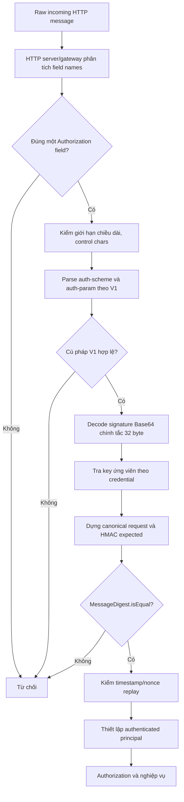

# Header parsing

## 1. Header parsing nằm ở đâu trong xác thực HTTP request bằng HMAC?

Một API backend-to-backend có thể đặt chữ ký trong header riêng như `X-Signature`, hoặc đóng gói thông tin xác thực vào **header `Authorization`**. Trong trường hợp thứ hai, server cần **phân tích chính xác cú pháp field value** để rút ra scheme, client ID, key ID và chữ ký trước khi thực hiện HMAC verification.

Một request ví dụ:

```http
POST /v1/payments?merchantId=m-42 HTTP/1.1
Host: api.example.test
Authorization: HMAC-SHA256-AUTH-V1 Credential="client-42/key-demo-01", Signature="<base64-hmac>"
Content-Type: application/json
X-Timestamp: 1795856400
X-Nonce: AAAAAAAAAAAAAAAAAAAAAA

{"orderId":"O-42","amount":250000,"currency":"VND"}
```

Đây chỉ là **cú pháp minh họa của một scheme HMAC do ứng dụng định nghĩa**, không phải scheme HMAC mặc định của HTTP hoặc một chuẩn `Authorization` dùng chung cho mọi API. Timestamp và nonce trong ví dụ là fixture cố định, không dùng để ký request production.

Chủ đề **“Header parsing”** thuộc chương **Authorization header** của mô-đun **`SECURITY_AUTHENTICATION_HMAC_REQUEST_AUTHENTICATION`**. Mô-đun hướng tới xác thực HTTP request bằng HMAC với shared secret và canonical request chứa method, URI, signed headers hoặc body; xác minh chữ ký, chống replay bằng timestamp/nonce, key rotation, kiểm thử proxy/gateway và phân biệt xác thực với phân quyền.

Sau bài này, người học có thể:

- Đọc đúng các thành phần **`Authorization`, auth-scheme, credentials, auth-param** trong ngữ nghĩa HTTP.
- Phân biệt **HTTP header parser** với **parser của scheme HMAC riêng**.
- Thiết kế một grammar tường minh, giới hạn kích thước và phát hiện header/parameter trùng, thiếu hoặc có biểu diễn mơ hồ.
- Kiểm tra Base64 signature **đúng variant, padding, canonical encoding và tag length**.
- Hiểu **client ID/key ID trước HMAC chỉ là gợi ý tra khóa**, không phải principal đã xác thực.
- Viết Java 17 parser và verifier HMAC có **timestamp, nonce, replay store và authorization boundary**.
- Đánh giá hành vi khi proxy/gateway/HTTP/2 làm thay đổi cách biểu diễn header.
- Viết bộ kiểm thử từ format negative cases đến golden vector, tampering, fuzz và integration.

**Nguyên tắc chung:** **parse được ≠ xác thực được ≠ được phép thực hiện nghiệp vụ**. Parsing chỉ giúp hiểu input theo một hợp đồng; HMAC mới xác minh bên gửi nắm secret tương ứng, nonce chặn phát lại, còn authorization quyết định quyền trên tài nguyên.

## 2. Ngữ nghĩa `Authorization` trong HTTP

HTTP định nghĩa trường `Authorization` để mang **credentials** cho tài nguyên tại origin server. Cấu trúc tổng quát được mô tả theo dạng:

```text
Authorization: <auth-scheme> <credentials>
```

Trong đó **auth-scheme** là tên cơ chế xác thực (không phân biệt hoa/thường theo HTTP), còn cú pháp **credentials** phụ thuộc scheme. Hai họ cú pháp thường gặp là **`token68`** và danh sách **`auth-param`**; không được mặc định mọi scheme dùng cùng parser.

Ví dụ các scheme khác nhau:

```http
Authorization: Basic dXNlcjpwYXNz
Authorization: Bearer eyJhbGciOi...
Authorization: HMAC-SHA256-AUTH-V1 Credential="client-42/key-demo-01", Signature="..."
```

- **Basic** mang credential theo quy tắc riêng; không phải HMAC.
- **Bearer** mang bearer token; không chứng minh client đã HMAC ký canonical request.
- **`HMAC-SHA256-AUTH-V1`** trong bài là scheme riêng có hai tham số bắt buộc `Credential` và `Signature`.

Không nên gọi chung mọi giá trị của header `Authorization` là “bearer token”; cũng không tự dùng `Base64.getDecoder` trên **toàn bộ header**.

### 2.1. Phân biệt `Authorization` và `Proxy-Authorization`

- `Authorization`: thông tin xác thực dành cho **origin server** hoặc hệ thống gateway đang đại diện origin theo thiết kế tin cậy.
- `Proxy-Authorization`: thông tin xác thực dành cho **proxy** khi proxy yêu cầu credentials.
- `WWW-Authenticate`: origin gửi **challenge**, thường đi cùng phản hồi `401 Unauthorized`.
- `Proxy-Authenticate`: proxy gửi challenge, thường đi với `407 Proxy Authentication Required`.

Đừng dùng `Proxy-Authorization` như một fallback thay thế `Authorization` của ứng dụng. Một proxy có thể tự tiêu thụ `Proxy-Authorization`; hai field có **đích bảo vệ khác nhau**.

### 2.2. Tên header, tên scheme và giá trị không có cùng quy tắc hoa/thường

Tên header HTTP **không phân biệt chữ hoa/thường**:

```http
Authorization: ...
authorization: ...
AUTHORIZATION: ...
```

Chúng đều là **cùng một field name**, không phải ba credentials độc lập.

Tên **auth-scheme** cũng không phân biệt hoa/thường theo HTTP. Tên **auth-param** cũng được xem không phân biệt hoa/thường. Nhưng **giá trị** như client ID, key ID, Base64 signature thường **phân biệt hoa/thường** theo hợp đồng của ứng dụng.

Ví dụ `client-42` và `CLIENT-42` không được tự động nhập thành cùng client nếu định danh trong kho secret của sản phẩm là case-sensitive. Việc chuyển toàn bộ header sang lowercase trước khi parse sẽ **phá signature encoding** và có thể chọn sai secret.

## 3. Cú pháp auth-scheme, token68 và auth-param

Các khái niệm trong HTTP authentication cần được phân biệt:

| Thành phần | Dạng minh họa | Vai trò |
| --- | --- | --- |
| Field name | `Authorization` | Chỉ nơi gửi credentials |
| Auth-scheme | `HMAC-SHA256-AUTH-V1` | Chọn giao thức xác thực theo allowlist |
| Token68 | `dXNlcjpwYXNz` | Một dạng credentials compact cho các scheme dùng token68 |
| Auth-param | `Credential="client-42/key-demo-01"` | Tham số có tên, giá trị |
| Quoted-string | `"client-42/key-demo-01"` | Dạng bao trong dấu ngoặc kép |
| Separator | `,` | Phân cách các auth-param trong profile này |
| Optional whitespace | `SP`, `HTAB` ở vị trí grammar cho phép | Không tự cho phép newline, CRLF hoặc khoảng trắng bất kỳ |

**Quan trọng:** một scheme chọn **grammar của chính nó**. Parser `Basic` không thể dùng để phân tích `HMAC-SHA256-AUTH-V1`, và việc tùy tiện thay một scheme `Bearer` bằng scheme `HMAC` có thể tạo **authentication confusion**.

Trong RFC HTTP authentication, `token68` cho phép một alphabet cụ thể gồm chữ, số và một số ký tự như `-`, `.`, `_`, `~`, `+`, `/`, cùng padding `=` ở cuối. Đây **không phải** cú pháp của một danh sách auth-param. Với scheme `HMAC-SHA256-AUTH-V1` của bài, chúng ta **không dùng token68**, mà dùng **hai auth-param có thứ tự cố định**.

### 3.1. Quoted-string là một cấu trúc ngữ pháp, không chỉ “tách theo dấu phẩy”

Theo cú pháp HTTP, các tham số có thể chứa giá trị dạng quoted-string. Dấu phẩy trong chuỗi được trích dẫn không có cùng ý nghĩa với dấu phẩy phân tách các auth-param.

Ví dụ với một scheme khác có giá trị tự do:

```http
Authorization: Example Token="a,b", Version="1"
```

Gọi `value.split(",")` sẽ tách sai tại dấu phẩy **bên trong chuỗi**. Generic parser cần hiểu quoted-string, escape và grammar cụ thể.

**Với profile HMAC trong bài**, ta cố ý **thu hẹp grammar**: client ID/key ID chỉ dùng alphabet `[A-Za-z0-9._-]`, signature dùng Base64 Basic padded, không cho phép dấu phẩy hoặc escaped quote trong giá trị. Vì vậy có thể parse bằng một pattern đầy đủ, chặt chẽ — nhưng **không được quảng bá pattern đó là generic parser cho mọi `Authorization` scheme**.

## 4. Hợp đồng minh họa: `HMAC-SHA256-AUTH-V1`

Để các bên có thể kiểm thử độc lập, chọn **một format cố định**:

```http
Authorization: HMAC-SHA256-AUTH-V1 Credential="client-42/key-demo-01", Signature="uLv7VGLVu/VI20hrMA4dKj3qOmzX/R5sa04rKEgv77Y="
```

Các thuộc tính của profile V1:

| Quy tắc | Giá trị |
| --- | --- |
| Field name | `Authorization`, đúng **một field value** |
| Scheme | `HMAC-SHA256-AUTH-V1` |
| Scheme case | Chấp nhận khác hoa/thường, chuẩn hóa nội bộ thành literal V1 |
| Tham số bắt buộc | Chính xác **`Credential`** rồi **`Signature`** |
| Param name case | Không phân biệt hoa/thường |
| Credential | `"<clientId>/<keyId>"`; slash phân cách duy nhất |
| `clientId`, `keyId` | Mỗi phần 1–80 ký tự `[A-Za-z0-9._-]`, **case-sensitive** |
| Signature | `"<Base64 Basic padded full HMAC-SHA-256>"` |
| Signature bytes | Đúng **32 byte** |
| Signature text | Đúng **44 ký tự**, một `=` cuối; Base64 chính tắc |
| Khoảng trắng | Ít nhất một ASCII space sau scheme; SP/HTAB ở quanh dấu phẩy theo pattern |
| Thứ tự params | **Cố định**: Credential trước, Signature sau |
| Unknown/duplicate params | **Từ chối** |
| Backslash escape trong giá trị | **Từ chối** theo profile thu hẹp |
| CR/LF, control chars | **Từ chối** |
| Header value quá dài | **Từ chối** trước decode/tra key |

**Quy định này là profile ứng dụng, không phải đòi hỏi chung của mọi scheme HTTP.** Một parser HTTP tổng quát có thể chấp nhận nhiều biểu diễn hợp lệ khác; ứng dụng có thể chọn một **tập con cụ thể** và từ chối phần còn lại để tránh ambiguity.

### 4.1. Vì sao dùng giá trị `Credential="client/key"`?

Nó cung cấp hai thông tin để **chọn secret ứng viên**:

- `clientId`: định danh khách hàng/đối tác theo hồ sơ đăng ký.
- `keyId`: phiên bản secret được phép sử dụng, hỗ trợ key rotation.

**Trước khi so HMAC, hai giá trị đều chưa đáng tin**. Chúng không tự là principal đã được xác thực. Key resolver chỉ dùng chúng để tìm key **còn hiệu lực và thuộc đúng client**; principal được xác nhận **sau khi** chữ ký khớp.

### 4.2. Vì sao không cho client chọn thuật toán bằng tham số?

Không chấp nhận một header như:

```http
Authorization: HMAC-SHA256-AUTH-V1 Credential="client-42/key-demo-01", Algorithm="HmacMD5", TagLength="1", Signature="..."
```

Scheme V1 **ấn định HmacSHA256 và full tag 32 byte**. Cho request tự chọn thuật toán/tag length có thể tạo downgrade hoặc chấp nhận MAC quá ngắn. Nếu muốn thay cơ chế, cần **phiên bản giao thức** và allowlist server-side rõ ràng, không thử lần lượt các thuật toán/format yếu hơn cho tới khi một cái khớp.

## 5. Parse header theo hai tầng: HTTP field extraction và scheme parsing

Một thiết kế tốt tách **tầng HTTP** khỏi **tầng HMAC**.



**Tầng HTTP extraction** cần đảm bảo:

- Field name `Authorization` được nhận diện **case-insensitive**.
- Header có **đúng một giá trị**; không merge một field không có list semantics thành chuỗi CSV.
- Không có CRLF injection, header folding mơ hồ, field size vượt giới hạn.
- Các signed headers khác (`X-Timestamp`, `X-Nonce`, `Content-Type`) cũng được kiểm số lượng/giá trị theo hợp đồng.
- Request body và original public method/path/query có thể lấy **đúng byte/biểu diễn cần ký**.

**Tầng scheme parsing** chỉ hoạt động trên **một field value đã được HTTP adapter kiểm và chuẩn hóa OWS tại ranh giới được phép**, rồi trích `Credential` và `Signature` theo grammar V1.

### 5.1. Không dùng `getHeader(...)` đơn lẻ để suy “chỉ có một header”

Một số HTTP framework chỉ trả **giá trị đầu tiên**, **giá trị cuối** hoặc **giá trị đã được nối lại** khi gọi `getHeader("Authorization")`. Nếu một proxy và ứng dụng chọn hai giá trị khác nhau, verification có thể bảo vệ một identity trong khi downstream lại đọc identity khác.

Pseudocode cho adapter:

```text
values = rawHttpHeaders.allValuesIgnoreCase("Authorization")

if values.count != 1:
    reject BAD_AUTHORIZATION_HEADER

value = values.single
if value is ambiguous, folded, contains CR/LF,
   exceeds field-value size limit:
    reject BAD_AUTHORIZATION_HEADER

parsed = AuthorizationHeaderV1.parse(value)
if parsed absent:
    reject BAD_AUTHORIZATION_HEADER
```

Nếu framework **đã mất thông tin duplicate** trước khi code ứng dụng được gọi, cần kiểm soát điều này tại **gateway/HTTP server** sớm hơn, thay vì hy vọng parser HMAC có thể phát hiện điều nó không còn nhìn thấy.

## 6. Header duplicate, header smuggling và gộp giá trị sai

Những input sau phải **bị từ chối** trong profile một Authorization field:

```http
Authorization: HMAC-SHA256-AUTH-V1 Credential="client-42/key-demo-01", Signature="..."
authorization: Bearer attacker-token
```

```http
Authorization: HMAC-SHA256-AUTH-V1 Credential="client-42/key-demo-01", Signature="..."
Authorization: HMAC-SHA256-AUTH-V1 Credential="client-99/key-evil-01", Signature="..."
```

```http
Authorization: HMAC-SHA256-AUTH-V1 Credential="client-42/key-demo-01", Signature="...", Signature="..."
```

Không viết logic:

```java
// SAI: che mất header trùng hoặc credential bổ sung.
String chosen = request.getHeaders("Authorization")
        .iterator().next();

String signature = chosen.substring(
        chosen.lastIndexOf("Signature=") + 10);
```

Một attacker có thể khai thác khác biệt giữa proxy, WAF, HMAC filter và backend router trong việc parse các field trùng, dấu phẩy và khoảng trắng. Một lớp có thể kiểm chữ ký của `client-42`, lớp khác lại xử lý `client-99`.

**Chính sách an toàn:** từ chối ambiguity ở ingress, **không dùng “first wins” hoặc “last wins” ngầm định**, và không cho backend đọc lại credential theo parser khác với verifier.

### 6.1. Header CRLF và obsolete line folding

Các chuỗi chứa `\r`, `\n` hay ký tự điều khiển có thể dẫn tới HTTP header injection hoặc parser differential. HTTP hiện đại không cho ứng dụng tùy ý dùng line folding cũ để mang nhiều field logic trong một dòng.

Ví dụ giá trị Java biểu diễn payload giả mạo:

```java
String bad = "HMAC-SHA256-AUTH-V1 Credential=\"client-42/key-demo-01\", "
           + "Signature=\"abc\"\r\nX-Client-Id: victim";
```

HTTP server/gateway nên **loại bỏ input nguy hiểm trước application parser**; parser scheme vẫn nên kiểm defense-in-depth nếu nhận được control chars. Không “sửa” bằng `replace("\r", "").replace("\n", "")` để rồi tiếp tục xác minh.

### 6.2. Header size limits và chi phí xử lý

Attacker có thể gửi một `Authorization` dài hàng megabyte, hàng nghìn dấu phẩy hoặc hàng chục nghìn đoạn quote. Nếu parser liên tục cấp phát/copy chuỗi hoặc dùng regex phức tạp với backtracking, API có thể bị DoS **trước khi xác thực**.

Giới hạn nên áp dụng ở nhiều lớp: tổng số headers, tổng kích thước HTTP headers, chiều dài riêng `Authorization`, kích thước body và rate limit. Ví dụ profile V1 đặt **tối đa 300 ký tự** cho giá trị header sau khi HTTP adapter cung cấp nó; con số này chỉ là lựa chọn minh họa của ứng dụng.

## 7. OWS, khoảng trắng và chữ hoa/thường: canonical hóa gì?

Trong HTTP, tên header và tên auth-scheme không phân biệt hoa/thường. Tuy nhiên **chỉ một số vị trí** trong grammar cho phép whitespace.

Profile V1 nhận:

```http
Authorization: HMAC-SHA256-AUTH-V1 Credential="client-42/key-demo-01", Signature="uLv7VGLVu/VI20hrMA4dKj3qOmzX/R5sa04rKEgv77Y="
authorization: hmac-sha256-auth-v1 credential="client-42/key-demo-01",signature="uLv7VGLVu/VI20hrMA4dKj3qOmzX/R5sa04rKEgv77Y="
Authorization: HMAC-SHA256-AUTH-V1 Credential="client-42/key-demo-01" ,	 Signature="uLv7VGLVu/VI20hrMA4dKj3qOmzX/R5sa04rKEgv77Y="
```

Ba dòng ở đây là **ba ví dụ độc lập**, **không phải ba header được gửi trong cùng một request**. Dấu tab ở vị trí thứ ba minh họa HTAB sau dấu phẩy; nếu ứng dụng muốn loại bỏ HTAB hoàn toàn, cần quy định như vậy trong profile và sửa parser tương ứng.

Profile V1 **không** nhận:

```http
Authorization:HMAC-SHA256-AUTH-V1Credential="client-42/key-demo-01",Signature="..."
Authorization: HMAC-SHA256-AUTH-V1 Credential = "client-42/key-demo-01", Signature="..."
Authorization: HMAC-SHA256-AUTH-V1 Signature="...", Credential="client-42/key-demo-01"
```

Đây là **quyết định profile thu hẹp**, không có nghĩa mọi biến thể thứ tự/whitespace nêu trên đều vi phạm HTTP chung.

### 7.1. Canonical request có nên ký nguyên chuỗi Authorization không?

Nếu đưa nguyên `Authorization` vào canonical request **bao gồm cả chữ ký**, sẽ tạo vòng lặp:

```text
signature = HMAC(secret, canonicalIncluding(signature))
```

Cách thiết kế đúng là ký **các trường ngữ nghĩa của credentials**, **không ký chính output signature**:

```text
canonical fields include:
  protocol version
  method, raw path, raw query
  content-type
  credential clientId/keyId
  x-timestamp, x-nonce
  SHA-256(raw body bytes)

exclude:
  Signature=... (MAC output)
```

Nếu nhận những biến thể case/OWS hợp lệ của scheme/param, canonical request được dựng từ **giá trị đã parse và một version literal cố định**, không lấy text header thô rồi thay whitespace tùy ý.

### 7.2. Không lowercase `Signature`, `clientId` hoặc `keyId`

Việc `Authorization` và `authorization` tương đương **không cho phép** đổi:

```text
Signature="uLv7VGLVu/VI..."
       thành
signature="ulv7vglvu/vi..."
```

Base64 phân biệt hoa/thường; thay một ký tự có thể tạo tag khác. Client ID/key ID cũng có thể case-sensitive. Chỉ scheme name/parameter names được xử lý không phân biệt hoa/thường.

## 8. Base64 signature: decode strict chưa đủ

Đầu ra `HmacSHA256` là **32 byte raw tag**. Trong profile V1, header chứa tag đã encode bằng **Base64 Basic có padding**.

Với 32 byte:

```text
raw HMAC tag = 32 bytes
Base64 Basic padded = 44 ASCII chars
43 ký tự dữ liệu + 1 dấu '=' ở cuối
```

Ví dụ test vector của bài:

```text
uLv7VGLVu/VI20hrMA4dKj3qOmzX/R5sa04rKEgv77Y=
```

Một parser an toàn nên:

1. Giới hạn độ dài text header và kiểm grammar **trước khi decode**.
2. Kiểm signature đúng **44 ký tự Base64 Basic** với `=` cuối.
3. Decode bằng `Base64.getDecoder()`; **không** dùng `getMimeDecoder()` để bỏ qua ký tự/line break tùy ý.
4. Yêu cầu decoded tag **đúng 32 byte**.
5. Encode lại bằng `Base64.getEncoder()` và so text với input để bảo đảm **padding, alphabet và pad bits chính tắc**.
6. So **raw tag** với expected HMAC bằng `MessageDigest.isEqual` sau khi HMAC đã tính được.

Đừng dùng `String.equals` giữa **expected MAC Base64 text** và input làm bước so mật mã; nó không có hợp đồng chống early exit phù hợp. Ngược lại, phép `re-encodedPublicText.equals(originalText)` trong bước **kiểm format** không phải việc so bí mật HMAC; nó được dùng để loại encoding mơ hồ.

### 8.1. Những biến thể cần từ chối

| Input signature | Lý do |
| --- | --- |
| 43 ký tự, **thiếu `=`** | V1 yêu cầu padded Base64 |
| 44 ký tự nhưng có `-` hoặc `_` | V1 yêu cầu Basic alphabet, không phải Base64URL |
| Có newline | Không thuộc format value và có nguy cơ injection |
| Có dấu `=` ở giữa | Padding sai chỗ |
| Decode thành 16 byte | Tag rút gọn không thuộc V1 |
| Decode thành 33 byte | Độ dài MAC sai |
| Pad bits không chính tắc | Decode/re-encode equality thất bại |
| Có space đầu/cuối hoặc giữa | Không đúng grammar profile |
| Giá trị có quotation bị escape | Profile từ chối escaped quote/backslash |
| Dùng một ký tự HMAC đúng rồi padding | Không đủ 32 byte, phải từ chối |

**Không bao giờ** so `Arrays.copyOf(expected, supplied.length)` với supplied tag: attacker có thể điều khiển số byte MAC được xác minh. Full HMAC-SHA-256 V1 cần so đủ **256 bit**, không chấp nhận 0/1/16 byte tùy ý.

## 9. Golden HMAC vector cho scheme `Authorization`

Vì profile V1 của bài này có `Credential` nằm **bên trong Authorization**, ta định nghĩa canonical request **khác** các profile sử dụng `X-Client-Id`/`X-Key-Id` riêng biệt. Đừng trộn những test vector giữa các version.

Request mẫu:

```http
POST /v1/payments?merchantId=m-42 HTTP/1.1
Content-Type: application/json
Authorization: HMAC-SHA256-AUTH-V1 Credential="client-42/key-demo-01", Signature="uLv7VGLVu/VI20hrMA4dKj3qOmzX/R5sa04rKEgv77Y="
X-Timestamp: 1795856400
X-Nonce: AAAAAAAAAAAAAAAAAAAAAA

{"orderId":"O-42","amount":250000,"currency":"VND"}
```

Body **đúng 51 byte UTF-8**, không có LF cuối:

```text
{"orderId":"O-42","amount":250000,"currency":"VND"}
```

SHA-256 lowercase hex của body:

```text
ea646bb8b1903a83256034142a633e90ffad35b3a40bb4c5f0e8f1eb4f4f27f9
```

Canonical request gồm **chính xác 9 dòng**, nối bằng LF (`\n`), không có LF cuối:

```text
HMAC-SHA256-AUTH-V1
POST
/v1/payments
merchantId=m-42
content-type:application/json
credential:client-42/key-demo-01
x-timestamp:1795856400
x-nonce:AAAAAAAAAAAAAAAAAAAAAA
ea646bb8b1903a83256034142a633e90ffad35b3a40bb4c5f0e8f1eb4f4f27f9
```

Canonical bytes: **235 byte** theo UTF-8. Secret test gồm đúng 32 byte ASCII:

```text
0123456789abcdef0123456789abcdef
```

Đầu ra HMAC-SHA-256:

```text
Raw tag hex:
b8bbfb5462d5bbf548db486b300e1d2a3dea3a6cd7fd1e6c6b4e2b28482fefb6

Base64 Basic padded:
uLv7VGLVu/VI20hrMA4dKj3qOmzX/R5sa04rKEgv77Y=
```

Đổi **chỉ credential client ID** thành `client-43` nhưng giữ các byte khác và dùng cùng secret test:

```text
credential:client-43/key-demo-01

Base64 expected trong test:
4Rwe6V2O5k9ULiDklEoyFkbSCZDsB894VGnZDFYEKBo=
```

**Hai giá trị signature là vector được tính độc lập**. Nếu header `Authorization` bị đổi credential mà chữ ký cũ vẫn được chấp nhận, có thể credential đã không được ràng buộc vào canonical request hoặc verifier có lỗi chọn key.

**Chỉ dùng cho test:** secret công khai, timestamp cố định, nonce toàn chữ `A` (16 byte zero) không phù hợp production. Vectors kiểm tính tất định, không kiểm freshness theo đồng hồ hiện tại; unit test cần dùng `Clock.fixed`.

## 10. Java 17: strict parser cho `Authorization` profile V1

Parser dưới đây **chỉ nhận một biểu diễn auth-param có kiểm soát** của scheme V1. Nó **không** thay thế HTTP parser, cũng không cố hỗ trợ tất cả scheme chuẩn như Basic/Bearer.

```java
import java.util.Base64;
import java.util.Objects;
import java.util.Optional;
import java.util.regex.Matcher;
import java.util.regex.Pattern;

public final class AuthorizationHeaderV1 {
    private static final int MAX_VALUE_CHARS = 300;

    // Scheme/param names nhận case-insensitive theo HTTP.
    // Credential và Base64 signature giữ nguyên case của value.
    private static final Pattern FORM = Pattern.compile(
            "HMAC-SHA256-AUTH-V1 +Credential=\""
          + "([A-Za-z0-9._-]{1,80})/([A-Za-z0-9._-]{1,80})"
          + "\"[ \\t]*,[ \\t]*Signature=\"([A-Za-z0-9+/]{43}=)\"",
            Pattern.CASE_INSENSITIVE);

    private AuthorizationHeaderV1() {}

    public record Parsed(
            String clientId, String keyId, byte[] rawSignature) {
        public Parsed {
            Objects.requireNonNull(clientId, "clientId");
            Objects.requireNonNull(keyId, "keyId");
            Objects.requireNonNull(rawSignature, "rawSignature");
            if (rawSignature.length != 32) {
                throw new IllegalArgumentException(
                        "Expected full SHA-256 MAC");
            }
            rawSignature = rawSignature.clone();
        }

        @Override
        public byte[] rawSignature() {
            return rawSignature.clone();
        }
    }

    public static Optional<Parsed> parse(String value) {
        if (value == null || value.length() > MAX_VALUE_CHARS
                || value.indexOf('\r') >= 0
                || value.indexOf('\n') >= 0) {
            return Optional.empty();
        }

        Matcher matcher = FORM.matcher(value);
        // matches(): toàn bộ input phải thỏa grammar, không
        // chỉ match một substring.
        if (!matcher.matches()) {
            return Optional.empty();
        }

        String clientId = matcher.group(1);
        String keyId = matcher.group(2);
        String b64 = matcher.group(3);

        final byte[] supplied;
        try {
            supplied = Base64.getDecoder().decode(b64);
        } catch (IllegalArgumentException badBase64) {
            return Optional.empty();
        }

        if (supplied.length != 32) {
            return Optional.empty();
        }

        // Chuỗi decode được nhưng không canonical phải reject.
        if (!Base64.getEncoder().encodeToString(supplied)
                .equals(b64)) {
            return Optional.empty();
        }

        return Optional.of(new Parsed(clientId, keyId, supplied));
    }
}
```

### 10.1. Những điểm reviewer phải để ý

- `FORM.matcher(value).matches()` buộc **toàn bộ value** khớp. Dùng `find()` có thể vô tình chấp nhận prefix/suffix không được xác thực.
- `Pattern.CASE_INSENSITIVE` chỉ áp dụng cho **so khớp ký tự grammar**, không đổi nội dung các captured groups. `clientId` và `keyId` được giữ nguyên để tra key chính xác.
- Dấu ngoặc kép được xử lý theo pattern **không chấp nhận escape**, vì client/key dùng alphabet an toàn. Generic HTTP quoted-string có thể linh hoạt hơn; đây là profile thu hẹp đã công bố.
- Pattern cho phép SP sau scheme, SP/HTAB quanh dấu phẩy; **không** cho phép khoảng trắng tùy ý quanh `=`.
- Kiểm value length **trước regex/decode** để hạn chế chi phí xử lý input chưa xác thực.
- Dữ liệu trả về là **raw 32-byte signature** để verifier so với HMAC; chưa xác thực danh tính.
- Record sao chép defensive array để caller không thể sửa byte signature sau parse.
- Không nhận token68, unknown params, duplicate params, thiếu quote, thiếu signature hoặc tag rút gọn.

### 10.2. Parser có kiểm được duplicate `Authorization` không?

**Không**, vì input của `parse(String value)` chỉ là **một String**. Việc từ chối nhiều field cùng tên thuộc trách nhiệm của **HTTP adapter/gateway trước khi gọi parser**. Một parser nội bộ nhận một String đơn lẻ không thể khôi phục những giá trị đã bị HTTP framework chọn bỏ hoặc gộp.

### 10.3. Parser có kiểm đúng secret không?

**Không**. `parse` chỉ trả `clientId`, `keyId` và `rawSignature`. Nó chưa nhận secret, chưa biết key active/inactive, chưa có body hoặc canonical request, chưa kiểm timestamp/nonce. Không được viết:

```java
var auth = AuthorizationHeaderV1.parse(header);

if (auth.isPresent()) {
    authorizePayment(); // SAI: parse được không phải authenticate.
}
```

## 11. Java 17: canonical request từ credential đã parse

Ví dụ bên dưới **đóng chặt endpoint** `POST /v1/payments?merchantId=m-42` và `Content-Type: application/json` nhằm làm rõ header parsing. API nhiều route cần một canonicalization contract tổng quát cho method, public raw URI, query, selected headers và raw body bytes.

```java
import java.nio.charset.StandardCharsets;
import java.security.GeneralSecurityException;
import java.security.MessageDigest;
import java.util.HexFormat;
import java.util.Objects;

public final class AuthorizationCanonicalV1 {
    private AuthorizationCanonicalV1() {}

    public record RequestParts(
            String method,
            String publicRawPath,
            String rawQuery,
            String contentType,
            String timestampSeconds,
            String nonce,
            byte[] rawBody) {
        public RequestParts {
            Objects.requireNonNull(rawBody, "rawBody");
            rawBody = rawBody.clone();
        }

        @Override
        public byte[] rawBody() {
            return rawBody.clone();
        }
    }

    public static byte[] canonicalBytes(
            RequestParts request,
            AuthorizationHeaderV1.Parsed credential)
            throws GeneralSecurityException {

        Objects.requireNonNull(request, "request");
        Objects.requireNonNull(credential, "credential");

        if (!"POST".equals(request.method())
                || !"/v1/payments".equals(request.publicRawPath())
                || !"merchantId=m-42".equals(request.rawQuery())
                || !"application/json".equals(request.contentType())) {
            throw new IllegalArgumentException(
                    "Request differs from V1 endpoint contract");
        }

        String bodyDigest = HexFormat.of().formatHex(
                MessageDigest.getInstance("SHA-256")
                        .digest(request.rawBody()));

        String canonical = String.join("\n",
                "HMAC-SHA256-AUTH-V1",
                request.method(),
                request.publicRawPath(),
                request.rawQuery(),
                "content-type:" + request.contentType(),
                "credential:" + credential.clientId()
                        + "/" + credential.keyId(),
                "x-timestamp:" + request.timestampSeconds(),
                "x-nonce:" + request.nonce(),
                bodyDigest);

        return canonical.getBytes(StandardCharsets.UTF_8);
    }
}
```

**Vì sao có dòng `credential:...`?** Vì client ID và key ID đến từ Authorization header, không phải hai header `X-Client-Id`/`X-Key-Id` khác. Đưa định danh vào HMAC input giúp bảo vệ **identity/key-selection metadata** khỏi bị sửa sau khi ký. Version literal `HMAC-SHA256-AUTH-V1` đồng thời ràng buộc scheme/algorithm của profile này.

**Vì sao không có `Signature=...` trong canonical?** Vì signature là **đầu ra cần xác minh**, đưa nó vào đầu vào HMAC sẽ tạo vòng tự tham chiếu.

## 12. Java 17: verifier có parsing, HMAC, timestamp và nonce

Các interface sau mô tả yêu cầu hạ tầng, nhưng **không tự cài đặt Redis, database hoặc secret manager**.

```java
import java.util.Objects;

public final class AuthVerificationContractsV1 {
    private AuthVerificationContractsV1() {}

    public record ActiveKey(
            String authenticatedPrincipal, byte[] secret) {
        public ActiveKey {
            Objects.requireNonNull(authenticatedPrincipal);
            Objects.requireNonNull(secret);
            if (authenticatedPrincipal.isBlank()
                    || secret.length == 0) {
                throw new IllegalArgumentException(
                        "Invalid key resolver result");
            }
            secret = secret.clone();
        }

        @Override
        public byte[] secret() {
            return secret.clone();
        }
    }

    @FunctionalInterface
    public interface KeyResolver {
        // Chỉ trả key còn hiệu lực của đúng client/key ID.
        ActiveKey resolveActive(
                String clientId, String keyId);
    }

    @FunctionalInterface
    public interface ReplayStore {
        // Atomic insert-if-absent qua mọi verifier nodes.
        // Throw khi store gặp lỗi, không được return true.
        boolean reserveOnce(
                String authenticatedPrincipal,
                String nonce, long ttlSeconds);
    }
}
```

Verifier:

```java
import java.security.GeneralSecurityException;
import java.security.MessageDigest;
import java.time.Clock;
import java.time.Instant;
import java.util.Base64;
import java.util.Optional;
import javax.crypto.Mac;
import javax.crypto.spec.SecretKeySpec;

public final class AuthorizationHmacVerifierV1 {
    private static final long MAX_PAST = 300L;
    private static final long MAX_FUTURE = 60L;
    private static final long REPLAY_MARGIN = 60L;

    private AuthorizationHmacVerifierV1() {}

    public static Optional<String> verifyAndReserve(
            String authorizationValue,
            AuthorizationCanonicalV1.RequestParts request,
            Clock serverClock,
            AuthVerificationContractsV1.KeyResolver keys,
            AuthVerificationContractsV1.ReplayStore replay)
            throws GeneralSecurityException {

        var parsedOpt = AuthorizationHeaderV1.parse(
                authorizationValue);
        if (parsedOpt.isEmpty()) return Optional.empty();
        var parsed = parsedOpt.get();

        // Kiểm cú pháp timestamp trước parse long.
        String text = request.timestampSeconds();
        if (text == null
                || !text.matches("0|[1-9][0-9]{0,11}")) {
            return Optional.empty();
        }
        long timestamp = Long.parseLong(text);
        long now = Instant.now(serverClock).getEpochSecond();

        final long minTime;
        final long maxTime;
        try {
            minTime = Math.subtractExact(now, MAX_PAST);
            maxTime = Math.addExact(now, MAX_FUTURE);
        } catch (ArithmeticException badClock) {
            return Optional.empty();
        }
        if (timestamp < minTime || timestamp > maxTime) {
            return Optional.empty();
        }

        // Nonce = 16 raw bytes, Base64URL without padding:
        String nonce = request.nonce();
        if (nonce == null
                || !nonce.matches("[A-Za-z0-9_-]{22}")) {
            return Optional.empty();
        }
        final byte[] nonceBytes;
        try {
            nonceBytes = Base64.getUrlDecoder().decode(nonce);
        } catch (IllegalArgumentException badNonce) {
            return Optional.empty();
        }
        if (nonceBytes.length != 16
                || !Base64.getUrlEncoder().withoutPadding()
                        .encodeToString(nonceBytes).equals(nonce)) {
            return Optional.empty();
        }

        // Canonical bytes phải lấy từ request thực nhận.
        final byte[] canonical;
        try {
            canonical = AuthorizationCanonicalV1.canonicalBytes(
                    request, parsed);
        } catch (IllegalArgumentException invalidRequest) {
            return Optional.empty();
        }

        // Trước HMAC, clientId/keyId CHỈ là lookup hints.
        var active = keys.resolveActive(
                parsed.clientId(), parsed.keyId());
        if (active == null) return Optional.empty();

        // HMAC-SHA-256 đầy đủ 32-byte, không tag truncation.
        Mac mac = Mac.getInstance("HmacSHA256");
        mac.init(new SecretKeySpec(
                active.secret(), "HmacSHA256"));
        byte[] expected = mac.doFinal(canonical);

        if (!MessageDigest.isEqual(
                expected, parsed.rawSignature())) {
            return Optional.empty();
        }

        // Chỉ sau HMAC đúng mới ghi nonce theo principal.
        // TTL = remaining acceptance window + margin.
        final long ttl;
        try {
            long expiry = Math.addExact(timestamp, MAX_PAST);
            ttl = Math.max(1L, Math.addExact(
                    Math.subtractExact(expiry, now),
                    REPLAY_MARGIN));
        } catch (ArithmeticException badTime) {
            return Optional.empty();
        }

        if (!replay.reserveOnce(
                active.authenticatedPrincipal(), nonce, ttl)) {
            return Optional.empty();
        }

        // Đây là authenticated principal, CHƯA authorize.
        return Optional.of(active.authenticatedPrincipal());
    }
}
```

### 12.1. Những bảo đảm và giới hạn

- `AuthorizationHeaderV1.parse` kiểm **cú pháp** và giải mã chữ ký. Nó không chứng minh key đang hợp lệ.
- `KeyResolver` quyết định secret **đúng client ID/key ID** và **chưa bị thu hồi**. Định danh do header cung cấp trước HMAC chỉ là input tra cứu.
- `Mac` được tạo cục bộ mỗi lần gọi, tránh chia sẻ mutable state giữa các request hoặc giữa các secret.
- `MessageDigest.isEqual` so sánh raw 32-byte MAC; không so Base64 String với expected secret-dependent text.
- `AuthorizationCanonicalV1` ký method, raw target, Content-Type, credential, timestamp, nonce và hash body bytes. Không chỉ kiểm HMAC trên một header client tự khai.
- `ReplayStore` phải là **insert-if-absent nguyên tử**, không phải kiểm `exists` rồi `put` riêng rẽ.
- Khi replay store timeout hoặc mất kết nối, **không được bắt exception rồi cho request qua**.
- TTL minh họa dựa trên cửa sổ **300 giây quá khứ / 60 giây tương lai** cộng margin 60 giây. Phải kiểm tính đúng với clock skew thực tế của cluster.
- `verifyAndReserve` trả principal đã xác thực, **không cấp quyền** thao tác với merchant hoặc resource.
- Adapter phải từ chối duplicate/malformed HTTP headers **trước khi gọi phương thức này**; ví dụ ở đây không thực hiện wire-level HTTP parsing.

### 12.2. Trường hợp parser thành công nhưng verifier thất bại

Ví dụ:

```text
Header parser:
  scheme = HMAC-SHA256-AUTH-V1
  clientId = client-42
  keyId = key-demo-01
  suppliedTag = 32 bytes
  -> PARSE SUCCESS

Verifier:
  key-demo-01 đã revoked
  hoặc body bị đổi sau khi ký
  hoặc timestamp hết hạn
  hoặc nonce đã được reserve
  -> AUTHENTICATION FAILS / request rejected
```

Parser thành công chỉ chứng minh **field value phù hợp grammar**; nó không chứng minh người gửi có secret hay có quyền.

## 13. Java 17 + JUnit 5: test parser và golden signature

Các ví dụ dưới đây là **bài tập tài liệu**, không chạy Gradle/JUnit trong STEP 4. Khi tích hợp dự án, cần JUnit 5 dependency và HTTP adapter thật.

### 13.1. Test parse header chuẩn và biến thể scheme/param case

```java
import static org.junit.jupiter.api.Assertions.*;
import java.util.Base64;
import org.junit.jupiter.api.Test;

class AuthorizationHeaderV1Test {
    static final String VECTOR =
            "uLv7VGLVu/VI20hrMA4dKj3qOmzX/R5sa04rKEgv77Y=";

    static final String AUTH =
            "HMAC-SHA256-AUTH-V1 "
          + "Credential=\"client-42/key-demo-01\", "
          + "Signature=\"" + VECTOR + "\"";

    @Test
    void parsesCanonicalHeader() {
        var parsed = AuthorizationHeaderV1.parse(AUTH)
                .orElseThrow();

        assertEquals("client-42", parsed.clientId());
        assertEquals("key-demo-01", parsed.keyId());
        assertArrayEquals(
                Base64.getDecoder().decode(VECTOR),
                parsed.rawSignature());
        assertEquals(32, parsed.rawSignature().length);
    }

    @Test
    void acceptsCaseInsensitiveSchemeAndParamNames() {
        String value =
                "hmac-sha256-auth-v1 "
              + "credential=\"client-42/key-demo-01\","
              + "signature=\"" + VECTOR + "\"";

        var parsed = AuthorizationHeaderV1.parse(value)
                .orElseThrow();

        assertEquals("client-42", parsed.clientId());
        assertEquals("key-demo-01", parsed.keyId());
    }

    @Test
    void preservesCaseSensitiveCredentialValues() {
        String value =
                "HMAC-SHA256-AUTH-V1 "
              + "Credential=\"CLIENT-42/Key-Demo-01\", "
              + "Signature=\"" + VECTOR + "\"";

        var parsed = AuthorizationHeaderV1.parse(value)
                .orElseThrow();

        assertEquals("CLIENT-42", parsed.clientId());
        assertEquals("Key-Demo-01", parsed.keyId());
    }
}
```

Test `preservesCaseSensitiveCredentialValues` **không** chứng minh chữ ký cho client khác hợp lệ. Nó chỉ xác nhận parser không tự lowercase phần identity; verifier sẽ sử dụng identity này để chọn secret ứng viên và tính HMAC.

### 13.2. Negative tests cho grammar, quoting và encoding

```java
import static org.junit.jupiter.api.Assertions.*;
import org.junit.jupiter.api.Test;

class AuthorizationHeaderV1NegativeTest {
    static final String SIG =
            "uLv7VGLVu/VI20hrMA4dKj3qOmzX/R5sa04rKEgv77Y=";

    @Test
    void rejectsMalformedHeaders() {
        String[] bad = {
            null,
            "",
            "Basic dXNlcjpwYXNz",
            "Bearer abc.def",
            "HMAC-SHA256-AUTH-V1",
            "HMAC-SHA256-AUTH-V1 Credential=\"x/y\"",
            "HMAC-SHA256-AUTH-V1 Credential=\"/key\", "
                + "Signature=\"" + SIG + "\"",
            "HMAC-SHA256-AUTH-V1 Credential=\"x/\", "
                + "Signature=\"" + SIG + "\"",
            "HMAC-SHA256-AUTH-V1 Credential=x/y, "
                + "Signature=\"" + SIG + "\"",
            "HMAC-SHA256-AUTH-V1 Signature=\"" + SIG
                + "\", Credential=\"x/y\"",
            "HMAC-SHA256-AUTH-V1 Credential=\"x/y\", "
                + "Signature=\"" + SIG + "\", Extra=1",
            "HMAC-SHA256-AUTH-V1 Credential=\"x/y\", "
                + "Signature=\"" + SIG + "\", Signature=\"" + SIG + "\"",
            "HMAC-SHA256-AUTH-V1 Credential=\"x/y\", "
                + "Signature=\"short\"",
            "HMAC-SHA256-AUTH-V1 Credential=\"x/y\", "
                + "Signature=\"" + SIG.substring(0, 43) + "\"",
            "HMAC-SHA256-AUTH-V1 Credential=\"x/y\", "
                + "Signature=\"" + SIG + "\"\r\nX-Admin: 1"
        };

        for (String header : bad) {
            assertTrue(AuthorizationHeaderV1.parse(header).isEmpty(),
                    "Should reject: " + header);
        }
    }

    @Test
    void rejectsExcessivelyLongValue() {
        String tooLong = "A".repeat(5000);
        assertTrue(AuthorizationHeaderV1.parse(tooLong).isEmpty());
    }
}
```

### 13.3. Test golden HMAC và ràng buộc credential

Ta dùng **cùng canonical bytes đã tính độc lập** trong mục 9:

```java
import static org.junit.jupiter.api.Assertions.*;
import java.nio.charset.StandardCharsets;
import java.security.MessageDigest;
import java.util.Base64;
import java.util.HexFormat;
import javax.crypto.Mac;
import javax.crypto.spec.SecretKeySpec;
import org.junit.jupiter.api.Test;

class AuthorizationHmacVectorTest {
    @Test
    void matchesCanonicalAndTagGoldenVector() throws Exception {
        String authorization =
                "HMAC-SHA256-AUTH-V1 "
              + "Credential=\"client-42/key-demo-01\", "
              + "Signature=\"uLv7VGLVu/VI20hrMA4dKj3qOmzX/R5sa04rKEgv77Y=\"";

        var parsed = AuthorizationHeaderV1.parse(
                authorization).orElseThrow();

        byte[] body = (
                "{\"orderId\":\"O-42\",\"amount\":250000,"
              + "\"currency\":\"VND\"}"
        ).getBytes(StandardCharsets.UTF_8);

        var parts = new AuthorizationCanonicalV1.RequestParts(
                "POST", "/v1/payments", "merchantId=m-42",
                "application/json", "1795856400",
                "AAAAAAAAAAAAAAAAAAAAAA", body);

        byte[] canonical = AuthorizationCanonicalV1
                .canonicalBytes(parts, parsed);

        assertEquals(51, body.length);
        assertEquals(235, canonical.length);
        assertEquals(9, new String(canonical, StandardCharsets.UTF_8)
                .split("\n", -1).length);

        byte[] secret = (
                "0123456789abcdef0123456789abcdef"
        ).getBytes(StandardCharsets.US_ASCII);

        Mac mac = Mac.getInstance("HmacSHA256");
        mac.init(new SecretKeySpec(secret, "HmacSHA256"));
        byte[] expected = mac.doFinal(canonical);

        assertEquals(
                "b8bbfb5462d5bbf548db486b300e1d2a3dea3a6cd7fd1e6c6b4e2b28482fefb6",
                HexFormat.of().formatHex(expected));
        assertEquals(
                "uLv7VGLVu/VI20hrMA4dKj3qOmzX/R5sa04rKEgv77Y=",
                Base64.getEncoder().encodeToString(expected));

        assertTrue(MessageDigest.isEqual(
                expected, parsed.rawSignature()));
    }
}
```

**Giới hạn của golden test:** nó xác nhận bytes, encoding và HMAC. Nó không chứng minh freshness theo thời gian thực, bảo đảm replay store hoặc quyền merchant. Với unit test verifier, inject `Clock.fixed(Instant.ofEpochSecond(1795856400L), ZoneOffset.UTC)` và dùng một fake atomic nonce store; với integration test, dùng hạ tầng thật.

## 14. Những phép thử nhất thiết phải chạy qua HTTP adapter/gateway

Một test chỉ gọi `AuthorizationHeaderV1.parse(String)` **không thấy nhiều header lines**. Do đó những tình huống sau cần integration tests trên HTTP stack thực tế.

| Tình huống | Kỳ vọng |
| --- | --- |
| `Authorization` xuất hiện hai lần cùng giá trị | Từ chối, không tự “dedupe” |
| `Authorization` và `authorization` cùng xuất hiện | Từ chối vì cùng tên HTTP |
| Hai scheme Basic và HMAC trên hai dòng | Từ chối, không chọn scheme tùy ý |
| Header bị HTTP library gộp bằng dấu phẩy | Từ chối nếu không đúng grammar V1 |
| Header được gửi qua HTTP/2 (tên lowercase) | Nhận diện đúng field name |
| Header value chứa CRLF/control | HTTP server/gateway từ chối |
| Header vượt tổng kích thước | Request bị từ chối trước MAC/DB |
| Gateway xóa `Authorization` | Verifier từ chối, không cho request anonymous đi tiếp |
| Gateway thay `Credential` | HMAC không còn khớp hoặc key lookup thất bại |
| Proxy rewrite public raw URI | HMAC phải phát hiện canonical mismatch |
| Proxy đổi `Content-Type` hoặc body bytes | HMAC sai nếu các thành phần ấy được ký |
| Gateway verify rồi backend verify lại cùng nonce store | Thiết kế tránh double-reserve không chủ đích |
| Redirect sang origin khác | HTTP client không được rò rỉ credential cho origin không tin cậy |
| Client `Authorization` + `Proxy-Authorization` | Hai trường được xử lý đúng vai trò |
| CORS preflight OPTIONS | Theo chính sách CORS, không tự xem là signed POST nghiệp vụ |

### 14.1. HTTP/2 không đổi nguyên tắc của Authorization

Trong HTTP/2, tên field thường được biểu diễn bằng **lowercase**. Parser application không được yêu cầu tên literal `Authorization` đúng hoa/thường trên wire. Nhưng **value** `clientId`/`keyId`/`Signature` vẫn giữ ngữ nghĩa case-sensitive theo profile.

Khi gateway chuyển HTTP/2 về HTTP/1.1 hoặc ngược lại, phải kiểm xem các thành phần signed request khác (method, public path/query, headers, body bytes) còn được bảo toàn theo canonical contract hay không.

### 14.2. Proxy không được tự tạo chữ ký “để giúp client”

Nếu một middleware sửa `Authorization` hoặc thêm một header `X-Authenticated-Client` chưa được bảo vệ, downstream có thể tin nhầm nguồn danh tính.

Hai cách thường dùng:

1. **Xác minh tại gateway** trước rewrite; gateway chuyển authenticated principal qua kênh nội bộ đáng tin, xóa mọi identity headers do client Internet tự gửi.
2. **Xác minh tại backend**, giữ method/URI/body/signed headers gốc theo một metadata channel bảo vệ khỏi client giả mạo.

Không dùng `X-Original-URI` hoặc `X-Forwarded-Authorization` do client gửi làm nguồn dữ liệu đáng tin mà không có trust boundary rõ ràng.

## 15. Key rotation: credential parse đúng vẫn chưa phải key hợp lệ

Với `Credential="client-42/key-demo-01"`, parser chỉ tách hai chuỗi. Key resolver phải áp dụng:

- `key-demo-01` thuộc **client-42**, không thuộc client khác.
- Secret đang được phép dùng ở thời điểm server xác minh.
- Key chưa bị revoke và nằm trong giai đoạn rotation được công bố.
- Scheme và algorithm của key phù hợp `HMAC-SHA256-AUTH-V1`.
- Không dùng fallback secret đã thu hồi chỉ vì key ID không tìm thấy.
- Một key ID không được trùng mơ hồ giữa các principal nếu resolver không có thêm scope.

Ví dụ:

```text
Client client-42:
  key-demo-01: REVOKED
  key-demo-02: ACTIVE

Authorization:
  Credential="client-42/key-demo-01", Signature="..."

Kết quả:
  Parser: thành công về format.
  Key resolver: từ chối key đã revoked.
  Không thực hiện business operation.
```

Khi client chuyển key, phải tạo chữ ký mới từ secret mới và cập nhật credential. **Nonce replay scope** thường theo authenticated principal thay vì theo key ID để không cho dùng lại nonce khi rotation; **idempotency key** của cùng business intent cũng nên ổn định theo principal/operation dù key thay đổi.

### 15.1. Không suy principal từ parse result trước khi xác thực

Đoạn code này sai:

```java
var parsed = AuthorizationHeaderV1.parse(value);

if (parsed.isPresent()) {
    securityContext.setPrincipal(
            parsed.get().clientId()); // SAI: chưa kiểm HMAC.
}
```

Đúng hơn: chọn secret **ứng viên**, tính và so HMAC, kiểm timestamp/nonce, rồi mới đặt **authenticated principal** từ key resolver và áp dụng authorization.

## 16. Timestamp, nonce và replay sau khi parse header

Một Authorization header hoàn toàn hợp lệ về format có thể chứa **HMAC đúng nhưng request đã được sử dụng**.

```mermaid
sequenceDiagram
    autonumber
    participant C as Client
    participant P as Authorization parser
    participant V as HMAC verifier
    participant R as Replay store
    participant B as Business handler
    C->>P: Authorization + X-Timestamp T1 + X-Nonce N1
    P->>V: clientId/keyId, rawSignature
    V->>V: HMAC khớp; timestamp còn hạn
    V->>R: reserveOnce(principal, N1, ttl)
    R-->>V: Insert thành công
    V->>B: Tiếp tục authorization/operation
    Note over C,V: Client/attacker phát lại nguyên request
    C->>P: Cùng Authorization, T1, N1
    P->>V: Parse vẫn thành công
    V->>V: HMAC vẫn khớp
    V->>R: reserveOnce(principal, N1, ttl)
    R-->>V: Đã tồn tại -> replay
    V-->>C: Từ chối
```

**Timestamp** giới hạn request có thể được nhận trong một khoảng như `serverNow-300 <= signedTimestamp <= serverNow+60`. **Nonce** được ký và được lưu bằng atomic insert-if-absent giúp chặn lần phát lại bên trong khoảng ấy.

### 16.1. Vì sao reserve nonce phải sau kiểm HMAC?

Nếu parser vừa trích `clientId` và `nonce` rồi ghi nonce trước HMAC, attacker không biết secret vẫn có thể gửi request giả chiếm chỗ của một nonce, tạo denial-of-service. Nên:

```text
parse/validate format
-> resolve secret candidate
-> compute and compare HMAC
-> authenticated principal
-> reserve nonce atomically
-> authorize
-> business/idempotency
```

Time-window precheck có thể diễn ra trước HMAC để từ chối input đã quá hạn, nhưng **không được ghi nonce hoặc thực hiện nghiệp vụ** dựa trên một request chưa được xác thực.

### 16.2. Replay TTL không chỉ bằng past window

Nếu cho phép request có timestamp **ở tương lai 60 giây**, và tuổi quá khứ tối đa **300 giây**, một request có thể còn hợp lệ **360 giây** kể từ lần đầu reserve khi nó ở future boundary. TTL 300 giây có thể **hết trước timestamp window**; cần tính theo thời gian còn hợp lệ + margin clock/consistency.

Ví dụ với `serverNow=1000` và `signedTimestamp=1060`:

```text
last accepted server time = 1060 + 300 = 1360
remaining from now=1000 = 360 seconds
with 60 seconds margin -> example TTL = 420 seconds
```

Nếu replay store timeout/evict key sớm/failover mất bản ghi, request cũ có thể được chấp nhận lại. Hệ thống nhạy cảm cần **fail closed**, capacity monitoring và consistency/durability phù hợp.

## 17. Parsing Authorization không đồng nghĩa authorization nghiệp vụ

Từ “Authorization” trong tên HTTP header dễ gây hiểu nhầm rằng chỉ cần field này đúng là user có quyền làm mọi thao tác. **Không phải vậy.**

Ta cần ba lớp:

| Lớp | Đầu vào | Kết luận |
| --- | --- | --- |
| **Header parsing** | Field `Authorization` | Có một scheme/credential/signature hợp lệ về **format** |
| **Authentication** | Secret + canonical bytes + HMAC + freshness/replay | Request được xác thực thuộc principal nào |
| **Authorization** | Authenticated principal + resource + scope/tenant | Principal được phép thực hiện operation cụ thể hay không |

Ví dụ client-42 có secret hợp lệ, gửi POST cho `merchantId=m-99`:

```http
POST /v1/payments?merchantId=m-99 HTTP/1.1
Authorization: HMAC-SHA256-AUTH-V1 Credential="client-42/key-demo-01", Signature="<valid-signature-for-this-request>"
```

Ngay cả nếu client tạo được một chữ ký đúng trên request đó, business authorization phải kiểm **client-42 có quyền với m-99 không**. Một chữ ký hợp lệ **không tự cấp quyền** truy cập tenant khác.

Nếu API hỗ trợ `Idempotency-Key`, phải kiểm quyền **trước khi trả cached response**; nếu không, một caller đoán được key của người khác có thể tìm cách lấy business result dù chưa được phép.

### 17.1. Mã lỗi HTTP

- `401 Unauthorized` thường dùng khi **không có credentials hợp lệ**; theo HTTP authentication, phản hồi 401 của origin server cần có một `WWW-Authenticate` challenge thích hợp.
- `403 Forbidden` thường dùng khi server hiểu request và từ chối **quyền truy cập**.
- `400 Bad Request` có thể phù hợp cho request/header không đúng định dạng theo hợp đồng API.
- `429`, `503` có thể dùng khi rate limit hoặc hạ tầng verifier/store không thể phục vụ, theo policy sản phẩm.

Không tự quyết định mã status chỉ dựa trên tên exception của parser. Cần có **error contract** nhất quán, không tiết lộ sự tồn tại client/key, secret status hay nội dung expected HMAC. Với proprietary auth scheme, nếu gửi challenge `WWW-Authenticate`, phải định nghĩa scheme/realm và hành vi client tương ứng.

## 18. Kiểm thử đầy đủ: grammar, security và proxy integration

### 18.1. Ma trận test header parsing

| ID | Input | Kỳ vọng |
| --- | --- | --- |
| H01 | Header HMAC V1 chuẩn, đúng quotes | Parse thành công |
| H02 | Scheme viết lowercase | Parse thành công |
| H03 | Param names viết lowercase | Parse thành công |
| H04 | Credential values đổi hoa/thường | Giữ nguyên value, không tự chuẩn hóa |
| H05 | Thiếu scheme hoặc thiếu space | Từ chối |
| H06 | Scheme khác như Bearer hoặc Basic | Từ chối theo profile này |
| H07 | Auth header thiếu Credential | Từ chối |
| H08 | Auth header thiếu Signature | Từ chối |
| H09 | Đổi thứ tự hai param | Từ chối theo profile |
| H10 | Duplicate Credential/Signature param | Từ chối |
| H11 | Thêm unknown param | Từ chối |
| H12 | Unquoted credential hoặc signature | Từ chối |
| H13 | Credential không có slash | Từ chối |
| H14 | Credential có hai slash, path traversal, quote | Từ chối |
| H15 | Client/key ID rỗng hoặc quá 80 ký tự | Từ chối |
| H16 | Signature thiếu `=`, thừa `=` | Từ chối |
| H17 | Base64URL trong profile Basic | Từ chối |
| H18 | Signature Base64 pad bits không chính tắc | Từ chối |
| H19 | Decode thành tag dưới/qua 32 byte | Từ chối |
| H20 | Value có CR, LF, NUL hoặc control chars | Từ chối |
| H21 | Value quá 300 ký tự | Từ chối trước decode |
| H22 | Prefix/suffix thừa sau Signature | Từ chối vì `matches()` |
| H23 | Quoted-string escaped quote/backslash | Từ chối theo profile |
| H24 | Dấu phẩy trong quoted credential | Từ chối theo profile |
| H25 | Hai header `Authorization` | Từ chối ở ingress |
| H26 | `Authorization` + `authorization` | Từ chối ở ingress |
| H27 | Field bị proxy gộp | Từ chối không đúng grammar |
| H28 | HTTP/2 header name lowercase | Nhận diện đúng tên field |
| H29 | Proxy dùng `Proxy-Authorization` thay thế | Không cho fallback origin auth |
| H30 | Redirect khác origin mang theo credential | HTTP client phải bảo vệ, test không leak |

### 18.2. Ma trận test HMAC/replay/authz liên quan parser

| ID | Tình huống | Kỳ vọng |
| --- | --- | --- |
| S01 | Golden HMAC vector `client-42`, secret đúng | MAC khớp |
| S02 | Credential đổi `client-43` nhưng giữ chữ ký cũ | MAC không khớp hoặc resolver từ chối |
| S03 | Key ID sai/đã revoked | Từ chối |
| S04 | Body thay sau khi ký | HMAC sai |
| S05 | Public raw URI thay sau khi ký | HMAC sai |
| S06 | Timestamp bị sửa giữ signature | HMAC sai |
| S07 | Timestamp nằm ngoài window | Từ chối |
| S08 | Nonce bị sửa giữ signature | HMAC sai |
| S09 | Replay nguyên request trong window | Atomic nonce store từ chối |
| S10 | Concurrent replay qua 2 instances | Tối đa một reserve thành công |
| S11 | Replay store lỗi/timeout | Fail closed |
| S12 | Nonce TTL hết sớm hơn timestamp | Security test phát hiện |
| S13 | Key rotation giữa hai secret | Chỉ active key được nhận |
| S14 | HMAC đúng nhưng principal thiếu quyền | Authorization từ chối |
| S15 | HMAC/nonce mới, Idempotency-Key cũ | Retry hợp lệ; business không tạo trùng |
| S16 | Gateway verify rồi backend reserve lại | Phát hiện thiết kế double-reserve |
| S17 | Header duplicate ở ingress nhưng parser string nhận một | E2E phải phát hiện trước parse |
| S18 | CORS preflight OPTIONS không có HMAC nghiệp vụ | Xử lý riêng theo CORS policy |

### 18.3. Property/fuzz testing grammar

Một fuzzer có thể sinh:

- Nhiều biến thể hoa/thường cho scheme/param names.
- Nhiều dấu phẩy, quote, backslash, dấu `=`, ký tự Unicode hoặc control characters.
- Chuỗi rất dài, các dạng space/HTAB và ký tự Unicode trông giống whitespace.
- Các ID có slash chồng, dấu `:`, `@`, `%` và path fragments.
- Base64 với lỗi padding, pad bits không chuẩn, variant URL/MIME.
- Input gần giới hạn 300 ký tự; missing/null; unexpected suffix/prefix.

Với mọi malformed input, parser phải **từ chối an toàn, không tăng CPU/memory bất thường, không rơi vào success**. Test nên so kết quả độc lập giữa HTTP adapter, gateway và parser V1, không chỉ kiểm regex trong unit test.

## 19. Các lỗi review hay gặp khi triển khai Authorization parsing

| Anti-pattern | Nguy cơ | Biện pháp |
| --- | --- | --- |
| `header.startsWith("HMAC")` | Chấp nhận prefix lạ/đánh lừa | Parse **toàn bộ** scheme literal |
| `String.split(",")` cho generic auth-param | Sai khi dấu phẩy nằm trong quoted-string | Dùng parser grammar hoặc profile strict |
| `String.split(" ")` không giới hạn | Không xử lý OWS đúng | Grammar xác định số/loại whitespace |
| `header.trim().replace(...)` trước verify | Nới format/mutate signed values tùy ý | Chỉ normalize theo contract được công bố |
| Dùng `toLowerCase()` trên cả header | Phá Base64, credential case | Chỉ so scheme/param name case-insens |
| `getHeader("Authorization")` tin một giá trị | Header duplicate có thể bị bỏ qua | Kiểm multiple values tại ingress |
| Tự chọn giá trị đầu/cuối khi duplicate | Proxy/backend parser differential | Reject ambiguity |
| Nhận Basic/Bearer và HMAC trong cùng helper | Fallback nhầm scheme, auth confusion | Allowlist per endpoint/version |
| Tự decode toàn header bằng Base64 | Scheme/params không phải một blob Base64 | Parse grammar rồi decode `Signature` |
| Chấp nhận Base64 Basic/URL/MIME thay nhau | Multiple encodings, dễ lệch client/server | Một variant chính tắc |
| Cho HMAC tag độ dài client chọn | Xác thực thiếu bit | Full fixed-length 32 bytes |
| So expected Base64 String bằng `equals` | So MAC không có timing-aware contract | So raw bytes bằng `MessageDigest.isEqual` |
| Xác thực principal ngay sau parse | Attacker chọn client ID giả | Chỉ xác thực sau HMAC khớp |
| Tra secret cũ vô hạn khi key ID sai | Key revocation/downgrade thất bại | Key resolver có policy rõ |
| Ghi nonce trước HMAC | Request giả có thể chiếm nonce | HMAC trước, atomic reserve sau |
| Không ký credential identity | Có thể dẫn tới substitution/ambiguity | Bind client/key vào canonical string |
| Ký nguyên `Authorization` gồm Signature | Vòng tự tham chiếu | Loại Signature, ký semantic credential fields |
| Tin `X-Original-URI` client tự đặt | Xác minh nhầm request target | Trust boundary qua gateway rõ |
| Header lỗi nhưng handler fallback anonymous | Bỏ qua xác thực | Fail closed cho endpoint bắt buộc HMAC |
| Không kiểm authorization sau HMAC | Principal vượt tenant/scope | Kiểm quyền trên resource thực |

### 19.1. Logging và error messages

Đừng log toàn bộ `Authorization` hoặc full signature/canonical request chứa thông tin nhạy cảm trong production. Một signed request còn hạn có thể bị sao chép; secret tuyệt đối không được đưa vào logs.

Có thể ghi metrics/error codes nội bộ có kiểm soát:

- `auth_header_missing`, `auth_header_duplicated`, `auth_scheme_unsupported`.
- `credential_parse_failed`, `signature_base64_invalid`, `bad_mac`.
- `timestamp_expired`, `replay_rejected`, `key_revoked`.
- `key_resolver_error`, `nonce_store_error`, `authorization_denied`.

Không nên trả chi tiết giúp attacker phân biệt secret đúng/sai hoặc sự tồn tại của từng key. Rate limiting và request size limits vẫn cần ở phía trước parser.

## 20. Bài tập thực hành: thiết kế parser cho API HMAC

Giả sử một partner API yêu cầu:

```http
Authorization: HMAC-SHA256-AUTH-V1 Credential="partner-7/k-2026", Signature="<44-char-base64-basic-padded>"
X-Timestamp: <unix-seconds>
X-Nonce: <22-char-base64url-unpadded>
```

Cùng các yêu cầu: full HMAC-SHA-256, canonical request gồm method/public raw path/query/Content-Type/credential/timestamp/nonce/SHA-256(body), window 300 giây quá khứ và 60 giây tương lai, nonce single-use.

**Câu hỏi:**

1. Header `Authorization` khác `Proxy-Authorization` về đích xác thực ra sao?
2. Khi scheme là `Basic` hoặc `Bearer`, parser của `HMAC-SHA256-AUTH-V1` phải xử lý thế nào?
3. Vì sao tên field và tên scheme không phân biệt hoa/thường nhưng `Signature` value phải giữ nguyên hoa/thường?
4. Vì sao `split(",")` không thể làm một generic auth-param parser?
5. Khi profile chỉ cho `Credential` và `Signature`, nên làm gì với unknown/duplicate param?
6. Có nên tự `trim()` và bỏ escaped quotes để cố parse input sai contract không?
7. Một request chứa cả `Authorization` và `authorization`: vì sao không được chọn value đầu tiên?
8. Trong Java, phương thức nào phù hợp để buộc một regex parse **toàn bộ** header?
9. Signature HMAC-SHA-256 full có bao nhiêu byte và bao nhiêu ký tự Base64 Basic padded?
10. Vì sao decode Base64 được vẫn chưa chứng minh format chính tắc?
11. Vì sao không so `expectedBase64.equals(suppliedBase64)` ở bước quyết định tính đúng của MAC?
12. Client ID/key ID lấy từ `Credential` có thể được coi là authenticated principal ngay sau parse không?
13. Nếu attacker thay `Credential="client-42/key-demo-01"` thành `Credential="client-43/key-demo-01"` nhưng không ký lại, expected MAC phải thế nào?
14. Tại sao không đưa `Signature` vào chính canonical message dùng để tính signature?
15. Với request có timestamp quá hạn nhưng HMAC đúng, server có được xử lý nghiệp vụ không?
16. Nếu request đúng HMAC được phát lại trong cửa sổ 300 giây, bước nào chặn?
17. Gateway HTTP/2 lowercase `authorization`: verifier có nên từ chối vì khác hoa/thường không?
18. Nếu proxy rewrite public URI trước khi backend verify, parser Authorization đúng có đủ để request được chấp nhận không?
19. Khi key ID bị revoked nhưng signature format đúng, server quyết định ra sao?
20. Với một request đã authenticated, client-42 không có quyền payment merchant-99: tầng nào cần từ chối?

**Gợi ý:** (1) origin vs proxy; (2) reject unsupported scheme per endpoint; (3) tên trường/scheme so case-insens, value case-sensitive; (4) dấu phẩy có thể nằm trong quoted-string; (5) reject theo profile; (6) không tự nới contract; (7) một field name trùng dưới HTTP; (8) `Matcher.matches()`; (9) 32 bytes, 44 chars; (10) pad bits/variant/thiếu padding; (11) dùng `MessageDigest.isEqual` trên raw tags; (12) chưa; (13) canonical credential khác nên HMAC khác hoặc resolver từ chối; (14) self-reference; (15) không; (16) signed nonce + atomic replay store; (17) không; (18) không, canonical method/path/query/body phải đúng; (19) reject theo key policy; (20) authorization.

## 21. Tổng kết

**Header parsing là bước đọc dữ liệu chưa đáng tin, không phải kết quả xác thực.** Với HTTP `Authorization`, trước hết phải nhận diện đúng field theo quy tắc case-insensitive, kiểm **đúng một giá trị**, giới hạn size và ngăn header injection/duplicate ambiguity. Sau đó parser của scheme cụ thể phân tích **auth-scheme và credentials/auth-params** theo một **grammar rõ ràng**, không suy đoán Basic/Bearer/HMAC từ vài ký tự đầu.

Trong profile **`HMAC-SHA256-AUTH-V1`** của bài, parser trích `clientId`, `keyId` và full **32-byte HMAC tag** từ chuỗi Base64 Basic padded chính tắc. Verifier dùng identity làm **lookup hint**, dựng canonical request từ method, public URI, signed headers, timestamp/nonce và body bytes thực nhận, tính HMAC rồi so bằng **`MessageDigest.isEqual`**. Chỉ sau MAC hợp lệ mới thiết lập principal đã xác thực và ghi nonce bằng thao tác nguyên tử.

Header hợp lệ về cú pháp **không** chứng minh key còn hiệu lực, request còn mới, nonce chưa dùng hay client có quyền. Bảo mật thực tế đòi hỏi **HMAC + canonicalization nhất quán + timestamp/nonce chống replay + key rotation + proxy/gateway trust boundary + authorization**. Đó là lý do cần cả **unit tests cho parser/golden vector** lẫn **integration tests với HTTP stack, duplicate headers, concurrency và gateway**, thay vì chỉ test một biểu thức regex.

