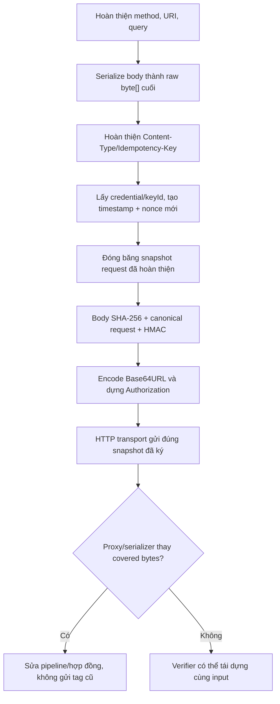
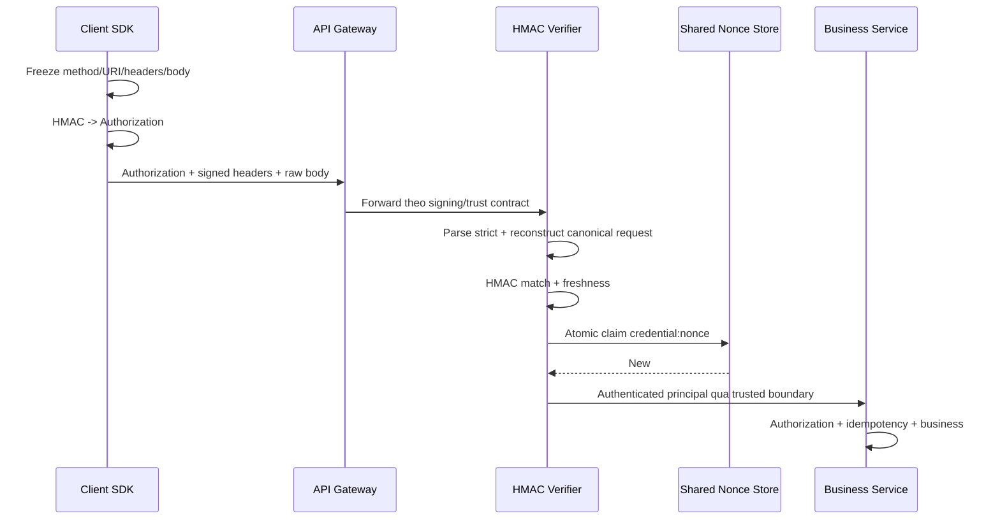

# Tài liệu header Authorization cho HTTP HMAC: đặc tả, ví dụ và quy tắc kiểm chứng

> **Chương:** Authorization header  
> **Bài học:** Tài liệu header  
> **Module:** `SECURITY_AUTHENTICATION_HMAC_REQUEST_AUTHENTICATION` — thiết kế xác thực HTTP request bằng HMAC trên shared secret, canonical request bảo vệ method, URI, headers và/hoặc body. Bài học hướng dẫn cách **viết tài liệu giao thức header** để client SDK, gateway và server đồng thuận: cú pháp HTTP `Authorization`, signing input, signature transport, xử lý malformed header, timestamp/nonce chống replay, key rotation và ranh giới giữa authentication và authorization.

## 1. Vì sao tài liệu header là một phần của thiết kế bảo mật?

Một cơ chế HMAC có thể triển khai đúng `Mac.getInstance("HmacSHA256")` nhưng vẫn thất bại khi hai phía hiểu khác nhau về header:

- Client gửi chữ ký dưới `Authorization`, server lại đọc `X-Signature`.
- Client viết `keyId`, gateway chuẩn hóa thành `keyid` và parser phía sau xử lý sai.
- Client dùng Base64 chuẩn có `+`, server yêu cầu Base64URL không padding.
- Client ký header `X-Timestamp` nhưng server không đưa header đó vào canonical request.
- Header `Authorization` bị lặp; gateway chọn giá trị đầu trong khi backend chọn giá trị cuối.
- Thư viện HTTP đổi body hoặc `Content-Type` sau khi signer đã tính tag.
- API dùng thuật ngữ “Authorization” khiến người triển khai tưởng chữ ký hợp lệ đồng nghĩa caller được quyền thao tác mọi tài nguyên.

**Tài liệu header tốt là một giao ước byte-level và security policy có thể kiểm thử**, không chỉ là bảng liệt kê tên header. Nó phải đủ cụ thể để hai đội độc lập có thể triển khai signer và verifier cho **cùng byte input/cùng tag**.

### Sau bài này, người học có thể

1. Phân biệt `Authorization` theo HTTP authentication framework với các custom `X-*` headers.
2. Đặc tả một custom HMAC authentication scheme với **định dạng duy nhất** và validation nghiêm ngặt.
3. Viết chính xác bảng tên header, tính bắt buộc, cú pháp, phạm vi ký và thời điểm tạo.
4. Phân biệt auth-scheme, auth-param, credential identifier, secret và HMAC signature.
5. Ghi lại canonical request, signature encoding và golden vectors dưới dạng có thể kiểm chéo.
6. Mô tả response `401`/`WWW-Authenticate` và `403` đúng vai trò.
7. Tích hợp OpenAPI, SDK Java 17+, proxy/gateway, timestamp/nonce và key rotation.
8. Thiết kế test cho malformed, duplicate và tampered headers mà không tạo đường bypass.

## 2. `Authorization` là HTTP field gì?

Theo ngữ nghĩa HTTP, field `Authorization` dùng để mang **credentials** của user agent cho request tới origin server. Nó là thành phần của **HTTP authentication framework**, không phải cơ chế phân quyền chi tiết của ứng dụng.

Ví dụ các scheme quen thuộc:

```http
Authorization: Basic <credentials>
Authorization: Bearer <token>
```

Trong bài này ta định nghĩa một **scheme minh họa tùy biến** tên `HMAC-Request`:

```http
Authorization: HMAC-Request keyId="merchant-a-k2",version="1",algorithm="hmac-sha256",signedHeaders="content-type;idempotency-key;x-nonce;x-timestamp",signature="<BASE64URL_43_CHARS>"
```

**Quan trọng:** `HMAC-Request` và phiên bản `1` trong bài là **hợp đồng tự thiết kế để học**; không phải một HMAC Authorization scheme đã được chuẩn hóa để mọi client/server tự nhận diện, cũng không đồng nhất với **RFC 9421 HTTP Message Signatures**. Khi xây API thật, cần công bố contract riêng hoặc chọn một chuẩn/giao thức cụ thể có quy tắc tương thích rõ.

### 2.1. Các thành phần của field

| Thành phần | Giá trị ví dụ | Tác dụng |
| --- | --- | --- |
| Field name | `Authorization` | Cho HTTP stack biết đây là request credential field. Field name **không phân biệt chữ hoa/thường**. |
| Auth-scheme | `HMAC-Request` | Chọn authentication mechanism. Tên auth-scheme được so **case-insensitive** theo HTTP. |
| Auth-param `keyId` | `merchant-a-k2` | Tra credential trong registry phía server; **không phải secret**. |
| Auth-param `version` | `1` | Chọn chính xác canonical/signature contract. |
| Auth-param `algorithm` | `hmac-sha256` | Giá trị giao thức cố định và allowlisted; không để caller ép downgrade. |
| Auth-param `signedHeaders` | `content-type;idempotency-key;x-nonce;x-timestamp` | Danh sách covered headers cố định, thứ tự và cách chuẩn hóa được quy định. |
| Auth-param `signature` | 43 ký tự Base64URL | Chứa full HMAC-SHA256 tag 32 byte mã hóa **không padding**. |

Trong HTTP authentication framework, một scheme có thể sử dụng dạng `token68` **hoặc** danh sách `auth-param` theo cú pháp scheme. Ví dụ ở đây dùng **auth-param trong quoted-string**. Server **không thử cả hai kiểu** trong phiên bản `1` nếu contract chỉ công bố một kiểu.

### 2.2. Field name khác auth-scheme

```http
authorization: hmac-request keyId="merchant-a-k2",version="1",algorithm="hmac-sha256",signedHeaders="content-type;idempotency-key;x-nonce;x-timestamp",signature="<TAG>"
```

Về HTTP, tên field `authorization` và auth-scheme `hmac-request` được hiểu không phân biệt case. Nhưng **giá trị** `keyId` và chuỗi tag Base64URL **phân biệt case**.

Tài liệu và parser cần nói rõ cái gì được normalize:

- Normalize field **name** về lower-case khi tra danh sách field được ký.
- Normalize auth-scheme và tên auth-param cho **so sánh cú pháp**, không tự lowercase mọi giá trị.
- Giữ nguyên giá trị key ID, nonce, idempotency key và signature theo grammar đã ký.
- Không biến `+` thành space, không tự bỏ `=` Base64 padding, không tự decode URL trong header value.
- Không thay đổi `X-Timestamp` hoặc `Idempotency-Key` trước/sau khi tính chữ ký.

## 3. Chọn vị trí signature: `Authorization` hay custom headers?

Có hai thiết kế phổ biến cần **phân biệt trong tài liệu**, không tự trộn khi chưa version giao thức.

### Phương án A — `Authorization` với custom HMAC auth-scheme

```http
Authorization: HMAC-Request keyId="merchant-a-k2",version="1",algorithm="hmac-sha256",signedHeaders="content-type;idempotency-key;x-nonce;x-timestamp",signature="<TAG>"
X-Timestamp: 1767225600
X-Nonce: 87a3d56ea72d40af89f5b68cb3e831d4
Idempotency-Key: pay-order-42
```

Ưu điểm: gắn với HTTP authentication framework, dễ mô tả bằng security scheme trong OpenAPI. Cần thiết kế đúng challenge, parser, interoperability và hành vi của proxy/API gateway.

### Phương án B — Các custom header riêng

```http
X-Key-Id: merchant-a-k2
X-Timestamp: 1767225600
X-Nonce: 87a3d56ea72d40af89f5b68cb3e831d4
X-Signature: v1=<TAG>
Idempotency-Key: pay-order-42
```

Ưu điểm: có thể phù hợp với middleware/SDK hiện tại. Nhưng không mặc nhiên tuân thủ ngữ nghĩa `Authorization`/`WWW-Authenticate`; tài liệu phải định nghĩa đầy đủ, và các tầng an ninh cần biết đúng tên header.

| Tiêu chí | `Authorization: HMAC-Request` | `X-Key-Id` / `X-Signature` |
| --- | --- | --- |
| Định danh cơ chế | Auth-scheme trong một field | Tổ hợp header do API tự đặt |
| Credential transport | Gắn với HTTP auth framework | Custom fields, cần quy định riêng |
| API documentation | Có thể dùng OpenAPI `type: http` | Thường dùng `apiKey` hoặc parameters mô tả rõ |
| Duplicate parsing | Phải reject duplicate `Authorization` và auth-params | Reject duplicate từng security header |
| Proxy/gateway | Nhiều gateway có quy tắc đặc biệt với `Authorization` | Gateway cần chính sách forwarding custom header |
| Response `401` | Cần công bố `WWW-Authenticate` challenge | Cần thiết kế status/error contract phù hợp |
| HMAC toán học | Không thay đổi | Không thay đổi |

**Bài học chọn phương án A** để đi sâu vào **tài liệu header Authorization**. Không có ý rằng phương án A an toàn hơn chỉ nhờ tên field; an toàn phụ thuộc hợp đồng ký, credential policy, chống replay và implementation.

## 4. Một bộ tài liệu header tối thiểu phải công bố gì?

Đừng chỉ đưa một ví dụ request. Cần ít nhất:

1. **Scheme name**, phiên bản và algorithm allowlist.
2. **Grammar đầy đủ** của `Authorization`, mandatory params, case handling và duplicated params.
3. **Headers đi kèm**: tên, cardinality, grammar, timezone/unit/encoding, có được ký hay không.
4. **Canonical request**: byte encoding, method, URI, query, signed header order, body digest, LF/CRLF.
5. **String-to-sign**, HMAC key bytes, output encoding và cách server so tag.
6. **Credential lifecycle**: key ID, active/revoked, environment/tenant, rotation và secret storage.
7. **Freshness/replay**: signed timestamp, signed nonce, cửa sổ và atomic store/TTL.
8. **Error semantics**: malformed, authentication failure, replay, forbidden, unavailable.
9. **Proxy/redirect**: chính xác thành phần request ở trust boundary, không tin header giả.
10. **Golden fixtures và negative tests** để hai đội triển khai độc lập xác nhận tương thích.

Bài sẽ cụ thể hóa theo một **custom protocol** tên `HMAC-AUTHZ-V1`.

## 5. Hợp đồng `HMAC-AUTHZ-V1`: request hoàn chỉnh

Ví dụ một POST tạo thanh toán:

```http
POST /v1/payments?currency=VND&orderId=42 HTTP/1.1
Host: api.example.test
Content-Type: application/json
Idempotency-Key: pay-order-42
X-Timestamp: 1767225600
X-Nonce: 87a3d56ea72d40af89f5b68cb3e831d4
Authorization: HMAC-Request keyId="merchant-a-k2",version="1",algorithm="hmac-sha256",signedHeaders="content-type;idempotency-key;x-nonce;x-timestamp",signature="<BASE64URL_43_CHARS>"

{"amount":100000,"currency":"VND"}
```

`<BASE64URL_43_CHARS>` là placeholder **chưa tính HMAC**, không phải chữ ký hợp lệ. `X-Timestamp` và `X-Nonce` là fixture cố định phục vụ test, không được tái sử dụng trong production.

### 5.1. Bảng field chi tiết

| Field hoặc phần tử | Required | Cardinality | Grammar / semantics | Có được ràng buộc vào HMAC? |
| --- | --- | --- | --- | --- |
| `Authorization` | Có | **Chính xác 1 field** | Custom scheme `HMAC-Request`, 5 params bắt buộc. | Không ký raw `Authorization` vì chứa signature đầu ra; ràng buộc từng thành phần thông qua contract. |
| `keyId` param | Có | Đúng 1 | `[A-Za-z0-9._-]{1,64}`, phân biệt case. | **Có**, thành một dòng canonical. |
| `version` param | Có | Đúng 1 | Chính xác `1`. | **Có qua domain/version prefix cố định**. |
| `algorithm` param | Có | Đúng 1 | Chính xác `hmac-sha256`. | **Có qua HMAC algorithm allowlist và signing prefix**. |
| `signedHeaders` param | Có | Đúng 1 | Chính xác `content-type;idempotency-key;x-nonce;x-timestamp`. | **Có**, danh sách tên nằm trong canonical request. |
| `signature` param | Có | Đúng 1 | `[A-Za-z0-9_-]{43}`, Base64URL không padding, decode ra 32 byte và re-encode phải trùng. | Là **tag đầu ra**, không tự đưa vào input của chính nó. |
| `Content-Type` | Có | 1 | Chính xác `application/json`, no content-coding trong fixture. | **Có**. |
| `Idempotency-Key` | Có | 1 | `[A-Za-z0-9._-]{1,64}`. | **Có**. |
| `X-Timestamp` | Có | 1 | Unix epoch **seconds**, 10–11 chữ số ASCII, không leading zero. | **Có**. |
| `X-Nonce` | Có | 1 | 16 byte CSPRNG dưới dạng 32 ký tự hex lowercase. | **Có**. |
| HTTP method | Có | 1 | `POST`. | **Có**. |
| Request target | Có | 1 | HTTPS authority `api.example.test`, path `/v1/payments`, raw query canonical `currency=VND&orderId=42`. | **Có**. |
| Request body | Có theo endpoint | 1 | UTF-8 JSON bytes ≤64 KiB; SHA-256 của **raw body bytes**, không phải Java object. | **Có qua SHA-256**. |

**Giới hạn ví dụ:** Endpoint và query cố định để tránh trình bày sai một URI canonicalizer tổng quát. API thật cần đặc tả percent-encoding, duplicate query keys, path traversal/encoded slash, normalization, authority, port, Content-Encoding và các media types theo business policy.

### 5.2. Cú pháp `Authorization` ở mức auth-param

Hợp đồng chấp nhận:

```text
Authorization = HMAC-Request SP auth-params

auth-params (phiên bản minh họa):
  keyId="<id>"
  version="1"
  algorithm="hmac-sha256"
  signedHeaders="content-type;idempotency-key;x-nonce;x-timestamp"
  signature="<43-char-Base64URL>"

Các auth-params:
  - được phân tách bằng dấu phẩy
  - có thể có SP sau dấu phẩy
  - tên param không phân biệt chữ hoa/thường
  - thứ tự param bất kỳ
  - mỗi tên xuất hiện CHÍNH XÁC một lần
  - chỉ cho 5 tên trên, không extension trong version 1
  - mọi giá trị là quoted-string nhưng CHỈ chứa các ký tự
    an toàn đã quy định cho từng param, không dùng quoted escaping
```

Đây là **strict subset** được tài liệu hóa của cơ chế auth-param HTTP: parser của ví dụ không hỗ trợ mọi biến thể quoted-string/OWS mà HTTP syntax tổng quát cho phép. Nếu SDK/gateway phải tương thích với parser tổng quát hơn, hãy dùng parser HTTP chuẩn với **chính sách validation semantic tương đương** và golden fixtures, không tự tách token bằng một regex thiếu kiểm thử.

**Không** dùng `value.split(",")` mù quáng cho một grammar quoted-string tổng quát. Dấu phẩy có thể xuất hiện bên trong quoted-string trong các protocol khác. Bài chọn value grammar không chứa dấu phẩy, nhưng parser thực vẫn phải phân biệt delimiter hợp lệ và reject escape/quoted-value ngoài hợp đồng.

### 5.3. Duplicate là lỗi bảo mật

```http
Authorization: HMAC-Request keyId="merchant-a-k2",version="1",algorithm="hmac-sha256",signedHeaders="content-type;idempotency-key;x-nonce;x-timestamp",signature="<TAG_A>"
authorization: HMAC-Request keyId="attacker-k9",version="1",algorithm="hmac-sha256",signedHeaders="content-type;idempotency-key;x-nonce;x-timestamp",signature="<TAG_B>"
```

Hai tên field là **cùng `Authorization`** theo HTTP. Nếu gateway chọn dòng đầu và backend chọn dòng cuối, các tầng có thể xác thực/định tuyến dưới hai principal khác nhau.

**Quy tắc:** Reject duplicate authorization fields **trước khi HTTP framework gộp hoặc chọn `getFirst()`**. Tương tự, reject duplicate `X-Timestamp`, `X-Nonce`, `Idempotency-Key` và các signed headers một giá trị.

Không cho phép:

```http
Authorization: HMAC-Request keyId="merchant-a-k2",keyId="merchant-b-k1",...
```

Từ chối auth-param lặp kể cả khác case (`keyId` và `KEYID`). **Không chọn first/last**, không cho caller trộn nhiều authentication schemes vào một request nếu endpoint chỉ chấp nhận HMAC.

## 6. Canonical request: ghi rõ từng byte đi vào HMAC

Một header documentation không hoàn chỉnh nếu chỉ ghi “signature = HMAC(secret, request)” mà không định nghĩa `request` là những byte nào.

Với request ở mục 5, canonical request gồm **11 dòng**, ngăn cách bằng LF `\n` và **không có LF cuối**:

```text
POST
api.example.test
/v1/payments
currency=VND&orderId=42
content-type:application/json
idempotency-key:pay-order-42
x-nonce:87a3d56ea72d40af89f5b68cb3e831d4
x-timestamp:1767225600
content-type;idempotency-key;x-nonce;x-timestamp
merchant-a-k2
<SHA256_HEX_OF_EXACT_RAW_BODY_BYTES>
```

Dòng digest là placeholder, phải thay bằng **64 ký tự hex lowercase** của SHA-256 trên body bytes cuối cùng:

```text
UTF8 bytes of body exactly:
{"amount":100000,"currency":"VND"}

Không có LF/CRLF ở cuối body trừ khi client gửi thực sự.
```

### 6.1. String-to-sign

```text
canonicalRequest = joinLF(11 components above)

stringToSign =
    "HMAC-REQUEST/1\n" + canonicalRequest

bytesToSign =
    UTF8(stringToSign)

rawTag =
    HMAC-SHA256(secretBytesForKeyId, bytesToSign)

signatureParam =
    Base64URLNoPadding(rawTag)
```

**Tất cả** bên client, gateway và service phải đồng ý:

- Algorithm cố định **HmacSHA256**, không dùng SHA-256 không khóa thay thế.
- Secret là **byte[]** từ credential registry, không phải text của giá trị Base64 chưa decode.
- `keyId` là một dòng của canonical request; người thay key ID không thể giữ tag cũ mà xác thực sang key khác.
- `HMAC-REQUEST/1` trong prefix ràng buộc domain và version; algorithm param phải là `hmac-sha256` theo allowlist.
- `signedHeaders` bắt buộc đúng danh sách cố định và xuất hiện trong canonical bytes; không cho caller bỏ bớt header nhạy cảm để có tag dễ ký.
- `Authorization` không được ký như raw header vì chứa chính output signature và có thể khác ordering/spacing vô hại của auth-params.
- Raw body được bảo vệ **qua SHA-256 digest**; cùng JSON object nhưng khác byte (spaces, field order, newline, BOM) cho tag khác theo contract.
- `X-Timestamp`, `X-Nonce` và `Idempotency-Key` đều được ký.
- Host/authority nằm trong canonical input **với giá trị đáng tin**, không lấy từ `X-Forwarded-Host` do caller tự khai.

### 6.2. Vì sao ký key ID nhưng không ký nguyên field Authorization?

Raw field:

```http
Authorization: HMAC-Request keyId="merchant-a-k2",version="1",algorithm="hmac-sha256",signedHeaders="...",signature="..."
```

nằm trong request nhưng có **signature tự tham chiếu**. Nếu đưa toàn bộ field vào signing input, bạn sẽ phải ký chính kết quả chưa tính ra. Giải pháp là:

1. Chọn những **auth params ảnh hưởng bảo mật**.
2. Ràng buộc version/algorithm bằng protocol prefix và strict validation.
3. Ràng buộc key ID bằng canonical line.
4. Ràng buộc signedHeaders bằng một canonical line + nội dung từng signed field.
5. Truyền tag ở `signature` param nhưng loại tag đó khỏi bytesToSign.

Với contract này, **auth-param order khác nhau không làm chữ ký đổi**, vì server lấy các giá trị đã parse rồi dựng lại một canonical string duy nhất. Nhưng thay **giá trị** được ký hoặc đổi version/algorithm trái policy phải bị từ chối.

## 7. Signature encoding phải được ghi rõ

`HmacSHA256` tạo **32 raw bytes**. Với Base64URL không padding:

```text
32 raw bytes -> 43 Base64URL chars
Alphabet    -> A-Z a-z 0-9 - _
Padding     -> KHÔNG có dấu =
```

Ví dụ Java 17:

```java
byte[] rawTag = mac.doFinal(bytesToSign);
String encoded = Base64.getUrlEncoder()
        .withoutPadding()
        .encodeToString(rawTag);
```

Server cần kiểm:

1. `signature` đúng 43 ký tự với `[A-Za-z0-9_-]{43}`.
2. Decode bằng `Base64.getUrlDecoder()`, đúng 32 byte.
3. Re-encode với Base64URL không padding phải **trùng chính xác** text nhận (kiểm canonical pad bits).
4. So **raw byte[]** với expected tag qua `MessageDigest.isEqual(expected, supplied)`.
5. Không tự thử Base64 thường, hex, tag truncation hoặc version khác nếu chưa được contract cho phép.

Dùng `String.equals()` trên hai signature strings thay vì parse/so raw tags có thể bỏ sót lỗi noncanonical representation. Dùng `new String(rawTag)` càng sai vì tag là nhị phân, **không phải UTF-8 text**.

### Known-answer test mật mã

Kiểm riêng thuật toán trước khi debug HTTP:

```text
RFC 4231, HMAC-SHA256 test case 1:
key = 20 bytes giá trị 0x0b
message = ASCII "Hi There"

raw tag hex:
b0344c61d8db38535ca8afceaf0bf12b
881dc200c9833da726e9376c2e32cff7
```

KAT chỉ xác nhận HMAC implementation cho vector đã biết; **không chứng minh** canonical URI/headers/body hoặc signature transport đúng.

## 8. Java 17+: parser Authorization nghiêm ngặt và verifier minh họa

Chương trình tự chứa sau chạy **offline trên JDK 17+**. Nó **không tạo HTTP server**: request model giả lập dữ liệu HTTP adapter đã kiểm ở ingress.

Mục tiêu:

- Đọc **mọi lần xuất hiện** của header qua `List<Field>` để phát hiện duplicate trước khi gộp.
- Parse `Authorization: HMAC-Request` thành auth-params; chấp nhận tên param khác case và thứ tự khác, **không** chấp nhận duplicate.
- Reject malformed signature, unknown/inactive key, HMAC mismatch, timestamp hết hạn, nonce replay, unauthorized principal và replay-store unavailable.
- Tự dựng canonical request theo hợp đồng `HMAC-AUTHZ-V1`; signer và verifier không dùng raw `Authorization` làm HMAC input.
- Dùng `MessageDigest.isEqual` cho full tag 32 byte và canonical Base64URL re-encode.
- Kiểm test fixture, tampered body, duplicate headers, parameter injection, stale timestamp, rotation và một race concurrency cùng nonce.

**Giới hạn quan trọng:** Parser ví dụ là strict subset, không phải bộ HTTP parser tổng quát. `LocalNonceStore` chỉ atomic **trong một JVM**; production phải dùng shared atomic store với TTL/durability. Framework/gateway phải cung cấp body bytes và mọi header occurrences trung thực trước khi tạo request model.

```java
import java.nio.charset.StandardCharsets;
import java.security.GeneralSecurityException;
import java.security.MessageDigest;
import java.time.Clock;
import java.time.Instant;
import java.time.ZoneOffset;
import java.util.ArrayList;
import java.util.Arrays;
import java.util.Base64;
import java.util.HashMap;
import java.util.HexFormat;
import java.util.List;
import java.util.Locale;
import java.util.Map;
import java.util.Objects;
import java.util.Set;
import java.util.concurrent.Callable;
import java.util.concurrent.ConcurrentHashMap;
import java.util.concurrent.CountDownLatch;
import java.util.concurrent.ExecutorService;
import java.util.concurrent.Executors;
import java.util.concurrent.Future;
import java.util.concurrent.TimeUnit;
import java.util.concurrent.atomic.AtomicBoolean;
import java.util.function.Predicate;
import javax.crypto.Mac;
import javax.crypto.spec.SecretKeySpec;

public final class HmacAuthorizationHeaderDemo {
    private static final HexFormat HEX = HexFormat.of();
    private static final String SCHEME = "HMAC-Request";
    private static final String PREFIX = "HMAC-REQUEST/1\n";
    private static final String SIGNED_NAMES =
            "content-type;idempotency-key;x-nonce;x-timestamp";
    private static final Set<String> ALLOWED_PARAMS =
            Set.of("keyid", "version", "algorithm",
                    "signedheaders", "signature");
    private static final long PAST = 300L;
    private static final long FUTURE = 300L;
    private static final long MARGIN = 60L;

    private HmacAuthorizationHeaderDemo() {}

    record Field(String name, String value) {}

    // Một HTTP adapter thật phải chuyển tất cả header occurrences
    // và raw body bytes tới lớp này, không dùng getFirst().
    record Request(String method, String authority, String path,
                   String query, List<Field> fields, byte[] body) {
        Request {
            Objects.requireNonNull(method);
            Objects.requireNonNull(authority);
            Objects.requireNonNull(path);
            Objects.requireNonNull(query);
            fields = List.copyOf(fields);
            body = body.clone();
        }
        @Override public byte[] body() {
            return body.clone();
        }
    }

    record Credential(String principal, byte[] secret, boolean active) {
        Credential {
            Objects.requireNonNull(principal);
            secret = secret.clone();
        }
        @Override public byte[] secret() {
            return secret.clone();
        }
    }

    record Auth(String keyId, byte[] tag) {
        Auth {
            tag = tag.clone();
        }
        @Override public byte[] tag() {
            return tag.clone();
        }
    }

    enum Decision {
        ACCEPT, BAD_REQUEST, UNAUTHENTICATED, STALE,
        REPLAY, FORBIDDEN, UNAVAILABLE
    }

    interface NonceStore {
        boolean claim(String scopedKey, long expiresAt, long now);
    }

    // Chỉ dùng trong ONE JVM; không durable, không tự cleanup.
    static final class LocalNonceStore implements NonceStore {
        private final ConcurrentHashMap<String, Long> used =
                new ConcurrentHashMap<>();

        @Override public boolean claim(
                String scopedKey, long expiresAt, long now) {
            if (expiresAt <= now) {
                throw new IllegalStateException("Bad nonce expiry");
            }
            AtomicBoolean inserted = new AtomicBoolean(false);
            used.compute(scopedKey, (key, oldExpiry) -> {
                if (oldExpiry == null || oldExpiry <= now) {
                    inserted.set(true);
                    return expiresAt;
                }
                return oldExpiry;
            });
            return inserted.get();
        }
    }

    private static void require(boolean condition) {
        if (!condition) {
            throw new IllegalArgumentException("Invalid HMAC contract");
        }
    }

    // Chỉ nhận các header field values ASCII in được; strict subset
    // nhằm giảm ambiguity, không thay toàn bộ HTTP/2/HTTP/1 parser.
    private static Map<String, String> singleFields(Request r) {
        require(r.fields().size() <= 24);
        Map<String, String> result = new HashMap<>();
        for (Field f : r.fields()) {
            require(f != null && f.name() != null && f.value() != null);
            require(f.name().matches("[A-Za-z0-9-]{1,64}"));
            require(f.value().length() <= 1024);
            require(f.value().equals(f.value().strip()));
            for (int i = 0; i < f.value().length(); i++) {
                char c = f.value().charAt(i);
                require(c >= 0x20 && c <= 0x7E);
            }
            String name = f.name().toLowerCase(Locale.ROOT);
            require(result.putIfAbsent(name, f.value()) == null);
        }
        return result;
    }

    private static String required(
            Map<String, String> h, String name) {
        String value = h.get(name);
        require(value != null && !value.isEmpty());
        return value;
    }

    private static long parseEpoch(String text) {
        require(text.matches("[1-9][0-9]{9,10}"));
        return Long.parseLong(text);
    }

    private static void validate(
            Request r, Map<String, String> h) {
        require(r.method().equals("POST"));
        require(r.authority().equals("api.example.test"));
        require(r.path().equals("/v1/payments"));
        require(r.query().equals("currency=VND&orderId=42"));
        require(r.body().length <= 64 * 1024);
        require(required(h, "content-type").equals("application/json"));
        require(required(h, "idempotency-key")
                .matches("[A-Za-z0-9._-]{1,64}"));
        require(required(h, "x-nonce").matches("[0-9a-f]{32}"));
        parseEpoch(required(h, "x-timestamp"));
        // Endpoint minh họa chỉ nhận body JSON không nén:
        require(!h.containsKey("content-encoding"));
    }

    // Parser cho strict subset:
    // scheme case-insensitive; param names case-insensitive;
    // mọi value phải được quote, không hỗ trợ escaping hay dấu phẩy
    // nằm bên trong value, SP quanh '=' và sau dấu phẩy được phép.
    private static Auth parseAuthorization(String text) {
        require(text != null && text.length() <= 1024);
        int space = text.indexOf(' ');
        require(space > 0);
        require(text.substring(0, space).equalsIgnoreCase(SCHEME));
        String params = text.substring(space + 1);
        Map<String, String> parsed = new HashMap<>();

        int i = 0;
        while (i < params.length()) {
            while (i < params.length() && params.charAt(i) == ' ') {
                i++;
            }
            require(i < params.length()); // Reject trailing comma + spaces.
            int nameStart = i;
            while (i < params.length()
                    && ((params.charAt(i) >= 'A'
                         && params.charAt(i) <= 'Z')
                        || (params.charAt(i) >= 'a'
                            && params.charAt(i) <= 'z'))) {
                i++;
            }
            require(i > nameStart);
            String name = params.substring(nameStart, i)
                    .toLowerCase(Locale.ROOT);

            while (i < params.length() && params.charAt(i) == ' ') {
                i++;
            }
            require(i < params.length() && params.charAt(i) == '=');
            i++;
            while (i < params.length() && params.charAt(i) == ' ') {
                i++;
            }
            require(i < params.length() && params.charAt(i) == '"');
            i++;
            int valueStart = i;
            while (i < params.length() && params.charAt(i) != '"') {
                char c = params.charAt(i);
                // Strict values: ASCII visible except backslash,
                // comma and quotes (quoted escaping not supported).
                require(c >= 0x21 && c <= 0x7E
                        && c != '\\' && c != ',');
                i++;
            }
            require(i < params.length());
            String value = params.substring(valueStart, i);
            i++;

            require(ALLOWED_PARAMS.contains(name));
            require(parsed.putIfAbsent(name, value) == null);

            while (i < params.length() && params.charAt(i) == ' ') {
                i++;
            }
            if (i < params.length()) {
                require(params.charAt(i) == ',');
                i++;
                require(i < params.length());
            }
        }

        require(parsed.keySet().equals(ALLOWED_PARAMS));
        String keyId = parsed.get("keyid");
        require(keyId.matches("[A-Za-z0-9._-]{1,64}"));
        require(parsed.get("version").equals("1"));
        require(parsed.get("algorithm").equals("hmac-sha256"));
        require(parsed.get("signedheaders").equals(SIGNED_NAMES));

        String encoded = parsed.get("signature");
        require(encoded.matches("[A-Za-z0-9_-]{43}"));
        byte[] tag = Base64.getUrlDecoder().decode(encoded);
        require(tag.length == 32);
        require(encoded.equals(Base64.getUrlEncoder()
                .withoutPadding().encodeToString(tag)));
        return new Auth(keyId, tag);
    }

    private static String canonical(
            Request r, Map<String, String> h, String keyId)
            throws GeneralSecurityException {
        validate(r, h);
        String digest = HEX.formatHex(MessageDigest
                .getInstance("SHA-256").digest(r.body()));
        return String.join("\n",
                "POST",
                "api.example.test",
                r.path(),
                r.query(),
                "content-type:" + required(h, "content-type"),
                "idempotency-key:" + required(h, "idempotency-key"),
                "x-nonce:" + required(h, "x-nonce"),
                "x-timestamp:" + required(h, "x-timestamp"),
                SIGNED_NAMES,
                keyId,
                digest);
    }

    private static byte[] hmac(
            Request r, Map<String, String> h,
            String keyId, byte[] secret)
            throws GeneralSecurityException {
        Mac mac = Mac.getInstance("HmacSHA256");
        mac.init(new SecretKeySpec(secret, "HmacSHA256"));
        String input = PREFIX + canonical(r, h, keyId);
        return mac.doFinal(input.getBytes(StandardCharsets.UTF_8));
    }

    private static String authorizationValue(
            Request unsigned, String keyId, byte[] secret)
            throws GeneralSecurityException {
        Map<String, String> fields = singleFields(unsigned);
        require(!fields.containsKey("authorization"));
        require(keyId.matches("[A-Za-z0-9._-]{1,64}"));
        byte[] tag = hmac(unsigned, fields, keyId, secret);
        String encoded = Base64.getUrlEncoder()
                .withoutPadding().encodeToString(tag);

        return SCHEME + " keyId=\"" + keyId
                + "\",version=\"1\",algorithm=\"hmac-sha256\""
                + ",signedHeaders=\"" + SIGNED_NAMES
                + "\",signature=\"" + encoded + "\"";
    }

    private static Request appendField(
            Request r, String name, String value) {
        List<Field> copy = new ArrayList<>(r.fields());
        copy.add(new Field(name, value));
        return new Request(r.method(), r.authority(),
                r.path(), r.query(), copy, r.body());
    }

    private static Request replaceField(
            Request r, String name, String value) {
        List<Field> copy = new ArrayList<>();
        for (Field f : r.fields()) {
            copy.add(f.name().equalsIgnoreCase(name)
                    ? new Field(f.name(), value) : f);
        }
        return new Request(r.method(), r.authority(),
                r.path(), r.query(), copy, r.body());
    }

    private static Request withBody(Request r, String body) {
        return new Request(r.method(), r.authority(),
                r.path(), r.query(), r.fields(),
                body.getBytes(StandardCharsets.UTF_8));
    }

    static Decision verify(
            Request r, Map<String, Credential> registry,
            NonceStore nonceStore, Clock clock,
            Predicate<String> authorized) {
        try {
            Map<String, String> h = singleFields(r);
            validate(r, h);
            String wire = h.get("authorization");
            if (wire == null) return Decision.UNAUTHENTICATED;

            Auth auth = parseAuthorization(wire);
            Credential credential = registry.get(auth.keyId());
            if (credential == null || !credential.active()) {
                return Decision.UNAUTHENTICATED;
            }
            byte[] expected = hmac(
                    r, h, auth.keyId(), credential.secret());
            if (!MessageDigest.isEqual(expected, auth.tag())) {
                return Decision.UNAUTHENTICATED;
            }

            long signedAt = parseEpoch(required(h, "x-timestamp"));
            long now = clock.instant().getEpochSecond();
            if (signedAt < now - PAST || signedAt > now + FUTURE) {
                return Decision.STALE;
            }
            long expiresAt = signedAt + PAST + MARGIN;
            String nonceKey = auth.keyId() + ":"
                    + required(h, "x-nonce");
            if (!nonceStore.claim(nonceKey, expiresAt, now)) {
                return Decision.REPLAY;
            }

            // HMAC xác thực principal; quyền nghiệp vụ kiểm riêng.
            if (!authorized.test(credential.principal())) {
                return Decision.FORBIDDEN;
            }
            return Decision.ACCEPT;
        } catch (IllegalArgumentException invalid) {
            return Decision.BAD_REQUEST;
        } catch (GeneralSecurityException cryptoFailure) {
            return Decision.UNAVAILABLE;
        } catch (RuntimeException infrastructureFailure) {
            return Decision.UNAVAILABLE;
        }
    }

    private static void check(boolean yes, String why) {
        if (!yes) throw new AssertionError(why);
    }

    private static void expect(Decision result, Decision wanted) {
        check(result == wanted,
                "Expected " + wanted + " but got " + result);
    }

    public static void main(String[] args) throws Exception {
        // KAT RFC 4231: chứng minh HMAC provider trước khi debug HTTP.
        byte[] testKey = new byte[20];
        Arrays.fill(testKey, (byte) 0x0b);
        Mac kat = Mac.getInstance("HmacSHA256");
        kat.init(new SecretKeySpec(testKey, "HmacSHA256"));
        byte[] katTag = kat.doFinal(
                "Hi There".getBytes(StandardCharsets.US_ASCII));
        check(HEX.formatHex(katTag).equals(
                "b0344c61d8db38535ca8afceaf0bf12b"
              + "881dc200c9833da726e9376c2e32cff7"),
                "RFC 4231 HMAC KAT failed");

        byte[] secret = HEX.parseHex(
                "000102030405060708090a0b0c0d0e0f"
              + "101112131415161718191a1b1c1d1e1f");
        Map<String, Credential> registry = Map.of(
                "merchant-a-k2",
                new Credential("merchant-a", secret, true));
        Clock fixed = Clock.fixed(
                Instant.ofEpochSecond(1767225600L), ZoneOffset.UTC);

        Request unsigned = new Request(
                "POST", "api.example.test",
                "/v1/payments", "currency=VND&orderId=42",
                List.of(
                    new Field("Content-Type", "application/json"),
                    new Field("Idempotency-Key", "pay-order-42"),
                    new Field("X-Timestamp", "1767225600"),
                    new Field("X-Nonce",
                            "87a3d56ea72d40af89f5b68cb3e831d4")
                ),
                "{\"amount\":100000,\"currency\":\"VND\"}"
                    .getBytes(StandardCharsets.UTF_8));

        String authValue = authorizationValue(
                unsigned, "merchant-a-k2", secret);
        Request valid = appendField(
                unsigned, "Authorization", authValue);
        Auth parsed = parseAuthorization(authValue);
        check(parsed.tag().length == 32, "Wrong tag length");

        LocalNonceStore nonceStore = new LocalNonceStore();
        expect(verify(valid, registry, nonceStore,
                fixed, p -> true), Decision.ACCEPT);
        expect(verify(valid, registry, nonceStore,
                fixed, p -> true), Decision.REPLAY);

        // Dù thứ tự auth-param khác, cùng semantics vẫn phải verify.
        String b64 = Base64.getUrlEncoder()
                .withoutPadding().encodeToString(parsed.tag());
        String reordered =
                "hmac-request signature=\"" + b64
                + "\", signedHeaders=\"" + SIGNED_NAMES
                + "\", algorithm=\"hmac-sha256\""
                + ", version=\"1\", keyId=\"merchant-a-k2\"";
        expect(verify(replaceField(valid,
                "Authorization", reordered),
                registry, new LocalNonceStore(),
                fixed, p -> true), Decision.ACCEPT);

        // Một header Authorization lặp, dù tên khác case: reject.
        Request duplicate = appendField(
                valid, "authorization", authValue);
        expect(verify(duplicate, registry,
                new LocalNonceStore(), fixed, p -> true),
                Decision.BAD_REQUEST);

        // Auth-param trùng: không chọn first/last key ID.
        String doubled = authValue + ",keyId=\"merchant-b-k1\"";
        expect(verify(replaceField(valid,
                "Authorization", doubled),
                registry, new LocalNonceStore(),
                fixed, p -> true), Decision.BAD_REQUEST);

        // Signature đúng nhưng thay body mà KHÔNG ký lại.
        expect(verify(withBody(valid,
                "{\"amount\":900000,\"currency\":\"VND\"}"),
                registry, new LocalNonceStore(),
                fixed, p -> true), Decision.UNAUTHENTICATED);

        // Signature encoding không đúng no-padding grammar.
        expect(verify(replaceField(valid, "Authorization",
                authValue.replace("signature=\"" + b64 + "\"",
                "signature=\"" + b64 + "=\"")),
                registry, new LocalNonceStore(),
                fixed, p -> true), Decision.BAD_REQUEST);

        // Unsupported version và thuật toán: reject, không downgrade.
        expect(verify(replaceField(valid, "Authorization",
                authValue.replace("version=\"1\"", "version=\"2\"")),
                registry, new LocalNonceStore(),
                fixed, p -> true), Decision.BAD_REQUEST);

        // Timestamp quá cũ nhưng tag được ký lại đúng.
        Request old = replaceField(unsigned,
                "X-Timestamp", "1767225299");
        Request oldSigned = appendField(old,
                "Authorization", authorizationValue(
                        old, "merchant-a-k2", secret));
        expect(verify(oldSigned, registry,
                new LocalNonceStore(),
                fixed, p -> true), Decision.STALE);

        // Revoke key dù HMAC theo key cũ vẫn tính đúng.
        Map<String, Credential> revoked = Map.of(
                "merchant-a-k2",
                new Credential("merchant-a", secret, false));
        expect(verify(valid, revoked, new LocalNonceStore(),
                fixed, p -> true), Decision.UNAUTHENTICATED);

        // Authentication đúng không tự cho quyền tenant/resource.
        expect(verify(valid, registry,
                new LocalNonceStore(),
                fixed, p -> false), Decision.FORBIDDEN);

        NonceStore broken = (key, expiry, now) -> {
            throw new IllegalStateException("Nonce store down");
        };
        expect(verify(valid, registry, broken,
                fixed, p -> true), Decision.UNAVAILABLE);

        // Hai verifiers đồng thời, một nonce: đúng một accept.
        LocalNonceStore racing = new LocalNonceStore();
        ExecutorService pool = Executors.newFixedThreadPool(2);
        CountDownLatch ready = new CountDownLatch(2);
        CountDownLatch go = new CountDownLatch(1);
        Callable<Decision> task = () -> {
            ready.countDown();
            go.await();
            return verify(valid, registry, racing,
                    fixed, p -> true);
        };
        try {
            Future<Decision> a = pool.submit(task);
            Future<Decision> b = pool.submit(task);
            check(ready.await(5, TimeUnit.SECONDS),
                    "Threads did not become ready");
            go.countDown();
            Decision da = a.get(5, TimeUnit.SECONDS);
            Decision db = b.get(5, TimeUnit.SECONDS);
            check((da == Decision.ACCEPT && db == Decision.REPLAY)
                    || (db == Decision.ACCEPT
                        && da == Decision.REPLAY),
                    "Nonce claim was not atomic");
        } finally {
            go.countDown();
            pool.shutdownNow();
        }

        System.out.println(
                "PASS: HMAC Authorization header contract");
    }
}
```

Lưu đúng tên `HmacAuthorizationHeaderDemo.java`, chạy với JDK 17+:

```bash
javac HmacAuthorizationHeaderDemo.java
java HmacAuthorizationHeaderDemo
```

**Phân biệt mức kiểm chứng:** Code ở bài là ví dụ có thể tự chạy; tài liệu **không khẳng định đã compile hay gửi traffic trên HTTP thực**. Unit test chỉ mô phỏng ingress adapter và local replay store, không thay end-to-end integration tests.

### Những giới hạn bắt buộc khi chuyển thành production

- **Parser:** Tầng HTTP thực phải reject header ambiguity, request smuggling, duplicate fields/params và value có control chars trước khi framework collapse. Ví dụ chỉ nhận strict subset với **SP** làm khoảng trắng trong auth-param, không hỗ trợ quoted escapes hoặc extensions.
- **HTTP/2:** `:authority`/`:method` là pseudo-headers, không xuất hiện trong `List<Field>` demo; adapter phải lấy chúng từ representation đã xác minh và bảo toàn tương ứng HTTP/1.1.
- **Body:** Không đọc vô hạn vào RAM; enforce byte limits/streaming, kiểm raw body bytes đúng nơi verifier và handler cùng hiểu, Content-Encoding nếu được hỗ trợ.
- **URI:** Ví dụ chỉ nhận endpoint/query fixture. Production cần canonicalizer raw path/query, percent-encoding, dot segments và duplicate keys theo contract.
- **Secret:** Registry trong code là `Map` test. Production lấy secret byte/key handle từ secret manager, kiểm ACTIVE/REVOKED, scope và expiry; không log secret.
- **Nonce:** `ConcurrentHashMap` chỉ atomic trong **một JVM** và không tự cleanup; production cần shared atomic store với TTL tính từ signed timestamp, consistency/durability khi failover.
- **Timestamp:** `Clock.fixed` chỉ cho test. Production cần đồng hồ được đồng bộ và giám sát clock skew.
- **Authorization:** `Predicate<String>` chưa kiểm tenant, resource, role/action. Business phải thực hiện kiểm quyền độc lập trên principal đã xác thực.
- **HTTP transport:** Phải chạy integration test với JDK `HttpClient`/SDK thực, interceptors, redirects, proxy/gateway và backend để xác nhận signing input không bị biến đổi.

## 9. Client SDK và `Authorization`: ký khi nào, gửi gì?

### Thứ tự đúng



Trong Java, với body JSON:

```java
byte[] bodyBytes = jsonSerializer.serializeToUtf8Bytes(payment);
byte[] tag = signer.sign(
        finalizedMethod, finalizedUri, finalizedSignedHeaders, bodyBytes);
String authorization = authorizationFormatter.format(keyId, tag);

// HttpRequest.BodyPublishers.ofByteArray(bodyBytes)
// cần dùng CHÍNH snapshot bytes đã ký.
```

Đây là pseudocode, chưa định nghĩa `jsonSerializer`/`signer`. Ý tưởng là **không ký một JSON object rồi để HTTP library tự serialize lại**. Chữ ký ký bytes, không ký “ý định” trừ khi dùng một JSON canonicalization scheme có đặc tả riêng.

### Timestamp và nonce production

```java
import java.security.SecureRandom;
import java.time.Clock;
import java.util.HexFormat;

Clock clock = Clock.systemUTC();
String timestamp =
        Long.toString(clock.instant().getEpochSecond());

byte[] nonceBytes = new byte[16];
new SecureRandom().nextBytes(nonceBytes);
String nonce = HexFormat.of().formatHex(nonceBytes);
```

Client nên tạo nonce mới cho mỗi signing attempt có khả năng tới server. Timestamp là epoch **seconds**, không phải milliseconds. Trong SDK thực có thể dùng một `SecureRandom` dùng lại.

Nếu retry POST vì timeout:

- **Tạo timestamp/nonce/signature mới**.
- **Giữ Idempotency-Key cũ**, cùng business intent/body.
- Replay database từ chối phát lại nguyên nonce cũ; idempotency store xử lý retry bằng nonce mới để **không nhân đôi payment**.
- Không tự forward Authorization cũ sang URI/host khác khi redirect; cần xem lại authority và credential policy trước khi ký/gửi.

## 10. Cách viết tài liệu API có thể dùng ngay

Một API reference cho `Authorization` nên có đủ năm phần ngắn và chính xác:

### 10.1. Mô tả cho client developer

> **Authentication:** Mỗi request tới `POST /v1/payments` phải gửi một `Authorization: HMAC-Request` hợp lệ. Dùng key ID và secret do server cấp; tính full HMAC-SHA256 trên signing input `HMAC-AUTHZ-V1`, truyền tag bằng Base64URL không padding. `X-Timestamp` là Unix epoch seconds; `X-Nonce` là 16 byte CSPRNG encode hex lowercase và không được dùng lại trong cửa sổ. Với POST, `Idempotency-Key` là bắt buộc và phải được ký. Không gửi shared secret trên HTTP. Server xác minh chữ ký, freshness và nonce trước khi kiểm quyền truy cập.

Đó là đoạn mô tả có thể đặt trong API docs, **nhưng phải đi cùng bảng grammar và canonicalization** ở mục 5–7 để khách hàng có thể triển khai.

### 10.2. OpenAPI 3.1 mô tả custom HTTP auth scheme

```yaml
openapi: 3.1.0
info:
  title: HMAC Payment API - illustrative contract
  version: 1.0.0
servers:
  - url: https://api.example.test
paths:
  /v1/payments:
    post:
      summary: Create payment with HMAC request authentication
      security:
        - HmacRequest: []
      parameters:
        - name: X-Timestamp
          in: header
          required: true
          schema:
            type: string
            pattern: '^[1-9][0-9]{9,10}$'
          description: Signed Unix epoch seconds.
        - name: X-Nonce
          in: header
          required: true
          schema:
            type: string
            pattern: '^[0-9a-f]{32}$'
          description: Signed single-use 128-bit nonce.
        - name: Idempotency-Key
          in: header
          required: true
          schema:
            type: string
            pattern: '^[A-Za-z0-9._-]{1,64}$'
          description: Signed stable identifier for the business intent.
        - name: currency
          in: query
          required: true
          schema:
            type: string
            enum: [VND]
        - name: orderId
          in: query
          required: true
          schema:
            type: string
            enum: ["42"]
      requestBody:
        required: true
        content:
          application/json:
            schema:
              type: object
              required: [amount, currency]
              properties:
                amount:
                  type: integer
                  minimum: 1
                currency:
                  type: string
                  enum: [VND]
      responses:
        "201":
          description: Payment created.
        "400":
          description: Malformed request/header.
        "401":
          description: Authentication or replay rejected.
        "403":
          description: Authenticated but not authorized.
        "409":
          description: Idempotency conflict.
        "503":
          description: Verification/idempotency service unavailable.
components:
  securitySchemes:
    HmacRequest:
      type: http
      scheme: HMAC-Request
      description: |
        Custom illustrative scheme HMAC-AUTHZ-V1.
        Authorization auth-params:
        keyId, version=1, algorithm=hmac-sha256,
        signedHeaders=content-type;idempotency-key;x-nonce;x-timestamp,
        signature=43-char unpadded Base64URL.
        Canonical request details are defined in the API security guide.
```

**Chú ý:**

- `type: http` và `scheme: HMAC-Request` mô tả một HTTP auth scheme **custom**, không có nghĩa Swagger UI hoặc mọi code generator tự biết tạo signature.
- Không khai báo `Authorization` vừa là security scheme **vừa** là một query/header parameter tuỳ tiện dễ gây xung đột trong tooling.
- Phần OpenAPI trên **chưa thay thế** đặc tả canonical bytes, replay policy, duplicate headers và signing examples. Nếu contract đổi version, cần cập nhật security docs, fixtures và clients.
- Tập giá trị query cố định trong ví dụ để khớp Java demo; API production sẽ có cấu trúc schema/query rộng hơn và cần canonicalization rõ.

### 10.3. cURL minh họa wire format

```bash
curl --request POST \
  'https://api.example.test/v1/payments?currency=VND&orderId=42' \
  --header 'Content-Type: application/json' \
  --header 'Idempotency-Key: pay-order-42' \
  --header 'X-Timestamp: 1767225600' \
  --header 'X-Nonce: 87a3d56ea72d40af89f5b68cb3e831d4' \
  --header 'Authorization: HMAC-Request keyId="merchant-a-k2",version="1",algorithm="hmac-sha256",signedHeaders="content-type;idempotency-key;x-nonce;x-timestamp",signature="<CALCULATED_TAG>"' \
  --data-binary '{"amount":100000,"currency":"VND"}'
```

**Không copy để gọi production:** Signature vẫn là placeholder, timestamp cố định đã cũ với hệ thống thời gian thực, và `api.example.test` là hostname minh họa. Trong chạy thật, SDK phải tạo nonce/timestamp mới, ký chính xác body bytes của `--data-binary` và thêm header đã tính.

### 10.4. Golden test fixture

Một API cần phát hành ít nhất một fixture **đã tính độc lập**:

```yaml
fixtureId: hmac-authz-v1-post-payment
contract: HMAC-AUTHZ-V1
method: POST
authority: api.example.test
rawPath: /v1/payments
rawQuery: currency=VND&orderId=42
keyId: merchant-a-k2
version: "1"
algorithm: hmac-sha256
contentType: application/json
idempotencyKey: pay-order-42
timestamp: "1767225600"
nonce: 87a3d56ea72d40af89f5b68cb3e831d4
bodyUtf8: '{"amount":100000,"currency":"VND"}'
secretBytesHex: <FIXTURE_SECRET_HEX_ONLY>
bodyBytesHex: <EXPECTED_RAW_BODY_HEX>
bodySha256Hex: <EXPECTED_SHA256_HEX>
canonicalRequestUtf8Hex: <EXPECTED_CANONICAL_BYTES_HEX>
bytesToSignHex: <EXPECTED_SIGNING_BYTES_HEX>
expectedTagHex: <EXPECTED_FULL_HMAC_TAG_HEX>
expectedAuthorization: <EXPECTED_AUTHORIZATION_VALUE>
```

**Đây là khung fixture, không phải golden vector hoàn chỉnh.** Tất cả giá trị `<...>` phải được tính thật và **kiểm chéo bằng implementation độc lập** trước khi phát hành. Không đưa production secret vào fixture public. Lưu UTF-8 hex để bắt LF/CRLF, trailing newline và Unicode differences.

## 11. `WWW-Authenticate`, `401`, `403` và “Authorization” không đồng nghĩa “phân quyền”

### 11.1. Authentication failure: `401`

Khi request thiếu/không có credential hợp lệ, một HTTP API dùng authentication framework có thể trả:

```http
HTTP/1.1 401 Unauthorized
WWW-Authenticate: HMAC-Request realm="payments",version="1"
Cache-Control: no-store
Content-Type: application/json

{"error":"request_not_authenticated","requestId":"req-example-001"}
```

`WWW-Authenticate` mang **challenge** theo HTTP semantics; client có thể dựa vào đó để biết scheme/realm được hỗ trợ. Với custom scheme, tài liệu phải định nghĩa challenge grammar, khi nào dùng và phản ứng của SDK. **Không giả định browser/HTTP library tự sinh HMAC** chỉ vì thấy challenge.

Không nên tiết lộ:

- “keyId X có tồn tại nhưng bị revoke”.
- Secret, expected tag, signing bytes của request thực nhạy cảm.
- Chính xác byte đầu tiên của signature sai.
- Trạng thái nonce store/credential registry cho caller chưa xác thực.

### 11.2. Authorization denial: `403`

Một request có thể có HMAC đúng và credential ACTIVE nhưng caller không có quyền:

```text
Authenticated principal: merchant-A
Requested action: create payment
Target tenant: merchant-B
Result: FORBIDDEN
```

Kết quả thường là **403 Forbidden**, không phải yêu cầu client đổi signature để vượt quyền. API phải kiểm principal, action, resource/tenant **sau khi xác thực**, và idempotency store không được trả cached response nhạy cảm cho người không còn quyền.

### 11.3. `Proxy-Authorization` khác `Authorization`

`Proxy-Authorization` phục vụ proxy authentication, liên quan response `407 Proxy Authentication Required` và field `Proxy-Authenticate`. Nó **không thay thế** `Authorization` của origin server. Tài liệu không được yêu cầu client chuyển HMAC credential tùy tiện sang proxy authentication header.

### 11.4. Bảng phản hồi gợi ý

| Nhóm lỗi | Decision nội bộ | HTTP response có thể áp dụng |
| --- | --- | --- |
| Field/param thiếu, duplicate, CRLF injection, signature syntax không đúng. | `malformed_header` | 400 hoặc 4xx phù hợp contract. |
| Không có credential, key unknown/revoked, tag sai. | `unauthenticated` | 401 với challenge nếu dùng HTTP auth semantics. |
| Timestamp quá cũ/xa tương lai. | `stale_timestamp` | Lỗi authentication/freshness theo policy, thường không tiết lộ quá chi tiết. |
| Nonce đã dùng. | `replay_detected` | 401 hoặc lỗi riêng đã công bố; không thực thi side effect. |
| Credential/nonce store không khả dụng. | `verification_unavailable` | 503 hoặc lỗi tạm thời, **fail closed**. |
| Principal không đủ quyền. | `forbidden` | 403. |
| Cùng Idempotency-Key nhưng fingerprint khác. | `idempotency_conflict` | 409 là lựa chọn thường gặp. |
| Rate limit vượt ngưỡng. | `rate_limited` | 429 và policy retry phù hợp. |

Mã HTTP không thay thế **security outcome**. Trong kiểm thử, cần assert rằng request sai không tạo payment, không claim nonce trước HMAC và không bypass authorization.

## 12. Replay protection: header documentation phải nói đủ vòng đời

Vì `Authorization` mang HMAC tag, client/server phải đồng ý về các companion headers:

```http
X-Timestamp: 1767225600
X-Nonce: 87a3d56ea72d40af89f5b68cb3e831d4
```

**Timestamp** phải được ký và diễn giải UTC epoch seconds. Một policy ví dụ:

```text
serverNow - 300 <= signedTimestamp <= serverNow + 300
```

**Nonce** phải được ký, tạo mới bằng 16 byte ngẫu nhiên từ `SecureRandom` cho mỗi signing attempt và claim theo scope đáng tin, ví dụ `(credentialId, nonce)`. Server phải dùng **shared atomic insert-if-absent**: một request có chữ ký hợp lệ chỉ được claim một lần.

### Replay store expiry không được quá ngắn

Gọi `T` là signed timestamp, `P` là past window và `F` là future window:

\[
N-P \le T \le N+F
\]

Suy ra request cùng `T` có thể được chấp nhận khi:

\[
T-F \le N \le T+P
\]

Vậy nonce record cần được giữ tới ít nhất `T+P+margin`, **không** đơn giản là `now+P`.

Với cửa sổ ±300 giây, một nonce claim sớm ở `T-300` cần tồn tại tới ít nhất `T+300`, tức **600 giây kể từ claim sớm nhất** cộng margin. Replay store là phần bắt buộc của chính sách chấp nhận; nếu nó lỗi, **không fallback accept**.

### Retry POST phải giữ ý định nghiệp vụ

Retry hợp lệ sau timeout:

```text
Idempotency-Key: GIỮ NGUYÊN
Business payload : GIỮ NGUYÊN
X-Timestamp      : TẠO MỚI
X-Nonce          : TẠO MỚI
Authorization    : KÝ LẠI, tag mới
```

Replay database chặn nonce cũ, còn idempotency store giúp không nhân đôi tác động nghiệp vụ khi request mới có nonce mới. **Đừng dùng nonce làm Idempotency-Key**.

## 13. Key rotation: tài liệu Authorization phải mô tả credential lifecycle

Giả sử client chuyển từ `merchant-a-k1` sang `merchant-a-k2`:

| Giai đoạn | Authorization header | Hành vi verifier |
| --- | --- | --- |
| k1 ACTIVE | `keyId="merchant-a-k1"`, tag ký bằng K1. | Tra đúng key, verify HMAC, gán principal tương ứng. |
| Overlap có kiểm soát | Mỗi request khai **một key ID** và ký bằng secret tương ứng. | Chỉ chấp nhận key đang được policy cho phép. |
| k2 ACTIVE | `keyId="merchant-a-k2"`, tag ký bằng K2. | Verify với K2, principal có thể giữ nguyên. |
| k1 REVOKED | Request mới dùng k1 bị từ chối. | Không fallback “thử mọi secret”. |
| Lộ credential | Thu hồi/rotate K1, audit và giới hạn ảnh hưởng. | Không coi việc đổi Base64 sang hex là rotation. |

**Key ID không phải chứng minh danh tính.** Header param `keyId` do caller tự gửi chỉ phục vụ lookup; server gán principal khi credential policy và HMAC đã đạt.

Idempotency store nên scope theo **stable principal/tenant/operation**, không chỉ theo keyId, nếu key rotation không được phép tạo duplicate business transaction. Replay nonce namespace nên dựa trên **stable credential identity** khi hệ thống có alias/cùng secret dưới nhiều key IDs.

Java `Mac.reset()` **không đổi key**. Đổi credential cần `Mac.init(newKey)` hoặc Mac instance mới.

## 14. Proxy, gateway, HTTP/2 và redirect: header dễ bị biến đổi ở đâu?



### Các biến đổi cần có integration tests

| Tình huống | Nguy cơ | Cách xử lý |
| --- | --- | --- |
| Gateway xóa `Authorization`. | Verifier mất credential/tag. | Reject, không bypass vì “đã vào internal network”. |
| Proxy đổi `Authorization` sang `Bearer` hoặc thêm scheme khác. | Sai contract/credential confusion. | Reject version/scheme không hỗ trợ. |
| Hai `Authorization` headers bị coalesce thành một value. | Verifier không biết original occurrences, khác interpreter. | Reject duplicate tại ingress **trước** coalescing. |
| Gateway đổi case field names. | Field names HTTP vốn case-insensitive. | Normalize names, không đổi case value nhạy cảm. |
| Gateway thay `Host`/`:authority` hoặc path prefix. | Canonical input khác. | Chọn điểm verify trước rewrite hoặc secure original target contract. |
| Query percent-encoding/duplicate keys bị normalize. | Routing và HMAC có thể dùng ý nghĩa khác nhau. | Kiểm raw query/canonicalizer và parser business nhất quán. |
| `Content-Type` tự được HTTP client thêm sau signer. | Signed metadata khác. | Hoàn thiện header trước signing. |
| Proxy giải nén hoặc reserialize JSON. | Raw body digest khác. | Verify tại đúng điểm/representation, không bỏ digest. |
| HTTP/1.1 ↔ HTTP/2. | `Host`/`:authority` và framing khác hình thức. | Ký semantic components đã đặc tả và kiểm adapter protocol. |
| Redirect sang host khác. | Chữ ký/key metadata có thể gửi sai đích. | Không forward Authorization cũ tự động tới authority khác; kiểm policy và ký lại nếu được phép. |
| Proxy cache trả response đã được authenticate cho người khác. | Rò dữ liệu cross-client. | HTTP caching policy phù hợp, `Cache-Control: private, no-store` khi cần, không tin cache chung mặc định. |
| Backend bị gọi trực tiếp bỏ qua gateway. | Bypass HMAC/replay. | Network ACL/mTLS/service authentication; chốt trust boundary. |

**Không tin `X-Original-URI`, `X-Forwarded-Host` hoặc `X-Authenticated-Client` do client tự gửi**. Nếu gateway cấp dữ liệu đã xác minh cho backend, nó phải strip/overwrite header từ Internet và bảo vệ kênh nội bộ; không để principal do caller tự khai quyết định quyền.

### Ký ở gateway hay service?

- **Gateway verifier:** gateway xác minh HMAC trước rewrite, claim nonce tại một điểm có thẩm quyền và chuyển principal qua trusted service boundary; service tiếp tục authorization/idempotency. Service không claim lại cùng nonce như attempt Internet mới.
- **Service verifier:** gateway bảo toàn canonical components hoặc chuyển request target gốc đã được bảo vệ; service tự verify và claim nonce. Không lấy arbitrary forwarded headers làm source of truth.

Không được sửa mismatch bằng cách bỏ method/path/query/body khỏi signing input nếu chúng ảnh hưởng quyền và nghiệp vụ.

## 15. Negative tests: chứng minh tài liệu header có thể triển khai chính xác

Các test nên phân biệt **malformed syntax**, **authentication failure**, **replay**, **authorization denial** và **infrastructure failure**. Đặc biệt, hai implementations độc lập phải nhất quán với cùng fixtures và wire traffic.

| # | Test case | Kết quả mong đợi |
| --- | --- | --- |
| 1 | Một `Authorization: HMAC-Request` hợp lệ, tag đúng, nonce mới. | HMAC/freshness/replay pass, tiếp tục authorization. |
| 2 | Không có `Authorization`. | Reject unauthenticated. |
| 3 | Hai `Authorization` fields, kể cả tên khác case. | Reject duplicate trước khi chọn value. |
| 4 | Hai `keyId` auth-params. | Reject duplicate parameter. |
| 5 | `keyId` và `KEYID` trong cùng field. | Reject duplicate case-insensitive. |
| 6 | Auth-scheme khác `Bearer`, `Basic`. | Reject unsupported scheme. |
| 7 | Scheme `hmac-request` chữ thường với params hợp lệ. | Chấp nhận syntax scheme case-insensitive. |
| 8 | Thứ tự auth-params thay đổi nhưng values giống nhau. | Tái dựng cùng canonical signing input; tag vẫn đúng. |
| 9 | Thêm SP sau dấu phẩy trong auth-param list. | Chấp nhận trong strict subset đã đặc tả. |
| 10 | Param name khác case nhưng không trùng. | Parser nhận dạng case-insensitive. |
| 11 | Thiếu một param bắt buộc. | Reject malformed. |
| 12 | Có auth-param lạ trong version 1. | Reject, không bỏ qua metadata security ngoài contract. |
| 13 | Auth-param version `2` chưa hỗ trợ. | Reject version, không downgrade/fallback. |
| 14 | Algorithm param `none`, `sha256` hoặc `hmac-sha1`. | Reject allowlist. |
| 15 | SignedHeaders bỏ `x-timestamp` hoặc `idempotency-key`. | Reject contract, không cho caller giảm covered set. |
| 16 | Signature chứa hex thay Base64URL. | Reject grammar/tag length. |
| 17 | Signature Base64 chuẩn chứa `+` hoặc `/`. | Reject với Base64URL contract. |
| 18 | Signature có `=` padding. | Reject no-padding grammar. |
| 19 | Signature không đủ 43 ký tự. | Reject. |
| 20 | Signature có noncanonical pad bits nhưng decode ra cùng bytes. | Reject khi re-encode không khớp. |
| 21 | Tag bị thay một ký tự vẫn đúng Base64URL. | HMAC mismatch. |
| 22 | Header chứa CR/LF injection, tab/control ngoài grammar. | Reject malformed, không đánh giá authn. |
| 23 | Quoted value chứa escape/backslash ngoài subset. | Reject theo contract hiện tại. |
| 24 | Duplicate `X-Nonce` với tên khác case. | Reject duplicate. |
| 25 | Duplicate `X-Timestamp`. | Reject duplicate. |
| 26 | Duplicate `Idempotency-Key`. | Reject duplicate. |
| 27 | Thiếu `Content-Type` hoặc gateway thay giá trị. | Reject hoặc HMAC mismatch. |
| 28 | Đổi method `POST` sang `GET`, giữ tag. | Reject contract/HMAC. |
| 29 | Đổi authority/tenant host, giữ tag. | Reject target/HMAC. |
| 30 | Đổi path `/v1/payments` thành `/v1/refunds`. | Reject contract/HMAC. |
| 31 | Đổi query `orderId=42` thành `orderId=99`. | Reject HMAC. |
| 32 | Query duplicate `orderId` / percent-encoding mơ hồ. | Reject trước khi business parser khác hiểu. |
| 33 | Body đổi amount, giữ signature. | HMAC mismatch. |
| 34 | Body thêm LF/BOM hoặc đổi JSON whitespace. | Raw-body digest khác, HMAC mismatch. |
| 35 | Key ID đổi nhưng giữ tag cũ. | Reject credential/HMAC. |
| 36 | Unknown key ID. | Reject authentication, không leak key existence. |
| 37 | Key bị revoked dù tag theo key cũ đúng. | Reject credential policy. |
| 38 | Client ký bằng bytes của Base64 text thay raw secret. | Tag khác golden fixture, reject. |
| 39 | Timestamp là milliseconds thay seconds. | Reject grammar/freshness. |
| 40 | Timestamp quá cũ, tag tính lại đúng. | Reject freshness. |
| 41 | Timestamp quá xa tương lai, tag tính lại đúng. | Reject freshness. |
| 42 | Sửa timestamp nhưng giữ tag. | HMAC mismatch. |
| 43 | Sửa nonce nhưng giữ tag. | HMAC mismatch. |
| 44 | Dùng lại nguyên request HMAC hợp lệ. | Replay store reject nonce. |
| 45 | Hai verifier instances claim cùng nonce đồng thời. | Một claim thành công, một reject replay. |
| 46 | Nonce store unavailable/timeout. | Fail closed, không cho request đi tiếp. |
| 47 | Key registry unavailable. | Fail closed, không “treat as authenticated”. |
| 48 | Client A có HMAC hợp lệ nhưng thao tác tenant B. | Authentication có thể pass; authorization 403. |
| 49 | Retry POST nonce mới, cùng Idempotency-Key và body. | Idempotency store trả kết quả cũ, không tạo payment mới. |
| 50 | Retry cùng Idempotency-Key nhưng body khác. | Idempotency conflict. |
| 51 | Gateway xóa `Authorization`. | Reject, không bypass. |
| 52 | Gateway rewrite method/URI/query hoặc reserialize body. | HMAC mismatch hoặc verify tại boundary đã định nghĩa. |
| 53 | HTTP/1.1 sang HTTP/2, field names lower-case. | Canonical semantics giống nhau, request đúng vẫn pass. |
| 54 | Redirect sang authority không được cho phép. | Không gửi credential/signature không kiểm soát. |
| 55 | HTTP `401` có `WWW-Authenticate` challenge đúng scheme. | SDK hiểu contract; không tự lộ secret hoặc expected tag. |
| 56 | HTTP `403` cho principal thiếu quyền. | Không coi “signature sai”, không tạo business side effect. |
| 57 | OpenAPI mô tả `type: http` custom scheme. | Documentation/tooling hiểu cần signer custom. |
| 58 | SDK thay phiên bản serializer HTTP. | Golden body/canonical fixtures và wire-level tests vẫn đúng. |
| 59 | Client ký body bytes A nhưng server business parse bytes B. | Detect request interpretation mismatch; không thực thi sai. |
| 60 | Signature hợp lệ nhưng idempotency store lỗi. | Business flow fail closed, không bỏ qua chống lặp. |

### Đừng chỉ assert status code

Một test có giá trị cần kiểm:

- Phần thân request **không** gây payment/event khi HMAC/replay/authorization thất bại.
- Unknown/revoked credential không được truy vấn cached business response rồi lộ dữ liệu.
- Tag sai không claim nonce để tránh poisoning.
- Duplicate security headers bị chặn **trước** khi parser loss of information.
- Một request qua gateway phải có **cùng method/URI/query/signed headers/body semantics** với request verifier đã ký.
- Golden signing bytes phải khớp giữa client Java và một implementation độc lập.
- No-store/replay store lỗi **không dẫn tới fallback allow**.
- Retry nonce mới không làm thay idempotency key/biz fingerprint.

## 16. Troubleshooting khi client nói “Authorization đúng mà vẫn bị 401”

Hãy chẩn đoán trên **test fixture không nhạy cảm**, đi từ lớp syntax tới bytes:

```text
01. Endpoint thực đang yêu cầu HMAC-Request hay Bearer/Basic?
02. Có đúng một Authorization field trên HTTP wire không?
03. Scheme name/mandatory params/duplicate/escaping đúng contract?
04. keyId trỏ đúng credential ACTIVE và đúng environment?
05. Version=1, algorithm=hmac-sha256, signedHeaders cố định?
06. Signature Base64URL không padding, 43 ký tự và canonical?
07. Client secret thực dùng là raw bytes hay text của secret encode?
08. Method/authority/path/query trước và sau gateway giống hợp đồng?
09. Tất cả signed field occurrences và values có đúng trên wire?
10. Body raw bytes: length, SHA-256, UTF-8, BOM, LF/CRLF?
11. Canonical request bytes dùng LF, không trailing LF?
12. stringToSign prefix HMAC-REQUEST/1 và keyId canonical line?
13. Expected tag raw 32 bytes và supplied decoded tag có khớp?
14. Timestamp epoch seconds, freshness và server clock skew?
15. Nonce đã claim chưa, store shared/atomic/TTL có đúng?
16. Credential rotation, revoked key, principal và authorization?
17. POST retry: Idempotency-Key/fingerprint hay provider outcome?
```

| Triệu chứng | Nghi vấn đầu tiên |
| --- | --- |
| HMAC RFC 4231 KAT sai. | Secret bytes/JCA algorithm/provider. |
| KAT đúng, signing bytes client/server khác. | URI/query/header/body canonicalization hoặc gateway rewrite. |
| Signing bytes trùng, raw tags khác. | Secret khác, HMAC algorithm hoặc key rotation sai. |
| Raw tags khớp nhưng Authorization bị reject. | Encoding grammar, credential policy, freshness, nonce hoặc authorization. |
| Trực tiếp pass nhưng qua gateway fail. | Proxy drop/merge Authorization, rewrite authority/query, body transformations. |
| Chữ ký hợp lệ nhưng HTTP 403. | Principal thiếu quyền, không phải bài toán encode HMAC. |
| Retry POST tạo hai payments. | Idempotency scope/fingerprint/business transaction, không phải chỉ do Authorization field. |

**Không “chữa” 401 bằng cách bỏ body/method/path khỏi chữ ký, tắt nonce hoặc chấp nhận mọi auth-scheme**. Cần tìm đúng byte và quy tắc bị hiểu khác nhau.

## 17. Checklist review tài liệu header trước khi phát hành SDK

- [ ] Công bố rõ `HMAC-Request` là custom scheme, cùng protocol/version compatibility.
- [ ] Mô tả được chính xác **một `Authorization`** và mọi auth-param bắt buộc.
- [ ] Nêu field/param case rules, OWS, quote syntax, duplicate handling và max lengths.
- [ ] Định nghĩa key ID, algorithm allowlist, raw secret bytes và credential lifecycle.
- [ ] Nêu signedHeaders bắt buộc, body hash, canonical URI/query, UTF-8, LF, no trailing newline.
- [ ] Có ví dụ raw HTTP request và **golden vector hoàn chỉnh được tính độc lập**.
- [ ] Nêu 32-byte HMAC tag → 43 Base64URL chars không padding, strict decode/re-encode.
- [ ] Timestamp/nonce được ký; có CSPRNG policy, freshness window và replay store atomic/expiry.
- [ ] Mô tả `401`/`WWW-Authenticate`, `403`, malformed/replay/infrastructure errors.
- [ ] Nêu cách xử lý retry POST bằng nonce mới và Idempotency-Key ổn định.
- [ ] Nêu key rotation, revoke, alias và stable business identity để giữ idempotency.
- [ ] Kiểm OpenAPI security scheme không khiến tools tự đoán signer.
- [ ] Có integration tests trực tiếp và qua gateway (HTTP/1.1/HTTP/2).
- [ ] Có chính sách log redaction, no-store/sensitive responses và chặn backend bypass.

## 18. Bài tập thực hành

### Bài tập A — Viết API reference cho `Authorization`

Từ request mẫu, hãy viết bảng header có đủ: tên, required, cardinality, grammar, signed/unsigned, error response. Mô tả `keyId`, `version`, `algorithm`, `signedHeaders` và `signature`, không bỏ quy tắc duplicate.

**Tiêu chí đạt:** Một lập trình viên chỉ đọc tài liệu có thể tạo đúng request và tự xác định request nào sẽ bị reject, không cần đoán format từ một ví dụ duy nhất.

### Bài tập B — Golden vectors qua hai implementations

Tạo secret fixture công khai, body bytes cố định và timestamp/nonce cố định **chỉ để test**. Dùng Java signer và một verifier độc lập (ví dụ một ngôn ngữ khác):

1. So body bytes hex và body SHA-256.
2. So canonical request UTF-8 hex.
3. So string-to-sign bytes.
4. So HMAC full tag hex.
5. So `Authorization` signature param Base64URL.

**Tiêu chí đạt:** Tất cả byte-level fixtures trùng nhau; đổi một signed byte làm tag khác.

### Bài tập C — Tìm ambiguity ở gateway

Gửi request test có hai `Authorization`, duplicate `X-Nonce`, auth-param `keyId` lặp và query có duplicate keys. So gateway log, verifier parse result và dữ liệu backend thực thi.

**Tiêu chí đạt:** Không có đường đi nào cho request mơ hồ vượt authentication hoặc làm backend hiểu khác verifier; duplicate bị chặn ở ingress có đầy đủ raw occurrences.

### Bài tập D — Retry và rotation

Một POST đã commit payment nhưng response mất; client đổi từ `merchant-a-k1` sang `merchant-a-k2` trong lúc retry.

**Yêu cầu:** Tạo request mới bằng secret k2, keyId k2, nonce/timestamp/signature mới; **giữ Idempotency-Key cũ** và business fingerprint. Key k1 đã revoke phải không dùng được; principal vẫn phải được authorize.

**Tiêu chí đạt:** Lần retry không bị replay vì nonce mới; idempotency store trả payment cũ; không tạo payment thứ hai; credential revoked không được lấy cached response.

### Bài tập E — Kiểm `401`/`403` và troubleshooting

Tạo ba trường hợp:

- `Authorization` thiếu param `signature`.
- Signature đúng, nonce đã dùng.
- Signature đúng, nonce mới, principal không có quyền tenant đích.

**Yêu cầu:** Nêu lý do nội bộ, response theo contract và trạng thái nonce/business side effect.

**Tiêu chí đạt:** Không nhầm authentication với authorization và không dùng một status code duy nhất để kết luận đã/không xác thực.

## 19. Câu hỏi tự kiểm tra

**Câu 1.** Vì sao `Authorization` có tên như vậy nhưng chưa có nghĩa client được cấp quyền?

*Đáp án:* Đây là HTTP credential field phục vụ authentication framework. Signature có thể xác thực người nắm secret; **authorization** vẫn cần kiểm principal, action và resource/tenant.

**Câu 2.** Field name `Authorization` và auth-scheme `HMAC-Request` có phân biệt case không?

*Đáp án:* Field name và auth-scheme theo HTTP không phân biệt case. Nhưng key ID, signature Base64URL và các signed values có grammar/ý nghĩa riêng, thường phân biệt case.

**Câu 3.** Nếu có hai `Authorization` fields, có được lấy giá trị đầu tiên không?

*Đáp án:* Không với contract một field. Reject duplicate **trước** khi proxy/framework collapse vì hai tầng có thể hiểu principal khác nhau.

**Câu 4.** Vì sao `signature` param không nằm trực tiếp trong HMAC signing input?

*Đáp án:* Nó là output của HMAC, đưa nguyên raw Authorization chứa signature vào input sẽ tự tham chiếu. Cần ràng buộc keyId/version/algorithm/covered headers theo canonical contract, không ký output tag của chính nó.

**Câu 5.** Có nên chọn thuật toán từ `algorithm="sha1"` nếu client gửi không?

*Đáp án:* Không. Version 1 chỉ cho `hmac-sha256` theo allowlist; unsupported/downgrade phải bị reject. Không thử algorithm yếu cho tới khi có tag khớp.

**Câu 6.** Full HMAC-SHA256 tag 32 byte khi Base64URL không padding dài bao nhiêu?

*Đáp án:* **43 ký tự**. Decoder cần kiểm 32 byte, grammar và canonical re-encode.

**Câu 7.** Vì sao signedHeaders phải chứa `x-timestamp` và `x-nonce`?

*Đáp án:* Nếu bỏ chúng, attacker có thể sửa timestamp hoặc nonce trên request cũ mà giữ tag và vượt freshness/replay policy.

**Câu 8.** Một request HMAC đúng nhưng có nonce đã claim có được chấp nhận không?

*Đáp án:* Không. HMAC có thể đúng cho bản sao request; shared atomic replay store phải từ chối nonce trùng trong khoảng hợp lệ.

**Câu 9.** `Idempotency-Key` có thay nonce không?

*Đáp án:* Không. Idempotency key định danh ý định nghiệp vụ qua các retries; nonce định danh một signing attempt và phải dùng một lần. Retry hợp lệ giữ idempotency key nhưng tạo nonce/tag mới.

**Câu 10.** Client dùng `Authorization` đúng nhưng gateway sửa `Content-Type` sau khi ký thì sao?

*Đáp án:* HMAC mismatch nếu Content-Type được ký. Phải finalize header trước signer hoặc kiểm đúng representation tại signing trust boundary; không bỏ signed header để sửa tạm.

**Câu 11.** HTTP `401` và `403` khác nhau ở điểm nào?

*Đáp án:* `401` thuộc authentication/challenge semantics, còn `403` thường là từ chối dù request đã được hiểu/xác thực nhưng không được phép theo policy. API cần error contract nhất quán.

**Câu 12.** Key rotation k1→k2 có buộc đổi Idempotency-Key của cùng thanh toán không?

*Đáp án:* Không. Idempotency key và business fingerprint của cùng ý định nên ổn định; request mới ký bằng secret/key ID mới, principal vẫn kiểm đúng quyền.

**Câu 13.** OpenAPI `type: http`, `scheme: HMAC-Request` có khiến mọi client tự ký HMAC đúng không?

*Đáp án:* Không. Custom scheme cần signer/interceptor riêng và tài liệu byte-level/canonicalization; nhiều code generator chỉ ghi nhận tên scheme.

**Câu 14.** `Proxy-Authorization` có thể thay `Authorization` trong request gửi origin không?

*Đáp án:* Không. Nó dành cho proxy authentication, là cơ chế/ranh giới khác với credential của origin server.

**Câu 15.** Tại sao một golden test chỉ so hai signature strings từ cùng Java signer chưa đủ?

*Đáp án:* Hai lần cùng có thể sai canonical request. Cần fixture bytes độc lập và verifier dựng signing input từ request nhận thực tế.

**Câu 16.** Nếu nonce database không khả dụng nhưng HMAC đúng, có được tiếp tục business không?

*Đáp án:* Không đối với endpoint bắt buộc chống replay. Kết quả xác minh chưa đủ nên fail closed, không cho request qua vì store lỗi.

---

## Tài liệu tham khảo

- [RFC 9110 — HTTP Semantics](https://www.rfc-editor.org/rfc/rfc9110): HTTP authentication framework, `Authorization`, `WWW-Authenticate`, auth-scheme/auth-param và status 401/403.
- [RFC 9112 — HTTP/1.1](https://www.rfc-editor.org/rfc/rfc9112): message framing, request-line và kiểm parser ambiguity.
- [RFC 9113 — HTTP/2](https://www.rfc-editor.org/rfc/rfc9113): header fields, pseudo-headers và ánh xạ request semantics.
- [RFC 9111 — HTTP Caching](https://www.rfc-editor.org/rfc/rfc9111): cached responses cho requests có `Authorization` và cache-control.
- [RFC 3986 — URI Generic Syntax](https://www.rfc-editor.org/rfc/rfc3986): authority/path/query và percent-encoding.
- [RFC 2104 — HMAC: Keyed-Hashing for Message Authentication](https://www.rfc-editor.org/rfc/rfc2104): mật mã HMAC có khóa.
- [RFC 4231 — Test Vectors for HMAC-SHA-224/256/384/512](https://www.rfc-editor.org/rfc/rfc4231): known-answer test cho HMAC-SHA256.
- [RFC 4648 — Base16, Base32, and Base64 Data Encodings](https://www.rfc-editor.org/rfc/rfc4648): Base64URL, padding và canonical encoding.
- [RFC 9421 — HTTP Message Signatures](https://www.rfc-editor.org/rfc/rfc9421): một chuẩn ký HTTP độc lập, **khác** `HMAC-AUTHZ-V1` custom scheme.
- [OpenAPI Specification 3.1 — Security Scheme Object](https://spec.openapis.org/oas/v3.1.0#security-scheme-object): mô tả custom HTTP authentication scheme.
- [Oracle Java SE 17 — `javax.crypto.Mac`](https://docs.oracle.com/en/java/javase/17/docs/api/java.base/javax/crypto/Mac.html): HmacSHA256 qua JCA.
- [Oracle Java SE 17 — `Base64`](https://docs.oracle.com/en/java/javase/17/docs/api/java.base/java/util/Base64.html): Base64URL encoding/decoding.
- [Oracle Java SE 17 — `MessageDigest`](https://docs.oracle.com/en/java/javase/17/docs/api/java.base/java/security/MessageDigest.html): SHA-256 và so sánh HMAC raw bytes.
- [Oracle Java SE 17 — `HttpRequest`](https://docs.oracle.com/en/java/javase/17/docs/api/java.net.http/java/net/http/HttpRequest.html): xây request và body publisher.
- [Oracle Java SE 17 — `SecureRandom`](https://docs.oracle.com/en/java/javase/17/docs/api/java.base/java/security/SecureRandom.html): sinh nonce khó đoán.

**Ghi nhớ:** Viết **tài liệu Authorization header** cho API HMAC là định nghĩa **một hợp đồng có thể tái tạo từng byte**, không chỉ đặt tên `Authorization`. Phải công bố scheme/params, cardinality và duplicate rules, canonical method/URI/headers/body, encoding tag, credential/key rotation, signed timestamp/nonce, HTTP challenge/error semantics và trust boundary qua gateway. **HMAC xác thực request; nonce store chặn replay; Idempotency-Key xử lý retry nghiệp vụ; authorization kiểm quyền** — bốn trách nhiệm không được gộp hay bỏ qua chỉ vì header trông đúng.
