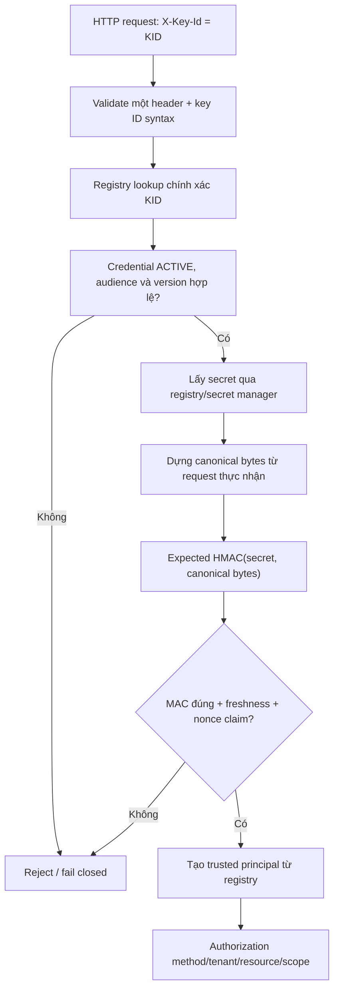
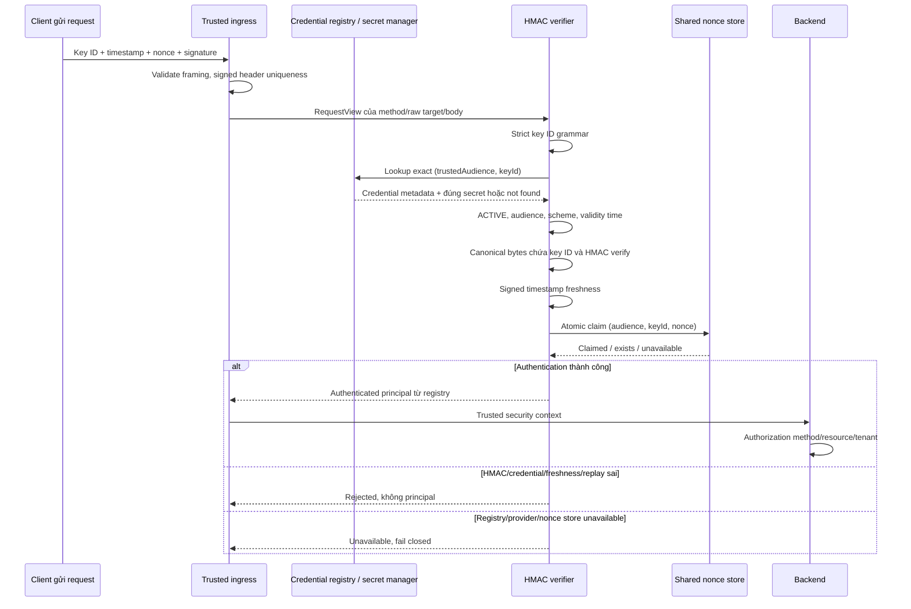

# Key ID là gì? Định danh khóa trong xác thực HTTP request bằng HMAC

Một API nhận request có header `X-Signature` và muốn xác minh HMAC-SHA256. Server có hàng nghìn đối tác, mỗi đối tác có thể sở hữu nhiều shared secret trong giai đoạn key rotation. Vấn đề xuất hiện **trước cả phép tính HMAC**: *server nên lấy secret nào để tính MAC kỳ vọng?*

Câu trả lời thường là **Key ID** (*key identifier*): một định danh để tra cứu **đúng credential/secret và policy của nó** trong registry đáng tin cậy. Client gửi key ID cùng request đã ký, server dùng key ID để tra cứu nhưng **không mặc nhiên tin danh tính hoặc quyền của client**. Chỉ khi lựa chọn credential, kiểm tra trạng thái, dựng canonical request, xác minh MAC, timestamp và nonce thành công, server mới được tạo **authenticated principal**.

Bài **Key ID là gì** thuộc chương **Key identifier** trong module `SECURITY_AUTHENTICATION_HMAC_REQUEST_AUTHENTICATION`. Module có mục tiêu thiết kế xác thực HTTP request bằng HMAC với **shared secret** và canonical request chứa method, URI, header hoặc body theo hợp đồng ký; xác minh signature, chống replay bằng timestamp/nonce, quản lý key rotation, kiểm thử proxy/gateway và phân biệt **authentication** với **authorization**. Bài này tập trung vào vai trò, cấu trúc, độ tin cậy và vòng đời của **Key ID**.

## 1. Mục tiêu học tập

Sau bài học, bạn có thể:

1. Định nghĩa **key ID** và phân biệt nó với **secret key**, **client ID**, **principal**, **tenant ID**, **scope**, **signature** và **protocol version**.
2. Giải thích tại sao key ID là **lookup hint do client khai**, chưa phải danh tính đã xác thực, và vì sao **không được gửi secret** qua header key ID.
3. Thiết kế credential registry với quan hệ `keyId → key material + status + audience + principal metadata + policy` và quy tắc không tái sử dụng ID.
4. Đưa key ID vào **canonical request được HMAC bảo vệ**, bảo đảm server chọn **một secret chính xác** và không thử mọi secret khi MAC sai.
5. Phân tích key rotation, overlap, revocation, secret manager, key lookup outage, cache consistency và client SDK thay credential theo cặp.
6. Thực hành Java 17 dùng `Mac`, `SecretKeySpec`, `MessageDigest.isEqual`, `SecureRandom`, `Clock` và registry giả lập để xác minh key ID.
7. Thiết kế kiểm thử ở gateway/proxy, nhiều tenant, key ID case sensitivity, duplicate headers, nonce namespace và authentication/authorization.
8. Nhận diện rủi ro key enumeration, log lộ dữ liệu, lỗi policy và cách trả HTTP response an toàn.

## 2. Key ID là gì?

**Key ID** là **mã định danh một phiên bản credential cụ thể** để verifier chọn đúng khóa đã được cấp phát. Trong một API HMAC tùy biến, nó có thể được truyền qua header:

```http
X-Key-Id: partner-a-202611
```

Client có thể gửi một request như sau:

```http
POST /v1/orders?channel=partner HTTP/1.1
Host: api.example.test
Content-Type: application/json
X-Key-Id: partner-a-202611
X-Timestamp: 2026-11-28T02:00:00Z
X-Nonce: Zq8DxKtUokcwPGNj3d_yvQ
X-Signature: v1=<BASE64_OF_32_BYTE_HMAC>

{"sku":"BK-42","quantity":2}
```

Các chuỗi `<...>` ở đây là **placeholder**, không phải signature có thể gửi thật. `partner-a-202611` chỉ là tên minh họa; production có thể dùng ID ngẫu nhiên không mang ngữ nghĩa, ví dụ một UUID hoặc mã opaque do hệ thống cấp.

Hãy hiểu trình tự:



**Key ID là địa chỉ tra cứu secret, không phải secret.** Nó có thể xuất hiện trên wire và bị quan sát, trong khi **secret bytes không được gửi**. Đối tượng biết key ID nhưng **không biết secret tương ứng** không thể tự tạo một MAC hợp lệ cho request mới.

### Một key ID có bắt buộc giống client ID không?

**Không.** Một client có thể có nhiều credential:

```text
clientId = partner-a
  ├── keyId = partner-a-202611  → secret A
  └── keyId = partner-a-202702  → secret B
```

Đây là tình huống rotation thông thường: cả hai key có thể **ACTIVE trong thời gian overlap**, cùng ánh xạ về một principal `partner-a` nhưng sử dụng **secret bytes khác nhau**.

## 3. Key ID không phải những thứ sau

| Khái niệm | Là gì? | Có được dùng thay key ID hoặc secret không? |
| --- | --- | --- |
| **Key ID** (`kid`) | Nhãn/handle tra cứu một credential cụ thể. | Không phải bằng chứng sở hữu khóa. |
| **Shared secret** | Bytes bí mật làm đầu vào cho HMAC. | **Không được** đưa vào `X-Key-Id` hay log/URL/header. |
| **Client ID** | Định danh ứng dụng/đối tác sở hữu credential. | Không nhất thiết định danh **một phiên bản secret**. |
| **Principal** | Danh tính **đã được xác minh** và phát hành cho security context. | Không được tạo chỉ từ key ID chưa xác thực. |
| **Tenant ID** | Không gian dữ liệu hoặc tổ chức mà request được gắn. | Không suy từ chuỗi key ID hoặc header khách tự khai. |
| **Scope/role** | Quyền tiềm năng của principal. | Không thể suy “admin” từ tên key ID. |
| **Signature** | MAC tạo từ secret và canonical bytes; có thể encode Base64. | Không dùng làm key ID để tra secret. |
| **Protocol version** | Quy tắc ký: algorithm, canonical fields, encoding. | Không dùng key ID suffix để đoán thuật toán. |
| **Key material reference** | Handle nội bộ đến secret manager/HSM hoặc vault. | Không nên đưa raw vault path/tên kho nội bộ lên wire. |

Một key ID dạng `admin-prod-key` **không có nghĩa** caller là admin. Ngay cả key ID có vẻ thuộc client A, phải kiểm tra mapping từ registry **sau khi xác minh chữ ký và freshness** mới kết luận principal đó là A.

**Quy tắc nhận diện độ tin cậy:**

```text
HTTP header X-Key-Id         = untrusted input / lookup hint
Trusted credential registry  = source of policy + secret metadata
Correct HMAC + freshness     = cryptographic authentication checks
Nonce claimed atomically     = anti-replay check
Authenticated principal      = output only after all checks succeed
Authorization               = separate decision for the actual action
```

### Key ID có phải thông tin bí mật không?

Về mặt mật mã, **không cần giữ key ID bí mật** để HMAC an toàn: attacker biết key ID nhưng không có secret vẫn không ký được request mới. Tuy nhiên key ID có thể gợi ý khách hàng, môi trường, lịch rotation hoặc số lượng credential. Vì vậy production nên dùng mã khó đoán ý nghĩa nếu cần và hạn chế log/telemetry không cần thiết.

Đừng dùng key ID như bearer token. Nếu chỉ biết key ID là đủ đăng nhập hoặc gọi API, hệ thống đã không còn thực hiện HMAC authentication như dự kiến.

## 4. Credential registry: nơi key ID trở thành thông tin có nghĩa

Ở server, key ID được tra trong một **registry được bảo vệ**. Ví dụ mô hình:

| Field | Ví dụ | Nhiệm vụ |
| --- | --- | --- |
| `keyId` | `partner-a-202611` | Lookup key duy nhất trong phạm vi registry. |
| `clientId` | `partner-a` | Principal ứng dụng sau authentication. |
| `tenantId` | `tenant-42` | Đầu vào cho policy tenant; không phải tự động cấp mọi quyền. |
| `audience` | `orders-api-prod` | Ràng buộc credential với đúng dịch vụ/môi trường. |
| `scheme` | `HMAC-SHA256-V1` | Giao thức và canonicalization được chấp nhận. |
| `state` | `ACTIVE` | Trạng thái vòng đời credential. |
| `validFrom` | `2026-11-01T00:00:00Z` | Thời điểm credential bắt đầu có hiệu lực. |
| `validUntil` | `2027-03-01T00:00:00Z` | Biên hết hiệu lực, ví dụ **exclusive**. |
| `secretRef` | `secret-manager://opaque-reference` | Tham chiếu **nội bộ** đến secret; không phát lên wire. |
| `scopes` | `orders:read`, `orders:create` | Các entitlement để tầng authorization tiếp tục quyết định. |

Bảng trên là **thiết kế minh họa**, không phải schema chuẩn của HTTP. Có hệ thống đặt `scheme` và `audience` theo **credential**, có hệ thống đặt theo **API deployment** và đảm bảo registry đã được partition. Điểm bắt buộc là verifier phải xác định **một policy rõ ràng** và không nhận bản mô tả thuật toán/khóa do client tùy ý đưa vào mà không kiểm soát.

### Ba bất biến nên áp dụng cho registry

1. **Một ID ánh xạ một credential version rõ ràng tại một thời điểm.** Không để hai client hoặc hai secret khác nhau cùng sử dụng một lookup key mơ hồ trong cùng không gian xác minh.
2. **Không recycle key ID cho secret mới** trong phạm vi được bảo vệ; khi rotate, cấp ID mới. Recycle ID có thể làm audit, nonce namespace và cache state nhập nhằng, đặc biệt với request cũ còn hiệu lực.
3. **Không suy principal bằng cách parse ID.** Chuỗi `partner-a-202611` có thể chỉ để người vận hành dễ đọc; nguồn principal là **metadata registry đã được xác thực**.

### Global ID hay ID theo audience?

Nếu lookup key là `(audience,keyId)` thì cùng chuỗi key ID **có thể tồn tại** ở hai audience khác nhau, miễn API định nghĩa partition, secret và replay namespace nhất quán. Nếu lookup chỉ theo `keyId`, ID nên **duy nhất trong registry mà verifier truy cập**.

Không được vô tình lấy audience từ một header do client tự khai rồi dùng nó để chọn secret ở môi trường khác. Audience phải đến từ **endpoint/virtual host đáng tin hoặc cấu hình verifier**, và nên xuất hiện trong canonical request.

## 5. Định dạng Key ID: ổn định, rõ ràng và không nhập nhằng

Không có cú pháp `X-Key-Id` bắt buộc chung cho mọi HMAC API. Vì vậy phải công bố **grammar** và xử lý chính xác value.

Ví dụ hợp đồng V1:

```text
Header: X-Key-Id
Allowed: ASCII lowercase letters a-z, digits 0-9, '.', '_' và '-'
Length:  1 đến 64 ký tự
Regex:   [a-z0-9][a-z0-9._-]{0,63}
Example: partner-a-202611
```

Tại sao cần giới hạn?

- **Độ dài hữu hạn:** tránh request header quá lớn, giảm áp lực lookup/log/index.
- **ASCII và character allowlist:** tránh confusable Unicode, newline/control characters, path traversal và serialization không nhất quán.
- **Không khoảng trắng/CRLF:** không tạo cơ hội header injection, parser disagreement.
- **Giữ nguyên value:** HTTP **field names** case-insensitive, nhưng giá trị key ID là **identifier theo policy**; không mặc nhiên casefold hoặc trim bên trong để “sửa”.
- **Định dạng không quy định quyền:** không thể suy quyền admin/client từ tiền tố `admin` hoặc `partner`.

**Case sensitivity là một quyết định contract**, không phải tính chất mặc định của mọi hệ thống. V1 minh họa chỉ nhận lowercase ASCII, nên `Partner-A-202611` bị từ chối; không tự biến về lowercase và chọn nhầm credential. Nếu hệ thống cho phép cả hoa/thường thì vẫn cần mô hình định danh không nhập nhằng và quy tắc so khớp ổn định.

### Header name và header value phải được xử lý khác nhau

Hai field sau cùng chỉ đến **một tên header HTTP**:

```http
X-Key-Id: partner-a-202611
x-key-id: partner-a-202611
```

Trong HTTP, **tên field không phân biệt hoa/thường**. Tuy nhiên ví dụ trên **nếu cùng xuất hiện trong một request** thì chính là **duplicate của security header** và nên bị từ chối, thay vì chọn first/last hoặc gộp thành `partner-a-202611, partner-a-202611`.

Ngược lại:

```http
X-Key-Id: partner-a-202611
X-Key-Id: Partner-A-202611
```

Không phải “cùng key ID vì khác chữ hoa”: theo hợp đồng V1, giá trị thứ hai **không hợp lệ**. Server phải chặn duplicate ngay ở **HTTP ingress tin cậy**, trước khi một framework gộp/cắt/normalize các trường bảo mật.

## 6. Key ID phải nằm trong canonical request đã ký

**Key ID chọn secret được dùng để verify.** Điều này tạo một câu hỏi: key ID đã được gửi trong request thì có cần **ký chính nó** không?

**Có, theo hợp đồng V1 của bài.** Đưa key ID vào canonical string bảo đảm attacker không thể **thay định danh credential** mà vẫn giữ MAC của request cũ, kể cả khi registry có cấu hình sai hoặc nhiều credential vô tình dùng cùng secret.

Ví dụ canonical request tự định nghĩa:

```text
HMAC-SHA256-V1
orders-api-prod
POST
/v1/orders?channel=partner
content-type:application/json
x-key-id:partner-a-202611
x-timestamp:2026-11-28T02:00:00Z
x-nonce:Zq8DxKtUokcwPGNj3d_yvQ
sha256:<LOWERCASE_HEX_SHA256_OF_RAW_BODY>
```

Dòng `sha256:<...>` là placeholder để minh họa: client phải thay bằng **64 ký tự hex thường** của SHA-256 trên **raw body bytes**.

Hợp đồng:

| Thành phần | Quy tắc minh họa |
| --- | --- |
| Version | Dòng đầu `HMAC-SHA256-V1`; không tự chọn bằng key ID suffix. |
| Audience | `orders-api-prod`, xác định bởi verifier và credential registry. |
| Method | Chính xác `POST`. |
| Target | Origin-form raw path/query `/v1/orders?channel=partner`. |
| `Content-Type` | Một giá trị `application/json`, tên canonical lowercase. |
| `X-Key-Id` | Một giá trị `partner-a-202611`, được ký nguyên văn. |
| `X-Timestamp` | UTC `YYYY-MM-DDTHH:mm:ssZ`, được ký, cửa sổ ±300 giây. |
| `X-Nonce` | 16 byte ngẫu nhiên, Base64URL unpadded, được ký và claim một lần. |
| Body | SHA-256 của raw content bytes; không cho `Content-Encoding` trong V1. |
| Byte encoding | UTF-8, LF giữa các dòng, **không LF cuối**. |
| Signature wire | Header `X-Signature: v1=` + Base64 chuẩn padded của full HMAC-SHA256 32 byte. |

Công thức:

\[
\begin{aligned}
D &= \operatorname{SHA256}(\mathrm{rawBodyBytes}),\\
C &= \operatorname{UTF8}(\mathrm{canonicalRequestWithHex}(D)),\\
T &= \operatorname{HMAC}_{\mathrm{SHA256}}(K_{\mathrm{keyId}}, C),\\
S &= \texttt{v1=} \Vert \operatorname{Base64}_{\mathrm{padded}}(T).
\end{aligned}
\]

**Header `X-Signature` không tự nằm trong canonical string** (tránh vòng lặp ký chính chữ ký). Ngược lại, key ID, timestamp và nonce là dữ liệu do client khai có ảnh hưởng trực tiếp đến quyết định authentication nên **phải nằm trong dữ liệu HMAC bảo vệ**.

### Đổi key ID nhưng giữ signature sẽ ra sao?

Giả sử client ký:

```text
x-key-id:partner-a-202611
signature: v1=<MAC_WITH_SECRET_A>
```

Attacker thay thành:

```text
x-key-id:partner-a-202702
signature: v1=<SAME_OLD_MAC>
```

Server sẽ tra secret B (nếu ID mới tồn tại), tạo canonical string chứa **key ID mới**, rồi so expected MAC với signature cũ. Request phải bị từ chối. Không chạy vòng lặp “thử B không khớp, thử A để cứu request”.

### Nếu hai key ID dùng nhầm cùng secret?

Ngay cả khi registry sai và A/B dùng cùng bytes secret, **ký key ID** vẫn tạo ra hai canonical strings khác nhau. Tuy nhiên **đừng coi điều đó là lý do có thể dùng lại secret**: rotation an toàn yêu cầu **secret mới độc lập**, phát hành và revoke theo đúng lifecycle.

## 7. Tra cứu key ID đúng cách: một lookup, một secret

Một verifier có thể nhận header `X-Key-Id` trước khi có bằng chứng chữ ký. Điều đó cho phép tra secret nhưng cũng tạo bề mặt tấn công như key enumeration, lookup DoS hoặc chọn nhầm policy.

Trình tự an toàn:



Cần lưu ý:

1. **Chọn một credential** bằng lookup exact. Trạng thái revoked, sai audience, quá hạn hoặc key ID không tồn tại làm authentication thất bại.
2. **Không tìm secret theo chữ ký** (thử lần lượt hàng trăm khóa cho đến khi có MAC trùng). Cách này vừa tốn CPU, vừa phá audit, vừa tăng nguy cơ chấp nhận credential không được phép.
3. **Không sửa key ID** để lookup gần đúng theo prefix, ignore case, trim nội dung hoặc giải mã URL tùy tiện.
4. **Không lấy algorithm từ key ID** như hậu tố `-sha512` và tự đổi provider. Algorithm/version là policy rõ ràng của endpoint và registry.
5. **Không tạo principal từ key ID trước MAC**. Mapping sang `clientId` là thông tin registry, nhưng chưa được publish cho backend khi request chưa xác minh.
6. **Không tiếp tục khi registry/secret manager lỗi**. Không thể xác minh với key đúng thì phải **fail closed**, phân biệt với “key không tồn tại”.

### Key enumeration và response timing

Nếu API trả:

```json
{"error":"key partner-a-202611 exists but MAC is wrong"}
```

attacker có thể dò ID hợp lệ mà không cần biết secret. Tương tự, một registry lookup nhanh/chậm khác nhau đáng kể giữa key tồn tại và không tồn tại có thể tạo tín hiệu phụ.

Phòng vệ thực tế gồm: response bên ngoài **chung cho lỗi authentication**, rate limit/quotas, ID khó đoán ý nghĩa nếu cần, cache/lookup policy nhất quán, giám sát truy vấn bất thường, và hạn chế chênh lệch thời gian xử lý nếu threat model nhạy cảm. **`MessageDigest.isEqual` giúp so MAC bytes an toàn hơn, nhưng không tự biến toàn bộ đường lookup/kiểm tra thành constant-time.**

## 8. Key ID và vòng đời khóa: create, activate, rotate, revoke

Một key ID hữu ích vì cho phép **mỗi secret có vòng đời riêng**.

| Trạng thái | Ý nghĩa | Verifier xử lý |
| --- | --- | --- |
| `PROVISIONED` / `PENDING` | Credential đã cấp nhưng chưa bắt đầu được dùng. | Chưa chấp nhận nếu chưa ACTIVE. |
| `ACTIVE` | Credential được phép xác thực trong audience và khoảng hiệu lực. | Có thể chọn secret để verify. |
| `OVERLAP` (trạng thái vận hành hoặc policy) | Secret cũ và mới **đồng thời ACTIVE** trong thời gian chuyển. | Mỗi request dùng đúng một key ID và secret tương ứng. |
| `REVOKED` | Credential bị thu hồi do sự cố, hết hợp đồng hoặc yêu cầu bảo mật. | **Từ chối** dù MAC từng đúng, timestamp fresh. |
| `EXPIRED` | Qua thời điểm `validUntil` theo policy. | **Từ chối**; không phục hồi chỉ vì request ký trước expiry. |
| `DELETED` | Key material đã được xóa theo retention/audit policy. | Không sử dụng để verify request mới. |

Đây là mô hình trạng thái minh họa, không phải API chuẩn chung. Với hệ thống dùng `OVERLAP`, cách triển khai có thể là **hai credential `ACTIVE`** chứ không cần enum `OVERLAP` riêng.

### Một lịch rotation cụ thể

```text
Client principal: partner-a
Audience: orders-api-prod

Key ID                 Secret     State
partner-a-202611       Secret A   ACTIVE (overlap)
partner-a-202702       Secret B   ACTIVE (new)
partner-a-202608       Secret Z   REVOKED
```

Quy trình an toàn:

1. **Provision** một secret **mới độc lập** B và một key ID mới B; đăng ký đúng principal/audience/scopes, validity và key policy.
2. **Phân phối cặp `(keyIdB, secretB)` an toàn** cho client. Client phải đọc cấu hình theo **snapshot bất biến**, không đọc ID từ version mới và secret từ version cũ.
3. **Overlap:** cho phép A và B cùng ACTIVE trong khoảng có kiểm soát. Verifier tra **đúng một secret** theo key ID của từng request.
4. **Chuyển gửi:** client bắt đầu ký bằng ID B và secret B. Giám sát tỷ lệ request theo credential ID đã lọc, không cần log secret.
5. **Revoke A** khi đã xác nhận chuyển hoặc ngay lập tức nếu lộ; không tiếp tục chấp nhận request từ A chỉ vì timestamp/nonce còn hợp lệ.
6. **Lưu audit metadata** đủ thời gian theo chính sách nhưng không giữ secret cũ lâu hơn cần thiết. Không tái sử dụng ID A cho secret C.

### Tại sao phải đổi cả key ID lẫn secret?

Nếu chỉ đổi `X-Key-Id` mà không đổi secret, rotation **không tạo ra khóa mật mã mới**, và có thể khiến signature sai vì key ID là signed field. Nếu chỉ đổi secret nhưng giữ ID trong registry đang được cache, client/server có thể dùng **hai secret khác nhau dưới cùng ID** dẫn đến lỗi ngắt quãng và làm audit không đáng tin.

**Đổi credential nên là một thao tác nhất quán theo phiên bản**: client chọn một pair, server tra một registry record, thông tin trạng thái/hiệu lực có chiến lược cache và revoke rõ.

## 9. Key ID, principal và authorization: ba lớp tách biệt

Giả sử registry ghi:

```text
keyId:    partner-a-202611
clientId: partner-a
tenantId: tenant-42
scopes:   [orders:read]
```

Một request có HMAC đúng, timestamp còn mới và nonce mới có thể tạo principal `partner-a`. Nhưng nếu request là:

```http
POST /v1/orders?channel=partner
```

và API yêu cầu scope `orders:create`, tầng authorization phải **từ chối**, thường với `403 Forbidden`.

| Lớp | Câu hỏi | Dữ liệu chính |
| --- | --- | --- |
| **Lookup** | Key ID này tương ứng credential nào? | `X-Key-Id` chưa tin + credential registry. |
| **Authentication** | Request có MAC đúng từ secret ACTIVE, đúng audience, fresh và không replay? | Canonical bytes, secret, timestamp, nonce. |
| **Principal creation** | Bên gửi được xác thực là client/tenant nào? | Metadata từ registry, **không** từ client header. |
| **Authorization** | Principal được gọi method này trên resource/tenant này không? | Scope/role, tenant/resource ownership, business policy. |
| **Business validation** | Payload/trạng thái nghiệp vụ có hợp lệ? | Schema, ETag, quota, transaction, domain rules. |

Không chuyển header như `X-Client-Id: admin` hoặc `X-Tenant-Id: root` thành principal chỉ vì request chứa `X-Key-Id` có vẻ hợp lệ. Những header ấy vẫn là **untrusted input**, trừ khi được xác minh/ràng buộc qua một trust boundary rõ.

## 10. Java 17: mô hình lookup key ID và xác minh HMAC đầy đủ

Ví dụ sau là một **chương trình Java 17 độc lập**, chỉ dùng JDK. Nó **không** chạy HTTP socket: đầu vào `SignedRequest` mô phỏng các trường **đã được HTTP ingress kiểm tra**. Mục tiêu là chứng minh key ID được sử dụng **để tìm đúng credential**, không phải là danh tính được tin trước HMAC.

Demo có:

- Grammar key ID lowercase ASCII, tối đa 64 ký tự.
- Một registry map `keyId → Credential`; một client có **hai key ACTIVE với secret khác nhau**, một key cũ REVOKED.
- Audience `orders-api-prod`, version `HMAC-SHA256-V1` và policy thời gian cho credential.
- Canonical request chứa `x-key-id`, method, raw target, Content-Type, timestamp, nonce và SHA-256(raw body).
- HMAC-SHA256 full 32 byte, `v1=` + Base64 chuẩn padded; so raw bytes bằng `MessageDigest.isEqual`.
- Freshness ±300 giây và nonce 16 byte CSPRNG Base64URL unpadded.
- `LocalNonceStore` nguyên tử **trong cùng JVM test**, không đủ thay store phân tán production.
- Kết quả `Authenticated` chỉ khi key/policy, HMAC, timestamp và nonce đều hợp lệ; `Rejected`/`Unavailable` không có principal.
- Test đổi key ID giữ signature, unknown ID, revoked key, registry lỗi, replay và hai luồng claim cùng nonce.

**Chỉ phục vụ học tập:** credential secret là dữ liệu test giả, registry và nonce store nằm trong memory, code chưa có HTTP parser/TLS/secret manager/authorization thực tế. Không dùng trực tiếp cho endpoint công khai.

Lưu file `KeyIdentifierHmacDemo.java`:

```java
import java.nio.charset.StandardCharsets;
import java.security.GeneralSecurityException;
import java.security.MessageDigest;
import java.security.SecureRandom;
import java.time.Clock;
import java.time.Instant;
import java.time.ZoneOffset;
import java.time.format.DateTimeParseException;
import java.time.temporal.ChronoUnit;
import java.util.Arrays;
import java.util.Base64;
import java.util.HashMap;
import java.util.HexFormat;
import java.util.Map;
import java.util.Set;
import java.util.concurrent.Callable;
import java.util.concurrent.CountDownLatch;
import java.util.concurrent.ExecutorService;
import java.util.concurrent.Executors;
import java.util.concurrent.Future;
import javax.crypto.Mac;
import javax.crypto.spec.SecretKeySpec;

public final class KeyIdentifierHmacDemo {
    private static final String VERSION = "HMAC-SHA256-V1";
    private static final String AUDIENCE = "orders-api-prod";
    private static final String TARGET = "/v1/orders?channel=partner";
    private static final String TYPE = "application/json";
    private static final String SIGNATURE_PREFIX = "v1=";
    private static final long WINDOW_SECONDS = 300;
    private static final long NONCE_MARGIN_SECONDS = 30;

    private KeyIdentifierHmacDemo() {}

    public enum KeyState { ACTIVE, REVOKED }

    public enum RejectCode {
        BAD_REQUEST, INVALID_CREDENTIAL, INVALID_SIGNATURE,
        NOT_FRESH, NONCE_REPLAY
    }

    public enum FailureCode {
        CREDENTIAL_REGISTRY, CRYPTO_PROVIDER, NONCE_STORE
    }

    public sealed interface AuthenticationResult
            permits Authenticated, Rejected, Unavailable {}

    public record Principal(
            String clientId, String tenantId, Set<String> scopes) {
        public Principal {
            scopes = Set.copyOf(scopes);
        }
    }

    public record Authenticated(
            Principal principal, String credentialId,
            String scheme, Instant verifiedAt)
            implements AuthenticationResult {}

    public record Rejected(RejectCode reason)
            implements AuthenticationResult {}

    public record Unavailable(FailureCode reason)
            implements AuthenticationResult {}

    public record Credential(
            String keyId, String clientId, String tenantId,
            String audience, String scheme, KeyState state,
            Instant validFrom, Instant validUntil,
            byte[] secret, Set<String> scopes) {
        public Credential {
            secret = secret.clone();
            scopes = Set.copyOf(scopes);
        }
        @Override
        public byte[] secret() {
            return secret.clone();
        }
    }

    public record SignedRequest(
            String method, String rawTarget, String contentType,
            boolean contentEncodingPresent, String keyId,
            String timestamp, String nonce, byte[] rawBody,
            String signature) {
        public SignedRequest {
            if (rawBody != null) {
                rawBody = rawBody.clone();
            }
        }
        @Override
        public byte[] rawBody() {
            return rawBody == null ? null : rawBody.clone();
        }
    }

    public static class RegistryFailure extends Exception {}
    public static class NonceFailure extends Exception {}

    public interface KeyRegistry {
        Credential lookup(String keyId) throws RegistryFailure;
    }

    public static final class LocalRegistry implements KeyRegistry {
        private final Map<String, Credential> credentials;
        private final boolean offline;

        public LocalRegistry(
                Map<String, Credential> credentials, boolean offline) {
            this.credentials = Map.copyOf(credentials);
            this.offline = offline;
        }

        @Override
        public Credential lookup(String keyId) throws RegistryFailure {
            if (offline) {
                throw new RegistryFailure();
            }
            return credentials.get(keyId);
        }
    }

    public interface NonceStore {
        boolean claim(String key, Instant expiresAt, Instant now)
                throws NonceFailure;
    }

    public static final class LocalNonceStore implements NonceStore {
        private final Map<String, Instant> expiries = new HashMap<>();

        // Chỉ atomic trong MỘT JVM; production cần shared store.
        @Override
        public synchronized boolean claim(
                String key, Instant expiresAt, Instant now) {
            if (!expiresAt.isAfter(now)) {
                return false;
            }
            expiries.entrySet().removeIf(
                    entry -> !entry.getValue().isAfter(now));
            if (expiries.containsKey(key)) {
                return false;
            }
            expiries.put(key, expiresAt);
            return true;
        }
    }

    // Đây là grammar tự định nghĩa, KHÔNG phải quy định mọi HMAC API.
    private static boolean validKeyId(String id) {
        return id != null
                && id.matches("[a-z0-9][a-z0-9._-]{0,63}");
    }

    private static Instant parseTimestamp(String timestamp) {
        if (timestamp == null || !timestamp.matches(
                "[0-9]{4}-[0-9]{2}-[0-9]{2}T"
                + "[0-9]{2}:[0-9]{2}:[0-9]{2}Z")) {
            throw new IllegalArgumentException("Bad timestamp syntax");
        }
        try {
            Instant parsed = Instant.parse(timestamp);
            if (!parsed.truncatedTo(ChronoUnit.SECONDS)
                    .toString().equals(timestamp)) {
                throw new IllegalArgumentException("Noncanonical time");
            }
            return parsed;
        } catch (DateTimeParseException invalid) {
            throw new IllegalArgumentException("Bad timestamp value", invalid);
        }
    }

    private static boolean validNonce(String nonce) {
        if (nonce == null || nonce.length() != 22) {
            return false;
        }
        try {
            byte[] bytes = Base64.getUrlDecoder().decode(nonce);
            return bytes.length == 16
                    && Base64.getUrlEncoder().withoutPadding()
                            .encodeToString(bytes).equals(nonce);
        } catch (IllegalArgumentException malformed) {
            return false;
        }
    }

    private static boolean validShape(SignedRequest r) {
        if (r == null
                || !"POST".equals(r.method())
                || !TARGET.equals(r.rawTarget())
                || !TYPE.equals(r.contentType())
                || r.contentEncodingPresent()
                || !validKeyId(r.keyId())
                || !validNonce(r.nonce())
                || r.rawBody() == null
                || r.rawBody().length > 8192) {
            return false;
        }
        try {
            parseTimestamp(r.timestamp());
            return true;
        } catch (IllegalArgumentException invalid) {
            return false;
        }
    }

    private static byte[] canonicalBytes(SignedRequest r)
            throws GeneralSecurityException {
        String bodyHash = HexFormat.of().formatHex(
                MessageDigest.getInstance("SHA-256")
                        .digest(r.rawBody()));
        String canonical = String.join("\n",
                VERSION, AUDIENCE, r.method(), r.rawTarget(),
                "content-type:" + r.contentType(),
                "x-key-id:" + r.keyId(),
                "x-timestamp:" + r.timestamp(),
                "x-nonce:" + r.nonce(),
                "sha256:" + bodyHash);
        return canonical.getBytes(StandardCharsets.UTF_8);
    }

    private static byte[] hmac(byte[] secret, byte[] canonical)
            throws GeneralSecurityException {
        // Policy cấp khóa của demo yêu cầu secret ngẫu nhiên >=32 byte.
        if (secret == null || secret.length < 32) {
            throw new GeneralSecurityException("Invalid credential policy");
        }
        Mac mac = Mac.getInstance("HmacSHA256");
        mac.init(new SecretKeySpec(secret, "HmacSHA256"));
        return mac.doFinal(canonical);
    }

    private static byte[] decodeSignature(String wire) {
        if (wire == null || wire.length() != 47
                || !wire.startsWith(SIGNATURE_PREFIX)) {
            return null;
        }
        String base64 = wire.substring(SIGNATURE_PREFIX.length());
        if (!base64.matches("[A-Za-z0-9+/]{43}=")) {
            return null;
        }
        try {
            byte[] bytes = Base64.getDecoder().decode(base64);
            return bytes.length == 32
                    && Base64.getEncoder().encodeToString(bytes)
                            .equals(base64) ? bytes : null;
        } catch (IllegalArgumentException invalid) {
            return null;
        }
    }

    public static AuthenticationResult authenticate(
            SignedRequest request, KeyRegistry registry,
            NonceStore nonceStore, Clock clock) {
        if (!validShape(request)) {
            return new Rejected(RejectCode.BAD_REQUEST);
        }

        Instant now = clock.instant();
        Credential c;
        try {
            c = registry.lookup(request.keyId());
        } catch (RegistryFailure unavailable) {
            return new Unavailable(FailureCode.CREDENTIAL_REGISTRY);
        }

        if (c == null || c.state() != KeyState.ACTIVE
                || !AUDIENCE.equals(c.audience())
                || !VERSION.equals(c.scheme())
                || !request.keyId().equals(c.keyId())
                || now.isBefore(c.validFrom())
                || !now.isBefore(c.validUntil())) {
            return new Rejected(RejectCode.INVALID_CREDENTIAL);
        }

        byte[] supplied = decodeSignature(request.signature());
        if (supplied == null) {
            return new Rejected(RejectCode.INVALID_SIGNATURE);
        }
        try {
            // Chính secret của key ID được tra, KHÔNG thử các key khác.
            byte[] expected = hmac(
                    c.secret(), canonicalBytes(request));
            if (!MessageDigest.isEqual(expected, supplied)) {
                return new Rejected(RejectCode.INVALID_SIGNATURE);
            }
        } catch (GeneralSecurityException cryptoFailure) {
            return new Unavailable(FailureCode.CRYPTO_PROVIDER);
        }

        Instant signedTime = parseTimestamp(request.timestamp());
        if (signedTime.isBefore(now.minusSeconds(WINDOW_SECONDS))
                || signedTime.isAfter(now.plusSeconds(WINDOW_SECONDS))) {
            return new Rejected(RejectCode.NOT_FRESH);
        }

        // Per-credential/audience nonce namespace, không chứa timestamp.
        String nonceKey = "replay:v1:" + AUDIENCE + ":"
                + c.keyId() + ":" + request.nonce();
        Instant expiresAt = signedTime.plusSeconds(
                WINDOW_SECONDS + NONCE_MARGIN_SECONDS);
        try {
            if (!nonceStore.claim(nonceKey, expiresAt, now)) {
                return new Rejected(RejectCode.NONCE_REPLAY);
            }
        } catch (NonceFailure unavailable) {
            return new Unavailable(FailureCode.NONCE_STORE);
        }

        // Không dùng keyId/header làm principal trước khi HMAC + nonce đạt.
        Principal trusted = new Principal(
                c.clientId(), c.tenantId(), c.scopes());
        return new Authenticated(trusted, c.keyId(), VERSION, now);
    }

    private static String newNonce(SecureRandom random) {
        byte[] raw = new byte[16];
        random.nextBytes(raw);
        return Base64.getUrlEncoder().withoutPadding()
                .encodeToString(raw);
    }

    // Chỉ là signer tạo fixture: production client đọc credential
    // từ secret manager, cùng dữ liệu body/URI sẽ gửi.
    public static SignedRequest signForTest(
            Credential c, String timestamp, String nonce, byte[] body)
            throws GeneralSecurityException {
        SignedRequest unsigned = new SignedRequest(
                "POST", TARGET, TYPE, false,
                c.keyId(), timestamp, nonce, body, null);
        if (!validShape(unsigned)) {
            throw new IllegalArgumentException("Invalid signed fixture");
        }
        String signature = SIGNATURE_PREFIX
                + Base64.getEncoder().encodeToString(
                    hmac(c.secret(), canonicalBytes(unsigned)));
        return new SignedRequest(
                unsigned.method(), unsigned.rawTarget(),
                unsigned.contentType(), false, c.keyId(),
                timestamp, nonce, body, signature);
    }

    private static Authenticated expectAuthenticated(
            AuthenticationResult result) {
        if (!(result instanceof Authenticated)) {
            throw new AssertionError(
                    "Expected Authenticated, got " + result);
        }
        return (Authenticated) result;
    }

    private static void expectRejected(
            RejectCode expected, AuthenticationResult result) {
        if (!(result instanceof Rejected)) {
            throw new AssertionError(
                    "Expected rejection, got " + result);
        }
        Rejected rejected = (Rejected) result;
        if (rejected.reason() != expected) {
            throw new AssertionError(
                    "Expected " + expected + ", got " + rejected.reason());
        }
    }

    public static void main(String[] args) throws Exception {
        // Secret giả CHỈ để test; các key độc lập.
        byte[] keyA = new byte[32];
        byte[] keyB = new byte[32];
        byte[] keyOld = new byte[32];
        Arrays.fill(keyA, (byte) 0x41);
        Arrays.fill(keyB, (byte) 0x42);
        Arrays.fill(keyOld, (byte) 0x43);

        Instant from = Instant.parse("2026-01-01T00:00:00Z");
        Instant until = Instant.parse("2027-12-31T23:59:59Z");
        Credential a = new Credential(
                "partner-a-202611", "partner-a", "tenant-42",
                AUDIENCE, VERSION, KeyState.ACTIVE,
                from, until, keyA, Set.of("orders:read"));
        Credential b = new Credential(
                "partner-a-202702", "partner-a", "tenant-42",
                AUDIENCE, VERSION, KeyState.ACTIVE,
                from, until, keyB, Set.of("orders:read"));
        Credential revoked = new Credential(
                "partner-a-202608", "partner-a", "tenant-42",
                AUDIENCE, VERSION, KeyState.REVOKED,
                from, until, keyOld, Set.of("orders:read"));

        KeyRegistry registry = new LocalRegistry(
                Map.of(a.keyId(), a, b.keyId(), b,
                        revoked.keyId(), revoked), false);
        LocalNonceStore nonces = new LocalNonceStore();
        Clock fixed = Clock.fixed(
                Instant.parse("2026-11-28T02:00:30Z"), ZoneOffset.UTC);
        SecureRandom random = new SecureRandom();
        byte[] body = "{\"sku\":\"BK-42\",\"quantity\":2}"
                .getBytes(StandardCharsets.UTF_8);
        String timestamp = "2026-11-28T02:00:00Z";

        SignedRequest signedA = signForTest(
                a, timestamp, newNonce(random), body);
        Authenticated resultA = expectAuthenticated(
                authenticate(signedA, registry, nonces, fixed));
        if (!"partner-a".equals(resultA.principal().clientId())
                || !a.keyId().equals(resultA.credentialId())) {
            throw new AssertionError("Wrong principal or credential A");
        }

        // Gửi lại nguyên request: MAC vẫn đúng nhưng nonce đã claim.
        expectRejected(RejectCode.NONCE_REPLAY,
                authenticate(signedA, registry, nonces, fixed));

        // Đổi X-Key-Id sang B nhưng giữ signature của A:
        // server tra B và tính canonical chứa B -> MAC mismatch.
        SignedRequest swapped = new SignedRequest(
                signedA.method(), signedA.rawTarget(),
                signedA.contentType(), false, b.keyId(),
                signedA.timestamp(), signedA.nonce(),
                signedA.rawBody(), signedA.signature());
        expectRejected(RejectCode.INVALID_SIGNATURE,
                authenticate(swapped, registry, nonces, fixed));

        // Rotation: key B ACTIVE, secret B độc lập, principal vẫn là A.
        SignedRequest signedB = signForTest(
                b, timestamp, newNonce(random), body);
        Authenticated resultB = expectAuthenticated(
                authenticate(signedB, registry, nonces, fixed));
        if (!resultA.principal().clientId()
                    .equals(resultB.principal().clientId())
                || !b.keyId().equals(resultB.credentialId())) {
            throw new AssertionError("Rotation mapping failed");
        }

        // Credential cũ REVOKED, dù chữ ký được tạo đúng secret cũ.
        SignedRequest signedOld = signForTest(
                revoked, timestamp, newNonce(random), body);
        expectRejected(RejectCode.INVALID_CREDENTIAL,
                authenticate(signedOld, registry, nonces, fixed));

        // ID không tồn tại: không được thử mọi secret tới khi khớp.
        SignedRequest unknown = new SignedRequest(
                signedA.method(), signedA.rawTarget(),
                signedA.contentType(), false, "missing-key",
                signedA.timestamp(), newNonce(random),
                signedA.rawBody(), signedA.signature());
        expectRejected(RejectCode.INVALID_CREDENTIAL,
                authenticate(unknown, registry, nonces, fixed));

        // Grammar không cho casefold value hoặc dùng slash/dấu hai chấm.
        SignedRequest invalidId = new SignedRequest(
                signedA.method(), signedA.rawTarget(),
                signedA.contentType(), false, "Partner/A:Admin",
                signedA.timestamp(), newNonce(random),
                signedA.rawBody(), signedA.signature());
        expectRejected(RejectCode.BAD_REQUEST,
                authenticate(invalidId, registry, nonces, fixed));

        // Registry lỗi: KHÔNG mặc định cho request qua.
        KeyRegistry offline = new LocalRegistry(
                Map.of(a.keyId(), a), true);
        SignedRequest anotherA = signForTest(
                a, timestamp, newNonce(random), body);
        AuthenticationResult unavailable = authenticate(
                anotherA, offline, nonces, fixed);
        if (!(unavailable instanceof Unavailable failure)
                || failure.reason() != FailureCode.CREDENTIAL_REGISTRY) {
            throw new AssertionError("Registry outage failed open");
        }

        // Hai thread gửi cùng request mới: chỉ 1 claim được thành công.
        SignedRequest race = signForTest(
                a, timestamp, newNonce(random), body);
        ExecutorService pool = Executors.newFixedThreadPool(2);
        CountDownLatch start = new CountDownLatch(1);
        Callable<AuthenticationResult> task = () -> {
            start.await();
            return authenticate(race, registry, nonces, fixed);
        };
        try {
            Future<AuthenticationResult> f1 = pool.submit(task);
            Future<AuthenticationResult> f2 = pool.submit(task);
            start.countDown();
            AuthenticationResult r1 = f1.get();
            AuthenticationResult r2 = f2.get();
            int accepted = (r1 instanceof Authenticated ? 1 : 0)
                    + (r2 instanceof Authenticated ? 1 : 0);
            int replayed = (r1 instanceof Rejected x
                    && x.reason() == RejectCode.NONCE_REPLAY ? 1 : 0)
                    + (r2 instanceof Rejected y
                    && y.reason() == RejectCode.NONCE_REPLAY ? 1 : 0);
            if (accepted != 1 || replayed != 1) {
                throw new AssertionError("Atomic nonce claim failed");
            }
        } finally {
            pool.shutdownNow();
        }

        // Mặc dù authenticated, A không có scope orders:create.
        if (resultA.principal().scopes().contains("orders:create")) {
            throw new AssertionError("Authorization bypass");
        }

        System.out.println(
                "Key ID lookup, rotation, signing and replay checks passed.");
    }
}
```

### Cách chạy và đọc kết quả

Biên dịch/chạy bằng **JDK 17**:

```text
javac KeyIdentifierHmacDemo.java
java KeyIdentifierHmacDemo
```

Nếu các assertions không ném lỗi, dòng cuối dự kiến:

```text
Key ID lookup, rotation, signing and replay checks passed.
```

Các bài test trong `main` minh họa:

- **Key A hợp lệ:** lookup `partner-a-202611` → secret A → MAC đúng → nonce mới → principal `partner-a`, credential ID ghi đúng A.
- **Replay chính request A:** giữ MAC đúng nhưng nonce đã dùng → `NONCE_REPLAY`.
- **Swapped ID:** thay `X-Key-Id` thành B mà giữ MAC của A → `INVALID_SIGNATURE`; verifier **không** thử A để “cứu” request.
- **Rotation:** secret B và key ID B xác thực hợp lệ, vẫn ánh xạ về cùng `clientId=partner-a`.
- **Revocation:** key cũ bị `REVOKED` không được xác thực kể cả khi test fixture biết secret cũ.
- **Unknown ID:** không tìm thấy credential → rejected; không cấp principal hoặc thử các khóa khác.
- **Malformed ID:** ID chứa slash, colon, uppercase không theo grammar V1 bị từ chối.
- **Registry outage:** trả `Unavailable(CREDENTIAL_REGISTRY)`, không tạo principal.
- **Concurrent replay:** hai luồng gửi request cùng nonce, trong một JVM dùng chung store, chỉ một authenticated và một replay bị chặn.
- **Authentication khác authorization:** principal có scope `orders:read` nhưng không có `orders:create`; backend phải từ chối thao tác tạo đơn.

**Giới hạn demo:** Không mở kết nối HTTP, không bắt header duplicate trên wire, không sử dụng TLS, không có secret manager, không có distributed nonce store, không có authz engine và không chứng minh consistency của cluster production. Mã chỉ là test lõi để phân biệt key ID, secret và principal.

## 11. Key ID trong client SDK: tránh ghép nhầm cặp credential

Một lỗi vận hành phổ biến xuất hiện khi client SDK **hot reload key rotation**:

```java
// SAI nếu hai property bị update ở hai thời điểm khác nhau:
String keyId = config.getCurrentKeyId();   // Có thể là key B.
byte[] secret = config.getCurrentSecret();  // Có thể vẫn là secret A.
```

Request dùng `X-Key-Id: B` nhưng HMAC bằng secret A. Verifier lấy secret B từ registry và trả MAC mismatch. Thay vì mở cơ chế thử secret A, hãy thiết kế một **snapshot credential bất biến**:

```java
record SigningCredential(String keyId, byte[] secret) {
    SigningCredential {
        secret = secret.clone();
    }
    @Override
    public byte[] secret() {
        return secret.clone();
    }
}

// Cập nhật nguyên cả reference atomically khi rotation.
java.util.concurrent.atomic.AtomicReference<SigningCredential> current =
        new java.util.concurrent.atomic.AtomicReference<>(
                new SigningCredential("partner-a-202611", oldSecret));

// Khi có bản credential B được provision hợp lệ:
current.set(new SigningCredential("partner-a-202702", newSecret));

// Trong MỘT HTTP attempt:
SigningCredential selected = current.get();
String keyIdForHeader = selected.keyId();
byte[] secretForHmac = selected.secret();
```

Đây là **mảnh code minh họa**: `oldSecret` và `newSecret` được provision từ nguồn an toàn. Không đưa secret vào config plaintext không bảo vệ, log hoặc UI. Client phải dựng cả canonical request và HTTP header từ **một snapshot selected**.

### Key ID có cần ký trong request retry không?

**Có.** Khi retry có timestamp/nonce mới, client ký lại canonical request đầy đủ, gồm key ID từ credential được chọn cho attempt đó. Nếu retry xảy ra đúng lúc rotation A → B, hai attempt có thể dùng hai key ID khác nhau nhưng vẫn ánh xạ cùng principal.

Nếu endpoint có **idempotency key**, nó thường ổn định theo cùng business intent qua các retry; **nonce và timestamp phải mới mỗi attempt**. Hợp đồng ký của endpoint cần ký idempotency key nếu nó ảnh hưởng nghiệp vụ. Trong V1 minh họa không có field này; thêm field cần **contract/version mới** hoặc chính sách mở rộng được thỏa thuận, không âm thầm thay canonical format.

## 12. Key ID, timestamp và nonce: các namespace khác nhau

HMAC authentication thường có ít nhất ba định danh độc lập:

| Định danh | Vòng đời | Namespace |
| --- | --- | --- |
| **Key ID** | Một version credential; sống tới khi revoke/delete theo policy. | Registry lookup theo audience hoặc không gian xác minh. |
| **Nonce** | Mới mỗi HTTP attempt; server nhớ trong freshness lifetime. | Thường `(audience,keyId,nonce)` theo contract V1. |
| **Idempotency-Key** (nếu API hỗ trợ) | Một business intent; giữ nguyên qua retry. | Thường `(audience,clientId,tenantId,idempotencyKey)`. |

**Vì sao replay key chứa key ID?** Vì hai credential ACTIVE khác nhau có thể tạo nonce trùng nhau mà không có nghĩa đây là **cùng signed attempt**. Replay namespace `(audience,keyId,nonce)` cho phép chống replay theo credential.

Nhưng cũng có hệ thống yêu cầu **một nonce không được tái sử dụng xuyên rotation** cho cùng client. Lúc đó có thể scope replay key theo **authenticated client ID**. Đây là một lựa chọn threat model/contract, không phải kết luận có thể đưa ra chỉ từ một header `X-Key-Id`.

### TTL của nonce khi key ID thay đổi

Với freshness window `now - 300s ≤ signedTimestamp ≤ now + 300s`, request được chấp nhận từ `T - 300s` đến `T + 300s`. Vì vậy entry nonce đã claim cần sống ít nhất đến:

```text
nonceExpiresAt = signedTimestamp + allowedPast + safetyMargin
```

Nếu xóa sau đúng 300 giây tính từ **lần nhận sớm nhất**, request có timestamp ở tương lai có thể còn fresh sau khi nonce đã mất. Điều này có thể mở lại replay, **không liên quan tới việc key ID có hợp lệ hay không**.

**Credential revoke và nonce store là hai cơ chế độc lập:** revoke key phải chặn mọi request mới ngay theo policy dù nonce chưa từng dùng; nonce store chặn tái sử dụng request dưới key còn hiệu lực.

## 13. Multi-tenant và audience: key ID không được làm router tùy ý

Một công ty có API nhiều tenant và các environment:

```text
api.orders.example / orders-api-prod
sandbox.orders.example / orders-api-sandbox
tenant-42 / tenant-99
```

Nếu verifier nhận `X-Key-Id` và **tự suy môi trường hoặc tenant từ prefix** của key ID, attacker có thể khai giá trị khác để đi vào registry hoặc business route không đúng. Cần phân tách:

- **Trusted routing context:** endpoint/authority sau ingress đã xác minh, tenant/resource từ router và policy.
- **Credential registry mapping:** key ID chọn record trong **audience đúng**, ánh xạ tới client/tenant được cấp.
- **HMAC binding:** canonical request có audience và raw method/target, body/signed headers.
- **Authorization:** principal đã được xác thực phải có quyền trên **tenant/resource thực sự**.

Một ví dụ nguy hiểm:

```text
X-Key-Id: tenant-admin
X-Tenant-Id: tenant-root
X-Authenticated-Client: admin
```

Ba header này **không tự chứng minh quyền admin**. Nếu backend chọn tenant theo `X-Tenant-Id` mà không ràng buộc với principal và resource, có thể xảy ra cross-tenant access dù HMAC đúng cho một credential khác.

### Key ID dạng opaque có lợi ích gì?

Key ID **opaque**, không có tên khách/tenant hay thời hạn trong string, giúp giảm coupling với business metadata và tránh tiết lộ sơ đồ khách hàng qua header. Một ID kiểu UUID/random do server cấp cũng hạn chế khả năng đoán ID có giá trị, nhưng **không thay cho** rate limit, registry ACL, HMAC verification hoặc authorization.

Không dùng độ khó đoán key ID như lớp bảo mật thay thế secret. Một ID có entropy cao chỉ là metadata khó đoán; possession của ID **không** là authentication.

## 14. Proxy/gateway và header key ID: kiểm thử ranh giới thật

Request có thể đi qua CDN, TLS terminator, API gateway, service mesh rồi mới tới verifier.

| Biến đổi | Tác động | Kiểm soát/kiểm thử |
| --- | --- | --- |
| HTTP/1.1 → HTTP/2 lowercase `X-Key-Id` thành `x-key-id`. | **Tên header** tương đương, MAC không nên đổi. | Canonical tên lowercase; giữ nguyên value theo contract. |
| Proxy sửa `partner-a-202611` thành `Partner-A-202611`. | **Giá trị key ID** thay đổi; V1 sẽ từ chối format/MAC. | Không normalize signed header **value**. |
| Hai `X-Key-Id` khác case trong cùng request. | Verifier và backend có thể chọn khác value. | Từ chối duplicate security field **trước khi merge**. |
| Proxy gộp header thành `a,b`. | Lookup sai hoặc tạo parser discrepancy. | Không chấp nhận danh sách key IDs; yêu cầu đúng một value. |
| Gateway chuyển `/public/v1/orders` thành `/v1/orders`. | Raw target được ký khác điểm backend nhận. | Verify tại edge trước rewrite hoặc truyền trusted original target/effective route mapping. |
| Gateway route theo `X-Key-Id` chưa xác minh. | Có thể tạo routing/tenant confusion. | Chỉ dùng key ID làm lookup hint trong trust boundary có kiểm soát. |
| Proxy chuyển content encoding/serialize JSON. | Raw body digest khác, MAC mismatch. | Ký đúng raw bytes, test qua gateway thật. |
| Client tự khai `X-Authenticated-Client`. | Backend có thể tin principal giả. | Strip header ngoài, truyền trusted principal qua kênh bảo vệ. |
| Gateway tra key registry khác version/region. | Có thể nhận `unknown key` hoặc MAC mismatch ngắt quãng. | Đồng bộ registry, config version và rollout/revoke. |

**Một key ID không làm cho giá trị `Host` hoặc `X-Forwarded-Host` đáng tin.** Nếu host quyết định audience/tenant, cần kiểm tra authority từ ingress tin cậy và ràng buộc bằng canonical policy thích hợp. Không tin `X-Original-URI` do client tự gửi để “sửa chữ ký” sau rewrite.

## 15. Trả lỗi và audit khi key ID không hợp lệ

Khi verifier nhận key ID không hợp lệ, cách phân loại lỗi nên rõ **nội bộ** nhưng không giúp client/attacker dò registry.

| Tình huống | Nội bộ | Response bên ngoài gợi ý |
| --- | --- | --- |
| Key ID thiếu, sai grammar, duplicate header. | `BAD_REQUEST`. | `400` hoặc lỗi authentication chung theo contract. |
| Key ID hợp format nhưng không tồn tại. | `INVALID_CREDENTIAL`. | Authentication failed, thường `401`. |
| Credential bị revoke/expire/sai audience. | `INVALID_CREDENTIAL`. | Cùng dạng lỗi với unknown key để hạn chế enumeration. |
| Key ID có thật, signature Base64 sai/MAC mismatch. | `INVALID_SIGNATURE`. | `401` chung, không thông báo ID có thật. |
| Key ID đúng, MAC đúng nhưng timestamp ngoài window. | `NOT_FRESH`. | Authentication failed theo contract. |
| Key ID đúng, MAC/freshness đúng nhưng nonce đã dùng. | `NONCE_REPLAY`. | Authentication failed/replay code theo contract. |
| Registry/secret manager timeout hoặc không nhất quán. | `UNAVAILABLE(CREDENTIAL_REGISTRY)`. | **5xx**, fail closed; cảnh báo vận hành. |
| JCA provider không dùng được. | `UNAVAILABLE(CRYPTO_PROVIDER)`. | **5xx**, không nói client ký sai. |
| Authenticated nhưng thiếu scope/tenant. | Authorization failure. | Thường **403 Forbidden**; không phải lỗi key ID. |

Nếu API dùng `401 Unauthorized` theo HTTP authentication semantics, cần công bố scheme/challenge `WWW-Authenticate` phù hợp. Với HMAC custom header, response mapping phải được thiết kế trong API contract.

### Audit sao cho không lộ secret hoặc danh tính nhạy cảm?

Có thể ghi request ID, scheme version, verifier instance, elapsed time, outcome, policy version, và key ID **đã lọc hoặc dùng audit fingerprint** theo nhu cầu. Không nên log secret, toàn bộ canonical request có PII, raw body hay full signature production.

**Đừng làm response phân biệt unknown key, revoked key và wrong secret quá chi tiết.** Nhưng cũng đừng nuốt mọi lỗi thành `INVALID_SIGNATURE` nội bộ: registry outage cần alert khác với SDK ký sai.

## 16. Ma trận kiểm thử Key ID cho HMAC request auth

| Test case | Kỳ vọng |
| --- | --- |
| Key ID hợp lệ, secret đúng, key ACTIVE, đúng audience. | HMAC/freshness/nonce có thể pass; principal từ registry. |
| Client thiếu `X-Key-Id`. | Reject trước lookup/MAC hoặc theo contract. |
| Key ID khác case so với policy lowercase. | Reject grammar; không tự lowercase value. |
| Key ID chứa dấu `/`, `:`, whitespace hoặc control char. | Reject trước registry lookup. |
| Key ID quá 64 ký tự. | Reject, không tạo registry query quá lớn. |
| Có hai `X-Key-Id` khác cách viết hoa tên field. | Ingress từ chối duplicate, không chọn first/last. |
| Header name lowercase `x-key-id` duy nhất, value không đổi. | Cùng nghĩa HTTP; canonical tên lowercase. |
| Key ID hợp format nhưng **unknown**. | Reject credential; không thử key khác. |
| Key ID bị `REVOKED`. | Reject dù MAC với secret cũ đúng. |
| Credential hết hạn tại đúng `validUntil` exclusive. | Reject; kiểm thử boundary. |
| Key ID bị thay A → B nhưng giữ signature A. | MAC mismatch nếu B ACTIVE; không fallback A. |
| Key A/B cùng principal, mỗi key có secret riêng. | Đều có thể authenticate trong overlap; credential ID khác. |
| Header key ID B nhưng client ký bằng secret A. | MAC mismatch; SDK phải chọn snapshot đúng cặp. |
| Key ID có hậu tố `-sha512` nhưng policy chỉ V1/SHA256. | Không tự đổi algorithm từ string. |
| Request thử key ID ở audience khác. | Từ chối audience/credential policy. |
| Registry timeout hoặc secret manager lỗi. | `Unavailable`, fail closed, không publish principal. |
| Nonce store unavailable sau MAC đúng. | `Unavailable`, fail closed. |
| Hai gateway nhận cùng signed request dưới key A. | Shared nonce store chỉ claim tối đa một lần. |
| Key B mới, replay nonce từ key A trong per-key scope. | Theo **contract per-key**, một nonce có thể hợp lệ riêng cho B nếu được ký lại với B; đánh giá scope client-wide nếu cần. |
| HMAC đúng nhưng principal thiếu `orders:create`. | Authentication pass, authorization từ chối. |
| Client gửi `X-Client-Id: admin` cùng key A. | Không tin header đó để cấp principal/quyền. |
| Gateway rewrite URI hoặc signed header value. | MAC mismatch hoặc trust-boundary rejection. |
| Key ID chứa tên khách hàng trong log/metric. | Kiểm tra data minimization và quyền truy cập log. |
| Key rotation đồng thời nhiều thread trong SDK. | Mọi request dùng một snapshot `(keyId, secret)` nhất quán. |

**Kiểm thử liên ngôn ngữ** nên có test vector (secret giả): key ID, method, raw target, signed headers, body bytes, SHA-256 body, canonical UTF-8 bytes, raw HMAC tag và Base64 signature. Với rotation, có vector cho A và B và test thay ID giữ chữ ký. Test thực tế qua HTTP ingress còn phải kiểm duplicate, casing, gateway route và replay topology, không chỉ unit test `Mac.doFinal()`.

## 17. Bài tập thực hành

### Bài 1 — Biết key ID có phải đã đăng nhập?

Client gửi `X-Key-Id: partner-a-202611` nhưng chữ ký sai. Filter lấy phần `partner-a` từ key ID rồi gắn `Principal("partner-a")` vào security context. Đúng hay sai?

**Gợi ý:** Sai. Key ID chỉ là untrusted lookup hint. Chỉ tạo principal từ registry sau khi kiểm tra credential policy, canonical HMAC, timestamp và nonce thành công.

### Bài 2 — Khi nào cần key ID khác client ID?

Một client `partner-a` cần rotation nhưng hệ thống dùng `clientId=partner-a` làm duy nhất key ID. Có rủi ro gì?

**Gợi ý:** Nếu cùng ID phải trỏ cả secret A/B, registry/SDK có thể không biết nên dùng secret nào, audit khó xác định phiên bản và nguy cơ fallback. Cần ID riêng cho mỗi **credential version**, cùng mapping về client ID.

### Bài 3 — Thay key ID mà giữ MAC

Attacker ghi lại một request ký bằng secret A dưới key ID A, sau đó đổi `X-Key-Id` thành B nhưng giữ `X-Signature`. Verifier nên làm gì?

**Gợi ý:** Dùng **đúng secret B** của B và canonical string chứa B, nhận MAC mismatch (nếu B ACTIVE) rồi reject. Không thử A như fallback; không cấp principal B từ header.

### Bài 4 — Registry trả lỗi mạng

Key ID đúng format, request signature có vẻ đúng, nhưng secret manager không trả secret do timeout. Có được coi request authenticated “tạm thời” không?

**Gợi ý:** Không. Không thể verify bằng đúng secret thì **fail closed**, trả `Unavailable`/5xx theo policy, ghi alert vận hành. Không dùng header tự khai để thay principal.

### Bài 5 — Key rotation và retry

SDK đọc key ID mới B nhưng secret cũ A trong lúc hot reload, rồi gửi request. Thấy `401`, đội vận hành muốn verifier thử cả A và B cho mỗi request. Cần xử lý gì?

**Gợi ý:** Sửa SDK để đọc snapshot `(keyId,secret)` nguyên tử. Verifier chọn **một credential** theo ID; thử nhiều secret làm mơ hồ chính sách và tăng bề mặt tấn công.

### Bài 6 — Case của tên header và value

Proxy đổi tên `X-Key-Id` thành `x-key-id` mà giữ nguyên giá trị. Điều đó có làm HMAC sai không? Nếu proxy đổi giá trị `partner-a` thành `Partner-A` thì sao?

**Gợi ý:** Tên header HTTP case-insensitive; canonical lowercase tên nên không làm MAC đổi. Giá trị là signed identifier theo contract; đổi value sẽ bị reject grammar/MAC.

### Bài 7 — Authenticated nhưng truy cập tenant khác

Client có credential ACTIVE và HMAC đúng cho một request đến endpoint đơn hàng của tenant-99, nhưng registry principal thuộc tenant-42. Key ID có cấp quyền với tenant-99 không?

**Gợi ý:** Không. HMAC có thể xác thực client, nhưng authorization phải kiểm tra resource/tenant/scope; không suy tenant từ key ID hay header client tự khai.

### Bài 8 — Nonce scope qua rotation

Key A và B cùng ánh xạ một client, nhưng nonce store key theo `(audience,keyId,nonce)`. Client vô tình dùng lại cùng nonce dưới B và ký lại bằng secret B. Có chắc bị chặn không?

**Gợi ý:** Không theo scope per-key; key A/B khác nhau. Cần quy định threat model: nếu cần uniqueness xuyên rotation, scope replay theo authenticated principal thay vì key ID, hoặc xử lý trùng nghiệp vụ bằng idempotency.

## 18. Checklist triển khai và kết luận

Trước khi dùng Key ID trong HMAC authentication production:

- [ ] Key ID được định nghĩa là **định danh credential version**, không phải shared secret, bearer token hay principal.
- [ ] Client truyền **chính xác một** `X-Key-Id` theo grammar ASCII/length đã công bố, không chứa secret hoặc metadata nội bộ nhạy cảm.
- [ ] HTTP ingress chặn duplicate security headers (kể cả khác case), CRLF, request smuggling, path ambiguity và body quá giới hạn.
- [ ] Registry lookup theo **(trusted audience, key ID)** hoặc policy partition tương đương, không dựa vào tenant/algorithm do client tự khai.
- [ ] Mỗi credential version có key ID riêng, secret độc lập, state ACTIVE/REVOKED, validity và mapping client/tenant chính xác.
- [ ] Key ID nằm trong **canonical request đã ký**, cùng version, audience, method, raw URI, signed headers, timestamp, nonce và body digest.
- [ ] Verifier chọn **một secret** theo key ID đã tra; không brute-force qua registry, không thử version/URI normalization cho signature khớp.
- [ ] Chữ ký HMAC-SHA256 được verify trên raw bytes bằng API so sánh an toàn; encoding Base64 được kiểm strict theo contract.
- [ ] Timestamp UTC đã ký được kiểm tra với clock server; nonce ngẫu nhiên được claim nguyên tử ở kho dùng chung trước side effect.
- [ ] Khi registry/secret manager/provider/nonce store không sẵn sàng phải **fail closed**, không tạo authenticated principal từ header.
- [ ] Principal và tenant đến từ **trusted registry sau authentication**; authorization method/resource/tenant/scope được thực hiện riêng.
- [ ] Rotation phát hành **key ID mới + secret mới**, overlap có thời hạn, SDK chọn snapshot credential nhất quán; revoke cũ theo policy.
- [ ] Không recycle key ID trong phạm vi còn có request/cache/audit; đánh giá tính nhất quán và propagation của registry trên nhiều region.
- [ ] Replay namespace theo audience/key ID/nonce hoặc principal đã xác minh phù hợp threat model; TTL dựa trên signed timestamp.
- [ ] Proxy/gateway giữ nguyên signed key ID **value** và ràng buộc effective route; HTTP/2 lowercase **header name** không bị hiểu là sửa identity.
- [ ] Phản hồi bên ngoài không tiết lộ key ID nào tồn tại, revoked hay secret nào được dùng; log dùng metadata đã lọc.
- [ ] Kiểm thử unknown/malformed/duplicate/case-swapped IDs, key rotation, revoked/expired, wrong secret, registry outage, concurrent replay và 403.
- [ ] Khi API có Idempotency-Key, ký field ảnh hưởng nghiệp vụ và scope theo authenticated principal, không đồng nhất với key ID.

**Kết luận:** **Key ID là nhãn tra cứu đúng shared secret và chính sách của một credential**, không phải bằng chứng danh tính hay quyền truy cập. Trong HMAC request authentication, client phải gửi key ID đúng định dạng, **ký chính key ID trong canonical request** và dùng secret tương ứng; server phải tra chính xác một credential, kiểm tra trạng thái/audience/version, xác minh full HMAC, freshness và nonce rồi mới phát hành principal. Một thiết kế đúng còn phải chịu được **rotation, revocation, proxy transformations, store failures và multi-tenant authorization** mà không biến giá trị key ID chưa được xác minh thành nguồn tin cậy.
