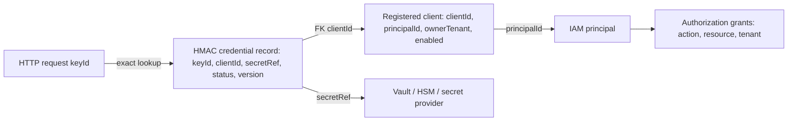
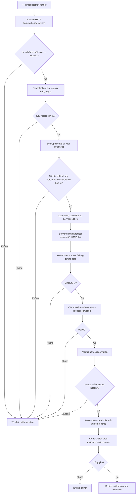

# Mapping key với client trong xác thực HTTP request bằng HMAC

## 1. Từ `keyId` đến đúng client: bước nối dữ liệu chưa tin cậy với danh tính đáng tin cậy

Trong module `SECURITY_AUTHENTICATION_HMAC_REQUEST_AUTHENTICATION`, một HTTP client tạo chữ ký HMAC bằng **shared secret** trên **canonical request**. Canonical request có thể chứa method, raw URI/query, signed headers, timestamp, nonce và digest của raw body. Server tự tạo lại chính các byte đó, tính HMAC, so chữ ký, chống replay và sau cùng kiểm tra **authorization**.

Bước tưởng đơn giản nhưng cực kỳ quan trọng là **mapping key với client**: khi request mang một `keyId`, server phải xác định **credential nào** được dùng để xác minh và credential ấy thuộc **client nào**. Client ở đây là **ứng dụng/service/đối tác đã đăng ký** trong hệ thống xác thực, **không mặc định là người dùng cuối**, địa chỉ IP, tenant trong URL hay chính đối tượng HTTP client của Java.

Ví dụ:

```http
POST /v1/tenants/t-42/payments?mode=instant HTTP/1.1
Host: api.example.test
Content-Type: application/json
X-HMAC-Key-Id: kid_P7q2Kc9v6R4
X-HMAC-Timestamp: 1767268800
X-HMAC-Nonce: 7d46b2dd65d618a32ba74de99da88d80
X-HMAC-Signature: <base64-cua-hmac-sha256-du-32-byte>

{"amountMinor":125000,"currency":"VND"}
```

`X-HMAC-Key-Id` là dữ liệu **do người gửi tự khai**. Attacker có thể chép một key ID công khai từ tài liệu, log hoặc request khác. **Chỉ nhìn key ID không chứng minh client là ai.** Server cần tra một record **được quản lý phía server**, dùng đúng secret tương ứng để kiểm tra MAC. Sau khi MAC đúng, freshness/nonce pass và key/client còn được phép xác thực, server mới được tạo authenticated identity.

Sơ đồ tin cậy:

```text
Untrusted HTTP:
    X-HMAC-Key-Id: kid_P7q2Kc9v6R4
                  |
                  v
Trusted server key registry:
    keyId = kid_P7q2Kc9v6R4
    clientId = cli_checkout_42
    secretRef = vault://payments/prod/hmac/kid_P7q2Kc9v6R4
    algorithm = HmacSHA256
    canonicalVersion = CLIENT-MAP-V1
    audience = payments-api/prod
    status = ACTIVE
                  |
                  v
Trusted client directory:
    clientId = cli_checkout_42
    securityPrincipal = service:merchant-42-checkout
    administrativeOwner = t-42
    status = ENABLED
                  |
                  v
Load secret via trusted secretRef, recompute canonical HMAC
                  |
                  v
MAC valid + timestamp + nonce + key/client current? 
                  |
          YES ----+---- NO: reject
           |
           v
Authenticated client = cli_checkout_42
Authorization = can this principal perform this action
                on the ACTUAL requested resource?
```

**Mục tiêu của bài “Mapping key với client”**, thuộc chương **“Key identifier”**, là thiết kế ánh xạ đó sao cho **không nhầm danh tính, không chia sẻ credential giữa clients, không cấp quyền từ key ID và không làm sai key rotation**.

> **Quy tắc gốc:** Một **key ID được dùng để tìm đúng một bản ghi khóa có chủ sở hữu cố định**. Nó không phải bằng chứng authentication, không phải secret, không phải tenant grant và không phải đường dẫn vault do client được quyền quyết định.

### Kết quả học tập

Sau bài này, bạn có thể:

1. Phân biệt `keyId`, `clientId`, `principalId`, `ownerTenantId`, `secretRef`, secret bytes và key version.
2. Thiết kế quan hệ **một client – nhiều key versions; mỗi key – đúng một client** cùng bất biến không tái sử dụng key ID.
3. Xây dựng registry và client directory có unique constraints, foreign keys, audit và provisioning/rotation/revocation.
4. Giải thích tại sao không bao giờ dùng key ID hoặc một `X-Client-Id` chưa xác minh làm authenticated principal.
5. Viết Java 17+ để resolve key→client, kiểm tra policy, xác minh MAC và tạo principal **chỉ sau HMAC/freshness/replay**.
6. Chọn replay nonce scope phù hợp khi một client có hai key đồng thời hoặc khi nhiều clients thuộc cùng tenant.
7. Phân tích các rủi ro cross-client, cross-tenant, cross-audience, stale cache, gateway và parser differential.
8. Kiểm thử race khi rotation, thay đổi principal mapping, revocation, quyền resource và truy xuất secret manager.

## 2. Các định danh và thuộc tính dễ bị trộn lẫn

Giả sử doanh nghiệp quản lý một đối tác thanh toán tên Merchant 42. Họ có ứng dụng checkout và ứng dụng reconciliation, cùng thuộc một tenant quản trị `t-42`.

```text
Administrative tenant       t-42

Client (app) A              cli_checkout_42
  Authenticated principal   service:merchant-42-checkout
  Key old                    kid_checkout_v6  (VERIFY_ONLY)
  Key new                    kid_checkout_v7  (ACTIVE)

Client (app) B              cli_reconcile_42
  Authenticated principal   service:merchant-42-reconcile
  Key                        kid_reconcile_v3 (ACTIVE)

API audience                payments-api/prod
Requested resource tenant   /v1/tenants/t-42/payments
Secret reference            vault://.../kid_checkout_v7
Secret material             [random bytes, never in URL/log]
```

| Khái niệm | Ví dụ | Ai quyết định? | Có thể suy ra điều gì? |
| --- | --- | --- | --- |
| **Key identifier** (`keyId`) | `kid_checkout_v7` | Registry cấp phát; request chỉ **khai báo selector** | Chọn một record để **thử xác minh**; chưa kết luận caller. |
| **Client identifier** (`clientId`) | `cli_checkout_42` | Client directory phía server | Định danh logical application đã đăng ký, không phải secret. |
| **Security principal** | `service:merchant-42-checkout` | IAM / client directory đáng tin | Danh tính dùng cho authz/audit **sau authentication**. |
| **Owner tenant** | `t-42` | Hệ thống đăng ký/kinh doanh | Chủ quản lý client; **không tự là permission** trên mọi tài nguyên. |
| **Secret reference** | `vault://.../kid_checkout_v7` | Key registry nội bộ | Địa chỉ đọc đúng secret; không lấy từ HTTP header. |
| **Shared secret bytes** | 32 bytes ngẫu nhiên | Quy trình provisioning/secret manager | Khả năng tính HMAC, phải giữ bí mật. |
| **Audience** | `payments-api/prod` | Key metadata và service policy | Giới hạn service/môi trường mà key được chấp nhận. |
| **Key version / status** | `v7 / ACTIVE` | Registry | Phân biệt rotation và key còn được verify hay không. |

Một **client** có thể có nhiều credential vì cần đổi khóa. Một **tenant** có thể có nhiều clients. Nhiều clients có thể được IAM cấp cùng một tập quyền, nhưng chúng vẫn nên có **key riêng** để thu hồi, audit và rate-limit độc lập.

**Không dùng trực tiếp tenant trong URL để xác định client.** Request `/v1/tenants/t-99/payments` có thể do client của `t-42` cố ý gửi; key ID vẫn ánh xạ đến `cli_checkout_42`. Chỉ có authorization mới quyết định principal đó có quyền trên tenant `t-99` hay không.

### 2.1 “Một key – một client” là chính sách ownership

Trong mô hình của bài:

```text
Client 1 --- N KeyRecord

KeyRecord.clientId là immutable.
KeyRecord.keyId là unique và KHÔNG tái sử dụng.
KeyRecord.secretRef trỏ đúng key material của record đó.
```

Điều này không nói rằng một client chỉ có một key; ngược lại, ít nhất hai key có thể cùng tồn tại khi rotate.

**Không gán lại key ID cũ cho client mới**, kể cả khi client cũ đã bị xóa. Nếu một key ID `K` ngày hôm qua thuộc client A, hôm nay chuyển sang client B, các node đang cache mapping cũ có thể xác thực danh tính không nhất quán; audit lịch sử cũng bị sai. Muốn đổi chủ sở hữu, **cấp key ID mới + secret mới**, rồi revoke key cũ.

### 2.2 Vì sao không dùng một shared secret cho nhiều clients?

Nếu client A và client B cùng biết một secret `S`, và server coi `keyId_A`/`keyId_B` là hai người dùng khác nhau nhưng cùng HMAC key material:

- A có thể tạo MAC dưới `keyId_B` nếu canonical contract có ký key ID nhưng **cả hai cùng biết S**.
- Server có thể xác minh chữ ký đúng dưới record của B, rồi gán request cho B dù người tạo là A.
- Không thể quy trách nhiệm mật mã theo client; rotate/revoke từng client kém hiệu quả.

**Bảo mật cần gắn khả năng tạo MAC với ownership của đúng client.** Hãy cấp **secret độc lập cho mỗi key**, tránh share raw material giữa các clients. Trong trường hợp cố tình có một key dùng chung nhiều ứng dụng, security principal nên phản ánh **nhóm sở hữu chung**, không giả vờ có thể phân biệt bằng mật mã một người dùng key đó.

## 3. Mapping key với client là quan hệ dữ liệu, không phải phép tách chuỗi

Một triển khai đơn giản nhưng sai:

```java
// Không coi đây là cách tìm client đã xác thực.
String claimedKeyId = request.header("X-HMAC-Key-Id");
String clientId = claimedKeyId.split(":")[0];
AuthenticatedPrincipal principal =
        new AuthenticatedPrincipal(clientId); // SAI: chưa verify MAC!
```

Sai vì `keyId` do client tự khai; còn `split(":")` chỉ là quy tắc chuỗi không có bằng chứng integrity. Nếu keyId được đặt như `merchant-42:k7`, tiền tố `merchant-42` **chỉ là gợi ý tên**, không phải nguồn quyền.

**Đúng hơn:**

```text
Request carries keyId
   |
   v
Exact lookup key record by keyId (trusted database)
   |
   +--> keyRecord.clientId  ---> exact lookup client directory
   +--> keyRecord.secretRef ---> secret store by trusted reference
   +--> metadata algorithm/version/audience/status
   |
   v
Recompute HMAC using exactly this key
   |
   v
If MAC/time/replay/metadata status all pass:
   construct authenticated client from trusted client record
```

### 3.1 Tên key ID nên được thiết kế thế nào?

Các lựa chọn thực tế:

| Đặc điểm | Khuyến nghị | Lý do |
| --- | --- | --- |
| **Unique** | ID duy nhất trong namespace của registry, enforced DB unique | Không để hai records nhận một selector. |
| **Opaque** | Ví dụ `kid_f92Qp7dGx6sA`, không cần encode tenant/client | Tránh ràng buộc danh tính vào cấu trúc string, dễ thay đổi mapping/schema. |
| **Độ dài hữu hạn** | Ví dụ 1–96 ký tự ASCII allowlist | Hạn chế memory/lookup/metric abuse. |
| **Case semantics rõ** | Exact case-sensitive comparison nếu contract chọn | Không dùng `toLowerCase()` khi lookup nhưng ký giữ nguyên string. |
| **Không tái sử dụng** | Tombstone/unique historical record | Ngăn stale cache/identity confusion và sai audit. |
| **Không bí mật** | Có thể xuất hiện trên wire; bảo vệ metadata nhạy cảm riêng | Không đánh đồng key ID và shared secret. |
| **Không thành đường dẫn** | Key ID dùng SQL indexed lookup; secretRef từ record | Tránh traversal/confused deputy. |
| **Không làm quyền** | Không suy scope, role, tenant từ prefix ID | Authorization theo IAM/policy hiện tại. |

Một key ID có thể mang một version hint như `merchant-42:k7` cho vận hành, nhưng **version hint không có quyền override** key metadata. Nếu có nhiều registry/region, cần thống nhất namespace/issuer và uniqueness — không cho hai issuer tạo cùng ID rồi phục vụ qua gateway chung.

### 3.2 Nếu client gửi thêm `X-Client-Id` thì sao?

Có ba chiến lược:

1. **Không có `X-Client-Id` trên wire:** cách đơn giản trong bài. Server lấy client ID hoàn toàn từ trusted key record.
2. **Có client ID để route hoặc telemetry:** coi nó là **untrusted hint**; nếu ảnh hưởng đến request semantics, ký hoặc ràng buộc trong canonical, rồi **so bằng exact equality với keyRecord.clientId**. Không cho hint chọn record khác.
3. **Có client ID trong `Authorization` scheme:** vẫn chỉ dùng như claim cần xác minh, không thành principal trước khi MAC đúng và server mapping khớp.

Ngay cả khi client ID được HMAC ký, client biết secret vẫn có thể ký một claim sai. HMAC chứng minh người gửi **biết secret của key**, không chứng minh mọi claim được họ ký là đúng. **Trusted registry phải quyết định quan hệ key→client.**

## 4. Mô hình dữ liệu: key registry, client directory và permission store

Tách **credential registry** khỏi **client directory** và **authorization grants** giúp tránh việc đổi key vô tình đổi quyền.



### 4.1 SQL schema minh họa

Ví dụ PostgreSQL-ish SQL nhằm diễn giải quan hệ và constraint; không phải migration production cho mọi RDBMS:

```sql
CREATE TABLE api_clients (
    client_id          VARCHAR(96) PRIMARY KEY,
    principal_id       VARCHAR(128) NOT NULL,
    owner_tenant_id    VARCHAR(96) NOT NULL,
    client_status      VARCHAR(16) NOT NULL
                       CHECK (client_status IN ('ENABLED','DISABLED')),
    client_revision    BIGINT NOT NULL,
    created_at         TIMESTAMPTZ NOT NULL
);

CREATE TABLE api_hmac_keys (
    key_id             VARCHAR(96) PRIMARY KEY,
    client_id          VARCHAR(96) NOT NULL
                       REFERENCES api_clients(client_id),
    key_version        INTEGER NOT NULL,
    secret_ref         VARCHAR(256) NOT NULL,
    algorithm          VARCHAR(32) NOT NULL
                       CHECK (algorithm IN ('HmacSHA256')),
    canonical_version  VARCHAR(32) NOT NULL,
    audience           VARCHAR(128) NOT NULL,
    key_status         VARCHAR(24) NOT NULL
                       CHECK (key_status IN
                             ('ACTIVE','VERIFY_ONLY','REVOKED')),
    verify_not_before  TIMESTAMPTZ NOT NULL,
    verify_until       TIMESTAMPTZ NOT NULL,
    key_revision       BIGINT NOT NULL,
    issued_at          TIMESTAMPTZ NOT NULL,
    revoked_at         TIMESTAMPTZ,
    UNIQUE (client_id, key_version),
    UNIQUE (secret_ref),
    CHECK (verify_not_before < verify_until)
);

CREATE INDEX idx_api_hmac_keys_client
    ON api_hmac_keys (client_id);
```

**Ràng buộc bất biến phải được giữ ở tầng service/database:**

- Không `UPDATE api_hmac_keys SET client_id=...` để chuyển chủ key đang tồn tại. Nếu cần, sử dụng immutability trigger, restricted write permissions hoặc logic append-only.
- Không tái sử dụng `key_id`/`secret_ref` đã từng cấp; một `DELETE` cứng có thể vô tình cho phép reuse. Giữ tombstone/audit theo retention policy.
- Khi client bị `DISABLED`, **tất cả keys** của client phải không được dùng để xác thực mới, bất kể key row còn `ACTIVE`.
- `UNIQUE(secret_ref)` chặn reuse **cùng reference**, nhưng **không đủ** phát hiện hai vault records khác nhau chứa **cùng secret bytes**. Provisioning phải sinh material độc lập và giới hạn duplication.
- `client_revision`/`key_revision` hỗ trợ theo dõi cache stale và việc revoke/disable giữa request.
- Permissions như “create payment on tenant t-42” **không** lưu thành quyền vô điều kiện của key ID. Có thể gắn **max scopes** cho credential để thu hẹp đặc quyền, nhưng quyền thực thi cuối vẫn phải được kiểm tra bằng principal/resource policy hiện tại.

### 4.2 Tại sao ánh xạ 1:N thay vì 1:1?

Nếu ép một client chỉ có đúng một key, rotation có thể yêu cầu ngừng hoạt động mọi client cùng lúc. Mô hình 1:N cho phép:

```text
cli_checkout_42
   |
   +-- kid_checkout_v6  VERIFY_ONLY until 2026-12-15T00:00:00Z
   +-- kid_checkout_v7  ACTIVE
   +-- kid_checkout_v8  prepared, not verifiable yet
```

Verifier tra đúng **key ID gửi trong request** và áp dụng policy của key đó. Không thử tuần tự tất cả secrets của client để tìm cái nào cho MAC đúng; làm vậy dễ bỏ qua trạng thái revoked, tạo timing khác nhau và gắn sai principal khi dữ liệu lệch.

### 4.3 Gắn client với tenant theo cách nào?

Một client có thể thuộc tenant quản trị `t-42` nhưng được phép truy cập một số tenant khác theo mô hình delegation, hoặc bị giới hạn chỉ đọc tài nguyên trong `t-42`. Do đó:

```text
keyId → registered client → principal
principal + action + actualResource → permission decision
```

Không nên đồng nhất:

```text
ownerTenantId == requestedTenantId  => always authorized
```

vì hệ thống còn có scopes, role, resource ownership, merchant status, spending limits, delegation expiry hoặc tenant suspension. Một hệ thống đơn giản có thể dùng equality làm **một điều kiện policy**, nhưng phải là quyết định của authorization service **sau authentication**, không phải side effect của việc lookup key.

## 5. Provisioning và đăng ký key: bảo mật bắt đầu trước request đầu tiên

Khi một đối tác yêu cầu cấp key, service quản trị phải có quy trình **xác minh quyền sở hữu client**. Không nhận tự do `clientId` từ một HTTP request không xác thực rồi tự cấp secret cho ID đó.

### 5.1 Quy trình cấp key an toàn

1. **Đăng ký client:** tạo `clientId` duy nhất, principal và owner tenant từ quy trình onboarding/IAM được phê duyệt; gắn trạng thái ENABLED khi đủ điều kiện.
2. **Ủy quyền quản trị:** chỉ admin/client owner đã được xác thực và có quyền `create-credential` mới được yêu cầu cấp key.
3. **Sinh key ID và secret:** dùng ID unique; sinh shared secret bằng CSPRNG, ví dụ **ít nhất 32 bytes ngẫu nhiên** với HMAC-SHA256 theo policy sản phẩm.
4. **Đưa secret vào secret provider:** vault/secret manager, encrypted secret hoặc HSM/MAC service phù hợp; record chỉ giữ trusted `secretRef`.
5. **Ghi credential record atomically:** clientId, audience, algorithm, canonical version, status, verify bounds, revision và secretRef đều nhất quán.
6. **Bàn giao secret an toàn:** client nhận qua kênh đã xác thực, bảo vệ secret bằng client-side secret manager; không ghi ra query, ticket công khai, email plaintext hoặc request log.
7. **Kiểm thử handshake:** client ký một test request, server exact-lookup đúng key và xác minh canonical bytes; không coi một `200` tự động là bằng chứng client có quyền business.
8. **Audit:** lưu sự kiện ai tạo key, cấp cho client nào, audience/expiry, revision, khi nào thu hồi; **không log secret bytes**.

### 5.2 Không trộn key generation với client-selected ownership

Sai:

```text
POST /admin/keys
{ "clientId": "merchant-victim", "algorithm": "HmacSHA1" }

Service không xác thực caller
  -> sinh secret và trả về
  -> attacker nhận credential của nạn nhân
```

Đúng:

```text
Authenticated admin/owner
  -> authorize createKey(clientId)
  -> server determines allowed audience, canonical version, algorithm
  -> server generates random secret + new immutable keyId
  -> trusted registry owns mapping
  -> secure delivery + audit
```

**Key ID là public selector nhưng quy trình tạo và gán ownership là hành động đặc quyền.** Nếu kiểm soát provisioning sai, verifier có HMAC chuẩn và so tag constant-time cũng không ngăn attacker sở hữu một key được gán nhầm vào victim.

### 5.3 Tách “rotate key” khỏi “transfer client”

- **Rotate:** cùng client/principal sở hữu **key version mới với secret mới**. Key cũ chuyển VERIFY_ONLY rồi EXPIRED/REVOKED.
- **Transfer ownership:** chuyển quyền sở hữu client/application giữa các tenant hay tổ chức. Phải có quy trình quản trị riêng; **không di chuyển key đang biết bởi owner cũ sang client mới**. Tùy threat model cần revoke và cấp material mới.
- **Rename:** đổi display name của client không nên đổi `clientId` hoặc mapping lịch sử; nếu đổi principal, phải đánh giá toàn bộ IAM/cache/audit.
- **Disable client:** mọi key liên quan bị từ chối ngay cả khi trạng thái key đang ACTIVE.

## 6. Hợp đồng ký CLIENT-MAP-V1: ràng buộc key ID vào đúng request

Bài dùng hợp đồng giảng dạy `HMAC-REQUEST/CLIENT-MAP-V1`. Đây **không phải** một chuẩn HMAC request phổ quát; client SDK và verifier phải chốt cùng quy tắc byte-level.

### 6.1 Ví dụ request

```http
POST /v1/tenants/t-42/payments?mode=instant HTTP/1.1
Host: api.example.test
Content-Type: application/json
X-HMAC-Key-Id: kid_checkout_v7
X-HMAC-Timestamp: 1767268800
X-HMAC-Nonce: 7d46b2dd65d618a32ba74de99da88d80
X-HMAC-Signature: <base64-cua-32-byte-hmac-sha256>

{"amountMinor":125000,"currency":"VND"}
```

Timestamp `1767268800` là fixture cho `2026-01-01T12:00:00Z`; không dùng nguyên để gửi production ở thời điểm khác. `signature` là placeholder và body được hiểu là **đúng byte UTF-8 của JSON, không thêm LF cuối**.

### 6.2 Contract cụ thể

| Thành phần | Quy tắc CLIENT-MAP-V1 |
| --- | --- |
| Wire key ID | Đúng một `X-HMAC-Key-Id`, ASCII `[A-Za-z0-9._:-]{1,96}`; **selector**, chưa phải client identity. |
| Secret | Server lấy **đúng một secretRef** qua trusted key registry, không từ header/path. |
| Algorithm | `HmacSHA256`, raw full tag 32 bytes; server ghim theo metadata. |
| Canonical version | `CLIENT-MAP-V1`, server phải đối chiếu record key. |
| Method | HTTP `POST` thực nhận, không method override. |
| Raw target | Origin-form raw path + raw query như gửi; reject ambiguous routing; không tự sort query/percent-decode. |
| Audience | `payments-api/prod` từ service config + key metadata, không tự tin `Host`/`X-Forwarded-Host`. |
| Content-Type | Một header, value chính xác `application/json` trong ví dụ. |
| Timestamp | Unix epoch **seconds**, chuỗi thập phân ASCII canonical, được ký. |
| Nonce | 16 bytes CSPRNG, encode 32 hex lowercase, được ký. |
| Body | SHA-256 của raw application bytes sau HTTP framing; ví dụ cấm `Content-Encoding`. |
| Size | Decimal size của byte[] body thực tế, không tin `Content-Length` unverified. |
| Canonical serialization | **11 dòng** UTF-8 nối bằng LF `0x0A`, không có LF cuối. |
| Signature | Base64 chuẩn có padding của HMAC 32 bytes, text 44 ký tự; reject duplicate/format lạ/truncation. |
| Replay | Timestamp window và atomic nonce store theo replay domain server-defined. |
| Authorization | Principal/client từ registry **sau verify**; route/action/resource kiểm tra riêng. |

### 6.3 Chính xác 11 dòng canonical

```text
HMAC-REQUEST/CLIENT-MAP-V1
HMAC-SHA256
POST
/v1/tenants/t-42/payments?mode=instant
audience:payments-api/prod
content-type:application/json
x-hmac-key-id:kid_checkout_v7
x-hmac-timestamp:1767268800
x-hmac-nonce:7d46b2dd65d618a32ba74de99da88d80
body-size:<actual-raw-body-byte-count>
body-sha256:<lowercase-hex-SHA256-of-raw-body>
```

Hai giá trị `<...>` là placeholders; trước khi ký phải thay bằng length và SHA-256 thật của **cùng body byte[] thực gửi**. Client tính:

```text
rawBody  = stable byte snapshot
bodyHash = lowercase_hex(SHA256(rawBody))
canonical = UTF8(joinLF(exact_11_lines_without_final_LF))
tagBytes  = HMAC_SHA256(secretOf(kid_checkout_v7), canonical)
signature = BASE64_STANDARD_PADDED(tagBytes)
```

Server tự dựng canonical từ **request thực nhận tại trust boundary**. HMAC ký `x-hmac-key-id` để không thể tráo selector rồi giữ nguyên tag. Nhưng điều đó **không đủ** để cho phép signer dùng key A tự khai mình là client B: trusted mapping key→client mới là nguồn xác định danh tính.

### 6.4 Có nên ký `X-Client-Id`?

Mẫu **không cần** `X-Client-Id`. Server tự tìm client qua `keyId`. Nếu protocol khác bắt buộc header client ID vì routing, phải:

1. Chốt format/occurrence và ký value `X-Client-Id` trong canonical hoặc ràng buộc tương đương.
2. Sau exact key lookup, so **client ID đã khai** với `keyRecord.clientId` từ registry đáng tin.
3. Nếu khác, **reject** kể cả HMAC đúng.
4. **Không** cho header tự cấp role, tenant hoặc scopes.

Không có bước nào cho client ID trên header thay thế trusted mapping.

## 7. Lookup đúng một record, không “đoán client” hoặc thử nhiều khóa

### 7.1 Luồng từ selector đến candidate



**Phân biệt Candidate và AuthenticatedClient:**

- `Candidate`: record của key ID **được tìm thấy**, đủ để thử xác minh; attacker có thể cố tình gửi key ID đó.
- `AuthenticatedClient`: chỉ được tạo **sau** MAC đúng, timestamp hợp lệ, nonce mới và key/client current theo policy.

Một lỗi phổ biến là đặt `SecurityContext.setPrincipal(keyRecord.clientId)` ngay sau lookup rồi controller dùng context đó **trước khi MAC pass**. Phải hoãn gắn principal hoặc dùng type/lifecycle nội bộ bảo đảm code nghiệp vụ không nhìn thấy identity chưa xác thực.

### 7.2 Tại sao không thử tất cả keys của một client?

Sai:

```java
// KHÔNG dùng.
for (KeyRecord key : registry.findAllByClaimedClientId(clientId)) {
    if (verifyMac(key.secret(), request)) {
        return authenticated(clientId);
    }
}
```

Nó khiến client tự chọn danh tính để lấy nhóm keys, tăng timing/DoS, có thể thử key VERIFY_ONLY/REVOKED ngoài policy và làm khó attribution. **Đúng** là chỉ dùng key ID làm exact selector cho một record duy nhất, đối chiếu status/audience/version, rồi verify bằng secret đó.

### 7.3 Sự khác nhau giữa “not found” và “backend unavailable”

| Điều kiện | Quyết định bảo mật | Logging/response |
| --- | --- | --- |
| `keyId` không có trong registry đang khỏe | Authentication reject | Response generic, không tiết lộ tenant/client. |
| Key ID tồn tại nhưng key đã REVOKED/EXPIRED | Reject | Response generic, nội bộ biết key status. |
| Client đã DISABLED | Reject **mọi key** của client | Audit việc disable, không in secret. |
| Key thuộc audience khác | Reject | Không cho cross-environment/service replay. |
| Registry timeout / replica không thể đọc revision | **Fail-closed** | Có thể 503 theo policy, không nói “không có key”. |
| Secret provider timeout / decrypt denied | **Fail-closed** | Không dùng default secret hoặc key khác. |
| Mapping mâu thuẫn: clientId không còn tồn tại | Reject + integrity alert | Không tự tạo client implicit. |
| Key record ánh xạ nhầm principal | Integrity incident | Không dùng input HTTP để “sửa” mapping. |

Đừng chuyển network outage thành `Optional.empty()` rồi cho phép fallback. Phân biệt nguyên nhân trong telemetry nội bộ, nhưng response không nên làm lộ sự tồn tại một key ID qua thông tin chi tiết hoặc timing quá dễ quan sát. Rate-limit tra cứu random key IDs; giữ negative cache bounded.

## 8. Java 17+: model client, key record và Resolver

Đây là **ví dụ Java 17 thuần** để minh họa mapping. `KeyRegistry` và `ClientDirectory` là interface cho adapter database/cache thật; không có vault credential thật hoặc kết nối database trong bài.

### 8.1 Các record và trạng thái

```java
import java.time.Instant;
import java.util.Objects;
import java.util.Optional;
import java.util.regex.Pattern;

public final class KeyToClientResolverV1 {
    private static final Pattern KEY_ID =
            Pattern.compile("[A-Za-z0-9._:-]{1,96}");

    public enum KeyStatus {
        ACTIVE, VERIFY_ONLY, REVOKED
    }

    public enum ClientStatus {
        ENABLED, DISABLED
    }

    public record KeyRecord(
            String keyId,
            String clientId,
            String secretRef,  // trusted internal value
            String audience,
            String algorithm,
            String canonicalVersion,
            String revision,
            KeyStatus status,
            Instant verifyNotBefore,
            Instant verifyUntil) {

        public boolean mayVerifyAt(Instant now) {
            return (status == KeyStatus.ACTIVE
                    || status == KeyStatus.VERIFY_ONLY)
                    && !now.isBefore(verifyNotBefore)
                    && now.isBefore(verifyUntil);
        }
    }

    public record RegisteredClient(
            String clientId,
            String principalId,
            String ownerTenantId,
            String revision,
            ClientStatus status) {}

    // CANDIDATE không phải authenticated identity.
    public record Candidate(
            KeyRecord key,
            RegisteredClient client) {}

    public interface KeyRegistry {
        // Exact lookup, không tự normalize/cắt keyId.
        Optional<KeyRecord> findExact(String keyId);

        // Revalidate status/revision/ownership ở thời điểm commit auth.
        // Lỗi backend: throw, KHÔNG trả true hay Optional.empty().
        boolean isCurrentAndVerifiable(KeyRecord record, Instant now);
    }

    public interface ClientDirectory {
        Optional<RegisteredClient> findExact(String clientId);

        // Recheck status/owner/principal mapping nếu record/cache thay.
        boolean isCurrentAndEnabled(RegisteredClient record);
    }

    private final KeyRegistry keys;
    private final ClientDirectory clients;

    public KeyToClientResolverV1(
            KeyRegistry keys, ClientDirectory clients) {
        this.keys = Objects.requireNonNull(keys);
        this.clients = Objects.requireNonNull(clients);
    }

    /**
     * Chỉ resolve candidate. KHÔNG được cấp quyền/Principal ở đây.
     */
    public Optional<Candidate> resolveCandidate(
            String untrustedKeyId,
            String requiredAudience,
            Instant now) {

        if (untrustedKeyId == null
                || !KEY_ID.matcher(untrustedKeyId).matches()) {
            return Optional.empty();
        }

        Optional<KeyRecord> lookup = keys.findExact(untrustedKeyId);
        if (lookup.isEmpty()) return Optional.empty();
        KeyRecord key = lookup.get();

        if (!untrustedKeyId.equals(key.keyId())
                || !"HmacSHA256".equals(key.algorithm())
                || !"CLIENT-MAP-V1".equals(key.canonicalVersion())
                || !Objects.equals(requiredAudience, key.audience())
                || !"payments-api/prod".equals(requiredAudience)
                || key.status() == null
                || key.verifyNotBefore() == null
                || key.verifyUntil() == null
                || !key.mayVerifyAt(now)
                || key.secretRef() == null
                || key.secretRef().isBlank()
                || key.revision() == null
                || key.revision().isBlank()
                || key.clientId() == null
                || key.clientId().isBlank()) {
            return Optional.empty();
        }

        Optional<RegisteredClient> clientFound =
                clients.findExact(key.clientId());
        if (clientFound.isEmpty()) return Optional.empty();

        RegisteredClient client = clientFound.get();
        if (!key.clientId().equals(client.clientId())
                || client.status() != ClientStatus.ENABLED
                || client.principalId() == null
                || client.principalId().isBlank()
                || client.ownerTenantId() == null
                || client.ownerTenantId().isBlank()
                || client.revision() == null
                || client.revision().isBlank()) {
            return Optional.empty();
        }

        return Optional.of(new Candidate(key, client));
    }

    public boolean stillAllowed(Candidate candidate, Instant now) {
        return keys.isCurrentAndVerifiable(candidate.key(), now)
                && clients.isCurrentAndEnabled(candidate.client());
    }
}
```

**Những bất biến cần chú ý:**

1. `untrustedKeyId` chỉ được validate format và dùng **exact lookup**; không lấy một phần của string làm client.
2. `KeyRecord.clientId` đến từ registry phía server, dùng để tìm `RegisteredClient`; không đọc `X-Client-Id`.
3. `candidate` còn là **danh tính chưa được chứng minh** cho request hiện tại. Chỉ bước HMAC pass mới chứng minh bên gửi biết secret tương ứng.
4. `secretRef` là metadata **server-controlled**, không phải phép nối `"vault/" + keyId` từ request.
5. `ACTIVE`/`VERIFY_ONLY` có thể verify trong khoảng thời gian chính sách; `REVOKED` không, dù client còn giữ secret.
6. Client bị `DISABLED` → key cũng không thể được dùng. Key còn ACTIVE không override client status.
7. Cả client và key có `revision` vì có thể thay đổi độc lập. Trước khi accept cần recheck nếu cache có thể stale.
8. Interface trả `Optional.empty()` cho absence/policy rejection, nhưng outage **phải là exception được xử lý fail-closed**. Trong hệ thống thật có thể dùng result types nội bộ để phân loại rõ ràng hơn.
9. `requiredAudience` được truyền **từ endpoint/service config**, không lấy từ header client để tự chọn môi trường.

### 8.2 Vì sao `clientId` không nên đưa thẳng vào `Authentication` khi lookup xong?

Ngay sau `resolveCandidate`, attacker có thể gửi một key ID thật nhưng signature giả. Nếu authentication filter gắn principal từ `candidate.client()` quá sớm, một downstream filter hoặc async handler có thể thấy request như đã authenticated.

**Phải có ranh giới API:**

```text
Untrusted Request
    |
    +--> Candidate (private to verifier)
               |
               +--> HMAC PASS?
               +--> Freshness PASS?
               +--> Nonce reserved?
               +--> Key/client current?
                         |
                         v
                 AuthenticatedClient principal
                         |
                         v
                 Authorization
```

Một cách kỹ thuật là chỉ cho verifier tạo `AuthenticatedClient` qua factory/package-private constructor sau các kiểm tra, rồi bảo đảm security context chỉ được đặt tại nhánh thành công. Type safety giúp review, nhưng **không thay kiểm soát trust boundary** giữa code chưa xác thực và nghiệp vụ.

## 9. Java 17+: canonical request và HMAC verifier cho mapping

### 9.1 Dựng canonical từ request thực nhận

`CLIENT-MAP-V1` có 11 dòng. Lớp mẫu chỉ hỗ trợ một endpoint để giữ logic HTTP raw target tường minh; production phải có parser/route policies chặt và tests HTTP/2/proxy.

```java
import java.nio.charset.StandardCharsets;
import java.security.GeneralSecurityException;
import java.security.MessageDigest;
import java.util.HexFormat;
import java.util.Objects;

public final class ClientMappingCanonicalV1 {
    private ClientMappingCanonicalV1() {}

    public static byte[] build(
            String method,
            String rawTarget,
            String contentType,
            String keyId,
            String timestampSeconds,
            String nonce,
            byte[] bodyBytes) {

        Objects.requireNonNull(bodyBytes);
        if (!"POST".equals(method)
                || !"/v1/tenants/t-42/payments?mode=instant"
                        .equals(rawTarget)
                || !"application/json".equals(contentType)
                || keyId == null
                || !keyId.matches("[A-Za-z0-9._:-]{1,96}")
                || timestampSeconds == null
                || !timestampSeconds.matches("(0|[1-9][0-9]{0,11})")
                || nonce == null
                || !nonce.matches("[0-9a-f]{32}")) {
            throw new IllegalArgumentException(
                    "Invalid CLIENT-MAP-V1 canonical inputs");
        }

        String digest;
        try {
            digest = HexFormat.of().formatHex(
                    MessageDigest.getInstance("SHA-256")
                            .digest(bodyBytes));
        } catch (GeneralSecurityException e) {
            throw new IllegalStateException("SHA-256 unavailable", e);
        }

        String text = String.join("\n",
                "HMAC-REQUEST/CLIENT-MAP-V1",
                "HMAC-SHA256",
                method,
                rawTarget,
                "audience:payments-api/prod",
                "content-type:" + contentType,
                "x-hmac-key-id:" + keyId,
                "x-hmac-timestamp:" + timestampSeconds,
                "x-hmac-nonce:" + nonce,
                "body-size:" + bodyBytes.length,
                "body-sha256:" + digest);

        return text.getBytes(StandardCharsets.UTF_8);
    }
}
```

Ở ví dụ trên, route raw target bị **ghim đúng một giá trị** để code không giả vờ giải quyết toàn bộ percent-encoding, duplicate query, dot segments và routing. Một hệ thống nhiều routes phải:

- Lấy raw origin-form target **tại trust boundary**; với HTTP/2 kiểm soát `:path` và chuyển đổi gateway;
- Reject encoded slash/dot segments/malformed percent encoding hoặc canonicalize theo **một contract khác có version**;
- Bảo đảm resource được authorize là **resource thực backend xử lý**, không bị router decode khác với verifier;
- Không dùng `URI.getPath()` (decoded) để tạo signed raw target khi client đã ký raw representation;
- Không parse/serialize lại JSON trước SHA-256 nếu hợp đồng ký raw bytes.

### 9.2 So MAC bằng full tag timing-safe

```java
import java.security.GeneralSecurityException;
import java.security.MessageDigest;
import java.util.Arrays;
import java.util.Base64;
import javax.crypto.Mac;
import javax.crypto.SecretKey;

public final class ClientMappingMacV1 {
    private ClientMappingMacV1() {}

    public static boolean matches(
            SecretKey trustedKey,
            byte[] serverCanonical,
            String signatureText) {

        if (trustedKey == null || serverCanonical == null
                || signatureText == null
                || !signatureText.matches("[A-Za-z0-9+/]{43}=")) {
            return false;
        }

        final byte[] supplied;
        try {
            supplied = Base64.getDecoder().decode(signatureText);
        } catch (IllegalArgumentException badEncoding) {
            return false;
        }

        if (supplied.length != 32
                || !Base64.getEncoder().encodeToString(supplied)
                        .equals(signatureText)) {
            Arrays.fill(supplied, (byte) 0);
            return false;
        }

        byte[] expected;
        try {
            Mac mac = Mac.getInstance("HmacSHA256");
            mac.init(trustedKey);
            expected = mac.doFinal(serverCanonical);
        } catch (GeneralSecurityException providerError) {
            Arrays.fill(supplied, (byte) 0);
            throw new IllegalStateException(
                    "HMAC provider or key unavailable", providerError);
        }

        try {
            return expected.length == 32
                    && MessageDigest.isEqual(expected, supplied);
        } finally {
            Arrays.fill(expected, (byte) 0);
            Arrays.fill(supplied, (byte) 0);
        }
    }
}
```

`String.equals` trong nhánh re-encode chỉ so **biểu diễn input công khai với chính input đó**, không so một chuỗi MAC kỳ vọng bí mật. `MessageDigest.isEqual(expected, supplied)` kiểm tra **raw 32-byte full HMAC tag**. Không tự viết vòng lặp trả false ở byte đầu sai; không chấp nhận chữ ký 16 byte truncated khi version yêu cầu 32.

JCA `SecretKey` ở đây đến từ `SecretProvider`, dùng **trusted secretRef** của key record. Nếu thực tế secret manager trả Base64 text, adapter phải decode thành **secret bytes** đúng một lần; không dùng UTF-8 của chuỗi Base64 làm key. Nếu HSM/KMS dùng **non-exportable MAC key**, adapter có thể cần API `VerifyMac` chuyên dụng thay vì JCA key object; không giả định mọi KMS hỗ trợ cùng primitive.

## 10. Tích hợp: chỉ sau HMAC mới tạo authenticated client

Đây là **pseudocode server-side** đặt mapper vào đúng vị trí trong request pipeline. `http`, `ingress`, `secretProvider`, `nonceStore`, `authorization` là thành phần hệ thống, không phải API JDK.

```java
// 1. Validate HTTP trust boundary và signed fields.
ValidatedRequest req = ingress.parseStrict(http);
// Must reject duplicate X-HMAC-Key-Id, Signature, Timestamp,
// Nonce, Content-Type; reject method override/content transforms.

String untrustedKeyId = req.uniqueHeader("X-HMAC-Key-Id");
Instant startedAt = clock.instant(); // server-controlled clock

// 2. Chỉ tìm CANDIDATE theo keyId, chưa tạo principal.
Optional<KeyToClientResolverV1.Candidate> found =
        keyResolver.resolveCandidate(
                untrustedKeyId, "payments-api/prod", startedAt);
if (found.isEmpty()) {
    rejectGenericAuthentication();
    return;
}
KeyToClientResolverV1.Candidate candidate = found.get();

// 3. Load secret theo trusted secretRef của key record,
// không lấy secretRef/clientId từ HTTP.
SecretKey secret = secretProvider.loadTrusted(
        candidate.key().secretRef());

// 4. Server build canonical từ HTTP actual data.
byte[] canonical = ClientMappingCanonicalV1.build(
        req.method(),
        req.rawTarget(),
        req.uniqueHeader("Content-Type"),
        untrustedKeyId,
        req.uniqueHeader("X-HMAC-Timestamp"),
        req.uniqueHeader("X-HMAC-Nonce"),
        req.rawBodyBytes());

// 5. MAC phải đúng; keyId được ký trong canonical.
if (!ClientMappingMacV1.matches(
        secret, canonical, req.uniqueHeader("X-HMAC-Signature"))) {
    rejectGenericAuthentication();
    return;
}

// 6. Trước accept: clock health, timestamp freshness,
// recheck key/client current (status, revision, principal mapping).
Instant verifiedAt = clock.instant();
if (!clockHealth.isHealthy()
        || !timestampPolicy.accepts(
                req.uniqueHeader("X-HMAC-Timestamp"), verifiedAt)
        || !keyResolver.stillAllowed(candidate, verifiedAt)) {
    rejectAuthenticationOrUnavailable();
    return;
}

// 7. Anti-replay dùng identity từ trusted registry, KHÔNG raw keyId.
// Scope chính sách CLIENT-MAP-V1: clientId + audience + nonce.
NonceResult nonceResult = nonceStore.reserveAtomically(
        candidate.client().clientId(),
        candidate.key().audience(),
        req.uniqueHeader("X-HMAC-Nonce"),
        nonceTtlSeconds);

if (nonceResult != NonceResult.INSERTED) {
    rejectReplayOrStoreUnavailable(nonceResult);
    return;
}

// 8. Chỉ BÂY GIỜ mới tạo principal và gắn security context.
AuthenticatedClient authenticated = identityFactory.fromVerified(
        candidate.client().clientId(),
        candidate.client().principalId(),
        candidate.client().ownerTenantId(),
        candidate.key().keyId());

// 9. Authorization: action/tenant/resource phải là ACTUAL route.
if (!authorization.canCreatePayment(
        authenticated.principalId(),
        req.actualTenantId(),
        req.actualResource())) {
    rejectForbidden();
    return;
}

paymentsService.processAuthorizedRequest(authenticated, req);
```

### 10.1 Tại sao phải recheck cả key lẫn client?

Giả sử key `kid_checkout_v7` đang ACTIVE lúc request bắt đầu, nhưng client `cli_checkout_42` bị DISABLED vì nghi lộ secret khi backend còn đang đọc body 500 MB. Nếu chỉ kiểm tra trạng thái ở đầu request, verifier có thể **cho qua một identity đã bị khóa** sau vài phút.

Cần chính sách:

- Key record và client record có revisions, hoặc nhận một **consistent authorization snapshot** đủ tươi theo SLO;
- Recheck `REVOKED`/`DISABLED` trước khi chấp nhận, đặc biệt với long upload;
- Không dùng **timestamp client ký** để tìm lại trạng thái client/key trong quá khứ (“lúc ký vẫn active”) khi hiện đã revoke;
- Cache có TTL/invalidation và revocation propagation SLO; nếu policy freshness không đạt thì fail-closed;
- Nếu principalId/ownerTenantId bị đổi, không chấp nhận một candidate cũ đã trở thành mâu thuẫn.

**Thận trọng TOCTOU:** Không có cách “recheck một lần” tuyệt đối loại bỏ mọi race khi key/client bị revoke tức thời sau recheck. Phải xác định **điểm quyết định security** và consistency/SLO: admission cut-off, cách xử lý ongoing operations, audit và transaction boundaries.

### 10.2 Client bị DISABLED khác thiếu quyền trên resource

**Client disabled** thường là lỗi **authentication/credential eligibility**, không được tạo principal active. **Client enabled nhưng thiếu quyền** là lỗi authorization. Ví dụ:

```text
cli_checkout_42 is ENABLED, key ACTIVE, MAC PASS
  request tenant=t-99
  IAM grant: only t-42
  => AUTHENTICATION PASS; AUTHORIZATION DENIED.
```

Không chuyển điều kiện `ownerTenantId=t-42` thành “client đã được quyền t-42 và mọi resource con” chỉ vì HMAC đúng. Với thanh toán, nên có thêm spending limits, beneficiary policy và resource ownership.

## 11. Mapping và anti-replay khi có nhiều clients/keys

### 11.1 Chọn replay domain có chủ đích

Trong CLIENT-MAP-V1, mỗi key ánh xạ tới **một logical client**. Ta chọn:

```text
replay domain = (authenticatedClientId, audience, nonce)
```

Lợi ích:

- **Cùng client, hai keys khi rotation:** sử dụng lại nonce N với key mới vẫn bị chặn trong domain của client.
- **Hai clients khác nhau trong cùng tenant:** mỗi client có namespace nonce riêng, không chặn nhau chỉ vì tình cờ trùng nonce.
- **Cross-audience:** phân biệt vùng production/staging hoặc dịch vụ khác; audience vẫn phải bị ghim theo key metadata.

Có hệ thống định nghĩa `(principalId, audience, nonce)` để chặn cùng nonce xuyên nhiều clients chia sẻ một security principal. Cách đó cũng có thể hợp lý nếu policy yêu cầu. **Không có một scope mặc định đúng cho mọi giao thức**; cần chọn nhất quán và test xuyên key rotation/client alias. Đừng dùng `(keyId, nonce)` chỉ vì dễ lấy từ header nếu mục tiêu là chặn nonce reused giữa key versions cùng client.

### 11.2 Nonce TTL phụ thuộc freshness window, không phụ thuộc key cache TTL

Nếu cửa sổ timestamp server chấp nhận:

```text
serverNow - 300 <= signedTimestamp <= serverNow + 30
```

thì một timestamp T có thể hợp lệ trong **330 giây** kể từ biên sớm nhất, khi đồng hồ chuẩn. Với mỗi replica có sai số tối đa ±5 giây và safety margin 20 giây, biên bảo thủ minh họa:

```text
nonceTTL >= maxPastAge + maxFutureSkew
            + 2 * maxServerClockError + safetyMargin

         >= 300 + 30 + 2*5 + 20 = 360 seconds
```

Không phải công thức tuyệt đối khi storage mất dữ liệu sớm, clock step lớn hoặc failover/eventual consistency; lúc đó phải **fail-closed** và sửa hạ tầng. Một nonce đã được reserve không được xóa tự động sau 500/timeout nếu request có thể đã tạo side effect.

### 11.3 Ví dụ Redis atomic reservation

```redis
SET hmac:nonce:client-map-v1:<hash-of-client-audience-nonce> 1 NX EX 360
```

Đây là **cú pháp mô tả**, `<hash-of-...>` phải được thay bằng key được tạo nhất quán từ tuple **client ID, audience, nonce sau authentication**. Dùng length-prefix encoding hoặc SHA-256 trên tuple đã được định nghĩa để tránh delimiter collision và giới hạn độ dài key.

- Reply `OK`: nonce chưa có, vừa reserve.
- Reply key already exists: duplicate, reject replay.
- Timeout/unknown outcome: **fail-closed**, không coi nonce mới.
- Hai Redis độc lập ở hai regions có thể cùng reserve thành công; cần replay store có consistency/durability phù hợp, hoặc consistent routing an toàn.
- Khi service reboot/redis eviction làm mất nonce trước hết window, replay có thể lọt dù HMAC và key mapping đúng.

### 11.4 Nonce không phải business idempotency

Hai attempts có nonce N1 và N2 khác nhau, cùng key/client và cùng yêu cầu chuyển tiền:

```text
N1: HMAC pass, nonce fresh -> business process
N2: HMAC pass, nonce fresh -> business process again?
```

Anti-replay không cản N2 vì đó là một signed attempt mới. Nếu API có side effect, cần **idempotency key được ký hoặc ràng buộc an toàn**, durable idempotency state, fingerprint request và transaction/reconciliation phù hợp. Không dùng raw `X-Idempotency-Key` chưa được ký để quyết định trả cached result cho một client khác.

## 12. Cache mapping, consistency và cách xử lý key rotation

Mapping thường được cache để giảm database/vault latency. Tuy nhiên **cache key→client stale có thể tạo lỗi identity**, thậm chí nguy hiểm hơn mismatch HMAC đơn thuần.

### 12.1 Ba cache cần phân biệt

| Cache | Key → value | Rủi ro |
| --- | --- | --- |
| **Key metadata cache** | `keyId → clientId, secretRef, status, audience, version, revision` | Stale ACTIVE/old client binding sau revoke/disable/transfer. |
| **Client metadata cache** | `clientId → principalId, ownerTenant, status, revision` | Vẫn gắn principal cũ hoặc enabled khi client đã disabled. |
| **Secret cache** | `secretRef/revision → secret bytes/handle` | Lộ secret từ memory/dump; dùng material cũ sau rotation/revocation. |

**Không** dùng cache key `clientId` để thay exact keyId lookup, vì cùng client có nhiều key versions. Cache nên giữ immutable record identity và revision; không thay secret của keyId cũ bằng secret mới sau rotate.

### 12.2 Giao thức khi revoke/disable

```text
12:00:00  key K ACTIVE, client C ENABLED
12:00:01  Security admin REVOKE K / DISABLE C
12:00:02  Replica A nhận event invalidation
12:00:04  Replica B vẫn cache ACTIVE
12:00:05  Attacker có K ký request mới tới B
```

Nếu B chấp nhận vì cache còn ACTIVE, hệ thống vi phạm revocation propagation contract. Cần:

- Key/client revisions, invalidation, short-lived TTL hoặc authoritative recheck;
- Một **SLO thu hồi** rõ ràng; khi yêu cầu thu hồi gần tức thời, không dựa riêng vào TTL dài;
- Backend freshness errors phải làm **fail-closed**, không fallback sang default client/secret;
- Tests trên nhiều replicas và failover ngay sau revoke/disable;
- Tránh “tạm mở lại key cũ” để hỗ trợ client chưa kịp rotate.

### 12.3 Vòng đời key rotation minh họa

| Thời điểm | Key v6 | Key v7 | Client mapping |
| --- | --- | --- | --- |
| Trước rotation | ACTIVE | Chưa cấp | Cả hệ thống xác định `cli_checkout_42`. |
| Chuẩn bị | ACTIVE | Not-before future / staged | **Không** đổi owner/client. |
| Cutover | VERIFY_ONLY (deadline rõ) | ACTIVE | Cả hai keys trỏ cùng client/principal. |
| Hết grace | EXPIRED/REVOKED | ACTIVE | Không thử v6 khi request khai key v7. |
| Nghi compromise | REVOKED ngay | Có thể phát key v8 mới | Revoke/invalidate trên mọi replica; audit. |

**Key version không nên là dynamic alias “current secret for client”.** Nếu record `kid_checkout_v6` tự động trỏ tới secret v7 sau rotation, một request dùng key ID cũ có thể được hiểu theo policy khác, làm hỏng golden vectors/attribution. Mỗi key ID cần gắn immutable key material và owner; status/expiry được cập nhật theo lifecycle.

### 12.4 Không nên chuyển key ownership bằng update trực tiếp

Một client bị chuyển chủ sở hữu từ tenant `t-42` sang `t-52`. Nếu giữ nguyên secret mà owner cũ từng biết, việc đổi `clientId` hoặc principal mapping không làm người cũ quên secret. Vì vậy, thay đổi ownership cần xem như **sự kiện bảo mật**:

1. Quyết định quyền của chủ cũ/chủ mới qua IAM và phê duyệt.
2. Revoke các shared secrets mà chủ cũ đã có khả năng biết.
3. Cấp key ID và secret mới cho chủ mới.
4. Cập nhật client/principal/tenant mapping có audit và cache invalidation.
5. Kiểm tra quyền tài nguyên thực tế sau khi đổi; không hợp thức hóa các request cũ bằng current mapping mới.
6. Không tái sử dụng key ID cũ đã bị revoke.

## 13. Cross-client, cross-tenant và các dạng confused deputy

### 13.1 Cross-client key reuse

Nếu hai clients có keys khác ID nhưng **cùng secret bytes**, client A có thể ký với key ID của B nếu biết ID đó, làm server gắn request vào B. Bài test cần bảo đảm:

- Provisioning sinh secrets độc lập cho từng key.
- Key ID và metadata là exact, immutable.
- HMAC ký `x-hmac-key-id`.
- API không cấp raw secret của client khác qua management endpoint.
- Nếu phát hiện secret leak/duplicate, revoke và cấp lại thay vì thay tên key ID.

### 13.2 Cross-tenant resource request

```http
POST /v1/tenants/t-99/payments?mode=instant
X-HMAC-Key-Id: kid_checkout_v7
X-HMAC-Signature: <HMAC-dung-do-client-t42-tu-ky>
```

Client thuộc `t-42` có thể **tự ký** request có target `t-99` vì biết secret. **MAC đúng không phải quyền t-99**. Phải gọi policy, ví dụ:

```text
authorize(
  principalId = service:merchant-42-checkout,
  action = createPayment,
  resourceTenant = t-99,
  resource = actualPaymentCollection
)
  -> DENY
```

Không chỉ so raw header `X-Tenant-Id` hay prefix URL rồi tin kết quả; kiểm soát cần được áp dụng trên tenant/resource **router và database thực sử dụng**.

### 13.3 Gateway tự khai authenticated client

Nguy hiểm nếu backend tin:

```http
X-Verified-Client-Id: cli_admin
X-Verified-Principal: admin
```

mà client Internet tự gửi các header ấy. Gateway phải **strip/overwrite** header untrusted và truyền verified identity qua **trusted channel** (mTLS/identity-bearing signed context, service mesh với authn/authz hoặc cơ chế tương đương) tới backend. Backend vẫn phải authorization trên resource thực tế; không coi một header ngẫu nhiên là proof.

### 13.4 Cross-audience / cross-environment

Một key dành cho `payments-api/staging` không được dùng để ký request production bằng cách sửa `Host` hay `X-Audience`. Server cần ràng buộc:

- `keyRecord.audience == serviceExpectedAudience`;
- Canonical bytes chứa audience domain do service xác định;
- Secret provisioning namespace/permissions tách prod và staging;
- Gateway routing không đưa request đã verify ở audience A sang backend B mà thiếu contract bảo vệ.

Ngay cả khi hai môi trường vô tình chia sẻ secret, **audience pinning** ngăn cross-environment acceptance theo protocol. Cách tốt nhất vẫn là **secret khác nhau** giữa môi trường.

### 13.5 Header/query parser differential

Các biểu hiện:

- Hai `X-HMAC-Key-Id` khác case: ingress lấy giá trị đầu, downstream lấy cuối.
- Header `X-Client-Id` và key ID khai hai clients khác nhau.
- Key ID có trailing whitespace, Unicode confusable, null byte, `%2F` hoặc ký tự control.
- Proxy ghép signed headers, decode query, thay method hoặc canonicalize path khác.
- Backend route `/tenants/t-42` nhưng HMAC verifier nhìn raw target khác.

Phải reject input không thuộc format, reject duplicates **trước khi framework chọn một value**, ký raw target/headers theo đúng contract, và giữ router/security semantics đồng nhất.

## 14. Chính sách quản trị, audit và dữ liệu nhạy cảm

### 14.1 Những gì nên log

| Có thể ghi sau khi áp dụng chính sách dữ liệu | Tránh ghi hoặc phải bảo vệ đặc biệt |
| --- | --- |
| Correlation ID, endpoint, outcome class | Full `Authorization`/`X-HMAC-Signature` có thể bị replay. |
| Client ID/key ID đã được HMAC xác minh và cho phép log | Raw shared secret bytes, secret Base64/hex, decrypted payload. |
| Key/client revision, status category, audience | Full secretRef nếu làm lộ cấu trúc vault/permissions. |
| Clock health, timestamp window error class | Raw body/query chứa PII/token; expected MAC. |
| Nonce duplicate metrics dạng tổng hợp | Full nonce ở log không kiểm soát; metric cardinality vô hạn. |
| Key issuance/revocation actor và audit event | Admin provisioning tokens/one-time secret delivery. |

**Đừng dùng raw key ID tự do của attacker làm metric label** (cardinality DoS). Nếu cần correlation theo key, phân biệt **untrusted key lookup attempts** với **authenticated key usage** để không báo cáo sai “client A đã gửi 10.000 requests” chỉ vì attacker biết key ID của A.

### 14.2 Mapping và audit trách nhiệm

Một request hợp lệ nên có evidence nội bộ:

```text
requestId
verifiedAt
keyId + keyRevision
clientId + clientRevision
principalId
audience
canonicalVersion
authentication outcome
nonce reservation outcome
authorization decision + actual resource
business operationId / idempotency reference (nếu có)
```

**Không cần** log secret hoặc full MAC. Nếu key/client metadata thay đổi theo thời gian, audit cần ghi revision/snapshot provenance để điều tra sau này, không chỉ join với trạng thái hiện tại rồi suy rằng “lúc đó key thuộc client hiện tại”.

### 14.3 Incident response khi ánh xạ sai

1. Tạm ngừng/revoke credential liên quan; có thể disable client nếu nghi lộ quản trị.
2. Bảo đảm cache invalidation/recheck trên mọi replica, region và gateway.
3. Truy vết issuance, mapping revisions, secretRef access/audit và các request có MAC pass.
4. Xác định có **secret sharing** giữa clients hay lỗi parser/lookup không.
5. Xác nhận authorization/resource checks và side effects đã xảy ra; nếu thanh toán phải reconcile theo workflow.
6. Cấp secret/key mới với ownership chuẩn; không “chuyển tên” key cũ và không reset nonce store.
7. Bổ sung constraints, regression tests và monitoring phát hiện cross-client reuse.

## 15. Ma trận kiểm thử “Mapping key với client”

Kiểm thử nên bao trùm **registry + client directory + secret provider + verifier + replay + authorization**, không chỉ test SQL lookup. Với unit tests, dùng fake registry và `Clock.fixed`; integration tests cần backend thực tế về transaction/cache/gateway và **test-only secrets**.

| Case | Tình huống | Kết quả kỳ vọng |
| --- | --- | --- |
| M01 | Key ID tồn tại, key ACTIVE, client ENABLED, MAC đúng, timestamp/nonce hợp lệ. | Gắn đúng authenticated client từ registry, rồi kiểm tra quyền. |
| M02 | Request khai key ID thật nhưng MAC giả. | Không tạo principal dù lookup tìm thấy client. |
| M03 | Key ID không tồn tại. | Generic authentication reject, không fallback secret. |
| M04 | Key ID có khoảng trắng, CRLF, slash hoặc Unicode confusable. | Reject format trước DB/secret lookup. |
| M05 | `K1` và `k1` là hai values case-sensitive. | Exact matching; không lowercase nhầm. |
| M06 | Hai `X-HMAC-Key-Id` khác case. | Reject duplicate ở ingress. |
| M07 | Key ID unique constraint bị vi phạm lúc provisioning. | DB từ chối collision, không tạo hai owners. |
| M08 | Hai keys của cùng client v6/v7 trong rotation. | Mỗi ID chọn đúng secret/version; cùng client principal. |
| M09 | Key v6 VERIFY_ONLY nhưng chưa hết hạn. | Verify được nếu policy cho phép, không thành “active để ký mới” tự động. |
| M10 | Key v6 REVOKED nhưng signature hợp lệ với secret cũ. | Authentication reject. |
| M11 | Key đã quá `verifyUntil`. | Reject ngay tại biên expiry theo contract. |
| M12 | Key chưa đến `verifyNotBefore`. | Reject. |
| M13 | Key row ACTIVE nhưng client DISABLED. | Reject mọi key của client. |
| M14 | Client directory không có `clientId` mà key record tham chiếu. | Fail-closed + integrity alert, không tạo client implicit. |
| M15 | Client principalId bị đổi giữa lookup và accept. | Revision recheck từ chối candidate stale/áp policy đúng. |
| M16 | Key record bị update sang client khác trong cache stale. | Phát hiện immutability/revision violation; không tự nhận mapping mới. |
| M17 | Key ID cũ bị xóa rồi cấp lại cho client khác. | Test constraints/tombstone chặn reuse. |
| M18 | Hai key refs khác nhau nhưng secret bytes giống nhau cho hai clients. | Provisioning/test phát hiện và xử lý; không giả định ID phân biệt người ký. |
| M19 | Client A dùng key ID của B nhưng không biết secret B. | HMAC fail, không được gắn B principal. |
| M20 | A và B được cấp nhầm cùng secret, A biết key ID B. | Security test phát hiện nguy cơ impersonation, revoke/reissue. |
| M21 | Client gửi `X-Client-Id=other-client` ngoài signed contract. | Không dùng claim chọn principal; reject nếu header bị cấm. |
| M22 | Client ID được ký ở protocol khác nhưng không khớp key record. | Reject sau mapping, không tin signed claim tự động. |
| M23 | Client thuộc t-42 ký request tới t-99 với MAC đúng. | Authentication pass, authorization deny khi thiếu grant. |
| M24 | Client enabled nhưng bị rút quyền createPayment. | Authorization deny dù HMAC và key status pass. |
| M25 | Key metadata audience staging, endpoint production. | Reject cross-audience. |
| M26 | Client thêm `X-HMAC-Algorithm=HmacSHA1`. | Không override algorithm/version từ server; reject policy. |
| M27 | Key metadata canonicalVersion khác CLIENT-MAP-V1. | Reject, không thử fallback format. |
| M28 | Key lookup timeout/outage. | Fail-closed, không xử lý như “not found rồi dùng default client”. |
| M29 | Client directory timeout. | Fail-closed, không coi client enabled theo mặc định. |
| M30 | Secret provider timeout/decrypt permission denied. | Fail-closed, không dùng secret của key/client khác. |
| M31 | KeyId bị dùng để ghép vault path tùy ý. | Security review/test chặn path traversal/confused deputy. |
| M32 | Signer dùng Base64 text của secret như raw HMAC key. | Golden vector phát hiện mismatch với bytes đúng. |
| M33 | Thay `x-hmac-key-id` sau khi đã ký, giữ signature cũ. | MAC mismatch vì keyId nằm trong canonical. |
| M34 | Thay raw URI/query/body sau khi ký. | Digest/canonical MAC mismatch. |
| M35 | Gateway decode `%2F` rồi định tuyến khác raw signed target. | Reject mismatch hoặc verify ở đúng trust boundary; không authz sai resource. |
| M36 | HTTP/2 `:path` chuyển sang HTTP/1.1 raw path không bảo toàn. | Interop test phát hiện canonical mismatch. |
| M37 | Proxy cho client gửi `X-Verified-Principal` tự khai. | Strip/overwrite; backend chỉ tin verified context. |
| M38 | Timestamp -300s và +30s ở biên policy. | Freshness pass nếu MAC, clock health và key đúng. |
| M39 | Timestamp -301s hoặc +31s. | Reject freshness, không reserve nonce. |
| M40 | Cùng request HMAC hợp lệ gửi lại. | Nonce đã reserve → reject replay, không side effect. |
| M41 | Cùng client hai keys khác version nhưng nonce giống nhau. | Bị chặn trong scope `(clientId,audience,nonce)` của CLIENT-MAP-V1. |
| M42 | Hai clients độc lập cùng tenant vô tình dùng nonce giống nhau. | Namespace tách theo client; không chặn chéo. |
| M43 | Two-region nonce stores độc lập cùng reserve một nonce. | Test phát hiện double admission, yêu cầu consistency/routing. |
| M44 | Nonce TTL 300s với window 300+30. | Test phát hiện expiry sớm và replay risk. |
| M45 | Clock health fail hoặc nonce store timeout. | Fail-closed, không gắn principal/process business. |
| M46 | Key bị REVOKED giữa streaming body 500 MB. | Recheck key current trước accept, không cho qua dựa timestamp cũ. |
| M47 | Client bị DISABLED giữa lookup và HMAC completion. | Recheck client current, reject. |
| M48 | Cache key metadata stale sau revocation vượt SLO. | Không accept; test invalidation/freshness policy. |
| M49 | Client retry với nonce mới cùng business intent. | HMAC/replay có thể pass; idempotency riêng ngăn double effect. |
| M50 | Idempotency-Key chưa được ký nhưng ảnh hưởng cached result. | Reject/bảo vệ theo contract mới; không lộ result cross-client. |
| M51 | Một key/client đổi display name. | Key mapping/immutable ID không tự đổi, audit revision đúng. |
| M52 | Transfer ownership tenant t-42→t-52 nhưng chủ cũ biết secret. | Revoke/reissue keys, không gán lại key cũ cho principal mới. |
| M53 | Key registry và client directory dùng inconsistent replicas. | Chặn mapping stale/sai status hoặc fail-closed. |
| M54 | Attacker bắn một triệu random key IDs để dò client. | Rate limit, bounded negative cache, sanitized metrics/error. |
| M55 | Golden vector Java/Go/Node với cùng test secret/raw request. | Canonical 11 dòng, raw HMAC/Base64 và client mapping outcome thống nhất. |
| M56 | HMAC pass nhưng resource controller khác resource verifier đã xét. | Integration reject parser differential, authz đúng actual route. |

### 15.1 Golden vector tối thiểu

Một bộ fixture nghiêm túc cần:

```text
keyId                = kid_checkout_v7
keyRecord.clientId   = cli_checkout_42
client.principalId   = service:merchant-42-checkout
client.ownerTenantId = t-42
client.status        = ENABLED
key.status           = ACTIVE
audience             = payments-api/prod
algorithm            = HmacSHA256
canonicalVersion     = CLIENT-MAP-V1
secret               = exact_test_only_32_random_bytes
method               = POST
rawTarget            = /v1/tenants/t-42/payments?mode=instant
contentType          = application/json
timestamp            = 1767268800
nonce                = 7d46b2dd65d618a32ba74de99da88d80
body                 = UTF8(exact_json_without_final_newline)
canonical            = exact_11_lines_UTF8_LF_no_final_LF
expectedRawHmac      = HMAC_SHA256(secret, canonical)
signature            = base64_standard_padded(expectedRawHmac)

verifyResult         = AUTHENTICATED(clientId=cli_checkout_42)
authorizationResult  = evaluated separately for actual resource
```

Các biểu thức `exact_test_only...` và `HMAC_SHA256(...)` là **mô tả fixture**, không phải giá trị MAC đã tính cụ thể. Golden vector thực phải lưu **bytes/hex/Base64 đã tính độc lập**; không dùng client và server chung một hàm canonical builder rồi coi việc chúng khớp là chứng minh interoperability.

### 15.2 Property-based tests có ích cho mapping

Ngoài ví dụ tĩnh, có thể kiểm tra các properties:

- **No unauthenticated principal:** với mọi input sai MAC, không có business code nào thấy authenticated client.
- **One immutable owner per key:** với mọi key ID được cấp, record owner không đổi trong lịch sử; mọi update owner bị reject.
- **No cross-client secret reuse:** provisioning không tái sử dụng cùng material giữa clients độc lập.
- **Exact lookup:** key IDs chỉ khác case/space/encoding không tự alias nhau.
- **Revocation wins:** khi key/client bị revoke/disabled tại security decision point, chữ ký đúng không pass.
- **Resource authz independent:** đổi requested tenant mà giữ client identity không tự biến deny thành allow.
- **Rotation continuity:** key v6/v7 của cùng client có chung client/replay identity nhưng cryptographic material khác nhau.
- **No fail-open:** registry/vault/clock/nonce outages không tạo authenticated principal hoặc side effect.

Đối với mutation testing, cố ý thay `keyRecord.clientId`, `clientRecord.principalId`, `audience`, `secretRef`, `keyId` rồi xác minh ít nhất một bước policy/MAC/revision phát hiện thay đổi không hợp lệ.

## 16. Tình huống thực hành: key hợp lệ nhưng server nhận nhầm client

Một hệ thống thanh toán có ba đối tác: `cli_checkout_42`, `cli_reconcile_42` và `cli_checkout_99`. Đội vận hành đã dùng một table tạm:

```text
keyPrefix          currentClient      secretEnvVar
merchant-42        cli_checkout_42    HMAC_SHARED_42
merchant-99        cli_checkout_99    HMAC_SHARED_99
```

Server tách key ID `merchant-42:v7` tại dấu `:` để tìm client. Sau rotation, team tạo hai keys `merchant-42:v7` và `merchant-42:v8` nhưng đều trỏ cùng biến môi trường `HMAC_SHARED_42`. Một số services cũng dùng `HMAC_SHARED_42` cho client reconciliation. API gateway lấy `X-Client-Id` từ request rồi truyền nguyên vào `X-Verified-Client-Id` cho backend.

Trong một incident, client reconciliation có secret `HMAC_SHARED_42` và biết key ID `merchant-42:v8`. Ứng dụng đó ký một request với key ID `merchant-42:v8` để tạo payment tại tenant `t-99`. Gateway xác minh MAC thành công, gắn client checkout theo prefix, rồi backend tin `X-Verified-Client-Id` mà không kiểm tra quyền resource. Hệ thống còn cache client mapping 30 phút; key cũ bị revoke nhưng node B chưa invalidation.

### 16.1 Phân tích từng lỗi

1. **Prefix không phải ownership proof.** `merchant-42` là chuỗi có thể đoán/khai; chỉ exact trusted key record mới xác định client.
2. **Secret reuse làm mất cryptographic attribution.** Nếu reconciliation biết secret checkout, nó có thể tính HMAC cho key ID checkout. Không có cách phân biệt hai người có cùng secret chỉ dựa vào MAC; phải cấp secrets độc lập và thu hồi material đã share.
3. **Rotation phải cấp material mới.** Chỉ đổi key ID từ v7 sang v8 nhưng giữ `HMAC_SHARED_42` không phải rotation secret có ý nghĩa. Secret cũ lộ vẫn ký được dưới ID mới nếu server reuse bytes.
4. **Header client ID chưa tin cậy.** `X-Client-Id` do người gửi khai không được gắn thành authenticated identity; gateway phải derive từ trusted mapping sau MAC và strip/overwrite headers từ Internet.
5. **Cross-tenant authorization bị thiếu.** Dù checkout client thực sự có HMAC hợp lệ, điều đó không cho phép payment trên `t-99` nếu không có grant. Phải authorize actual tenant/resource.
6. **Cache stale làm revoke không hiệu lực đúng hạn.** Node B vẫn accept key đã bị revoke; cần revision/invalidation/SLO và fail-closed nếu không chứng minh metadata current.
7. **Nonce/clock vẫn phải kiểm tra.** HMAC đúng trên một bản signed request không ngăn replay; nonce store phải atomic trong replay domain và TTL phủ freshness.
8. **Audit sai danh tính:** Nếu mapping theo prefix, log sẽ nói checkout đã ký, trong khi reconciliation thực sự có secret. Phải điều tra issuance và shared material, không chỉ dựa vào historical client labels.
9. **Migration:** Tạo immutable key rows riêng cho từng client, secrets mới ngẫu nhiên, client directory/IAM rõ principal/grants, versioned canonical contract, strict gateway parser và golden vectors.
10. **Không có hotfix “thử mọi secret”.** Việc thử secret của hai clients để cứu request chỉ kéo dài khả năng mạo danh và làm mờ ownership.

### 16.2 Kế hoạch sửa thiết kế

```text
PHASE 1 — containment:
   revoke compromised/shared keys
   disable affected clients nếu policy cần
   invalidate all replicas/caches
   verify business effects + audit access

PHASE 2 — identity model:
   client directory with immutable clientId
   credential registry with immutable keyId -> clientId
   separate principal/ownerTenant/permission store
   key-status/client-status revisions

PHASE 3 — provisioning:
   CSPRNG fresh secret per key
   trusted secretRef per credential
   no secret sharing across unrelated clients
   secure delivery + short auditable rollout

PHASE 4 — HMAC verifier:
   exact key lookup -> candidate client
   server canonical + HMAC -> freshness + atomic nonce
   recheck key/client -> authenticated identity
   authorization on actual route/resource

PHASE 5 — integration:
   HTTP/1.1, HTTP/2 gateway, raw URI/query/body
   duplicate header, key rotation/revocation
   cross-client/cross-tenant attempt, side effects
   Redis failover/cache lag/key directory mismatch
```

### Câu hỏi tự kiểm tra

1. `keyId` và `clientId` khác nhau thế nào? Vì sao biết key ID không chứng minh caller?
2. Vì sao một client thường cần nhiều key versions, nhưng một key không nên sở hữu nhiều clients?
3. Nếu hai clients dùng cùng raw HMAC secret, có thể phân biệt ai đã tính MAC không? Hậu quả đối với audit/authorization?
4. Vì sao `clientId = keyId.split(":")[0]` là một security anti-pattern?
5. Khi nào mới được tạo `AuthenticatedClient` từ một `Candidate`?
6. Nếu client gửi `X-Client-Id` cùng key ID không khớp, verifier nên làm gì?
7. Vì sao ownerTenantId không tự là permission trên requested resource tenant?
8. Làm sao schema SQL bảo vệ uniqueness của key ID và ownership mapping?
9. Key ID đã revoke có nên được cấp lại cho một client mới không? Vì sao?
10. Key đang ACTIVE nhưng client DISABLED: request HMAC đúng được xử lý thế nào?
11. `secretRef` nên đến từ đâu? Vì sao không nối raw key ID thành một vault path?
12. Key metadata audience staging có được verify ở production không?
13. Tại sao canonical request cần chứa `x-hmac-key-id` dù server đã dùng key ID để lookup?
14. Tại sao tránh thử lần lượt nhiều secrets khi signature fail?
15. Khi rotation v6→v7, nonce replay domain nên phụ thuộc key ID hay client ID theo policy bài này?
16. Vì sao nonce TTL và key metadata cache TTL là hai chính sách khác nhau?
17. Một key bị revoke giữa lúc stream body: điều gì phải được kiểm tra lại trước accept?
18. Gateway đã verify HMAC nhưng backend nhận `X-Verified-Client-Id` do Internet gửi: rủi ro gì?
19. Nếu principal có quyền trên `t-42` nhưng gửi signed request tới `t-99`, bước nào từ chối?
20. Vì sao một request có HMAC/time/nonce pass vẫn có thể tạo double payment khi retry?
21. Golden vector client↔server cần những trường nào để phát hiện mapping sai?
22. Bạn sẽ mô phỏng cache stale và cross-client secret reuse như thế nào trong integration tests?
23. Những tín hiệu audit nào giúp xác định key đã từng thuộc client nào mà không log secret?
24. Khi transfer ownership giữa tenants, vì sao chỉ sửa clientId/principalId trên key row không đủ an toàn?

**Ghi nhớ:** **Mapping key với client** là quyết định danh tính dựa trên **trusted key registry**, không phải đoán từ `keyId` hoặc tin header client tự khai. Hãy thiết kế **mỗi key ID duy nhất, ownership bất biến, mỗi secret độc lập**, cho phép **một client có nhiều key versions** khi rotation, và phân tách rõ `clientId`, `principalId`, `ownerTenantId` với quyền trên **actual resource**. Verifier chỉ tạo authenticated client sau **HMAC đúng, key/client current, timestamp hợp lệ và nonce được reserve nguyên tử**; còn **authorization** phải xét riêng action/tenant/resource. Cache, gateway, cross-client secret reuse, revocation và multi-region replay đều là các ranh giới cần kiểm thử bằng dữ liệu thực tế và golden vectors.

