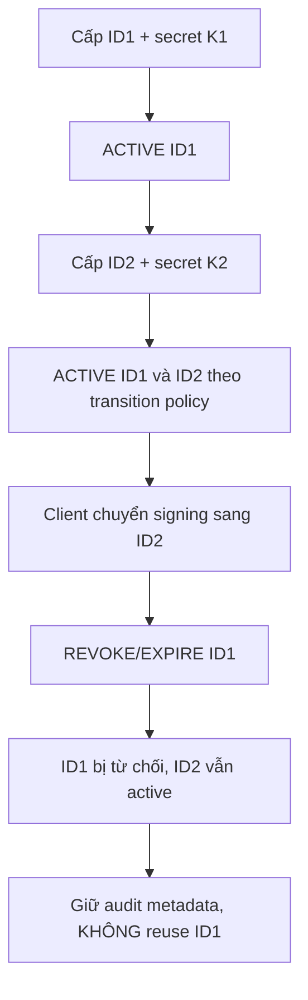
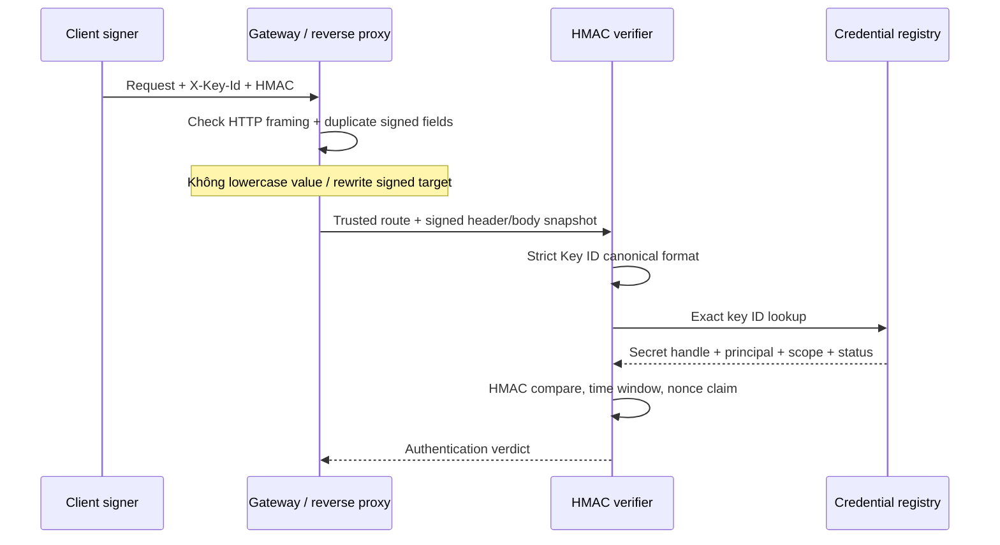

# Key ID format: định dạng định danh khóa trong xác thực HTTP request bằng HMAC

## 1. Key ID là gì và tại sao cần có định dạng rõ ràng?

Trong hệ thống xác thực HTTP request bằng **HMAC**, mỗi client hoặc ứng dụng tích hợp được cấp một **shared secret**. Client tính chữ ký trên **canonical request bytes** bằng secret đó; server phải tìm được **đúng secret** để tính lại MAC và xác minh. Nếu hệ thống có hàng nghìn client, nhiều tenant hoặc đang xoay khóa (key rotation), server không thể đoán phải dùng secret nào.

**Key identifier (Key ID, thường viết `kid`)** là một **định danh dùng để chọn credential** trong kho khóa phía server. Client gửi Key ID kèm request đã ký, còn server dùng nó để tìm secret và chính sách tương ứng. Key ID **không phải secret** và **không phải bằng chứng đã xác thực**.

Bài **Key ID format** thuộc chương **Key identifier** của module `SECURITY_AUTHENTICATION_HMAC_REQUEST_AUTHENTICATION`. Phạm vi module: thiết kế xác thực HTTP request bằng **HMAC với shared secret**, dựng canonical request từ method, URI, signed headers hoặc body theo hợp đồng; xác minh chữ ký, chống replay bằng timestamp/nonce, quản lý key rotation, kiểm thử proxy/gateway và phân biệt **authentication** với **authorization**. Do đó, thiết kế định dạng Key ID cần xem xét cả **cú pháp, cách truyền qua HTTP, tác động đến canonical HMAC, lookup chính xác, vòng đời khóa và bảo mật của verifier**.

Ví dụ request:

```http
POST /v1/orders?draft=false HTTP/1.1
Host: api.example.test
Content-Type: application/json
X-Key-Id: kid_AAAAAAAAAAAAAAAAAAAAAA
X-Signature-Version: hmac-keyid-v1
X-Timestamp: 2026-11-28T10:00:00Z
X-Nonce: AAAAAAAAAAAAAAAAAAAAAAAAAAAAAAAA
X-Signature: <64 ký tự lowercase hex của HMAC>

{"orderId":"O-42","amount":90000}
```

Các chữ `A` trong Key ID và nonce ở request trên **chỉ là giá trị giả để minh họa cú pháp, không phải giá trị ngẫu nhiên đủ chất lượng để triển khai**. Trong thực tế, Key ID và nonce phải được tạo theo quy tắc riêng ở các mục sau.

Server thực hiện:

```text
HTTP X-Key-Id
    |
    v
strict parse + validate format
    |
    v
lookup exact credential in server-side store
    |
    +--> secret bytes + allowed signature versions
    +--> principal / tenant / audience / route scope
    +--> active / not-before / expires / revoked status
    |
    v
HmacSHA256(secret, canonicalRequestBytes)
    |
    v
constant-time compare + timestamp + nonce + authorization
```

### Những gì Key ID **là** và **không phải**

| Khái niệm | Có phải Key ID? | Ý nghĩa |
| --- | --- | --- |
| Key ID | **Đúng** | Mã định danh, giúp tra credential/secret theo lookup chính xác. |
| Shared secret | **Không** | Byte khóa bí mật dùng cho `Mac.init(key)` và HMAC; không được gửi trong request. |
| HMAC signature | **Không** | MAC tính từ secret và canonical request; thay đổi khi signed fields thay đổi. |
| Principal ID / tenant ID | **Không nhất thiết** | Identity/scope do **server xác minh** và map từ credential; không được suy ra chỉ từ chuỗi Key ID. |
| Signature version | **Không** | Chỉ schema và thuật toán ký được phép, ví dụ `hmac-keyid-v1`; có thể được quản lý độc lập với Key ID. |
| Nonce | **Không** | Giá trị mới theo mỗi HTTP attempt để chống replay, không phải định danh credential lâu dài. |
| Request ID | **Không** | Mã tracing/debug, không nên dùng để lookup secret. |
| Idempotency key | **Không** | Mã stable theo logical business operation qua retry, khác với Key ID và nonce. |

Một lỗi nghiêm trọng là:

```java
// SAI: Key ID là public identifier, không phải secret.
new javax.crypto.spec.SecretKeySpec(
        keyId.getBytes(java.nio.charset.StandardCharsets.UTF_8),
        "HmacSHA256");
```

Server phải lấy **secret bytes** từ credential store bằng key ID đã được parse, không dùng chữ của key ID làm khóa HMAC.

## 2. Mục tiêu thiết kế một định dạng Key ID an toàn

Không có **một cú pháp Key ID HMAC chung** mà mọi HTTP API phải dùng. Mỗi sản phẩm cần một hợp đồng ký có version, cùng quy tắc parse ở client, gateway, verifier và key store. Định dạng tốt nên:

1. **Không mơ hồ:** một chuỗi đầu vào tương ứng với tối đa **một credential record** trong namespace đã chọn.
2. **Có giới hạn chiều dài:** tránh header quá dài, cache-key amplification và tấn công vào lookup/index.
3. **Chỉ dùng ký tự an toàn qua HTTP:** hạn chế encoding, whitespace, CR/LF, dấu phân cách gây nhầm parser.
4. **Có tính ổn định trong vòng đời một credential:** cùng secret/version quản lý bằng record có Key ID cố định, trừ khi rotate sang record khác.
5. **Không chứa thông tin nhạy cảm:** tránh nhúng API secret, password, token, PII hoặc chi tiết nội bộ của tenant vào Key ID.
6. **Cho phép phát hành nhiều khóa và rotation:** record mới có Key ID mới; key cũ có thể revoked hoặc hết hạn mà không nhầm record.
7. **Có thể tra cứu chính xác và kiểm toán:** hệ thống tìm theo exact key, có index/unique constraint, tránh tìm bằng prefix hoặc thử lần lượt nhiều secret.
8. **Phân biệt rõ định dạng với quyền:** cú pháp đúng chỉ nói rằng field **well-formed**, không nói caller đã được xác thực hay được phép thực hiện action.
9. **Hoạt động qua proxy/gateway:** không dựa vào tính nguyên vẹn của dấu phân cách hay tự động lowercase/trim không được công bố.
10. **Có khả năng mở rộng định dạng:** nếu format cần thay đổi, dùng registry/format version được công bố, không mặc định mọi key đều theo cách parse “thông minh” tùy ý.

### Tại sao thường nên chọn Key ID opaque?

Một định dạng có thể đọc bằng mắt như:

```text
tenant-017-production-hmacsha256-202611-key3
```

giúp vận hành dễ nhìn, nhưng có thể **tiết lộ tên tenant, môi trường, lịch xoay khóa, chiến lược thuật toán hoặc thông tin nội bộ**. Nó cũng khuyến khích server hoặc gateway “giải mã” business semantics từ chuỗi Key ID thay vì dựa vào credential metadata tin cậy.

Một Key ID **opaque** phù hợp hơn với nhiều API công khai:

```text
kid_<22 ký tự Base64URL không padding, được mã hóa từ 16 byte CSPRNG>
```

Ví dụ cấu trúc (không dùng trong production):

```text
kid_AAAAAAAAAAAAAAAAAAAAAA
```

**Prefix `kid_` chỉ giúp nhận biết loại định danh**; nó không tự chứng minh thuật toán HMAC, trạng thái key, tenant hay quyền. Nội dung 16 byte được phát hành ngẫu nhiên, sau đó mã hóa Base64URL. Key ID công khai **không cần bí mật**, nhưng ngẫu nhiên làm giảm rủi ro va chạm, suy đoán tên khách hàng và việc vô tình nhúng metadata.

## 3. Profile định dạng cụ thể: `kid_` + Base64URL 16 byte

Để có thể lập trình và kiểm thử chính xác, bài sử dụng **profile minh họa `KEY-ID-FORMAT-V1`**:

```text
keyId = "kid_" + BASE64URL_NO_PADDING(random16Bytes)
```

Một dãy 16 byte (128 bit) mã hóa Base64URL không padding tạo **22 ký tự**. Vì thế toàn Key ID dài chính xác **26 ký tự ASCII**:

```text
4 chars prefix + 22 chars Base64URL = 26 chars total
```

**Grammar chính xác:**

```regex
^kid_[A-Za-z0-9_-]{22}$
```

Sau regex cần thêm **decode và encode lại** để kiểm tra chuỗi là một biểu diễn Base64URL canonical đúng **16 byte**, vì regex một mình không ràng buộc đầy đủ bit padding ở ký tự cuối.

| Quy tắc | Profile `KEY-ID-FORMAT-V1` |
| --- | --- |
| Prefix | Chính xác `kid_` chữ thường. |
| Phần opaque | 16 byte ngẫu nhiên từ CSPRNG, Base64URL **không padding**. |
| Chiều dài chuỗi | 26 ký tự ASCII, không dấu cách bên trong. |
| Alphabet | `A-Z`, `a-z`, `0-9`, `_`, `-` cho phần dữ liệu. |
| Padding | Không chấp nhận `=`. |
| URL/percent encoding | Không chấp nhận `%xx` hoặc decode URL cho giá trị header. |
| Case | **Case-sensitive toàn bộ Key ID**; không lowercase/uppercase giá trị. |
| Unicode | Không chấp nhận ký tự ngoài ASCII; không NFKC/NFC để “sửa” input. |
| Byte representation | Header value ASCII; đưa đúng giá trị đã validate vào canonical UTF-8 bytes. |
| Lookup | Exact match theo Key ID trong registry, không prefix search. |
| Uniqueness | Unique theo phạm vi của credential registry; phát hành mới nếu collision. |
| Vòng đời | Không tái sử dụng ID cho secret khác, nhất là khi credential cũ còn trong audit/replay window. |

**Lưu ý:** 16 byte ngẫu nhiên ở đây là entropy của **định danh**, không phải yêu cầu secret HMAC. Secret trong ví dụ HMAC-SHA256 nên được cấp riêng từ CSPRNG/secret manager, với chính sách ví dụ **32 byte ngẫu nhiên**, và không được suy ra từ Key ID.

### Vì sao cần kiểm tra Base64URL canonical?

Với Base64URL 16 byte, ký tự Base64URL cuối chỉ sử dụng một phần các bit; một số biến thể decoder có thể bỏ qua **pad bits không bằng zero**. Khi đó các chuỗi text khác nhau có thể decode về cùng bytes. Nếu một tầng dùng **Key ID string**, tầng khác dùng **decoded bytes** và một tầng chuẩn hóa lại text, sẽ sinh ra nhiều cách biểu diễn cho cùng định danh, gây sai lookup, key confusion hoặc sai canonical request.

Do đó kiểm tra:

```text
parse candidate
  -> phải có đúng prefix, 22 ký tự alphabet
  -> Base64URL decode thành đúng 16 byte
  -> Base64URL encode lại không padding
  -> phải bằng phần encoded BAN ĐẦU từng ký tự
  -> dùng nguyên Key ID string canonical để lookup và ký
```

Việc này **không phải kiểm tra Key ID có thật**. Một chuỗi đúng grammar nhưng chưa từng được phát hành vẫn chỉ là dữ liệu đầu vào hợp lệ về cú pháp; credential lookup sẽ trả “không tìm thấy”.

## 4. Phân biệt định dạng ở client, HTTP adapter và key store

Key ID thường xuất hiện ở **ba nơi**:

```text
Credential provisioning:
    server cấp Key ID + secret qua kênh an toàn
              |
              v
Client credential configuration:
    lưu Key ID (public) và secret (protected) gắn thành một cặp
              |
              v
HTTP request:
    X-Key-Id: kid_...
              |
              v
Gateway + backend:
    parse đúng một field line, validate grammar
              |
              v
Server credential store:
    lookup exact keyId -> secret + principal + policy
```

**Client** không nên tự sinh một Key ID rồi giả định server biết nó. Trong contract bài này, **server/provisioning service cấp phát và đăng ký** cả Key ID lẫn secret; client giữ cặp đó cho đến khi rotate. Client có thể tự sinh **nonce** và **idempotency key**, nhưng **Key ID phải trỏ đến record đã được phía server cấp phép**.

### Hai lựa chọn carrier phổ biến

```http
# Lựa chọn A: header riêng
X-Key-Id: kid_...
```

```http
# Lựa chọn B: tham số trong Authorization theo scheme riêng của API
Authorization: HMAC keyId="kid_...",version="hmac-keyid-v1",signature="..."
```

Đây là **hai thiết kế khác nhau**, không phải chuẩn mặc định phải hỗ trợ đồng thời. Profile `hmac-keyid-v1` trong bài chọn **A: đúng một `X-Key-Id`**. Một sản phẩm dùng `Authorization` phải công bố **scheme, grammar, quoting/escaping và cách ký** riêng, không lấy parser của A để xử lý B.

### Header name không phân biệt case, Key ID value phân biệt case

```http
X-Key-Id: kid_AbCd...
x-key-id: kid_AbCd...
```

Hai tên field cùng chỉ **một tên header HTTP** nhưng nếu cùng tồn tại trong **một request** thì đó là **duplicate**. Profile này yêu cầu **đúng một field line**, nên reject cả khi hai value bằng nhau.

Ngược lại, **`kid_AbCd...` và `kid_aBcD...` là hai chuỗi Key ID khác nhau**. Không lowercase value khi lookup, không so sánh keyId theo case-insensitive và không thử các biến thể để tìm credential.

HTTP adapter có thể bỏ **optional whitespace (SP/HTAB) bên ngoài field value** theo hợp đồng, ví dụ khoảng trắng sau dấu `:`, nhưng sau đó phải kiểm tra **exact grammar**. Không tự trim whitespace bên trong, bỏ dấu ngoặc kép, URL-decode hoặc chuyển Unicode thành ASCII để làm Key ID “có vẻ hợp lệ”.

## 5. Những Key ID nên được chấp nhận và từ chối

Trong bảng dưới đây, `kid_AAAAAAAAAAAAAAAAAAAAAA` là **mẫu giả lập** có đủ 22 ký tự Base64URL và có thể decode thành 16 byte toàn zero. Nó không phải một ID thực nên không được cấp cho khách hàng:

| Key ID client gửi | Hợp lệ về **format**? | Giải thích |
| --- | --- | --- |
| `kid_AAAAAAAAAAAAAAAAAAAAAA` | Có | Đủ prefix, đủ 22 Base64URL chars, canonical; **chưa chắc tồn tại** trong store. |
| `kid_aaaaaaaaaaaaaaaaaaaaaa` | Phụ thuộc canonical decode | Phải qua bước decode/re-encode, không chỉ regex. |
| `kid_AAAAAAAAAAAAAAAAAAAAA=` | Không | Có padding `=`, không thuộc grammar. |
| `kid_AAAAAAAAAAAAAAAAAAAAA` | Không | Chỉ có 21 ký tự phần dữ liệu. |
| `kid_AAAAAAAAAAAAAAAAAAAAAAA` | Không | Có 23 ký tự phần dữ liệu. |
| `KID_AAAAAAAAAAAAAAAAAAAAAA` | Không | Prefix `kid_` có phân biệt hoa/thường. |
| `kid_AAAAAAAAAAAAAAAAAAAAAA ` | Chỉ hợp lệ nếu dấu cách thuộc **OWS ngoài field value** đã được adapter trim đúng contract. | Giá trị Key ID canonical tự nó không chứa SP; không được tự sửa whitespace nằm bên trong ID. |
| `kid_+AAAAAAAAAAAAAAAAAAAAA` | Không | Dấu `+` không thuộc Base64URL; tránh nhầm Base64 chuẩn. |
| `kid_/AAAAAAAAAAAAAAAAAAAAA` | Không | Dấu `/` không thuộc Base64URL. |
| `kid_%41AAAAAAAAAAAAAAAAAAAA` | Không | Percent encoding không được decode ngầm. |
| `kid_ÁAAAAAAAAAAAAAAAAAAAA` | Không | Ký tự Unicode không thuộc ASCII alphabet. |
| `kid_..../../secret` | Không | Không theo grammar, không được đưa vào filesystem path hay SQL. |
| `kid_` hoặc `null` | Không | Rỗng/không phải ID, không fallback sang default secret. |

**Điều chỉnh cách đọc bảng:** những dấu cách **OWS** ngay bên ngoài HTTP field value có thể được HTTP adapter loại bỏ theo quy tắc công bố; sau bước đó **chỉ giá trị đúng grammar mới được dùng**. Không được thay đổi Key ID đã được parse sau khi tạo canonical request hoặc sau khi lookup.

### Định dạng đúng không đồng nghĩa Key ID tồn tại

Giả sử client gửi đúng:

```http
X-Key-Id: kid_AAAAAAAAAAAAAAAAAAAAAA
```

Server phải kiểm tra theo hai bước độc lập:

```text
1) FORMAT:
   Có đúng "kid_" + canonical Base64URL(16 bytes)?
   Nếu không -> reject.

2) CREDENTIAL LOOKUP:
   Registry có exact key ID này không?
   Nếu không, expired, revoked hoặc out of scope -> reject.
```

Phân biệt hai bước giúp không sử dụng Key ID malformed để truy vấn database và ngăn các nhánh “nếu lookup lỗi thì dùng credential mặc định”. **Không bao giờ chuyển request thành authenticated chỉ vì Key ID đúng regex**.

## 6. Chọn Key ID opaque hay structured ID?

Một số hệ thống cần Key ID dễ đọc:

```text
merchant-a-prod-2026-11-hmac-02
```

Một số hệ thống chọn opaque:

```text
kid_<opaque random data>
```

Cả hai đều có thể triển khai an toàn **nếu có grammar/namespace/lookup đúng**. Sự khác biệt chủ yếu nằm ở metadata lộ qua chuỗi ID và nguy cơ các tầng dựa vào cách parse ID để phân quyền.

| Tiêu chí | Structured ID | Opaque random ID |
| --- | --- | --- |
| Nhìn log dễ hiểu | Dễ nhận diện key/tenant/date. | Cần tra metadata qua công cụ nội bộ. |
| Rò metadata | Có thể lộ tenant, env, lịch rotate. | Ít lộ metadata theo cấu trúc. |
| Dễ nhầm namespace | Có thể bị tách theo `-` sai quy tắc. | Coi như một chuỗi bất biến. |
| Độ dài | Thường biến thiên, cần giới hạn. | Có thể cố định 26 ký tự như profile. |
| Key rotation | Không nên suy từ suffix/date để bỏ qua lookup. | Tạo ID mới và metadata mới trong registry. |
| DB collation/case | Có rủi ro nếu phần token phân biệt case. | Có rủi ro như nhau; cần exact/binary match. |
| Làm key lookup | Exact match theo full ID. | Exact match theo full ID. |

**Khuyến nghị cho API mới:** ưu tiên Key ID opaque với prefix dễ nhận biết; giữ môi trường, tenant, principal, thời gian phát hành, thuật toán và trạng thái trong **server-side metadata**. Nếu có yêu cầu tương thích phải giữ structured ID, hãy quy định chặt delimiter, character classes, maximum length, escaping, version migration và lookup exact; tuyệt đối không để “prefix trông giống `admin`” trở thành quyết định quyền.

### Prefix và version: không tự đoán thuật toán

`kid_` là prefix **định dạng định danh**, không phải signature version. Một số nền tảng có thể phát hành:

```text
kid2_<another canonical token>
```

trong tương lai, nhưng chỉ khi **đăng ký format mới** và thiết kế migration rõ ràng. Không viết verifier kiểu:

```java
// SAI: tự suy MAC algorithm từ tiền tố client gửi.
String algorithm = keyId.startsWith("sha1") ? "HmacSHA1" : "HmacSHA256";
```

**Thuật toán và canonicalization** phải được quyết định từ **signature profile registry phía server** và policy cho credential, ví dụ `X-Signature-Version: hmac-keyid-v1` được allowlist; request không được “tự chọn thuật toán yếu” bằng cách đổi tên Key ID.

## 7. Key ID và credential registry phía server

Một credential record không chỉ có Key ID:

```text
credential_record:
  key_id:             "kid_<opaque>"
  internal_id:        "cred-00042"         # immutable, local to registry
  principal_id:       "merchant-a"         # verified identity mapping
  secret_ref:         "vault://..."        # reference, không phải raw secret trong log
  active:             true
  allowed_audience:   "https://api.example.test"
  allowed_targets:    ["/v1/orders?draft=false"]
  allowed_versions:   ["hmac-keyid-v1"]
  created_at:         ...
  not_before:         ...
  expires_at:         ...
  revoked_at:         ...
```

Các giá trị trên là **mô hình record minh họa**, không phải YAML schema bắt buộc. Trong triển khai thật cần kiểm tra key validity tại thời điểm xác minh, bảo vệ secret manager/KMS/HSM, audit và kiểm soát truy cập.

### Registry phải có các bất biến

1. **Unique exact key ID** trên phạm vi mà verifier dùng để lookup. Nếu một registry có nhiều tenant và Key ID chỉ unique từng tenant, lookup phải thêm **scope do server xác thực** hoặc thay bằng global identifier. Tránh lấy `X-Tenant` do client tự khai để chọn secret mà không có policy.
2. **Một ID không bao giờ trỏ sang một secret không liên quan** sau khi rotate. Nếu thay secret, cấp Key ID mới, lưu record mới và điều chỉnh active/revoked state của record cũ.
3. **Lookup đúng một candidate**, không thử mọi key secret khi chữ ký sai; việc thử vòng quanh khiến sai signature có thể khớp nhầm, làm chậm xử lý hoặc mở downgrade path.
4. **Kiểm tra trạng thái trước authentication:** expired/revoked/not-yet-valid credentials không được cấp verified identity, kể cả phép HMAC tính theo secret cũ có thể cho cùng byte kết quả.
5. **Kiểm tra scope:** cùng Key ID không mặc nhiên được dùng cho mọi method, endpoint, audience, tenant, signature version và resource.
6. **Không lộ secret trong bản ghi trả về client:** server chỉ sử dụng secret nội bộ để tính HMAC. Credential provisioning qua kênh tin cậy là quy trình riêng.
7. **Principal ổn định khi cần:** user/tenant identity thực thường gắn với principal; nhiều Key IDs có thể map về cùng principal trong thời gian rotation, nhưng authorization phải luôn được đánh giá.

### Database collation: case-insensitive có thể phá tính chính xác

Java `HashMap<String,Credential>` phân biệt hoa/thường theo chuỗi. Tuy nhiên một số database hoặc collation của cột `VARCHAR` có thể **so sánh không phân biệt chữ hoa/thường**. Hai chuỗi `kid_A...` và `kid_a...` khác nhau theo profile nhưng có thể được DB coi là bằng nhau nếu collation sai.

Ví dụ rủi ro:

```sql
-- Ví dụ khái niệm: truy vấn Key ID phải tương ứng
-- với exact case-sensitive semantics của signature profile.
SELECT credential_id, secret_ref, status
FROM credentials
WHERE key_id = :validated_key_id;
```

**Chỉ câu SQL này chưa đủ bảo đảm exact matching.** Hãy cấu hình collation/binary comparison phù hợp, unique index trên canonical key representation, và kiểm thử **hai Key IDs chỉ khác case**. Không “khắc phục” bằng cách lowercase Key ID đầu vào vì đó là một giao thức khác, có thể làm hai credentials bị alias và làm canonical HMAC khác.

### Secret lookup không được lấy giá trị khóa trực tiếp từ client

```text
Client supplies:     keyId = "kid_..."
Trusted store maps:  keyId -> credential -> secretBytes
HMAC computation:    HmacSHA256(secretBytes, canonicalRequestBytes)
```

`Key ID` chỉ là một **index không bí mật**. Một attacker có thể tự đặt bất kỳ Key ID đúng format; điều ngăn impersonation là **không biết shared secret tương ứng** và không thể tạo MAC đúng trên canonical request.

## 8. Đưa Key ID vào canonical request để ngăn đổi credential

Giả sử request có:

```http
X-Key-Id: kid_AAAAAAAAAAAAAAAAAAAAAA
X-Signature-Version: hmac-keyid-v1
X-Timestamp: 2026-11-28T10:00:00Z
X-Nonce: AAAAAAAAAAAAAAAAAAAAAAAAAAAAAAAA
```

Key ID là dữ liệu do caller gửi, vì vậy trong profile này nó **phải được HMAC ký**. Nếu không ký Key ID, attacker có thể đổi header sang ID khác, khiến server lookup secret khác; trong một số hệ thống phức tạp có key alias/scope lỗi, điều này tạo **key confusion**. Ràng buộc Key ID vào canonical message giúp chữ ký chỉ xác thực cho đúng ID đã chọn.

Canonical request profile `hmac-keyid-v1`:

```text
HMAC-KEYID-V1
POST
https://api.example.test
/v1/orders?draft=false
content-type:application/json
x-key-id:kid_AAAAAAAAAAAAAAAAAAAAAA
x-signature-version:hmac-keyid-v1
x-timestamp:2026-11-28T10:00:00Z
x-nonce:AAAAAAAAAAAAAAAAAAAAAAAAAAAAAAAA
<lowercaseHex(SHA-256(bodyBytes))>
```

Các quy tắc:

- **Domain separator:** `HMAC-KEYID-V1` ở dòng đầu.
- **Method:** `POST` chính xác.
- **Audience:** `https://api.example.test`, lấy từ cấu hình route/ingress đáng tin, **không** chỉ từ `Host` hoặc `X-Forwarded-Host` do Internet caller khai báo.
- **Raw request target:** `/v1/orders?draft=false`, không tự decode/reorder query hoặc rewrite giữa signing và verification.
- **Signed header values:** Content-Type, Key ID, signature version, timestamp, nonce; tất cả phải đơn trị và đúng grammar.
- **Body:** SHA-256 trên **body bytes thực sẽ được handler xử lý**, sau khi gỡ HTTP transfer framing; ví dụ không hỗ trợ `Content-Encoding`.
- **Framing:** các dòng nối bằng LF (`0A`), encode UTF-8, **không LF cuối**; header names trong canonical là chữ thường.
- **MAC:** `HmacSHA256` với shared secret phía credential record, kết quả 32 byte, mã hóa **64 lowercase hex**.
- **Signature carrier:** `X-Signature` là kết quả nên **không** nằm trong canonical (tránh vòng lặp tự tham chiếu).

**Dòng cuối trên chỉ là placeholder**, phải thay bằng digest thật (64 ký tự hex thường) trước khi ký; không ký dấu `<` và `>`.

```text
bodyDigest = SHA-256(bodyBytes)
canonicalBytes = UTF8(canonical message with lowercaseHex(bodyDigest))
expectedMac = HMAC-SHA256(secretForExactKeyId, canonicalBytes)
valid = constantTimeEqual(expectedMac, strictHexDecode(X-Signature))
```

### Key ID format không giải quyết được những rủi ro gì?

Ngay cả khi Key ID đúng cú pháp và MAC đúng:

- **Timestamp quá cũ hoặc quá xa tương lai** vẫn phải từ chối theo chính sách freshness.
- **Nonce đã được dùng** vẫn phải bị replay cache từ chối với atomic insert-if-absent và TTL phù hợp.
- **Credential bị revoke** vẫn phải bị từ chối kể cả khi secret cũ có thể tạo MAC đúng.
- **Caller thiếu quyền trên order/merchant** vẫn bị authorization từ chối.
- **Một POST hợp lệ được retry với nonce mới** vẫn cần idempotency theo logical operation để không tạo đơn hai lần.
- **Key ID opaque không mã hóa lưu lượng**; hệ thống vẫn cần HTTPS/TLS, quản lý secret và chính sách log.

Định dạng Key ID là **một mắt xích** trong toàn bộ chuỗi xác thực, không phải thay thế canonicalization, HMAC, replay protection hay phân quyền.

## 9. Java 17+: sinh, validate và cấp phát Key ID canonical

Đối với profile `KEY-ID-FORMAT-V1`, Java 17 đã có các API cần thiết:

- `SecureRandom` tạo 16 byte cho **public identifier** và một dãy byte **khác** để làm shared secret.
- `Base64.getUrlEncoder().withoutPadding()` mã hóa Key ID trong alphabet an toàn.
- `Base64.getUrlDecoder()` đọc phần opaque, sau đó re-encode để kiểm tra canonical.
- `Pattern` kiểm tra chính xác prefix/length/alphabet.
- `ConcurrentHashMap.putIfAbsent` minh họa registry không ghi đè Key ID cũ **trong một JVM**. Production phải dùng **unique constraint hoặc atomic conditional insert trong credential database**.

Ví dụ hàm cấp định danh:

```java
import java.security.SecureRandom;
import java.util.Base64;

static String generateKeyId(SecureRandom random) {
    byte[] opaque = new byte[16];
    random.nextBytes(opaque);
    return "kid_" + Base64.getUrlEncoder()
            .withoutPadding().encodeToString(opaque);
}
```

Mỗi lần sinh phải kiểm tra **ID chưa tồn tại trong registry**, và xử lý collision bằng phát hành ID mới (không overwrite). Với 128 bit được tạo ngẫu nhiên đúng cách, xác suất trùng rất thấp ở quy mô thông thường; **CSPRNG** vẫn cần được cấu hình/khởi tạo an toàn và kiểm thử theo môi trường. Không suy rằng Key ID đã ngẫu nhiên là đủ bảo vệ request: shared secret là dữ liệu **khác**.

Hàm validation:

```java
import java.util.Base64;
import java.util.regex.Pattern;

private static final Pattern KEY_ID =
        Pattern.compile("kid_[A-Za-z0-9_-]{22}");

static boolean canonicalKeyId(String candidate) {
    if (candidate == null || !KEY_ID.matcher(candidate).matches()) {
        return false;
    }
    String encoded = candidate.substring(4);
    try {
        byte[] decoded = Base64.getUrlDecoder().decode(encoded);
        return decoded.length == 16
                && encoded.equals(Base64.getUrlEncoder()
                        .withoutPadding().encodeToString(decoded));
    } catch (IllegalArgumentException invalidBase64) {
        return false;
    }
}
```

**Tại sao không gọi `candidate.trim().toLowerCase()` trong validator?** Vì nó làm thay đổi identity do client gửi, tạo alias không được công bố và có thể khiến signer với verifier dùng **khác canonical bytes**. Chỉ có **HTTP adapter** được phép loại OWS bên ngoài field value theo contract, **trước** khi validator nhận chuỗi. Validator tự nó kiểm tra một Key ID **đã canonical**.

### Bảo vệ secret và mapping khi cấp khóa

Một quy trình cấp phát minh họa:

```text
server provisioning authority:
  keyId = generateKeyId(SecureRandom)       # ID công khai
  secret = randomBytes(32)                  # secret bí mật độc lập
  credential = (keyId, principalId, secretRef, scope, active...)
  atomic registry insertion with UNIQUE keyId
  deliver keyId + secret through protected provisioning channel

client:
  store (keyId, secret) as a pair
  never derive secret from keyId
  sign each HTTP request using secret
  send keyId, NOT secret, in X-Key-Id
```

Không gửi secret qua HTTP header thông thường, log, URL/query hoặc telemetry. Nếu credential có nguồn gốc từ KMS/HSM và không cho export key bytes, cần provider JCA/cryptographic integration phù hợp; không bắt buộc xuất raw secret ra JVM nếu hệ thống bảo mật không cho phép.

## 10. Java 17 hoàn chỉnh: HTTP Key ID, registry và HMAC verifier

Ví dụ sau là một class Java 17 tên `KeyIdFormatHmacDemo.java`. Nó có **ba mục tiêu**:

1. **Provision:** server sinh Key ID canonical bằng `SecureRandom`, tạo secret độc lập, đăng ký `Credential` với verified principal và policy.
2. **Sign:** client dùng cặp Key ID/secret đã cấp, tạo signed headers, nonce/timestamp mới và HMAC trên canonical request chứa **Key ID đúng text**.
3. **Verify:** server kiểm tra header đơn trị, strict Key ID format, lookup **exact**, key status/scope, HMAC, freshness/nonce và chỉ sau đó xuất authenticated identity để tầng authorization quyết định.

Trong `main`, chương trình kiểm thử Key ID bị đổi, header trùng, phát lại request, xoay key và revoke credential.

**Ranh giới ví dụ:** `RequestSnapshot` đã được một **HTTP adapter đáng tin cậy** tạo ra, chứa raw target và body bytes sau khi gỡ transfer framing; adapter thực phải chặn request smuggling, duplicate fields trước khi chúng bị framework hợp nhất, body transform/Content-Encoding ngoài contract, forwarded headers không đáng tin và parser ambiguity. Registry/replay cache ở ví dụ chỉ là **in-memory, dùng một JVM**; không đảm bảo durability, TTL cleanup hoặc distributed consistency, vì vậy **không dùng làm production credential store/replay cache**.

```java
import java.nio.charset.StandardCharsets;
import java.security.GeneralSecurityException;
import java.security.MessageDigest;
import java.security.SecureRandom;
import java.time.Clock;
import java.time.Duration;
import java.time.Instant;
import java.time.ZoneOffset;
import java.time.format.DateTimeParseException;
import java.time.temporal.ChronoUnit;
import java.util.ArrayList;
import java.util.Base64;
import java.util.HashMap;
import java.util.HexFormat;
import java.util.List;
import java.util.Locale;
import java.util.Map;
import java.util.Objects;
import java.util.Optional;
import java.util.Set;
import java.util.concurrent.ConcurrentHashMap;
import java.util.concurrent.atomic.AtomicBoolean;
import java.util.regex.Pattern;
import javax.crypto.Mac;
import javax.crypto.spec.SecretKeySpec;

public final class KeyIdFormatHmacDemo {
    private static final String VERSION = "hmac-keyid-v1";
    private static final String ORIGIN = "https://api.example.test";
    private static final String TARGET = "/v1/orders?draft=false";
    private static final String TYPE = "application/json";
    private static final HexFormat HEX = HexFormat.of();
    private static final Pattern KEY_ID =
            Pattern.compile("kid_[A-Za-z0-9_-]{22}");
    private static final Duration MAX_AGE = Duration.ofSeconds(300);
    private static final Duration FUTURE_SKEW = Duration.ofSeconds(30);
    private static final Duration NONCE_TTL = Duration.ofSeconds(360);
    private static final Set<String> REQUIRED_HEADERS = Set.of(
            "content-type", "x-key-id", "x-signature-version",
            "x-timestamp", "x-nonce", "x-signature");

    public record HeaderLine(String name, String value) {}

    public record RequestSnapshot(
            String method, String rawTarget, String trustedOrigin,
            List<HeaderLine> headers, byte[] body) {
        public RequestSnapshot {
            if (headers == null
                    || headers.stream().anyMatch(Objects::isNull)) {
                throw new IllegalArgumentException("Missing header lines");
            }
            headers = List.copyOf(headers);
            body = body == null ? null : body.clone();
        }
        @Override public byte[] body() {
            return body == null ? null : body.clone();
        }
    }

    // Credential client nhận sau provisioning.
    public record ClientKey(String keyId, byte[] secret) {
        public ClientKey {
            secret = secret == null ? null : secret.clone();
        }
        @Override public byte[] secret() {
            return secret == null ? null : secret.clone();
        }
    }

    // Credential server giữ, KHÔNG gửi record này cho HTTP caller.
    public record Credential(
            String keyId, String immutableCredentialId,
            String principalId, byte[] secret, String audience,
            Set<String> allowedTargets, Set<String> allowedVersions,
            Instant notBefore, Instant expiresAt) {
        public Credential {
            secret = secret == null ? null : secret.clone();
            allowedTargets = Set.copyOf(allowedTargets);
            allowedVersions = Set.copyOf(allowedVersions);
        }
        @Override public byte[] secret() {
            return secret == null ? null : secret.clone();
        }
    }

    public static String issueKeyId(SecureRandom random) {
        byte[] randomId = new byte[16];
        random.nextBytes(randomId);
        return "kid_" + Base64.getUrlEncoder()
                .withoutPadding().encodeToString(randomId);
    }

    public static boolean isCanonicalKeyId(String candidate) {
        if (candidate == null || !KEY_ID.matcher(candidate).matches()) {
            return false;
        }
        String encoded = candidate.substring(4);
        try {
            byte[] raw = Base64.getUrlDecoder().decode(encoded);
            return raw.length == 16 && encoded.equals(
                    Base64.getUrlEncoder().withoutPadding()
                            .encodeToString(raw));
        } catch (IllegalArgumentException invalid) {
            return false;
        }
    }

    public static final class CredentialRegistry {
        private final ConcurrentHashMap<String, Credential> records =
                new ConcurrentHashMap<>();
        private final Set<String> revoked =
                ConcurrentHashMap.newKeySet();

        // Chỉ dùng provisioning/test, không gọi từ HTTP request verifier.
        public ClientKey provision(
                String principalId, SecureRandom random,
                Instant start, Instant end) {
            Objects.requireNonNull(principalId);
            for (int attempt = 0; attempt < 5; attempt++) {
                String id = issueKeyId(random);
                byte[] secret = new byte[32];
                random.nextBytes(secret);
                Credential record = new Credential(
                        id, id, principalId, secret, ORIGIN,
                        Set.of(TARGET), Set.of(VERSION), start, end);
                if (records.putIfAbsent(id, record) == null) {
                    return new ClientKey(id, secret);
                }
            }
            throw new IllegalStateException(
                    "Failed to issue a unique Key ID");
        }

        public Credential findExact(String id) {
            return records.get(id); // Java String exact, case-sensitive.
        }

        public boolean revoked(String id) {
            return revoked.contains(id);
        }

        public void revoke(String id) {
            if (records.containsKey(id)) revoked.add(id);
        }
    }

    public record Authenticated(
            String principalId, String credentialId,
            byte[] verifiedBody) {
        public Authenticated {
            verifiedBody = verifiedBody.clone();
        }
        @Override public byte[] verifiedBody() {
            return verifiedBody.clone();
        }
    }

    private record NonceKey(
            String audience, String credentialId, String nonce) {}

    // Chỉ mô phỏng atomic nonce claim TRONG MỘT JVM.
    public static final class InMemoryReplayCache {
        private final ConcurrentHashMap<NonceKey, Instant> used =
                new ConcurrentHashMap<>();

        public boolean claim(
                String audience, String credentialId, String nonce,
                Instant now, Duration ttl) {
            NonceKey key = new NonceKey(
                    audience, credentialId, nonce);
            AtomicBoolean fresh = new AtomicBoolean(false);
            used.compute(key, (k, priorExpiry) -> {
                if (priorExpiry == null
                        || !priorExpiry.isAfter(now)) {
                    fresh.set(true);
                    return now.plus(ttl);
                }
                return priorExpiry;
            });
            return fresh.get();
        }
    }

    private static String stripOws(String value) {
        int start = 0, end = value.length();
        while (start < end
                && (value.charAt(start) == ' '
                    || value.charAt(start) == '\t')) start++;
        while (end > start
                && (value.charAt(end - 1) == ' '
                    || value.charAt(end - 1) == '\t')) end--;
        return value.substring(start, end);
    }

    // Input: từng field line của HTTP adapter trước khi merge.
    // Không dùng getHeader/firstValue để "chứng minh" header đơn trị.
    private static Map<String, String> parseRequiredHeaders(
            List<HeaderLine> rawLines) {
        Map<String, String> values = new HashMap<>();
        for (HeaderLine line : rawLines) {
            if (line == null || line.name() == null
                    || !line.name().matches("[A-Za-z0-9-]{1,128}")
                    || line.value() == null) {
                throw new IllegalArgumentException("Malformed header");
            }
            String name = line.name().toLowerCase(Locale.ROOT);
            if ("content-encoding".equals(name)) {
                throw new IllegalArgumentException("Unexpected encoding");
            }
            String value = stripOws(line.value());
            for (int i = 0; i < value.length(); i++) {
                char ch = value.charAt(i);
                if (ch < 0x20 || ch > 0x7E) {
                    throw new IllegalArgumentException(
                            "Non-ASCII/control header value");
                }
            }
            if (REQUIRED_HEADERS.contains(name)
                    && values.putIfAbsent(name, value) != null) {
                throw new IllegalArgumentException(
                        "Duplicate signed header");
            }
        }
        if (!values.keySet().equals(REQUIRED_HEADERS)) {
            throw new IllegalArgumentException(
                    "Missing signed header");
        }
        return Map.copyOf(values);
    }

    private static boolean canonicalNonce(String value) {
        if (value == null || !value.matches("[A-Za-z0-9_-]{32}")) {
            return false;
        }
        try {
            byte[] raw = Base64.getUrlDecoder().decode(value);
            return raw.length == 24 && value.equals(
                    Base64.getUrlEncoder().withoutPadding()
                            .encodeToString(raw));
        } catch (IllegalArgumentException invalid) {
            return false;
        }
    }

    private static Instant parseTimestamp(String value) {
        if (value == null || !value.matches(
                "[0-9]{4}-[0-9]{2}-[0-9]{2}T"
                + "[0-9]{2}:[0-9]{2}:[0-9]{2}Z")) {
            throw new IllegalArgumentException("Bad timestamp syntax");
        }
        try {
            Instant time = Instant.parse(value);
            if (time.getNano() != 0 || !time.toString().equals(value)) {
                throw new IllegalArgumentException(
                        "Noncanonical UTC timestamp");
            }
            return time;
        } catch (DateTimeParseException invalid) {
            throw new IllegalArgumentException(
                    "Invalid UTC timestamp", invalid);
        }
    }

    private static byte[] canonicalBytes(
            RequestSnapshot r, Map<String, String> values)
            throws GeneralSecurityException {
        String bodyDigest = HEX.formatHex(
                MessageDigest.getInstance("SHA-256").digest(r.body()));
        String canonical = String.join("\n",
                "HMAC-KEYID-V1",
                r.method(),
                ORIGIN,
                r.rawTarget(),
                "content-type:" + values.get("content-type"),
                "x-key-id:" + values.get("x-key-id"),
                "x-signature-version:"
                        + values.get("x-signature-version"),
                "x-timestamp:" + values.get("x-timestamp"),
                "x-nonce:" + values.get("x-nonce"),
                bodyDigest);
        return canonical.getBytes(StandardCharsets.UTF_8);
    }

    private static byte[] macSha256(
            byte[] secret, byte[] canonical)
            throws GeneralSecurityException {
        Mac mac = Mac.getInstance("HmacSHA256");
        mac.init(new SecretKeySpec(secret, "HmacSHA256"));
        return mac.doFinal(canonical);
    }

    // Client đã được cấp Key ID và secret tương ứng qua kênh an toàn.
    public static RequestSnapshot sign(
            ClientKey client, byte[] serializedBody,
            Instant now, SecureRandom random)
            throws GeneralSecurityException {
        if (client == null || !isCanonicalKeyId(client.keyId())
                || client.secret() == null
                || client.secret().length < 32
                || serializedBody == null
                || serializedBody.length == 0
                || serializedBody.length > 1_048_576) {
            throw new IllegalArgumentException("Invalid signer input");
        }
        byte[] nonceBytes = new byte[24];
        random.nextBytes(nonceBytes);
        String nonce = Base64.getUrlEncoder().withoutPadding()
                .encodeToString(nonceBytes);
        String timestamp = now.truncatedTo(
                ChronoUnit.SECONDS).toString();

        List<HeaderLine> headers = new ArrayList<>(List.of(
                new HeaderLine("Content-Type", TYPE),
                new HeaderLine("X-Key-Id", client.keyId()),
                new HeaderLine("X-Signature-Version", VERSION),
                new HeaderLine("X-Timestamp", timestamp),
                new HeaderLine("X-Nonce", nonce)));

        RequestSnapshot unsigned = new RequestSnapshot(
                "POST", TARGET, ORIGIN, headers, serializedBody);
        Map<String, String> fields = Map.of(
                "content-type", TYPE,
                "x-key-id", client.keyId(),
                "x-signature-version", VERSION,
                "x-timestamp", timestamp,
                "x-nonce", nonce);
        String signature = HEX.formatHex(macSha256(
                client.secret(), canonicalBytes(unsigned, fields)));
        headers.add(new HeaderLine("X-Signature", signature));
        return new RequestSnapshot(
                "POST", TARGET, ORIGIN, headers, serializedBody);
    }

    public static Optional<Authenticated> verify(
            RequestSnapshot request, CredentialRegistry registry,
            InMemoryReplayCache replay, Clock clock)
            throws GeneralSecurityException {
        if (request == null || registry == null
                || replay == null || clock == null
                || request.method() == null
                || request.rawTarget() == null
                || request.trustedOrigin() == null
                || request.body() == null) {
            return Optional.empty();
        }
        if (!"POST".equals(request.method())
                || !TARGET.equals(request.rawTarget())
                || !ORIGIN.equals(request.trustedOrigin())
                || request.body().length == 0
                || request.body().length > 1_048_576) {
            return Optional.empty();
        }

        Map<String, String> fields;
        Instant issuedAt;
        try {
            fields = parseRequiredHeaders(request.headers());
            if (!TYPE.equals(fields.get("content-type"))
                    || !VERSION.equals(
                            fields.get("x-signature-version"))
                    || !isCanonicalKeyId(fields.get("x-key-id"))
                    || !canonicalNonce(fields.get("x-nonce"))
                    || !fields.get("x-signature")
                            .matches("[0-9a-f]{64}")) {
                return Optional.empty();
            }
            issuedAt = parseTimestamp(fields.get("x-timestamp"));
        } catch (IllegalArgumentException invalid) {
            return Optional.empty();
        }

        String selectedId = fields.get("x-key-id");
        Credential credential = registry.findExact(selectedId);
        Instant serverNow = clock.instant();
        if (credential == null
                || registry.revoked(selectedId)
                || !selectedId.equals(credential.keyId())
                || credential.principalId() == null
                || credential.immutableCredentialId() == null
                || !ORIGIN.equals(credential.audience())
                || !credential.allowedTargets().contains(TARGET)
                || !credential.allowedVersions().contains(VERSION)
                || credential.notBefore() == null
                || credential.expiresAt() == null
                || serverNow.isBefore(credential.notBefore())
                || !serverNow.isBefore(credential.expiresAt())) {
            return Optional.empty();
        }
        byte[] secret = credential.secret();
        if (secret == null || secret.length < 32) {
            return Optional.empty();
        }

        byte[] expectedMac = macSha256(
                secret, canonicalBytes(request, fields));
        byte[] submittedMac = HEX.parseHex(
                fields.get("x-signature"));
        if (expectedMac.length != 32 || submittedMac.length != 32
                || !MessageDigest.isEqual(
                        expectedMac, submittedMac)) {
            return Optional.empty();
        }

        // HMAC đúng chưa đủ: request có thể đã quá cũ hoặc phát lại.
        if (issuedAt.isBefore(serverNow.minus(MAX_AGE))
                || issuedAt.isAfter(serverNow.plus(FUTURE_SKEW))) {
            return Optional.empty();
        }

        // Production phải dùng atomic shared nonce store + TTL
        // và fail closed khi storage gặp lỗi.
        if (!replay.claim(ORIGIN,
                credential.immutableCredentialId(),
                fields.get("x-nonce"), serverNow, NONCE_TTL)) {
            return Optional.empty();
        }

        // Chỉ sau đây mới tạo verified identity.
        // Business handler vẫn phải authorization và idempotency.
        return Optional.of(new Authenticated(
                credential.principalId(),
                credential.immutableCredentialId(), request.body()));
    }

    private static RequestSnapshot withChangedHeader(
            RequestSnapshot source, String name, String newValue) {
        List<HeaderLine> changed = new ArrayList<>();
        for (HeaderLine h : source.headers()) {
            if (h.name().equalsIgnoreCase(name)) {
                changed.add(new HeaderLine(h.name(), newValue));
            } else {
                changed.add(h);
            }
        }
        return new RequestSnapshot(
                source.method(), source.rawTarget(),
                source.trustedOrigin(), changed, source.body());
    }

    private static void require(
            boolean condition, String description) {
        if (!condition) throw new AssertionError(description);
    }

    public static void main(String[] args) throws Exception {
        SecureRandom rng = new SecureRandom();
        Instant t0 = Instant.parse("2026-11-28T10:00:00Z");
        Clock clock = Clock.fixed(t0, ZoneOffset.UTC);
        CredentialRegistry registry = new CredentialRegistry();
        InMemoryReplayCache replay = new InMemoryReplayCache();

        // Provision hai key ID và secret khác nhau cho cùng principal.
        ClientKey oldKey = registry.provision(
                "merchant-a", rng,
                Instant.parse("2026-01-01T00:00:00Z"),
                Instant.parse("2027-01-01T00:00:00Z"));
        ClientKey newKey = registry.provision(
                "merchant-a", rng,
                Instant.parse("2026-01-01T00:00:00Z"),
                Instant.parse("2027-01-01T00:00:00Z"));

        require(isCanonicalKeyId(oldKey.keyId()),
                "Issued ID must be canonical");
        require(isCanonicalKeyId(newKey.keyId()),
                "Second issued ID must be canonical");
        require(!oldKey.keyId().equals(newKey.keyId()),
                "Two independent credentials must have different IDs");
        require(!isCanonicalKeyId(oldKey.keyId() + "="),
                "Padded/wrong-length Key ID must fail");
        require(!isCanonicalKeyId(
                "KID_" + oldKey.keyId().substring(4)),
                "Uppercase prefix must fail");

        byte[] body = (
                "{\"orderId\":\"O-42\",\"amount\":90000}")
                .getBytes(StandardCharsets.UTF_8);
        RequestSnapshot first = sign(oldKey, body, t0, rng);

        require(verify(first, registry, replay, clock).isPresent(),
                "First signed request should authenticate");
        require(verify(first, registry, replay, clock).isEmpty(),
                "Same HMAC nonce must be rejected as replay");

        // Attacker đổi X-Key-Id, vẫn giữ MAC cũ.
        RequestSnapshot swapped = withChangedHeader(
                first, "X-Key-Id", newKey.keyId());
        require(verify(swapped, registry, replay, clock).isEmpty(),
                "Swapping Key ID without re-signing must fail");

        // Key ID format hợp lệ nhưng chưa từng được provisioning.
        String otherId = issueKeyId(rng);
        RequestSnapshot unknown = withChangedHeader(
                first, "X-Key-Id", otherId);
        require(verify(unknown, registry, replay, clock).isEmpty(),
                "Well-formed but unknown Key ID must fail");

        // Duplicate X-Key-Id, kể cả khác case và cùng value.
        List<HeaderLine> doubled = new ArrayList<>(first.headers());
        doubled.add(new HeaderLine("x-key-id", oldKey.keyId()));
        RequestSnapshot duplicate = new RequestSnapshot(
                first.method(), first.rawTarget(),
                first.trustedOrigin(), doubled, first.body());
        require(verify(duplicate, registry, replay, clock).isEmpty(),
                "Duplicate Key ID header must fail");

        // Rotation: Key ID mới, secret mới, cùng principal.
        RequestSnapshot rotated = sign(
                newKey, body, t0.plusSeconds(2), rng);
        Clock later = Clock.fixed(
                t0.plusSeconds(2), ZoneOffset.UTC);
        Authenticated auth = verify(
                rotated, registry, replay, later).orElseThrow();
        require("merchant-a".equals(auth.principalId()),
                "Rotation keeps mapped principal");

        registry.revoke(oldKey.keyId());
        RequestSnapshot revoked = sign(
                oldKey, body, t0.plusSeconds(3), rng);
        require(verify(revoked, registry, replay,
                        Clock.fixed(t0.plusSeconds(3), ZoneOffset.UTC))
                        .isEmpty(),
                "Revoked Key ID must not authenticate");

        System.out.println("Canonical Key ID validation: PASS");
        System.out.println("Exact lookup, HMAC, replay checks: PASS");
        System.out.println("Duplicate and unknown Key IDs: REJECTED");
        System.out.println("Rotation and revocation checks: PASS");
    }
}
```

### Diễn giải kết quả chạy ví dụ

| Tình huống | Kỳ vọng |
| --- | --- |
| Key ID do provisioning tạo ra | Regex, Base64URL canonical decode/re-encode và 16 byte đều hợp lệ. |
| ID có `=` hoặc prefix `KID_` | Từ chối định dạng. |
| Request đầu có Key ID/secret đã được cấp | HMAC đúng, timestamp mới, nonce chưa dùng → authentication PASS. |
| Gửi lại đúng request | HMAC vẫn đúng, nhưng nonce đã claim → replay FAIL. |
| Thay `X-Key-Id` bằng ID mới nhưng giữ MAC cũ | Lookup sang secret khác, HMAC mismatch → FAIL. |
| Key ID well-formed nhưng chưa được cấp | Exact lookup không có record → authentication FAIL. |
| Hai `X-Key-Id` khác case | Header parser từ chối duplicate, không tùy tiện chọn giá trị nào. |
| Rotate sang Key ID/secret khác cùng principal | Request ký mới đạt, principal server map vẫn là `merchant-a`. |
| Revoke Key ID cũ | Request ký bằng secret cũ bị từ chối theo key status. |

**Không phải tất cả logic đã có trong ví dụ:** phần HTTP adapter, credential store bền vững, authentication response, rate limiting, business authorization, idempotency, TLS/mTLS và shared replay cache phải được thiết kế/triển khai riêng. Mục đích code là cho thấy **format -> exact lookup -> HMAC -> anti-replay -> verified identity**, chứ không phải một production-ready framework.

## 11. Rotation: Key ID và secret phải cùng thay đổi theo record

Trong HMAC shared-secret authentication, **key rotation** là quy trình phát hành secret mới, phân phối an toàn tới client, cập nhật verifier và vô hiệu hóa secret cũ theo lịch/sự kiện.

Với profile opaque Key ID, quy tắc đơn giản là **một secret mới có một Key ID mới**:

```text
Credential record #1:
  keyId         = kid_<random-id-1>
  secretRef     = K1
  principal     = merchant-a
  state         = ACTIVE / RETIRING / REVOKED

Credential record #2:
  keyId         = kid_<random-id-2>
  secretRef     = K2
  principal     = merchant-a
  state         = ACTIVE
```

Key ID không phải “tên chung cho mọi secret của merchant”. Nếu dùng một Key ID duy nhất rồi thay secret K1 thành K2 ngay trong record, các request đang truyền có thể bị reject ngẫu nhiên và không còn phân biệt record nào đã được client dùng. Thiết kế **ID riêng cho mỗi credential** cho phép:

- Duy trì **hai record cùng active** trong giai đoạn chuyển tiếp khi policy cho phép.
- Cho client chuyển sang K2 và gửi **Key ID mới** trong request.
- Hủy K1 bằng cách đổi trạng thái record #1 mà không ảnh hưởng secret K2.
- Audit, rate-limit và cảnh báo các request còn dùng record #1.
- Tránh việc verifier phải “thử K1, nếu sai thử K2” khi Key ID chỉ ra đúng một credential.

### Vòng đời minh họa



**Không xóa audit và replay cache quá sớm chỉ vì key đã rotate.** Request được ký bằng ID1 nhưng đã nhận có nonce cần được bảo vệ theo time window, trong khi key policy quyết định liệu credential cũ còn hợp lệ hay đã bị revoke. Nonce store của HMAC có thể scope theo **immutable credential ID**; idempotency của thao tác nghiệp vụ lại thường scope theo **verified principal ổn định**, vì cùng logical operation có thể được retry qua rotation.

### Tránh lỗi cache khi thu hồi credential

Backend thường cache `keyId -> credential metadata/secret handle` để giảm latency. Nếu record bị revoke nhưng cache còn giữ `active=true` quá lâu, node có thể chấp nhận request mà chính sách đã cấm. Cần:

- Chọn TTL/cache invalidation phù hợp với yêu cầu thu hồi; đo thời gian lan truyền revoke trên mọi instance/region.
- Có cơ chế **version/epoch của credential record** hoặc kiểm tra trạng thái authoritative khi cần revoke gần thời gian thực.
- Không chấp nhận fallback sang “last known good key” khi policy yêu cầu revoke tức thì.
- Không đưa **raw secret** vào log/debug khi xử lý cache miss.
- Khi đổi signature algorithm/canonical schema, kiểm tra per-credential allowlist; không coi ID2 tự cho phép mọi profile.

Một Key ID có grammar đúng nhưng secret record bị revoke **phải bị từ chối** ngay cả khi request có thể tính HMAC bằng secret cũ và timestamp chưa quá hạn.

## 12. Bảo mật của quá trình lookup Key ID

### Đầu vào chưa tin cậy nhưng cần tra dữ liệu nội bộ

Trước MAC verification, server nhận `X-Key-Id` từ Internet. Đây là **lookup hint chưa được xác thực**. Việc dùng hint để tìm candidate key có thể chấp nhận được, nhưng mọi quyết định dựa trên result phải được kiểm tra:

```text
untrusted X-Key-Id
    |
    +--> validate grammar, length, canonical encoding
    |
    +--> exact lookup in fixed server-side registry
    |
    +--> check policy (active, audience, version, route)
    |
    +--> HMAC verification
    |
    +--> authenticated principal (only after MAC)
```

**Không** dùng key ID client gửi để tự tạo địa chỉ tải secret từ một URL bất kỳ. Một thiết kế kiểu sau rất nguy hiểm:

```java
// KHÔNG NÊN: key ID do client kiểm soát quyết định remote host/path.
String secretEndpoint = "https://" + untrustedKeyId
        + "/secret";
```

Đây có thể trở thành bề mặt **SSRF, URL/path injection hoặc uncontrolled secret retrieval**. Thay vào đó, server phải tra Key ID bằng **parameterized exact lookup** vào registry có backend cố định và truy xuất secret bằng **secret reference đã đăng ký trong metadata**. Dù profile của bài chỉ cho Base64URL an toàn, vẫn không được coi input hợp lệ là quyền lựa chọn backend hay kho bí mật.

### Không bao giờ dùng Key ID làm điều kiện phân quyền trực tiếp

```java
// SAI: prefix của chuỗi Key ID không chứng minh role hoặc tenant.
if (requestKeyId.startsWith("admin-")) {
    allowAdminOperation();
}
```

Định danh Key ID có thể do attacker tự khai trước HMAC. Authentication chỉ hoàn thành khi **server có credential record đúng và MAC khớp**. Sau đó authorization phải dùng **verified principal + server-side scopes/roles + resource ownership**, không dựa vào format string.

### Key ID enumeration và response timing

Một attacker có thể gửi hàng nghìn Key IDs đúng format để xem hệ thống trả:

```text
unknown keyId -> 401 nhanh
known keyId   -> thử HMAC rồi trả 401 chậm
```

Khác biệt thời gian hoặc thông báo có thể tiết lộ **ID nào có thật**. Vì Key ID là định danh công khai, không phải lúc nào việc nhận biết nó tồn tại cũng là lỗ hổng nghiêm trọng như lộ secret, nhưng vẫn có thể giúp kẻ tấn công lập danh sách client hoặc gây DoS.

Biện pháp:

1. Trả **thông báo authentication failure nhất quán** ra ngoài cho unknown, revoked, bad signature, tùy API contract.
2. Rate-limit lookup và request malformed theo IP/client/network, có logging/metrics nội bộ an toàn.
3. Dùng registry index/cache với latency ổn định hợp lý; không scan toàn bộ secret.
4. Nếu threat model yêu cầu chống key enumeration ở mức cao, có thể xem xét **dummy HMAC computation hoặc thiết kế response timing**; đó là bài toán đo toàn pipeline, **không** có guarantee constant-time tổng thể chỉ vì thêm dummy work.
5. Khi đã có expected MAC 32 byte và supplied MAC 32 byte hợp lệ về format, dùng `MessageDigest.isEqual(expected, supplied)` để tránh lộ tiền tố byte MAC qua so sánh.

Không cần chạy HMAC để so với một signature null, sai alphabet hoặc dài hàng megabyte: đây là **đặc điểm công khai của input**; có thể từ chối sớm theo policy. Không được vì mong muốn “mọi lỗi cùng thời gian” mà bỏ qua validation.

### Bảo vệ dữ liệu quan sát và logs

Key ID **không phải secret**, nên có thể xuất hiện trong request và một số logs. Nhưng nó vẫn có thể là metadata nhạy cảm về tenant, phiên bản hoặc customer integration. Đề xuất:

- Không log **secret bytes, expected MAC, raw full signature**, authorization headers hoặc body chứa PII/payment data.
- Khi cần điều tra, ghi **mã lỗi, route, request ID, signature version, credential internal ID đã được ẩn danh** hoặc một truncated hash theo chính sách.
- Chỉ có công cụ nội bộ được ủy quyền mới được map Key ID tới tenant, principal và key lifecycle.
- Không đưa Key ID/secret vào URL query, bookmark, public analytics hoặc error message có thể bị chia sẻ.
- Khi cấp credential, bảo vệ kênh truyền và yêu cầu xác thực của người quản trị/khách hàng trước khi cho xem secret mới.

## 13. HTTP proxy/gateway: header không phải một chuỗi tùy ý

Trong HTTP, **tên field không phân biệt case**, nhưng các giá trị do ứng dụng định nghĩa có thể **case-sensitive**. Nếu hệ thống chạy qua nhiều lớp, có nguy cơ Key ID bị thay đổi trước khi MAC verifier nhìn thấy:



| Gateway / HTTP case | Lỗi có thể xảy ra | Cách xử lý |
| --- | --- | --- |
| HTTP/2 dùng tên header chữ thường `x-key-id`. | Code `Map.get("X-Key-Id")` phân biệt case có thể thấy thiếu. | Adapter tìm field name case-insensitive, giữ nguyên **value**. |
| Gửi `X-Key-Id` và `x-key-id` trong cùng request. | Một tầng chọn đầu, tầng khác chọn cuối. | Từ chối **duplicate** trước khi merge. |
| Proxy tự lowercase value của `X-Key-Id`. | Exact key lookup sai hoặc canonical MAC mismatch. | Không normalize opaque value; end-to-end golden fixtures. |
| Proxy cắt header dài hoặc gộp value bằng dấu phẩy. | ID malformed, signature không xác minh được. | Giới hạn kích thước tại ingress và reject biểu diễn không đúng contract. |
| Proxy strip `X-Key-Id` rồi backend dùng “default key”. | Có thể chọn secret sai hoặc tạo bypass nếu fallback lỗi. | Reject missing header; không có default credential. |
| CDN cache response trước xác thực. | Trả dữ liệu riêng tư mà verifier không được gọi. | Cache policy và enforcement tại edge; không cache private response theo URL chung. |
| Gateway rewrite URI/query sau khi client ký. | MAC khác do signed target không nhất quán. | Verify trước rewrite hoặc định nghĩa logical canonical target và metadata tin cậy. |
| Reverse proxy thay `Host`/`:authority`. | Audience bị lấy sai từ untrusted headers. | Lấy audience từ trusted routing/ingress config. |
| Gateway decompress/serialize lại body. | Body digest client và backend khác. | Verify trên đúng snapshot body đã định nghĩa, tránh TOCTOU. |
| HTTP middleware đổi `X-Key-Id` thành parameter `kid` khác format. | Client và backend đang dùng hai signing protocols khác nhau. | Có schema conversion/version rõ và verify đúng trust boundary; không tự hỗ trợ “mọi format”. |
| Gateway verify nhưng backend chấp nhận `X-Verified-Principal` của client. | Bypass identity nếu header tự khai không bị strip. | Bảo vệ metadata xác minh bằng kênh được xác thực và chặn backend direct access. |
| Đưa Key ID vào `Proxy-Authorization`. | Dữ liệu dành cho proxy, không phải origin HMAC contract. | Chỉ dùng carrier đã quy định và phân biệt proxy/origin authentication. |

### HTTP/2 và HTTP/3

HTTP/2/HTTP/3 thường biểu diễn field names chữ thường và có pseudo-headers (chẳng hạn `:method`, `:path`, `:authority`) theo quy tắc HTTP version. Key ID trong profile vẫn là **value của một field**, không được tự đổi case khi chuyển giữa các phiên bản. HTTP adapter cần dựng **logical method/target/authority tin cậy** theo hợp đồng rồi ký/xác minh, không ký những chi tiết framing như chunk boundaries hoặc wire bytes của HTTP/1.1.

Nếu `Authorization` được dùng thay `X-Key-Id`, cần kiểm tra scheme và auth-param grammar riêng, duplicate Authorization và chỗ lấy Key ID; **không suy ra rằng HTTP framework sẽ parse HMAC custom scheme đúng cho mình**.

### Authenticated gateway và backend phải cùng hiểu Key ID

Nếu gateway trực tiếp xác minh HMAC:

- Gateway dùng **registry và Key ID format authoritative**, không tự đoán tenant bằng prefix.
- Sau khi MAC/time/nonce đạt, gateway chuyển verified principal, credential scope và trusted route tới backend qua **mTLS hoặc kênh bảo vệ tương đương**.
- Backend **không tin header `X-Verified-Principal` tự khai từ Internet**, và phải chặn bypass vào backend.
- Authorization tại backend vẫn kiểm tra quyền cho action/resource; verified credential không tự cho phép mọi route.

Nếu backend tự xác minh:

- Gateway giữ đúng một `X-Key-Id` cùng các signed headers, target/body đúng contract.
- Nếu cần chuyển original target, chỉ tin metadata **gateway tự tạo sau khi đã strip header giả từ client**, không tin `X-Original-URI` không có trust boundary.
- Cả gateway và backend cùng test Key ID **case-sensitive**, duplicate, OWS và Base64URL canonical; không có tầng nào “fix” input trước khi verify.

## 14. Troubleshooting khi Key ID “đúng” nhưng HMAC không khớp

Một request bị từ chối không nhất thiết là do Key ID sai. Cần phân biệt các giai đoạn để tìm lỗi mà không tiết lộ secret cho client:

| Vị trí lỗi | Dấu hiệu trong test | Nguyên nhân thường gặp | Cách khắc phục |
| --- | --- | --- | --- |
| Header missing | Parser không tìm thấy `X-Key-Id`. | Gateway strip header, client dùng carrier khác. | Chốt carrier/profile, kiểm thử từng hop. |
| Duplicate field | Hai `X-Key-Id` hoặc khác case. | HTTP library gửi header hai lần; proxy merge. | Reject duplicate tại ingress; sửa client để gửi một giá trị. |
| Key ID format invalid | Regex/canonical Base64URL fail. | Padding `=`, sai prefix, Unicode, percent encoding. | Dùng đúng format được provisioning cấp; không sửa tự động ở verifier. |
| Format valid, lookup miss | Key ID đúng grammar nhưng không có registry record. | Client môi trường staging gọi production, key chưa cấp, typo, namespace không đúng. | Kiểm tra provisioning/scope, không fallback sang key khác. |
| Lookup nhầm record | Key ID chỉ khác case nhưng DB trả cùng row. | Case-insensitive DB collation hoặc index cấu hình sai. | Binary/exact index, regression test case sensitivity. |
| Key revoked/expired | Secret vẫn tồn tại, HMAC có thể đúng nhưng policy reject. | Rotation/sunset chưa đồng bộ, client dùng old key. | Sử dụng key mới, propagate state, không nới revoke để “cứu” request. |
| Signature version mismatch | `X-Signature-Version` không nằm trong allowlist. | Client/server chọn canonical schema khác hoặc định đổi thuật toán. | Version negotiation/provisioning rõ ràng, không downgrade. |
| HMAC mismatch | Key ID lookup đúng nhưng expected MAC khác. | Client dùng secret của ID khác, khác method/path/query/headers/body, nhầm Base64 secret bytes. | So fixture canonical bytes **với test secret**, kiểm tra cặp ID/secret, UTF-8 và body snapshot. |
| Proxy/gateway rewrite | Client ký target A, server verify target B. | Rewrite URI/query, header normalization, decompression. | Xác định trusted verification boundary và giữ canonical inputs nhất quán. |
| MAC đúng, timestamp không hợp lệ | Request quá cũ hoặc đi trước server quá xa. | Clock drift, retry dùng lại timestamp. | Đồng bộ UTC, retry ký lại với timestamp mới. |
| MAC đúng, nonce đã claim | Request bị replay hoặc client reuse nonce. | SDK không cấp nonce mới theo attempt; retries giữ nguyên signature. | Nonce mới và chữ ký mới cho retry, business idempotency key vẫn giữ nguyên. |
| MAC đúng, thiếu quyền | Authentication hoàn tất nhưng action bị cấm. | Credential không có route/resource scope. | Authorization tách biệt, không “mở quyền” bằng cách đổi Key ID. |

### Debug bằng golden fixture thay vì log secret

Khi client và server không khớp chữ ký, dùng **một bộ dữ liệu kiểm thử không nhạy cảm** có:

```text
signatureProfile = "hmac-keyid-v1"
keyId            = "kid_<valid test ID>"
testSecretHex    = "..."                     # chỉ dùng trong fixture test
method           = "POST"
trustedAudience  = "https://api.example.test"
rawTarget        = "/v1/orders?draft=false"
signedHeaders    = {Content-Type, X-Key-Id, X-Signature-Version, X-Timestamp, X-Nonce}
bodyBytesHex     = "..."                     # bytes thật của test payload
canonicalBytesHex= "..."
expectedHmacHex  = "..."
```

Nếu **test vector HMAC-SHA256 độc lập** đã đúng nhưng fixture HTTP vẫn sai, hãy đối chiếu **từng canonical byte** (LF, charset, value case, query encoding, body SHA-256) rồi mới nghi ngờ `Mac.init`. Chỉ sử dụng **test secrets**, không ghi body khách hàng hoặc secret production vào log để debug.

## 15. Ma trận kiểm thử Key ID format và credential selection

Để phân biệt lỗi **format**, **lookup**, **HMAC** và **authorization**, thiết kế test với verdict được mong đợi ở **từng lớp**:

| Ca kiểm thử | Kết quả cần có |
| --- | --- |
| Cấp Key ID bằng 16 byte ngẫu nhiên. | Chuỗi bắt đầu `kid_`, dài 26 ASCII chars, canonical Base64URL decode ra 16 byte. |
| Cấp hàng nghìn Key IDs trong test. | Không có ID trùng trong mẫu kiểm thử; **production còn có unique constraint**. |
| Hai lần cấp cùng ID giả lập do mock random. | Registry **không overwrite record**, retry cấp ID khác hoặc báo lỗi. |
| Key ID có prefix `KID_` hoa. | Reject format; không lowercase để cứu. |
| Key ID phần opaque có dấu `+`, `/` hoặc `=`. | Reject format, không thử Base64 chuẩn làm fallback. |
| Key ID phần opaque có 21 hoặc 23 ký tự. | Reject length. |
| Key ID đủ 22 Base64URL chars nhưng pad bits không canonical. | Reject khi decode/re-encode round-trip khác. |
| Key ID có U+00E9, emoji, space nội bộ hoặc ký tự xuống dòng. | Reject theo ASCII/header grammar; không normalize Unicode. |
| Key ID là literal `null` hoặc header không có. | Reject, không dùng default credential. |
| HTTP adapter thấy một `X-Key-Id` với OWS hợp lệ ở rìa. | Tách OWS theo contract rồi validate giá trị canonical; không biến đổi phần opaque. |
| Có hai `X-Key-Id` cùng value nhưng tên khác case. | Reject duplicate. |
| Có hai `X-Key-Id` khác value. | Reject duplicate, không lấy first/last. |
| Request chỉ gửi `Authorization: HMAC ...` nhưng profile yêu cầu `X-Key-Id`. | Reject do thiếu carrier, không tự đoán protocol. |
| Key ID đúng format nhưng chưa từng được cấp. | Exact lookup miss; authentication fail. |
| Hai Key IDs khác nhau chỉ ở ký tự hoa/thường. | Registry phải phân biệt; test binary DB collation. |
| Key ID cũ đã bị revoke nhưng client vẫn có secret. | Reject theo policy, không trả verified identity. |
| Key ID not-before nằm ở tương lai. | Reject credential status. |
| Key ID expired nhưng HMAC toán học đúng. | Reject credential status. |
| Key ID đúng và active nhưng service audience khác. | Reject scope, không cho dùng secret trên service khác. |
| Key ID đúng nhưng route/target không được phép. | Reject scope và/hoặc canonical MAC mismatch. |
| Key ID đúng nhưng signature version ngoài allowed list. | Reject, không fallback. |
| Đổi `X-Key-Id` sang ID mới nhưng giữ MAC cũ. | Reject; Key ID là một signed canonical field và secret lookup khác. |
| Key ID và secret cùng đúng, mọi signed bytes khớp. | HMAC PASS; tiếp tục timestamp, replay, authorization. |
| Key ID đúng nhưng client dùng secret Base64 **text bytes** thay vì decoded bytes. | HMAC mismatch. |
| Key ID đúng, đổi chữ ký 1 byte đầu hoặc byte cuối. | Reject bằng `MessageDigest.isEqual` trên hai MAC bytes đủ độ dài. |
| Header signature null, rỗng, 63 hex hoặc Base64 khi yêu cầu hex. | Reject signature encoding; không coi Key ID đúng là đủ. |
| Client sửa method, query hoặc body giữ cùng Key ID/signature. | Reject do canonical mismatch/policy. |
| Same signed request được gửi lần hai với nonce cũ. | HMAC có thể đúng nhưng **replay cache reject**. |
| HTTP retry tạo nonce/timestamp mới, cùng business operation. | HMAC/replay có thể PASS; idempotency key riêng giúp không tạo order lặp. |
| Key rotation: K1/ID1 và K2/ID2 cùng principal. | Mỗi ID lookup đúng secret riêng; principal server map đúng khi auth PASS. |
| Old key đã revoked, new key active. | ID1 FAIL, ID2 có thể PASS; không thử K2 cho request khai ID1. |
| Cache credential cũ chưa nhận revoke. | Test phải phát hiện chênh lệch trạng thái và yêu cầu propagation/fail-closed policy. |
| Gateway lowercase value `X-Key-Id`. | Format hoặc exact lookup/HMAC reject; test end-to-end tìm hop gây sửa. |
| HTTP/2 header name thành `x-key-id`. | Adapter vẫn đọc đúng value theo tên case-insensitive. |
| Request có `X-Verified-Principal` do Internet tự khai. | Header không cấp identity; chỉ credential mapping đã verify mới được tin. |
| Unknown Key ID gây hàng loạt requests. | Rate limiting/lookup protection, không quét mọi secret hoặc lộ chi tiết key. |
| Client ký request có body nhạy cảm, logger ghi full secret/expected MAC. | Security test phải phát hiện và yêu cầu redaction. |
| MAC hợp lệ nhưng principal không được phép sửa order của tenant khác. | **Authentication PASS, authorization FAIL**. |

### Unit test nhỏ cho grammar

Trong unit test Java 17, có thể dùng class ví dụ:

```java
import java.security.SecureRandom;

String issued = KeyIdFormatHmacDemo.issueKeyId(new SecureRandom());
assert KeyIdFormatHmacDemo.isCanonicalKeyId(issued);
assert issued.startsWith("kid_");
assert issued.length() == 26;

assert !KeyIdFormatHmacDemo.isCanonicalKeyId(null);
assert !KeyIdFormatHmacDemo.isCanonicalKeyId("");
assert !KeyIdFormatHmacDemo.isCanonicalKeyId("null");
assert !KeyIdFormatHmacDemo.isCanonicalKeyId("KID_" + issued.substring(4));
assert !KeyIdFormatHmacDemo.isCanonicalKeyId(issued + "=");
assert !KeyIdFormatHmacDemo.isCanonicalKeyId(
        "kid_AAAAAAAAAAAAAAAAAAAAA");
```

Nếu chạy Java với `assert`, bật assertions qua `-ea` hoặc dùng JUnit/assertion framework. **Những assert về format không thay thế integration tests** tra credential DB với binary collation, registry uniqueness, proxy duplicate header handling, HMAC canonical bytes và distributed replay cache.

## 16. Bài tập thực hành

### Bài tập 1 — Chọn grammar Key ID

Hãy thiết kế ba format:

```text
A = "merchant_42_2026_11"
B = "kid_" + Base64URL(noPadding, 16 random bytes)
C = unbounded user-controlled string from HTTP request
```

So sánh về độ dài, alphabet, tính đọc được, metadata leakage, uniqueness, nguy cơ normalization và khả năng lookup. Giải thích vì sao C không nên được chấp nhận làm Key ID format; với A, nêu cách cấm parse ID thành role/permission; với B, viết validator regex **và** Base64URL canonical round-trip.

### Bài tập 2 — Case-sensitive lookup

Tạo hai key strings khác nhau ở chữ hoa/thường tại phần opaque, lưu vào hai records trong môi trường test. Kiểm tra cách `HashMap` Java và database đang dùng xử lý. Nếu database có collation case-insensitive, mô tả cách sửa index/cột để bảo đảm **một Key ID chỉ map đúng một record**.

### Bài tập 3 — Key ID có format đúng nhưng không tồn tại

Sinh ID 26 ký tự đúng profile nhưng **không register**. Gửi request có ID này và signature tùy ý. Viết các bước server phải thực hiện và giải thích vì sao regex đúng không phải authentication PASS, cũng như vì sao verifier **không thử mọi shared secret** khi lookup không có record.

### Bài tập 4 — Key rotation

Provision `ID1/K1` và `ID2/K2` cùng principal. Ký request R1 bằng ID1/K1 và R2 bằng ID2/K2, rồi revoke ID1. Kiểm tra:

- R2 mới có thể được xác thực bằng đúng record ID2.
- Request mới dùng ID1/K1 bị từ chối theo trạng thái revoke.
- Server không tự chuyển ID1 sang secret K2 hoặc fallback khi MAC mismatch.
- Một retry cùng logical order/payment qua rotation vẫn cần **idempotency** theo principal, không theo Key ID.

### Bài tập 5 — Tampering và canonical bytes

Sử dụng một golden fixture với test secret và Key ID hợp lệ. Thay đúng **một ký tự** trong `X-Key-Id` nhưng không đổi MAC, sau đó quan sát HMAC verification thất bại. Thử thay `Content-Type`, path/query, nonce hoặc body để chứng minh Key ID chỉ là **một** trong nhiều signed fields.

### Bài tập 6 — Gateway/header differential

Cho client gửi hai dòng `X-Key-Id` cùng tên nhưng khác case. Dùng HTTP/1.1 và HTTP/2 trong môi trường test và quan sát gateway/backend xử lý duplicate. Thiết kế bước **reject sớm ngay tại ingress còn nhìn thấy field lines** thay vì một backend `Map<String,String>` đã mất thông tin.

### Bài tập 7 — Credential enumeration và an toàn lỗi

Gửi Key ID đúng format nhưng không tồn tại, Key ID tồn tại nhưng revoked và Key ID active với MAC sai. So sánh **phản hồi công khai** và metrics nội bộ. Đề xuất cách hạn chế enumeration/rate-limit mà **không** biến unknown Key ID thành default credential hoặc bỏ qua validation/HMAC.

### Bài tập 8 — Thực thi HTTPS + replay + authorization

Một client có credential hợp lệ gửi POST tạo order của một merchant khác, với nonce mới và MAC đúng. Diễn giải:

1. Key ID lookup và HMAC có thể thành công.
2. Timestamp/nonce có thể đạt.
3. Authorization theo verified principal và merchant ownership vẫn từ chối.
4. HTTPS vẫn cần thiết để bảo vệ secret/session và chống nghe lén/replay ngoài ý muốn.

## 17. Checklist triển khai Key ID format

- [ ] Định nghĩa **một grammar Key ID rõ ràng**, có version/migration policy; không mặc định mọi HMAC API dùng cùng format.
- [ ] Format có **prefix, alphabet, length, case-sensitivity và canonical encoding** chính xác; với ví dụ này `kid_` + 22 Base64URL chars từ 16 byte.
- [ ] Validate Base64URL bằng **decode 16 byte + re-encode no padding round-trip**, không chỉ regex.
- [ ] Key ID được **provisioning authority cấp và đăng ký**; client không tự đặt ID chưa đăng ký rồi coi là được cấp credential.
- [ ] Key ID là **public opaque identifier**, không nhúng raw shared secret, token, password hoặc PII; secret được cấp phát/ngăn cách riêng.
- [ ] Shared secret HMAC được lấy từ **credential registry/secret manager phía server**; không dùng `keyId.getBytes()` làm secret.
- [ ] Credential store có **unique exact key lookup** và collation/index case-sensitive; không prefix-match, lowercase, URL-decode hoặc thử hàng loạt secret.
- [ ] Key ID được đưa vào **canonical request đã ký**, cùng method, raw target, trusted audience, các signed headers, timestamp/nonce và body digest theo contract.
- [ ] `X-Key-Id` hoặc auth-param carrier phải có **đúng một biểu diễn được công bố**; chặn duplicate, null, empty, malformed header trước khi proxy/parser merge.
- [ ] Signature version không suy từ user-controlled Key ID; server có **registry/allowlist** thuật toán và canonical schema.
- [ ] Credential status (active/not-before/expiry/revoke), audience, tenant/service, route và allowed versions được kiểm tra; format đúng không đủ để authenticate.
- [ ] **Mỗi secret mới có Key ID mới**; không reuse ID cũ hoặc đổi secret đằng sau ID mà không có lifecycle policy rõ.
- [ ] Khi rotate, cho phép overlap theo chính sách, propagate revoke, invalidate credential caches và giữ audit metadata cần thiết.
- [ ] Principal/tenant/permission lấy từ **credential mapping đã xác minh**, không suy từ Key ID prefix hoặc header tự khai.
- [ ] Khi so MAC 32 byte đủ định dạng, dùng `MessageDigest.isEqual(expected, supplied)`, không so bằng `String.equals`.
- [ ] Timestamp nằm trong time window và nonce được claim **nguyên tử trên shared replay store** với TTL phù hợp; Key ID không thay thế replay protection.
- [ ] Business idempotency (nếu cần) scope theo verified principal và logical operation, không trộn vào Key ID/nonce.
- [ ] Có request-size limits, rate limits, safe error mapping, timeout/fail-closed cho credential store, replay cache và JCA provider.
- [ ] Gateway giữ nguyên **value case** của Key ID, signed method/target/headers/body; tránh parser differential qua HTTP/1.1, HTTP/2, HTTP/3.
- [ ] Chỉ tin metadata đã verify từ gateway qua kênh bảo vệ, không tin các forwarded identity headers tự khai.
- [ ] Logs/traces che secret, expected MAC, full signature, body nhạy cảm; hạn chế xem mapping Key ID → principal.
- [ ] Có unit tests grammar, canonical Base64URL, case sensitivity; integration tests DB uniqueness/collation, rotation, revocation, proxy rewrite, key enumeration và HMAC negative cases.
- [ ] Vẫn dùng HTTPS/TLS để xác minh server và bảo vệ đường truyền; HMAC authentication **không thay thế authorization** theo tài nguyên.

## 18. Tổng kết

**Key ID format** là hợp đồng biểu diễn một **định danh credential công khai** giúp server **chọn đúng shared secret** khi xác minh chữ ký HMAC. Với profile minh họa, Key ID có dạng:

```text
kid_ + canonical Base64URL(no padding, 16 bytes CSPRNG)
```

Server phải kiểm tra chính xác **prefix, độ dài, alphabet, Base64URL canonical round-trip và case-sensitivity**, sau đó lookup **một record duy nhất** trong registry authoritative. Key ID phải là **signed field** của canonical HTTP request, nhưng một chuỗi đúng định dạng **không tự mang secret hoặc quyền truy cập**.

**Điểm cần nhớ:** **Key ID chọn khóa, shared secret tạo HMAC, verifier xác nhận credential và request; authorization quyết định quyền.** Một Key ID format an toàn phải đơn trị, có giới hạn và được dùng nhất quán từ client qua proxy tới server; rotation dùng ID mới cho key mới, còn timestamp/nonce, replay cache và business idempotency bảo vệ những rủi ro riêng mà Key ID không thể giải quyết.
