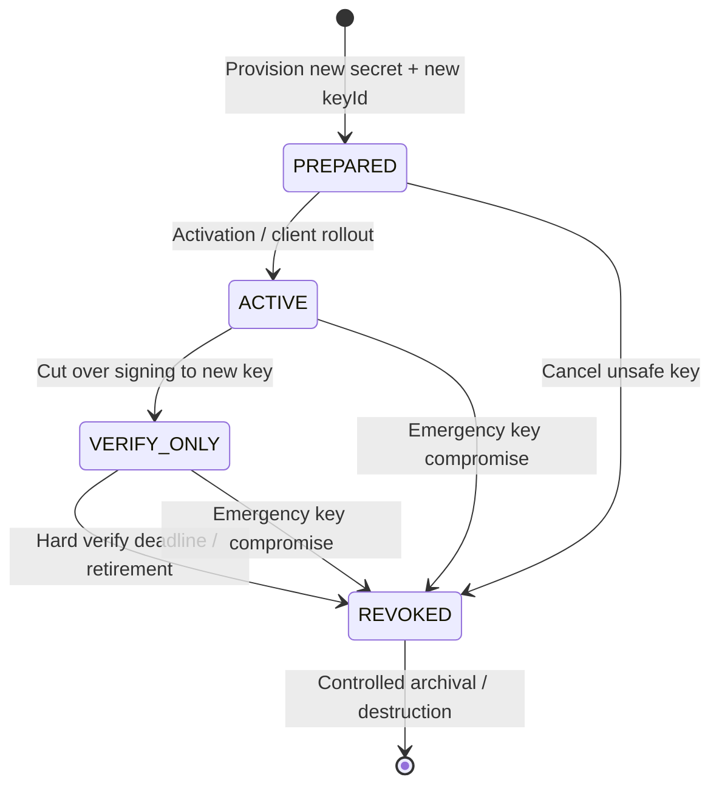
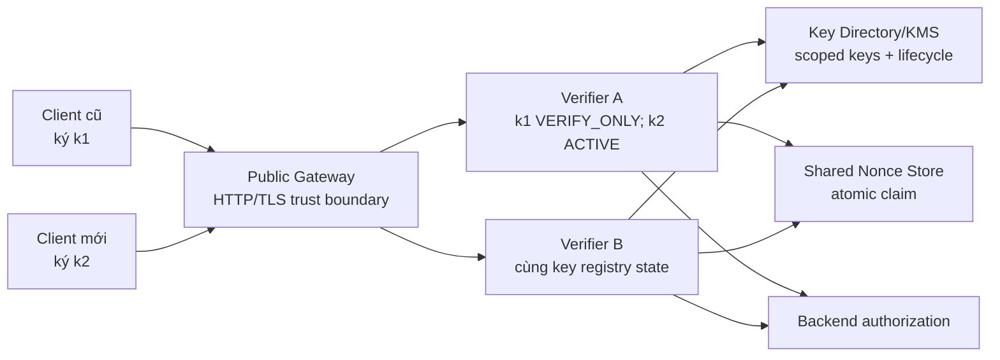

# Key ID rotation trong HMAC Request Authentication

## Mục tiêu học tập

Sau bài học, bạn có thể:

- Giải thích **Key ID** (`keyId` hoặc `kid`) là **mã nhận diện phiên bản khóa**, không phải shared secret và không phải bằng chứng danh tính nếu chưa xác minh HMAC.
- Thiết kế **key ID rotation**: phát hành **khóa mới với key ID mới**, cho server nhận song song khóa mới/cũ có giới hạn, chuyển client sang ký bằng khóa mới, rồi thu hồi khóa cũ.
- Phân biệt **khóa dùng để ký request mới** và **khóa chỉ được dùng để xác minh request đã phát hành**, cùng các trạng thái `PREPARED`, `ACTIVE`, `VERIFY_ONLY`, `REVOKED`.
- Thiết kế lookup đúng **environment + audience + clientId + keyId**, không tra key ID trên toàn hệ thống, không đổi secret phía sau cùng một key ID và không fallback thử mọi key.
- Ràng buộc `keyId` vào **canonical request** cùng method, raw URI, Host, signed headers, timestamp/nonce và SHA-256 body; dùng HMAC-SHA256 để chứng thực đúng phiên bản khóa.
- Viết ví dụ Java 17+ sử dụng `javax.crypto.Mac`, `SecretKeySpec`, `MessageDigest.isEqual`, key registry có vòng đời, signer chọn khóa `ACTIVE` và verifier chấp nhận `VERIFY_ONLY` có hạn.
- Lập runbook rollback, emergency revocation, cache invalidation, phối hợp nhiều replica/vùng và xử lý retry/idempotency khi client đổi key.
- Kiểm thử end-to-end qua proxy/gateway; phân biệt **authentication bằng HMAC**, **chống replay** và **authorization**.

**Bối cảnh:** Bài nằm trong chương **Key identifier**, chủ đề **Key ID rotation**, thuộc module `SECURITY_AUTHENTICATION_HMAC_REQUEST_AUTHENTICATION`. Module hướng tới thiết kế xác thực HTTP request bằng **shared secret** và **canonical request** gồm phương thức HTTP, URI, header hoặc body theo hợp đồng ký; người học thực hành kiểm tra chữ ký, chống replay bằng timestamp/nonce, quản lý key rotation, kiểm thử proxy/gateway và phân biệt xác thực với phân quyền. Trọng tâm ở đây là **vai trò định danh của key ID xuyên toàn bộ vòng đời luân chuyển HMAC secret**, không chỉ việc sinh một chuỗi ID mới.

> **Phạm vi:** `HMAC-V1`, các tham số `client`/`keyid`/`ts`/`nonce`/`sig` và hợp đồng `hmac-key-rotation-v1` dưới đây là **giao thức tự định nghĩa cho ví dụ**. Chúng không phải chuẩn wire format mặc định của các nền tảng HMAC khác. Client, verifier và gateway phải dùng cùng đặc tả trước khi triển khai.

## 1. Key ID là gì và vì sao cần rotation?

Một đối tác `partner-17` có thể được cấp shared secret để tính HMAC cho request:

```text
Client có: clientId = "partner-17"
           keyId    = "k-2026-11-a"
           secret   = 32 raw bytes do hệ thống cấp (GIỮ BÍ MẬT)

Server có: (environment, audience, clientId, keyId)
                    -> key record chứa secret, owner, state, policy
```

`keyId` là **nhãn giúp chọn đúng bản ghi khóa**. Nó có thể lộ trong HTTP header mà không tự tiết lộ secret. Một key ID dễ đoán **không làm HMAC yếu đi** nếu secret mạnh, được bảo vệ và mọi lookup đều kiểm tra scope. Ngược lại, key ID bí mật cũng **không thay thế** shared secret.

### Key ID có ba nhiệm vụ

1. **Chọn phiên bản khóa:** verifier biết request được client đề nghị xác minh bằng `k-2026-11-a` hay `k-2027-01-b`.
2. **Hỗ trợ luân chuyển không ngắt dịch vụ:** trong khoảng overlap có thể xác minh tag bằng **một trong hai bản ghi được phép** — nhưng **mỗi request chỉ tra một key ID cụ thể**.
3. **Giám sát và thu hồi:** quan sát key nào còn ký traffic, xác định client chưa cutover, thu hồi đúng phiên bản khi hết hạn hoặc bị lộ.

**Key ID không tự xác thực caller:** trước khi HMAC khớp, `client="partner-17"` và `keyid="k-2027-01-b"` là **metadata tự khai của bên gửi**. Server có thể dùng chúng cho **lookup ứng viên có giới hạn**, nhưng principal thực chỉ được tạo từ key record sau xác minh.

### Rotation khác đổi thuật toán

| Thao tác | Điều thay đổi | Có phải key ID rotation? |
|---|---|---|
| Thay HMAC secret cũ bằng secret ngẫu nhiên mới, cấp key ID mới | Secret bytes + key record | **Có** |
| Chỉ đổi tên `keyid`, giữ nguyên secret | Nhãn, không tạo key mới | **Không phải luân chuyển secret thực chất** |
| Thay secret nhưng **giữ cùng key ID** | Phá tính bất biến của mapping, gây cache/key confusion | **Không nên làm** |
| HMAC-SHA256 → HMAC-SHA512 | Thuật toán, tag length, contract | Đây là **algorithm/protocol migration**, cần version riêng |
| Chuyển key từ signing sang verify-only | Trạng thái/khả năng được phép sử dụng | Một giai đoạn **của** rotation |
| Thu hồi secret bị lộ | Trạng thái và quyền verify | **Emergency revocation**, có thể không có overlap |

**Quy tắc nền tảng:** trong cùng namespace `(environment, audience, clientId)`, **một `keyId` phải gắn bất biến với một bộ secret material/algorithm policy**. Khi tạo secret mới, **cấp key ID mới**. Đừng để cache của verifier A hiểu `k2` là secret X còn verifier B hiểu `k2` là secret Y.

## 2. Một key ID đúng scope trông như thế nào?

Giả sử `orders-api` phục vụ nhiều đối tác trên môi trường `sandbox` và `production`. Ta định nghĩa định danh bản ghi khóa:

```text
KeyRef(
  environment = "production",
  audience    = "orders-api",
  clientId    = "partner-17",
  keyId       = "k-2027-01-b"
)
```

**`keyId` không nhất thiết duy nhất trên toàn Internet.** Một đối tác khác có thể dùng cùng chuỗi `k-2027-01-b` nếu hệ thống cho phép; việc lookup phải dựa trên **toàn bộ KeyRef**. Có thể chọn key ID globally unique để giảm vận hành khó hiểu, nhưng vẫn phải bảo vệ **scope của owner và audience**.

| Thuộc tính | Lấy từ đâu? | Tin cậy ở bước nào? |
|---|---|---|
| `environment` | Cấu hình server/ingress đã xác lập | Không được để client tùy ý khai rồi dùng để tìm secret production |
| `audience` | Endpoint/service đang xác thực hoặc route đáng tin | Gắn request với API đích; không dựa vào `Host` giả |
| `clientId` | Auth-param tự khai | **Chỉ để lookup** trước HMAC; sau HMAC mới gắn principal |
| `keyId` | Auth-param tự khai | Chọn **một key ứng viên**; chính giá trị key ID phải được ký |
| `principal` | Bản ghi key đã xác minh | Backend dùng cho authorization |

### Key ID được đặt ở đâu?

Có nhiều thiết kế hợp lệ: `X-Key-Id` riêng, field trong `Authorization`, hoặc tham số khác theo scheme. Profile này dùng:

```http
Authorization: HMAC-V1 client="partner-17", keyid="k-2027-01-b", ts="<epoch-seconds>", nonce="<nonce>", sig="<tag>"
```

Đây là **một credential container**, không phải nơi gửi secret. Không dùng query parameter `?keyId=...` như một fallback tùy tiện khi header thiếu: client/server có thể ký một ID nhưng backend chọn ID khác.

Một số hệ thống gọi trường là `kid`; **`kid` và `keyid` không mặc nhiên đồng nghĩa**. Giao thức phải quy định đúng một tên, casing/serialization, duplicate policy và quy tắc mapping tới bản ghi key.

## 3. Vòng đời khóa khi luân chuyển

Key rotation không phải thao tác “thay value trong database và hy vọng mọi client đổi kịp”. Cần tách **quyền ký** và **quyền xác minh**.

| State | Client mới được ký? | Verifier được xác minh? | Ý nghĩa |
|---|---|---|---|
| `PREPARED` | **Không** | **Không** | Secret/key ID đã provision nhưng chưa kích hoạt |
| `ACTIVE` | **Có** (trong hiệu lực) | **Có** | Khóa dùng để ký các request mới |
| `VERIFY_ONLY` | **Không** theo chính sách signer | **Có, tạm thời** tới deadline | Chấp nhận một số request cũ/in-flight khi cutover |
| `REVOKED` | **Không** | **Không** | Thu hồi do hết hạn, lộ secret, sự cố hoặc quyết định bảo mật |

Có thể bổ sung `EXPIRED`/`DESTROYED` để biểu diễn archival, zeroization và tiêu hủy, nhưng không làm thay đổi nguyên tắc **khi đã REVOKED thì không được verify**.

### Quan hệ giữa key state và thời hạn

Mỗi key record có thể có:

- `notBefore`: không được verify trước thời điểm activation đã công bố.
- `signCutover`: thời điểm ngừng **phát hành chữ ký mới** bằng khóa cũ tại các client. Đây thường là policy triển khai của signer.
- `verifyUntil`: **deadline cứng theo clock của verifier** mà sau đó key không được verify nữa.
- `state`: quyền hiện tại; `REVOKED` ghi đè các deadline đã định.

**Một chi tiết an ninh quan trọng:** nếu server giữ khóa cũ ở `VERIFY_ONLY`, **bất kỳ ai còn biết secret cũ vẫn có thể tạo một request mới** và ký HMAC hợp lệ cho tới deadline verify, trừ khi có thêm policy đáng tin khác. Timestamp trong request là **self-asserted** bởi bên giữ secret, không tự chứng minh chữ ký được tạo **trước signCutover**. Vì vậy cần **overlap hữu hạn và hard verifyUntil**, không nên để verify-only vô thời hạn.

### Sơ đồ vòng đời



Để không nhầm lẫn: **hai bản ghi khóa cùng client có thể ở state khác nhau tại cùng thời điểm**. Ví dụ k1=`VERIFY_ONLY` và k2=`ACTIVE`, không phải “chuyển” một secret duy nhất thành secret khác dưới cùng key ID.

## 4. Runbook luân chuyển key ID không gián đoạn

Một kế hoạch dễ audit nên có ít nhất năm giai đoạn.

### Giai đoạn A — Chuẩn bị và phân phối khóa mới

1. Tạo **secret mới, độc lập**, bằng CSPRNG/KMS/HSM phù hợp; ví dụ 32 bytes ngẫu nhiên cho HMAC-SHA256 theo policy.
2. Cấp **key ID mới** `k2`, không tái sử dụng `k1`, không đặt secret trong key ID.
3. Tạo key record `(production, orders-api, partner-17, k2)` ở trạng thái `PREPARED` cùng metadata owner, policy, timestamps, audit.
4. Phân phối secret mới tới client được phép qua kênh bảo mật; dùng secret manager và quy trình xác thực người nhận.
5. Đảm bảo **tất cả verifier có thể lookup k2 và hiểu version hợp đồng** trước khi client bắt đầu dùng nó; nếu không, rollout sẽ phát sinh hàng loạt 401.

### Giai đoạn B — Kích hoạt xác minh và ký mới

- Chuyển `k2` sang `ACTIVE` theo lịch có kiểm soát, đồng bộ trạng thái tới mọi replica.
- Cho client **chọn k2 làm signing key ưu tiên**; mỗi HTTP attempt dùng `keyid="k2"` trong Authorization và **secret k2** để tính HMAC.
- Giữ `k1` ở `VERIFY_ONLY` theo chính sách có hạn nếu cần chấp nhận request còn trên mạng hoặc các client chưa kịp cutover.
- **Không** cho client tự thử lần lượt k1/k2 khi nhận lỗi signature chung mà không có lý do/cấu hình rõ; automatic downgrade có thể khiến rotation không bao giờ hoàn tất.

### Giai đoạn C — Giám sát overlap

Đo traffic được xác minh bằng k1/k2 theo client, region, SDK version và endpoint. Xác định client nào còn ký bằng khóa cũ, queue/offline worker nào còn giữ cấu hình cũ, cache key lifecycle nào chưa cập nhật.

Không đọc raw secret từ metrics; chỉ dùng `keyId`, state và thống kê đã lọc. Không log nguyên Authorization header hoặc body cá nhân.

### Giai đoạn D — Dừng xác minh khóa cũ

Đến **hard verifyUntil** hoặc sau khi đủ điều kiện được công bố:

- Chuyển `k1` sang `REVOKED` hoặc trạng thái không còn verify.
- Invalidate/refresh cache key state trên mọi node, gateway và vùng.
- Đảm bảo **mọi request ký bằng k1 bị từ chối**, kể cả HMAC có thể được tính đúng.
- Giữ audit không chứa secret và xử lý tiêu hủy/xóa secret theo retention/security policy.

### Giai đoạn E — Tổng kết và dự phòng

- Xác nhận không còn signers cũ, không còn verifier chấp nhận k1.
- Kiểm tra cơ chế **không thể phục hồi k1 từ backup/cache stale** một cách gây bypass.
- Kiểm thử lộ key, outage KMS, multi-region split-brain, emergency revoke và bản phát hành client chậm.
- Lên lịch rotation kế tiếp với số liệu thực tế về lead time/cutover.

### Ví dụ timeline

```text
T0      : k1 ACTIVE, k2 PREPARED; verifier đồng bộ metadata
T1      : k2 ACTIVE; client bắt đầu ký k2
T1...T2 : k1 VERIFY_ONLY + k2 ACTIVE; overlap có giới hạn
T2      : k1 REVOKED; chỉ k2 verify
T3      : hoàn thành audit, tiêu hủy/archival theo chính sách
```

Các mốc T0–T3 phải được chọn theo **latency, clock drift, queue/backlog, khả năng cập nhật client và độ nhạy của API**. Không coi overlap dài hơn luôn an toàn hơn: **mỗi phút giữ k1 được verify là thêm thời gian có thể dùng secret cũ**.

## 5. Key ID và canonical request: bắt buộc ký chính key ID

Không đủ nếu verifier đọc `keyid=k2`, tìm secret rồi so HMAC mà **canonical message bỏ key ID**. Key ID góp phần ràng buộc ngữ cảnh key identity và tránh nhầm phiên bản/tenant/audience.

Hợp đồng `hmac-key-rotation-v1` dùng một endpoint minh họa:

```http
POST /v1/orders HTTP/1.1
Host: api.example.test
Content-Type: application/json
Idempotency-Key: order-2026-001
Authorization: HMAC-V1 client="partner-17", keyid="k2", ts="<unix-seconds>", nonce="<22-char-base64url>", sig="<43-char-base64url>"

{"orderId":"O-42","amountMinor":120000}
```

Mỗi dấu `<...>` là placeholder.

Canonical text phiên bản này:

```text
hmac-key-rotation-v1
POST
/v1/orders
host:api.example.test
content-type:application/json
idempotency-key:order-2026-001
environment:production
audience:orders-api
auth-scheme:hmac-v1
client:partner-17
keyid:k2
ts:<unix-seconds>
nonce:<22-char-base64url>
body-sha256:<base64url-sha256-raw-body>
```

**Quy tắc byte-level:**

- Thứ tự dòng **cố định**, nối bằng **LF (0x0A)**, **không có LF cuối**.
- Mã hóa canonical text thành **UTF-8 không BOM**.
- `environment` và `audience` được cấu hình ở client và xác lập từ **context đáng tin của server**, không cho client khai tùy ý rồi lấy làm nguồn xác thực.
- `client`, **`keyid`**, `ts`, `nonce` là **giá trị từ Authorization đã parse và validate**, không phải raw header text; giá trị ID **phân biệt hoa/thường**.
- `auth-scheme:hmac-v1` ràng buộc version authentication scheme, không nhận `alg=none` hoặc thuật toán do input quyết định.
- `body-sha256` được tính trên **exact raw request body bytes** từ HTTP request thực nhận, không phải JSON parse rồi serialize lại.
- `Idempotency-Key` được ký vì backend dùng nó cho retry/business dedup.
- `sig` **không nằm trong canonical request** vì chính nó là HMAC tag đang được tính.

Sau đó:

```text
tagBytes = HMAC-SHA256(secretBytesForKeyId, UTF8(canonicalText))
sigText  = Base64URL_NoPadding(tagBytes) // 32 bytes -> 43 ký tự
```

**Nếu attacker thay `keyid="k1"` thành `keyid="k2"` nhưng giữ `sig` cũ:** verifier chọn **secret k2** và đưa **keyid:k2** vào canonical; expected tag không còn khớp tag cũ, trừ khả năng giả mạo mật mã không thực tế. Đừng thiết kế một “try all keys” path để chấp nhận bất kỳ secret nào có tag trùng.

### Key ID không phải access role

Một ID như `admin-key-2027` không chứng minh bearer là admin. Chỉ **principal và quyền** của key record đã được HMAC xác minh mới được dùng khi authorization. Không phân quyền dựa trên substring `"admin"` của key ID, không cho caller tự tạo header `X-Principal`.

## 6. Authorization parser và key lookup phải nghiêm ngặt

Profile minh họa dùng chính xác năm auth-param theo thứ tự:

```text
Authorization: HMAC-V1 client="<clientId>", keyid="<keyId>", ts="<epochSeconds>", nonce="<nonceB64Url>", sig="<macB64Url>"
```

| Trường | Yêu cầu |
|---|---|
| Header `Authorization` | **Đúng một occurrence** từ ingress; không gộp hai header thành chuỗi mơ hồ |
| `HMAC-V1` | Tên scheme **case-insensitive**, canonical thành `hmac-v1` |
| Parameter names | `client`, `keyid`, `ts`, `nonce`, `sig` **case-insensitive** |
| Order/quotes/commas | Cố định theo profile; không escaped quote hay extra param |
| Client ID / Key ID | ASCII `[A-Za-z0-9][A-Za-z0-9._-]{0,63}`, values **case-sensitive** |
| Timestamp | Unix epoch seconds decimal không leading zero, 1–12 chữ số |
| Nonce | 16 bytes CSPRNG, Base64URL không padding **22 ký tự**, canonical re-encode |
| Signature | Full 32-byte HMAC-SHA256, Base64URL không padding **43 ký tự**, canonical re-encode |
| Algorithm | Server xác định HMAC-SHA256, không nhận `alg` tùy ý |
| Key reference | `(serverEnv, serverAudience, clientId, keyId)` |
| Key state | Có quyền `VERIFY` ở **thời điểm server** và chưa REVOKED |

Theo HTTP authentication nói chung, **scheme và auth-param names không phân biệt hoa/thường**. Profile này **hạn chế** serialization để loại nhập nhằng; không khẳng định mọi spacing/order khác đều sai theo toàn bộ HTTP. Nếu server cần một parser linh hoạt hơn, phải có grammar rõ và duplicate detection, không `split(",")` tùy tiện.

### Không chấp nhận những input này

```http
Authorization: HMAC-V1 client="partner-17", keyid="k1", keyid="k2", ts="...", nonce="...", sig="..."
Authorization: HMAC-V1 client="partner-17", keyid="k1", KEYID="k2", ts="...", nonce="...", sig="..."
Authorization: HMAC-V1 client="partner-17", keyid="", ts="...", nonce="...", sig="..."
Authorization: HMAC-V1 client="partner-17", keyid="k1", alg="none", ts="...", nonce="...", sig="..."
```

Các dấu `...` chỉ để minh họa lỗi. Phải reject duplicate `keyid` kể cả tên khác case. Nếu verifier chọn key ID đầu tiên nhưng canonical builder lấy ID cuối, việc xác minh không còn ràng buộc đúng secret identity.

### Lookup đúng scope, không thử dàn trải

**Đúng:**

```text
candidate = keyStore.find(
    environment = "production",       // từ server
    audience    = "orders-api",        // từ endpoint đáng tin
    clientId    = auth.clientId,       // untrusted lookup input
    keyId       = auth.keyId           // untrusted lookup input
)
if missing / revoked / expired: reject
expected = HMAC(candidate.secret, canonicalFromActualRequest)
accept only if expectedTag == suppliedTag
```

**Sai:** lấy `keyId` làm khóa map toàn cục không có owner; khi không tìm thấy thì thử secret của client khác; khi sai signature thì fallback sang k1; hoặc coi key có ID trông đúng là authenticated principal.

Bảo vệ key directory trước **enumeration và DoS**: giới hạn ID grammar/length, request rate, lookup budget và trả lỗi công khai không lộ key existence. Không lấy key ID của client làm tên file path, câu SQL ghép chuỗi hoặc log raw secret.

## 7. HMAC verification và state key phải là hai điều kiện độc lập

Một chữ ký đúng về toán học chưa đủ cho phép request đi qua nếu bản ghi khóa đã bị thu hồi.

```mermaid
sequenceDiagram
    autonumber
    participant C as Client
    participant G as API Gateway
    participant V as HMAC Verifier
    participant K as Key Directory / KMS
    participant N as Shared Nonce Store
    participant B as Backend
    C->>C: Chọn ACTIVE keyId và secret
    C->>C: Canonical request có keyid + timestamp + nonce
    C->>G: HTTPS request + Authorization HMAC-V1
    G->>G: HTTP parse, duplicate header/target/body checks
    G->>V: Trusted request snapshot
    V->>V: Parse keyid/nonce/sig, validate timestamp window
    V->>K: find(env,audience,clientId,keyId)
    K-->>V: Key record + state + verifyUntil + principal
    V->>V: Kiểm tra key được verify tại clock server
    V->>V: HMAC(secret, server canonical bytes)
    V->>V: MessageDigest.isEqual(expectedTag, receivedTag)
    alt Key sai / revoked / expired / MAC mismatch
        V-->>G: Reject authentication; không claim nonce
        G-->>C: Authentication failure
    else Key và MAC hợp lệ
        V->>N: Atomic claim(env,audience,client,nonce,TTL)
        alt Nonce trùng hoặc store lỗi
            V-->>G: Reject replay / fail closed
            G-->>C: Error
        else Nonce mới
            N-->>V: Claimed
            V->>B: Authenticated principal + verified request
            B->>B: Resource authorization + idempotency
            B-->>G: Business outcome
            G-->>C: Response
        end
    end
```

**Verifier đọc `keyid` để tìm khóa**, nhưng **không đánh đồng “tìm được khóa” với “đã xác thực caller”**. Chỉ khi key status policy cho phép, expected MAC đúng **trên request thực nhận**, nonce được claim, mới tạo authenticated principal.

### Verify-only không phải một thuật toán kiểm chứng nguồn gốc thời điểm ký

Server không thể chỉ nhìn `ts="..."` mà biết một chữ ký bằng secret k1 đã được tính **trước cutover** hay **sau cutover**. Ai nắm k1 có thể ký timestamp còn trong cửa sổ. `VERIFY_ONLY` là **chính sách vận hành hạn chế signer hợp lệ và chấp nhận key cũ trong thời gian ngắn**, không phải một phép chứng minh mật mã rằng mọi chữ ký k1 đều thực sự phát hành trong quá khứ.

Do đó một mốc `verifyUntil` được enforcement **theo server clock** là cần thiết. Nếu k1 bị nghi lộ, **revocation ngay** có thể quan trọng hơn việc tránh gián đoạn cho các client chậm cập nhật.

## 8. Timestamp, nonce, key ID và idempotency khi đổi phiên bản

### Timestamp/nonce của một request vẫn được ký như bình thường

Ví dụ cửa sổ timestamp `±300 giây`. Dù dùng k1 hay k2, verifier vẫn phải kiểm tra:

- Timestamp theo **Unix epoch seconds**, được HMAC ký và nằm trong policy window theo clock server.
- Nonce được ký, đúng format 16 byte CSPRNG → 22 Base64URL characters.
- HMAC-SHA256 được tính với **secret ứng với key ID được khai** sau lookup đúng scope.
- Nonce được claim bằng **shared atomic store** sau khi HMAC đúng và trước side effect.

### Đừng đổi nonce namespace theo key ID

Nếu nonce store dùng khóa:

```text
(environment, audience, authenticatedClientId, keyId, nonce)
```

thì cùng client có thể có **hai namespace nonce** khi k1 và k2 overlap. Nếu chính sách muốn *một nonce dùng tối đa một lần cho một client/audience* bất kể phiên bản key, cách này tạo điểm yếu so với mục tiêu đó.

Một scope phù hợp hơn:

```text
(environment, audience, authenticatedClientId, nonce)
```

Lưu ý kẻ không biết secret vẫn không thể tự đổi `keyid` và ký lại hợp lệ; rủi ro namespace tách rõ hơn với client có cả k1/k2 hoặc key bị lộ. Thiết kế scope phải phù hợp với **đối tượng được bảo vệ**, không chọn chỉ vì tiện ghép Redis key.

### TTL bao phủ time window, không dựa trên key overlap

Với thời gian hợp lệ `now-W ≤ t ≤ now+W`, một timestamp t có thể được chấp nhận từ `t-W` đến `t+W`: tổng tối đa **`2W`**.

Nếu dùng TTL cố định từ lúc claim:

```text
nonce TTL >= 2 * W + safetyMargin

Với W = 300 s, margin lab = 5 s:
nonce TTL >= 605 s
```

Key k1/k2 có thời gian overlap **khác** với TTL nonce; không lấy “overlap 10 phút” để mặc nhiên đặt nonce TTL 10 phút. Cần tính drift, replication, failover và thời gian lưu replay theo chính sách cụ thể.

### Retry cùng logical operation khi chuyển k1 → k2

Giả sử client gửi tạo đơn với k1, nhận timeout, rồi re-sign bằng k2:

```text
Logical operation:
  Idempotency-Key = order-2026-001
  raw business body = same bytes

Attempt A:
  keyid=k1, timestamp=T1, nonce=N1, sig=HMAC(k1, canonicalA)

Attempt B:
  keyid=k2, timestamp=T2, nonce=N2, sig=HMAC(k2, canonicalB)
```

Hai attempts có thể **được xác thực riêng** bằng hai khóa hợp lệ ở các thời điểm tương ứng. Replay gate của B có thể pass vì N2 mới. Backend vẫn phải dùng **idempotency ledger** có scope theo authenticated principal/tenant/operation và key ổn định, **không tách idempotency namespace theo key ID** nếu cùng một logical operation.

**Nonce khác Idempotency-Key:** nonce **mới trên mỗi lần gửi được ký lại**, còn Idempotency-Key **giữ nguyên khi retry cùng ý định**. Việc đổi HMAC key không tự biến một ý định tạo đơn thành hai đơn được phép.

## 9. Java 17+: key ID rotation với signer, parser và verifier

Ví dụ dưới đây minh họa **hai key records cùng client có secret khác nhau**:

- `k1` dùng để **ký request trước cutover**; sau cutover bản ghi verifier là `VERIFY_ONLY` đến `verifyUntil`.
- `k2` là `ACTIVE`, được phép ký request mới và được verifier chấp nhận.
- Verifier chọn **duy nhất một candidate** bằng `KeyRef(environment, audience, clientId, keyId)`.
- `keyid` **được HMAC ký**, tag so bằng `MessageDigest.isEqual`, nonce được claim **sau MAC**.
- Trạng thái `REVOKED` hoặc quá `verifyUntil` khiến request bị reject ngay cả khi người gửi biết secret và tự tính tag đúng.

Đây là **demo JDK độc lập**. `KeyDirectory` và `NonceStore` là interface để triển khai bằng secret manager/KMS và Redis/SQL tương ứng. Bộ in-memory trong `main` chỉ minh họa và **không đáp ứng production đa replica**.

### 9.1. Mã Java tự chứa

```java
import java.nio.charset.StandardCharsets;
import java.security.GeneralSecurityException;
import java.security.MessageDigest;
import java.security.SecureRandom;
import java.time.Clock;
import java.time.Instant;
import java.time.ZoneOffset;
import java.util.Base64;
import java.util.Map;
import java.util.Optional;
import java.util.Set;
import java.util.concurrent.ConcurrentHashMap;
import java.util.regex.Matcher;
import java.util.regex.Pattern;
import javax.crypto.Mac;
import javax.crypto.spec.SecretKeySpec;

public final class HmacKeyIdRotationV1 {
    private static final String CONTRACT = "hmac-key-rotation-v1";
    private static final String ENVIRONMENT = "production";
    private static final String AUDIENCE = "orders-api";
    private static final String PUBLIC_HOST = "api.example.test";
    private static final String TARGET = "/v1/orders";
    private static final String CONTENT_TYPE = "application/json";
    private static final long CLOCK_WINDOW_SECONDS = 300;
    private static final long NONCE_TTL_SECONDS = 605;
    private static final long MAX_EPOCH_SECONDS = 253402300799L;
    private static final Base64.Encoder B64 =
            Base64.getUrlEncoder().withoutPadding();

    private static final Pattern ID =
            Pattern.compile("[A-Za-z0-9][A-Za-z0-9._-]{0,63}");
    private static final Pattern TS =
            Pattern.compile("[1-9][0-9]{0,11}");
    private static final Pattern NONCE =
            Pattern.compile("[A-Za-z0-9_-]{22}");
    private static final Pattern SIGNATURE =
            Pattern.compile("[A-Za-z0-9_-]{43}");
    private static final Pattern AUTH = Pattern.compile(
            "(?i:HMAC-V1) (?i:client)=\"([A-Za-z0-9][A-Za-z0-9._-]{0,63})\", " +
            "(?i:keyid)=\"([A-Za-z0-9][A-Za-z0-9._-]{0,63})\", " +
            "(?i:ts)=\"([1-9][0-9]{0,11})\", " +
            "(?i:nonce)=\"([A-Za-z0-9_-]{22})\", " +
            "(?i:sig)=\"([A-Za-z0-9_-]{43})\"");
    private static final Pattern IDEMPOTENCY =
            Pattern.compile("[A-Za-z0-9][A-Za-z0-9._-]{0,79}");

    private HmacKeyIdRotationV1() {}

    public enum KeyState { PREPARED, ACTIVE, VERIFY_ONLY, REVOKED }

    // Identity bất biến: secret mới -> KeyRef mới.
    public record KeyRef(
            String environment, String audience,
            String clientId, String keyId) {}

    public record KeyRecord(
            KeyRef ref, String principal, KeyState state,
            Instant notBefore, Instant verifyUntil,
            byte[] secret) {

        public KeyRecord {
            if (secret == null || secret.length < 32) {
                throw new IllegalArgumentException("Bad key material");
            }
            secret = secret.clone();
        }

        @Override
        public byte[] secret() {
            return secret.clone();
        }

        public boolean mayVerify(Instant now) {
            return (state == KeyState.ACTIVE ||
                    state == KeyState.VERIFY_ONLY)
                    && !now.isBefore(notBefore)
                    && now.isBefore(verifyUntil);
        }

        public boolean maySign(Instant now) {
            // Signer chỉ cho ACTIVE key tạo request mới.
            return state == KeyState.ACTIVE
                    && !now.isBefore(notBefore)
                    && now.isBefore(verifyUntil);
        }
    }

    public record Claims(
            String clientId, String keyId,
            String timestamp, String nonce) {}

    public record Parsed(Claims claims, byte[] tag) {}

    // Từ trusted HTTP adapter; clone raw body để bất biến.
    public record Request(
            String method, String rawTarget, String publicAuthority,
            String contentType, String idempotencyKey, byte[] rawBody) {

        public Request {
            if (rawBody == null) {
                throw new IllegalArgumentException("Missing raw body");
            }
            rawBody = rawBody.clone();
        }

        @Override
        public byte[] rawBody() {
            return rawBody.clone();
        }
    }

    public interface KeyDirectory {
        Optional<KeyRecord> find(KeyRef ref);
    }

    public interface NonceStore {
        // Atomic và shared giữa tất cả verifier có thể nhận cùng scope.
        boolean claim(String environment, String audience,
                      String authenticatedClientId, String nonce,
                      long ttlSeconds);
    }

    public static String newNonce(SecureRandom rng) {
        byte[] nonce = new byte[16];
        rng.nextBytes(nonce);
        return B64.encodeToString(nonce);
    }

    private static byte[] decodeCanonical(
            String text, Pattern grammar, int length) {
        if (text == null || !grammar.matcher(text).matches()) {
            throw new IllegalArgumentException("Bad auth encoding format");
        }
        final byte[] decoded;
        try {
            decoded = Base64.getUrlDecoder().decode(text);
        } catch (IllegalArgumentException malformed) {
            throw new IllegalArgumentException("Bad Base64URL");
        }
        if (decoded.length != length ||
                !B64.encodeToString(decoded).equals(text)) {
            throw new IllegalArgumentException("Noncanonical Base64URL");
        }
        return decoded;
    }

    private static long parseTimestamp(String text) {
        if (text == null || !TS.matcher(text).matches()) {
            throw new IllegalArgumentException("Bad timestamp format");
        }
        long t = Long.parseLong(text);
        if (t > MAX_EPOCH_SECONDS) {
            throw new IllegalArgumentException("Timestamp out of range");
        }
        return t;
    }

    private static void validateClaims(Claims c) {
        if (c == null || c.clientId() == null ||
                !ID.matcher(c.clientId()).matches() ||
                c.keyId() == null ||
                !ID.matcher(c.keyId()).matches()) {
            throw new IllegalArgumentException("Bad key identity");
        }
        parseTimestamp(c.timestamp());
        decodeCanonical(c.nonce(), NONCE, 16);
    }

    // Parser nhận đúng một Authorization value do ingress đã kiểm tra.
    public static Parsed parseAuthorization(String header) {
        if (header == null || header.length() > 512) {
            throw new IllegalArgumentException("Bad Authorization header");
        }
        Matcher m = AUTH.matcher(header);
        if (!m.matches()) {
            throw new IllegalArgumentException("Bad auth-param syntax");
        }
        Claims c = new Claims(
                m.group(1), m.group(2), m.group(3), m.group(4));
        validateClaims(c);
        return new Parsed(c, decodeCanonical(m.group(5), SIGNATURE, 32));
    }

    // Client và verifier dùng cùng hợp đồng. Server dựng lại từ
    // method/target/authority/headers/body THỰC NHẬN.
    public static byte[] canonicalBytes(Request r, Claims c)
            throws GeneralSecurityException {
        validateClaims(c);
        if (r == null ||
                !"POST".equals(r.method()) ||
                !TARGET.equals(r.rawTarget()) ||
                !PUBLIC_HOST.equals(r.publicAuthority()) ||
                !CONTENT_TYPE.equals(r.contentType()) ||
                r.idempotencyKey() == null ||
                !IDEMPOTENCY.matcher(r.idempotencyKey()).matches() ||
                r.rawBody().length == 0 ||
                r.rawBody().length > 16384) {
            throw new IllegalArgumentException("Bad signed request");
        }

        byte[] bodyHash = MessageDigest.getInstance("SHA-256")
                .digest(r.rawBody());
        String canonical = String.join("\n",
                CONTRACT,
                "POST",
                TARGET,
                "host:" + r.publicAuthority(),
                "content-type:" + r.contentType(),
                "idempotency-key:" + r.idempotencyKey(),
                "environment:" + ENVIRONMENT,
                "audience:" + AUDIENCE,
                "auth-scheme:hmac-v1",
                "client:" + c.clientId(),
                "keyid:" + c.keyId(),
                "ts:" + c.timestamp(),
                "nonce:" + c.nonce(),
                "body-sha256:" + B64.encodeToString(bodyHash));

        return canonical.getBytes(StandardCharsets.UTF_8);
    }

    private static byte[] computeTag(
            byte[] secret, Request request, Claims claims)
            throws GeneralSecurityException {
        Mac mac = Mac.getInstance("HmacSHA256");
        mac.init(new SecretKeySpec(secret, "HmacSHA256"));
        return mac.doFinal(canonicalBytes(request, claims));
    }

    // Client-side signer: không cho VERIFY_ONLY hoặc REVOKED ký mới.
    public static String signAuthorization(
            KeyRecord signingKey, Request request,
            Claims claims, Clock clock)
            throws GeneralSecurityException {
        if (signingKey == null ||
                !signingKey.maySign(clock.instant()) ||
                !ENVIRONMENT.equals(signingKey.ref().environment()) ||
                !AUDIENCE.equals(signingKey.ref().audience()) ||
                !signingKey.ref().clientId().equals(claims.clientId()) ||
                !signingKey.ref().keyId().equals(claims.keyId())) {
            throw new IllegalArgumentException("Signing key not ACTIVE");
        }

        long t = parseTimestamp(claims.timestamp());
        long now = clock.instant().getEpochSecond();
        if (now < 0 || now > MAX_EPOCH_SECONDS ||
                t - now < -CLOCK_WINDOW_SECONDS ||
                t - now > CLOCK_WINDOW_SECONDS) {
            throw new IllegalArgumentException("Bad signing timestamp");
        }

        String sig = B64.encodeToString(
                computeTag(signingKey.secret(), request, claims));
        return "HMAC-V1 client=\"" + claims.clientId() +
                "\", keyid=\"" + claims.keyId() +
                "\", ts=\"" + claims.timestamp() +
                "\", nonce=\"" + claims.nonce() +
                "\", sig=\"" + sig + "\"";
    }

    public static Optional<String> authenticate(
            Request incoming, String header,
            Clock serverClock, KeyDirectory keys, NonceStore nonces)
            throws GeneralSecurityException {
        final Parsed auth;
        try {
            auth = parseAuthorization(header);
            canonicalBytes(incoming, auth.claims());
        } catch (IllegalArgumentException malformed) {
            return Optional.empty();
        }

        long t = parseTimestamp(auth.claims().timestamp());
        long nowSeconds = serverClock.instant().getEpochSecond();
        if (nowSeconds < 0 || nowSeconds > MAX_EPOCH_SECONDS ||
                t - nowSeconds < -CLOCK_WINDOW_SECONDS ||
                t - nowSeconds > CLOCK_WINDOW_SECONDS) {
            return Optional.empty();
        }

        KeyRef ref = new KeyRef(
                ENVIRONMENT, AUDIENCE,
                auth.claims().clientId(), auth.claims().keyId());
        Optional<KeyRecord> candidate = keys.find(ref);
        if (candidate.isEmpty()) return Optional.empty();

        KeyRecord key = candidate.get();
        if (!ref.equals(key.ref()) ||
                key.principal() == null ||
                !key.mayVerify(serverClock.instant())) {
            return Optional.empty();
        }

        byte[] expected = computeTag(
                key.secret(), incoming, auth.claims());
        if (!MessageDigest.isEqual(expected, auth.tag())) {
            return Optional.empty();
        }

        // Key ID KHÔNG nằm trong nonce scope: đồng nhất qua rotation.
        final boolean claimed;
        try {
            claimed = nonces.claim(
                    ENVIRONMENT, AUDIENCE, key.ref().clientId(),
                    auth.claims().nonce(), NONCE_TTL_SECONDS);
        } catch (RuntimeException storeUnavailable) {
            return Optional.empty(); // Fail closed.
        }
        if (!claimed) return Optional.empty();

        // Principal đã xác thực; backend vẫn phải authorize.
        return Optional.of(key.principal());
    }

    public static void main(String[] args)
            throws GeneralSecurityException {
        Instant cutover = Instant.parse("2026-11-28T00:00:00Z");
        Clock before = Clock.fixed(
                cutover.minusSeconds(60), ZoneOffset.UTC);
        Clock atCutover = Clock.fixed(cutover, ZoneOffset.UTC);
        Clock afterRetire = Clock.fixed(
                cutover.plusSeconds(601), ZoneOffset.UTC);

        SecureRandom random = new SecureRandom();
        byte[] oldSecret = new byte[32];
        byte[] newSecret = new byte[32];
        random.nextBytes(oldSecret);
        random.nextBytes(newSecret); // Hai secret KHÁC NHAU.

        KeyRef oldRef = new KeyRef(
                ENVIRONMENT, AUDIENCE, "partner-17", "k1");
        KeyRef newRef = new KeyRef(
                ENVIRONMENT, AUDIENCE, "partner-17", "k2");
        Instant start = cutover.minusSeconds(86400);
        Instant oldHardVerifyUntil = cutover.plusSeconds(600);
        Instant newVerifyUntil = cutover.plusSeconds(86400);

        // Trước cutover, client vẫn được ký bằng k1.
        KeyRecord oldSigning = new KeyRecord(
                oldRef, "svc:partner-17", KeyState.ACTIVE,
                start, oldHardVerifyUntil, oldSecret);

        Request order = new Request(
                "POST", TARGET, PUBLIC_HOST, CONTENT_TYPE,
                "order-2026-001",
                "{\"orderId\":\"O-42\",\"amountMinor\":120000}"
                        .getBytes(StandardCharsets.UTF_8));

        Claims oldClaims = new Claims(
                "partner-17", "k1",
                Long.toString(before.instant().getEpochSecond()),
                newNonce(random));
        String oldHeader = signAuthorization(
                oldSigning, order, oldClaims, before);

        // Sau cutover, key cùng ID/secret chuyển sang VERIFY_ONLY;
        // key k2 ACTIVE. Không thay secret phía sau keyId k1.
        KeyRecord oldVerifyOnly = new KeyRecord(
                oldRef, "svc:partner-17", KeyState.VERIFY_ONLY,
                start, oldHardVerifyUntil, oldSecret);
        KeyRecord newActive = new KeyRecord(
                newRef, "svc:partner-17", KeyState.ACTIVE,
                cutover.minusSeconds(3600),
                newVerifyUntil, newSecret);

        Map<KeyRef, KeyRecord> records =
                Map.of(oldRef, oldVerifyOnly, newRef, newActive);
        KeyDirectory keys = ref -> Optional.ofNullable(records.get(ref));

        // Test fixture trong một JVM: chưa có TTL/durable/shared state.
        Set<String> seen = ConcurrentHashMap.newKeySet();
        NonceStore nonces = (env, aud, client, nonce, ttl) ->
                seen.add(env + "|" + aud + "|" + client + "|" + nonce);

        // Request đã ký bằng k1 trước cutover vẫn được verify tạm thời.
        if (!"svc:partner-17".equals(authenticate(
                order, oldHeader, atCutover, keys, nonces)
                .orElse(null))) {
            throw new AssertionError("Old in-flight signature rejected");
        }

        // Nhưng signer đã chuyển k1 sang VERIFY_ONLY thì không ký mới.
        try {
            signAuthorization(oldVerifyOnly, order, oldClaims, atCutover);
            throw new AssertionError("VERIFY_ONLY key signed request");
        } catch (IllegalArgumentException expected) {
            // PASS.
        }

        // Request mới phải ký bằng k2 và vẫn tạo cùng principal.
        Claims newClaims = new Claims(
                "partner-17", "k2",
                Long.toString(atCutover.instant().getEpochSecond()),
                newNonce(random));
        String newHeader = signAuthorization(
                newActive, order, newClaims, atCutover);
        if (!"svc:partner-17".equals(authenticate(
                order, newHeader, atCutover, keys, nonces)
                .orElse(null))) {
            throw new AssertionError("New signing key rejected");
        }

        // Dùng nonce CHƯA được claim để test riêng ràng buộc keyId/HMAC.
        Claims changedKeySource = new Claims(
                "partner-17", "k1",
                Long.toString(before.instant().getEpochSecond()),
                newNonce(random));
        String freshOldHeader = signAuthorization(
                oldSigning, order, changedKeySource, before);

        // Đổi keyid trên Authorization nhưng giữ tag cũ: reject HMAC.
        String relabeled = freshOldHeader.replace(
                "keyid=\"k1\"", "keyid=\"k2\"");
        if (authenticate(order, relabeled, atCutover,
                keys, nonces).isPresent()) {
            throw new AssertionError("Changed keyId accepted");
        }

        // Replay nguyên request cũ bị chặn bởi nonce store.
        if (authenticate(order, oldHeader, atCutover,
                keys, nonces).isPresent()) {
            throw new AssertionError("Replay accepted");
        }

        // Dùng lại nonce của request k1 nhưng ký HMAC MỚI bằng k2:
        // phải reject do namespace chống replay không tách theo keyId.
        Claims reusedNonceAcrossKeys = new Claims(
                "partner-17", "k2",
                Long.toString(atCutover.instant().getEpochSecond()),
                oldClaims.nonce());
        String reusedNonceHeader = signAuthorization(
                newActive, order, reusedNonceAcrossKeys, atCutover);
        if (authenticate(order, reusedNonceHeader, atCutover,
                keys, nonces).isPresent()) {
            throw new AssertionError("Nonce reused across keys accepted");
        }

        // Cố tình tạo một chữ ký mới bằng oldSecret để chứng minh:
        // quá hard verifyUntil thì k1 không được verify, dù HMAC đúng.
        Claims lateClaims = new Claims(
                "partner-17", "k1",
                Long.toString(afterRetire.instant().getEpochSecond()),
                newNonce(random));
        KeyRecord hypotheticalOldSigner = new KeyRecord(
                oldRef, "svc:partner-17", KeyState.ACTIVE,
                start, afterRetire.instant().plusSeconds(60),
                oldSecret);
        String oldLateHeader = signAuthorization(
                hypotheticalOldSigner, order, lateClaims, afterRetire);
        if (authenticate(order, oldLateHeader, afterRetire,
                keys, nonces).isPresent()) {
            throw new AssertionError("Expired old key accepted");
        }

        // Key bị REVOKED phải bị từ chối ngay, kể cả chưa hết deadline.
        KeyRecord revokedOld = new KeyRecord(
                oldRef, "svc:partner-17", KeyState.REVOKED,
                start, oldHardVerifyUntil, oldSecret);
        KeyDirectory afterRevoke = ref ->
                Optional.ofNullable(
                        Map.of(oldRef, revokedOld, newRef, newActive)
                                .get(ref));
        // freshOldHeader có HMAC đúng và nonce CHƯA claim:
        // riêng key state REVOKED phải là nguyên nhân reject.
        if (authenticate(order, freshOldHeader, atCutover,
                afterRevoke, nonces).isPresent()) {
            throw new AssertionError("Revoked key accepted");
        }

        System.out.println("Key ID rotation HMAC: PASS");
    }
}
```

### 9.2. Cách đọc ví dụ

- `KeyRef` ghép **environment, audience, clientId, keyId**; hai khóa k1/k2 là **hai record khác nhau**. Không lookup chỉ bằng `"k2"`.
- `KeyRecord` chứa secret raw bytes, state và mốc verify theo clock. `maySign` chỉ cho `ACTIVE`; `mayVerify` cho `ACTIVE` hoặc `VERIFY_ONLY` nhưng **không** vượt `verifyUntil`.
- `signAuthorization` ký cùng `client/keyid/ts/nonce` được đóng gói vào Authorization; client không tự thay chúng sau khi tính tag.
- `parseAuthorization` full-match grammar, giới hạn chiều dài và Base64URL canonical; chỉ trả đúng một key ID, không đoán nhiều keys.
- `authenticate` tái dựng canonical từ `Request` do trusted HTTP adapter tạo, tra đúng key record, so full 32-byte tag bằng `MessageDigest.isEqual`, rồi mới claim nonce.
- `main` tạo k1 **ACTIVE trước cutover**, k1 **VERIFY_ONLY sau cutover** với **cùng secret**, k2 **ACTIVE** với secret khác. Nó chứng minh tiếp nhận request cũ, client chuyển sang k2, key ID tampering/replay/expiry/revocation bị từ chối.
- `KeyDirectory` và `NonceStore` chỉ là interface. `Map.of`/`ConcurrentHashMap.newKeySet()` trong `main` **không có KMS/TTL/persistence và không chia sẻ đa replica**, chỉ dùng để dạy thứ tự logic.

**Giới hạn quan trọng:** code không parse HTTP/1.1/HTTP/2 framing; trước khi tạo `Request`, adapter phải reject **duplicate Authorization**, Host/`:authority` nhập nhằng, method override, URI/query ngoài contract, content encoding không được phép, header/body vượt giới hạn. Các constant `ENVIRONMENT`/`AUDIENCE` ở demo đại diện **cấu hình server đáng tin**, không phải claim untrusted. Trong ứng dụng nhiều môi trường/service, phải truyền chúng từ context đã bảo vệ.

## 10. Những lỗi rotation nguy hiểm ngoài ví dụ Java

### 10.1. Thay secret dưới cùng một key ID

Giả sử k1 trỏ secret A trong cache cũ, nhưng key directory vừa cập nhật k1 → secret B:

```text
Verifier A (cache stale): KeyRef(..., k1) -> secret A
Verifier B (fresh)     : KeyRef(..., k1) -> secret B
Client                 : keyid=k1, secret B
```

Kết quả là **request được xác minh tùy replica**. Với một số hệ thống, kẻ còn giữ secret A có thể tiếp tục ký trên node stale. Đây là lý do secret mới phải có **key ID mới**, thay vì overwrite key value.

### 10.2. Thử lần lượt tất cả secrets

Khi `keyid` không tìm thấy hoặc HMAC sai, một verifier “dễ dãi” thử k1, k2, k3 cho tới khi tag khớp. Cách này làm mất ràng buộc **key ID → secret**, tăng chi phí DoS, khó audit và có thể chấp nhận nhầm khóa thuộc scope khác.

**Đúng:** tìm đúng **một record** theo `KeyRef`, kiểm tra lifecycle rồi so MAC bằng đúng secret của record ấy. Nếu không tìm thấy → reject. Không fallback sang key cũ chỉ để “cứu request”.

### 10.3. Không ký key ID

Nếu HMAC message không chứa `keyid`, attacker có thể thay key ID còn giữ signature cũ. Dù secret k1/k2 thường khác nên expected tag có thể không khớp, việc bỏ key ID vẫn làm thiếu ràng buộc ngữ cảnh identity/rotation và có thể tạo **key confusion** khi secret bị tái sử dụng hoặc key aliasing. **Hãy ký key ID rõ ràng**.

### 10.4. Đặt overlap vô hạn

Một key ở `VERIFY_ONLY` **vô thời hạn** kéo dài thời gian có thể dùng secret cũ. Khi nghi lộ secret, trạng thái verify-only không bảo đảm “chỉ request cũ mới qua”, vì người biết secret có thể tạo request mới với timestamp hiện tại. Cần hard deadline và emergency revoke.

### 10.5. Trộn environment và audience

Nếu cùng secret được dùng ở `staging` và `production`, hoặc hai dịch vụ có canonical schema tương đồng nhưng không ràng buộc audience, chữ ký có thể bị dùng sai ngữ cảnh. Nên có **key separation theo môi trường/mục đích** và domain separation trong canonical string; server **không cho client tự chọn audience bằng header**.

## 11. Proxy/gateway và nhiều replica khi rotation



Rotation chỉ đáng tin cậy khi **các verifier nhìn thấy state/key material nhất quán theo policy**. Những tình huống cần kiểm soát:

| Điểm hạ tầng | Lỗi thường gặp | Biện pháp |
|---|---|---|
| Gateway xóa `Authorization` | Mất key ID và signature | Cấu hình route HMAC bảo toàn credential hoặc verify tại edge |
| Filter `Bearer` chạy trước | Đánh giá sai scheme, fallback không an toàn | Endpoint-specific authentication scheme allowlist |
| Hai Authorization headers | Parser chọn first/last khác nhau | Reject duplicate ở ingress |
| Host rewrite | Client ký public Host, verifier thấy internal Host | Trusted public authority context hoặc verify trước rewrite |
| Path/query rewrite | Canonical target khác resource backend xử lý | Ràng buộc request-target ở trust boundary, reject ambiguity |
| Body reserialization | Body SHA-256 khác khi đổi JSON whitespace/order | Hash exact raw body bytes |
| `X-Forwarded-Host` do client tự gửi | Giả mạo audience | Strip/overwrite tại trusted proxy |
| Verifier A cache k1 ACTIVE, B cache k1 REVOKED | Khóa cũ vẫn được xác minh ở A | Key state invalidation, hard TTL, fail-closed policy |
| Verifier A chưa có k2 | Client đã cutover nhưng request rơi vào A fail | Chuẩn bị verifier trước client switch |
| Region failover dùng backup cũ | Hồi sinh key state hoặc secret đã revoke | Versioned/tombstoned revocation state, recovery policy |
| Nonce store tách theo region/key ID | Replay gate không đồng nhất | Shared consistent nonce scope |
| Internal header `X-Authenticated-Client` do caller đặt | Bypass verifier | Mọi internal identity do trusted gateway tạo, bảo vệ hop |

### Không sử dụng cache stale như lý do bỏ policy

Khi không liên lạc được key directory/KMS, không tự cho phép k1 đã hết hạn chỉ vì cache từng đánh dấu `ACTIVE`. Cần chính sách cache **thời hạn ngắn, invalidation, revocation propagation, hard verifyUntil**, và endpoint nhạy cảm nên **fail closed nếu không thể xác định key state đáng tin**.

Mô hình KMS/HSM có thể giữ key material không xuất khỏi phần cứng; ví dụ Java dùng raw secret để dễ hiểu JCA. Trong production, cách dùng API xác minh/ký của KMS/HSM tùy khả năng hệ thống, nhưng **logic key ID → immutable key record → allowed operation** vẫn không đổi.

## 12. Rollback và emergency revocation

### Rollback khi client chuyển k2 thất bại

Một rollout có thể gặp lỗi: client SDK ký sai canonical string bằng k2, proxy cũ không forward Authorization, hoặc một vùng chưa nhận key record mới.

Cách xử lý:

1. **Phân loại nguyên nhân** bằng telemetry đã lọc: format, key not found, state reject, MAC mismatch, nonce duplicate, authorization failure.
2. Nếu k1 **chưa bị revoke** và chính sách overlap cho phép, có thể **tạm điều hướng signer được phép** quay về k1 dưới một quyết định vận hành được phê duyệt. Mỗi attempt vẫn phải sinh timestamp/nonce/tag mới.
3. **Không tự fallback** bên trong verifier hay SDK dựa trên một lỗi 401 mơ hồ; downgrade có thể bị kẻ tấn công lợi dụng hoặc làm thất bại mục tiêu rotation.
4. Nếu k1 **đã REVOKED do compromise**, **không khôi phục** nó để rollback. Sửa k2 hoặc cấp k3 mới.
5. Ghi lại phạm vi ảnh hưởng, cập nhật deadline, đồng bộ key state ở mọi verifier.

### Emergency rotation khi secret bị lộ

Trường hợp nghi k1 đã bị lấy cắp:

- **Đánh dấu k1 REVOKED** nhanh nhất có thể theo policy, **không chờ overlap**.
- Buộc các verifier từ chối k1 dù signature, timestamp và nonce đều đúng.
- Invalidate cache và kiểm tra những replica offline/region partition; ngăn route traffic tới node chưa cập nhật.
- Cấp k2/k3 bằng secret độc lập, phân phối qua kênh an toàn.
- Kiểm toán requests sử dụng k1 trong khoảng nghi lộ, đối chiếu side effects và quyền.
- Xoay các khóa dùng chung khác nếu có nguy cơ secret reuse.
- Không xem nonce store hoặc HMAC constant-time compare là biện pháp sửa **key compromise**.

**Trade-off:** revocation có thể làm gián đoạn một số request hợp lệ cũ. Trong tình huống bị lộ secret, chấp nhận gián đoạn có thể cần thiết để chặn attacker tạo chữ ký mới.

## 13. Xác thực, phân quyền và dữ liệu sau rotation

Một request xác minh thành công bằng k1 hoặc k2 của cùng client có thể tạo ra **cùng principal** `svc:partner-17`. Nhưng **quyền truy cập** vẫn được backend quyết định theo action/resource/tenant, không dựa trên việc dùng “khóa mới”.

| Giai đoạn | Câu hỏi bảo mật | Kết luận |
|---|---|---|
| Parse Authorization | Có clientId/keyId/nonce/sig hợp grammar? | Chưa xác thực |
| Key lookup | Tìm được record đúng scope? | Chưa xác thực |
| Key lifecycle | Record cho verify tại server time? | Được phép thử xác minh |
| HMAC compare | Full 32-byte tag khớp canonical request? | Xác thực khả năng dùng secret đúng |
| Replay claim | Nonce chưa dùng, timestamp còn hiệu lực? | Qua replay gate |
| Principal mapping | Key record thuộc service account nào? | Authenticated principal |
| Authorization | Principal được phép tạo/sửa order của tenant này? | Cho phép hoặc từ chối nghiệp vụ |
| Idempotency | Retry cùng logical operation đã commit chưa? | Không tạo duplicate side effect |

Không cấp quyền cao hơn chỉ vì key mới có tên `k2-admin`. Khi thay key, cần kiểm tra **metadata ownership/quyền gắn principal** không vô tình đổi tenant hoặc roles ngoài policy; key rotation nên là thay credential material, **không tự động nâng quyền**.

### Tách key rotation khỏi account migration

Nếu đồng thời chuyển một khách hàng từ principal A sang principal B, đó là **identity/authorization migration** cần kế hoạch riêng. Việc cùng một secret/key ID được gán owner mới khi chưa có authorization policy rõ ràng có thể khiến request được xác thực dưới **danh tính khác** sau rotation.

## 14. Giám sát và kiểm toán vòng đời key ID

Một runbook thực tế cần dựa trên **số liệu** để quyết định thời điểm chuyển `VERIFY_ONLY → REVOKED`.

| Signal | Ý nghĩa | Hành động gợi ý |
|---|---|---|
| `hmac_verified_total{key_id=k1}` | Traffic còn xác minh bằng khóa cũ | Tìm client/region chưa cutover |
| `hmac_verified_total{key_id=k2}` | Adoption khóa mới | Theo dõi xu hướng tăng |
| `key_not_found` | Key ID chưa provision hoặc sai scope | Kiểm tra thứ tự rollout và key ref |
| `key_state_rejected` | Request với PREPARED/REVOKED/expired key | Kiểm tra client stale/compromise |
| `hmac_mismatch` | Wrong secret, canonical drift, sửa request | Debug fixture byte-level (không log secret) |
| `nonce_replay_rejected` | Attempt phát lại hoặc retry không re-sign | Kiểm tra SDK và shared nonce store |
| `key_rotation_deadline_remaining` | Sắp hết overlap | Chủ động thông báo client còn dùng k1 |
| `key_registry_cache_age` | Key state stale | Tăng giám sát revoke propagation |
| `authorized_denied` | HMAC pass nhưng thiếu quyền | Không trộn với key rotation lỗi |
| `idempotency_duplicate` | Retry business operation | Không coi là lỗi HMAC nếu nonce mới |

**Bảo vệ telemetry:** key ID không phải secret, nhưng tổ hợp client ID, key ID, timestamp, endpoint có thể tiết lộ cấu trúc đối tác và lịch rotation. Giới hạn nhãn high-cardinality, quyền đọc log; không ghi nguyên secret, raw tag, Authorization hoặc body nhạy cảm vào logs.

### Log trạng thái thay vì nội dung bí mật

Ví dụ log nội bộ đã lọc:

```text
event=auth_failed
category=key_state_rejected
environment=production
audience=orders-api
client_ref_hash=...
key_ref_hash=...
request_trace_id=...
```

Không cần đưa raw secret, canonical request có PII hay full HTTP Authorization vào log mới điều tra được trạng thái revoke.

## 15. Ma trận kiểm thử Key ID rotation

| Trường hợp | Thao tác | Kỳ vọng |
|---|---|---|
| k1 ACTIVE | Client ký với k1 trước cutover | Verify pass nếu HMAC/nonce hợp lệ |
| k2 PREPARED | Client gửi chữ ký bằng k2 trước activation | Reject state |
| k2 ACTIVE | Client ký request mới bằng k2 | Verify pass |
| k1 VERIFY_ONLY | Request hợp lệ đã ký k1, còn trong window và trước verifyUntil | Verify pass tạm thời |
| k1 VERIFY_ONLY dùng làm signer | Client SDK nhận record verify-only | Không cho tạo chữ ký mới |
| k1 quá verifyUntil | Tag có thể đúng bằng secret k1, timestamp mới | **Reject cứng** theo server time |
| k1 REVOKED | Tag đúng/nonce mới | Reject trước nonce claim |
| Key ID mới, secret cũ | Chỉ đổi `keyid` không cấp material mới | Không được xem là rotation an toàn |
| Secret mới dưới key ID cũ | Hai verifier có cache khác nhau | Test phát hiện mismatch; không cho overwrite key identity |
| Không có key ID | Authorization thiếu `keyid` | Reject parser |
| Duplicate `keyid` | Có hai auth-param cùng tên | Reject |
| `keyid` và `KEYID` | Duplicate case-insensitive | Reject |
| Giá trị key ID khác case | `k2` → `K2` | ID khác; lookup fail/MAC mismatch |
| Đổi key ID sau ký | k1→k2, giữ tag cũ | HMAC mismatch |
| Sai client scope | k2 thuộc đối tác A, request khai B | Reject key lookup/ownership |
| Sai environment | Sandbox key trên production | Reject; không cross-environment lookup |
| Sai audience | Orders key dùng cho Refunds | Reject; không cross-service acceptance |
| Key không có | Key ID không tồn tại | Reject, không fallback |
| Fallback thử mọi secret | k2 sai nhưng k1 tag đúng | Test phát hiện verifier không được chấp nhận |
| HMAC signature sai format | Base64URL padded/noncanonical, tag không đủ 32 bytes | Reject parser |
| Body bị sửa | Giữ Authorization, đổi amount trong JSON | MAC mismatch |
| URI/query bị rewrite | Gateway/handler thấy target khác đã ký | Reject hoặc MAC mismatch |
| Host public/internal khác | Verifier lấy authority sai | Ingress phải cung cấp trusted public Host |
| Duplicate Authorization | Hai headers cùng tên | Reject ingress |
| Key cache stale sau revoke | Một node vẫn cho k1 verify | E2E phải fail; invalidation/route quarantine |
| Multi-region cutover lệch | Vùng A có k2, vùng B chưa | Rollout verifier trước signer; test phát hiện |
| Clock quá hạn | Timestamp ngoài ±W | Reject dù key active |
| Nonce trùng | Gửi lại nguyên signed request | Reject replay sau MAC |
| Nonce khi đổi k1→k2 | Cùng client/audience reuse nonce với signature mới | Reject theo nonce namespace không có keyId |
| Retry key khác, cùng Idempotency-Key | Request k1 rồi k2 cho cùng order | Không tạo duplicate business operation |
| Rollback khi k1 còn cho phép | Chính sách cho signer tạm dùng k1 | Có kiểm soát, re-sign; không auto fallback |
| Rollback khi k1 đã compromise/revoke | Cố khôi phục k1 | Không cho phép |
| HMAC đúng nhưng sai tenant | Principal A ký action lên B | Authn pass; authz deny |
| Secret bị lộ | Attacker có thể ký nonce/timestamp mới | Revoke key; nonce length không cứu key compromise |

**Kiểm thử phải bao gồm:** unit test parser/canonical builder/HMAC; integration test KeyDirectory, cache invalidation và shared nonce store; E2E qua HTTP client, proxy/gateway, verifier, backend; chaos test outage KMS, revoke trong lúc traffic đang xử lý, failover/cache stale. Unit test `Map.of(k1,k2)` không chứng minh toàn bộ fleet đã cập nhật state.

### Test matrix theo timeline

```text
T0: k1 ACTIVE, k2 PREPARED
    sign(k1) PASS, verify(k1) PASS
    verify(k2) REJECT nếu chưa activation

T1: k1 VERIFY_ONLY, k2 ACTIVE
    sign(k1) REJECT theo signer policy
    verify(k1-old-inflight) PASS trong thời hạn
    sign(k2) PASS, verify(k2) PASS

T2: k1 REVOKED, k2 ACTIVE
    verify(k1) REJECT dù HMAC tag đúng
    sign(k2) PASS, verify(k2) PASS

T3: key directory unavailable / state stale
    Không bypass revocation, fail closed theo threat model
```

**Cần kiểm tra cả signer và verifier.** Một verifier nhận k1 khi `VERIFY_ONLY` có thể là đúng, nhưng một client tiếp tục **ký mới** bằng k1 vì cache cũ phải được phát hiện từ metrics và chấm dứt theo deadline.

## 16. Bài tập thực hành: xoay HMAC key của Orders API

Một `orders-api` phục vụ `partner-17` và `partner-42`, mỗi đối tác có keys riêng theo `production`/`sandbox`. Client ký `POST /v1/orders` qua HTTPS. Hệ thống có ba verifier replicas sau API gateway, cache key directory ngắn hạn, nonce store chia sẻ, timestamp window `±300s`. Key cũ `k1` sẽ được thay bằng `k2`.

**Yêu cầu:**

1. **Thiết kế KeyRef:** `(environment, audience, clientId, keyId)`, quy định ID grammar, uniqueness, immutable secret binding, owner và key lifecycle fields.
2. **Tạo secret mới:** provision 32 random bytes hoặc key handle KMS/HSM phù hợp, key ID mới; tuyệt đối không gửi secret trong Authorization.
3. **Công bố HMAC contract:** method, raw URI, trusted Host, signed headers, environment/audience, client/key ID, timestamp/nonce, SHA-256 raw body, LF/UTF-8.
4. **Viết signer Java:** chỉ cho `ACTIVE` key ký; chuyển keyId và secret đồng thời, sinh nonce/timestamp mới, tạo Authorization với HMAC-SHA256 32 bytes.
5. **Viết verifier Java:** parse đúng một header, lookup đúng KeyRef, kiểm tra PREPARED/ACTIVE/VERIFY_ONLY/REVOKED và verifyUntil, tính lại MAC từ incoming request, so bằng `MessageDigest.isEqual`.
6. **Anti-replay:** dùng nonce namespace theo client/audience/environment, không tách theo keyId; atomic claim sau MAC, TTL đủ che cửa sổ timestamp.
7. **Runbook cutover:** provision k2 trên verifier → activate → chuyển client ký k2 → giữ k1 verify-only có hạn → revoke k1; đo số request k1/k2 theo từng replica.
8. **Rollback và compromise:** thiết kế riêng rollback an toàn khi k1 còn hiệu lực và emergency revoke khi k1 lộ; không cho automatic fallback sang k1 nếu key bị revoke.
9. **Multi-replica:** giả lập một replica không cập nhật k2 và một replica cache `k1 ACTIVE` sau revoke; xác định cách route quarantine/cache invalidation/fail closed.
10. **Proxy/gateway:** duplicate Authorization/keyid, Host rewrite, path query normalize, JSON body reserialization và HTTP/2 authority mismatch.
11. **Idempotency:** retry một đơn bằng k2 sau request k1 timeout; giữ Idempotency-Key ổn định, đổi nonce/tag mỗi attempt; chứng minh không tạo order trùng.
12. **Authorization:** client đã xác thực `partner-17` với key k2 không được cập nhật tài nguyên tenant `partner-42` dù HMAC và nonce đều đúng.

**Tiêu chí hoàn thành:** hệ thống chứng minh được **key ID bất biến → lookup đúng scope → ký cả key ID trong canonical bytes → kiểm tra state và hard verifyUntil → HMAC compare → nonce claim → authenticated principal → authorization/idempotency**. Cutover không làm verifier dùng sai secret và revoke không bị bypass do cache stale hoặc fallback.

---

## Ghi nhớ

Trong module `SECURITY_AUTHENTICATION_HMAC_REQUEST_AUTHENTICATION`, **Key ID rotation** là quy trình **cấp secret mới dưới key ID mới**, triển khai nhận khóa mới trước khi client dùng, **chuyển ký mới sang k2**, giữ k1 **VERIFY_ONLY có deadline rõ** khi cần, rồi **REVOKE k1**. `keyId` là **untrusted lookup metadata** cho tới khi HMAC khớp; phải được **ký trong canonical request** và tra theo **environment/audience/client**, không fallback thử toàn bộ secret hoặc tái sử dụng cùng key ID cho secret mới. Rotation an toàn còn đòi **nonce chống replay xuyên key versions, TTL phù hợp, cache/revocation đồng bộ trên các replica, key compromise runbook và authorization theo tài nguyên**.
