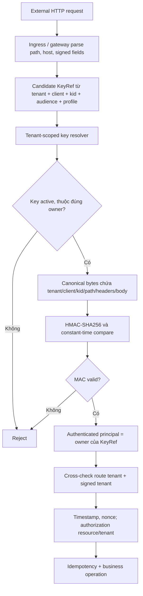

# Key ID và tenant trong xác thực HTTP request bằng HMAC

> **Chương:** Key identifier  
> **Bài học:** Key ID và tenant — xác định chính xác shared secret nào được phép xác minh request khi một hệ thống phục vụ nhiều tenant, nhiều client và nhiều thế hệ khóa.  
> **Phạm vi:** `SECURITY_AUTHENTICATION_HMAC_REQUEST_AUTHENTICATION`. Xác thực HTTP request bằng HMAC trên canonical request gồm method, URI, signed headers và body; chống replay bằng timestamp/nonce, quản lý key rotation, kiểm thử proxy/gateway và giữ ranh giới giữa **authentication** và **authorization**.

## 1. Vấn đề: cùng một Key ID có thể tồn tại ở hai tenant

Giả sử API thanh toán phục vụ hai doanh nghiệp độc lập:

```text
tenant-a
  client-01
    key ID: shared-kid -> secret A

tenant-b
  client-01
    key ID: shared-kid -> secret B
```

Cả hai dùng cùng chuỗi `shared-kid`. Điều này **không có gì sai** nếu hợp đồng định danh key là duy nhất **trong phạm vi tenant/client**, không phải trên toàn hệ thống.

Nhưng nếu verifier tra secret như sau:

```java
// SAI nếu Key ID không duy nhất toàn cục:
SecretKey secret = globalKeys.get(request.header("X-Key-Id"));
```

thì `shared-kid` có thể trả về secret của tenant khác. Hệ quả có thể là lỗi xác thực ngẫu nhiên, lẫn key cache, từ chối request hợp lệ hoặc nghiêm trọng hơn là **xác thực nhầm danh tính/tenant** nếu các bước sau dùng trường tenant chưa được chứng thực.

Một request minh họa:

```http
POST /v1/tenants/tenant-a/transfers?mode=commit HTTP/1.1
Host: api.example.test
Content-Type: application/json
X-Tenant-Id: tenant-a
X-Client-Id: client-01
X-Key-Id: shared-kid
X-Timestamp: 1795800000
X-Nonce: QW7TqnhFEcB7hKrLNZ5IQA
X-Idempotency-Key: transfer-101
Authorization: HMAC-SHA256 Credential="tenant-a/client-01/shared-kid", SignedHeaders="content-type;host;x-client-id;x-idempotency-key;x-key-id;x-nonce;x-tenant-id;x-timestamp", Signature="<base64url-hmac-sha256>"

{"transferId":"transfer-101","amountMinorUnits":100000}
```

Ở đây:

- `tenant-a` là phạm vi thuê bao/tổ chức mà request **khai báo**.
- `client-01` là client/service principal **khai báo** trong tenant đó.
- `shared-kid` là định danh bản ghi khóa **khai báo**.
- `Credential` lặp bộ ba trên trong tham số Authorization của profile minh họa.
- HMAC mới là phép kiểm tra bên gửi thực sự có secret tương ứng.
- Quyền chuyển tiền từ tài khoản nào là **một quyết định authorization riêng**.

**Định lý vận hành:** `Key ID` là *selector/hint* để tìm **candidate key**, không phải secret, không phải bằng chứng xác thực và không phải bằng chứng quyền truy cập tenant.

### 1.1 Kết quả học tập

Sau bài này, người học có thể:

1. Phân biệt tenant ID, client ID, key ID, authenticated principal và resource owner.
2. Thiết kế **composite key reference** thay vì tra `kid` đơn lẻ.
3. Ràng buộc tenant/client/key ID/audience/profile vào canonical HMAC request.
4. Ngăn tenant confusion khi path, host, header và Authorization Credential không nhất quán.
5. Thiết kế cache, rotation, revoke, migration và audit trail theo đúng tenant scope.
6. Viết Java 17 signer/verifier với tenant-aware key resolver, MAC validation, timestamp/nonce và authorization.
7. Kiểm thử cross-tenant attacks, key ID collision, proxy rewrite và replay across tenants.

## 2. Bốn loại định danh không được nhầm lẫn

| Tên | Ví dụ | Từ đâu đến? | Độ tin cậy trước HMAC |
| --- | --- | --- | --- |
| **Tenant ID** | `tenant-a` | Host/path/header hoặc dữ liệu nội bộ | Chỉ là lời khai/route hint nếu lấy từ request |
| **Client ID** | `client-01` | Header/Credential của bên ký | Chỉ là lời khai |
| **Key ID (kid)** | `shared-kid` | Header/Credential để chọn key | Chỉ là selector |
| **Authenticated principal** | `tenant-a/client-01` | Kết quả MAC đúng + key policy | Đáng tin trong phạm vi xác thực và key policy |
| **Resource owner/tenant** | `tenant-a` | Route + database ownership/policy | Cần xác minh ở tầng authorization |

Lưu ý: cùng một client ID có thể được cấp ở nhiều tenant, và một client có thể có nhiều key IDs trong giai đoạn rotation. Ngược lại, một tenant chứa nhiều service principals. Không mặc định quan hệ một-một.

### 2.1 Tenant ID không tự trở thành principal

Request có thể chứa:

```http
X-Tenant-Id: tenant-b
```

Attacker có quyền gửi tùy ý chuỗi này. **Kể cả request được HMAC ký hợp lệ bằng key của tenant-a**, chữ ký đó chỉ xác nhận tenant-a/client đã phát ra request, không tự cấp cho client quyền hành động trên tenant-b.

Nếu hệ thống dùng tenant từ path hoặc host, phải đối chiếu với **tenant được chứng thực sau MAC** và chính sách resource access. Một số sản phẩm có delegation/cross-tenant access chính thức; đó là quyền cấp phát riêng, không phải kết quả tự động của việc thay header.

### 2.2 Key ID không cần là secret

Một Key ID như `key-2026-11` hoặc `shared-kid` có thể xuất hiện trong HTTP request/log đã kiểm soát. **Đừng xây bảo mật trên việc giấu kid.** HMAC dựa trên shared secret có entropy mạnh; biết kid không cho phép tính tag hợp lệ.

Tuy vậy, key ID có thể làm lộ thông tin vận hành nếu chứa tên tenant nhạy cảm, đường dẫn secret vault, tên người hoặc cấu trúc hạ tầng. Chọn **opaque identifier**, giới hạn cú pháp và không log kèm dữ liệu nhạy cảm khi không cần.

### 2.3 Audience và signing profile cũng thuộc định danh key

Không nên chỉ xác định key bằng:

```text
tenantId + keyId
```

nếu cùng tenant có nhiều clients, nhiều môi trường hoặc nhiều signing profiles. Một tham chiếu an toàn hơn:

```text
KeyRef {
    audience,
    tenantId,
    clientId,
    keyId,
    signingProfile
}
```

Ví dụ:

```text
(payments-api-prod, tenant-a, client-01, shared-kid, hmac-tenant-key-v1)
(payments-api-prod, tenant-b, client-01, shared-kid, hmac-tenant-key-v1)
```

Đây là **hai tham chiếu khác nhau**, dù `clientId` và `keyId` giống nhau. `audience` phải lấy từ server policy/trust boundary; không để client chỉ cần sửa một header audience mà được kiểm tra ở một hệ thống khác.

## 3. Cách nhìn đúng về tính duy nhất của Key ID

Có ba lựa chọn thường gặp:

| Chính sách | Ưu điểm | Rủi ro cần quản lý |
| --- | --- | --- |
| Kid duy nhất trên toàn hệ thống | Lookup đơn giản hơn | Vẫn phải ràng buộc tenant; ID toàn cục không thay authorization |
| Kid duy nhất trong tenant | Cho phép mỗi tenant dùng `primary` hoặc `v1` | Phải resolve bằng tenant + kid, thêm client nếu cần |
| Kid duy nhất trong client của tenant | Phù hợp nhiều service principals với rotation độc lập | Bắt buộc composite tenant + client + kid |

Bài học chọn **kid duy nhất trong một client thuộc tenant**, có thêm audience và signing profile để tránh key confusion xuyên giao thức.

Điều này không có nghĩa mọi hệ thống bắt buộc dùng chính sách đó. Nếu tổ chức dùng UUID key ID toàn cục, vẫn nên lưu ownership tenant/client và **kiểm tra đúng ownership** mỗi khi xác minh.

### 3.1 Ví dụ bug “trùng kid” trong cache

```java
// Nguy hiểm:
Map<String, byte[]> cacheByKid;

// Tenant A nạp cacheByKid["shared-kid"] = secretA.
// Tenant B nạp cacheByKid["shared-kid"] = secretB.
// Request tiếp theo của A có thể được đối chiếu bằng secretB.
```

Đổi thành:

```java
record KeyRef(
    String audience,
    String tenant,
    String client,
    String kid,
    String profile) {}

Map<KeyRef, KeyMaterial> cacheByKeyRef;
```

Dùng typed composite key hoặc một encoding prefix-free/length-prefixed có quy tắc rõ; không nối chuỗi tự do nếu các thành phần có thể chứa ký tự phân cách.

### 3.2 Cache negative result cũng phải theo tenant

Một cache “không tìm thấy kid” dạng `missing["shared-kid"]` có thể khiến tenant B bị ảnh hưởng do tenant A thiếu kid. Negative cache cũng phải:

- Được key bằng composite reference.
- Có TTL hữu hạn và invalidation khi cấp key mới.
- Không che key mới sau rotation.
- Không lưu response chứa secret hoặc metadata tenant khác.

Không fallback từ `tenant-a/client-01/shared-kid` sang `default/shared-kid` chỉ để “giúp request chạy”. Mỗi fallback phải là policy explicit; trong profile này **không có fallback**.

## 4. Threat model: lẫn tenant nguy hiểm ở đâu?

Một request HMAC đi qua nhiều lớp:



Một số lỗ hổng thường gặp:

1. **Cross-tenant key lookup:** Cache keyed only by kid.
2. **Unsigned tenant:** Key resolver dùng tenant header nhưng canonical message không ký tenant, cho phép sửa tenant sau ký.
3. **Confused deputy:** Gateway xác thực bằng key tenant A, backend lại chọn database/schema tenant B từ header khác.
4. **Host/path confusion:** Ký `X-Tenant-Id` nhưng không ký/kiểm tra path hoặc authority chứa tenant.
5. **Client ID collision:** Hệ thống coi `client-01` là principal toàn cục trong khi hai tenants cùng có client ID đó.
6. **Key ID enumeration:** Phản hồi cho key tồn tại/không tồn tại khác nhau quá cụ thể, tạo kênh dò danh sách.
7. **Revocation lag:** Một node đã revoke key của tenant A, node khác vẫn còn cache stale.
8. **Tenant migration:** Chuyển tenant giữa regions hoặc domains nhưng vẫn cho phép request ký audience cũ chạy ở nơi mới.
9. **Replay namespace confusion:** Dùng `kid+nonce` hoặc chỉ `nonce` sai scope, dẫn đến false positives hoặc bỏ lọt reuse.
10. **Business idempotency leak:** Cache result theo idempotency key mà thiếu tenant/client ownership, trả receipt tenant A cho tenant B.

### 4.1 Không dùng tenant do client khai làm bằng chứng quyền

Một verifier có thể dùng `X-Tenant-Id` **trước MAC** làm input để **tìm candidate secret**. Điều này hợp lý nếu có giới hạn tài nguyên và key ownership policy.

Nhưng trước khi MAC đúng, input đó vẫn là untrusted. Không được:

- Cấp quyền tenant.
- Chọn database để đọc dữ liệu nhạy cảm theo quyền tenant.
- Ghi replay nonce như thể nó đã được chứng thực.
- Tạo idempotency record có quyền sở hữu tenant.
- Ghi audit event “tenant A đã xác thực” chỉ vì header nói thế.

Sau khi MAC đúng, danh tính thực là **key owner** mà resolver trả về; phải so nó với tenant/client/kid trong message và context thực.

### 4.2 Source of truth cho tenant

Tùy kiến trúc, resource tenant có thể được xác định từ:

- Route `/v1/tenants/{tenantId}/...`.
- Domain/authority đã xác minh qua gateway đáng tin.
- Quan hệ ownership trong database (`accountId → tenantId`).
- Một delegated principal có quyền trên tenant khác.

**Không tồn tại một header chung luôn là nguồn chân lý.** Trong ví dụ, path tenant là context phải khớp authenticated tenant, còn database authorization vẫn phải kiểm tra ownership của tài nguyên thật.

## 5. Chọn credential và tránh parser ambiguity

Profile minh họa:

```text
Authorization: HMAC-SHA256 Credential="<tenant>/<client>/<kid>", SignedHeaders="<list>", Signature="<tag>"
```

Ví dụ:

```text
Credential="tenant-a/client-01/shared-kid"
```

Các trường `X-Tenant-Id`, `X-Client-Id`, `X-Key-Id` cũng xuất hiện để dễ tương thích với HTTP filters. Vì có **hai nơi khai cùng một thông tin**, profile yêu cầu:

\[
\text{Credential tenant/client/kid} =
\text{X-Tenant-Id/X-Client-Id/X-Key-Id}.
\]

Nếu không khớp **phải từ chối**, không âm thầm chọn Credential hoặc header theo độ ưu tiên.

### 5.1 Một nguồn duy nhất sẽ đơn giản hơn

Trong một API thực tế, có thể chọn **chỉ có Credential** chứa tenant/client/kid rồi đưa credential vào canonical message, không lặp ở các `X-*` headers. Hoặc chỉ dùng ba signed headers và một signature header có format khác.

Điều quan trọng không phải số trường, mà là **một hợp đồng không nhập nhằng**, ràng buộc đầy đủ identity selectors trong HMAC và có server policy.

### 5.2 Grammar nên hẹp và được version hóa

Profile ví dụ:

```text
tenant-id: [a-z0-9][a-z0-9-]{0,47}
client-id: [a-z0-9][a-z0-9-]{0,47}
key-id:    [a-z0-9][a-z0-9-]{0,47}

Credential = tenant-id "/" client-id "/" key-id
```

Các chuỗi đều là ASCII lowercase, không chứa `/`, `:`, whitespace, CR/LF hoặc Unicode. Đây là **policy minh họa**, không phải ràng buộc chung của mọi hệ thống đa tenant.

Hệ thống đang có tenant ID Unicode hoặc chuỗi path khác cần một bước ánh xạ/IDNA/escaping được đặc tả, không đưa nguyên dữ liệu chưa chuẩn hóa vào key resolver hoặc cache rồi trông chờ các layers tự hiểu giống nhau.

### 5.3 Duplicate headers và credential parameter

Phải từ chối nếu có:

```http
X-Tenant-Id: tenant-a
x-tenant-id: tenant-b
```

Tên HTTP header không phân biệt hoa/thường. Nếu proxy hoặc framework gộp hai giá trị thành một comma-separated value, phải từ chối các values không qua grammar; lý tưởng **chặn duplicate ở hop còn quan sát được các header lines**.

Tương tự, `Authorization` không được có nhiều giá trị cùng scheme, nhiều `Credential` params hoặc nhiều key IDs khác nhau mà parser tự chọn cái đầu/cuối. Không viết parser bằng `split(",")` thiếu quy tắc quoted-string khi scheme rộng; profile hẹp có thể dùng parser strict đã anchor toàn bộ chuỗi.

## 6. Canonical request phải ràng buộc tenant và Key ID

Một thiết kế chỉ ký:

```text
method + LF + rawTarget + LF + bodyHash
```

bỏ mất tenant và key ID, tạo nguy cơ **credential swapping** hoặc cross-context confusion khi key resolver và backend tin các trường không được ký.

Profile `hmac-tenant-key-v1` yêu cầu:

```text
hmac-tenant-key-v1
payments-api-prod
tenant-a
client-01
shared-kid
tenant-a/client-01/shared-kid
POST
/v1/tenants/tenant-a/transfers?mode=commit
content-type;host;x-client-id;x-idempotency-key;x-key-id;x-nonce;x-tenant-id;x-timestamp
content-type:application/json
host:api.example.test
x-client-id:client-01
x-idempotency-key:transfer-101
x-key-id:shared-kid
x-nonce:QW7TqnhFEcB7hKrLNZ5IQA
x-tenant-id:tenant-a
x-timestamp:1795800000
<sha256-lowercase-hex-of-raw-body>
```

Ở đây:

| Phần canonical | Vì sao ràng buộc? |
| --- | --- |
| `hmac-tenant-key-v1` | Chống nhầm signing profile/version |
| `payments-api-prod` | Chống dùng request ở audience khác |
| `tenant-a` | Liên kết tag với tenant được khai/được policy chọn |
| `client-01` | Liên kết tag với client identity |
| `shared-kid` | Liên kết tag với key selector |
| `tenant-a/client-01/shared-kid` | Ràng buộc nguyên Credential của Authorization |
| `POST` | Hành động HTTP |
| Raw target có `tenant-a` | Tránh đổi route/resource tenant |
| `SignedHeaders` canonical | Chống bỏ một signed field khỏi chính sách |
| Từng `name:value` | Bảo vệ values của signed HTTP headers |
| Body digest | Bảo vệ payload bytes |

Một vài thông tin được đưa **lặp hai lần** (tenant/client/kid riêng và trong Credential/header) để làm rõ binding cho bài thực hành. Một profile production có thể loại bớt sự lặp nếu vẫn unambiguous và mọi phía dùng đúng định dạng đã version hóa.

### 6.1 Quy tắc bytes chính xác

- Encoding: UTF-8, toàn bộ metadata minh họa chỉ gồm ASCII.
- Phân cách các dòng: một byte LF `0x0A`.
- Không có CRLF và không LF cuối.
- Header names: ASCII lowercase, sorted ordinal.
- Required SignedHeaders cố định:
  `content-type;host;x-client-id;x-idempotency-key;x-key-id;x-nonce;x-tenant-id;x-timestamp`.
- Values: chỉ ASCII printable không có whitespace/CR/LF ở profile này; mỗi field một giá trị hợp lệ.
- Body digest: SHA-256 của **raw body bytes**, hex lowercase 64 ký tự.
- Signature: HMAC-SHA256 đầy đủ 32 bytes, Base64URL không padding (43 ký tự).

```text
bodyHash = lowercase_hex(SHA256(rawBodyBytes))
canonicalBytes = UTF8(joinWithLF(
  version, audience, claimedTenant, claimedClient, claimedKid,
  credential, method, rawTarget, signedHeaderNames,
  for each signedHeaderName: name + ":" + value,
  bodyHash))
tag = HMAC_SHA256(resolvedTenantScopedSecret, canonicalBytes)
signature = BASE64URL_NO_PADDING(tag)
```

Không lấy một canonical request string do client gửi làm nguồn xác minh. Server phải dựng lại từ **request thực ở trust boundary**, với method/path/host/header/body đúng phép xử lý nghiệp vụ.

### 6.2 Vì sao có cả tenant trong URI và signed header?

Hai chỗ đó có **vai trò khác nhau**:

- URI thể hiện tài nguyên/tenant mà HTTP request nhắm đến.
- `X-Tenant-Id` thể hiện tenant mà client khai như một phần credential.
- HMAC bảo vệ **cả hai** khỏi bị sửa riêng lẻ.
- Sau MAC, server phải kiểm tra chúng **khớp hoặc có delegation hợp lệ theo policy**.

HMAC đúng cho một request chứa `tenant-b` trong route nhưng `tenant-a` ở credential **không làm hai tenant trở thành cùng danh tính**.

### 6.3 Không đưa Signature vào chính message được ký

`Authorization` chứa `Signature` (tag HMAC), nên không thể đưa toàn bộ Authorization vào canonical message theo nghĩa tự tham chiếu. Ví dụ chỉ bind `Credential` và `SignedHeaders`, sau đó mới tính/tag và xây `Authorization`. Không có vòng lặp tính chữ ký.

## 7. Phân biệt lỗi authentication, tenant mismatch và authorization

Một verifier tốt có nhiều cổng kiểm tra:

| Trường hợp | Kết quả nội bộ đề xuất | Lý do |
| --- | --- | --- |
| Tenant/client/kid không đúng grammar | `BAD_FORMAT` | Input chưa hợp lệ |
| Key reference không tồn tại | `AUTH_FAILED` | Không có candidate key thuộc đúng scope |
| Key đã revoke/hết hạn | `AUTH_FAILED` | Key policy không cho phép |
| HMAC sai | `BAD_SIGNATURE` nội bộ | Secret/canonical bytes không khớp |
| HMAC đúng nhưng route tenant khác principal tenant | `TENANT_MISMATCH` | Không cho truy cập cross-tenant ngoài policy |
| HMAC đúng và tenant khớp nhưng thiếu quyền resource | `FORBIDDEN` | Phân quyền độc lập |
| MAC/time/rights đúng nhưng nonce đã dùng | `REPLAY` | Phòng phát lại |
| Replay store không sẵn sàng | `STORE_UNAVAILABLE` | Không thể xác nhận nonce mới |

**Không nhất thiết trả những mã nội bộ này cho client.** API công khai có thể gộp các lỗi authentication thành response chung để hạn chế account/key enumeration; các diagnostics có giới hạn truy cập mới giữ category chi tiết.

### 7.1 MAC đúng không đồng nghĩa có quyền trong tenant

Một service principal có thể có key hợp lệ để gọi endpoint **đọc trạng thái**, nhưng không có quyền `transfer.create`. Trong trường hợp này:

```text
key owner = tenant-a/client-01
HMAC = valid
nonce = new
route tenant = tenant-a
requested action = transfer.create
authorization = DENY
```

Server phải từ chối ở authorization. Việc có shared secret không tự cho phép thao tác mọi account trong tenant đó, càng không cho quyền truy cập tài nguyên tenant khác.

### 7.2 Cross-tenant delegation phải rõ ràng

Một số kiến trúc cho phép service bên thứ ba thao tác trên tenant khác theo consent hoặc delegated scope. Khi đó:

- Authenticated principal vẫn đến từ key owner.
- Target tenant đến từ resource/route đáng tin.
- Policy phải kiểm tra rõ `principal -> action -> targetTenant/resource`.
- Audit phải ghi cả **actor tenant** và **target tenant**.
- Canonical signature vẫn bảo vệ route và selector.

Không triển khai delegation bằng cách bỏ kiểm tra tenant equality một cách vô điều kiện.

## 8. Java 17: Tenant-aware Key ID resolver và HMAC verifier

Ví dụ Java 17 dưới đây chỉ dùng JDK, **không gửi HTTP thật**. Nó có một signing profile cố định để phơi bày các ràng buộc:

1. Hai tenants cùng có `client-01` và `shared-kid`, nhưng **secret khác nhau**.
2. Key resolver dùng composite `KeyRef(audience, tenant, client, kid, profile)`.
3. Thông tin tenant/client/kid xuất hiện cả trong Credential và signed headers; verifier yêu cầu chúng khớp.
4. Canonical bytes chứa tenant/client/kid, credential, method, raw target, required SignedHeaders và raw body digest.
5. Tag được so bằng `MessageDigest.isEqual` sau khi strict decode Base64URL.
6. Key có trạng thái active/revoked và khoảng hiệu lực theo server clock.
7. Verifier phân biệt MAC hợp lệ với quyền truy cập route tenant và action.
8. Signed timestamp/nonce được kiểm tra; demo replay store dùng typed `ReplayKey` và atomic in-memory insert.
9. Có negative tests cross-tenant route, sai secret, revoked key, duplicate headers, replay và store unavailable.

**Giới hạn:** `SignedRequest` mô phỏng đầu vào sau khi HTTP adapter đã parse và tách Authorization params. Code không triển khai HTTP/2 parser, TLS, secret vault, Redis TTL, database authorization hay business transaction. Nó không được dùng nguyên trạng như bộ xác thực thanh toán production.

Lưu thành `TenantKeyIdentifierDemo.java`:

```java
import java.nio.charset.StandardCharsets;
import java.security.GeneralSecurityException;
import java.security.MessageDigest;
import java.security.SecureRandom;
import java.time.Clock;
import java.time.Duration;
import java.time.Instant;
import java.time.ZoneOffset;
import java.util.ArrayList;
import java.util.Base64;
import java.util.HexFormat;
import java.util.LinkedHashMap;
import java.util.List;
import java.util.Locale;
import java.util.Map;
import java.util.Set;
import java.util.concurrent.ConcurrentHashMap;
import java.util.regex.Matcher;
import java.util.regex.Pattern;

import javax.crypto.Mac;
import javax.crypto.spec.SecretKeySpec;

public final class TenantKeyIdentifierDemo {
    private static final String PROFILE = "hmac-tenant-key-v1";
    private static final String AUDIENCE = "payments-api-prod";
    private static final String HOST = "api.example.test";
    private static final String METHOD = "POST";
    private static final String ALGORITHM = "HmacSHA256";
    private static final long PAST = 300;
    private static final long FUTURE = 60;

    private static final String[] SIGNED_NAMES = {
        "content-type", "host", "x-client-id",
        "x-idempotency-key", "x-key-id", "x-nonce",
        "x-tenant-id", "x-timestamp"
    };
    private static final String SIGNED_HEADERS =
        String.join(";", SIGNED_NAMES);
    private static final Set<String> REQUIRED = Set.of(
        SIGNED_NAMES);

    private static final Pattern TARGET = Pattern.compile(
        "^/v1/tenants/([a-z0-9][a-z0-9-]{0,47})"
        + "/transfers\\?mode=commit$");
    private static final String ID_GRAMMAR =
        "[a-z0-9][a-z0-9-]{0,47}";

    private TenantKeyIdentifierDemo() {}

    record KeyRef(
        String audience, String tenant, String client,
        String kid, String profile) {}

    record KeyMaterial(
        byte[] secret, Instant activeFrom,
        Instant expiresAt, boolean revoked) {

        KeyMaterial {
            if (secret == null || secret.length < 32
                    || activeFrom == null || expiresAt == null
                    || !activeFrom.isBefore(expiresAt)) {
                throw new IllegalArgumentException("Bad key material");
            }
            secret = secret.clone();
        }

        @Override
        public byte[] secret() {
            return secret.clone();
        }

        boolean active(Instant now) {
            return !revoked
                && !now.isBefore(activeFrom)
                && now.isBefore(expiresAt);
        }
    }

    static final class KeyDirectory {
        private final Map<KeyRef, KeyMaterial> keys;

        KeyDirectory(Map<KeyRef, KeyMaterial> entries) {
            keys = Map.copyOf(entries);
        }

        KeyMaterial findActive(KeyRef ref, Instant now) {
            KeyMaterial material = keys.get(ref);
            return material != null && material.active(now)
                    ? material : null;
        }
    }

    record Header(String name, String value) {}

    public record SignedRequest(
        String method,
        String rawTarget,
        List<Header> headers,
        String credential,
        String signedHeaders,
        String signature,
        byte[] body) {

        public SignedRequest {
            headers = List.copyOf(headers);
            body = body == null ? null : body.clone();
        }

        @Override
        public byte[] body() {
            return body == null ? null : body.clone();
        }
    }

    record ReplayKey(
        String audience, String tenant,
        String client, String nonce) {}

    static final class StoreUnavailable extends Exception {
        StoreUnavailable(String reason) {
            super(reason);
        }
    }

    interface ReplayStore {
        boolean claimOnce(ReplayKey key) throws StoreUnavailable;
    }

    // Demo một JVM: atomic insert, không có TTL, không bền vững.
    static final class MemoryReplayStore implements ReplayStore {
        private final Set<ReplayKey> used =
            ConcurrentHashMap.newKeySet();

        @Override
        public boolean claimOnce(ReplayKey key) {
            return used.add(key);
        }
    }

    @FunctionalInterface
    interface AuthorizationPolicy {
        boolean allowTransfer(KeyRef principal, String targetTenant);
    }

    enum Verdict {
        ACCEPTED, BAD_FORMAT, AUTH_FAILED,
        BAD_SIGNATURE, EXPIRED, FUTURE_TIMESTAMP,
        TENANT_MISMATCH, FORBIDDEN, REPLAY,
        STORE_UNAVAILABLE
    }

    static Map<String, String> strictHeaders(SignedRequest request) {
        if (request == null || request.headers() == null) {
            throw new IllegalArgumentException("Missing request");
        }

        Map<String, String> fields = new LinkedHashMap<>();
        for (Header header : request.headers()) {
            if (header == null || header.name() == null
                    || !header.name()
                        .matches("[A-Za-z][A-Za-z0-9-]{0,63}")
                    || header.value() == null
                    || header.value().isEmpty()
                    || header.value().length() > 128) {
                throw new IllegalArgumentException("Invalid header");
            }

            String name = header.name().toLowerCase(Locale.ROOT);
            if (!REQUIRED.contains(name)
                    || fields.containsKey(name)) {
                // Duplicate dù khác casing, hoặc field ngoài profile.
                throw new IllegalArgumentException(
                    "Unexpected or duplicate header");
            }

            for (int i = 0; i < header.value().length(); i++) {
                char c = header.value().charAt(i);
                if (c < 0x21 || c > 0x7E) {
                    // Không có whitespace/CRLF/Unicode trong profile.
                    throw new IllegalArgumentException(
                        "Unsupported value character");
                }
            }
            fields.put(name, header.value());
        }

        if (!fields.keySet().equals(REQUIRED)) {
            throw new IllegalArgumentException(
                "Missing required signed header");
        }

        if (!"application/json".equals(fields.get("content-type"))
                || !HOST.equals(fields.get("host"))
                || !fields.get("x-tenant-id").matches(ID_GRAMMAR)
                || !fields.get("x-client-id").matches(ID_GRAMMAR)
                || !fields.get("x-key-id").matches(ID_GRAMMAR)
                || !fields.get("x-idempotency-key")
                    .matches("[A-Za-z0-9._-]{1,80}")
                || !fields.get("x-timestamp")
                    .matches("[1-9][0-9]{9,11}")
                || !validNonce(fields.get("x-nonce"))) {
            throw new IllegalArgumentException(
                "Invalid signed header semantics");
        }
        return fields;
    }

    static boolean validNonce(String nonce) {
        if (nonce == null
                || !nonce.matches("[A-Za-z0-9_-]{22}")) {
            return false;
        }
        try {
            byte[] decoded = Base64.getUrlDecoder().decode(nonce);
            return decoded.length == 16
                && Base64.getUrlEncoder().withoutPadding()
                    .encodeToString(decoded).equals(nonce);
        } catch (IllegalArgumentException malformed) {
            return false;
        }
    }

    static String targetTenant(String rawTarget) {
        if (rawTarget == null) {
            throw new IllegalArgumentException("Missing target");
        }
        Matcher matcher = TARGET.matcher(rawTarget);
        if (!matcher.matches()) {
            throw new IllegalArgumentException("Invalid raw target");
        }
        return matcher.group(1);
    }

    static byte[] canonicalBytes(
        SignedRequest request, Map<String, String> fields)
        throws GeneralSecurityException {

        if (!METHOD.equals(request.method())
                || !SIGNED_HEADERS.equals(request.signedHeaders())
                || request.body() == null
                || request.body().length == 0
                || request.body().length > 1_048_576) {
            throw new IllegalArgumentException(
                "Invalid method/profile/body");
        }

        // Path syntax phải có cấu trúc hợp đồng.
        targetTenant(request.rawTarget());

        String tenant = fields.get("x-tenant-id");
        String client = fields.get("x-client-id");
        String kid = fields.get("x-key-id");
        String expectedCredential = tenant + "/" + client + "/" + kid;

        if (!expectedCredential.equals(request.credential())) {
            throw new IllegalArgumentException(
                "Credential and header mismatch");
        }

        String digestHex = HexFormat.of().formatHex(
            MessageDigest.getInstance("SHA-256")
                .digest(request.body()));

        List<String> lines = new ArrayList<>();
        lines.add(PROFILE);
        lines.add(AUDIENCE);
        lines.add(tenant);
        lines.add(client);
        lines.add(kid);
        lines.add(request.credential());
        lines.add(request.method());
        lines.add(request.rawTarget());
        lines.add(request.signedHeaders());

        for (String name : SIGNED_NAMES) {
            lines.add(name + ":" + fields.get(name));
        }
        lines.add(digestHex);

        return String.join("\n", lines)
            .getBytes(StandardCharsets.UTF_8);
    }

    static byte[] mac(byte[] secret, byte[] message)
        throws GeneralSecurityException {
        Mac mac = Mac.getInstance(ALGORITHM);
        mac.init(new SecretKeySpec(secret, ALGORITHM));
        return mac.doFinal(message);
    }

    static byte[] randomKey(SecureRandom rng) {
        byte[] bytes = new byte[32];
        rng.nextBytes(bytes);
        return bytes;
    }

    static String randomNonce(SecureRandom rng) {
        byte[] bytes = new byte[16];
        rng.nextBytes(bytes);
        return Base64.getUrlEncoder()
            .withoutPadding()
            .encodeToString(bytes);
    }

    static SignedRequest signForDemo(
        KeyRef ref, byte[] secret, String routeTenant,
        String nonce, String idempotencyKey, byte[] body,
        Clock clock) throws GeneralSecurityException {

        String rawTarget = "/v1/tenants/" + routeTenant
            + "/transfers?mode=commit";
        List<Header> headers = List.of(
            new Header("X-Nonce", nonce),
            new Header("X-Key-Id", ref.kid()),
            new Header("Host", HOST),
            new Header("X-Tenant-Id", ref.tenant()),
            new Header("Content-Type", "application/json"),
            new Header("X-Timestamp",
                Long.toString(clock.instant().getEpochSecond())),
            new Header("X-Client-Id", ref.client()),
            new Header("X-Idempotency-Key", idempotencyKey));

        SignedRequest draft = new SignedRequest(
            METHOD, rawTarget, headers,
            ref.tenant() + "/" + ref.client() + "/" + ref.kid(),
            SIGNED_HEADERS, "", body);

        byte[] tag = mac(
            secret, canonicalBytes(draft, strictHeaders(draft)));

        String signature = Base64.getUrlEncoder()
            .withoutPadding()
            .encodeToString(tag);

        return new SignedRequest(
            draft.method(), draft.rawTarget(), draft.headers(),
            draft.credential(), draft.signedHeaders(),
            signature, draft.body());
    }

    static Verdict verify(
        SignedRequest request,
        KeyDirectory directory,
        ReplayStore replayStore,
        AuthorizationPolicy policy,
        Clock serverClock)
        throws GeneralSecurityException {

        if (directory == null || replayStore == null
                || policy == null || serverClock == null
                || request == null) {
            return Verdict.BAD_FORMAT;
        }

        final Map<String, String> fields;
        final byte[] canonical;
        final String target;
        try {
            fields = strictHeaders(request);
            canonical = canonicalBytes(request, fields);
            target = targetTenant(request.rawTarget());
        } catch (IllegalArgumentException invalid) {
            return Verdict.BAD_FORMAT;
        }

        String tenant = fields.get("x-tenant-id");
        String client = fields.get("x-client-id");
        String kid = fields.get("x-key-id");
        KeyRef candidate = new KeyRef(
            AUDIENCE, tenant, client, kid, PROFILE);

        // Chỉ dùng tenant chưa xác thực để chọn CANDIDATE KEY.
        // Không coi đó là principal cho đến khi MAC khớp.
        Instant now = serverClock.instant();
        KeyMaterial material =
            directory.findActive(candidate, now);
        if (material == null) {
            return Verdict.AUTH_FAILED;
        }

        if (request.signature() == null
                || !request.signature()
                    .matches("[A-Za-z0-9_-]{43}")) {
            return Verdict.BAD_FORMAT;
        }

        byte[] supplied;
        try {
            supplied = Base64.getUrlDecoder()
                .decode(request.signature());
        } catch (IllegalArgumentException malformed) {
            return Verdict.BAD_FORMAT;
        }

        if (supplied.length != 32
                || !Base64.getUrlEncoder().withoutPadding()
                    .encodeToString(supplied)
                    .equals(request.signature())) {
            return Verdict.BAD_FORMAT;
        }

        byte[] expected = mac(material.secret(), canonical);
        if (!MessageDigest.isEqual(expected, supplied)) {
            return Verdict.BAD_SIGNATURE;
        }

        long signedAt = Long.parseLong(fields.get("x-timestamp"));
        long nowSeconds = now.getEpochSecond();

        final long earliest;
        final long latest;
        try {
            earliest = Math.subtractExact(nowSeconds, PAST);
            latest = Math.addExact(nowSeconds, FUTURE);
        } catch (ArithmeticException overflow) {
            return Verdict.BAD_FORMAT;
        }

        if (signedAt < earliest) {
            return Verdict.EXPIRED;
        }
        if (signedAt > latest) {
            return Verdict.FUTURE_TIMESTAMP;
        }

        // Có bằng chứng MAC hợp lệ cho candidate -> principal.
        if (!candidate.tenant().equals(target)) {
            return Verdict.TENANT_MISMATCH;
        }

        // Authorization là lớp RIÊNG sau xác thực.
        if (!policy.allowTransfer(candidate, target)) {
            return Verdict.FORBIDDEN;
        }

        ReplayKey replayKey = new ReplayKey(
            AUDIENCE, candidate.tenant(), candidate.client(),
            fields.get("x-nonce"));
        try {
            return replayStore.claimOnce(replayKey)
                ? Verdict.ACCEPTED : Verdict.REPLAY;
        } catch (StoreUnavailable unavailable) {
            return Verdict.STORE_UNAVAILABLE;
        }
    }

    static SignedRequest replaceHeader(
        SignedRequest request, String name, String newValue) {
        List<Header> changed = new ArrayList<>();
        for (Header header : request.headers()) {
            if (header.name().equalsIgnoreCase(name)) {
                changed.add(new Header(header.name(), newValue));
            } else {
                changed.add(header);
            }
        }
        return new SignedRequest(
            request.method(), request.rawTarget(), changed,
            request.credential(), request.signedHeaders(),
            request.signature(), request.body());
    }

    public static void main(String[] args) throws Exception {
        SecureRandom rng = new SecureRandom();
        byte[] secretA = randomKey(rng);
        byte[] secretB = randomKey(rng);
        byte[] secretOld = randomKey(rng);
        byte[] secretNew = randomKey(rng);

        KeyRef refA = new KeyRef(
            AUDIENCE, "tenant-a", "client-01",
            "shared-kid", PROFILE);
        KeyRef refB = new KeyRef(
            AUDIENCE, "tenant-b", "client-01",
            "shared-kid", PROFILE);
        KeyRef refOld = new KeyRef(
            AUDIENCE, "tenant-a", "client-01",
            "old-kid", PROFILE);
        KeyRef refNew = new KeyRef(
            AUDIENCE, "tenant-a", "client-01",
            "new-kid", PROFILE);

        Instant from = Instant.parse("2026-01-01T00:00:00Z");
        Instant until = Instant.parse("2027-01-01T00:00:00Z");
        KeyDirectory directory = new KeyDirectory(Map.of(
            refA, new KeyMaterial(secretA, from, until, false),
            refB, new KeyMaterial(secretB, from, until, false),
            refOld, new KeyMaterial(secretOld, from, until, true),
            refNew, new KeyMaterial(secretNew, from, until, false)
        ));

        Clock clock = Clock.fixed(
            Instant.parse("2026-11-28T02:00:00Z"),
            ZoneOffset.UTC);

        byte[] body = (
            "{\"transferId\":\"transfer-101\","
            + "\"amountMinorUnits\":100000}"
        ).getBytes(StandardCharsets.UTF_8);

        ReplayStore sharedReplay = new MemoryReplayStore();
        AuthorizationPolicy allowWithinTenant =
            (principal, target) ->
                principal.tenant().equals(target);
        AuthorizationPolicy denyAll = (principal, target) -> false;

        // Tenant A và B cùng dùng kid="shared-kid".
        // Cố ý dùng cùng NONCE ở hai tenants: scope tách biệt.
        String sameNonce = randomNonce(rng);
        SignedRequest firstA = signForDemo(
            refA, secretA, "tenant-a", sameNonce,
            "transfer-101", body, clock);
        SignedRequest firstB = signForDemo(
            refB, secretB, "tenant-b", sameNonce,
            "transfer-101", body, clock);

        System.out.println("Tenant A: " + verify(
            firstA, directory, sharedReplay,
            allowWithinTenant, clock));
        System.out.println("Tenant A exact replay: " + verify(
            firstA, directory, sharedReplay,
            allowWithinTenant, clock));
        System.out.println("Tenant B, same kid and nonce: " + verify(
            firstB, directory, sharedReplay,
            allowWithinTenant, clock));

        // Claimed tenant A nhưng tag tạo bằng secret của B.
        SignedRequest wrongSecret = signForDemo(
            refA, secretB, "tenant-a", randomNonce(rng),
            "transfer-102", body, clock);
        System.out.println("Wrong tenant secret: " + verify(
            wrongSecret, directory, sharedReplay,
            allowWithinTenant, clock));

        // B ký THẬT request đến path tenant A.
        SignedRequest crossTenant = signForDemo(
            refB, secretB, "tenant-a", randomNonce(rng),
            "transfer-103", body, clock);
        System.out.println("Cross-tenant route: " + verify(
            crossTenant, directory, sharedReplay,
            allowWithinTenant, clock));

        // Sửa claimed tenant sau ký; credential không còn khớp.
        SignedRequest tampered = replaceHeader(
            firstA, "X-Tenant-Id", "tenant-b");
        System.out.println("Tampered tenant header: " + verify(
            tampered, directory, sharedReplay,
            allowWithinTenant, clock));

        // Key đã thu hồi: HMAC được ký bằng secret cũ vẫn bị từ chối.
        SignedRequest revoked = signForDemo(
            refOld, secretOld, "tenant-a", randomNonce(rng),
            "transfer-104", body, clock);
        System.out.println("Revoked key: " + verify(
            revoked, directory, sharedReplay,
            allowWithinTenant, clock));

        // Signed request mới với key active khác trong rotation.
        SignedRequest rotated = signForDemo(
            refNew, secretNew, "tenant-a", randomNonce(rng),
            "transfer-105", body, clock);
        System.out.println("Active rotated key: " + verify(
            rotated, directory, sharedReplay,
            allowWithinTenant, clock));

        // Key thật, MAC thật, tenant đúng nhưng thiếu quyền.
        SignedRequest noPermission = signForDemo(
            refB, secretB, "tenant-b", randomNonce(rng),
            "transfer-106", body, clock);
        System.out.println("Valid MAC but no permission: " + verify(
            noPermission, directory, sharedReplay,
            denyAll, clock));

        // Duplicate case-insensitive header.
        List<Header> duplicate = new ArrayList<>(firstA.headers());
        duplicate.add(new Header("x-tenant-id", "tenant-a"));
        SignedRequest duplicateTenant = new SignedRequest(
            firstA.method(), firstA.rawTarget(), duplicate,
            firstA.credential(), firstA.signedHeaders(),
            firstA.signature(), firstA.body());
        System.out.println("Duplicate tenant header: " + verify(
            duplicateTenant, directory, sharedReplay,
            allowWithinTenant, clock));

        // Ký thật một timestamp hết hạn.
        SignedRequest expired = signForDemo(
            refA, secretA, "tenant-a", randomNonce(rng),
            "transfer-107", body,
            Clock.offset(clock, Duration.ofSeconds(-301)));
        System.out.println("Expired signed timestamp: " + verify(
            expired, directory, sharedReplay,
            allowWithinTenant, clock));

        ReplayStore unavailable = key -> {
            throw new StoreUnavailable("timeout");
        };
        SignedRequest fresh = signForDemo(
            refA, secretA, "tenant-a", randomNonce(rng),
            "transfer-108", body, clock);
        System.out.println("Replay store unavailable: " + verify(
            fresh, directory, unavailable,
            allowWithinTenant, clock));
    }
}
```

Biên dịch và chạy bằng JDK 17:

```bash
javac -encoding UTF-8 TenantKeyIdentifierDemo.java
java TenantKeyIdentifierDemo
```

Kết quả **trạng thái dự kiến**:

```text
Tenant A: ACCEPTED
Tenant A exact replay: REPLAY
Tenant B, same kid and nonce: ACCEPTED
Wrong tenant secret: BAD_SIGNATURE
Cross-tenant route: TENANT_MISMATCH
Tampered tenant header: BAD_FORMAT
Revoked key: AUTH_FAILED
Active rotated key: ACCEPTED
Valid MAC but no permission: FORBIDDEN
Duplicate tenant header: BAD_FORMAT
Expired signed timestamp: EXPIRED
Replay store unavailable: STORE_UNAVAILABLE
```

### 8.1 Diễn giải những trường hợp đáng chú ý

- **Tenant A và B cùng `shared-kid`:** resolver chọn đúng secret bằng composite `KeyRef`; không cần đổi kid thành global unique để tránh nhầm.
- **Cùng nonce ở A và B:** replay namespace của ví dụ tách theo authenticated tenant/client. Lần đầu của mỗi tenant đều được phép; gửi lại chính request A vẫn bị chặn.
- **Sai secret:** Request khai tenant A nhưng ký bằng secret B → MAC không khớp với secret của A. Chỉ biết kid không thể giả mạo tenant A.
- **Cross-tenant route:** B ký đúng bằng key của B nhưng yêu cầu path tenant A → MAC hợp lệ, route/actor tenant mismatch → từ chối.
- **Tampered tenant header:** Sửa header tenant nhưng giữ Credential và tag cũ → cấu trúc credential/header không khớp, bị từ chối trước MAC.
- **Key revoked:** Không vì tag có thể tính đúng bằng key cũ mà cho qua policy revocation.
- **Key active sau rotation:** Key mới của A được resolve và xác minh trong scope A; client identity không tự thay đổi.
- **FORBIDDEN:** Authentication thành công không có nghĩa client được phép tạo chuyển tiền.
- **Replay store outage:** Không chắc nonce mới → fail closed.

### 8.2 Giới hạn cụ thể của ví dụ

**Không dùng nguyên demo làm production verifier.**

1. `SignedRequest` là DTO mô phỏng; không phải HTTP message đã được parser/framework/gateway xử lý chính xác.
2. Demo tách sẵn `Credential`/`SignedHeaders`/`Signature`; production phải parse `Authorization` theo grammar, reject duplicate, quote/escape ambiguity và khác biệt HTTP/2.
3. `KeyDirectory` là Map bất biến với test secrets; không có vault, KMS, database, propagation cache, audit hoặc secret zeroization.
4. `MemoryReplayStore` không có TTL, durability, consistency giữa nodes hoặc failover; production dùng atomic shared store phù hợp.
5. `AuthorizationPolicy` trong demo chỉ là một interface nhận decision giả lập; production cần quyền theo tenant, resource ownership, action và delegated scopes.
6. Demo chỉ chấp nhận tập signed headers cố định và raw target theo regex hẹp; production phải định nghĩa toàn bộ request parsing/canonicalization và trust boundary.
7. Code chưa triển khai idempotency store hay transaction side effects. Kết quả `ACCEPTED` chỉ cho biết đã qua **các bước trong demo**, chưa ghi một giao dịch tài chính.
8. Console demo in verdict nội bộ; API public nên không để các lỗi key existence/tenant status trở thành enumeration oracle.

## 9. Key rotation: tenant A rotate không ảnh hưởng tenant B

Giai đoạn rotation:

```text
tenant-a/client-01:
  old-kid -> secret A-old (revoked/retiring)
  new-kid -> secret A-new (active)

tenant-b/client-01:
  shared-kid -> secret B (active, độc lập)
```

Một số tình huống cần phân biệt:

| Tình huống | Kết quả đúng |
| --- | --- |
| Tenant A bổ sung `new-kid` | Bất kỳ key nào của B không bị thay đổi |
| Hai key A đang active trong overlap | Request chỉ định key ID nào thì resolve đúng key đó |
| A revoke `old-kid` | Không fallback sang secret B hoặc key mặc định |
| B có `old-kid` cùng tên | Revocation của A không tự revoke key độc lập của B |
| Client A đổi key ID khi retry | Signed key ID + tag phải cập nhật; vẫn cùng principal/business operation |
| A đổi signing profile version | Verifier chỉ chấp nhận profile đang được policy cho phép |
| Shared secret bị lộ | Thu hồi đúng key/owner; đánh giá toàn bộ scope ảnh hưởng |

### 9.1 Active window theo clock và timestamp

Có hai loại kiểm tra:

1. **Request freshness:** signed timestamp nằm trong khoảng ví dụ `now-300 ≤ signedAt ≤ now+60`.
2. **Key validity:** key được phép ở thời điểm xác minh theo policy; `notBefore/notAfter/revoked`.

Một số tổ chức còn yêu cầu timestamp ký thuộc khoảng hiệu lực của key. Nếu vậy cần đặc tả cách xử lý clock skew, grace period và signedAt; không tự suy rằng “request ký trước khi key revoke thì luôn hợp lệ” hoặc “key vừa active hôm nay thì được ký từ ngày hôm qua”.

Demo kiểm tra **key active tại server now** và freshness của request; chưa thêm một chính sách signedAt-in-key-lifetime. Đó là quyết định cần explicit trong production.

### 9.2 Rotation và cache invalidation

Key resolver cache phải đánh dấu theo composite reference, không theo kid. Khi revoke/rotate:

- Propagate event theo `KeyRef` chính xác.
- Không để stale cache tiếp tục nhận revoked key ngoài thời gian cho phép.
- Ràng buộc cache TTL với revocation SLA.
- Không giữ secret trong log, error hoặc error-trace.
- Có kiểm thử nhiều API instances và regions trong giai đoạn overlap.
- Không thử mọi secret theo thứ tự cho đến khi MAC khớp; request phải chỉ định key selector rõ.

### 9.3 Không tự tách nonce namespace theo key ID

Nếu tenant A/client-01 dùng nonce N để ký bằng old key rồi ký lại một request khác bằng new key **vẫn dùng nonce N**, policy chống replay có thể yêu cầu từ chối lần thứ hai.

Ví dụ namespace:

```text
hmac-replay:v1:<audience>:<authenticated-tenant>:<authenticated-client>:<nonce>
```

**Không có key ID** trong namespace này vì profile quy định nonce một lần trên toàn client/tenant/audience xuyên rotation.

Đây là policy minh họa; nếu hệ thống chủ đích chia scope theo key ID, cần chứng minh và version hóa rõ ảnh hưởng chống replay.

## 10. Replay protection: đừng dùng tenant giả mạo làm namespace đã tin

Nonce phải được HMAC bảo vệ cùng tenant/client/kid. Server kiểm tra:

1. Field names/values, Credential, SignedHeaders đúng grammar; không trùng.
2. Candidate key qua `audience + tenant + client + kid + profile`.
3. Key active theo policy.
4. Canonical bytes có tenant/selector, method, target, signed timestamp, nonce và body digest.
5. MAC đúng bằng `MessageDigest.isEqual`.
6. Signed timestamp nằm trong cửa sổ.
7. Cross-check tenant trong route/resource với authenticated key owner; authorization phù hợp.
8. Claim nonce nguyên tử trong **scope của principal đã được chứng thực**.
9. Chỉ khi các cổng đều pass mới chuyển nghiệp vụ cho idempotency/transaction layer.

### 10.1 Replay TTL

Với past allowance 300 giây và future allowance 60 giây, thời gian tối đa từ lần nhận sớm nhất tới hạn cuối của signed timestamp là:

\[
TTL_{\text{min}} \approx PAST + FUTURE = 360 \text{ giây}.
\]

TTL cố định nên thêm margin phù hợp cho clock skew, TTL precision, cross-instance variation và vận hành; ví dụ **420 giây** chỉ là số minh họa khi margin 60 giây đã được đánh giá.

Trên Redis một-primary:

```redis
SET hmac-replay:v1:payments-api-prod:tenant-a:client-01:<nonce> 1 NX EX 420
```

`NX` cung cấp atomic insert-if-absent trên primary, nhưng không tự đảm bảo durability khi replication bất đồng bộ/failover hoặc global uniqueness trên nhiều active primaries. Nếu store timeout/không chắc trạng thái, **fail closed** và không xử lý side effect.

### 10.2 Nonce trùng ở tenant khác có phải replay?

Theo scope minh họa, cùng nonce giữa **tenant A và tenant B đã xác thực riêng** không làm hai requests trùng replay key. Một lần claim nonce của A không chiếm nonce B.

Ngược lại, cùng client A chuyển `old-kid` sang `new-kid` nhưng dùng lại nonce thì có thể bị coi là replay, vì uniqueness scope không chứa key ID.

Đây là lý do namespace phải được thiết kế **theo authenticated principal**, không theo mỗi nonce toàn cục hoặc key ID riêng lẻ.

## 11. Idempotency key và tenant trong retries

Một HTTP request đã được ký có thể được gửi lại vì client mất response. Quy tắc:

```text
Attempt 1:
  tenant=tenant-a, client=client-01
  keyId=old-kid
  nonce=N1, timestamp=T1, signature=M1
  idempotencyKey=transfer-101

Attempt 2 (retry cùng nghiệp vụ):
  tenant=tenant-a, client=client-01
  keyId=new-kid (nếu rotation hợp lệ)
  nonce=N2 (MỚI), timestamp=T2, signature=M2 (MỚI)
  idempotencyKey=transfer-101 (GIỮ NGUYÊN)
```

Idempotency scope nên gắn:

```text
(audience, authenticatedTenant, authenticatedClient,
 operationType, idempotencyKey)
```

**Không tự thêm key ID và nonce** vào business idempotency key. Thay chúng khi retry không biến một transfer thành giao dịch mới.

### 11.1 Tránh cross-tenant response leak

Hai tenants có thể đều dùng `X-Idempotency-Key: transfer-101`. Nếu server dùng map toàn cục keyed only by key text, tenant B có thể nhận cached receipt của tenant A.

Phải:

- Xác thực đúng tenant/client bằng key policy và MAC.
- Kiểm tra authorization đối với target/resource.
- Scope idempotency row theo authenticated tenant/client/operation.
- Ràng buộc stable business fingerprint; cùng key nhưng amount/currency/account khác phải conflict.
- Chỉ trả cached result thuộc quyền principal đang gọi.

Idempotency retention thường lâu hơn nonce replay TTL và phải đáp ứng contract retry/side effect, nhất là thanh toán.

## 12. Proxy/gateway: nơi tenant confusion thường xuất hiện

Một request có thể đi qua:

```text
Client -> CDN -> Gateway -> HMAC Filter -> Service -> DB
```

| Ranh giới | Lỗi thường gặp | Cách xử lý |
| --- | --- | --- |
| HTTP/1.1 `Host` | Host có thể bị client giả mạo | Verify allowlist, ràng buộc authority/audience |
| HTTP/2 `:authority` | Không đồng nhất với Host backend | Adapter theo profile, reject conflict |
| Gateway path rewrite | `/tenants/A` biến thành `/internal/B` | Bảo toàn original verified target/tenant context |
| `X-Forwarded-Host` | Header do client gửi bị tin là gateway assertion | Gateway strip/recreate qua trust boundary |
| `X-Tenant-Id` trùng | Proxy chọn first, backend chọn last | Reject duplicate ở hop có raw field lines |
| Credential parser | Header list/quote/escape mơ hồ | Parse scheme strict, một Credential |
| Key resolver cache | Cache keyed only by kid | Composite KeyRef với tenant/client/audience |
| Secret vault | Sai secret path khi tenant move | Ownership check, không fallback default |
| Multi-region | Revocation/key cache không nhất quán | Versioned invalidation và test failover |
| Replay cache | Separate local state | Atomic shared store, rõ uniqueness scope |
| DB routing | Dùng unsigned tenant header | Dùng authenticated principal + authorization |
| Observability | Log full secret/canonical response | Redaction, low-cardinality metric labels |

### 12.1 Host và tenant subdomain

Nếu hệ thống dùng:

```text
tenant-a.api.example.test
tenant-b.api.example.test
```

thì authority có thể mang tenant context. Với HTTP/2, gateway có `:authority`; với HTTP/1.1 có `Host`. Phải có quy tắc duy nhất xác định tenant, normalize IDNA/default port nếu cần, và bảo đảm route/tenant từ authority khớp key owner và authorization.

Không để `Host: tenant-a...` nhưng `X-Forwarded-Host: tenant-b...` điều khiển DB routing ngoài hợp đồng. Đây là một biến thể **confused deputy**: verifier tin một context, backend thực thi context khác.

### 12.2 Test xuyên giao thức

Kiểm thử một request cùng ý nghĩa khi đi:

- Client HTTP/1.1 → backend trực tiếp.
- Client HTTP/2 → gateway → HTTP/1.1 backend.
- Gateway preserve original target trước/ sau rewrite.
- Gateway thay authority nội bộ.
- Header names khác casing hoặc order.
- Duplicate tenant/client/key headers.
- Proxy retry cùng signed nonce.
- Failover sang node có key cache/clock khác.

Chốt **trust boundary** trước khi triển khai. Không ép so chữ ký trên bytes wire transport khác nhau nếu canonicalization profile ký semantics đã thống nhất thay vì raw HTTP framing.

## 13. Ẩn thông tin key và tenant trong public errors

Cần phân biệt chẩn đoán nội bộ và dữ liệu cho client.

**Không nên trả:**

```json
{
  "error": "Key shared-kid exists only in tenant-b",
  "vaultPath": "secret/payments/tenant-b/client-01/shared-kid",
  "validFrom": "2026-01-01T00:00:00Z"
}
```

Phản hồi này tiết lộ thông tin cấu trúc hệ thống, chính sách key và có thể hỗ trợ dò tenant/key IDs.

**Nên cân nhắc** một lỗi authentication công khai dạng generic theo API contract, ví dụ:

```json
{
  "error": "request_authentication_failed",
  "requestId": "req-correlation-example"
}
```

Trong observability nội bộ, phân loại `unknown-key`, `key-revoked`, `bad-signature`, `tenant-mismatch` theo quyền truy cập và retention; không log raw secret hoặc expected MAC. Key existence vẫn có thể rò qua timing key lookup/cache; cần threat-model, rate limits, caching policy và giám sát các patterns dò đoán.

### 13.1 Không đánh đồng `403` và `401`

Một API có thể trả:

- `401`/mã lỗi authentication cho key không tồn tại hoặc MAC sai.
- `403` cho principal đã xác thực nhưng không đủ quyền.
- `400` cho input format sai.

Tuy nhiên cách nhóm lỗi/timing phải dựa trên contract và nhu cầu giảm enumeration oracle. Không gắn mã HTTP cố định khi chưa xác định API policy. Điều bắt buộc là **không thực thi nghiệp vụ** khi kiểm tra key, MAC, tenant hoặc quyền thất bại.

## 14. Kiểm thử âm tính và ma trận bảo vệ tenant

| Test | Dữ liệu/thao tác | Kỳ vọng |
| --- | --- | --- |
| Hai tenants cùng kid | A và B cùng `shared-kid`, secret khác nhau | Mỗi request hợp lệ khi resolve composite đúng |
| Hai tenants cùng client ID | Cùng `client-01` | Không nhập principal |
| Lookup keyed only kid | Cache chứa cả A/B | Test phát hiện secret collision/misrouting |
| B ký request cho path B | HMAC B đúng | Thành công nếu B có quyền |
| B ký request cho path A | HMAC B đúng | TENANT_MISMATCH hoặc delegation policy reject |
| A khai tenant A nhưng dùng secret B | HMAC tính với secret B | BAD_SIGNATURE |
| Đổi tenant header sau ký | Giữ Credential/tag cũ | BAD_FORMAT/BAD_SIGNATURE, không chạy nghiệp vụ |
| Đổi Credential tenant sau ký | Header/tag cũ | Từ chối mismatch/MAC |
| Đổi kid sang key của tenant khác | Giữ tag | Từ chối key owner/MAC |
| Kid không tồn tại | Random kid | Generic authentication failure |
| Key revoked | MAC đúng bằng old secret | Key policy từ chối |
| Key chưa active | Key có notBefore tương lai | Từ chối |
| Key expired | Server time ngoài active interval | Từ chối |
| Overlap rotation | A có hai active key IDs | Chọn đúng key ID; không thử tất cả |
| Negative cache theo kid | A không có kid, B có kid | Không chặn nhầm B |
| Cache stale sau revoke | Node chưa invalidation | Test propagation và revocation SLA |
| Duplicate `X-Tenant-Id` | Khác casing | Từ chối parse |
| Duplicate `X-Key-Id` | Hai key IDs | Từ chối |
| Unicode/whitespace trong key ID | Ngoài grammar | Từ chối |
| Host khác expected audience | Ký/sửa host | Từ chối |
| URI target tenant bị sửa | Giữ tag cũ | MAC mismatch |
| Signed timestamp quá cũ | Ký thật time `now-301` | EXPIRED |
| Signed timestamp tương lai | Ký thật time `now+61` | FUTURE_TIMESTAMP |
| Exact replay trong A | Cùng nonce/tag | REPLAY |
| Cùng nonce ở B | Scope B, HMAC B đúng | Không va replay A theo policy |
| Cùng nonce qua rotation ở A | Old/new key | Bị coi là reuse theo namespace A |
| Store timeout | Không chắc trạng thái claim | Fail closed |
| Same idempotency text ở A/B | Hai operations khác tenant | Cached result không lộ chéo |
| HMAC valid nhưng không đủ quyền | Đúng tenant, thiếu action | FORBIDDEN |
| External delegation chính thức | Actor A trên resource B | Chỉ chấp nhận theo policy/consent |
| Gateway đổi `Host` | Proxy rewrite | Adapter trusted hoặc MAC reject |
| HTTP/2 → HTTP/1.1 | `:authority` mapping | Không nhầm tenant |
| JSON raw bytes bị reformat | Body digest khác | MAC mismatch |
| Split-brain multi-region | Hai replay/idempotency owners | Consistency/fencing phù hợp |

### 14.1 Golden test vectors cho Key ID/tenant binding

Một bộ vector liên ngôn ngữ nên có:

```text
profile: hmac-tenant-key-v1
algorithm: HmacSHA256
audience: payments-api-prod
tenant_id: tenant-a
client_id: client-01
key_id: shared-kid
credential: tenant-a/client-01/shared-kid
raw_target: /v1/tenants/tenant-a/transfers?mode=commit
method: POST
host: api.example.test
content_type: application/json
timestamp: <fixed-epoch-seconds>
nonce: <fixed-22-char-base64url>
idempotency_key: transfer-101
signed_headers: content-type;host;x-client-id;x-idempotency-key;x-key-id;x-nonce;x-tenant-id;x-timestamp
test_secret_hex: <32-byte-test-key>
raw_body_utf8_hex: <exact-json-body-bytes>
body_sha256_hex: <64-lowercase-hex>
canonical_utf8_hex: <exact-canonical-bytes>
hmac_tag_hex: <64-lowercase-hex>
signature_base64url: <43-char-tag>
```

Dấu `<...>` là **placeholder**, không phải một vector đã tính. Khi tạo vector thật phải dùng test secret cố định, bytes/tags được kiểm tra với implementation độc lập, và thêm vector B có **kid/client ID giống A nhưng secret và tenant khác**.

### 14.2 Test cache và rotation có yếu tố thời gian

Với `Clock.fixed`, thử:

- Trước `activeFrom`.
- Chính xác `activeFrom`.
- Ngay trước `expiresAt`.
- Chính xác `expiresAt`.
- Revocation khi key còn trong validity interval.
- Rotating A key mà không ảnh hưởng B key trùng kid.
- Cache refresh/invalidation và negative caching.
- Client ký attempt mới với key mới và cùng idempotency key.

Các ranh giới key lifetime phải được kiểm tra riêng với signed timestamp window. Đừng chỉ test “kid tồn tại”, vì key còn bị giới hạn bởi audience/client/tenant/active status.

## 15. Các lỗi triển khai dễ mắc

| Sai lầm | Hậu quả | Cách khắc phục |
| --- | --- | --- |
| `keys.get(kid)` toàn cục | Lẫn key tenant/client | Composite `KeyRef` |
| Cache keyed only by tenant/kid | Hai clients cùng kid bị lẫn | Thêm client/audience/profile |
| Không MAC-bind tenant/client/kid | Credential swapping/context confusion | Canonical chứa các selectors |
| Tin `X-Tenant-Id` trước MAC | Giả mạo tenant hoặc poisoning | Chỉ dùng làm lookup hint trước xác thực |
| Suy tenant chỉ từ Host chưa trusted | Host header spoofing | Gateway policy + authority validation |
| Ký header A, backend tin header B | Confused deputy | Một request context đáng tin |
| Trả cached result theo idempotency key toàn cục | Cross-tenant data leak | Scope và authorization |
| Replay key chứa kid một cách tùy tiện | Reuse nonce khi rotation | Scope theo principal/audience policy |
| Revocation chỉ ở một node | Stale secrets còn được dùng | Propagation/invalidation |
| Negative cache không có tenant | Chặn nhầm key tenant khác | Composite cache key |
| Fallback sang default tenant/key | Cross-tenant authentication confusion | Fail closed |
| Trả “tenant/key exists” công khai | Enumeration oracle | Generic public errors |
| Tự normalize Unicode IDs | Parser mismatch | Grammar/version rõ |
| Duplicate tenant/kid headers | Verifier/backend chọn khác | Reject duplicates |
| MAC đúng ⇒ mặc nhiên có quyền | Vượt tài nguyên/tenant | Resource authorization |
| Tenant move nhưng giữ audience cũ không kiểm soát | Cross-environment replay | Audience/version/migration policy |
| Dùng in-memory replay map production | Phát lại qua instance khác | Shared atomic state |
| Dùng một ID thay cả key/nonce/idempotency | Lẫn ba lifecycle khác nhau | Tách distinct responsibilities |

## 16. Checklist code review cho HMAC multi-tenant

1. **Phạm vi key ID:** Kid được định nghĩa unique toàn cục, trong tenant hay trong client? Có văn bản rõ?
2. **Key resolver:** Map bằng `audience + tenant + client + kid + profile` hay khóa tương đương không nhập nhằng?
3. **Key ownership:** Record từ vault/DB có owner tenant/client chính xác không?
4. **Cache:** Cache positive/negative/refresh/revoke có composite key và isolation không?
5. **Signed selectors:** Tenant, client, key ID, Credential và signed-header list có được MAC bảo vệ không?
6. **Audience/version:** Không ký thông điệp có thể dùng lại ở API/môi trường khác?
7. **Authority:** Host/HTTP2 :authority và original request target có trust boundary rõ?
8. **Route tenant:** Sau MAC có đối chiếu tenant target với authenticated principal và delegated policy?
9. **Header validation:** Có reject duplicates, CRLF, percent-encoding ambiguity và invalid ID grammar?
10. **Tag comparison:** Có strict Base64URL decode và `MessageDigest.isEqual`?
11. **Key status:** Active from/until, revoked, grace/overlap được xử lý đúng policy?
12. **Clock skew:** Timestamp đã ký được kiểm tra theo server clock, không dùng thời gian từ client làm now?
13. **Replay:** Atomic claim sau MAC/time với namespace theo authenticated tenant/client; TTL phù hợp?
14. **Permissions:** Actor, action và resource ownership được kiểm tra độc lập với việc giữ secret?
15. **Retry:** Nonce/timestamp/tag mới; business idempotency key giữ nguyên, scope theo tenant?
16. **Gateway:** Rewrite, forwarded headers, HTTP/1.1↔HTTP/2, auto retry được kiểm thử?
17. **Observability:** Không log secret, full tag, raw body; public error không enumeration?
18. **Incident recovery:** Có thể revoke một tenant/key độc lập, không ảnh hưởng tenant khác có cùng kid?
19. **Golden vectors:** Có cross-language tests và negative vectors đổi tenant/client/kid/path?
20. **Operational fail-closed:** Key store/replay store lỗi thì không chạy nghiệp vụ?

## 17. Bài tập thực hành

**Bài 1 — Composite key:** Từ tập `tenant-a/client-01/shared-kid` và `tenant-b/client-01/shared-kid`, hãy vẽ lookup key cho database/cache. Giải thích vì sao `kid` không thể là key duy nhất.

**Bài 2 — Client ID collision:** Hai service khác tenant đều là `client-01`. Bổ sung `client` vào KeyRef và test cache mapping không lẫn owner.

**Bài 3 — MAC binding:** Ký request có tenant A, rồi sửa `X-Tenant-Id` thành tenant B mà giữ tag. Phân biệt reject do Credential/header mismatch và reject do MAC mismatch.

**Bài 4 — Valid signature, wrong route:** Dùng key B ký thật request nhắm `/tenants/tenant-a/...`. Vì sao verifier không được coi “MAC valid” là bằng chứng B có quyền thao tác A?

**Bài 5 — Rotation độc lập:** Revoke `old-kid` trong tenant A, giữ tenant B có kid cùng chuỗi đang active. Test thay đổi không ảnh hưởng B.

**Bài 6 — Key lifetime:** Kiểm tra các biên `activeFrom` và `expiresAt`, signed timestamp window và key policy. Thử request hợp lệ về MAC nhưng key đã bị thu hồi.

**Bài 7 — Replay namespace:** Sinh hai requests A/B cùng nonce nhưng secret khác và đều HMAC hợp lệ. Cho replay scope theo authenticated tenant/client, giải thích vì sao chúng không va nhau; cùng nonce trong A qua rotation phải ra sao?

**Bài 8 — Authorization:** Cho client A quyền đọc mà không có quyền tạo transfer. Tạo HMAC đúng và nonce mới; triển khai authorization policy từ chối `transfer.create`.

**Bài 9 — Idempotency:** Client A ký retry với nonce/key ID mới sau key rotation nhưng giữ operation ID; backend chỉ thực hiện một transfer. Tenant B trùng text key không được đọc cached receipt A.

**Bài 10 — Proxy:** Thử `Host` hoặc `:authority` khác nhau, forwarded host bị giả mạo và gateway rewrite tenant path. Chốt context nào làm source of truth.

**Bài 11 — Negative cache:** Tạo tình huống tenant A thiếu `shared-kid` còn tenant B có. Chứng minh cache negative keyed only by kid dẫn đến false rejection.

**Bài 12 — Fuzz input:** Sinh tenant ID chứa `:`, `/`, Unicode, whitespace, CRLF, duplicate header names khác casing, và authorization parameters trùng. Tất cả phải fail-closed theo profile.

**Bài 13 — Key enumeration:** Thiết kế public errors chung cho unknown tenant/key và bad MAC; vẫn giữ diagnostic nội bộ có quyền truy cập. Đánh giá rate limiting/timing.

**Bài 14 — Cross-language:** Tạo golden vectors Java/Go/Node/Python với kid giống nhau ở hai tenants, verify canonical bytes từng dòng và tag HMAC chính xác.

## 18. Câu hỏi tự kiểm tra

1. Key ID là secret, authenticated identity hay selector?
2. Cùng Key ID ở hai tenants có bắt buộc là lỗi thiết kế không?
3. Vì sao lookup và cache keyed only by `kid` nguy hiểm?
4. Ngoài tenant ID và kid, một KeyRef nên ràng buộc những yếu tố gì?
5. Trước MAC, giá trị `X-Tenant-Id` có thể dùng để làm gì và **không được** dùng để làm gì?
6. Vì sao cần MAC-bind tenant/client/kid cùng method/URI/body?
7. Nếu Credential tenant khác với `X-Tenant-Id` thì xử lý thế nào?
8. HMAC đúng với secret tenant B có cấp quyền tài nguyên tenant A không?
9. Trong kiến trúc có delegation, actor tenant và target tenant được xử lý ra sao?
10. Vì sao public error không nên tiết lộ “kid tồn tại ở tenant X”?
11. Negative cache và positive cache nên cùng dùng key format nào?
12. Rotation key của A có nên tự ảnh hưởng B có cùng kid không?
13. Vì sao replay namespace theo authenticated tenant/client thường không chứa kid?
14. Same nonce ở hai tenants có tự động là replay không?
15. Server clock và key validity interval có giống timestamp freshness window không?
16. HTTP/2 `:authority` và HTTP/1.1 `Host` ảnh hưởng tenant routing thế nào?
17. Vì sao một unsigned `X-Forwarded-Host` có thể tạo confused deputy?
18. Retry sau key rotation cần đổi gì và giữ nguyên gì?
19. Cùng text `X-Idempotency-Key` ở hai tenant có được share cached response không?
20. Tại sao một verifier HMAC multi-tenant còn phải kiểm tra authorization/idempotency trước khi xử lý nghiệp vụ?

**Ghi nhớ:** **Key ID chỉ là một phần của khóa tra cứu có phạm vi**, không phải chứng chỉ danh tính hoặc quyền tenant. Trong hệ thống HMAC multi-tenant, resolver phải tìm secret theo **audience + tenant + client + key ID + signing profile**, kiểm tra owner và lifecycle, rồi dựng canonical request ký **các định danh này cùng HTTP method/target/headers/body, timestamp và nonce**. Sau MAC, mới gán authenticated principal, đối chiếu route/resource tenant và thực hiện authorization. Replay store và idempotency cần namespace dựa trên principal đã được chứng thực, không lẫn với kid; gateway/HTTP2, key rotation, cache invalidation và public error policy đều phải được kiểm thử để tránh cross-tenant confusion.
