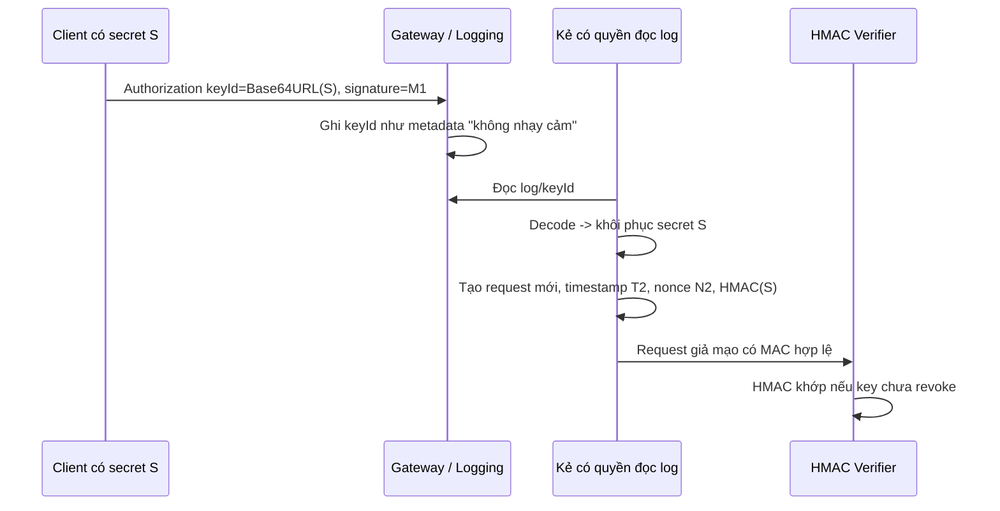

# Không nhúng secret vào key ID trong HMAC request authentication

## Mục tiêu học tập

Trong chương **Key identifier**, bài **Không nhúng secret vào key ID** giải thích một nguyên tắc thiết kế credential có vẻ nhỏ nhưng quyết định ranh giới an toàn của HTTP API: **`keyId` chỉ là định danh dùng tìm khóa; không được chứa, mã hóa lại hoặc làm lộ một phần shared secret**.

Bài thuộc module `SECURITY_AUTHENTICATION_HMAC_REQUEST_AUTHENTICATION`. Hệ thống xác thực HTTP request bằng **HMAC với shared secret** trên một **canonical request** bao gồm phương thức HTTP, URI, header và/hoặc body theo hợp đồng ký. Sau khi kiểm tra MAC, hệ thống còn phải kiểm soát **timestamp/nonce chống replay**, **key rotation**, **proxy/gateway** và **authorization** riêng biệt.

Sau bài học, người học có thể:

- Phân biệt `keyId` (*key identifier*), `clientId`, raw shared secret, **secret reference**, signature, nonce và Idempotency-Key.
- Giải thích vì sao `Base64(secret)`, `hex(secret)`, `secret-prefix`, một mã băm của secret hoặc một token có thể giải mã để lấy secret không nên trở thành `keyId`.
- Nhận diện các đường lộ ID qua HTTP header, gateway, access log, APM, metrics, support ticket và database index; hiểu hậu quả đặc biệt nghiêm trọng khi ID chứa secret.
- Sinh **opaque key ID độc lập** với raw secret bằng `SecureRandom` và lưu mapping `(audience, clientId, keyId) → secretReference` trong credential registry được bảo vệ.
- Đưa **giá trị `keyId` đã parse** vào canonical HMAC, tra đúng key record, chặn alias/key-substitution, key đã revoked và algorithm downgrade.
- Thực hành Java 17: tạo key ID và secret bằng **hai lần sinh ngẫu nhiên độc lập**, ký HMAC-SHA256, verify với key registry, thử thay ID, revoke/rotate, timestamp, nonce và phân quyền.
- Thiết kế test và checklist vận hành để **không có đường truyền dữ liệu từ secret sang ID công khai**.

## 1. Quy tắc bất biến: ID công khai, secret chỉ ở vùng bảo vệ

### 1.1. Bốn đối tượng khác nhau

Giả sử ứng dụng thanh toán có client `payout-worker-prod`. Registry lưu một bản ghi:

```text
Audience          : payments-api-prod
Client ID         : payout-worker-prod
Key ID            : kid_q0Wj7T1vJmVopTZ-8P5RXA
Secret reference  : secret-manager://payments/prod/client-42/v7
Raw shared secret : [32 byte ngẫu nhiên - KHÔNG HIỂN THỊ]
Status            : ACTIVE
Scopes            : payouts:create trong tenant được cấp
```

Ở đây `kid_q0Wj7T1vJmVopTZ-8P5RXA` chỉ là **chuỗi ID minh họa**; không chứa bất kỳ secret thật nào và không bắt buộc khớp ký tự trong bản ghi production.

| Thành phần | Ai sử dụng? | Có cần giữ bí mật không? | Vai trò |
| --- | --- | --- | --- |
| **`clientId`** | Client gửi; server tra identity. | Thường là định danh có thể xuất hiện trong request; bảo vệ metadata theo chính sách. | Xác định client nào tuyên bố đang ký. |
| **`keyId`** | Client gửi; verifier dùng để tìm record. | **Không được thiết kế như một secret.** | Chỉ định khóa/phiên bản credential cần xác minh. |
| **`secretReference`** | Registry/secret manager/backend. | Metadata nội bộ, phải hạn chế truy cập. | Chỉ đến vị trí lưu secret, không phải raw secret. |
| **Raw shared secret** | Signer được cấp quyền và verifier/crypto service. | **Bắt buộc giữ bí mật.** | Dùng làm khóa HMAC; ai biết có thể tạo MAC hợp lệ trong phạm vi credential. |
| **HMAC signature** | Client gửi, server kiểm tra. | Không phải shared secret; vẫn có thể là dữ liệu replay nhạy cảm trong window. | Chứng minh request bytes khớp credential. |

**`keyId` không phải password, API key, bearer token hay HMAC secret.** Chỉ nhìn thấy ID không được giúp bên ngoài tính HMAC của một request mới.

### 1.2. Định nghĩa thiết kế có thể kiểm thử

Một cách diễn đạt rõ:

> Thông tin được công bố bởi `keyId` **không được chứa bản sao raw secret, các byte của secret, hoặc một biểu diễn có thể dùng để khôi phục secret**. Key ID nên được sinh từ nguồn độc lập và ánh xạ tới secret thông qua registry.

Trong mô hình minh họa:

```text
Generate key ID:
    keyId = "kid_" + Base64URL_NoPadding(CSPRNG(16 bytes))

Generate raw HMAC secret:
    secretBytes = CSPRNG(32 bytes)       # 256 bits, RIÊNG BIỆT

Store securely:
    (audience, clientId, keyId) -> secretReference -> secretBytes

Sign:
    signature = Base64URL_NoPadding(
        HMAC-SHA256(secretBytes, UTF8(canonicalRequestIncludingKeyId))
    )
```

Ở đây ID có **128 bit ngẫu nhiên độc lập** và secret có **256 bit ngẫu nhiên độc lập**. Chuỗi `kid_` chỉ là nhãn định dạng **công khai**, không cung cấp sức mạnh mật mã. Không lấy 16 byte đầu của secret để làm ID, dù 16 byte đó có vẻ ngẫu nhiên.

### 1.3. Không cần giữ bí mật key ID để HMAC an toàn

Nhiều thiết kế muốn key ID khó đoán để giảm enumeration, nhưng **không được dựa vào tính bí mật của ID để xác thực**. Một người có được ID hợp lệ vẫn cần raw shared secret để ký MAC đúng; verifier phải kiểm tra key status, audience, client, timestamp, nonce và policy.

ID ngẫu nhiên/opaque hữu ích vì:

- Không mang thông tin về secret, tenant nội bộ hoặc business account không cần thiết.
- Giảm nguy cơ đoán cấu trúc key ID tuần tự và quét registry.
- Dễ tách lifecycle ID khỏi secret rotation và cách lưu key.
- Dùng được trong audit/log đã giới hạn quyền mà không vô tình ghi secret.

Tuy vậy, **entropy của key ID không thay thế entropy của shared secret**. Hệ thống có ID 128 bit đẹp nhưng secret là `"password123"` vẫn cực kỳ yếu.

## 2. Các hình thức “nhúng secret” phải tránh

### 2.1. Lộ nguyên secret dưới dạng một ID

Những biểu diễn sau **không phải cách bảo vệ secret**:

```text
keyId = secretBytes interpreted as text
keyId = Base64URL(secretBytes)
keyId = Hex(secretBytes)
keyId = URL-encode(Base64(secretBytes))
keyId = JSON {"kid": "...", "secret": "..."}
keyId = "kid_" + Base64URL(secretBytes)
```

Base64, hex, URL-encoding và JSON chỉ là **biến đổi có thể đảo ngược**; ai đọc ID có thể khôi phục chính xác dữ liệu đầu vào. Khi request mang keyId qua mạng, giá trị ID có thể xuất hiện tại nhiều tầng observability và được sao chép vào log/support ticket.

Ví dụ sai trong Java:

```java
// KHÔNG DÙNG: tên khóa chính là raw secret được mã hóa Base64URL.
String keyId = "kid_" + java.util.Base64.getUrlEncoder()
        .withoutPadding().encodeToString(rawSecretBytes);
```

Nếu attacker nhìn thấy `keyId`, chỉ cần bỏ prefix `kid_` và decode Base64URL sẽ có raw key dùng tạo HMAC. Không cần bẻ SHA-256 hay khai thác side channel.

### 2.2. ID chứa prefix hoặc suffix của secret

```text
keyId = "kid_" + HEX(secretBytes[0..7])
keyId = "rotated-" + HEX(lastFourBytesOfSecret)
keyId = clientId + "-" + Base64URL(secretBytes[0..15])
```

Dù chỉ lộ **một phần**, đây vẫn là lộ key material không cần thiết:

- Với một secret vốn yếu hoặc sinh sai, lộ thêm byte làm giảm không gian tìm kiếm.
- Prefix/suffix có thể liên kết các bản ghi có chung key material hoặc các secret được tái sử dụng.
- Đối thủ có thể dùng phần đã biết để kiểm tra giả thuyết trong các lỗi cấp phát/trích xuất secret khác.
- Các hệ thống vận hành có thể ghi giá trị này lâu dài vào những nơi không có mức bảo mật của secret.

Với secret thực sự 256 bit và chỉ lộ vài bit, không nhất thiết kẻ tấn công có thể khôi phục khóa trong thực tế. **Không cần phóng đại**; nhưng vì việc lộ một phần mang lại **không lợi ích xác thực** và tạo coupling nguy hiểm, chính sách đúng là **không lấy byte nào của secret làm ID**.

### 2.3. Băm secret rồi dùng digest làm ID

Một anti-pattern tinh vi hơn:

```java
byte[] digest = MessageDigest.getInstance("SHA-256")
        .digest(rawSecretBytes);
String keyId = HexFormat.of().formatHex(digest); // Không khuyến nghị.
```

SHA-256 không đảo ngược dễ dàng với một secret CSPRNG thực sự đủ mạnh (ví dụ 256 bit), nên **không được khẳng định** rằng public SHA-256 digest của secret 256 bit đồng nghĩa lộ ngay secret. Tuy nhiên cách này vẫn là thiết kế không phù hợp cho key ID của **shared-secret HMAC credential**:

- ID phụ thuộc **trực tiếp** vào secret, thay vì là một nhãn opaque độc lập.
- Nếu secret yếu, digest trở thành **offline verifier**: thử secret ứng viên, băm rồi so với key ID đã lộ.
- Hai service dùng cùng secret sẽ có cùng digest, làm lộ **khả năng liên kết/tái sử dụng khóa** giữa môi trường.
- Muốn rotate secret sẽ tự đổi ID dù registry hoặc client lifecycle có thể có quy tắc riêng.
- Nó khuyến khích coi fingerprint của key material là tên credential công khai, dễ bị mở rộng sai thành prefix/key sample.

**Phân biệt:** Trong mật mã bất đối xứng, fingerprint của **public key** có thể là key identifier hợp lệ (chẳng hạn thumbprint từ public JWK). Public key vốn được thiết kế công bố. Bài này nói về **shared secret HMAC**: không lấy digest của **symmetric secret** làm định danh công khai.

### 2.4. Dùng mã hóa thay vì ID độc lập

```text
keyId = Encrypt(masterKey, rawSecretBytes)
keyId = JWT/JWE carrying symmetric HMAC key bytes
keyId = encryptedSecret + "." + serialNumber
```

Dù được mã hóa, các giá trị này **vẫn mang secret** qua bề mặt có phạm vi truy cập khác. Một mã ciphertext được bảo vệ mạnh không đồng nghĩa thiết kế đáng chọn:

- Key quản lý việc mã hóa có thể bị lộ và dẫn tới hàng loạt key ID bị giải mã.
- Lỗi triển khai/chính sách/decryption service có thể trở thành đường trích xuất secret.
- Mọi công cụ lưu ID giờ giữ **bản sao mã hóa của secret**, làm phức tạp data retention/rotation.
- Không cần đưa secret qua request để tra record khi đã có registry.

Nếu giao thức **thực sự** sử dụng key-wrapping, encrypted key blob hoặc token chứa key material, đó là một protocol khác, phải có threat model/cryptographic review và key management riêng. **Không gọi ciphertext chứa secret là “key ID vô hại”.**

### 2.5. Secret trong identifier có cấu trúc

Các chuỗi kiểu sau cũng có thể làm lộ thông tin:

```text
kid_{tenantName}_{apiPassword}
kid_{rawAccessToken}
kid_{secretManagerPrivatePayload}
kid_{customerAccount}_{lastNBytesOfSharedSecret}
```

Tên tenant hoặc client không phải lúc nào cũng là secret, nhưng có thể là **metadata nhạy cảm**. Không đưa PII, credential, password, full token hay key material vào key ID chỉ vì muốn debug thuận tiện. Nếu cần quan sát, dùng opaque ID và mapping nội bộ với chính sách truy cập phù hợp.

## 3. Vì sao key ID thường bị nhìn thấy ở nhiều hệ thống?

Trong HTTP request authentication, client phải nói cho verifier **key record nào** cần dùng. Vì vậy ID thường được truyền trong:

```http
Authorization: HMAC-SHA256 clientId="payout-worker-prod", keyId="kid_q0Wj7T1vJmVopTZ-8P5RXA", timestamp="<epoch-seconds>", nonce="<nonce>", signature="<mac>"
```

Scheme trên là **hợp đồng custom minh họa**, không phải một chuẩn HMAC chung. Một API khác có thể gửi `X-Key-Id` hoặc trường `kid`. Dù ở đâu, **ID là metadata của request**, dễ được sao chép vào:

| Bề mặt | Vì sao rủi ro khi ID chứa secret? | Kiểm soát |
| --- | --- | --- |
| Gateway/reverse proxy | Auth middleware có thể parse, thêm trace hoặc ghi header. | Redact `Authorization`; không bao giờ nhúng secret vào ID. |
| Access logs | Có thể log header, URL hay auth attributes, retention rất dài. | Không ghi raw header/key material, dùng correlation ID. |
| APM/tracing | Key ID có thể thành tag/span attribute hoặc lỗi exception. | Allowlist attributes, redaction và giới hạn quyền. |
| Metrics labels | Dữ liệu high-cardinality phát tán trên nhiều dashboard. | Không dùng full keyId làm label công khai; aggregate/mask. |
| Support ticket/chat | Nhân viên có thể paste raw request để debug. | Mẫu debug đã redacted, chỉ gửi reference không có secret. |
| Database audit/index | Identifier được backup và replicate rộng. | Phân quyền, retention và opaque ID. |
| Client SDK/mobile/CI | ID có thể nằm trong config/repo hoặc output build. | ID không phải secret; shared secret vẫn phải ở kho riêng. |
| Redirect/cross-origin routing | Proxy có thể chuyển header ra đích không tin cậy nếu cấu hình sai. | Kiểm tra audience, không forward credential sang host lạ. |

**Hệ quả:** nếu raw secret được biến thành ID, mọi hệ thống được phép “chỉ đọc ID” bỗng có thể trở thành nguồn lộ **khóa ký HMAC**. Vụ lộ có thể khiến attacker tự tạo request mới với timestamp/nonce hợp lệ, không chỉ replay request cũ.

### 3.1. Kịch bản tấn công cụ thể



Đây **không phải replay attack đơn thuần**. Khi attacker có secret, họ có thể ký **nhiều thông điệp mới**, tự chọn method/URI/body trong phạm vi thuật toán và credential. Timestamp/nonce không chống được người đã sở hữu secret, vì họ có thể tạo timestamp/nonce hợp lệ.

Tuy nhiên credential hợp lệ **vẫn không tự cấp mọi quyền**: authorization phải giới hạn principal, scope, tenant và resource. Nếu thấy secret có khả năng đã lộ, cần **revoke/rotate khóa** và điều tra side effect, không chỉ xóa log hoặc thay tên key ID.

### 3.2. ID công khai không đồng nghĩa được phép phát tán tùy tiện

Khi ID không chứa secret, leak ID **không trực tiếp cho khả năng tính MAC**. Nhưng nó vẫn có thể hỗ trợ:

- Enumeration/tìm kiếm credential tồn tại nếu phản hồi lỗi phân biệt quá chi tiết.
- Liên kết client, môi trường hoặc vòng rotation.
- Suy đoán cấu trúc hạ tầng nếu ID chứa prefix nội bộ.
- DoS qua lookup nhiều key IDs không tồn tại.

Vì vậy vẫn cần logging có chủ đích, giới hạn độ dài ID, rate limit, response lỗi phù hợp và bảo vệ metadata. **Không thiết kế ID là bí mật**, nhưng cũng không coi mọi metadata ID là vô hại về privacy/operations.

## 4. Thiết kế đúng: opaque key ID và secret registry độc lập

### 4.1. Hai nguồn ngẫu nhiên độc lập

Với một credential mới:

```java
SecureRandom rng = new SecureRandom();

byte[] idBytes = new byte[16];
rng.nextBytes(idBytes);
String keyId = "kid_" + Base64.getUrlEncoder()
        .withoutPadding().encodeToString(idBytes);

byte[] secretBytes = new byte[32];
rng.nextBytes(secretBytes); // KHÔNG lấy từ idBytes.
```

Nếu dùng **một đối tượng `SecureRandom`** sinh hai output liên tiếp, hai buffer không phải cùng dữ liệu; đây là cách sinh độc lập phù hợp từ CSPRNG. Không cần hai loại PRNG hoặc hai máy chỉ để phân biệt ID với secret. Phải bảo đảm nguồn entropy và CSPRNG được cấu hình an toàn theo nền tảng.

Một cách khác là tạo **UUID v4 ngẫu nhiên** cho ID và raw secret 256 bit riêng; nếu dùng ULID/KSUID thì cần biết chúng **có thể làm lộ phần thời gian tạo**. Không lấy `keyId = trunc(secret)` để tiết kiệm một lần sinh ngẫu nhiên.

### 4.2. Registry là nơi giữ mapping và policy

```text
Credential registry (nội bộ, truy cập có kiểm soát)
└── (audience, clientId, keyId)
    ├── principalId
    ├── secretReference -> raw HMAC secret bytes
    ├── algorithm = HmacSHA256
    ├── canonicalVersion = keyid-separated-v1
    ├── status = ACTIVE / RETIRING / REVOKED
    ├── notBefore, notAfter (nếu có)
    ├── scopes, allowedTenants
    └── createdAt, rotatedAt, revokedAt
```

Định danh phù hợp để lookup thường là:

```text
lookupKey = (expectedAudience, claimedClientId, claimedKeyId)
```

- `expectedAudience` lấy từ cấu hình **verifier đáng tin**, không chọn tự do từ client.
- `claimedClientId`/`claimedKeyId` chỉ là **hint chưa xác thực** trước khi tính MAC.
- Registry trả key record **duy nhất**; verifier kiểm tra algorithm/version, trạng thái và raw secret.
- Chỉ sau khi MAC đúng mới gắn authenticated principal/scopes từ **record đã xác minh**.
- Không lấy scopes tự khai trong Authorization làm quyền, dù được ký; phải kiểm tra theo policy thực.

`keyId` có thể trùng giữa hai client hoặc hai audience nếu namespace cho phép, miễn composite key phân biệt rõ. Tránh lookup chỉ bằng `keyId` rồi vô tình dùng secret của tenant khác.

### 4.3. Collision, format, cấp phát và lưu bền vững

Token 16 byte CSPRNG có **128 bit**, nên xác suất trùng ngẫu nhiên cực thấp ở quy mô thông thường, nhưng **không bằng 0**. Registry phải dùng **unique constraint hoặc atomic create-if-absent** trên namespace:

```text
(audience, clientId, keyId)
```

Nếu trùng, **sinh một ID mới** và thử lưu lại. Không thay secret đang gắn với ID đã tồn tại để “giải quyết collision”, cũng không cho ghi đè credential cũ bằng lệnh upsert thiếu điều kiện.

Một grammar công khai có thể chọn:

```text
^kid_[A-Za-z0-9_-]{22}$
```

Sau khi nhận 22 ký tự Base64URL, có thể strict-decode thành **16 byte**, rồi encode lại đúng text để từ chối noncanonical pad bits. Format này không cần dấu cách, dấu hai chấm, Unicode hoặc dữ liệu do người dùng điều khiển. Prefix `kid_` là **nhãn công khai**, tuyệt đối không được dùng làm encoding của secret.

### 4.4. Secret reference không phải key ID từ secret

Một secret manager có thể dùng đường dẫn/vault key hoặc version:

```text
secret-manager://payments/prod/worker-42/v7
```

Đây là **locator nội bộ**, không phải byte HMAC key. Nên để registry mapping từ opaque `keyId` tới locator; verifier/crypto service dùng quyền riêng để đọc raw secret. Nếu đưa nguyên locator vào ID công khai, nó **không nhất thiết lộ raw secret**, nhưng có thể lộ cấu trúc hạ tầng, tenant và tên môi trường. Ưu tiên opaque public ID.

Không dựa vào việc secret được encrypt-at-rest để hợp thức hóa việc gửi key material (dạng plaintext hoặc có thể decode) trong `keyId`.

## 5. Ràng buộc key ID được chọn vào canonical HMAC

### 5.1. ID không phải secret nhưng vẫn phải nằm trong dữ liệu được ký

Một lỗi phổ biến là coi `keyId` chỉ là metadata không cần integrity protection, rồi để gateway hoặc client tùy ý sửa sau khi ký:

```text
canonical = method + "\n" + rawTarget + "\n" + bodyHash
Authorization: HMAC-SHA256 keyId=K1, signature=MAC(secretK1, canonical)
```

Nếu `keyId` không nằm trong canonical input, trường hợp nhiều key records dùng cùng secret (do alias/migration hoặc lỗi provision) có thể làm **key substitution** khó phân biệt. Ngoài ra audit và credential selection không được mật mã ràng buộc với request.

Hợp đồng nên **ký cả `clientId` và `keyId`**:

```text
canonical = join(LF, [
  "HMAC-SHA256", contractVersion, audience, clientId, keyId,
  method, rawTarget, contentType, bodyHash,
  idempotencyKey, timestamp, nonce
])
rawMac = HMAC-SHA256(rawSecretBytes, UTF8(canonical))
```

Nếu attacker thay `keyId` từ K1 thành K2 mà giữ raw MAC cũ, server tính expected MAC trên canonical **có K2** và sẽ từ chối, ngay cả khi hai ID vô tình trỏ **cùng secret**.

**Không đưa chính `signature` vào dữ liệu được ký**, vì chữ ký là kết quả của HMAC. Nếu dùng `Authorization` custom, phải parse thành các trường có tên rồi đưa **giá trị** `keyId`/`clientId` vào canonical theo contract, không ký nguyên chuỗi header gồm signature.

### 5.2. Ví dụ request và canonical contract `keyid-separated-v1`

Request minh họa:

```http
POST /v1/payouts?tenant=merchant-42 HTTP/1.1
Host: payments.example.test
Content-Type: application/json
Authorization: HMAC-SHA256 clientId="payout-worker-prod", keyId="kid_q0Wj7T1vJmVopTZ-8P5RXA", timestamp="1700000000", nonce="<nonce>", signature="<mac>"
Idempotency-Key: <operation-token>
X-Content-SHA256: <body-hash>

{"amount":120000,"currency":"VND"}
```

Các chuỗi `<...>` là placeholder, timestamp `1700000000` là fixture cũ **không còn fresh khi gửi thực**. `Authorization: HMAC-SHA256 ...` là scheme giáo dục **tùy chỉnh**, không phải mọi HTTP server tự nhận diện; client và server phải triển khai cùng grammar.

Canonical `keyid-separated-v1` gồm **12 dòng UTF-8**, nối bằng LF, **không LF cuối**:

```text
HMAC-SHA256
keyid-separated-v1
payments-api-prod
payout-worker-prod
kid_q0Wj7T1vJmVopTZ-8P5RXA
POST
/v1/payouts?tenant=merchant-42
application/json
<body-sha256-base64url>
<idempotency-key>
1700000000
<nonce-base64url>
```

| Dòng | Dữ liệu | Nguyên tắc |
| --- | --- | --- |
| 1–2 | Algorithm + version | Pin thuật toán HMAC-SHA256 và contract. |
| 3 | Audience | `payments-api-prod`, do verifier cấu hình đáng tin. |
| 4 | Client ID | Giá trị được parse, phải khớp registry credential. |
| **5** | **Key ID** | **Opaque ID độc lập**, được ký nguyên giá trị, không chứa secret. |
| 6–7 | HTTP method/raw request-target | Gắn chữ ký với thao tác và tenant. |
| 8–9 | Content-Type/body SHA-256 | Bảo vệ semantics và exact body bytes. |
| 10 | Idempotency-Key | Giữ qua retry cùng operation, tránh xử lý trùng nghiệp vụ. |
| 11–12 | Timestamp/nonce | Mới theo signed attempt, dùng chống replay. |

Contract minh họa quy định:

- Method `POST`; raw URI đúng `/v1/payouts?tenant=[A-Za-z0-9_-]{1,64}`; Content-Type chính xác `application/json`; Content-Encoding vắng mặt hoặc `identity`.
- `clientId` là `[A-Za-z0-9_-]{1,64}`; `keyId` là `kid_` + 22 ký tự Base64URL canonical; `nonce` và Idempotency-Key là 22 ký tự Base64URL (16 byte).
- Timestamp là **Unix epoch seconds decimal canonical**, không whitespace, không milliseconds, ví dụ cửa sổ quá khứ 300 giây và tương lai 60 giây.
- Body hash và HMAC-SHA256 là **raw 32 byte** được truyền thành 43 ký tự Base64URL không padding, strict-decode trước so sánh MAC.
- Server phải phát hiện header bị lặp, framing/Content-Encoding không khớp, parser ambiguity, body vượt limit trước khi xử lý nghiệp vụ.
- Nếu `Idempotency-Key` có ảnh hưởng side effect thì phải được ký (như dòng 10) và lưu trong **business idempotency store riêng**.

### 5.3. Nhận diện đúng ranh giới tin cậy của request

```mermaid
sequenceDiagram
    autonumber
    participant C as Client signer
    participant G as Gateway / Proxy
    participant V as HMAC verifier
    participant R as Credential registry / secret manager
    participant N as Shared nonce store
    participant B as Business service
    C->>C: Sinh ID opaque và secret riêng khi provisioning
    C->>C: Chọn keyId; ký canonical có keyId
    C->>G: Authorization keyId + signature, method/URI/body
    G->>V: Dữ liệu signed request tại trust boundary
    V->>V: Parse keyId; coi là untrusted lookup hint
    V->>R: Lookup (audience, clientId, keyId)
    R-->>V: Secret/key status/policy của đúng record
    V->>V: Tự dựng canonical; HMAC verify
    alt MAC sai hoặc key revoked
        V-->>C: Authentication reject
    else MAC đúng và timestamp fresh
        V->>N: Atomic claim nonce
        N-->>V: CLAIMED hoặc REPLAYED
        V->>B: Authenticated principal và validated operation
        B->>B: Authorization + business idempotency
    end
```

Nếu gateway **rewrite URI, normalize query, biến đổi body hoặc xóa Authorization** trước khi verifier dựng canonical, MAC có thể sai dù key ID hoàn toàn hợp lệ. Giải pháp là chọn đúng nơi xác minh và bảo toàn signed bytes/trusted metadata, **không bỏ keyId/URI/body khỏi chữ ký để che mismatch**.

## 6. Vòng đời credential: provisioning, rotation và thu hồi

### 6.1. Khi cấp khóa mới

Một quy trình cấp credential có thể gồm:

1. Xác định `audience` và `clientId`/principal đã được tổ chức cấp quyền.
2. Sinh **`keyId` opaque** độc lập, kiểm tra uniqueness bằng atomic insert.
3. Sinh **raw secret** mạnh độc lập, ví dụ 32 byte CSPRNG cho HMAC-SHA256.
4. Lưu secret vào secret manager/KMS hoặc vùng bảo vệ thích hợp; registry giữ `secretReference` và metadata policy.
5. Giao secret cho client qua kênh cấp phát an toàn, tránh log hoặc hiển thị lại quá mức; có thể chỉ xuất hiện một lần.
6. Đánh dấu key `ACTIVE` sau khi tất cả thành phần cần thiết đã sẵn sàng; client lưu đúng cặp `keyId + secret`, không phải một ID chứa secret.
7. Kiểm thử chữ ký với key mới và audience đúng trước khi dùng cho traffic production.

Key ID dễ quan sát được không phải kênh truyền secret. Không dùng email, error response hoặc HTTP request header thường xuyên để “nhắc lại” raw key bytes.

### 6.2. Khi rotation

```text
Trước:
  clientId=C, keyId=K_old, secret=S_old, ACTIVE

Chuyển tiếp:
  K_old / S_old -> RETIRING (đến deadline cho phép)
  K_new / S_new -> ACTIVE   (ID mới, secret mới độc lập)

Sau:
  K_old / S_old -> REVOKED
  K_new / S_new -> ACTIVE
```

Không đổi tên `K_old` thành `K_new` nhưng giữ nguyên `S_old` rồi gọi là rotation. Nếu raw secret đã lộ, phải **revoke vật liệu cũ**, không chỉ thay ID. Nếu người có secret cũ vẫn được cấp hợp lệ bởi server, họ vẫn có thể tạo MAC.

Một API có thể cho key `RETIRING` trong overlap hữu hạn; `REVOKED` phải bị từ chối **dù MAC đúng toán học**. Không fallback thử mọi key/thuật toán khi signature không khớp key ID được khai.

### 6.3. Chọn key khi retry và tránh nhầm idempotency

Với một business operation có `Idempotency-Key=OP`, attempt 1 và attempt 2 có thể dùng credential khác nhau do rotation:

```text
Attempt 1: (keyId=K_old, secret=S_old), timestamp=T1, nonce=N1
Attempt 2: (keyId=K_new, secret=S_new), timestamp=T2, nonce=N2

Cùng authenticated client principal, cùng OP, cùng method/URI/body.
```

Hệ thống cần:

- Ký lại **cả keyId, timestamp, nonce** của attempt mới bằng secret tương ứng.
- Nonce scope theo `(audience, authenticatedPrincipal, nonce)` để không cho replay cũ được tính như key namespace mới chỉ vì đổi key ID.
- Business idempotency scope theo **principal/audience/OP và fingerprint ổn định**, không đơn thuần theo key ID, để tránh tạo payout hai lần.
- Xác thực/authorization **lại ở mỗi attempt**, kể cả khi kết quả của OP đã được lưu.
- Không tự retry POST tạo tiền khi API không có cơ chế idempotency/reconciliation đáng tin.

### 6.4. Khi nghi ngờ secret đã bị nhúng vào ID hoặc rò qua log

Đây là một **credential exposure incident**, không chỉ là lỗi đặt tên. Các bước phản ứng phù hợp theo quy trình tổ chức:

- **Ngừng tạo ID từ secret**, chặn code/config phát sinh thêm secret-in-ID.
- **Revoke và thay raw secret thực tế** có nguy cơ bị lộ; cấp `keyId` opaque mới độc lập.
- Giới hạn quyền truy cập vào các log, trace, support ticket, export/backup có chứa ID cũ; áp dụng chính sách xử lý dữ liệu nhạy cảm và retention.
- Điều tra request giả mạo, key lookup bất thường, tenant/action bị truy cập và dấu hiệu replay hay side effect.
- Cập nhật SDK/gateway/registry, có rollout hỗ trợ migration với deadline rõ.
- Không tuyên bố đã khắc phục chỉ vì **xóa prefix**, **hash lại key ID cũ** hoặc **rotate tên** nhưng vẫn dùng secret bị lộ.

**Không in secret nghi ngờ bị lộ vào báo cáo để chứng minh lỗi.** Dùng mã sự cố, key record ID đã redacted và audit trong kênh được cấp quyền.

## 7. Java 17: cấp key ID và HMAC secret độc lập, xác minh qua registry

Chương trình `KeyIdNoSecretDemo.java` bên dưới chỉ dùng **JDK 17+**. Nó tạo **mỗi key ID và raw secret từ hai lần gọi CSPRNG độc lập**, lưu bản ghi registry, ký request theo `keyid-separated-v1` rồi xác minh bằng **secret được tra qua ID**, không lấy secret từ nội dung ID.

Kịch bản:

1. Cấp credential `ACTIVE`: `kid_<22 Base64URL chars>` từ 16 byte ngẫu nhiên, **secret 32 byte riêng**.
2. Tạo operation `POST /v1/payouts?tenant=merchant-42`, có một Idempotency-Key và body snapshot.
3. Client ký bằng secret; server tra `(audience, clientId, keyId)`, tự tính SHA-256 body và HMAC, so sánh raw MAC bytes.
4. Replay nguyên signed attempt bị chặn bởi nonce giả lập.
5. **Sửa key ID sau khi ký** nhưng giữ MAC cũ: signature không khớp.
6. Cấp key mới với ID mới/secret mới, ký lại thành một attempt mới; verifier có thể xác thực.
7. Thu hồi key cũ; một request được ký đúng bằng secret cũ vẫn bị từ chối theo **key status**.
8. Hai client có thể có **cùng văn bản key ID** nhưng dùng hai secret/namespace khác nhau; sửa `clientId` trong request không làm chữ ký cũ được chấp nhận.
9. MAC hợp lệ cho tenant ngoài quyền vẫn bị **authorization từ chối**.

**Giới hạn:** Đây là mô phỏng trong một JVM, không phải HTTP server hoặc payment system. Registry và nonce store chỉ ở RAM; chưa có TTL, atomicity xuyên node, persistence, key manager thực, duplicate HTTP header parser, business transaction hay Idempotency-Key result store. **Không được đưa trực tiếp code demo vào production.**

### 7.1. Mã nguồn hoàn chỉnh

```java
import java.nio.charset.StandardCharsets;
import java.security.GeneralSecurityException;
import java.security.MessageDigest;
import java.security.SecureRandom;
import java.time.Clock;
import java.time.Instant;
import java.time.ZoneOffset;
import java.util.Arrays;
import java.util.Base64;
import java.util.Objects;
import java.util.Set;
import java.util.concurrent.ConcurrentHashMap;
import java.util.concurrent.ConcurrentMap;
import java.util.regex.Pattern;
import javax.crypto.Mac;
import javax.crypto.spec.SecretKeySpec;

public final class KeyIdNoSecretDemo {
    private static final String AUDIENCE = "payments-api-prod";
    private static final String CLIENT = "payout-worker-prod";
    private static final long PAST = 300;
    private static final long FUTURE = 60;

    private static final Pattern CLIENT_ID = Pattern.compile(
            "[A-Za-z0-9_-]{1,64}");
    private static final Pattern KEY_ID = Pattern.compile(
            "kid_[A-Za-z0-9_-]{22}");
    private static final Pattern TARGET = Pattern.compile(
            "/v1/payouts\\?tenant=[A-Za-z0-9_-]{1,64}");
    private static final Pattern EPOCH_SECONDS = Pattern.compile(
            "[1-9][0-9]{0,11}");

    private static final Base64.Encoder ENCODE =
            Base64.getUrlEncoder().withoutPadding();
    private static final Base64.Decoder DECODE =
            Base64.getUrlDecoder();

    private KeyIdNoSecretDemo() {}

    enum Status { ACTIVE, REVOKED }

    record KeyRef(String audience, String clientId, String keyId) {}

    record Credential(
            String audience, String clientId, String keyId,
            byte[] rawSecret, Status status) {
        Credential {
            rawSecret = Objects.requireNonNull(rawSecret).clone();
        }

        @Override public byte[] rawSecret() {
            return rawSecret.clone();
        }
    }

    record Operation(
            String clientId, String keyId, String method,
            String rawTarget, String contentType, byte[] body,
            String idempotencyKey) {
        Operation {
            body = Objects.requireNonNull(body).clone();
        }

        @Override public byte[] body() {
            return body.clone();
        }
    }

    record SignedAttempt(
            Operation operation, String timestamp, String nonce,
            String bodyHash, String signature) {}

    enum Verdict {
        ACCEPTED, INVALID_INPUT, INVALID_CREDENTIAL,
        OUTSIDE_WINDOW, BAD_MAC, REPLAYED, FORBIDDEN
    }

    // Mô phỏng registry chỉ trong JVM, không phải secret manager thật.
    static final class Registry {
        private final ConcurrentMap<KeyRef, Credential> credentials =
                new ConcurrentHashMap<>();

        Credential issue(String audience, String clientId,
                         SecureRandom rng) {
            if (!CLIENT_ID.matcher(clientId).matches()) {
                throw new IllegalArgumentException("Invalid clientId");
            }
            for (int tryNumber = 0; tryNumber < 10; tryNumber++) {
                byte[] idBytes = new byte[16];
                byte[] secretBytes = new byte[32];

                // HAI buffer ngẫu nhiên độc lập.
                rng.nextBytes(idBytes);
                rng.nextBytes(secretBytes);

                String keyId = "kid_" + ENCODE.encodeToString(idBytes);
                Credential credential = new Credential(
                        audience, clientId, keyId, secretBytes,
                        Status.ACTIVE);
                KeyRef ref = new KeyRef(audience, clientId, keyId);

                // Cấm ghi đè credential nếu ID bất ngờ trùng.
                Credential previous =
                        credentials.putIfAbsent(ref, credential);

                Arrays.fill(idBytes, (byte) 0);
                Arrays.fill(secretBytes, (byte) 0);

                if (previous == null) {
                    // Trong ứng dụng thật chỉ provision secret qua
                    // kênh bảo vệ và lưu ref ở credential registry.
                    return credential;
                }
            }
            throw new IllegalStateException("Could not allocate key ID");
        }

        Credential lookup(KeyRef ref) {
            return credentials.get(ref);
        }

        void registerForTest(Credential credential) {
            KeyRef ref = new KeyRef(
                    credential.audience(), credential.clientId(),
                    credential.keyId());
            if (credentials.putIfAbsent(ref, credential) != null) {
                throw new IllegalArgumentException("Duplicate key record");
            }
        }

        void revoke(KeyRef ref) {
            credentials.computeIfPresent(ref, (ignored, old) ->
                    new Credential(old.audience(), old.clientId(),
                            old.keyId(), old.rawSecret(),
                            Status.REVOKED));
        }
    }

    // Chỉ mô phỏng claim trong một JVM: không TTL, failover hay multi-node.
    static final class DemoNonceStore {
        private final Set<String> used =
                ConcurrentHashMap.newKeySet();

        boolean claim(String principal, String nonce) {
            return used.add(AUDIENCE + "|" + principal + "|" + nonce);
        }
    }

    static byte[] strictBase64Url(
            String text, int textLength, int bytesLength) {
        if (text == null || text.length() != textLength
                || !text.matches("[A-Za-z0-9_-]+")) {
            throw new IllegalArgumentException("Invalid Base64URL syntax");
        }
        byte[] bytes = DECODE.decode(text);
        if (bytes.length != bytesLength
                || !ENCODE.encodeToString(bytes).equals(text)) {
            throw new IllegalArgumentException("Noncanonical Base64URL");
        }
        return bytes;
    }

    static String newToken(SecureRandom rng) {
        byte[] bytes = new byte[16];
        rng.nextBytes(bytes);
        String value = ENCODE.encodeToString(bytes);
        Arrays.fill(bytes, (byte) 0);
        return value;
    }

    static void validateOperation(Operation op) {
        if (op == null || op.clientId() == null
                || !CLIENT_ID.matcher(op.clientId()).matches()
                || op.keyId() == null
                || !KEY_ID.matcher(op.keyId()).matches()) {
            throw new IllegalArgumentException("Bad client/key ID");
        }
        strictBase64Url(op.keyId().substring(4), 22, 16);
        if (!"POST".equals(op.method())
                || op.rawTarget() == null
                || !TARGET.matcher(op.rawTarget()).matches()
                || !"application/json".equals(op.contentType())) {
            throw new IllegalArgumentException("Bad request target/type");
        }
        if (op.body().length == 0 || op.body().length > 1_048_576) {
            throw new IllegalArgumentException("Invalid body size");
        }
        strictBase64Url(op.idempotencyKey(), 22, 16);
    }

    static void validateAttempt(SignedAttempt a) {
        if (a == null) {
            throw new IllegalArgumentException("Missing attempt");
        }
        validateOperation(a.operation());
        if (a.timestamp() == null
                || !EPOCH_SECONDS.matcher(a.timestamp()).matches()) {
            throw new IllegalArgumentException("Invalid epoch seconds");
        }
        strictBase64Url(a.nonce(), 22, 16);
    }

    static byte[] sha256(byte[] bytes)
            throws GeneralSecurityException {
        return MessageDigest.getInstance("SHA-256").digest(bytes);
    }

    static String canonical(SignedAttempt a, String bodyHash) {
        validateAttempt(a);
        strictBase64Url(bodyHash, 43, 32);
        Operation op = a.operation();

        return String.join("\n",
                "HMAC-SHA256",
                "keyid-separated-v1",
                AUDIENCE,
                op.clientId(),
                op.keyId(), // Đúng ID; không chứa rawSecret.
                op.method(),
                op.rawTarget(),
                op.contentType(),
                bodyHash,
                op.idempotencyKey(),
                a.timestamp(),
                a.nonce());
        // 12 dòng UTF-8, LF, không LF cuối.
    }

    static byte[] hmac(byte[] rawSecret, String canonicalText)
            throws GeneralSecurityException {
        Mac mac = Mac.getInstance("HmacSHA256");
        mac.init(new SecretKeySpec(rawSecret, "HmacSHA256"));
        return mac.doFinal(
                canonicalText.getBytes(StandardCharsets.UTF_8));
    }

    static SignedAttempt sign(
            Operation op, Credential credential,
            Clock clock, SecureRandom rng)
            throws GeneralSecurityException {
        validateOperation(op);
        if (!op.clientId().equals(credential.clientId())
                || !op.keyId().equals(credential.keyId())
                || !AUDIENCE.equals(credential.audience())) {
            throw new IllegalArgumentException("Credential mismatch");
        }

        String timestamp =
                Long.toString(Instant.now(clock).getEpochSecond());
        String nonce = newToken(rng);
        String bodyHash = ENCODE.encodeToString(sha256(op.body()));
        SignedAttempt unsigned = new SignedAttempt(
                op, timestamp, nonce, bodyHash, "");
        String signature = ENCODE.encodeToString(
                hmac(credential.rawSecret(), canonical(unsigned, bodyHash)));
        return new SignedAttempt(
                op, timestamp, nonce, bodyHash, signature);
    }

    static Verdict verify(
            SignedAttempt received, Registry registry,
            Clock serverClock, DemoNonceStore nonceStore)
            throws GeneralSecurityException {
        try {
            validateAttempt(received);
            Operation op = received.operation();

            // clientId/keyId là UNTRUSTED LOOKUP HINTS cho tới khi MAC đúng.
            KeyRef ref = new KeyRef(AUDIENCE, op.clientId(), op.keyId());
            Credential registered = registry.lookup(ref);
            if (registered == null
                    || registered.status() != Status.ACTIVE) {
                return Verdict.INVALID_CREDENTIAL;
            }

            long now = Instant.now(serverClock).getEpochSecond();
            long signedTime = Long.parseLong(received.timestamp());
            if (signedTime < Math.subtractExact(now, PAST)
                    || signedTime > Math.addExact(now, FUTURE)) {
                return Verdict.OUTSIDE_WINDOW;
            }

            byte[] actualDigest = sha256(op.body());
            byte[] headerDigest =
                    strictBase64Url(received.bodyHash(), 43, 32);
            if (!MessageDigest.isEqual(actualDigest, headerDigest)) {
                return Verdict.BAD_MAC;
            }

            byte[] supplied =
                    strictBase64Url(received.signature(), 43, 32);
            byte[] expected = hmac(
                    registered.rawSecret(),
                    canonical(received, ENCODE.encodeToString(actualDigest)));
            if (!MessageDigest.isEqual(expected, supplied)) {
                return Verdict.BAD_MAC;
            }

            // Nonce scope theo authenticated principal, KHÔNG chỉ keyId.
            if (!nonceStore.claim(
                    registered.clientId(), received.nonce())) {
                return Verdict.REPLAYED;
            }

            // Giả lập authorization: chỉ được tenant merchant-42.
            if (!"/v1/payouts?tenant=merchant-42"
                    .equals(op.rawTarget())) {
                return Verdict.FORBIDDEN;
            }
            return Verdict.ACCEPTED;
        } catch (IllegalArgumentException | ArithmeticException ex) {
            return Verdict.INVALID_INPUT;
        }
    }

    static Operation withCredential(
            Operation op, String clientId, String keyId) {
        return new Operation(
                clientId, keyId, op.method(), op.rawTarget(),
                op.contentType(), op.body(), op.idempotencyKey());
    }

    static Operation withTarget(Operation op, String target) {
        return new Operation(
                op.clientId(), op.keyId(), op.method(), target,
                op.contentType(), op.body(), op.idempotencyKey());
    }

    public static void main(String[] args)
            throws GeneralSecurityException {
        SecureRandom random = new SecureRandom();
        Clock clock = Clock.fixed(
                Instant.ofEpochSecond(1_700_000_000L), ZoneOffset.UTC);
        Registry registry = new Registry();
        DemoNonceStore nonceStore = new DemoNonceStore();

        Credential first = registry.issue(AUDIENCE, CLIENT, random);
        Credential rotated = registry.issue(AUDIENCE, CLIENT, random);

        // Chỉ in PUBLIC ID; không in/encode secret cho log.
        System.out.println("Opaque ID syntax valid: "
                + KEY_ID.matcher(first.keyId()).matches());

        Operation op = new Operation(
                CLIENT, first.keyId(), "POST",
                "/v1/payouts?tenant=merchant-42",
                "application/json",
                "{\"amount\":120000,\"currency\":\"VND\"}"
                        .getBytes(StandardCharsets.UTF_8),
                newToken(random));

        SignedAttempt attempt1 = sign(op, first, clock, random);
        System.out.println("Valid signed request: "
                + verify(attempt1, registry, clock, nonceStore));
        System.out.println("Same signed attempt replay: "
                + verify(attempt1, registry, clock, nonceStore));

        // Sửa ID nhưng giữ body/nonce/timestamp/MAC cũ.
        Operation replacedKey =
                withCredential(op, CLIENT, rotated.keyId());
        SignedAttempt tampered = new SignedAttempt(
                replacedKey, attempt1.timestamp(), attempt1.nonce(),
                attempt1.bodyHash(), attempt1.signature());
        System.out.println("Changed keyId, old MAC: "
                + verify(tampered, registry, clock, nonceStore));

        // Ký lại bằng secret MỚI và keyId MỚI.
        Operation rotatedOp =
                withCredential(op, CLIENT, rotated.keyId());
        SignedAttempt attempt2 =
                sign(rotatedOp, rotated, clock, random);
        System.out.println("Valid rotated credential: "
                + verify(attempt2, registry, clock, nonceStore));
        System.out.println("Same operation key after rotation: "
                + op.idempotencyKey()
                    .equals(rotatedOp.idempotencyKey()));

        // Client vẫn ký được bằng secret cũ về mặt toán học,
        // nhưng credential REVOKED phải bị từ chối.
        registry.revoke(new KeyRef(AUDIENCE, CLIENT, first.keyId()));
        SignedAttempt afterRevocation =
                sign(op, first, clock, random);
        System.out.println("Revoked key rejected: "
                + verify(afterRevocation, registry, clock, nonceStore));

        // Mô phỏng hai client dùng cùng TEXT keyId nhưng secret khác.
        byte[] otherSecret = new byte[32];
        random.nextBytes(otherSecret);
        registry.registerForTest(new Credential(
                AUDIENCE, "other-worker-prod", first.keyId(),
                otherSecret, Status.ACTIVE));
        Arrays.fill(otherSecret, (byte) 0);

        Operation wrongClient = withCredential(
                op, "other-worker-prod", first.keyId());
        SignedAttempt alteredClient = new SignedAttempt(
                wrongClient, attempt1.timestamp(), attempt1.nonce(),
                attempt1.bodyHash(), attempt1.signature());
        System.out.println("Changed clientId, old MAC: "
                + verify(alteredClient, registry, clock, nonceStore));

        // MAC có thể đúng nhưng authenticated principal không có quyền
        // thực thi trên tenant khác.
        Operation forbidden = withTarget(
                rotatedOp, "/v1/payouts?tenant=merchant-99");
        SignedAttempt signedForbidden =
                sign(forbidden, rotated, clock, random);
        System.out.println("Valid MAC, unauthorized tenant: "
                + verify(signedForbidden, registry, clock, nonceStore));
    }
}
```

Kết quả kỳ vọng (key ID và signature cụ thể luôn khác khi sinh lại):

```text
Opaque ID syntax valid: true
Valid signed request: ACCEPTED
Same signed attempt replay: REPLAYED
Changed keyId, old MAC: BAD_MAC
Valid rotated credential: ACCEPTED
Same operation key after rotation: true
Revoked key rejected: INVALID_CREDENTIAL
Changed clientId, old MAC: BAD_MAC
Valid MAC, unauthorized tenant: FORBIDDEN
```

### 7.2. Vì sao ví dụ này **không thể** vô tình tạo key ID từ secret?

Trong `Registry.issue`, hai output được sinh riêng:

```java
byte[] idBytes = new byte[16];
byte[] secretBytes = new byte[32];

rng.nextBytes(idBytes);
rng.nextBytes(secretBytes);

String keyId = "kid_" + ENCODE.encodeToString(idBytes);
Credential credential = new Credential(
        audience, clientId, keyId, secretBytes, Status.ACTIVE);
```

**Không có biểu thức nào lấy `secretBytes` để tạo `keyId`.** `keyId` chỉ phụ thuộc `idBytes`, còn `rawSecret` chỉ dùng khi tính HMAC. Registry là cầu nối duy nhất giữa hai dữ liệu, không phải phép biến đổi mật mã công khai của secret.

`putIfAbsent` ngăn hai credential trùng composite key ghi đè nhau trong mô phỏng một JVM. Nếu ID trùng, ví dụ sinh ID/secret mới và thử lại. Production phải có uniqueness ở storage có consistency thích hợp.

### 7.3. Đổi key ID phải làm MAC fail, kể cả khi key đã tồn tại

`tampered` sửa **keyId sang một credential ACTIVE khác** nhưng giữ nguyên signature của attempt trước. Verifier:

1. Tra **secret khác** qua ID mới.
2. Dựng lại canonical có **ID mới**.
3. Tính HMAC, đối chiếu raw MAC bằng `MessageDigest.isEqual`.
4. Trả `BAD_MAC`, không claim nonce và không thực hiện business effect.

Trong thực hành, có thể thêm một test fixture **không dùng production** cho hai ID cố tình trỏ đến **cùng raw secret** để kiểm tra tính ràng buộc: sau khi đổi ID và giữ MAC cũ, signature **vẫn phải fail** vì chuỗi canonical thay đổi. Test này giúp phát hiện lỗi “forgot to sign keyId” nhưng không phải lý do cấp cùng secret cho nhiều key.

### 7.4. Secret được clone không có nghĩa zeroization tuyệt đối

`Credential` clone `rawSecret[]` khi khởi tạo và trả bản sao ở getter để tránh caller sửa mảng gốc. `Registry.issue` xóa **buffer tạm** sau khi copy vào record. Điều đó giảm một số đường lưu bản sao nhưng **không bảo đảm** không còn byte secret trong JVM heap, GC, crash dump hoặc JCA provider internals.

Ứng dụng thực phải giảm thời gian sống của secret, giới hạn quyền đọc, quản lý key qua secret manager/KMS phù hợp, tránh log/serialize debug object chứa key bytes và có kế hoạch revoke. Không in `credential.toString()` nếu record chứa field secret.

### 7.5. Các giới hạn có chủ đích

`DemoNonceStore` chỉ là `ConcurrentHashMap.newKeySet()`, **không có TTL hoặc tính nhất quán phân tán**. Production cần atomic claim (ví dụ kho dùng chung với TTL đủ che phủ cửa sổ timestamp), xử lý lỗi store theo fail-closed và phân tích failover/multi-region.

`validateOperation` kiểm tra các trường đã tách trong Java, **không phải HTTP parser**. API thật phải chặn duplicate `Authorization` hoặc `X-Key-Id`, header smuggling, invalid framing, Content-Encoding không hỗ trợ và proxy rewrite; chỉ nhận những byte method/URI/body đã thống nhất ở trust boundary.

Ví dụ có Idempotency-Key trong MAC, nhưng **không có idempotency store hay transaction**. `ACCEPTED` chỉ là kết quả của authentication/replay/authorization minh họa; nó **không** chứng minh một payout đã được tạo đúng một lần. Không tự retry POST tạo tiền nếu thiếu contract idempotency/reconciliation.

## 8. Khi một SDK hoặc gateway tự sinh key ID sai cách

### 8.1. Review luồng provisioning, không chỉ output

Một bài kiểm tra tĩnh kiểu `keyId.length() == 26` **không thể** chứng minh ID độc lập với secret. Nếu SDK sinh key ID bằng cách lấy 16 byte đầu secret rồi Base64URL, kết quả **vẫn đúng 22 ký tự** và nhìn rất ngẫu nhiên.

Vì vậy, cần review **nguồn dữ liệu**:

```text
Đúng:
  CSPRNG --(16 bytes)--> idBytes --------> public keyId
     |
     +----(32 bytes)--> secretBytes ------> protected secret store

Sai:
  CSPRNG --(32 bytes)--> secretBytes --+--> HMAC key
                                      +--> first16/hex/base64/hash --> keyId
```

Cần kiểm tra code ở các lớp:

- Credential-issuing service, provisioning scripts và import/migration job.
- SDK sinh key ID lúc bootstrap (có thể chạy cả trên mobile/agent/CI).
- Key manager tự đặt `kid` từ object khác, chẳng hạn access token hoặc secret manager payload.
- Gateway/plugin tự tạo identifier từ secret để “tránh lưu mapping”.
- Các template cấu hình, IaC, môi trường demo/test được copy sang production.

Một yêu cầu kiểm thử kiến trúc: **không có data flow từ raw secret sang trường public `keyId`**, kể cả qua `Base64`, substring, hash, UUID from secret, encryption hay một helper “fingerprint”. Chỉ được có **lookup mapping nội bộ** từ ID tới secret reference.

### 8.2. Khi key ID là chuỗi có cấu trúc

Có tổ chức muốn key ID mang prefix như `kid_live_`, `kid_test_` hay mã region. Điều đó **không đồng nghĩa nhúng secret** nếu prefix là metadata công khai không nhạy cảm và phần còn lại là ID độc lập:

```text
Có thể chấp nhận theo chính sách:
  kid_live_<opaque-random-id>
  kid_test_<opaque-random-id>

Không chấp nhận:
  kid_live_<raw-secret>
  kid_live_<base64-secret>
  kid_live_<first-8-secret-bytes>
```

Tuy nhiên việc encode region/client/tenant vào ID có thể làm lộ metadata, gây coupling và kéo theo nhu cầu đổi ID khi di chuyển hạ tầng. Với bài này, prefix `kid_` đơn giản được ưu tiên; audience/client/status nằm trong registry.

**Một kiểm tra format không bảo đảm bí mật:** chuỗi `kid_live_...` nhìn “đúng chuẩn” vẫn có thể chứa encoded secret ở phần sau. Phải review **quy trình sinh** chứ không chỉ regex.

### 8.3. ID đến từ vendor hoặc secret manager

Một cloud KMS/secret manager có thể cung cấp **key resource ID, ARN, version ID hoặc handle**. Những thứ đó thông thường **không phải raw key material**, nhưng không mặc nhiên thích hợp để gửi trong header công khai:

- Có thể lộ tài khoản cloud, region, tên dự án/tenant và cấu trúc nội bộ.
- Có thể bị dùng để gọi API quản lý khóa nếu identity/permission khác bị cấu hình sai.
- Có thể đổi semantics khi migrate provider, tài khoản hoặc version.
- Một số sản phẩm có "access key ID" đi kèm "secret access key"; đây là **hai giá trị khác nhau** và không được gộp làm một.

Thiết kế tốt là phát hành **public opaque keyId của ứng dụng** và ánh xạ nội bộ tới locator cloud; key manager giữ secret/cryptographic operation dưới quyền hạn thích hợp. Nếu thực sự chọn vendor handle làm public ID, phải review metadata disclosure và hợp đồng tích hợp, nhưng **không được đưa secret bytes vào handle**.

### 8.4. Một số phản ứng sai khi phát hiện vấn đề

| Phản ứng sai | Vì sao chưa an toàn? | Phản ứng đúng |
| --- | --- | --- |
| Đổi tên ID nhưng vẫn dùng secret từng xuất hiện trong log | Người đã biết raw secret vẫn ký được. | Revoke/rotate secret thật; phát ID mới độc lập. |
| Hash ID cũ (vốn là Base64 secret) rồi coi như xong | ID mới không chứa raw secret, nhưng **secret cũ đã có thể lộ**. | Thay key material và xử lý dữ liệu bị phơi bày. |
| Xóa một dashboard, bỏ qua log backups | Các bản sao đã tồn tại vẫn có thể bị đọc. | Điều tra phạm vi exposure, phân quyền, retention, audit. |
| Giảm quyền của key nhưng không revoke | Kẻ biết secret có thể tiếp tục ký trong phạm vi còn lại. | Revoke nếu credential đã lộ; cấp lại quyền tối thiểu. |
| Đặt ID vào TLS rồi coi nó là secret | TLS chỉ bảo vệ đường truyền, không ngăn server/telemetry lưu ID. | Không nhúng secret và redaction theo tuyến xử lý. |
| Đổi `clientId` nhưng giữ credential cũ | Có thể vẫn tạo MAC nếu registry còn chấp nhận alias. | Thu hồi mapping/key đúng, test negative cases. |

## 9. Tích hợp key ID với key rotation, replay và authorization

### 9.1. Ranh giới xác thực HMAC

Quy trình xác minh production thường gồm:

```text
HTTP input / Authorization header
    |
    v
Parse và giới hạn size, duplicate header, grammar, scheme
    |
    v
Lookup (expectedAudience, clientId, keyId) theo public ID
    |
    v
Credential policy: status, notBefore/notAfter, algorithm, version
    |
    v
SHA-256(exact body bytes) + reconstruct canonical có keyId
    |
    v
HMAC(raw secret từ protected store, canonical bytes)
    |
    v
MessageDigest.isEqual(expectedRawMac, receivedRawMac)
    |
    v
Timestamp freshness + atomic nonce claim (shared store)
    |
    v
Authenticated principal từ credential record
    |
    v
Authorization (tenant, resource, action, scope)
    |
    v
Business idempotency/transaction nếu endpoint có side effect
```

**Không có bước nào "decode keyId để lấy secret".** Nếu một hệ thống cần decode public key ID thành raw secret để ký/verifier hoạt động, thiết kế đã vi phạm nguyên tắc của bài.

### 9.2. Timing và oracle khi tra key ID

Khi key ID không tồn tại, lookup có thể trả nhanh hơn khi nó tồn tại. Trên những hệ thống đặc thù, thời gian phản hồi hoặc mã lỗi có thể cho attacker đoán key IDs hợp lệ. Các biện pháp tùy threat model:

- Giới hạn rate/quota và độ dài ID; không cho tìm kiếm wildcard/substring.
- Trả lỗi xác thực công khai theo contract, tránh phân biệt “ID tồn tại nhưng MAC sai” với “ID không tồn tại” nếu không cần.
- Theo dõi thất bại lookup từ nguồn đáng ngờ, không log secret/expected MAC.
- Bảo vệ registry khỏi bị duyệt toàn bộ hoặc query không có giới hạn.
- Không dùng delay tùy tiện như một bảo đảm constant-time toàn endpoint.

Dù tra key ID có khác biệt thời gian, bước so sánh MAC vẫn phải dùng primitive phù hợp như `MessageDigest.isEqual` trên raw byte MAC, không dùng `String.equals` để đoán prefix MAC.

### 9.3. Proxy/gateway không được biến ID thành đường dẫn secret

Một anti-pattern nguy hiểm ở backend:

```text
raw input: keyId = "../../../../prod/secret"
openFile("/secrets/" + keyId)
```

Kể cả `keyId` **không chứa secret**, nó vẫn là **untrusted input** trước authentication. Không đưa ID chưa kiểm tra vào path, SQL, shell command, URL hoặc key-management API theo cách tạo path traversal/injection. Dùng grammar allowlist, prepared query/composite lookup và một storage API bảo vệ.

Trong ví dụ `kid_[A-Za-z0-9_-]{22}`, dấu `/` và `.` không hợp lệ, nên path traversal đơn giản bị chặn; tuy nhiên **validation không thay access control của secret store**.

### 9.4. Key ID không thay thế authorization

Giả sử key record thuộc principal `payout-worker-prod` được cấp quyền tạo payout cho `merchant-42`. Client có secret đúng vẫn có thể ký:

```http
POST /v1/payouts?tenant=merchant-99 HTTP/1.1
Authorization: HMAC-SHA256 clientId="payout-worker-prod", keyId="<valid-id>", timestamp="<fresh>", nonce="<new>", signature="<valid-mac>"
```

Nếu verifier xác thực thành công, principal vẫn **không có quyền** với tenant `merchant-99`. Policy phải xét effective operation và scopes/tenants ở server, không suy quyền từ `keyId` hoặc từ việc MAC đúng.

Khi trả stored result của một Idempotency-Key, hệ thống cũng phải xác thực/authorize **attempt hiện tại**, không coi biết operation key hoặc key ID là đủ để xem dữ liệu nhạy cảm.

## 10. Ma trận kiểm thử: secret không thể chảy vào key ID

Bộ test cần bao gồm **quy trình sinh**, **định dạng**, **định vị credential**, **HMAC binding** và **đường lộ dữ liệu**. Một unit test `ID != secret` không đủ; Base64 hoặc hash của secret vẫn khác text raw secret.

| Ca kiểm thử | Cách kiểm tra | Kỳ vọng |
| --- | --- | --- |
| Sinh ID từ CSPRNG riêng | Review `issue`/provisioning data flow | ID dùng **idBytes**, secret dùng **secretBytes** độc lập. |
| ID dạng Base64(secret) | Đưa implementation sai vào test/migration scanner | Phát hiện và từ chối chính sách sinh ID này. |
| ID dạng hex(secret) | Review generator | Không chấp nhận ID chứa key material đảo được. |
| ID chứa 4/8/16 byte đầu của secret | Kiểm tra nguồn ID | Không chấp nhận tiết lộ prefix/suffix của secret. |
| ID bằng SHA-256(secret) | Static review, đặc biệt với secret yếu | Không dùng symmetric secret digest làm public ID. |
| ID dạng ciphertext chứa secret | Review protocol/data flow | Không coi encrypted key blob là ID công khai thông thường. |
| ID hợp lệ | `kid_` + 22 Base64URL chars, canonical decode | Parse được 16 byte identifier, không có secret. |
| ID có `/`, `.`, whitespace, Unicode | Thử input ngoài allowlist | Reject trước lookup/path/SQL usage. |
| ID có pad bits noncanonical | Decode/re-encode suffix ID | Reject, không chấp nhận nhiều text cho một ID. |
| ID rỗng/quá dài | Missing, max-size, regex | Reject; không fallback key mặc định. |
| Composite lookup | Hai client cùng text keyId | Lookup hai record/secret **khác nhau**. |
| Staging/prod trùng keyId | Audience khác | Không cross-environment access. |
| ID chưa tồn tại | HMAC đúng giả lập bằng secret không thuộc registry | Reject, không thử key dự phòng ngẫu nhiên. |
| ID được thay sau ký | Thay `keyId`, giữ signature cũ | BAD_MAC hoặc reject credential, không tiếp tục. |
| Hai IDs trỏ cùng secret do lỗi test | Thay ID nhưng giữ MAC | MAC vẫn fail vì keyId **đã được ký**. |
| Thay clientId sau ký | Tra record client khác | Reject, không dùng secret client gốc. |
| Key `REVOKED` | Sign bằng secret cũ nhưng registry revoked | Reject, kể cả timestamp fresh/MAC toán học đúng. |
| Key `RETIRING` sau deadline | Hết overlap | Reject theo key policy. |
| Rotation đúng | ID mới + secret mới độc lập | Sign/verify với record mới; không fallback. |
| Timestamp ngoài cửa sổ | MAC có thể đúng | Reject freshness. |
| Replay signed attempt | Cùng nonce đã claim | Reject qua shared nonce store. |
| Store nonce không khả dụng | Không thể xác nhận claim | Fail closed, không xử lý business. |
| Retry với keyId mới | Same operation/Idempotency-Key, nonce/MAC mới | Xác thực credential mới; business dedup theo principal. |
| Tenant ngoài quyền | MAC đúng | Authorization từ chối theo policy. |
| Gateway sửa URI/body | Signed bytes khác | MAC fail hoặc verify tại trust boundary đúng. |
| Gateway thay Authorization | Scheme/ID/signature mất hoặc đổi | Reject hoặc delegation được thiết kế rõ. |
| Logs/APM chứa raw Authorization | Quét/test telemetry | Không cho lộ header/secret, dùng redaction. |
| Secret trong error/debug representation | Kiểm tra exceptions, record toString, JSON serializer | Không serialize raw key material. |
| Multi-node credential registry | Cùng ID nhưng status khác giữa node | Test rollout/invalidations, không chấp nhận revoked record. |
| Database collision khi provision | Cấp đồng thời cùng namespace ID | Unique constraint/atomic create ngăn overwrite. |

### 10.1. Test vector HMAC giữa nhiều SDK

Để Java, Go, Node.js hoặc một gateway tự kiểm chứng có cùng contract, có thể công bố **fixture với secret giả**:

- `audience`, `clientId`, `keyId` **opaque độc lập** với secret giả.
- Raw secret test (hex/Base64URL) **chỉ trong test vector**; không sử dụng production secret.
- Method, raw request-target, Content-Type và exact body bytes.
- Idempotency-Key, timestamp, nonce và body SHA-256.
- Canonical request **12 dòng UTF-8**, LF không LF cuối.
- HMAC-SHA256 raw 32 bytes và signature Base64URL không padding 43 ký tự.
- Negative vectors: đổi `keyId`, đổi `clientId`, sai audience, key revoked, đổi URI/body, replay nonce và idempotency conflict.

Đối chiếu khác biệt theo thứ tự: **raw secret đúng record → canonical bytes → body hash → algorithm → signature encoding → HTTP gateway/transport**. Không dùng việc key ID “trông khớp” làm bằng chứng raw secret đúng.

## 11. Bài thực hành

Thiết kế một credential-issuing service và HMAC verifier cho endpoint `POST /v1/payouts?tenant={tenantId}`:

1. **Định nghĩa bất biến:** public key ID độc lập với shared secret, không xuất phát từ raw secret, encoded secret, hash của symmetric secret, prefix/suffix hay token chứa secret.
2. **Viết generator:** tạo 16 byte ID + 32 byte raw secret từ hai lần `SecureRandom.nextBytes` riêng; tạo `kid_` + Base64URL ID; không derive ID từ secret.
3. **Viết registry:** lưu `(audience, clientId, keyId)` → secret reference/status/scopes; unique constraint và atomic create-if-absent. Mỗi record chỉ thuộc đúng principal/audience.
4. **Provision client:** giao key ID và secret qua kênh bảo vệ, ghi ID vào config định danh và secret vào secret store; không đưa secret vào URL/header/ID.
5. **Viết canonical request:** 12 dòng `keyid-separated-v1` gồm algorithm/version/audience/client/keyId/method/raw target/Content-Type/body hash/Idempotency-Key/timestamp/nonce.
6. **Viết signer:** tính SHA-256 exact body bytes và HMAC-SHA256 raw secret bytes, chữ ký Base64URL 43 ký tự không padding.
7. **Viết verifier:** strict-parse Authorization headers/values, tra composite registry key, kiểm tra trạng thái khóa, freshness window, dựng canonical từ actual request, so raw MAC bằng `MessageDigest.isEqual`.
8. **Thử thay key ID:** sửa header keyId thành một ID ACTIVE khác nhưng giữ signature cũ; request phải fail. Thử fixture hai IDs cố tình cùng secret để xác nhận keyId nằm trong MAC.
9. **Thử nhiều client/audience:** cho hai client dùng cùng text keyId; xác nhận lookup không xuyên principal/prod/staging.
10. **Thử rotation/revoke:** cấp ID + raw secret mới độc lập, chuyển key cũ sang RETIRING/REVOKED theo deadline; sau revoke HMAC bằng secret cũ không được chấp nhận.
11. **Thêm anti-replay:** timestamp Unix seconds, nonce 16 byte mỗi attempt, atomic claim qua shared store; TTL tính đủ `past + future + margin`, fail closed khi store lỗi.
12. **Thêm idempotency:** với payout, Idempotency-Key được ký và giữ qua retry; store nhận diện cùng logical operation và ngăn duplicate business commit.
13. **Thử gateway:** header stripping, duplicate Authorization, path/query rewrite, JSON body reserialize; xác nhận verifier nhìn cùng canonical fields/secret registry record.
14. **Kiểm tra đường lộ:** dùng test secret và thiết bị/telemetry thử nghiệm để kiểm tra key ID không chứa secret, error/log/APM không xuất Authorization hoặc raw secret.
15. **Mô phỏng sự cố:** phát hiện một bản ghi legacy `keyId = Base64(secret)`, lập kế hoạch revoke, cấp lại secret/ID độc lập và thu hồi dữ liệu lộ theo quy trình.

**Câu hỏi tự đánh giá:**

- Nếu `keyId=Base64URL(secret)`, tại sao kẻ thấy ID có thể ký một request mới thay vì chỉ replay request cũ?
- Vì sao `SHA-256(secret)` làm ID không đồng nghĩa lộ ngay secret 256 bit nhưng vẫn không nên dùng cho symmetric HMAC credential?
- Việc dùng 16 byte đầu của một secret 32 byte làm ID có tác hại gì, kể cả khi không dễ brute-force phần secret còn lại?
- Vì sao `keyId` có thể xuất hiện ở nhiều log và service có quyền truy cập rộng hơn secret manager?
- Sinh 16 byte ID và 32 byte secret từ cùng một `SecureRandom` bằng **hai lần gọi khác nhau** có phải đang đặt ID bằng secret không?
- Vì sao phải đưa `keyId` vào canonical request, kể cả khi registry đã lookup một secret khác cho mỗi key ID?
- Tại sao server không được dùng `keyId` như scope/role hoặc như đường dẫn file không validate?
- Nếu key cũ bị lộ qua ID legacy, đổi tên key ID nhưng giữ raw secret cũ có ngăn giả mạo HMAC không?
- Vì sao key rotation vẫn phải giữ idempotency scope theo authenticated principal thay vì key ID?
- Nếu HMAC đúng với key và nonce mới, client có tự động được phép tạo payout cho bất kỳ tenant nào không?

## 12. Tài liệu tham khảo

- **RFC 2104 — HMAC: Keyed-Hashing for Message Authentication:** nguyên lý keyed hash và vai trò raw secret.
- **RFC 9110 — HTTP Semantics:** `Authorization`, HTTP field semantics, authentication/authorization, method/URI và status code.
- **RFC 4648 — The Base16, Base32, and Base64 Data Encodings:** Base64URL là binary-to-text encoding, **không phải mã hóa bảo mật**.
- **RFC 4231 — Identifiers and Test Vectors for HMAC-SHA Algorithms:** vector dùng kiểm tra HMAC-SHA256 độc lập với HTTP.
- **RFC 9421 — HTTP Message Signatures:** giao thức chuẩn khác custom `keyid-separated-v1` ở ví dụ; dùng đúng hợp đồng nếu ứng dụng theo RFC này.
- **Java SE 17 API — `java.security.SecureRandom`, `java.security.MessageDigest`, `javax.crypto.Mac`, `javax.crypto.spec.SecretKeySpec`, `java.util.Base64`:** entropy, SHA-256, HMAC và encoding.
- **OWASP Secrets Management Cheat Sheet và Logging Cheat Sheet:** quy tắc quản lý secret, giới hạn bề mặt lộ credential và logging.
- **Tài liệu secret manager/KMS và API gateway cụ thể đang triển khai:** tra cứu ID, phân quyền secret reference, trạng thái key, header forwarding, failover và logging có thể khác nhau giữa các nền tảng.

## 13. Kết luận

**Không nhúng secret vào key ID** không chỉ là quy ước đặt tên. Đây là nguyên tắc giữ **hai ranh giới bảo mật độc lập**: **`keyId` là định danh được dùng để định vị credential**, có thể xuất hiện trong HTTP request, audit và telemetry; còn **raw shared secret là key material được giữ trong vùng bảo vệ**, chỉ được dùng để tính và xác minh HMAC.

Hãy sinh ID opaque và secret **độc lập**, lưu mapping qua credential registry, tra theo `(audience, clientId, keyId)`, ký **chính giá trị keyId** vào canonical request và thực thi rotation/revoke đúng trạng thái. Nếu từng để raw secret, encoded secret, prefix hay digest dẫn xuất secret lọt vào ID, phải **điều tra exposure và rotate secret thực tế**, không chỉ đổi nhãn. Cuối cùng, HMAC đúng vẫn cần timestamp/nonce chống replay, gateway trust boundary, idempotency cho retry và authorization theo quyền nghiệp vụ — không phần nào được thay thế chỉ bằng một key ID.


