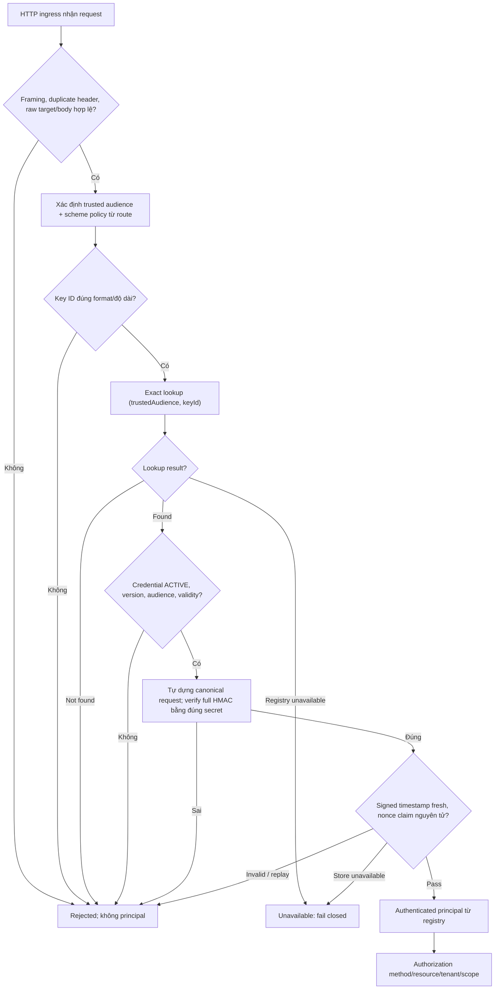

# Lookup key an toàn trong xác thực HTTP request bằng HMAC

Khi nhận HTTP request với `X-Key-Id: partner-a-202611`, server cần tìm **đúng shared secret** để xác minh chữ ký HMAC. Nhưng `X-Key-Id` là dữ liệu do bên gửi khai, **chưa có bằng chứng danh tính**. Nếu dùng header này để chọn nhầm tenant, thử hàng loạt secret hoặc bỏ qua lỗi credential registry, hệ thống có thể xác thực sai hoặc tiết lộ thông tin khóa.

**Lookup key an toàn** là quy trình: lấy **audience và policy từ ngữ cảnh định tuyến đáng tin cậy**, kiểm tra cú pháp/uniqueness của Key ID, tra **một credential chính xác**, kiểm tra trạng thái/hiệu lực/version, dùng **đúng secret** để tính HMAC trên canonical request **có ký Key ID**, rồi chỉ phát hành principal khi thêm các bước freshness/nonce đều đạt. Lookup chỉ **chọn ứng viên xác minh**, không tự động xác thực hoặc phân quyền client.

Bài **Lookup key an toàn** thuộc chương **Key identifier** của module `SECURITY_AUTHENTICATION_HMAC_REQUEST_AUTHENTICATION`. Module này thiết kế xác thực HTTP request bằng HMAC với **shared secret**, canonical request ràng buộc phương thức, URI, header hoặc body theo hợp đồng ký; thực hành xác minh chữ ký, chống replay bằng timestamp/nonce, quản lý key rotation, kiểm thử proxy/gateway và phân biệt xác thực với phân quyền. Bài tập trung vào **ranh giới tin cậy và quyết định tra khóa**, không chỉ vào thao tác `Map.get(keyId)`.

## 1. Mục tiêu học tập

Sau bài, bạn có thể:

1. Phân biệt **Key ID** (lookup hint), shared secret, credential record, client ID, principal, tenant, audience và scope.
2. Thiết kế registry/secret manager để lookup bằng **`(trustedAudience, keyId)`** hoặc một namespace tương đương, tránh nhầm khóa giữa tenant, môi trường và service.
3. Chặn duplicate/invalid `X-Key-Id` **trước khi framework merge header**, giữ nguyên value theo hợp đồng và ký Key ID trong canonical request.
4. Xác minh một credential **ACTIVE, đúng audience, đúng scheme, trong thời hạn**, không thử tất cả khóa hoặc tự fallback thuật toán khi HMAC sai.
5. Phân biệt **credential không tồn tại** với **registry/KMS/HSM không sẵn sàng**, luôn fail closed mà vẫn hạn chế key enumeration.
6. Hiểu tác dụng và giới hạn của compare MAC an toàn, chuẩn hóa response, rate limit, positive/negative caching, cache invalidation và thời gian xử lý.
7. Viết ví dụ **Java 17** tự chứa: scoped registry lookup, signed Key ID, HMAC-SHA256, timestamp/nonce, rotation, revoked/expired, outage, wrong audience và concurrency.
8. Kiểm thử tích hợp tại proxy/gateway, rotation/revocation nhiều instance, nonce namespace, audit và phân quyền.

## 2. Key lookup nằm ở đâu trong chuỗi xác thực?

Giả sử request:

```http
POST /v1/orders?channel=partner HTTP/1.1
Host: api.example.test
Content-Type: application/json
X-Key-Id: partner-a-202611
X-Timestamp: 2026-11-28T02:00:00Z
X-Nonce: Zq8DxKtUokcwPGNj3d_yvQ
X-Signature: v1=<BASE64_FULL_HMAC_SHA256>

{"sku":"BK-42","quantity":2}
```

`<...>` là placeholder, không phải signature thực. Server cần tìm secret nhưng **không được coi header `X-Key-Id` là principal đã xác thực**.



**Bất biến:** chỉ có **`Authenticated`** mới mang danh tính đáng tin. `Key ID tồn tại`, `lookup trả secret` và thậm chí `HMAC đúng` **chưa đủ** nếu còn thiếu freshness, nonce hoặc credential policy. Lookup là **bước đầu của phép kiểm chứng**, không phải quyết định cho phép hành động.

## 3. Key ID, secret và principal: tuyệt đối không dùng lẫn

| Thành phần | Nguồn | Công dụng | Mức tin cậy trước HMAC |
| --- | --- | --- | --- |
| `X-Key-Id` | Client header | Gợi ý credential cần tra. | **Chưa tin**; không phải bearer token. |
| Trusted audience | Host/route cấu hình tại ingress đã xác minh | Chọn namespace, policy, service/môi trường. | Phải xác định từ **trusted routing context**. |
| Credential record | Registry kiểm soát bởi server | Trạng thái, secret reference, client/tenant metadata, scheme. | Metadata tin cậy để **kiểm tra**, chưa publish principal. |
| Shared secret | Secret manager/HSM/vault bảo vệ | Tính expected HMAC-SHA256. | Chỉ trong vùng xử lý bí mật; không ra header/log. |
| `clientId` / `tenantId` | Mapping trong registry | Tạo principal sau xác thực. | Không lấy từ header tự khai hoặc parse tiền tố key ID. |
| Authenticated principal | Kết quả verifier hoàn chỉnh | Đầu vào cho authorization/business. | Chỉ có sau **HMAC + freshness + nonce**. |
| Role/scope | Registry/authorization service | Quyết định quyền trên endpoint/resource. | Không phải kết quả của phép lookup đơn thuần. |

Ví dụ hai credential hợp lệ của **cùng client**:

```text
Registry partition: orders-api-prod

keyId: partner-a-202611
clientId: partner-a
tenantId: tenant-42
secretRef: <opaque-internal-reference-A>
state: ACTIVE

keyId: partner-a-202702
clientId: partner-a
tenantId: tenant-42
secretRef: <opaque-internal-reference-B>
state: ACTIVE
```

Cả hai có thể trả về principal `partner-a` nhưng **mỗi ID ứng với secret độc lập**. Hợp đồng Key ID không phải quy tắc cú pháp định danh người dùng: tên `partner-a-...` chỉ là ví dụ dễ đọc. Production thường có lợi khi dùng **opaque ID** không chứa tenant, environment hoặc tên khách hàng.

**Không cho client gửi secret reference nội bộ** rồi bắt server đọc đường dẫn bất kỳ. Nếu biến `X-Key-Id` thành một URL/path trực tiếp để load secret, có thể tạo bề mặt SSRF, path traversal hoặc truy xuất secret ngoài allowlist. Server phải lookup trong **registry có index và policy được kiểm soát**.

## 4. Thiết kế namespace: lookup bằng audience đáng tin

Một thiết kế phổ biến:

```text
LookupKey = (trustedAudience, keyId)
Credential = registry.find(LookupKey)
```

Ví dụ:

| Trusted audience | Key ID | Ý nghĩa |
| --- | --- | --- |
| `orders-api-prod` | `partner-a-202611` | Credential A của production. |
| `orders-api-sandbox` | `partner-a-202611` | Một credential **khác** cùng chuỗi ID nếu policy cho phép partition. |
| `billing-api-prod` | `partner-a-202611` | Không mặc nhiên dùng được; phải có registry/policy của billing. |

Nếu registry sử dụng **Key ID duy nhất toàn cục**, lookup chỉ theo key ID vẫn có thể an toàn **khi** verifier kiểm tra audience/route, version và credential policy nghiêm ngặt. Tuy nhiên `(audience,keyId)` làm namespace tường minh và giảm rủi ro chọn nhầm key. Không có quy định buộc tất cả API phải dùng một key schema; điều bắt buộc là tính **không nhập nhằng và đúng trust boundary**.

### Audience tuyệt đối không lấy bừa từ client

```java
// KHÔNG an toàn nếu value đến từ header tự khai và không kiểm soát:
String audience = request.header("X-Audience");
Credential c = registry.find(audience, request.header("X-Key-Id"));
```

Nếu client chọn tùy ý audience, họ có thể ảnh hưởng namespace hoặc chọn policy yếu hơn. Audience nên gắn với **virtual host/route/service deployment đã được xác minh**. Nếu dùng Host, `:authority` hoặc forwarded headers để định tuyến, ingress phải áp quy tắc tin cậy tương ứng; `X-Forwarded-Host` do Internet gửi **không tự đáng tin**.

Hợp đồng canonical request cũng phải ký audience để request đã ký cho sandbox không bị **phát lại nguyên vẹn** sang production khi môi trường vô tình có secret giống nhau. Chọn đúng registry và ký audience là **hai kiểm soát bổ trợ**, không thay thế nhau.

### Tenant không phải lookup override

Không làm như sau:

```text
X-Key-Id: partner-a-202611
X-Tenant-Id: tenant-root
# Server tra key của tenant-root chỉ vì header này
```

Tenant/resource thực sự phải được ràng buộc với **authenticated principal** và **route/resource được xử lý**. Dữ liệu tenant do client nêu có thể là request parameter để authorization kiểm tra, nhưng không phải quyền truy cập tự động.

## 5. Kiểm tra Key ID trước lookup: grammar, length, duplicates

Header field name HTTP **không phân biệt hoa/thường**, nhưng **value của `X-Key-Id`** là identifier theo protocol, không mặc nhiên case-insensitive.

Quy ước V1 minh họa:

```text
Field name: X-Key-Id
Format: [a-z0-9][a-z0-9._-]{0,63}
Length: 1..64 ASCII chars
Case of value: lowercase only
Encoding: no Unicode normalization, no percent-decoding
Occurrence: exactly one value, not comma-separated list
```

| Input | Xử lý |
| --- | --- |
| `X-Key-Id: partner-a-202611` | Hợp format. |
| `x-key-id: partner-a-202611` | Hợp lệ: **tên** header khác case nhưng cùng field. |
| `X-Key-Id: Partner-A-202611` | **Từ chối** theo V1; không tự lowercase value. |
| `X-Key-Id: partner/a` | **Từ chối** ký tự ngoài grammar. |
| `X-Key-Id: ../../vault/secret` | **Từ chối**; không diễn giải ID thành path. |
| `X-Key-Id: a,b` | **Từ chối**; không hỗ trợ list key IDs. |
| Key ID dài hơn 64 ký tự | **Từ chối trước registry lookup**. |
| Hai header `X-Key-Id` và `x-key-id` trên cùng request | **Từ chối duplicate** trước khi framework gộp. |
| Null/control char, CRLF/obs-fold hoặc framing nhập nhằng | **Từ chối ở HTTP ingress**. |

**Đừng chỉ gọi `request.getHeader("X-Key-Id")` rồi tưởng đã chặn duplicate.** Một số API HTTP trả về giá trị đầu tiên/cuối cùng hoặc gộp các field trước khi application nhận. Ingress phải có cách kiểm tra số occurrence **trên biểu diễn đã parse đáng tin**; với HTTP/2/3 còn cần validate pseudo-header, authority, protocol framing và chính sách header uniqueness tương ứng.

**Value canonical phải giữ nguyên:** signed field-name được canonical lowercase, còn signed Key ID value phải đúng byte representation được giao thức quy định. Không trim, URL-decode, Unicode-normalize, bỏ dấu chấm hay đổi chữ hoa để “tìm được key”.

## 6. Key lookup phải gắn với hợp đồng HMAC được ký

Nếu verifier chọn key bằng `X-Key-Id` nhưng Key ID **không nằm trong dữ liệu ký**, việc thay ID giữa đường có thể ảnh hưởng tới secret/policy được chọn mà tầng MAC không ràng buộc rõ ý định của bên ký.

Hợp đồng minh họa `HMAC-SHA256-V1`:

| Phần | Giá trị/qui tắc |
| --- | --- |
| Version | Dòng đầu `HMAC-SHA256-V1`, verifier chọn từ endpoint/credential policy. |
| Audience | `orders-api-prod` do trusted route xác định. |
| Method | Chính xác `POST`, phân biệt case. |
| Raw target | Chính xác `/v1/orders?channel=partner` trong demo. |
| `Content-Type` | Đúng một field có value `application/json`. |
| **`X-Key-Id`** | Đúng một value; dòng `x-key-id:<value>` được ký. |
| `X-Timestamp` | UTC `YYYY-MM-DDTHH:mm:ssZ`, fresh ±300 giây. |
| `X-Nonce` | 16 byte CSPRNG, Base64URL không padding, dùng một lần. |
| Body | SHA-256 của **raw content bytes**, hex lowercase. |
| `Content-Encoding` | Không chấp nhận trong V1. |
| Canonical encoding | UTF-8, các dòng nối LF, **không LF cuối**. |
| Signature | `X-Signature: v1=` + Base64 chuẩn có padding của full HMAC-SHA256 **32 bytes**. |

Canonical request:

```text
HMAC-SHA256-V1
orders-api-prod
POST
/v1/orders?channel=partner
content-type:application/json
x-key-id:partner-a-202611
x-timestamp:2026-11-28T02:00:00Z
x-nonce:Zq8DxKtUokcwPGNj3d_yvQ
sha256:<SHA256_RAW_BODY_LOWERCASE_HEX>
```

`<...>` là placeholder; body digest phải được tính thật từ **bytes nhận được**, không serialize lại JSON để băm.

\[
\begin{aligned}
d &= \operatorname{SHA256}(\mathrm{rawBodyBytes}),\\
C &= \operatorname{UTF8}(\mathrm{canonicalRequestWithHex}(d)),\\
T &= \operatorname{HMAC}_{\mathrm{SHA256}}(K_{\mathrm{lookup}},C),\\
S &= \texttt{v1=} \Vert \operatorname{Base64}_{\mathrm{padded}}(T).
\end{aligned}
\]

Server **tự dựng `C`** từ method, raw URI, signed header values và raw body đã được adapter kiểm tra. Header `X-Signature` không tự tham gia chuỗi ký. **Không thử nhiều cách normalize URI/query/body đến khi HMAC khớp** — đó là lỗi protocol và có thể tạo signature confusion.

### Key ID được ký không khắc phục secret dùng chung sai cách

Nếu credential A và B vô tình **dùng cùng secret**, bên sở hữu secret A có thể **tự tạo HMAC mới** trên dòng `x-key-id:B`. Việc ký Key ID chỉ bảo vệ chống **sửa ID nhưng giữ MAC cũ**, không tạo cách ly mật mã giữa hai chủ thể có **cùng secret**.

Vì vậy cần **secret độc lập theo credential/trust domain**, provisioning và kiểm tra policy đúng. Với rotation, cấp **Key ID mới + secret mới**, không chỉ đổi nhãn.

## 7. Một lookup chính xác, không brute-force secret

Cách làm sai:

```java
// SAI: cố tìm bất kỳ secret nào làm signature khớp.
for (Credential c : registry.allCredentials()) {
    if (verifyHmac(c.secret(), request)) {
        return authenticatedAs(c.clientId());
    }
}
```

Hậu quả:

- Người gửi có thể **khai Key ID A** nhưng vô tình được xác thực bằng secret **B**.
- Registry có càng nhiều key, thời gian/CPU càng lớn; dễ bị abuse ở endpoint công khai.
- Trạng thái **REVOKED/EXPIRED/WRONG_AUDIENCE** dễ bị bỏ qua hoặc thử sai phiên bản.
- Audit `keyId` không khớp credential thực sự đã dùng, gây khó cho revoke/incident response.
- Hỗ trợ fallback secret/algorithm tùy tiện có thể dẫn tới **downgrade hoặc policy confusion**.

Cách đúng:

```java
Credential candidate = registry.find(trustedAudience, suppliedKeyId);
if (candidate == null || !eligible(candidate)) {
    return rejected();  // Không thử credential khác.
}
byte[] expected = hmac(candidate.secret(), canonicalBytes);
if (!MessageDigest.isEqual(expected, suppliedTag)) {
    return rejected();  // Không fallback sang key khác.
}
```

**Một lookup key** không nhất thiết đồng nghĩa đúng một RPC vật lý trong mọi cache/failover: adapter registry có thể đọc cache hoặc retry kết nối an toàn theo policy. Nhưng **về logic**, mỗi request phải được gắn với **một credential identity/version** rõ ràng. Không đổi credential cần xác minh chỉ vì MAC dưới ứng viên đầu tiên sai.

Nếu giao thức muốn hỗ trợ nhiều key đang ACTIVE trong overlap, **client phải chọn key ID cụ thể** và gửi signature tương ứng; verifier không đoán khóa thay client.

## 8. Trả kết quả lookup có cấu trúc: Found, Missing, Unavailable

Một API registry nên phân biệt:

```text
lookup(trustedAudience, keyId)
  ├─ FOUND(Credential)
  ├─ MISSING
  └─ UNAVAILABLE(failure)
```

| Kết quả | Có credential tin cậy? | Verifier làm gì? |
| --- | --- | --- |
| **FOUND** | Có record, nhưng vẫn cần kiểm trạng thái và MAC. | Kiểm tra ACTIVE/expiry/scheme/audience, verify. |
| **MISSING** | Không có record theo namespace đã chọn. | **Rejected**; không thử secret khác. |
| **UNAVAILABLE** | Không biết chính xác vì registry, secret manager hoặc hạ tầng lỗi. | **Fail closed**, không tạo principal; log/alert khác với missing. |

### Tại sao không gom MISSING và UNAVAILABLE bên trong hệ thống?

Khi registry ngừng hoạt động, việc coi mọi lookup như “không có key” sẽ làm người vận hành tưởng hàng loạt client bị revoke hoặc SDK ký sai. Tệ hơn, một số ứng dụng có thể “nới quy tắc” để khắc phục lỗi, chấp nhận request chưa kiểm tra được.

**Trên wire**, thường nên tránh cho attacker phân biệt **unknown key**, **revoked key** và **wrong secret** qua thông báo rất chi tiết. Tuy nhiên **nội bộ** phải phân loại rõ `INVALID_CREDENTIAL`, `INVALID_SIGNATURE` và `REGISTRY_UNAVAILABLE`. Lỗi hạ tầng không phải một MAC mismatch.

### Secret manager hoặc HSM

Credential registry có thể chứa **opaque reference** đến secret manager thay vì raw secret. HMAC có thể được tính:

- Trong tiến trình ứng dụng sau khi lấy secret qua kênh được bảo vệ và cache theo policy.
- Bởi KMS/HSM/MAC service hỗ trợ **HMAC operation với key handle** mà key bytes không export.

Không thể giả định mọi KMS chỉ có API sign của **asymmetric digital signature** đều dùng được cho HMAC; cần chọn đúng loại key và API thực sự hỗ trợ `HmacSHA256` hoặc tương đương. Khi MAC provider/secret manager lỗi, phải **Unavailable/fail closed**, không fallback sang secret cũ không còn được phép.

### Lỗi thiết kế: lấy secret từ input chưa kiểm soát

```text
X-Key-Id: https://internal-vault.example/admin-secret
X-Key-Id: ../../tenant-root/master
```

Nếu server trực tiếp dùng value làm URL/path để fetch secret, sẽ xuất hiện nguy cơ SSRF/path traversal và vượt phạm vi registry. **Key ID chỉ nên index vào namespace server quản lý**, với allowlist grammar và access control.

## 9. Key enumeration, timing và DoS: bảo vệ trước khi HMAC đúng

Ngay cả khi attacker không có secret, họ có thể gửi hàng loạt Key ID giả để:

- **Dò Key ID tồn tại** qua error text, status hoặc thời gian lookup.
- Tăng tải DB/secret manager với IDs ngẫu nhiên không có cache.
- Khai ID dài bất thường làm tăng chi phí parse/log/index.
- Khai Key ID thuộc tenant khác để tìm lỗi namespace/authorization.
- Làm cạn quota hoặc cache bằng lượng lớn negative lookups.

### Kỹ thuật phòng vệ và giới hạn

| Biện pháp | Giúp điều gì? | Không bảo đảm điều gì? |
| --- | --- | --- |
| **Grammar + length cap** trước lookup | Giới hạn input và giảm injection/resource abuse. | Không chặn lưu lượng số lượng lớn tự thân. |
| **Response authentication chung** | Giảm thông tin công khai về key existence/state. | Không loại bỏ mọi timing side channel. |
| **Rate limit/quotas tại ingress** | Hạn chế query floods và công việc crypto. | Không thay credential validity hoặc authz. |
| **Opaque, nonsemantic Key ID** | Giảm lộ metadata và đoán ID hợp lệ. | Không phải secret hoặc authentication factor. |
| **Positive cache có bound** | Giảm latency và phụ thuộc registry. | Dễ stale sau revoke nếu không invalidation/TTL phù hợp. |
| **Negative cache rất ngắn, bound** | Giảm lookup lặp cho một ID missing. | Có thể che key mới provision; cache pollution. |
| **Metrics tổng hợp thay vì label raw ID** | Tránh high-cardinality và lộ key enumeration trong telemetry. | Không giải quyết lỗi registry trực tiếp. |
| **MAC compare trên decoded raw bytes** | Giảm timing leak từ so chuỗi từng ký tự. | Không khiến toàn bộ lookup/hạ tầng thành constant-time. |
| **Dummy computation cho missing** trong threat model phù hợp | Có thể giảm chênh lệch thô giữa found/missing. | **Không chứng minh** end-to-end constant-time; phải benchmark, rate limit. |

`MessageDigest.isEqual` là API so bytes phù hợp cho MAC, nhưng thời gian tra registry, active-state, Base64 validation, cache hit, network jitter và xử lý lỗi vẫn có thể khác. **Đừng tuyên bố toàn bộ verifier constant-time** chỉ vì thay `String.equals` bằng `MessageDigest.isEqual`.

Nếu triển khai dummy HMAC khi missing để giảm chênh lệch, phải dùng **key giả nội bộ riêng** và không bao giờ cho dummy path sinh authentication success. Dummy work cũng có giá CPU, nên cần rate limiting và kiểm thử side-channel/threat model trước khi áp dụng.

## 10. Cache credential an toàn: revoke và rotation không được trễ vô hạn

Lookup trực tiếp tới secret manager cho mọi HTTP request có thể gây latency/tải. Nhưng cache credential làm xuất hiện câu hỏi: **một key đã revoke có thể tiếp tục được chấp nhận bao lâu do cache cũ?**

### Các loại cache và rủi ro

| Cache | Công dụng | Rủi ro | Biện pháp |
| --- | --- | --- | --- |
| **Positive metadata + secret** | Giảm registry call. | Revoke/expiry chưa được lan tới cache; secret sống quá lâu trong RAM. | TTL ngắn phù hợp, push invalidation, bounded cache, secret lifecycle. |
| **Negative missing ID** | Giảm query lặp với ID không tồn tại. | Key vừa provision bị coi missing cho đến khi TTL hết. | TTL thấp, invalidate on create, giới hạn size. |
| **Revoked/disabled state** | Chặn request theo policy. | Một node có trạng thái stale; hành vi không nhất quán vùng. | Versioned registry/config, audit, invalidation/consistency theo SLA. |
| **Per-audience partition** | Tách các môi trường. | Cache key thiếu audience có thể trả record sai. | Cache key **bao gồm trusted audience** hoặc mapping global rõ ràng. |
| **Unbounded Key ID cache** | Không có lợi ích an toàn. | Memory exhaustion do random IDs. | Bound size/eviction và kiểm soát cardinality. |

**Không fallback “cache key cũ đã revoke” nếu registry đang lỗi** mà không có policy đặc biệt được thiết kế và chấp nhận rủi ro. Với yêu cầu security cao, dependency unavailable phải fail closed hoặc áp tiêu chí freshness/consistency chặt chẽ; các quyết định này cần được viết thành **policy** và kiểm thử.

### Rotation không phải “thử hai secret trên một ID”

Trong overlap:

```text
partner-a-202611 → secret A, ACTIVE (old)
partner-a-202702 → secret B, ACTIVE (new)
```

Client phải chọn một cặp **(keyId, secret)** nguyên tử trong mỗi attempt. Verifier lookup đúng ID để lấy đúng secret. Khi revoke A, các node phải ngừng chấp nhận A theo SLA revocation; dù timestamp request vẫn fresh, credential A không còn hợp lệ.

**Không tái sử dụng Key ID cho secret mới.** Tái sử dụng tạo mơ hồ cho caches, nonce replay namespace, audit và incident response. Cấp ID mới cho mỗi credential version.

### TOCTOU và policy snapshot

Verifier có thể kiểm tra ACTIVE rồi credential bị revoke trong khi đang tính MAC. Không có một lựa chọn phù hợp mọi hệ thống về mức nhất quán: yêu cầu có thể là **policy snapshot tại lúc authenticate**, hoặc xác minh thêm revocation state cho giao dịch nhạy cảm. Nên ghi rõ SLA, cách cache invalidation, thời điểm lấy metadata và cách xử lý khi key biến trạng thái trong quá trình kiểm tra. Không tự tuyên bố “revoke ngay lập tức trên mọi node” khi hạ tầng không bảo đảm.

## 11. Tích hợp gateway/proxy: nơi chọn nhầm khóa thường xảy ra

```text
Client → CDN/TLS termination → Gateway → Service Mesh → Backend
```

Giữa các hop, header và raw URI có thể bị thay đổi hoặc tái biểu diễn. Key lookup phải dùng **chính sách của trust boundary**, không tự tin mọi request component từ client đã được ký.

| Tình huống | Rủi ro | Kiểm soát |
| --- | --- | --- |
| HTTP/1.1 `X-Key-Id` thành HTTP/2 `x-key-id`. | Không phải lỗi nếu chỉ đổi **tên header**. | Canonical lowercase field name; giữ nguyên value. |
| Proxy đổi value `partner-a` thành `Partner-A`. | Key ID/canonical MAC khác; hoặc chọn nhầm credential nếu casefold. | Strict grammar và signed value. |
| Hai occurrence `X-Key-Id` với casing khác. | Gateway và backend chọn first/last khác nhau. | Chặn duplicate **trước merge**. |
| `Host`/`:authority` có thể đổi do proxy. | Chọn audience sai hoặc xác minh request cho resource khác. | Cấu hình trusted virtual host/route, xử lý authority đúng. |
| Client tự gửi `X-Forwarded-Host`/`X-Original-URI`. | Dụ verifier dùng context giả khi tra key hoặc canonicalize. | Chỉ tin thông tin gateway **đã xác thực/ghi đè**. |
| Gateway rewrite URI sau verify. | Backend thực thi action khác với signed method/target. | Ràng buộc effective route và context tin cậy. |
| Gateway và backend có registry/cache versions khác nhau. | Khi rotation, request chấp nhận theo node; revoked key còn dùng được. | Đồng bộ config, cache invalidation, versioned rollout. |
| Gateway verify rồi backend tin header `X-Authenticated-Client` ngoài. | Identity spoofing qua header giả. | Strip header client; truyền principal qua mTLS/assertion đã bảo vệ. |
| Nonce claim chỉ ở một region. | Replay ở region khác dù lookup đúng. | Shared anti-replay scope hoặc kiến trúc partition chặt chẽ. |

**Nguyên tắc:** verifier phải biết **request được thực thi ở đâu và dưới audience/route nào**, không chỉ biết secret nào làm HMAC khớp. Một credential đúng không hợp thức hóa sai lệch route hoặc tenant.

## 12. Lookup với nonce, timestamp và authorization

Key ID chỉ là **một mắt xích** trong xác thực:

```text
parse HTTP safely
  → trusted audience + scheme policy
  → validate key ID + exact registry lookup
  → validate credential ACTIVE/version/validity
  → verify full HMAC on signed key ID/method/URI/headers/body
  → check signed timestamp against server clock
  → atomic claim signed nonce
  → authenticated principal
  → authorize resource/tenant/method/scope
  → business handler / idempotency
```

### Replay namespace phải tương thích với key lookup

Một lựa chọn thường gặp:

```text
replay:v1:<audience>:<keyId>:<nonce>
```

Nonce được claim **sau MAC hợp lệ**. Nếu request có key ID không tồn tại hoặc MAC sai, **không** tiêu hao nonce, tránh cho attacker không biết secret gây nonce poisoning.

Với cửa sổ timestamp `±300s`, nonce phải giữ đến **`signedTimestamp + allowedPast + safetyMargin`**, vì request ký trước có thể được nhận sớm nhất `T-300s` và vẫn fresh tới `T+300s`. TTL 300 giây tính từ lần nhận sớm nhất **không đủ**, có thể mở replay window.

Trong rotation, scope `(audience,keyId,nonce)` phân biệt key A và key B. Nếu threat model cần uniqueness xuyên rotation theo client, có thể scope theo **authenticated client ID**; không lấy client ID trực tiếp từ header trước khi HMAC đúng.

### Idempotency không được đồng nhất với Key ID hoặc nonce

Nếu client retry cùng một ý định `POST` sau timeout, mỗi HTTP attempt cần **nonce/timestamp/signature mới**. Một `Idempotency-Key` (nếu API hỗ trợ) cần **giữ nguyên theo ý định nghiệp vụ**, được ký khi ảnh hưởng đến xử lý, và store phải scope theo **principal/tenant/resource** phù hợp. Key ID xác định secret/version, không phải một order ID hoặc idempotency key.

### Authorization riêng biệt

Giả sử credential mapping:

```text
keyId=partner-a-202611
clientId=partner-a
tenantId=tenant-42
scopes=[orders:read]
```

HMAC đúng và nonce mới giúp xác thực `partner-a`, nhưng `POST /v1/orders` yêu cầu `orders:create` vẫn phải bị tầng authorization từ chối — thường `403`. Không suy quyền từ tên key ID, cũng không dùng `X-Tenant-Id` của client để thay metadata principal.

## 13. Java 17: triển khai secure lookup và kết quả xác thực có kiểu dữ liệu

Đây là **demo tự chứa chạy với Java 17**, không dùng framework. Nó mô phỏng các trường HTTP **sau khi ingress đã từ chối duplicate/framing sai**. Phạm vi chính: **exact registry lookup theo trusted audience và Key ID**, không thử secret khác; sau đó minh họa HMAC/freshness/nonce.

Hợp đồng V1 trong code:

- Header `X-Key-Id` value theo regex `[a-z0-9][a-z0-9._-]{0,63}`.
- HMAC-SHA256 full 32-byte tag; header signature `v1=` + Base64 chuẩn padded.
- Timestamp UTC `YYYY-MM-DDTHH:mm:ssZ`, cửa sổ ±300 giây.
- Nonce 16-byte CSPRNG, Base64URL không padding.
- Method `POST`, raw target `/v1/orders?channel=partner`, Content-Type `application/json`, body tối đa 8 KiB.
- `(trustedAudience, keyId)` trỏ **một** credential; scheme `HMAC-SHA256-V1`, state ACTIVE, khoảng `[validFrom, validUntil)`.
- Kết quả là **`Authenticated` / `Rejected` / `Unavailable`**, chỉ success mới có principal.
- `LocalNonceStore` atomic **trong một JVM**, không phải distributed store production.

Lưu file `SafeKeyLookupHmacDemo.java` trong môi trường thực hành Java 17:

```java
import java.nio.charset.StandardCharsets;
import java.security.GeneralSecurityException;
import java.security.MessageDigest;
import java.security.SecureRandom;
import java.time.Clock;
import java.time.Instant;
import java.time.ZoneOffset;
import java.time.format.DateTimeParseException;
import java.util.Arrays;
import java.util.Base64;
import java.util.HashMap;
import java.util.HexFormat;
import java.util.Map;
import java.util.Set;
import java.util.concurrent.Callable;
import java.util.concurrent.CountDownLatch;
import java.util.concurrent.ExecutorService;
import java.util.concurrent.Executors;
import java.util.concurrent.Future;
import java.util.concurrent.atomic.AtomicInteger;
import javax.crypto.Mac;
import javax.crypto.spec.SecretKeySpec;

public final class SafeKeyLookupHmacDemo {
    private static final String SCHEME = "HMAC-SHA256-V1";
    private static final String PROD = "orders-api-prod";
    private static final String SANDBOX = "orders-api-sandbox";
    private static final String TARGET = "/v1/orders?channel=partner";
    private static final String MEDIA_TYPE = "application/json";
    private static final String SIG_PREFIX = "v1=";
    private static final long WINDOW = 300;
    private static final long NONCE_MARGIN = 30;

    private SafeKeyLookupHmacDemo() {}

    public enum State { ACTIVE, REVOKED }

    public enum RejectCode {
        BAD_REQUEST, INVALID_CREDENTIAL, INVALID_SIGNATURE,
        NOT_FRESH, NONCE_REPLAY
    }

    public enum FailureCode {
        REGISTRY_UNAVAILABLE, CRYPTO_UNAVAILABLE, NONCE_STORE_UNAVAILABLE
    }

    public sealed interface AuthResult
            permits Authenticated, Rejected, Unavailable {}

    public record Principal(
            String clientId, String tenantId, Set<String> scopes) {
        public Principal {
            scopes = Set.copyOf(scopes);
        }
    }

    public record Authenticated(
            Principal principal, String credentialId,
            String audience, Instant verifiedAt)
            implements AuthResult {}

    public record Rejected(RejectCode reason) implements AuthResult {}
    public record Unavailable(FailureCode reason) implements AuthResult {}

    public record RegistryKey(String audience, String keyId) {}

    public record Credential(
            String keyId, String clientId, String tenantId,
            String audience, String scheme, State state,
            Instant validFrom, Instant validUntil,
            byte[] secret, Set<String> scopes) {
        public Credential {
            secret = secret.clone();
            scopes = Set.copyOf(scopes);
        }
        @Override
        public byte[] secret() {
            return secret.clone();
        }
    }

    public record RequestView(
            String method, String rawTarget, String contentType,
            boolean contentEncodingPresent, String keyId,
            String timestamp, String nonce, byte[] body,
            String signature) {
        public RequestView {
            if (body != null) {
                body = body.clone();
            }
        }
        @Override
        public byte[] body() {
            return body == null ? null : body.clone();
        }
    }

    public static class RegistryFailure extends Exception {}
    public static class NonceFailure extends Exception {}

    public interface CredentialRegistry {
        Credential find(String trustedAudience, String keyId)
                throws RegistryFailure;
    }

    public static final class TestRegistry implements CredentialRegistry {
        private final Map<RegistryKey, Credential> records;
        private final boolean offline;
        private final AtomicInteger lookupCount = new AtomicInteger();

        public TestRegistry(
                Map<RegistryKey, Credential> records, boolean offline) {
            this.records = Map.copyOf(records);
            this.offline = offline;
        }

        @Override
        public Credential find(String audience, String keyId)
                throws RegistryFailure {
            lookupCount.incrementAndGet();
            if (offline) {
                throw new RegistryFailure();
            }
            return records.get(new RegistryKey(audience, keyId));
        }

        public int lookups() {
            return lookupCount.get();
        }
    }

    public interface NonceStore {
        boolean claim(String replayKey, Instant expiresAt, Instant now)
                throws NonceFailure;
    }

    /** Chỉ atomic TRONG một JVM demo, không thay distributed store. */
    public static final class LocalNonceStore implements NonceStore {
        private final Map<String, Instant> expiries = new HashMap<>();

        @Override
        public synchronized boolean claim(
                String replayKey, Instant expiresAt, Instant now) {
            expiries.entrySet().removeIf(
                    entry -> !entry.getValue().isAfter(now));
            if (!expiresAt.isAfter(now)
                    || expiries.containsKey(replayKey)) {
                return false;
            }
            expiries.put(replayKey, expiresAt);
            return true;
        }
    }

    private static boolean validKeyId(String keyId) {
        return keyId != null
                && keyId.matches("[a-z0-9][a-z0-9._-]{0,63}");
    }

    private static boolean validNonce(String nonce) {
        if (nonce == null || nonce.length() != 22) {
            return false;
        }
        try {
            byte[] bytes = Base64.getUrlDecoder().decode(nonce);
            return bytes.length == 16
                    && Base64.getUrlEncoder().withoutPadding()
                            .encodeToString(bytes).equals(nonce);
        } catch (IllegalArgumentException malformed) {
            return false;
        }
    }

    private static Instant parseTimestamp(String text) {
        if (text == null || !text.matches(
                "[0-9]{4}-[0-9]{2}-[0-9]{2}T"
                + "[0-9]{2}:[0-9]{2}:[0-9]{2}Z")) {
            throw new IllegalArgumentException("Bad timestamp format");
        }
        try {
            Instant parsed = Instant.parse(text);
            if (!parsed.toString().equals(text)) {
                throw new IllegalArgumentException(
                        "Noncanonical timestamp");
            }
            return parsed;
        } catch (DateTimeParseException malformed) {
            throw new IllegalArgumentException(
                    "Invalid timestamp value", malformed);
        }
    }

    /** Chỉ nhận request fields sau ingress đã kiểm duplicate header. */
    private static boolean validShape(RequestView r) {
        if (r == null
                || !"POST".equals(r.method())
                || !TARGET.equals(r.rawTarget())
                || !MEDIA_TYPE.equals(r.contentType())
                || r.contentEncodingPresent()
                || !validKeyId(r.keyId())
                || !validNonce(r.nonce())
                || r.body() == null
                || r.body().length > 8192) {
            return false;
        }
        try {
            parseTimestamp(r.timestamp());
            return true;
        } catch (IllegalArgumentException badTimestamp) {
            return false;
        }
    }

    private static byte[] canonicalBytes(
            String trustedAudience, RequestView r)
            throws GeneralSecurityException {
        String bodyHash = HexFormat.of().formatHex(
                MessageDigest.getInstance("SHA-256")
                        .digest(r.body()));
        String canonical = String.join("\n",
                SCHEME, trustedAudience, r.method(), r.rawTarget(),
                "content-type:" + r.contentType(),
                "x-key-id:" + r.keyId(),
                "x-timestamp:" + r.timestamp(),
                "x-nonce:" + r.nonce(),
                "sha256:" + bodyHash);
        return canonical.getBytes(StandardCharsets.UTF_8);
    }

    private static byte[] hmac(byte[] secret, byte[] canonical)
            throws GeneralSecurityException {
        // Policy provisioning của demo, không phải giới hạn của JCA.
        if (secret == null || secret.length < 32) {
            throw new GeneralSecurityException("Bad secret configuration");
        }
        Mac mac = Mac.getInstance("HmacSHA256");
        mac.init(new SecretKeySpec(secret, "HmacSHA256"));
        return mac.doFinal(canonical);
    }

    private static byte[] decodeTag(String wire) {
        if (wire == null || wire.length() != 47
                || !wire.startsWith(SIG_PREFIX)) {
            return null;
        }
        String encoded = wire.substring(SIG_PREFIX.length());
        if (!encoded.matches("[A-Za-z0-9+/]{43}=")) {
            return null;
        }
        try {
            byte[] bytes = Base64.getDecoder().decode(encoded);
            return bytes.length == 32
                    && Base64.getEncoder().encodeToString(bytes)
                            .equals(encoded) ? bytes : null;
        } catch (IllegalArgumentException malformed) {
            return null;
        }
    }

    public static final class Verifier {
        private final String trustedAudience;
        private final CredentialRegistry registry;
        private final NonceStore nonces;
        private final Clock clock;

        public Verifier(
                String trustedAudience, CredentialRegistry registry,
                NonceStore nonces, Clock clock) {
            this.trustedAudience = trustedAudience;
            this.registry = registry;
            this.nonces = nonces;
            this.clock = clock;
        }

        public AuthResult authenticate(RequestView r) {
            // Invalid grammar never reaches registry.
            if (!validShape(r)) {
                return new Rejected(RejectCode.BAD_REQUEST);
            }
            Instant now = clock.instant();
            Credential c;
            try {
                // EXACT scoped lookup, no try-all-secret fallback.
                c = registry.find(trustedAudience, r.keyId());
            } catch (RegistryFailure failure) {
                return new Unavailable(FailureCode.REGISTRY_UNAVAILABLE);
            }
            if (c == null || c.state() != State.ACTIVE
                    || !trustedAudience.equals(c.audience())
                    || !SCHEME.equals(c.scheme())
                    || !r.keyId().equals(c.keyId())
                    || now.isBefore(c.validFrom())
                    || !now.isBefore(c.validUntil())) {
                return new Rejected(RejectCode.INVALID_CREDENTIAL);
            }

            byte[] supplied = decodeTag(r.signature());
            if (supplied == null) {
                return new Rejected(RejectCode.INVALID_SIGNATURE);
            }
            try {
                byte[] expected = hmac(
                        c.secret(), canonicalBytes(trustedAudience, r));
                if (!MessageDigest.isEqual(expected, supplied)) {
                    // NEVER try a different credential if MAC fails.
                    return new Rejected(RejectCode.INVALID_SIGNATURE);
                }
            } catch (GeneralSecurityException providerFailure) {
                return new Unavailable(FailureCode.CRYPTO_UNAVAILABLE);
            }

            Instant signedTime = parseTimestamp(r.timestamp());
            if (signedTime.isBefore(now.minusSeconds(WINDOW))
                    || signedTime.isAfter(now.plusSeconds(WINDOW))) {
                return new Rejected(RejectCode.NOT_FRESH);
            }

            // Scope replay by trusted audience + actual credential ID.
            String replayKey = "replay:v1:" + trustedAudience + ":"
                    + c.keyId() + ":" + r.nonce();
            Instant expiresAt = signedTime.plusSeconds(
                    WINDOW + NONCE_MARGIN);
            try {
                if (!nonces.claim(replayKey, expiresAt, now)) {
                    return new Rejected(RejectCode.NONCE_REPLAY);
                }
            } catch (NonceFailure failure) {
                return new Unavailable(FailureCode.NONCE_STORE_UNAVAILABLE);
            }

            Principal trusted = new Principal(
                    c.clientId(), c.tenantId(), c.scopes());
            return new Authenticated(
                    trusted, c.keyId(), trustedAudience, now);
        }
    }

    private static String newNonce(SecureRandom random) {
        byte[] bytes = new byte[16];
        random.nextBytes(bytes);
        return Base64.getUrlEncoder().withoutPadding()
                .encodeToString(bytes);
    }

    /** Test-only client signer. No production secret is used. */
    public static RequestView signForTest(
            Credential credential, String audience,
            String timestamp, String nonce, byte[] body)
            throws GeneralSecurityException {
        RequestView unsigned = new RequestView(
                "POST", TARGET, MEDIA_TYPE, false,
                credential.keyId(), timestamp, nonce, body, null);
        if (!validShape(unsigned)) {
            throw new IllegalArgumentException("Bad test request");
        }
        String signature = SIG_PREFIX
                + Base64.getEncoder().encodeToString(
                    hmac(credential.secret(), canonicalBytes(
                            audience, unsigned)));
        return new RequestView(
                unsigned.method(), unsigned.rawTarget(),
                unsigned.contentType(), false,
                unsigned.keyId(), timestamp, nonce, body, signature);
    }

    private static Authenticated requireAuthenticated(AuthResult result) {
        if (!(result instanceof Authenticated)) {
            throw new AssertionError(
                    "Expected authentication success, got " + result);
        }
        return (Authenticated) result;
    }

    private static void requireRejected(
            RejectCode code, AuthResult result) {
        if (!(result instanceof Rejected rejected)
                || rejected.reason() != code) {
            throw new AssertionError(
                    "Expected " + code + " rejection, got " + result);
        }
    }

    public static void main(String[] args) throws Exception {
        // Fake secrets for TEST ONLY. Distinct key material per ID.
        byte[] secretA = new byte[32];
        byte[] secretB = new byte[32];
        byte[] secretOld = new byte[32];
        Arrays.fill(secretA, (byte) 0x51);
        Arrays.fill(secretB, (byte) 0x52);
        Arrays.fill(secretOld, (byte) 0x53);

        Instant from = Instant.parse("2026-01-01T00:00:00Z");
        Instant until = Instant.parse("2028-01-01T00:00:00Z");
        Credential a = new Credential(
                "partner-a-202611", "partner-a", "tenant-42",
                PROD, SCHEME, State.ACTIVE, from, until,
                secretA, Set.of("orders:read"));
        Credential b = new Credential(
                "partner-a-202702", "partner-a", "tenant-42",
                PROD, SCHEME, State.ACTIVE, from, until,
                secretB, Set.of("orders:read"));
        Credential old = new Credential(
                "partner-a-202608", "partner-a", "tenant-42",
                PROD, SCHEME, State.REVOKED, from, until,
                secretOld, Set.of("orders:read"));
        Credential expired = new Credential(
                "partner-a-expired", "partner-a", "tenant-42",
                PROD, SCHEME, State.ACTIVE, from,
                Instant.parse("2026-11-28T02:00:30Z"),
                secretA, Set.of("orders:read"));

        // Synthetic sandbox uses same key ID AND same secret as prod,
        // deliberately to test that signed audience stops direct replay.
        // Never share a real secret across prod and sandbox.
        Credential sandbox = new Credential(
                a.keyId(), "sandbox-client", "tenant-test",
                SANDBOX, SCHEME, State.ACTIVE, from, until,
                secretA, Set.of("orders:read"));

        Map<RegistryKey, Credential> data = Map.of(
                new RegistryKey(PROD, a.keyId()), a,
                new RegistryKey(PROD, b.keyId()), b,
                new RegistryKey(PROD, old.keyId()), old,
                new RegistryKey(PROD, expired.keyId()), expired,
                new RegistryKey(SANDBOX, sandbox.keyId()), sandbox);
        TestRegistry registry = new TestRegistry(data, false);
        LocalNonceStore sharedNonces = new LocalNonceStore();
        Clock clock = Clock.fixed(
                Instant.parse("2026-11-28T02:00:30Z"), ZoneOffset.UTC);
        Verifier prod = new Verifier(
                PROD, registry, sharedNonces, clock);
        Verifier test = new Verifier(
                SANDBOX, registry, new LocalNonceStore(), clock);
        SecureRandom random = new SecureRandom();
        byte[] body = "{\"sku\":\"BK-42\",\"quantity\":2}"
                .getBytes(StandardCharsets.UTF_8);
        String timestamp = "2026-11-28T02:00:00Z";

        RequestView signedA = signForTest(
                a, PROD, timestamp, newNonce(random), body);
        Authenticated acceptedA = requireAuthenticated(
                prod.authenticate(signedA));
        if (!"partner-a".equals(acceptedA.principal().clientId())
                || !a.keyId().equals(acceptedA.credentialId())) {
            throw new AssertionError("Wrong principal or credential ID");
        }
        requireRejected(RejectCode.NONCE_REPLAY,
                prod.authenticate(signedA));

        // Swapped key ID B but kept MAC signed using A:
        // one lookup for B, then MAC mismatch, no fallback to A.
        RequestView swapped = new RequestView(
                signedA.method(), signedA.rawTarget(),
                signedA.contentType(), false,
                b.keyId(), signedA.timestamp(), signedA.nonce(),
                signedA.body(), signedA.signature());
        int before = registry.lookups();
        requireRejected(RejectCode.INVALID_SIGNATURE,
                prod.authenticate(swapped));
        if (registry.lookups() != before + 1) {
            throw new AssertionError("Verifier searched multiple keys");
        }

        // Invalid Key ID grammar is rejected before registry call.
        RequestView malformed = new RequestView(
                signedA.method(), signedA.rawTarget(),
                signedA.contentType(), false,
                "../tenant-root", timestamp, newNonce(random),
                body, signedA.signature());
        before = registry.lookups();
        requireRejected(RejectCode.BAD_REQUEST,
                prod.authenticate(malformed));
        if (registry.lookups() != before) {
            throw new AssertionError("Malformed ID reached registry");
        }

        // Correctly formed but unknown ID: no principal, no fallback.
        RequestView unknown = new RequestView(
                signedA.method(), signedA.rawTarget(),
                signedA.contentType(), false,
                "missing-key", timestamp, newNonce(random),
                body, signedA.signature());
        before = registry.lookups();
        requireRejected(RejectCode.INVALID_CREDENTIAL,
                prod.authenticate(unknown));
        if (registry.lookups() != before + 1) {
            throw new AssertionError("Unknown key used fallback lookup");
        }

        // Revoked / exactly-expired keys must not authenticate.
        RequestView signedOld = signForTest(
                old, PROD, timestamp, newNonce(random), body);
        requireRejected(RejectCode.INVALID_CREDENTIAL,
                prod.authenticate(signedOld));
        RequestView signedExpired = signForTest(
                expired, PROD, timestamp, newNonce(random), body);
        requireRejected(RejectCode.INVALID_CREDENTIAL,
                prod.authenticate(signedExpired));

        // Both ACTIVE rotation credentials independently verify.
        RequestView signedB = signForTest(
                b, PROD, timestamp, newNonce(random), body);
        Authenticated acceptedB = requireAuthenticated(
                prod.authenticate(signedB));
        if (!acceptedA.principal().clientId()
                    .equals(acceptedB.principal().clientId())
                || !b.keyId().equals(acceptedB.credentialId())) {
            throw new AssertionError("Rotation principal mismatch");
        }

        // Even when sandbox has same ID and secret (TEST ONLY),
        // prod-signed request must not verify for sandbox audience.
        requireRejected(RejectCode.INVALID_SIGNATURE,
                test.authenticate(signedA));

        // Freshness check happens after MAC; old signature cannot be
        // refreshed by changing timestamp without re-signing.
        RequestView oldTime = signForTest(
                a, PROD, "2026-11-28T01:55:29Z",
                newNonce(random), body);
        requireRejected(RejectCode.NOT_FRESH,
                prod.authenticate(oldTime));

        // Registry outage means unavailable, never authenticated.
        TestRegistry offline = new TestRegistry(data, true);
        Verifier offlineVerifier = new Verifier(
                PROD, offline, sharedNonces, clock);
        AuthResult registryDown = offlineVerifier.authenticate(
                signForTest(a, PROD, timestamp, newNonce(random), body));
        if (!(registryDown instanceof Unavailable failure)
                || failure.reason() != FailureCode.REGISTRY_UNAVAILABLE) {
            throw new AssertionError("Registry outage failed open");
        }

        NonceStore downNonceStore = (key, expiresAt, now) -> {
            throw new NonceFailure();
        };
        Verifier nonceOutageVerifier = new Verifier(
                PROD, registry, downNonceStore, clock);
        AuthResult nonceDown = nonceOutageVerifier.authenticate(
                signForTest(a, PROD, timestamp, newNonce(random), body));
        if (!(nonceDown instanceof Unavailable)) {
            throw new AssertionError("Nonce store outage failed open");
        }

        // Two threads, same signed request, shared local store:
        // exactly one Accepted and one Rejected(REPLAY) in this JVM.
        RequestView raceRequest = signForTest(
                a, PROD, timestamp, newNonce(random), body);
        CountDownLatch start = new CountDownLatch(1);
        ExecutorService pool = Executors.newFixedThreadPool(2);
        Callable<AuthResult> task = () -> {
            start.await();
            return prod.authenticate(raceRequest);
        };
        try {
            Future<AuthResult> f1 = pool.submit(task);
            Future<AuthResult> f2 = pool.submit(task);
            start.countDown();
            AuthResult x = f1.get();
            AuthResult y = f2.get();
            int ok = (x instanceof Authenticated ? 1 : 0)
                    + (y instanceof Authenticated ? 1 : 0);
            int replayed = (x instanceof Rejected rx
                    && rx.reason() == RejectCode.NONCE_REPLAY ? 1 : 0)
                    + (y instanceof Rejected ry
                    && ry.reason() == RejectCode.NONCE_REPLAY ? 1 : 0);
            if (ok != 1 || replayed != 1) {
                throw new AssertionError("Local atomic claim failed");
            }
        } finally {
            pool.shutdownNow();
        }

        // Authentication success does NOT imply create-order scope.
        if (acceptedA.principal().scopes().contains("orders:create")) {
            throw new AssertionError("Authorization bypass");
        }
        System.out.println(
                "Scoped key lookup, HMAC, rotation, outage and replay passed.");
    }
}
```

### Cách chạy và kết quả dự kiến

Trên máy có JDK 17, lưu class bằng đúng tên file và chạy:

```text
javac SafeKeyLookupHmacDemo.java
java SafeKeyLookupHmacDemo
```

Nếu các assertions đều đạt, chương trình in:

```text
Scoped key lookup, HMAC, rotation, outage and replay passed.
```

Chương trình dùng **fake secrets và synthetic timestamps**. Hai instance `Verifier` có trusted audience khác nhau được cấu hình **từ constructor**, không do `X-Audience` của client khai. `TestRegistry.lookups()` đếm logical lookup để xác minh trường hợp swapped Key ID/unknown Key ID **không thử các secret khác**.

**Chưa được kiểm chứng trong STEP 4:** code được trình bày để người học biên dịch/chạy trong môi trường riêng; ví dụ không thay thế production HTTP parser, distributed registry/nonce store hoặc một vòng kiểm thử tích hợp thực sự.

## 14. Phân tích các trường hợp âm của demo

| Test | Lookup/verification | Kết quả phải đạt |
| --- | --- | --- |
| Key A ACTIVE, MAC đúng | Exact lookup `(PROD,A)`, HMAC bằng secret A. | `Authenticated(partner-a, credential A)`. |
| Phát lại nguyên request A | MAC và timestamp vẫn đúng; nonce đã claim. | `Rejected(NONCE_REPLAY)`. |
| Thay `X-Key-Id` A → B nhưng giữ MAC A | Lookup **chỉ B**; canonical mới có key ID B. | `Rejected(INVALID_SIGNATURE)`, không fallback A. |
| Key ID chứa `../` | Invalid grammar trước lookup. | `Rejected(BAD_REQUEST)`, lookup count không đổi. |
| ID hợp grammar nhưng unknown | Một lookup trả missing. | `Rejected(INVALID_CREDENTIAL)`, không thử khác. |
| Credential `REVOKED` | Registry có record nhưng không đủ điều kiện. | `Rejected(INVALID_CREDENTIAL)`. |
| Credential hết hạn **đúng thời điểm now** | `validUntil` exclusive. | `Rejected(INVALID_CREDENTIAL)`. |
| Rotation A → B, cả hai ACTIVE | Hai secret khác nhau, cùng principal. | `Authenticated` ở cả hai attempt mới với ID đúng. |
| Prod-signed request vào sandbox có ID và secret trùng trong fixture | Trusted audience khác làm canonical bytes khác. | `Rejected(INVALID_SIGNATURE)`. |
| Timestamp cũ quá 300 giây, MAC vẫn đúng | Credential/HMAC pass nhưng freshness fail. | `Rejected(NOT_FRESH)`. |
| Credential registry unavailable | Không thể hoàn tất lookup. | `Unavailable(REGISTRY_UNAVAILABLE)`, không principal. |
| Nonce store unavailable | HMAC đúng nhưng không kiểm được replay. | `Unavailable(NONCE_STORE_UNAVAILABLE)`, fail closed. |
| Hai thread claim cùng nonce | Synchronized local store. | Đúng một Authenticated, một `NONCE_REPLAY` trong **một JVM**. |
| Authenticated nhưng scope chỉ `orders:read` | Không đủ `orders:create`. | Lớp authorization bên ngoài phải từ chối. |

**Điểm giới hạn:** test “prod vs sandbox cùng secret” chỉ chứng minh **một chữ ký đã ghi lại cho PROD không được phát lại nguyên xi ở SANDBOX** khi audience được ký. Nó **không chứng minh** việc tái sử dụng secret giữa môi trường an toàn: bất kỳ ai **biết secret chung** đều có thể tạo một signature **mới** cho audience sandbox. Production cần secret độc lập và policy namespace rõ.

## 15. Ma trận kiểm thử tích hợp secure lookup

| ID | Tình huống | Kết quả mong đợi |
| --- | --- | --- |
| `LOOKUP-01` | Key ID ACTIVE, đúng audience, full MAC đúng, nonce mới. | Authentication thành công với principal registry. |
| `LOOKUP-02` | Header `X-Key-Id` thiếu. | Reject trước registry; không tạo principal. |
| `LOOKUP-03` | Key ID quá 64 ký tự. | Bad request; không thực hiện query có input vô hạn. |
| `LOOKUP-04` | Key ID có uppercase hoặc Unicode confusable. | Reject grammar; không casefold/normalize. |
| `LOOKUP-05` | ID chứa colon, slash, CRLF, control characters. | Reject ingress/grammar, không đọc path/URL. |
| `LOOKUP-06` | Hai `X-Key-Id` khác case trong cùng request. | Ingress reject duplicate, không first/last/merge. |
| `LOOKUP-07` | Tên header chuyển từ `X-Key-Id` thành `x-key-id` qua HTTP/2. | Không làm đổi authenticated identity nếu value giữ nguyên. |
| `LOOKUP-08` | Key ID hợp format nhưng unknown. | Một lookup, generic rejection; không thử secret khác. |
| `LOOKUP-09` | Key ID revoked hoặc disabled. | Reject dù có signature tính bằng secret cũ. |
| `LOOKUP-10` | Key hết hiệu lực đúng `validUntil`. | Reject vì `validUntil` exclusive. |
| `LOOKUP-11` | Key ID A đổi thành B, signature A giữ nguyên. | Reject MAC; không key fallback. |
| `LOOKUP-12` | Header B nhưng signer nhầm secret A khi hot reload. | MAC mismatch; SDK sửa atomic credential snapshot. |
| `LOOKUP-13` | Credential scheme khác version endpoint. | Reject policy; không tự downgrade/try-all-algorithm. |
| `LOOKUP-14` | Lookup Key ID PROD ở audience SANDBOX. | Reject missing hoặc MAC/policy mismatch theo registry. |
| `LOOKUP-15` | Registry timeout/network partition. | `Unavailable`/5xx; không coi missing hoặc authenticated. |
| `LOOKUP-16` | Secret manager/HSM MAC provider unavailable. | Fail closed; alert nguyên nhân hạ tầng. |
| `LOOKUP-17` | Nonce store unavailable sau MAC đúng. | Fail closed, không publish principal. |
| `LOOKUP-18` | Cache positive có revoked key chưa invalidated. | Test phát hiện stale acceptance, đo revoke SLA. |
| `LOOKUP-19` | Negative cache lưu missing ID, sau đó key được provision. | Hoạt động theo TTL/invalidation được công bố, không lỗi vĩnh viễn. |
| `LOOKUP-20` | Hai vùng có registry snapshot khác phiên bản rotation. | Quan sát/mắc lỗi theo SLA, không fallback key không hợp lệ. |
| `LOOKUP-21` | Tấn công hàng nghìn Key ID ngẫu nhiên/giả. | Rate limit, bounded caches/metrics, registry vẫn ổn định. |
| `LOOKUP-22` | Response unknown/revoked/invalid signature. | Không lộ chi tiết tồn tại/state của key ra Internet. |
| `LOOKUP-23` | Gateway rewrite URI hoặc authority sau verify. | Không xác thực sai resource; trust-boundary policy áp dụng. |
| `LOOKUP-24` | Cùng signed request đến hai gateways. | Shared nonce claim tối đa một lần theo scope. |
| `LOOKUP-25` | Key A/B cùng client trong overlap, nonce khác. | Cả hai xác thực với đúng ID/secret, cùng trusted principal. |
| `LOOKUP-26` | Hai credentials khác client dùng **nhầm chung secret**. | Test cấu hình ngăn secret reuse/cross-principal confusion. |
| `LOOKUP-27` | Authenticated principal chỉ có `orders:read`. | Authorization không cho `POST` tạo đơn. |
| `LOOKUP-28` | Client khai `X-Client-Id: admin` cùng key khác. | Không nâng quyền; principal từ registry. |
| `LOOKUP-29` | Credential lookup metadata bị chỉnh/sai owner qua cache. | Phát hiện mapping mismatch; bảo vệ cache registry integrity. |
| `LOOKUP-30` | Key bị revoke khi có nhiều request đang xử lý. | Tuân đúng revocation/consistency policy; test race có kiểm soát. |

Với key lookup, **unit test HMAC đúng là chưa đủ**. Cần test **HTTP ingress, registry/cache, provider, nonce store, deployment multi-region** và backend authorization. Một test đồng thời trên local `synchronized` không chứng minh atomicity qua nhiều JVM.

## 16. Performance, observability và audit không làm lộ khóa

### Những metric hữu ích

| Metric | Lý do |
| --- | --- |
| `credential_lookup_latency_ms` (theo service/region, không theo raw Key ID) | Phát hiện registry/cache performance regressions. |
| `credential_lookup_result_total` theo `found/missing/unavailable` nội bộ | Phân biệt client typo/enumeration với outage. |
| `credential_cache_hit_rate`, cache age, invalidation delay | Đo rủi ro stale credential/rotation. |
| `hmac_mismatch_total` | Tìm SDK canonicalization bug hoặc traffic giả. |
| `nonce_claim_result_total` theo `inserted/exists/error` | Theo dõi replay và store health. |
| `credential_revocation_propagation_seconds` | Đo thực tế thời gian revoke hiệu lực trên nhiều node. |
| `authentication_result_total` theo `accepted/rejected/unavailable` | Tách authentication failure với dependency outage. |
| `rate_limited_key_lookup_total` | Cảnh báo lookup flood trước khi ảnh hưởng vault/DB. |

**Không dùng raw Key ID, nonce, signature hoặc secret làm metric labels**: raw IDs làm bùng cardinality và có thể lộ metadata. Với audit cần liên kết sự kiện theo credential, có thể dùng **credential pseudonym** hoặc HMAC fingerprint bằng **audit key riêng** có access control và retention; không đưa toàn bộ raw credential secret/signature vào log.

### Nên log gì khi key không tồn tại?

Ví dụ sự kiện đã lọc:

```json
{
  "requestId": "req-1042",
  "audience": "orders-api-prod",
  "scheme": "HMAC-SHA256-V1",
  "stage": "credential_lookup",
  "outcome": "MISSING",
  "credentialFingerprint": "masked-audit-tag",
  "gateway": "gw-a",
  "elapsedMs": 6
}
```

Không log raw request body, canonical string có PII, full signature, secret manager path hay shared secret. Mã phản hồi gửi ra ngoài có thể dùng một lỗi chung `request_authentication_failed`, còn hệ thống giám sát lưu mã nội bộ với quyền phù hợp.

### Response semantics

| Internal outcome | HTTP response theo hợp đồng minh họa |
| --- | --- |
| Malformed/duplicate Key ID | `400 Bad Request` hoặc lỗi auth chung theo policy. |
| Unknown/revoked/expired Key ID | Thường `401 Unauthorized` chung, tránh enumeration. |
| MAC invalid | `401` chung, không tiết lộ Key ID tồn tại. |
| Registry/secret manager/nonce store outage | **5xx**, thường `503`, fail closed và alert. |
| Authentication thành công nhưng thiếu scope/resource permission | **403 Forbidden** hoặc policy che resource; không phải lookup failure. |

Nếu API dùng `401`, cần tuân theo quy định challenge `WWW-Authenticate` cho HTTP authentication scheme được định nghĩa. Với HMAC custom header, response và challenge semantics phải được công bố theo contract.

## 17. Runbook sự cố: lookup fail và rotation gián đoạn

### Tình huống A — `INVALID_CREDENTIAL` tăng sau deployment

1. Phân loại **missing**, **revoked**, **wrong audience**, **expired** và **invalid grammar** từ telemetry nội bộ, không chỉ thống kê `401`.
2. Kiểm tra config trusted audience, registry version, cache namespace, client SDK credential snapshot.
3. Đối chiếu key ID đang ACTIVE và thời điểm `validFrom/validUntil`, không tự sửa key state theo header do client khai.
4. Kiểm tra sự khác biệt theo gateway/region, TLS termination, route/authority.
5. Nếu do rotation, sửa provisioning/SDK/caches/invalidation; **không bật try-all-secret fallback**.
6. Xác nhận test vector của key mới bằng secret giả/sandbox và giám sát sau khắc phục.

### Tình huống B — Registry mất kết nối

1. Xác nhận lỗi hạ tầng qua metric `lookup_unavailable`, circuit breaker, latency, DNS/network và secret manager health.
2. Đảm bảo verifier trả **Unavailable/fail closed** và không phát hành principal.
3. Áp chính sách vận hành được phê duyệt về recovery/traffic shedding, không cho phép unauthenticated fallback.
4. Khôi phục registry/cache consistency; kiểm tra key revoke/expiry đã được áp khi dịch vụ trở lại.
5. Dùng test integration xác nhận request hợp lệ, unknown và revoked được xử lý đúng sau hồi phục.

### Tình huống C — Revoked key vẫn được nhận ở một region

1. Khoanh vùng instance/region còn cache key ACTIVE, thu thập **version + cache age**.
2. Kiểm tra invalidation, rollout, partition, clock skew, negative/positive cache TTL.
3. Ưu tiên giảm tác động theo quy trình sự cố; không xóa toàn bộ nonce store vì có thể mở replay window.
4. Đo **thời gian propagation thực tế** so với SLA revoke.
5. Bổ sung kiểm thử cấp cluster và alerts cho mọi đường chấp nhận credential đã revoke.

**Bằng chứng quan trọng:** cấu hình và trạng thái registry **tại thời điểm request được xác minh**, không chỉ snapshot hiện tại. Một record hiện `REVOKED` hôm nay không tự cho biết một request hôm qua được xử lý khi credential ở trạng thái nào.

## 18. Bài tập thực hành

### Bài 1 — Lookup key bằng tên do client khai

Một gateway đọc `X-Audience: billing-api-prod` từ request để chọn registry, rồi lấy `X-Key-Id` tương ứng. Điều gì có thể sai?

**Gợi ý:** Audience là trust boundary, không nên cho client tùy ý chọn policy/namespace. Xác định trusted audience từ route/authority đã được ingress bảo vệ; ký audience trong canonical request và kiểm tra credential đúng audience.

### Bài 2 — Key ID A, HMAC secret B

Client gửi `X-Key-Id=A` nhưng MAC được tạo bằng secret B. Developer đề xuất duyệt tất cả key ACTIVE; khi thấy B khớp thì authenticated thành client B. Có nên không?

**Gợi ý:** Không. Điều đó làm lời khai Key ID, audit và policy mất ý nghĩa; có thể dẫn đến key confusion. Tra **đúng một credential** theo ID A và reject MAC mismatch, không fallback.

### Bài 3 — HTTP duplicate header

Proxy nhận cả `X-Key-Id: A` và `x-key-id: B`. Framework ở gateway lấy A nhưng backend lấy B. Hệ quả?

**Gợi ý:** Tên header HTTP case-insensitive; đây là duplicate security field. Reject ở ingress trước merge, tránh parser differential và xác minh dưới key khác với resource được xử lý.

### Bài 4 — Secret A bị revoke, cache chưa cập nhật

Key A đã `REVOKED` ở registry nhưng một node dùng positive cache ACTIVE 10 phút. Node vẫn chấp nhận MAC hợp lệ. Đây là lỗi của HMAC hay lookup policy?

**Gợi ý:** Là rủi ro **cache consistency/revocation policy**. Cần SLA revoke, invalidation/push, TTL, versioned metadata, test multi-region; không coi HMAC đúng là lý do giữ quyền đã thu hồi.

### Bài 5 — Timing enumeration

API trả `unknown_key_id` nhanh cho key sai, nhưng `invalid_signature` chậm hơn với key tồn tại. Attacker có thể biết gì? `MessageDigest.isEqual` có giải quyết toàn bộ không?

**Gợi ý:** Có thể dò key tồn tại qua status/timing. Cần response chung, rate limit, hạn chế metadata, đánh giá timing toàn đường. `MessageDigest.isEqual` chỉ giúp so MAC bytes, không làm registry lookup constant-time.

### Bài 6 — Secret dùng lại giữa hai clients

Credential A và B ánh xạ hai principal khác nhau nhưng được cấp **cùng shared secret**. Key ID có ký. Client A biết secret; có thể tự tạo một MAC hợp lệ với `x-key-id:B` không?

**Gợi ý:** **Có**, nếu key B dùng cùng secret và protocol/audience cho phép. Ký Key ID chỉ chống sửa một chữ ký **cũ**, không ngăn người biết secret tạo chữ ký **mới**. Cần secret độc lập theo security principal/credential và provisioning policy nghiêm ngặt.

### Bài 7 — Registry unavailable khác missing

Khi DB registry timeout, service biến mọi lookup thành `null` rồi trả generic `401`. Có vấn đề gì?

**Gợi ý:** Fail closed về cấp quyền có thể vẫn giữ, nhưng hệ thống **đánh mất phân biệt hạ tầng** và có thể debug/alert sai. Cần nhánh `Unavailable` nội bộ và response 5xx theo contract; không fallback sang anonymous hoặc cache trái policy.

### Bài 8 — Principal và phân quyền

Request ký đúng dưới Key ID `partner-a-202611`. Registry cho `clientId=partner-a`, `tenantId=tenant-42`, scope `orders:read`. Request đòi tạo đơn ở tenant-99. Bước nào từ chối?

**Gợi ý:** Authentication có thể pass nếu MAC/timestamp/nonce đúng. **Authorization** phải kiểm tra method/resource/tenant và từ chối, thường 403. Không suy quyền từ Key ID hoặc tenant header.

### Bài 9 — Key rotation đồng thời

SDK reload Key ID B nhưng vẫn đọc secret A trong một request đang được dựng. Tại sao test bị `INVALID_SIGNATURE` dù cả A/B đều ACTIVE?

**Gợi ý:** Verifier lookup B → secret B, còn client dùng A. Dùng **atomic credential snapshot `(keyId,secret)`** cho mỗi attempt, không thử khóa khác ở server.

## 19. Checklist triển khai và tổng kết

Trước khi đưa **secure key lookup** vào API HMAC production:

- [ ] `Key ID` được xem là **untrusted lookup hint**, không phải authentication factor tự đủ, principal hoặc bearer token.
- [ ] Audience/scheme policy đến từ **trusted route**, không từ header `X-Audience`/`X-Forwarded-Host` chưa được bảo vệ.
- [ ] HTTP ingress bảo đảm đúng một `X-Key-Id`, chặn duplicate kể cả khác case, framing/CRLF và body/path nhập nhằng.
- [ ] Key ID grammar/length/value canonical được kiểm **trước lookup**, không dùng raw ID làm URL/path secret manager.
- [ ] Registry và caches được partition chính xác theo `(audience,keyId)` hoặc global namespace đã được chứng minh không nhập nhằng.
- [ ] Verifier **chọn một credential identity** và một secret; không thử mọi secret/algorithm/URI khi chữ ký sai.
- [ ] Credential phải **ACTIVE, đúng audience, đúng scheme, trong validity window**, không recycled ID và không dùng lại secret giữa trust domains.
- [ ] Key ID, version, audience, method, raw URI, signed headers, timestamp, nonce và body digest được **canonicalize theo contract** và ký.
- [ ] Signature Base64 được decode strict; HMAC-SHA256 full 32 bytes so trên raw bytes bằng API thích hợp.
- [ ] Timestamp đã ký được kiểm theo clock tin cậy; nonce đã ký được claim **nguyên tử** trong store dùng chung, giữ TTL đủ lâu.
- [ ] Missing/revoked/invalid signature phân loại nội bộ nhưng không để response giúp enumerate keys; rate limit và metrics bounded.
- [ ] Registry/secret manager/provider/nonce store lỗi → **Unavailable, fail closed**, không cấp principal hoặc thử secret cũ ngoài policy.
- [ ] Positive/negative cache có bounded size, TTL, invalidation, SLA revoke và kiểm thử race nhiều region.
- [ ] Rotation phát hành **Key ID mới + secret mới**, client chọn snapshot bất biến; overlap/revoke có mốc rõ ràng.
- [ ] Principal chỉ tạo từ **registry metadata sau authentication**, không từ `X-Client-Id` hoặc parsing Key ID.
- [ ] Authorization method/tenant/resource/scope chạy riêng, kể cả khi lookup/HMAC/replay thành công.
- [ ] Gateway/proxy giữ signed header values, kiểm tra trusted authority/raw target và không tin client-provided forwarded metadata.
- [ ] Unit/integration tests bao phủ unknown/revoked/expired, swapped ID, wrong audience, duplicate headers, cache stale, outages, concurrent replay.
- [ ] Audit/telemetry không chứa shared secret, raw signed body, full signature hoặc raw Key ID không cần thiết; giám sát latency/outage/revoke propagation.
- [ ] Nếu dùng `Idempotency-Key`, phải có contract ký và scope theo authenticated principal, không coi ID credential là business intent.

**Kết luận:** **Lookup key an toàn không phải chỉ là tìm được secret trong Map.** Đây là một quyết định trong **ranh giới tin cậy**: lấy audience đúng từ route, nhận một Key ID có cú pháp hợp lệ, lookup **chính xác một credential**, kiểm tra trạng thái/version/hiệu lực, xác minh HMAC trên canonical bytes **có ký Key ID**, rồi kiểm tra freshness và nonce trước khi phát hành principal. Các cơ chế **rotation, cache invalidation, fail-closed, chống enumeration, proxy trust và authorization** phải nhất quán với cùng mô hình; chỉ khi đó Key ID mới là một cách chọn khóa hiệu quả **mà không biến dữ liệu chưa xác thực thành quyền truy cập**.
