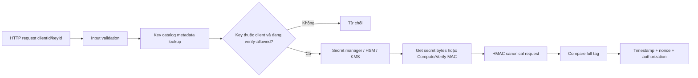
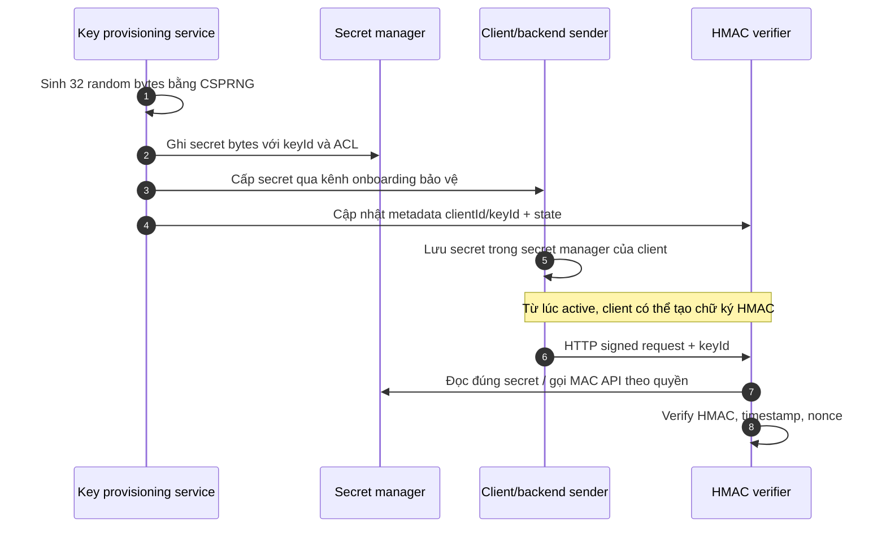
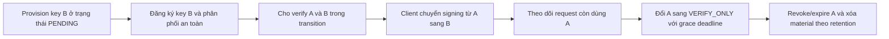

# Lưu shared secret

## 1. Vì sao cách lưu shared secret quyết định độ an toàn của HMAC?

Trong xác thực HTTP request bằng **HMAC**, client và server cùng biết một khóa bí mật — **shared secret**. Client dùng secret để tính HMAC trên **canonical request**; server lấy secret tương ứng với client và key ID, tính lại HMAC rồi so với chữ ký nhận được. Một chữ ký đúng là bằng chứng rằng bên tạo chữ ký **có khả năng dùng secret hợp lệ**, với điều kiện canonicalization và việc xác minh được triển khai đúng.

Ví dụ:

```text
HTTP sender                             HMAC verifier
-----------                            -------------
shared secret K                         shared secret K
canonical request C                    dựng lại C từ HTTP thực nhận
HMAC-SHA-256(K, C) = tag               HMAC-SHA-256(K, C) = expected
gửi tag + metadata              --->   so tag/expected, chống replay
```

Nếu secret bị lộ, attacker không cần đánh cắp request cũ nữa: họ có thể **tạo request mới với timestamp/nonce mới, tính HMAC hợp lệ và giả mạo một client** trong phạm vi secret đó. Vì thế, lưu shared secret không chỉ là chọn một chỗ để đặt cấu hình; đó là thiết kế **ranh giới tin cậy, quyền truy cập, vòng đời khóa và khả năng thu hồi**.

Bài **“Lưu shared secret”** thuộc chương **Secret management** của mô-đun **`SECURITY_AUTHENTICATION_HMAC_REQUEST_AUTHENTICATION`**. Mô-đun hướng đến thiết kế xác thực HTTP request bằng HMAC với shared secret và canonical request chứa method, URI, header hoặc body; thực hành xác minh chữ ký, chống replay bằng timestamp/nonce, quản lý key rotation, kiểm thử proxy/gateway và phân biệt xác thực với phân quyền.

**Mục tiêu học tập:**

- Giải thích **khóa HMAC phải được giữ bí mật ở đâu và ai được phép truy cập**.
- Phân biệt **random key bytes**, biểu diễn Base64/hex, mã hóa khi lưu và quyền gọi MAC của HSM/KMS.
- So sánh secret manager, HSM/KMS, secret file, environment variable, Kubernetes Secret và database được mã hóa.
- Thiết kế catalog **`(clientId, keyId) → key metadata + secret reference`** theo nguyên tắc least privilege.
- Thực hiện **provisioning, rotation, revocation, cache invalidation, audit và incident response**.
- Dùng Java 17 lấy secret từ nguồn tin cậy mà không hardcode, kiểm encoding và tạo `Mac` theo request.
- Viết test vector, negative tests và checklist vận hành để phát hiện cấu hình key sai hoặc bị lộ.

**Thông điệp chính:** nơi lưu shared secret phải được thiết kế đồng bộ với **khả năng sử dụng secret**, chứ không chỉ với việc “có mã hóa hay không”. Một khóa mã hóa ở database nhưng mọi service account đều đọc/giải mã được vẫn là một thiết kế phân quyền kém.

## 2. Threat model khi lưu secret HMAC

Cần đặt câu hỏi: attacker muốn gì, có thể truy cập phần nào và hậu quả là gì?

| Tình huống | Secret có thể lộ bằng cách nào? | Hậu quả |
| --- | --- | --- |
| Secret được hardcode trong repository | Source, Git history, package, decompile | Bất cứ ai có bản copy có thể ký request giả |
| Secret trong file cấu hình commit vào Git | CI logs, code review, bản sao repo | Bí mật lan sang nhiều bản copy khó thu hồi |
| Secret trong environment variable | Crash dump, debug endpoint, logs, process inspection theo quyền hệ điều hành | Key có thể bị sao chép dù không nằm trong code |
| Container image chứa `.env` hoặc file secret | Image registry, layer cache, host node | Một image bị lộ làm lộ secret nhiều môi trường |
| Shared secret gửi qua HTTP/plaintext | Network interceptor | Attacker ký request mới hoặc lấy bản sao request |
| Một secret dùng chung cho tất cả client | Chỉ một client bị xâm nhập | Có thể giả mạo nhiều client, blast radius lớn |
| Service account có quyền đọc mọi secret | Pod/service bị chiếm | Đọc secret của tenant không liên quan |
| Log raw request/secret khi debug | Log/trace vendor, support artifact | Mở rộng phạm vi truy cập bí mật |
| Sao lưu plaintext không mã hóa | Backup, snapshot, export DB | Secret có thể tồn tại lâu sau khi bị xóa ở bản chính |
| Key cũ không bị thu hồi | Secret đã thôi dùng vẫn xác minh được | Attacker tiếp tục tạo HMAC bằng khóa cũ |
| Multi-node cache không nhận revocation | Một node còn giữ key đã thu hồi | Policy thu hồi không có hiệu lực toàn cluster |

**Bảo vệ mong muốn:** bí mật chỉ đến **đúng bên ký và đúng bên xác minh** theo phạm vi cần thiết, qua kênh được bảo vệ, trong thời gian cần dùng, với log/backup/incident controls thích hợp.

### 2.1. Shared secret khác mật khẩu, token và public key

- **HMAC shared secret**: cả bên ký và bên xác minh cần **khả năng sử dụng cùng key**. Không thể thay secret thật bằng hash một chiều trong database rồi dùng hash ấy để tính **HMAC với secret gốc**.
- **Mật khẩu người dùng**: thường nên lưu kết quả của password hashing/KDF phù hợp, không lưu plaintext. Quy tắc password hashing **không trực tiếp thay thế** mô hình lưu HMAC key ngẫu nhiên.
- **Bearer token**: ai sở hữu token thường có thể dùng nó để được xác thực; có thể lưu hash token tùy protocol. HMAC key lại dùng để tạo một MAC **gắn với từng request**.
- **Cặp public/private key**: bên xác minh chữ ký bất đối xứng có thể chỉ giữ public key; HMAC là **đối xứng**, nên bên xác minh có khả năng tạo MAC hợp lệ nếu biết key.

Nếu mục tiêu là **verifier tuyệt đối không có khả năng giả mạo client**, HMAC shared secret có thể không phù hợp với threat model đó; cân nhắc **chữ ký bất đối xứng** với private key chỉ ở phía sender.

### 2.2. Shared secret có cần được truyền theo request không?

**Không.** Request chỉ nên mang các metadata như `clientId`, `keyId`, timestamp, nonce và MAC tag, **không bao giờ mang raw shared secret**. Ví dụ:

```http
POST /v1/orders HTTP/1.1
X-Client-Id: client-42
X-Key-Id: k-2026-11
X-Timestamp: <unix-seconds>
X-Nonce: <fresh-random-nonce>
X-Signature: <base64-hmac>
```

Secret được **provision trước qua kênh tin cậy** đến cả hai bên. Nếu server tự nhận `X-Secret` từ request rồi dùng nó để xác minh HMAC, attacker có thể tự chọn khóa và chữ ký của mình; đó **không phải** xác thực caller bằng secret đã đăng ký.

## 3. Tạo secret HMAC: entropy, độ dài và nguồn ngẫu nhiên

Khóa HMAC là **dãy byte**, không phải một chuỗi tiếng Anh dễ nhớ. Đối với `HmacSHA256`, một lựa chọn thực tế phổ biến là **32 byte được tạo từ CSPRNG**, tức **256 bit ngẫu nhiên**.

```text
SecureRandom
     |
     v
32 random bytes  ----------------->  HMAC-SHA-256 key bytes
     |
     +-- optional Base64URL encoding --> chuỗi để provisioning/storage
```

Không tạo HMAC key bằng:

```java
String weakKey = "my-company-secret";            // đoán được
String weakKey2 = "password123";                  // từ điển
long weakKey3 = System.currentTimeMillis();       // entropy thấp
double weakKey4 = Math.random();                  // không phải CSPRNG
```

Không dùng key ID, client ID, mã merchant hoặc timestamp làm secret. Chúng là **định danh/metadata**, thường công khai và có thể đoán được.

### 3.1. Độ dài tag không phải độ dài secret

`HmacSHA256` tạo **tag đầy đủ 32 byte** dù secret là 20, 32 hay 64 byte. Không dùng `secret.length` làm độ dài expected MAC; thuật toán và chính sách truncation mới quyết định số byte tag.

Một secret **ngắn nhưng hoàn toàn ngẫu nhiên** không giống một password dài nhưng entropy thấp. Tuy nhiên, vì hệ thống mới có thể chọn key size, **32 byte CSPRNG** là một baseline đơn giản và phù hợp với SHA-256.

### 3.2. Sinh khóa khi provisioning, không mỗi lần chạy service

Secret phải **ổn định giữa sender và verifier** trong một key version. Nếu API tự tạo secret ngẫu nhiên mỗi khi container start mà không provision đến client, chữ ký của client sẽ không còn khớp.

Đúng:

```text
Key provisioning:
  sinh 32 byte ngẫu nhiên -> lưu vào secret manager
  -> cấp cho client được đăng ký qua kênh bảo vệ
  -> gắn với clientId + keyId

Runtime:
  verifier tra key material cho clientId + keyId
  -> tính HMAC, không tự tạo secret khác
```

Khi cần thay khóa, thực hiện **key rotation có chủ đích** với key ID mới và trạng thái hiệu lực rõ ràng.

## 4. Chọn nơi lưu: so sánh các cách phổ biến

Không có một đáp án giống nhau cho mọi hệ thống; lựa chọn phụ thuộc kiến trúc và mức bảo đảm.

| Cách lưu | Phù hợp khi | Rủi ro và yêu cầu bổ sung |
| --- | --- | --- |
| **Secret manager/Vault được quản lý** | Production có nhiều dịch vụ, cần IAM/audit/rotation | Least privilege, network policy, cache TTL/revocation, secret retrieval |
| **KMS/HSM hỗ trợ HMAC** | Muốn bảo vệ material bằng ranh giới mật mã và API MAC | Phải xét khả năng provision shared key cho sender; quota/latency/algorithm, key lifecycle |
| **Database có envelope encryption** | Cần secret riêng theo rất nhiều client/tenant | App phải có quyền giải mã; quản lý DEK/KEK, audit, migration |
| **Secret file mount với quyền nghiêm ngặt** | Container/VM lấy secret qua agent/secret volume | Quyền file, tmpfs, refresh/atomic replacement, backup và host compromise |
| **Environment variable** | Mô hình nhỏ, bootstrap secret hoặc dev | Có thể lộ qua process inspect/dumps/logging, kế thừa bởi child process; đổi key khó kiểm soát |
| **Kubernetes Secret object** | Kubernetes deployment đã có RBAC và secret delivery | Base64 trong manifest **không phải mã hóa**; cần bảo vệ etcd, RBAC, mounts/secret sync |
| **Plaintext config file trong repo** | **Không phù hợp production** | Lộ qua Git/history/artifact |
| **Source code/hardcode** | Chỉ có thể chứa **test key công khai** | Không chứa production key |

**Khuyến nghị thiết kế:** production nên ưu tiên secret manager hoặc một giải pháp bảo vệ khóa tương đương với IAM chi tiết, audit và rotation. File/env có thể là **phương tiện giao secret từ secret manager vào process**, không phải mặc nhiên một secret store có lifecycle và audit đầy đủ.

### 4.1. Vì sao `.env` không tự động an toàn?

Đặt secret trong `.env` giúp tránh hardcode vào code Java, nhưng **không tự giải quyết**:

- File có bị commit vào Git, đưa vào image hoặc backup hay không?
- Ai có quyền đọc file trên host?
- CI có in environment variables vào logs hay artifact?
- Process con có thừa kế secret trong environment?
- Làm sao revoke và đổi version khi hàng trăm pods đang chạy?
- Crash dump, diagnostic endpoint hoặc support package có chứa giá trị không?

Trong dev, một file riêng không commit có thể chấp nhận theo policy. Production cần **quản lý nguồn gốc, truy cập và vòng đời** của bí mật.

### 4.2. Kubernetes Secret: Base64 không phải encryption

Ví dụ nội dung Secret manifest có thể có:

```yaml
apiVersion: v1
kind: Secret
metadata:
  name: hmac-client-example
type: Opaque
data:
  hmac-key: <base64-content>
```

`data` trong Kubernetes Secret được Base64-encode để vận chuyển qua API YAML/JSON, **không tự đảm bảo mã hóa ở nơi lưu**. Cần kiểm:

- Encryption at rest của Kubernetes storage/etcd theo cấu hình triển khai.
- RBAC: service account nào đọc/mount được Secret.
- Namespace isolation, admission/policy, node compromise.
- Mount file vs env, update propagation và restart behavior.
- Không commit manifest chứa raw encoded production key vào Git công khai.

Nếu dùng external secrets operator, cần bảo vệ cả **quyền từ cluster đến secret manager** và tránh để secrets sync đến những namespace không cần thiết.

## 5. Kiến trúc lưu trữ: key catalog tách khỏi secret material

Một hệ thống nhiều đối tác cần tra **đúng secret theo client và key version**. Nên tách:

1. **Key metadata/catalog**: client ID, key ID, trạng thái, thời hạn, principal, secret locator.
2. **Secret material store**: raw key bytes đã được bảo vệ, chỉ truy cập bằng service identity có quyền.
3. **HMAC verifier**: lấy key đúng policy rồi tính MAC trên canonical request thực nhận.



Catalog có thể lưu một record minh họa:

| Field | Giá trị ví dụ | Có phải secret? |
| --- | --- | --- |
| `principalId` | `partner-42` | Không phải secret nhưng là dữ liệu bảo mật cần quản lý |
| `clientId` | `client-42` | Không |
| `keyId` | `k-2026-11` | Không |
| `state` | `SIGN_AND_VERIFY` | Không |
| `verifyFrom` | `2026-11-01T00:00:00Z` | Không |
| `verifyUntil` | `2026-12-15T00:00:00Z` | Không |
| `secretLocator` | `secret://hmac/partner-42/k-2026-11` | Reference, không phải raw key |
| `secretBytes` | **Chỉ ở kho bảo vệ** | **Có** |

Đừng dựa hoàn toàn vào string `keyId` toàn cục nếu nhiều tenant có thể cùng dùng key ID; lookup nên được scope bằng **client/principal** và policy.

### 5.1. Client ID và key ID chưa được xác thực trước HMAC

Request có thể gửi:

```http
X-Client-Id: client-42
X-Key-Id: k-2026-11
```

Đây là **untrusted lookup hints** trước khi chữ ký khớp. Verifier phải:

1. Validate cú pháp và giới hạn độ dài hai ID.
2. Tra **key record thuộc đúng client** và đúng version.
3. Kiểm key lifecycle (active/verify-only/revoked/expired).
4. Lấy secret candidate từ nguồn tin cậy.
5. Tính HMAC và so raw tag đúng 32 byte.
6. **Chỉ sau MAC khớp** mới thiết lập authenticated principal từ metadata đã xác thực.

Không tin một header `X-Authenticated-Client` do Internet tự khai, cũng không tạo principal dựa trên việc key ID “có tồn tại”.

### 5.2. Tách key signing và key verification

Một key có thể ở các trạng thái:

```text
CREATED / PENDING
      |
      v
SIGN_AND_VERIFY  -->  VERIFY_ONLY  -->  REVOKED / DISABLED
                         |
                         +--> hết verifyUntil
```

- **PENDING**: đã provision nhưng chưa được client phép dùng (tùy policy).
- **SIGN_AND_VERIFY**: client có thể dùng để ký request mới; server xác minh.
- **VERIFY_ONLY**: dùng khi chuyển tiếp, server vẫn nhận request ký bằng key cũ trong giai đoạn grace nhưng sender không nên tiếp tục ký mới bằng key đó.
- **REVOKED/DISABLED**: phải từ chối ngay theo chính sách, không căn cứ chỉ vào timestamp có vẻ còn hạn.

**VERIFY_ONLY không thể đảm bảo client ngừng ký bằng key cũ** về mặt kỹ thuật nếu client vẫn có secret; đây là một **policy/lifecycle**. Server chỉ có thể kiểm key đó còn trong phạm vi xác minh được phép hay không.

## 6. Lưu raw key bytes và hiểu rõ Base64/hex

Secret của HMAC là **bytes**. Base64 hay hex chỉ là **cách viết bytes thành text** để vận chuyển/lưu trong hệ thống text-oriented; chúng **không mã hóa bí mật**.

Ví dụ **test key công khai** 32 byte:

```text
Raw hex:
00112233445566778899aabbccddeeff00112233445566778899aabbccddeeff

Base64URL, không padding:
ABEiM0RVZneImaq7zN3u_wARIjNEVWZ3iJmqu8zd7v8
```

Đây là **cùng một dãy byte** ở hai cách biểu diễn. Chuỗi Base64URL có **43 ký tự** cho 32 byte không padding. Nó không phải secret production, không được tái sử dụng trong request thật.

**Bug nguy hiểm về interoperability:**

```java
String encoded = "ABEiM0RVZneImaq7zN3u_wARIjNEVWZ3iJmqu8zd7v8";

// SAI nếu profile nói secret là raw bytes đã được Base64URL-encode:
byte[] wrongKey = encoded.getBytes(StandardCharsets.UTF_8);

// ĐÚNG: decode encoding về 32 bytes gốc:
byte[] actualKey = Base64.getUrlDecoder().decode(encoded);
```

Với `wrongKey`, HMAC dùng **43 byte ký tự ASCII** thay vì **32 byte khóa**. Client dùng raw key còn server dùng bytes của text Base64 sẽ tính **HMAC khác nhau** dù hiển thị cùng một chuỗi cấu hình.

### 6.1. Không dùng một hàm tự động đoán encoding

Tránh các fallback kiểu:

```text
try Base64 Basic
catch -> try Base64URL
catch -> assume UTF-8 plaintext
catch -> try hex
```

Nó làm key format mơ hồ và khó kiểm soát. Định nghĩa rõ **`secretFormat=BASE64URL_NOPAD_256`** cho một key version hoặc nguồn provisioning, và **từ chối** chuỗi sai format.

### 6.2. UTF-8, Unicode và bí mật dạng mật khẩu

Nếu ai đó cấu hình `secret = "mật-khẩu-bí-mật"`, cần xác định cách encode text thành bytes, normalization và entropy. Nhưng **không nên dùng human-memorable password làm HMAC key**. Với API machine-to-machine, ưu tiên **random bytes** và transport encoding chính tắc.

Nếu một hệ thống legacy buộc dùng passphrase, đó là **giao thức khác cần KDF/key-derivation và policy riêng**, không chỉ lấy `passphrase.getBytes` rồi coi là khóa 256 bit.

## 7. Generate, provision và lưu secret qua kênh bảo vệ

Một vòng đời key bắt đầu từ **generation**, rồi **registration, delivery, activation, rotation và revocation**. Không chỉ chọn một value trong config.



**Provisioning channel** phải bảo vệ **bí mật và integrity**: xác thực danh tính hai bên, TLS, quyền đọc tối thiểu, không để secret trong chat/email công khai, URL query, bug report hoặc ticket logs.

### 7.1. Ai được sinh key?

Có thể server-side onboarding service sinh key rồi bàn giao cho client một lần, hoặc hai bên thỏa thuận quy trình import/provision hợp lệ. HMAC yêu cầu hai bên có **khả năng dùng cùng key material**, nên quy trình phải chứng minh client thực sự đã nhận đúng key mà không vô tình tạo hai bản khác nhau.

Nếu dùng HSM/KMS **non-exportable**, phải giải thích rõ **làm sao client có cùng secret**. Có thể import key đã provision cho client vào dịch vụ HSM server, hoặc dùng cơ chế khác theo nhà cung cấp; không thể vừa “server tự sinh key không bao giờ export” vừa kỳ vọng một client bên ngoài tự biết giá trị secret đó.

### 7.2. Một secret cho mỗi client hay dùng chung toàn hệ thống?

Thông thường nên **mỗi client một keyset**:

```text
client-42: k-A, k-B
client-99: k-C
client-100: k-D, k-E
```

Khi secret của `client-42` lộ, server có thể revoke keyset đó mà không làm hỏng request của toàn bộ client khác. Dùng một secret toàn hệ thống làm tăng **blast radius**, khó audit và khó xoay khóa cho một đối tác riêng.

Có thể có nhiều key theo **môi trường** (dev/staging/production), vùng hoặc use case, nhưng phải phân biệt key ID, phạm vi và policy; **không dùng chung production secret với test**.

## 8. Encryption at rest, envelope encryption, KMS và HSM

**Mã hóa secret khi lưu** là một lớp bảo vệ quan trọng, nhưng chỉ hiệu quả khi **key giải mã và quyền sử dụng** được quản lý tách biệt.

### 8.1. Envelope encryption trong database

Một thiết kế có thể là:

```text
32-byte HMAC secret
       |
       v
Encrypt with per-record Data Encryption Key (DEK)
       |
       +--> encrypted HMAC secret nằm trong DB
       |
       +--> DEK được wrap bởi Key Encryption Key (KEK) trong KMS

Runtime verifier:
  authenticate as workload identity
  -> load encrypted record / wrapped DEK
  -> KMS unwrap/decrypt theo IAM policy
  -> chỉ giữ HMAC key material trong memory cần thiết
  -> compute/verify HMAC
```

Ưu điểm: database snapshot chỉ có ciphertext nếu keystore được bảo vệ riêng. Nhưng nếu attacker có cả **database và quyền gọi KMS decrypt** của service, họ vẫn có thể lấy secret; cần IAM, audit, rate limit, network boundary, incident response và khả năng revoke.

### 8.2. Khi KMS/HSM trực tiếp làm HMAC

Một số key service hỗ trợ **tính/xác minh MAC bên trong ranh giới bảo vệ khóa**, không trả raw key bytes cho JVM:

```text
verifier -> KMS/HSM VerifyMac(keyId, canonicalBytes, suppliedTag)
          hoặc GenerateMac(keyId, canonicalBytes) rồi kiểm tag
```

**Lợi ích:** giảm secret material hiện diện trong memory của application. **Trade-off:** latency, quota, availability, chi phí, thuật toán hỗ trợ, payload size giới hạn và cách cấp phát cùng secret đến client.

**Không phải mọi KMS đều hỗ trợ HMAC MAC operations với key tùy ý**, và API/provider có thể quy định cách import/provision đặc thù. Cần kiểm service contract trước khi thiết kế. Nếu KMS chỉ hỗ trợ encrypt/decrypt mà không hỗ trợ HMAC, ứng dụng vẫn phải **lấy plaintext key vào memory** để gọi `Mac` Java.

### 8.3. Key encryption key không phải HMAC shared secret

**KEK** dùng để mã hóa/giải mã key material trong storage; **HMAC secret** dùng ký HTTP request. Không dùng KEK của KMS như HMAC secret gửi cho client, cũng không lưu bản sao raw KEK trong database.

Phân tách mục đích (*key separation*) giúp giảm tác động khi một cơ chế bị lộ và làm rõ lifecycle/permissions.

## 9. Quản lý quyền đọc secret bằng workload identity

Một secret manager tốt chưa đủ nếu mọi service đều có quyền lấy tất cả key.

### 9.1. Quy tắc least privilege

- **Verifier service** chỉ có quyền **read/use** key cần xác minh theo tenant/namespace.
- **Provisioning service** có quyền **create/rotate**, không nhất thiết phục vụ HTTP traffic.
- **Client backend** chỉ nhận secret của chính client đã đăng ký.
- **Support/UI/analytics** không có quyền export raw key material; cần thông tin metadata thì dùng API metadata.
- **CI runner** không được dùng production key khi chạy unit tests; dùng test key công khai.
- **Operator** có quyền xử lý sự cố theo cơ chế phân quyền và audit, tránh shared admin account.
- Quyền truy cập phải được **audit**, và cần cảnh báo trên truy vấn key bất thường.

Nếu ứng dụng gọi secret manager bằng **một credential cố định hardcode trong config**, ta chỉ đổi vị trí secret gốc sang một secret bootstrap khác. Ưu tiên **workload identity** hoặc token ngắn hạn được nền tảng cấp theo danh tính runtime.

### 9.2. Workload identity khác key ID của đối tác

`X-Key-Id` trong HTTP request là key version do **client khai báo** để giúp server tra secret. Danh tính **service account/pod/instance** dùng để gọi secret manager được xác minh bởi hạ tầng, **không lấy từ request header**.

```text
Internet client header:
  clientId / keyId  -> untrusted lookup hints

Server workload identity:
  verifier-service -> quyền đọc/verify secret do IAM cấp
```

Không tự ghép user input vào một path secret manager mà bỏ qua allowlist, tenant boundary và canonicalization. Ví dụ `secret://clients/../../admin/root` không được coi là locator hợp lệ chỉ vì `keyId` có một chuỗi trùng.

### 9.3. Tra secret theo allowlist metadata, không theo đường dẫn user tự nhập

Pseudocode:

```text
(clientId, keyId) = validateStrict(rawHeaders)
descriptor = catalog.findByClientAndKeyId(clientId, keyId)

if descriptor missing / revoked / not yet valid / expired:
    deny

locator = descriptor.secretLocator   // thuộc catalog tin cậy
secret = secretManager.read(locator) // theo workload identity
verify full HMAC on actual canonical request
```

Đừng cho header `X-Secret-Path` hoặc query parameter `secretPath` tự điều khiển secret manager read. Attacker có thể dùng ứng dụng làm một **confused deputy** để truy cập secret không liên quan.

## 10. Java 17: encode/decode đúng 32-byte key material

Utility dưới đây minh họa **một định dạng secret storage/provisioning cố định**: 32 raw bytes mã hóa bằng **Base64URL không padding, 43 ASCII chars**. Nó không làm network I/O, không đọc file/env và không in key.

```java
import java.security.SecureRandom;
import java.util.Arrays;
import java.util.Base64;
import java.util.regex.Pattern;

public final class SharedSecretCodecV1 {
    private static final int RAW_BYTES = 32;
    private static final int TEXT_CHARS = 43;
    private static final SecureRandom RANDOM = new SecureRandom();

    private static final Pattern ALPHABET =
            Pattern.compile("[A-Za-z0-9_-]{43}");

    private SharedSecretCodecV1() {}

    // Chỉ dùng trong bước provisioning với kênh bảo vệ.
    public static String generateForProvisioning() {
        byte[] raw = new byte[RAW_BYTES];
        try {
            RANDOM.nextBytes(raw);
            return Base64.getUrlEncoder()
                    .withoutPadding()
                    .encodeToString(raw);
        } finally {
            Arrays.fill(raw, (byte) 0);
        }
    }

    public static byte[] decode32(String encoded) {
        if (encoded == null
                || encoded.length() != TEXT_CHARS
                || !ALPHABET.matcher(encoded).matches()) {
            throw new IllegalArgumentException(
                    "Invalid key encoding");
        }

        byte[] raw;
        try {
            raw = Base64.getUrlDecoder().decode(encoded);
        } catch (IllegalArgumentException invalid) {
            throw new IllegalArgumentException(
                    "Invalid key encoding", invalid);
        }

        if (raw.length != RAW_BYTES
                || !Base64.getUrlEncoder().withoutPadding()
                        .encodeToString(raw).equals(encoded)) {
            Arrays.fill(raw, (byte) 0);
            throw new IllegalArgumentException(
                    "Noncanonical key material");
        }
        return raw;
    }
}
```

**Giải thích:**

- `SecureRandom` là CSPRNG trong Java; không dùng `Random`/`ThreadLocalRandom` cho HMAC secret.
- `generateForProvisioning()` trả về **String chứa secret**, vì vậy caller phải chuyển nó trực tiếp vào **kênh lưu/cấp phát bảo vệ** và không log hoặc để trong exception. `String` trong JVM là immutable và không có bảo đảm zeroize.
- `decode32` từ chối empty, sai alphabet, thiếu/thừa padding và noncanonical Base64URL. Base64 không bảo vệ tính bí mật.
- `decode32` trả ra **raw bytes**; caller **sở hữu mảng byte** và nên giảm thời gian sống, dọn tạm thời khi thích hợp.
- Zeroize bằng `Arrays.fill` chỉ là **best effort** trong JVM; việc sao chép nội bộ, provider/JIT, heap snapshot, swap hoặc crash dump vẫn có thể để lại bản khác.
- 32-byte policy là baseline V1. Nếu key provider có quy định key size khác hoặc HMAC profile khác, thiết kế version riêng và kiểm thử interoperable.

### 10.1. Hai lỗi key encoding thường gặp

**Double encoding:**

```java
// SAI nếu alreadyEncoded đã là Base64URL string của raw key.
String wrong = Base64.getUrlEncoder()
        .withoutPadding()
        .encodeToString(
            alreadyEncoded.getBytes(
                java.nio.charset.StandardCharsets.UTF_8));
```

**Using literal Base64 text as key:**

```java
// SAI theo profile BASE64URL_NOPAD_256:
SecretKeySpec wrongKey = new SecretKeySpec(
        storedBase64.getBytes(
            java.nio.charset.StandardCharsets.UTF_8),
        "HmacSHA256");

// ĐÚNG:
byte[] keyBytes = SharedSecretCodecV1.decode32(storedBase64);
try {
    SecretKeySpec key = new SecretKeySpec(
            keyBytes, "HmacSHA256");
    // Mac.init(key) ...; không log secret/key.
} finally {
    java.util.Arrays.fill(keyBytes, (byte) 0);
}
```

JCA `SecretKeySpec` và crypto provider có thể giữ **bản sao key material** trong memory. Việc fill mảng ban đầu không chứng minh mọi bản sao trong JVM đã được xóa hoàn toàn.

## 11. Java 17: resolve secret theo client/key ID và key lifecycle

Đây là một **ví dụ Java 17 dùng interfaces** cho catalog và secret backend. Nó minh họa các nguyên tắc bảo mật của storage: key lookup theo tuple, không tin header làm principal, chỉ lấy secret khi metadata hợp lệ, giữ bytes ngắn hạn và **không fail open** khi backend không đọc được.

```java
import java.security.GeneralSecurityException;
import java.time.Clock;
import java.time.Instant;
import java.util.Arrays;
import java.util.Objects;
import java.util.Optional;
import javax.crypto.Mac;
import javax.crypto.spec.SecretKeySpec;

public final class ManagedHmacKeysV1 {
    private ManagedHmacKeysV1() {}

    public enum State {
        SIGN_AND_VERIFY, VERIFY_ONLY, REVOKED
    }

    public record KeyVersion(
            String principalId,
            String clientId,
            String keyId,
            String secretLocator,
            State state,
            Instant verifyFrom,
            Instant verifyUntil) {

        public KeyVersion {
            Objects.requireNonNull(principalId);
            Objects.requireNonNull(clientId);
            Objects.requireNonNull(keyId);
            Objects.requireNonNull(secretLocator);
            Objects.requireNonNull(state);
            Objects.requireNonNull(verifyFrom);
            Objects.requireNonNull(verifyUntil);
            if (!verifyFrom.isBefore(verifyUntil)) {
                throw new IllegalArgumentException(
                        "Invalid key verification interval");
            }
        }
    }

    @FunctionalInterface
    public interface KeyCatalog {
        // Không trả raw secret; chỉ trả metadata đáng tin.
        Optional<KeyVersion> find(String clientId, String keyId);
    }

    @FunctionalInterface
    public interface SecretStore {
        // Trả byte[32] MỚI mà caller sở hữu để có thể zeroize.
        // Lỗi vault/KMS phải ném exception, không được trả
        // một key mặc định.
        byte[] readOwnedBytes(String trustedLocator);
    }

    public static final class KeyLease implements AutoCloseable {
        private final String principalId;
        private byte[] keyMaterial;

        private KeyLease(String principalId, byte[] source) {
            this.principalId = principalId;
            this.keyMaterial = source.clone();
        }

        public String principalId() {
            return principalId;
        }

        public synchronized byte[] hmacSha256(byte[] canonicalBytes)
                throws GeneralSecurityException {
            Objects.requireNonNull(canonicalBytes);
            if (keyMaterial == null) {
                throw new IllegalStateException(
                        "Key lease is closed");
            }

            // Mac local per call; không share Mac mutable.
            Mac mac = Mac.getInstance("HmacSHA256");
            mac.init(new SecretKeySpec(
                    keyMaterial, "HmacSHA256"));
            return mac.doFinal(canonicalBytes);
        }

        @Override
        public synchronized void close() {
            if (keyMaterial != null) {
                Arrays.fill(keyMaterial, (byte) 0);
                keyMaterial = null;
            }
        }
    }

    public static Optional<KeyLease> resolveForVerification(
            String clientId,
            String keyId,
            Clock clock,
            KeyCatalog catalog,
            SecretStore store) {

        Objects.requireNonNull(clock);
        Objects.requireNonNull(catalog);
        Objects.requireNonNull(store);

        // Không cho input chưa xác thực điều khiển arbitrary paths.
        if (clientId == null || keyId == null
                || !clientId.matches("[A-Za-z0-9._-]{1,80}")
                || !keyId.matches("[A-Za-z0-9._-]{1,80}")) {
            return Optional.empty();
        }

        var recordOpt = catalog.find(clientId, keyId);
        if (recordOpt.isEmpty()) {
            return Optional.empty();
        }

        var record = recordOpt.get();
        Instant now = Instant.now(clock);

        // Defense in depth: metadata phải thuộc đúng lookup tuple.
        if (!clientId.equals(record.clientId())
                || !keyId.equals(record.keyId())
                || record.principalId().isBlank()
                || record.state() == State.REVOKED
                || now.isBefore(record.verifyFrom())
                || !now.isBefore(record.verifyUntil())) {
            return Optional.empty();
        }

        // Locator chỉ lấy từ catalog tin cậy, không từ raw header.
        byte[] raw = store.readOwnedBytes(
                record.secretLocator());

        if (raw == null) {
            throw new IllegalStateException(
                    "Secret backend returned no key material");
        }

        try {
            if (raw.length != 32) {
                throw new IllegalStateException(
                        "Invalid stored HMAC key length");
            }
            return Optional.of(
                    new KeyLease(record.principalId(), raw));
        } finally {
            // Dọn bản copy do SecretStore giao. KeyLease giữ
            // một bản riêng cho thời gian sống của operation.
            Arrays.fill(raw, (byte) 0);
        }
    }
}
```

### 11.1. Cách sử dụng lease trong verifier

Sau khi đã parse request, tạo canonical bytes từ **method, raw URI, signed headers, timestamp/nonce và body bytes thực nhận**, có thể dùng:

```java
var maybeLease = ManagedHmacKeysV1.resolveForVerification(
        clientId, keyId, clock, keyCatalog, secretStore);

if (maybeLease.isEmpty()) {
    rejectAuthentication();
} else {
    try (var lease = maybeLease.orElseThrow()) {
        byte[] expected = lease.hmacSha256(canonicalBytes);

        // suppliedTag đã được decode/canonical-validated
        // và bắt buộc đủ 32 bytes ở HTTP adapter.
        boolean validMac = expected.length == 32
                && suppliedTag.length == 32
                && java.security.MessageDigest.isEqual(
                        expected, suppliedTag);

        if (!validMac) {
            rejectAuthentication();
        } else {
            // Chỉ SAU MAC đúng mới thực hiện:
            // 1. kiểm timestamp window theo policy;
            // 2. atomic reserve nonce trong replay store;
            // 3. authorization theo lease.principalId().
            continueAfterAuthentication(lease.principalId());
        }
    }
}
```

**Pseudocode tích hợp** ở đây dùng các hàm `rejectAuthentication` và `continueAfterAuthentication` chưa định nghĩa; đó là logic adapter/framework, **không phải một class Java chạy độc lập**. Không tự return success khi `store.readOwnedBytes` timeout hoặc key metadata không tìm thấy.

Trong hệ thống thực, timestamp format có thể được **precheck trước MAC** để giảm chi phí, nhưng không được coi metadata header là principal đáng tin, ghi nonce hoặc làm business side effect **trước MAC hợp lệ**.

### 11.2. Trạng thái cache và KeyLease

`KeyLease` chỉ minh họa việc **giữ secret trong phạm vi một verify operation**. Trong hệ thống có tải lớn, lấy secret manager trên **mọi HTTP request** có thể không phù hợp vì latency và quota.

Có thể thiết kế cache key material theo chính sách chặt chẽ:

- Tối đa bao nhiêu key và tồn tại bao lâu trong JVM.
- Cache scope theo `(clientId, keyId, key version)`, không dùng raw user input làm path.
- Revalidate trạng thái revoked/expired; cần **cache invalidation nhanh** khi khẩn cấp.
- Giới hạn memory dump/diagnostic access và bảo vệ process.
- Không lưu secret cache vào disk/log/snapshot ngoài policy.
- Nếu cache miss khi secret manager unavailable, quyết định **fail closed** hoặc cơ chế dự phòng đã được phê duyệt, không tự tạo key mới.

Một secret chỉ tồn tại trong memory trong vài mili-giây tốt hơn về giảm thời gian phơi nhiễm, nhưng **không loại trừ** việc ứng dụng bị compromise lúc đang sử dụng key. Cần kết hợp isolation và least privilege.

## 12. Golden vector: cùng raw key, cùng bytes thì HMAC phải giống nhau

Để tránh lỗi lưu/giải mã secret, dùng test vector được tính từ **một raw key công khai dành riêng cho unit test**. Không dùng key đó trong production.

Key material:

```text
32 raw bytes, HEX:
00112233445566778899aabbccddeeff00112233445566778899aabbccddeeff

Base64URL without padding:
ABEiM0RVZneImaq7zN3u_wARIjNEVWZ3iJmqu8zd7v8
```

Canonical message cho test storage — **không phải toàn bộ một HTTP request production** — chứa **5 dòng** LF-delimited, không có newline cuối:

```text
HMAC-STORAGE-V1
client:client-42
key-id:k-demo-01
GET
/v1/status
```

Message dài **64 byte UTF-8**. Với `HmacSHA256` và raw key trên:

```text
Expected tag, 32-byte lowercase HEX:
b26d5da4d81d65a288552cc9975043a49280e49eded9e9f8a8ed65ac1f984ed6

Expected tag, Base64 Basic padded:
sm1dpNgdZaKIVSzJl1BDpJKA5J7e2en4qO1lrB+YTtY=
```

Các giá trị này được **tính độc lập** để làm fixture. Nếu server vô tình dùng 43 byte của text Base64URL làm key thay vì decode thành 32 raw bytes, MAC sẽ **không** khớp expected tag.

### 12.1. JUnit 5 kiểm Base64URL và HMAC key bytes

```java
import static org.junit.jupiter.api.Assertions.*;
import java.nio.charset.StandardCharsets;
import java.security.MessageDigest;
import java.util.Arrays;
import java.util.Base64;
import java.util.HexFormat;
import javax.crypto.Mac;
import javax.crypto.spec.SecretKeySpec;
import org.junit.jupiter.api.Test;

class SharedSecretCodecV1Test {
    static final String TEST_KEY =
            "ABEiM0RVZneImaq7zN3u_wARIjNEVWZ3iJmqu8zd7v8";

    @Test
    void parses32RawBytesFromCanonicalBase64Url() {
        byte[] key = SharedSecretCodecV1.decode32(TEST_KEY);
        try {
            assertEquals(32, key.length);
            assertEquals(
                    "00112233445566778899aabbccddeeff"
                  + "00112233445566778899aabbccddeeff",
                    HexFormat.of().formatHex(key));
        } finally {
            Arrays.fill(key, (byte) 0);
        }
    }

    @Test
    void hmacMatchesIndependentGoldenVector() throws Exception {
        byte[] key = SharedSecretCodecV1.decode32(TEST_KEY);
        byte[] canonical = String.join("\n",
                "HMAC-STORAGE-V1",
                "client:client-42",
                "key-id:k-demo-01",
                "GET",
                "/v1/status")
                .getBytes(StandardCharsets.UTF_8);

        try {
            assertEquals(64, canonical.length);

            Mac mac = Mac.getInstance("HmacSHA256");
            mac.init(new SecretKeySpec(key, "HmacSHA256"));
            byte[] tag = mac.doFinal(canonical);

            assertEquals(
                    "b26d5da4d81d65a288552cc9975043a49280e49eded9e9f8a8ed65ac1f984ed6",
                    HexFormat.of().formatHex(tag));
            assertEquals(
                    "sm1dpNgdZaKIVSzJl1BDpJKA5J7e2en4qO1lrB+YTtY=",
                    Base64.getEncoder().encodeToString(tag));
        } finally {
            Arrays.fill(key, (byte) 0);
        }
    }
}
```

**Lưu ý:** `Test key` trong source chỉ được phép vì nó là **dữ liệu thử nghiệm cố định, công khai**, không có quyền production. Không sao chép giá trị đó sang `application.yml`, secret manager thật hoặc CI production.

### 12.2. Negative tests cho key encoding

```java
import static org.junit.jupiter.api.Assertions.*;
import org.junit.jupiter.api.Test;

class SharedSecretCodecV1NegativeTest {

    @Test
    void rejectsMalformedSecretEncoding() {
        String[] invalid = {
                null,
                "",
                "short",
                "ABEiM0RVZneImaq7zN3u_wARIjNEVWZ3iJmqu8zd7v8=",
                "ABEiM0RVZneImaq7zN3u_wARIjNEVWZ3iJmqu8zd7v8 ",
                "ABEiM0RVZneImaq7zN3u/wARIjNEVWZ3iJmqu8zd7v8",
                "ABEiM0RVZneImaq7zN3u+wARIjNEVWZ3iJmqu8zd7v8",
                "A".repeat(1_000)
        };
        for (String value : invalid) {
            assertThrows(IllegalArgumentException.class,
                    () -> SharedSecretCodecV1.decode32(value));
        }
    }

    @Test
    void generatorReturnsCanonical256BitKey() {
        String generated =
                SharedSecretCodecV1.generateForProvisioning();

        assertEquals(43, generated.length);
        byte[] raw = SharedSecretCodecV1.decode32(generated);
        try {
            assertEquals(32, raw.length);
        } finally {
            java.util.Arrays.fill(raw, (byte) 0);
        }
    }
}
```

Test trên chỉ chứng minh **format và kích thước**, không thể chứng minh từ **một secret quan sát được** rằng entropy đúng 256 bit. Độ tin cậy của nguồn ngẫu nhiên được bảo đảm bằng việc lựa chọn `SecureRandom`, cấu hình nền tảng và quy trình provisioning.

## 13. JUnit 5: kiểm key resolver, trạng thái và tenant isolation

Để tránh việc một client tra nhầm secret của client khác, test resolver với **catalog/secret store giả**, không cần đưa production secret vào unit tests.

```java
import static org.junit.jupiter.api.Assertions.*;
import java.time.Clock;
import java.time.Instant;
import java.time.ZoneOffset;
import java.util.Arrays;
import java.util.Optional;
import java.util.concurrent.atomic.AtomicInteger;
import org.junit.jupiter.api.Test;

class ManagedHmacKeysV1Test {
    private static final String TEST_KEY =
            "ABEiM0RVZneImaq7zN3u_wARIjNEVWZ3iJmqu8zd7v8";

    private static final Clock FIXED = Clock.fixed(
            Instant.parse("2026-11-28T00:00:00Z"), ZoneOffset.UTC);

    private static ManagedHmacKeysV1.KeyVersion record(
            ManagedHmacKeysV1.State state) {
        return new ManagedHmacKeysV1.KeyVersion(
                "partner-42", "client-42", "k-demo-01",
                "vault://test-only/client-42/k-demo-01",
                state,
                Instant.parse("2026-11-01T00:00:00Z"),
                Instant.parse("2026-12-15T00:00:00Z"));
    }

    @Test
    void activeKeyResolvesForCorrectClientOnly() throws Exception {
        ManagedHmacKeysV1.KeyCatalog catalog = (client, key) ->
                "client-42".equals(client)
                    && "k-demo-01".equals(key)
                    ? Optional.of(record(
                        ManagedHmacKeysV1.State.SIGN_AND_VERIFY))
                    : Optional.empty();

        AtomicInteger reads = new AtomicInteger();
        ManagedHmacKeysV1.SecretStore store = locator -> {
            reads.incrementAndGet();
            return SharedSecretCodecV1.decode32(TEST_KEY);
        };

        var found = ManagedHmacKeysV1.resolveForVerification(
                "client-42", "k-demo-01", FIXED, catalog, store);
        assertTrue(found.isPresent());
        try (var lease = found.orElseThrow()) {
            assertEquals("partner-42", lease.principalId());
            assertEquals(32, lease.hmacSha256(
                    new byte[] { 1, 2, 3 }).length);
        }
        assertEquals(1, reads.get());

        assertTrue(ManagedHmacKeysV1.resolveForVerification(
                "client-99", "k-demo-01", FIXED,
                catalog, store).isEmpty());
        assertEquals(1, reads.get(),
                "Cross-tenant lookup must not read client-42 secret");
    }

    @Test
    void revokedKeyIsRejectedBeforeReadingMaterial() {
        ManagedHmacKeysV1.KeyCatalog catalog = (c, k) ->
                Optional.of(record(
                    ManagedHmacKeysV1.State.REVOKED));

        AtomicInteger reads = new AtomicInteger();
        ManagedHmacKeysV1.SecretStore store = locator -> {
            reads.incrementAndGet();
            return SharedSecretCodecV1.decode32(TEST_KEY);
        };

        assertTrue(ManagedHmacKeysV1.resolveForVerification(
                "client-42", "k-demo-01", FIXED,
                catalog, store).isEmpty());
        assertEquals(0, reads.get());
    }

    @Test
    void wrongMetadataTupleIsRejectedBeforeSecretRead() {
        ManagedHmacKeysV1.KeyCatalog catalog = (c, k) ->
                Optional.of(new ManagedHmacKeysV1.KeyVersion(
                        "partner-99", "client-99", "k-demo-01",
                        "vault://wrong-tenant",
                        ManagedHmacKeysV1.State.SIGN_AND_VERIFY,
                        Instant.parse("2026-11-01T00:00:00Z"),
                        Instant.parse("2026-12-15T00:00:00Z")));

        ManagedHmacKeysV1.SecretStore store = locator -> {
            fail("Must not read another tenant's secret");
            return null;
        };

        assertTrue(ManagedHmacKeysV1.resolveForVerification(
                "client-42", "k-demo-01", FIXED,
                catalog, store).isEmpty());
    }
}
```

Các test này kiểm **logic isolation và lifecycle**, không chứng minh production Vault/KMS/secret manager đã cấu hình IAM đúng. Để chứng minh quyền truy cập thật, cần integration tests với service identity và policy thực tế.

### 13.1. Test hết hạn/thu hồi với Clock.fixed

Với `verifyFrom=2026-11-01T00:00:00Z` và `verifyUntil=2026-12-15T00:00:00Z`, hợp đồng sử dụng **inclusive start / exclusive end**:

```text
now < verifyFrom       -> từ chối
now == verifyFrom      -> cho phép nếu state verify-allowed
verifyFrom < now < end -> cho phép
now == verifyUntil     -> từ chối
state REVOKED          -> từ chối dù thời gian còn hiệu lực
```

Không dùng signed `X-Timestamp` của request để quyết định “key cũ vẫn hợp lệ”. Việc một client ký request trước thời điểm revoke **không tự cho phép** server xác minh nó sau revocation, nếu policy yêu cầu thu hồi có hiệu lực ngay.

## 14. Rotation không gián đoạn: tạo mới, chuyển traffic, thu hồi cũ

Một kế hoạch **key rotation có kiểm soát** nên có timeline và cách quay lại khi gặp lỗi.



Ví dụ timeline **giả định**:

| Giai đoạn | `k-old` | `k-new` | Định hướng |
| --- | --- | --- | --- |
| Trước rotation | SIGN_AND_VERIFY | PENDING | Chỉ dùng key cũ |
| Chuẩn bị | SIGN_AND_VERIFY | SIGN_AND_VERIFY | Server đã biết key mới, client được phép chuyển |
| Di chuyển traffic | VERIFY_ONLY | SIGN_AND_VERIFY | Client ký request mới bằng key mới |
| Kết thúc grace | REVOKED | SIGN_AND_VERIFY | Server không xác minh key cũ |
| Emergency compromise | **REVOKED ngay** | SIGN_AND_VERIFY hoặc thay tiếp | Ưu tiên ngăn giả mạo hơn continuity |

### 14.1. Vì sao không đổi nội dung secret dưới cùng key ID?

Nếu thay `secret material` của `k-old` ngay trong kho mà **giữ nguyên key ID**, client chưa update sẽ ký bằng secret cũ trong khi server dùng secret mới. HMAC mismatch tăng đột biến và khó phân biệt với tấn công.

Dùng **key ID/version mới** để hai bên thỏa thuận rõ giai đoạn chuyển tiếp. Ghi metadata về trạng thái và thời điểm một cách có version, tránh key cache A bị hiểu là B.

### 14.2. Cửa sổ anti-replay và rotation

Khi client chuyển từ key A sang B, **nonce đã dùng** nên vẫn bị chặn trong replay scope theo authenticated principal, không scope riêng theo key ID nếu policy yêu cầu nonce **dùng một lần cho cả client**.

Tương tự, idempotency key của **cùng business intent** không được tự thay chỉ vì đổi HMAC key. Hai việc khác nhau:

```text
HMAC key ID:       thay theo rotation
HMAC signature:    tính lại bằng key mới
Timestamp/nonce:   thay cho mỗi HTTP attempt
Idempotency-Key:   giữ ổn định với cùng business intent
```

### 14.3. Emergency revoke và cache invalidation

Nếu biết secret A đã lộ:

1. Mark A **REVOKED** theo policy và phân phối revocation tới toàn verifier fleet.
2. Vô hiệu hoặc giảm TTL cache chứa key A; tránh một node tiếp tục verify bằng metadata cũ.
3. Giới hạn/analyze request ký bằng A, dấu hiệu lạm dụng và tác dụng phụ nghiệp vụ.
4. Provision key mới qua kênh bảo vệ; điều phối client cập nhật.
5. Kiểm tra lại audit logs, backup, CI, image artifact, secrets đã từng được nhân bản.
6. Có kế hoạch phục hồi/rollback nhưng **không bật lại key đã xác nhận bị compromise** chỉ để sửa availability.

Một incident compromise cần phân biệt **key rotation thông thường** với **thu hồi khẩn cấp**; grace period phù hợp trong rotation thường **không phù hợp** cho khóa bị lộ.

## 15. Cache secret: hiệu năng phải đi cùng chính sách thu hồi

Nếu mỗi request đều gọi secret manager, QPS cao có thể làm tăng latency/quota. Cache là một giải pháp hợp lý, nhưng nó làm tăng **thời gian tồn tại key material trong memory** và có thể giữ trạng thái revoked lỗi thời.

### 15.1. Các câu hỏi review cache

| Quyết định | Câu hỏi cần trả lời |
| --- | --- |
| Cache key | Có đủ `clientId`, `keyId` và version không? Có collision giữa tenants không? |
| TTL | Bao lâu? Revocation được cập nhật nhanh nhất sau bao lâu? |
| Max size | Có giới hạn số key, memory và khả năng tenant gây cache flooding không? |
| Eviction | Khi evict có best-effort clear key bytes không? Có copy khác còn sống không? |
| Concurrent loads | Hai threads lấy cùng secret có làm tăng tải Vault/KMS không? |
| Rotation | Làm sao cập nhật key B mà không thay nhầm giá trị A dưới cùng ID? |
| Key state | Có kiểm metadata state và verifyUntil **mỗi lần** hoặc qua cache policy được chứng minh không? |
| Outage | Cache stale được cho phép đến khi nào? Có lộ policy khi secret store lỗi không? |
| Revocation | Có tín hiệu push invalidation, short TTL hoặc path khẩn cấp để ngắt A không? |
| Monitoring | Có metrics cache hit/miss/age, revoked-key attempts và secret-store failures không? |

### 15.2. Khi secret store không hoạt động

Kết quả failure cần được định nghĩa:

- **Không có key trong cache** và secret manager unavailable: **không tự chấp nhận request** hoặc tạo default key.
- Cache đã có key đang active: được tiếp tục dùng hay không là **quyết định policy về availability vs revocation staleness**; với tác vụ nhạy cảm có thể cần fail closed khi không xác minh được key status còn mới.
- Cache chứa key đã revoke: phải **loại bỏ**, không “fallback vì service outage”.
- Nếu HSM/KMS là điểm tính MAC: outage có thể khiến verifier không tính được MAC; **không bỏ qua compare**.

Viết rõ tối đa bao lâu một revocation được phép lan tới mỗi node. Không quảng bá “revoke ngay lập tức” nếu có cache 30 phút không hỗ trợ invalidation.

## 16. Secrets trong build pipeline, container và runtime diagnostics

Một secret production có thể bị lộ trước cả khi HTTP verifier chạy: CI/CD, logs hoặc image artifact.

### 16.1. Không hardcode hoặc commit vào nguồn

Ví dụ **sai**:

```java
public class HardcodedKeys {
    // ĐỪNG làm thế trong production.
    private static final String SECRET =
            "actual-production-secret-here";
}
```

```yaml
# Sai: application.yml được commit cùng secret thật.
hmac:
  shared-secret: actual-production-secret-here
```

Ngay cả khi sau đó xóa secret khỏi file, **Git history, cache, package hoặc bản copy** có thể vẫn còn. Cần revoke/rotate secret đã lộ và xử lý bản ghi theo quy trình bảo mật; chỉ xóa dòng config **không đủ**.

### 16.2. Không đưa secret vào command line hoặc URL

Những cách này thường làm lộ dữ liệu qua process list, history, shell logs hoặc proxy logs:

```text
# KHÔNG dùng production secret theo cách này:
java -Dhmac.secret=THE_REAL_SECRET -jar app.jar
curl 'https://api.example.test/provision?secret=THE_REAL_SECRET'
```

Nếu cần bootstrap một secret, ưu tiên **identity-based retrieval** qua secret manager, hoặc file mount được bảo vệ với quyền và cleanup rõ ràng. Nếu dùng environment variable, áp dụng chính sách bảo vệ process/diagnostics và tránh in toàn bộ môi trường.

### 16.3. CI/CD không được “test bằng production secret”

Unit tests cần **test vector công khai**. Integration tests với secret manager có thể dùng **một namespace/tenant riêng** và credentials ngắn hạn. Không in secret dưới dạng build parameter, test failure messages, snapshots hoặc “debug dumps”.

Kiểm soát:

- Masking redaction ở logs **không phải bảo đảm duy nhất** vì secret có nhiều biểu diễn (raw/base64/hex).
- Build agents có least privilege và isolation.
- Artifacts, caches, heap dumps, support bundles không chứa key.
- Secret scanning ở source, Git history và build output.
- Credential có thời hạn và revoke khi phát hiện rò rỉ.

### 16.4. RAM, heap dumps, swap và crash reports

Java không cung cấp bảo đảm xóa mọi bản sao key material khỏi memory. `byte[]` có thể được best-effort zeroize nhưng:

- `SecretKeySpec` hoặc crypto provider có thể copy bytes.
- `String` chứa Base64 secret là immutable.
- GC có thể di chuyển object trước khi dọn.
- Heap dump/crash dump có thể snapshot key material.
- Swap, core dump và debug agent có thể mở rộng bề mặt truy cập.

Bảo vệ runtime qua **OS permissions, container isolation, hardened diagnostics, hạn chế heap dump, encrypted swap/storage khi phù hợp và kiểm soát quyền attach debugger**. Không tuyên bố `Arrays.fill` là “secure erase tuyệt đối” của secret trong Java.

## 17. Vận hành và quan sát mà không tiết lộ secret

Một hệ thống lưu secret cần chứng minh ai đã sử dụng key, nhưng **audit record không cần raw key**.

### 17.1. Log/metrics nên chứa gì?

Ghi metadata ở mức phù hợp với chính sách privacy:

- `key_id`, `client_id` hoặc mã hash/opaque identifier đã giảm rủi ro tiết lộ.
- Kết quả `key_not_found`, `key_revoked`, `key_expired`, `secret_store_unavailable`.
- Latency secret lookup/HSM MAC và cache hit/miss.
- Số lượng key đang active, verify-only, revoked theo môi trường.
- Tỷ lệ HMAC invalid, timestamp expired, nonce replay theo region.
- Sự kiện provisioning, rotation, revoke, quyền truy cập và thay đổi IAM.

**Không log:** raw shared secret, Base64/hex secret, decrypted bytes, access token tới secret manager, expected HMAC bytes, hoặc toàn bộ signed request còn khả năng bị replay.

### 17.2. Một chuỗi Base64 secret vẫn là secret

Nếu kho lưu 32 byte key dưới dạng:

```text
ABEiM0RVZneImaq7zN3u_wARIjNEVWZ3iJmqu8zd7v8
```

thì **người đọc được chuỗi này biết toàn bộ raw key bytes** sau khi decode. Giá trị ở đây chỉ là **test key công khai**. Với production value, không được coi việc Base64-encode là “đã bảo vệ” hoặc “đã hash”.

### 17.3. Backup và xóa key

Kiểm:

- Backup/encrypted snapshots có giữ secret sau khi production đã rotate/revoke?
- Ai có quyền restore backup và dùng key bị thu hồi?
- Retention policy có tuân thủ nghĩa vụ sản phẩm/pháp lý không?
- Test restore có vô tình đưa revoked key trở lại active key catalog không?
- Có kế hoạch cryptographic erasure nếu sử dụng envelope encryption không?

Thu hồi key trong verifier policy **phải có hiệu lực dù raw secret còn tồn tại trong backup**. Không dựa vào xóa vật lý bản key duy nhất để thay thế **revocation state**.

## 18. Đánh giá an toàn khi key bị lộ

Không phải mọi incident đều cần quy trình giống nhau. Hãy phân loại:

| Sự kiện | Hành động ưu tiên |
| --- | --- |
| Production key xuất hiện trong Git | Revoke/rotate, đánh giá người có quyền truy cập lịch sử, dọn bản sao |
| Secret manager IAM cấp nhầm quyền | Thu hẹp policy, audit truy cập, đánh giá key đã bị đọc, rotate nếu cần |
| Một pod verifier bị compromise | Cô lập pod, kiểm key cache, rotate key trong phạm vi có thể lộ, điều tra logs |
| Client partner báo lộ secret | Revoke key của client, cấp mới theo onboarding, phân tích request giả |
| Key old còn verify sau revoke | Kiểm cache invalidation/multi-node, đóng đường xác minh cũ |
| HSM/KMS outage | Fail closed theo policy, xử lý availability; không cho qua HMAC |
| Lộ backup chứa encrypted keys | Đánh giá quyền decrypt, KMS audit, khả năng thu hồi/rotate |
| Truy vấn key quá nhiều bất thường | Rate limit, điều tra IAM, chống enumeration, kiểm alert thresholds |

### 18.1. Có thể phát hiện tất cả hành vi giả mạo sau khi secret lộ không?

**Không.** Attacker biết secret có thể tạo **HMAC hợp lệ** với timestamp mới và nonce chưa dùng. Replay store sẽ coi đó là lần gửi mới. Server không thể phân biệt chỉ bằng HMAC rằng người tính MAC là client thật hay attacker có secret.

Cần kết hợp **revoke/rotation, rate limits, authorization theo principal/scope, audit, anomaly detection, confirmation của business operations**. Có thể cân nhắc mTLS hoặc chữ ký bất đối xứng nếu threat model yêu cầu ràng buộc danh tính thiết bị/khóa riêng tư mạnh hơn.

### 18.2. Key compromise khác replay attack

| Tình huống | Attacker có gì? | Nonce store giúp gì? |
| --- | --- | --- |
| Replay một request có MAC hợp lệ | Bản sao cũ của request | Chặn nonce đã dùng sau lần đầu |
| Key compromise | Raw shared secret hoặc quyền dùng key | Không chặn request **mới** với nonce mới |
| Client bị thu hồi quyền | Có thể vẫn giữ key chưa revoke | Cần revoke key **và** cập nhật authorization policy |

Không ghi “có nonce nên secret lộ cũng an toàn” trong tài liệu hoặc PR.

## 19. Ma trận kiểm thử cho lưu shared secret

Các kiểm thử cần nhiều mức: Java unit test, integration với secret manager, IAM policy test và chaos/incident drill.

### 19.1. Unit tests — representation và key resolution

| ID | Tình huống | Kỳ vọng |
| --- | --- | --- |
| K01 | Secret Base64URL 43 char chuẩn | Decode thành đúng 32 raw bytes |
| K02 | Base64URL có padding thừa | Từ chối theo V1 |
| K03 | Basic `+`/`/` dùng thay URL-safe | Từ chối |
| K04 | Unicode/whitespace/CRLF trong key text | Từ chối |
| K05 | Key decode ra 16/31/33 byte | Từ chối |
| K06 | Encode lại không bằng input | Từ chối noncanonical pad bits |
| K07 | Cùng raw key và canonical bytes | HMAC khớp golden vector |
| K08 | Dùng text Base64 làm raw key | HMAC không khớp golden vector |
| K09 | Catalog lookup client-42/key-01 đúng | Trả metadata đúng principal |
| K10 | Client khác thử key ID tương tự | Không trả key của tenant khác |
| K11 | Key state REVOKED | Không đọc material/không xác minh |
| K12 | Key chưa đến verifyFrom | Từ chối |
| K13 | Key đúng verifyFrom | Theo inclusive start |
| K14 | Key đúng verifyUntil | Từ chối theo exclusive end |
| K15 | Metadata tuple không khớp lookup | Từ chối trước secret read |
| K16 | Secret store trả 0/16 bytes | Lỗi cấu hình, fail closed |
| K17 | Secret store timeout/throw | Fail closed; không có default key |
| K18 | Cache lease đã close | Không cho dùng lại bytes qua lease |
| K19 | Chọn key mới sau rotation | HMAC khác khi secret khác |
| K20 | Tạo 32 byte bằng CSPRNG | Key encoding đúng 43 char; test chỉ kiểm format |

### 19.2. Integration/security tests — quyền và lifecycle

| ID | Tình huống | Kỳ vọng |
| --- | --- | --- |
| I01 | Verifier workload có quyền đọc key A | Đọc/use thành công theo IAM |
| I02 | Analytics workload gọi đọc key A | IAM từ chối |
| I03 | Một tenant yêu cầu secret locator của tenant khác | Không thể dùng user input bypass catalog |
| I04 | Secret manager unavailable tại cache miss | Fail closed |
| I05 | Cache chứa key bị revoke | Invalidated theo revocation SLA |
| I06 | Rotation A→B trên nhiều API nodes | Đúng key theo key ID, không accidental downtime |
| I07 | Key A hết grace period | Request ký bằng A bị từ chối |
| I08 | Revoked key vẫn trong backup | Không thể được kích hoạt do restore policy |
| I09 | Access log/trace lỗi lookup | Không chứa raw key/encoded key |
| I10 | CI job thử đọc production key | Permission denied |
| I11 | Production key vô tình xuất hiện trong repo | Secret scanner phát hiện, bắt buộc rotate |
| I12 | Kubernetes Secret mount có quá rộng quyền | Test policy/RBAC báo lỗi |
| I13 | Key lộ ở một client | Không cho dùng để giả mạo client khác |
| I14 | HMAC đúng nhưng nonce replay | Replay store từ chối |
| I15 | HMAC đúng, key revoked | Resolver từ chối |
| I16 | HMAC đúng nhưng principal không có quyền | Authorization từ chối |
| I17 | Proxy rewrite signed request | MAC mismatch nếu contract không cho rewrite |
| I18 | Gateway đã verify, backend lại dùng header client khai | Trust boundary test từ chối spoofed principal |
| I19 | Revocation lan chậm qua region | Đo và chặn vi phạm revocation SLA |
| I20 | HSM/KMS quota/latency tăng | Hệ thống giới hạn tải và fail closed khi không verify được |

**Không chạy test trên production secret thật trong môi trường unit**. Test IAM/rotation/failover nên dùng **tenant và key riêng**, chính sách gần giống production, audit và kết quả không chứa raw key.

## 20. Checklist code review và triển khai production

Reviewer có thể sử dụng checklist sau khi một PR thêm hoặc sửa quản lý HMAC shared secret.

- [ ] Key material là **random 32 bytes** từ CSPRNG hoặc profile được chứng minh phù hợp, không phải password hay client ID.
- [ ] Secret **không** nằm trong source, Git, image, logs, URL, JVM command line hoặc test snapshots.
- [ ] Base64/hex là **encoding, không phải encryption**; decoder chỉ nhận format chính tắc của version.
- [ ] Sender và verifier dùng **cùng raw key bytes**, được kiểm bằng golden test vector.
- [ ] Production key không được đưa vào unit test; test sử dụng public fixture riêng.
- [ ] Mỗi client/tenant có keyset riêng hoặc có threat model giải thích việc chia sẻ key.
- [ ] `clientId`/`keyId` chỉ là lookup hints trước HMAC; key resolver kiểm owner/principal.
- [ ] Secret locator lấy từ **trusted catalog**, không trực tiếp từ request header.
- [ ] Secret manager/HSM/KMS có IAM least privilege và audit, workload identity được bảo vệ.
- [ ] Đã kiểm mô hình storage-at-rest, backup, encryption, network transport và quyền restore.
- [ ] Có chính sách lifecycle `PENDING / SIGN_AND_VERIFY / VERIFY_ONLY / REVOKED` cùng hiệu lực rõ ràng.
- [ ] Rotation dùng **key ID mới**, không ghi đè secret dưới cùng key ID.
- [ ] Revocation có SLA và chiến lược cache invalidation cho mọi verifier nodes.
- [ ] Khi secret backend/KMS không sẵn sàng, không bỏ qua MAC hoặc dùng default key.
- [ ] Không chia sẻ `Mac` mutable giữa requests; compare raw HMAC tag bằng `MessageDigest.isEqual` trên đúng 32 bytes.
- [ ] Timestamp/nonce **được ký**, nonce reserve nguyên tử sau MAC; key rotation không làm bypass replay scope.
- [ ] Authorization phân tách với HMAC; principal thiếu quyền không được xử lý resource.
- [ ] Gateway/proxy không làm hỏng canonical method/URI/header/body hoặc chuyển identity assertion không bảo vệ.
- [ ] Có tests về wrong key, wrong tenant, revoked key, expired key, secret-store outage, rotation và replay.
- [ ] Logging/metrics và incident playbook có thể điều tra sự cố **không cần tiết lộ raw secret**.
- [ ] Có kế hoạch thu hồi production secret đã từng được lộ, kể cả bản sao Git/backup/CI artifacts.

## 21. Bài tập thực hành: thiết kế storage cho 100 đối tác

Một API payment có **100 đối tác**, mỗi đối tác ký `POST /v1/payments` bằng `HmacSHA256`. Hệ thống chạy trên nhiều pods và hai region, dùng secret manager, key catalog và replay store dùng chung. Đối tác có thể đổi key khi rotation.

**Câu hỏi:**

1. Shared secret HMAC khác password user như thế nào? Vì sao không chỉ lưu hash của secret trong database?
2. Vì sao mỗi client nên có một keyset riêng thay vì một secret cho tất cả?
3. Tạo secret 256 bit bằng Java 17 như thế nào? Vì sao không dùng `Math.random()`?
4. Nếu secret lưu ở Base64URL no-padding, 32 raw bytes sẽ tạo bao nhiêu ký tự?
5. Người lập trình dùng `storedBase64.getBytes(UTF_8)` làm `SecretKeySpec`. Sai ở điểm nào?
6. `SecretKeySpec` nhận raw bytes; việc `Arrays.fill` có xóa mọi copy trong JVM không?
7. Vì sao lưu secret dưới dạng Base64 trong Kubernetes Secret **không** tự động là mã hóa?
8. Với một key catalog, metadata nào nên tách khỏi raw secret material?
9. Vì sao `clientId`/`keyId` lấy từ HTTP header chưa đủ để thiết lập authenticated principal?
10. Nếu attacker gửi `X-Secret-Path: secret://other-tenant`, server nên xử lý ra sao?
11. Làm sao dùng workload identity/least privilege để verifier đọc key nhưng analytics service không đọc được?
12. Một HSM lưu key không export, nhưng client bên ngoài cũng cần HMAC cùng secret. Cần xem xét gì ở provisioning?
13. Đề xuất rotation A→B có giai đoạn verify-only như thế nào?
14. Nếu A đã compromised, có nên giữ grace period dài để hỗ trợ client cũ không?
15. HMAC key đã revoke nhưng còn được cache tại một node 20 phút. Điều gì có thể xảy ra?
16. Secret manager outage: server có được mặc nhiên chấp nhận signature để tránh downtime không?
17. Vì sao replay store không ngăn được attacker đã biết shared secret tạo request mới?
18. Nếu key rotation làm thay key ID, replay nonce key nên gắn với key ID hay authenticated principal theo policy một nonce/client?
19. Thiết kế test xác nhận `client-42` không thể dùng key record/secret của `client-99`.
20. Sau khi secret production bị commit nhầm vào Git rồi xóa trong commit sau, còn phải làm gì?
21. Làm sao kiểm một request HMAC đúng nhưng principal không có quyền merchant khác?
22. Nếu một external KMS chỉ hỗ trợ encrypt/decrypt và không hỗ trợ HMAC, Java verifier có thể tránh raw key bytes trong process không?
23. So sánh rủi ro của cache key material 1 phút và 30 phút với yêu cầu emergency revoke.
24. Test nào thuộc unit; test nào phải chạy với IAM/secret manager/real deployment?
25. Những trường nào **không bao giờ** nên xuất hiện trong logs/trace khi điều tra HMAC failure?

### Gợi ý đáp án

1. Verifier cần **cùng key bytes** để tính HMAC; password hashing không thay thế secret.
2. Giảm blast radius, dễ revoke và audit theo client.
3. `SecureRandom.nextBytes(new byte[32])`; `Math.random` không phải CSPRNG.
4. **43 ký tự** Base64URL không padding.
5. Đã dùng bytes của **text encoding** thay vì decode raw key bytes.
6. Không bảo đảm; JVM/provider có thể giữ nhiều bản copy.
7. Base64 là encoding; phải kiểm encryption-at-rest/RBAC/etcd.
8. Client, key ID, principal, status, verify windows, secret locator tách raw bytes.
9. Chúng là lookup hints chưa chứng minh bên gửi có secret.
10. Không cho user điều khiển locator; chỉ dùng catalog trusted.
11. IAM identity-based policies theo role/scope, audit và tách môi trường.
12. Cùng key phải được provision một cách hợp lệ tới sender; non-exportable server-generated key không tự xuất hiện ở client.
13. Provision B, verify A+B, chuyển client ký B, A verify-only rồi revoke.
14. Không nếu A đã lộ và policy yêu cầu chặn giả mạo ngay; cần emergency revoke.
15. Node tiếp tục chấp nhận signature ký bằng key lộ, vi phạm revocation SLA.
16. Không; **fail closed** nếu không thể xác minh.
17. Attacker có key có thể ký request mới với timestamp/nonce mới.
18. Theo **authenticated principal** nếu nonce single-use cho toàn client qua rotation.
19. Unit test resolver tuple + integration test IAM/tenant isolation.
20. Revoke/rotate, điều tra Git history/artifacts/CI/logs và phạm vi truy cập.
21. Authorization độc lập theo principal/merchant, không chỉ HMAC.
22. Nếu KMS chỉ decrypt, verifier cuối cùng có thể phải dùng plaintext key trong memory trừ khi có thiết kế service HMAC khác.
23. Cache dài giảm backend calls nhưng kéo dài exposure và staleness khi revoke.
24. Encoding, key resolution và golden HMAC là unit; IAM, rotation multi-node, cache revocation và failover là integration.
25. Raw secret, encoded secret, access token secret manager, expected MAC đầy đủ, toàn bộ signed request nhạy cảm.

## 22. Tổng kết

**Lưu shared secret là bảo vệ năng lực tạo chữ ký HMAC**, không chỉ đặt một chuỗi trong file cấu hình. Secret nên là **random key bytes** được tạo bằng CSPRNG, không phải password dễ đoán; Base64/hex chỉ là biểu diễn lưu/vận chuyển, không phải mã hóa. Với profile minh họa, **32 raw bytes** được Base64URL-encode thành **43 ký tự không padding** rồi decode lại về **đúng 32 bytes** trước khi tính HMAC.

Trong production, nên tách **key catalog metadata** khỏi **secret material**, dùng secret manager/HSM/KMS hoặc storage bảo vệ phù hợp, áp dụng **least-privilege workload identity**, audit, backup protection và kênh provisioning an toàn. Key ID trong HTTP chỉ là gợi ý tra cứu; xác thực principal chỉ hoàn tất sau khi HMAC được xác minh với một **key còn hiệu lực của đúng client**.

**Key rotation, revocation và cache invalidation** phải được thiết kế thành vòng đời có thể kiểm thử. Không dùng một key chung cho mọi đối tác khi có thể tách theo client, không fail open khi secret store lỗi, không giữ key revoked trong cache và không dựa vào `Arrays.fill` để hứa xóa sạch mọi bản sao key trong JVM.

Cuối cùng, quản lý secret phải đi cùng **canonical request đúng byte, timestamp/nonce chống replay, key rotation, gateway trust boundary, authorization và idempotency**. Một HMAC hợp lệ chỉ có giá trị bảo mật khi cả **secret storage lẫn pipeline xác minh** đều được bảo vệ và kiểm chứng.

