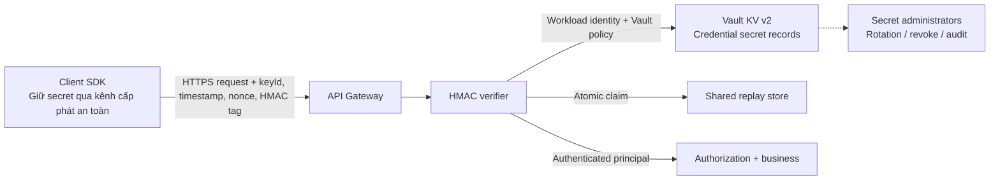
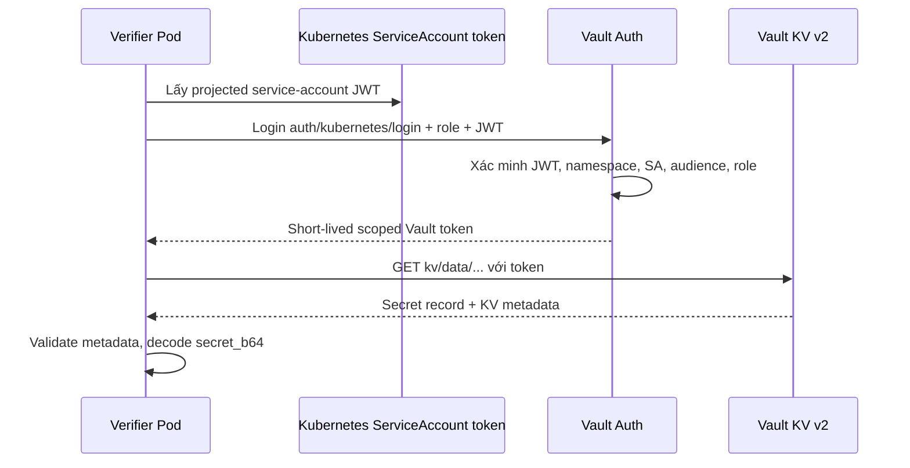
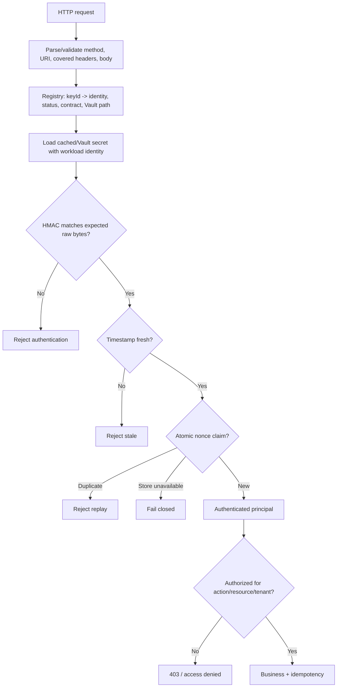
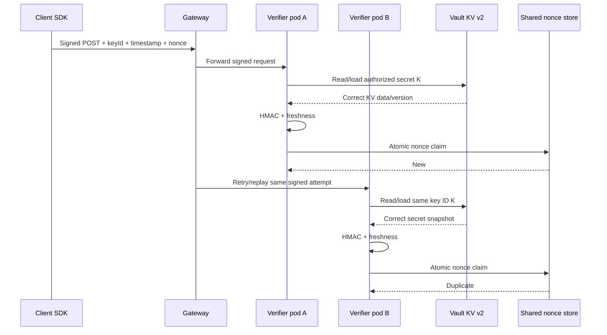

# Vault secret: quản lý shared secret HMAC an toàn bằng HashiCorp Vault

> **Chương:** Secret management  
> **Bài học:** Vault secret  
> **Module:** `SECURITY_AUTHENTICATION_HMAC_REQUEST_AUTHENTICATION` — thiết kế xác thực HTTP request bằng HMAC với shared secret và canonical request bao gồm HTTP method, URI, signed headers và body theo hợp đồng. Tài liệu tập trung vào **lưu trữ, truy xuất, cấp quyền và luân chuyển HMAC shared secret trong HashiCorp Vault**, đồng thời kết nối cách dùng secret với xác minh chữ ký, timestamp/nonce, replay protection, proxy/gateway và phân biệt authentication với authorization.

## 1. Vấn đề cốt lõi: HMAC mạnh đến đâu nếu shared secret bị lộ?

HMAC-SHA256 dùng một **khóa bí mật chung** để tạo message authentication code (MAC). Khi client và verifier có cùng khóa, cả hai có thể tính:

\[
\mathrm{tag}=\operatorname{HMAC\!-\!SHA256}(K,\mathrm{bytesToSign})
\]

Nếu attacker đọc được `K`, attacker có thể tạo **request mới** với timestamp và nonce mới, dựng canonical request hợp lệ rồi ký như client thật. Khi đó:

- Thuật toán HMAC vẫn hoạt động đúng về toán học.
- Timestamp/nonce không thể phân biệt người sở hữu credential thật với kẻ đã đánh cắp credential.
- Replay database chỉ chặn **lặp một nonce cũ**, không chặn người biết secret tạo nonce khác.
- TLS bảo vệ request khi truyền trên mạng, nhưng không tự bảo vệ secret nằm trong source code, CI log, container image hoặc backup.

**Do đó, bí mật khóa là một phần không thể tách rời của HMAC authentication.** Một Vault secret manager giải quyết bài toán nơi server lưu, truy xuất, phân phối và xoay vòng khóa; nó **không tự thay thế** HMAC verification, timestamp freshness, nonce uniqueness hoặc authorization.

### Mục tiêu sau bài học

Người học có thể:

1. Giải thích khi nào dùng **HashiCorp Vault KV v2** để lưu một HMAC shared secret.
2. Phân biệt Vault token, Vault secret, KV **record version** và HMAC **credential/key version**.
3. Thiết kế sơ đồ đường dẫn, metadata, quyền đọc và danh tính workload.
4. Tránh hardcode secret trong code, environment/CLI/logs, image hoặc test fixtures.
5. Truy xuất đúng **byte[] secret** và dùng `javax.crypto.Mac` an toàn trong Java 17+.
6. Chọn hành vi cache/reload khi Vault unavailable và cách fail closed.
7. Triển khai rotation, overlap, `VERIFY_ONLY`, revoke, audit và rollback có kiểm soát.
8. Thiết kế test cho wrong-key, stale credential, proxy/gateway, replay và quyền truy cập.
9. Phân biệt **lấy secret từ Vault** với **xác thực request bằng HMAC** và **phân quyền nghiệp vụ**.

## 2. Vault là gì trong mô hình HTTP HMAC?

Trong ví dụ, **HashiCorp Vault** là một hệ thống quản lý secrets với cơ chế xác thực workload, policy truy cập, audit và các secrets engines. Một cách dùng đơn giản là cất **shared key của từng client** trong **KV v2 secrets engine**.



Luồng điển hình:

1. Tổ chức tạo credential riêng cho client/principal, gồm **key ID công khai** và **secret byte[] ngẫu nhiên**.
2. Secret phía verifier được lưu trong Vault, truy cập chỉ qua danh tính workload/service.
3. Client nhận secret qua **quy trình cấp credential bảo mật riêng**. Vault nội bộ của server **không tự động cung cấp secret cho client bên ngoài**.
4. Client hoàn thiện method/URI/headers/body, sinh timestamp/nonce và tính HMAC.
5. Verifier tra key ID trong registry đáng tin; lấy đúng secret (từ Vault hoặc cache theo policy), dựng lại canonical request và so tag.
6. Sau HMAC đúng, verifier kiểm timestamp, claim nonce nguyên tử và gán principal đã xác thực.
7. Business handler **vẫn phải kiểm authorization** với principal/action/resource.

**Phân biệt nơi lưu và giao thức:** Vault không quy định ký path hay query theo cách nào; tất cả canonicalization và wire-format nằm trong **HMAC signing contract của API**.

## 3. Những từ khóa dễ nhầm: secret, token, key ID, version, lease

| Thuật ngữ | Ý nghĩa | Điều không nên suy diễn |
| --- | --- | --- |
| **HMAC shared secret** | Bytes bí mật `K` để client và server ký/kiểm tag. | Không phải Vault token. |
| **Key ID / credential ID** | Ví dụ `merchant-a-k2`, dùng tra khóa và principal. | Không phải secret; biết key ID không có quyền ký. |
| **Vault token** | Bằng chứng xác thực để **workload gọi Vault API**, mang policies và thời hạn. | Không gửi Vault token trong HTTP HMAC request của khách hàng. |
| **Vault auth method** | Kubernetes/JWT, AppRole hoặc phương pháp khác để lấy Vault token. | Không phải cách xác minh HMAC của API thanh toán. |
| **KV mount** | Ví dụ mount `kv/` của KV v2. | Khác `hmac/merchant-a/...` là đường dẫn secret. |
| **KV record version** | Số phiên bản do KV v2 quản lý khi cập nhật dữ liệu trên một path. | **Không** phải key version trong `X-Key-Id`; `version=7` của KV không có nghĩa client dùng `k7`. |
| **Credential state** | `ACTIVE`, `VERIFY_ONLY`, `REVOKED` theo registry/policy của API. | Không tự đồng nhất với KV `created_time` hoặc `deletion_time`. |
| **Vault token TTL/lease** | Thời hạn/khả năng renewal của token hoặc dynamic lease. | KV v2 static secret **không tự hết hạn theo token TTL**. |
| **Replay nonce TTL** | Giữ nonce đến khi signed timestamp không còn hợp lệ. | Hoàn toàn khác secret rotation và Vault token TTL. |

### Vault KV v2 có phải dynamic secret không?

**Không**, KV v2 là cơ chế lưu dữ liệu **được ghi sẵn và có phiên bản**. Nó không tự sinh một khóa HMAC mới cho mỗi lần read, không tự thu hồi secret đã cấp ra phía client và không cung cấp lease riêng cho mỗi lần đọc static secret theo cách nhiều dynamic secrets engines làm.

Nếu cần **lifecycle HMAC credential**, ứng dụng phải có quy trình tạo, cấp phát tới client, activate, rotate, retire/revoke và đồng bộ trạng thái verifier.

## 4. Chọn Vault KV v2 hay Transit?

| Phương án | Cách làm | Phù hợp khi nào | Điều cần cẩn thận |
| --- | --- | --- | --- |
| **KV v2 + HMAC trong Java** | Vault chứa shared key; verifier lấy **secret bytes** rồi dùng `Mac` trong JVM. | Cần tương thích với client bên ngoài có cùng shared secret và tự ký. | Secret đi ra khỏi Vault và hiện diện trong memory của workload; cần bảo vệ memory, file, cache và access. |
| **Vault Transit engine** | Một số thao tác mật mã có thể được yêu cầu thực hiện bởi Transit theo key/policy tương ứng. | Tổ chức muốn giảm việc xuất key material khỏi môi trường quản lý khóa và chấp nhận thêm RPC/latency theo thiết kế. | Không mặc nhiên thay thế được giao thức HMAC shared-secret với client bên ngoài; phải kiểm loại key, tính năng HMAC/verify và cách cấp key cho client. |
| **HSM/KMS qua giải pháp thích hợp** | Key handle hoặc ký/xác minh qua dịch vụ mật mã. | Có yêu cầu phần cứng, audit/segregation hoặc compliance đặc biệt. | Cần đảm bảo giao thức, throughput và khả năng shared-secret interoperability. |

**Bài này chọn KV v2** vì mục tiêu là thực hành **shared secret** được client và server cùng biết. Không được kết luận rằng “đưa secret vào Vault thì secret không bao giờ ra khỏi Vault”: với mô hình KV v2 + JCA, verifier phải tải khóa về bộ nhớ để kiểm HMAC.

## 5. Threat model cho Vault-backed HMAC authentication

### Tài sản cần bảo vệ

- HMAC secret hiện hành và secret đang trong rotation overlap.
- Vault token/workload authentication material.
- Credential registry: key ID → principal, tenant, status, signing version.
- Dữ liệu canonical request, timestamps/nonce, transaction và authorization decisions.
- Bản sao secret trong memory, agent template files, crash dumps, backups, CI/CD và logs.

### Các đường rò rỉ thường gặp

| Đường lộ | Ví dụ sai | Hậu quả | Kiểm soát chính |
| --- | --- | --- | --- |
| Source code / Git | `private static final String SECRET = "real-key";` | Secret lan tới repo/fork/PR history. | Không commit secret; pre-commit/secret scanning; revoke khi đã lộ. |
| Container image | `ENV HMAC_SECRET=...` trong Dockerfile. | Có thể lộ qua image config/layers/registry. | Inject lúc chạy, không bake trong image. |
| CI logs / terminal | Lệnh CLI in raw secret, `set -x`. | Operator/CI viewer đọc secret. | Tránh command-line arguments; kiểm log redaction, tránh echo. |
| HTTP log / error page | Log HMAC key bytes hoặc Vault response JSON. | Secret có thể bị truy hồi từ log. | Không log response chứa secrets; log metadata tối thiểu. |
| Environment variable | `HMAC_SECRET` tồn tại trong process env. | Dễ bị dump bởi debug tooling, diagnostic hoặc người có quyền host. | Ưu tiên workload identity + file/agent hoặc API; nếu buộc dùng env, giảm quyền và lifetime. |
| Shared filesystem | Agent template chứa secret nhưng permissions mở. | Pod/container khác đọc được. | File permissions, mount riêng, volume phù hợp, UID/GID và pod isolation. |
| Vault token quyền quá rộng | `root` token hoặc wildcard `kv/data/*`. | Đọc nhiều credentials ngoài scope. | Policy least privilege; short-lived token, namespaces/scope. |
| Credential alias / tenant confusion | Lookup key bằng tenant do caller tự khai. | Cross-tenant signer/verification confusion. | Stable registry identity và ràng buộc key ID với principal, environment. |
| Old secret vẫn hợp lệ vô hạn | Không revoke sau rotation. | Secret rò cũ vẫn ký request mới được. | Có thời hạn overlap, trạng thái key và emergency revoke. |

**Đừng nhầm:** Attacker chỉ biết `keyId`, nonce hoặc signature cũ **chưa** có shared secret. Nhưng kẻ **đọc được shared secret** có thể tạo tag hợp lệ, vì vậy scope/rotation/revoke quan trọng ngang cách tính HMAC.

## 6. Tạo HMAC secret đúng cách

### 6.1. Độ ngẫu nhiên và entropy

Một lựa chọn hợp lý cho HmacSHA256 là **32 byte sinh ngẫu nhiên bằng CSPRNG**, tương đương 256 bit entropy nếu nguồn ngẫu nhiên tốt. `HmacSHA256` có thể dùng các độ dài khóa khác, nhưng một contract phải đặt policy **tối thiểu** rõ; không nên dùng mật khẩu hoặc string con người tự nghĩ ra.

Java 17:

```java
import java.security.SecureRandom;
import java.util.Base64;

SecureRandom random = new SecureRandom();
byte[] secret = new byte[32];
random.nextBytes(secret);

// Chỉ minh họa chuyển đổi; KHÔNG print hay log secretEncoded.
// Lưu Base64 string vào Vault qua kênh provisioning đã bảo vệ.
String secretEncoded = Base64.getEncoder().encodeToString(secret);
```

**Không** dùng:

```java
byte[] badKey = "merchant-123-secret".getBytes(StandardCharsets.UTF_8);
byte[] badKey2 = String.valueOf(System.currentTimeMillis())
        .getBytes(StandardCharsets.UTF_8);
```

Các chuỗi như trên có entropy thấp/dễ suy đoán. Khi sinh secret trong môi trường thật, provisioning job phải có quyền rất hẹp, đường truyền mã hóa và quy trình cấp credential cho client riêng.

### 6.2. Thống nhất **bytes**, không chỉ chuỗi

Giả sử Vault chứa:

```json
{
  "secret_b64": "<BASE64_STANDARD_OF_32_RANDOM_BYTES>"
}
```

**Đúng:**

```java
byte[] secretBytes = Base64.getDecoder().decode(secretBase64);
mac.init(new SecretKeySpec(secretBytes, "HmacSHA256"));
```

**Sai:**

```java
byte[] wrong = secretBase64.getBytes(StandardCharsets.UTF_8);
mac.init(new SecretKeySpec(wrong, "HmacSHA256"));
```

Sai ở đây là dùng **các ký tự Base64** làm key thay vì decode về 32 byte gốc. Client và verifier sẽ tính hai HMAC khác nhau dù tưởng cùng “secret”.

### 6.3. Có nên log/print Base64 secret?

**Không.** Base64 chỉ là **encoding**, không phải encryption hay hash. Ai có chuỗi Base64 có thể decode lấy secret nguyên vẹn. Trong tài liệu, mọi secret “thật” phải được thay bằng placeholder hoặc **public test key** không dùng ngoài môi trường kiểm thử.

## 7. Thiết kế đường dẫn KV v2 và metadata

Giả sử mount KV v2 tên `kv` và tổ chức có môi trường `prod`, service `payments`, credential `merchant-a-k2`.

Một bố cục dễ phân quyền:

```text
KV mount: kv/

Secret logical path:
  services/prod/payments/hmac/merchant-a-k2

HTTP API read path for KV v2:
  /v1/kv/data/services/prod/payments/hmac/merchant-a-k2

HTTP API metadata path:
  /v1/kv/metadata/services/prod/payments/hmac/merchant-a-k2
```

**Không nhầm `data/` với một phần tên credential.** Đây là đoạn đường dẫn API của **KV v2**. Nếu mount tên `secret` thay vì `kv`, thay đúng mount trong API/policy. KV v1 có đường dẫn/response khác; đừng copy KV v2 code vào v1.

### 7.1. Một record Vault minh họa

Giá trị logic được lưu ở path `services/prod/payments/hmac/merchant-a-k2`:

```json
{
  "credential_id": "merchant-a-k2",
  "principal_id": "merchant-A",
  "tenant_id": "merchant-a",
  "algorithm": "HmacSHA256",
  "signing_contract": "HMAC-REQUEST-V1",
  "secret_b64": "<BASE64_STANDARD_OF_32_RANDOM_BYTES>",
  "state": "ACTIVE",
  "created_by": "credential-provisioner"
}
```

**Không** coi `principal_id` hay `state` do client đưa lên là nguồn tin cậy; chúng phải đến từ **registry/secret record có quyền ghi được kiểm soát**.

Có thể tách:

- **Credential registry** (DB hoặc control plane): key ID → stable credential ID, principal/tenant, state, contract version, path tham chiếu.
- **Vault KV**: key material + metadata tối thiểu để so cross-check.

Tách này cho phép cập nhật `REVOKED` ngay tại registry mà không bắt mỗi request phải gọi Vault. Đổi lại cần xử lý **tính nhất quán** và phân phối revoke state giữa các verifier.

### 7.2. Payload của Vault KV v2 có hai lớp `data`

Một read response được giản lược:

```json
{
  "data": {
    "data": {
      "credential_id": "merchant-a-k2",
      "secret_b64": "<BASE64_STANDARD_OF_32_RANDOM_BYTES>",
      "state": "ACTIVE",
      "algorithm": "HmacSHA256"
    },
    "metadata": {
      "version": 4,
      "created_time": "<RFC3339_TIMESTAMP>",
      "deletion_time": "",
      "destroyed": false
    }
  }
}
```

Ứng dụng đọc secret ở **`root.data.data.secret_b64`**. KV version ở **`root.data.metadata.version`**.

**Đặc biệt quan trọng:** KV `version=4` **không có nghĩa** HMAC client đang dùng `merchant-a-k4`. Nếu bạn ghi đè secret mới tại cùng path của k2, phiên bản KV tăng lên, nhưng client k2 có thể vẫn đang dùng secret cũ. Để rotation an toàn, cách đơn giản là **tạo path và key ID mới** cho k3, sau đó overlap và revoke k2; không thay secret âm thầm sau key ID cũ.

### 7.3. KV version, delete và destroy

KV v2 có khái niệm version của bản ghi, soft delete/undelete và destroy theo API. Một version cũ có thể tồn tại theo retention của engine, nhưng:

- **“Có version trong Vault” không đồng nghĩa credential được chấp nhận để ký HMAC.**
- Verifier không nên tự thử các KV versions cũ để tìm một tag khớp.
- Xóa/destroy một version ảnh hưởng khả năng recovery/forensics; cần quy trình riêng, không làm tuỳ tiện.
- Việc xóa secret khỏi Vault **không xóa bản sao** đã cấp cho client hoặc đã cache trong JVM; muốn vô hiệu hóa khả năng ký phải thực thi credential **REVOKED** trong verifier policy.

## 8. Vault ACL: dùng least privilege theo workload

Service verifier chỉ cần **đọc đúng secrets** thuộc service/environment của nó. Nó không cần quyền tạo, sửa, xóa hoặc liệt kê toàn mount.

Ví dụ HCL policy minh họa:

```hcl
# Vault KV v2 mount: kv
# Phân quyền đọc một credential cụ thể.
path "kv/data/services/prod/payments/hmac/merchant-a-k2" {
  capabilities = ["read"]
}
```

Một policy có thể cho phép nhiều credentials của service, nhưng phải suy xét blast radius:

```hcl
# Rộng hơn ví dụ 1-key: phù hợp CHỈ khi service
# thực sự phải verify tất cả credentials trong path này.
path "kv/data/services/prod/payments/hmac/*" {
  capabilities = ["read"]
}
```

**Tránh**:

```hcl
path "kv/*" {
  capabilities = ["create", "read", "update", "delete", "list", "sudo"]
}
```

Một backend verifier bị xâm nhập với wildcard toàn bộ mount có thể đọc secrets của những services/tenants khác. **Mức least privilege thực tế** phụ thuộc mô hình multi-tenant và số credentials; có thể chọn Vault namespace/mount riêng, service-specific roles hoặc cách chia secrets không để workload đọc xuyên tenant.

### 8.1. `data/` và `metadata/` có policy khác nhau

Trong KV v2:

- Đọc **giá trị secret** qua path `kv/data/<logical-path>` cần `read` ở path đó.
- List/version/metadata operations dùng path `kv/metadata/<logical-path>` và permissions khác tùy thao tác.
- Không cấp `list` trên metadata chỉ để code đọc secret nếu không cần.
- Quyền operator/credential provisioner để `create/update` nên được tách khỏi quyền **read-only** của verifier.

### 8.2. Vault token không phải một secret HMAC của khách hàng

Service có thể nhận **Vault token** thông qua workload identity. Token đó dùng để xác thực tới **Vault**. Không bao giờ:

- Gửi `X-Vault-Token` hoặc token nội bộ tới client HTTP HMAC.
- Lấy Vault token làm HMAC key cho khách hàng.
- Lưu root token vào Docker image, `application.yml` hoặc source code.
- Gửi token trong URL/query hoặc ghi vào access log.

Token phải có **policy tối thiểu, thời hạn giới hạn và cơ chế renewal/re-authentication**. Nếu token hết hạn, ứng dụng phải xử lý rõ trạng thái Vault access; không tự bypass HMAC verification.

## 9. Xác thực workload vào Vault: Kubernetes, AppRole và Agent

### 9.1. Kubernetes auth: gắn policy với ServiceAccount

Trong Kubernetes, một workload có thể dùng **service account JWT phù hợp cấu hình** để thực hiện Vault Kubernetes auth, đổi lấy Vault token được bound với role/policies.



Cấu hình role thường ràng buộc **service account name**, **namespace**, policies, audiences và TTL theo môi trường/phiên bản Vault. Không tạo role cho mọi service account toàn cluster và không dùng service account token của Pod A ở môi trường B.

Vault có thể hỗ trợ những auth methods khác như JWT/OIDC, cloud IAM, cert hoặc AppRole. Chọn phương pháp tin cậy với identity platform; tránh bootstrap bằng long-lived token trong config.

### 9.2. AppRole: bootstrap có kiểm soát

AppRole sử dụng `role_id` và `secret_id` để login. `role_id` không nên coi là toàn bộ credential; `secret_id` là thông tin nhạy cảm.

Thực hành an toàn:

- Gắn quyền tạo/lấy secret ID với provisioner đáng tin, không phát tán qua source/config.
- Cân nhắc `response wrapping` khi chuyển secret ID theo workflow phù hợp.
- Thiết lập lifetime/usage limits, token policies và rotation/revoke.
- Không lưu `secret_id` lâu dài vào log hoặc môi trường mở.

**Không hardcode role_id + secret_id cùng trong source**: làm vậy chỉ chuyển vị trí credential từ HMAC secret sang Vault bootstrap secret.

### 9.3. Vault Agent / Injector: giảm logic auth trong Java

Một cách triển khai là Vault Agent auto-auth và render template ra file trong volume chỉ service được đọc. Verifier lấy secret từ file đó, giảm việc tự quản Vault token/renewal trong Java.

Nhưng cần xem xét:

- File chứa plaintext secret, không có nghĩa an toàn chỉ vì do Agent tạo.
- Dùng volume/mount phù hợp (ưu tiên ephemeral khi có thể), UID/GID/permissions và workload isolation.
- Khi Agent cập nhật file, **JVM phải có cơ chế reload**; không giả định secret tự đổi trong một `byte[]` đã cache.
- Đọc atomically (tránh nửa file khi template được ghi), validate dữ liệu và version trước khi publish.
- Không log rendered template hoặc đưa file vào backup/container artifact.
- Nếu Agent bị lỗi hoặc file stale, có policy rõ: dùng cache còn hợp lệ hay **fail closed**.

### 9.4. Direct Vault API hay Agent?

| Tiêu chí | Java trực tiếp gọi Vault HTTPS API | Vault Agent / sidecar |
| --- | --- | --- |
| Bootstrap Vault auth | Code/client xử lý token hoặc tích hợp identity. | Agent thường thực hiện auto-auth/renewal. |
| Nơi secret xuất hiện | HTTP response và JVM memory. | Rendered file/proxy và JVM memory. |
| Network/latency | Cần cache, timeout, client pooling; không gọi remote Vault mỗi verification nếu không cần. | Agent có thể hỗ trợ local template/cache; vẫn cần reload. |
| Token exposure | App giữ Vault token nếu direct read. | Có thể giảm token handling trong app, phụ thuộc cấu hình Agent. |
| Rotation | App refresh/reload theo policy. | Template update + app reload/hot swap. |
| Availability | Vault outage ảnh hưởng refresh/load. | Agent/volume/refresh cũng có failure modes. |
| Blast radius | Scope theo service identity/policy. | Tương tự, cần protect sidecar/token/cache volume. |

Không có lựa chọn nào **miễn rotation, authz hoặc replay check**.

## 10. Thiết kế credential registry và secret lookup

Verifier không được lấy **bất kỳ path Vault** nào từ một HTTP header không tin cậy:

```http
X-Key-Id: ../../other-team/prod/root
```

Nếu code làm:

```text
vaultPath = "kv/data/" + request.header("X-Key-Id")
```

thì caller có thể thao túng đường dẫn; đồng thời path traversal, percent-encoding và lookup liên tenant trở nên khó kiểm chứng. Dù Vault ACL vẫn là lớp phòng vệ, **không để request tự chọn secret path**.

### Mô hình an toàn hơn

```text
HTTP request keyId
    ↓ strict grammar / length check
Trusted credential registry lookup
    → stableCredentialId
    → principalId / tenantId
    → lifecycle state
    → signingVersion / algorithm
    → allowed Vault path (configured, not raw user input)
    ↓
Vault access through least-privilege service identity
    ↓
Validate returned record belongs to expected credential
    ↓
Decode exactly 32 bytes HMAC key
```

Ví dụ registry:

| keyId do client gửi | stableCredentialId | principal | state | Vault logical path |
| --- | --- | --- | --- | --- |
| `merchant-a-k1` | `cred-A-1` | `merchant-A` | `VERIFY_ONLY` | `services/prod/payments/hmac/merchant-a-k1` |
| `merchant-a-k2` | `cred-A-2` | `merchant-A` | `ACTIVE` | `services/prod/payments/hmac/merchant-a-k2` |
| `merchant-b-k1` | `cred-B-1` | `merchant-B` | `REVOKED` | `services/prod/payments/hmac/merchant-b-k1` |

**Không dựa vào `keyId` để tự khẳng định principal trước HMAC.** Registry xác định danh tính dự kiến; sau khi HMAC tag khớp với secret và credential state hợp lệ mới coi principal được xác thực.

### Có cần đọc metadata mỗi request?

Không nhất thiết. Truy cập Vault trên mọi request có thể tăng latency, tải và phụ thuộc availability. Thiết kế thường dùng **immutable credential snapshots được nạp/cache có hạn**, nhưng phải có cơ chế đẩy/refresh trạng thái **REVOKED** đủ nhanh theo threat model.

**Nếu secret đã bị revoke nhưng cache vẫn cho dùng tới khi hết TTL**, đó là một khoảng rủi ro bảo mật phải được đo và chấp thuận hoặc loại bỏ bằng control plane/revocation mechanism phù hợp.

## 11. Vault KV v2 HTTP API: phản hồi, version và lỗi

### Đường dẫn read

```text
GET https://vault.internal.example/v1/kv/data/services/prod/payments/hmac/merchant-a-k2
X-Vault-Token: <SHORT_LIVED_WORKLOAD_TOKEN>
Accept: application/json
```

Ví dụ này **chỉ mô tả cấu trúc request nội bộ**, không phải gọi API ở môi trường thật; `vault.internal.example` và token là placeholders. Vault API giao tiếp qua TLS và phải xác minh certificate/hostname đúng. Không gửi token tới hostname khác hoặc qua redirect.

Đối với KV v2:

- `data.data`: payload do application lưu.
- `data.metadata.version`: KV version metadata của payload đọc được.
- Path `metadata/` là API riêng để quản lý/list metadata.
- Token renew/expiry là lifecycle khác với secret rotation.

### Các lỗi cần phân loại

| Kết quả truy xuất | Ý nghĩa có thể xảy ra | Hành vi an toàn |
| --- | --- | --- |
| `200` đúng schema | Record tồn tại và đọc được. | Validate mọi field, provenance, state, decode secret. |
| `403` | Workload token thiếu policy hoặc auth không hợp lệ. | Không fallback sang root token; alert cấu hình, fail closed nếu không có cache được phép. |
| `404` | Path/version không tồn tại, đã delete hoặc lookup sai. | Không thử wildcard secret khác; treat credential unavailable/not found theo policy. |
| `429` / rate limiting | Vault đang từ chối/quá tải. | Backoff/circuit-breaker; không bypass xác thực. |
| `5xx`, connection failure, TLS failure | Vault không khả dụng hoặc kết nối không tin cậy. | Fail closed nếu không có cached credential hợp lệ được policy cho phép. |
| JSON sai hoặc thiếu `data.data.secret_b64` | Không tương thích schema, dữ liệu hỏng. | Fail closed, không chấp nhận placeholder/empty secret. |
| KV version bị thay ngoài quy trình | Có thể overwrite/rollback ngoài ý muốn. | Alert; không âm thầm nhận secret mới dưới key ID cũ. |
| KV record state khác registry | Registry/cache không nhất quán hoặc thao túng record. | Reject/alert cho tới khi xác định trạng thái đáng tin. |

**Không** log raw Vault response body khi xử lý lỗi; response có thể chứa secret nếu code debug nhầm.

## 12. Ví dụ Java 17+ đọc Vault KV v2 qua HTTPS

JDK 17 có `java.net.http.HttpClient` nhưng **không tích hợp JSON parser chuẩn**. Để đọc Vault response đúng, ví dụ sau dùng Jackson `com.fasterxml.jackson.databind.ObjectMapper` **(phụ thuộc ngoài JDK, được nêu rõ)**. Đoạn code này là *integration sketch*, cần thêm Jackson dependency, vault config, workload token và test với Vault thật. Phần demo runnable JDK-only ở mục 16 không phụ thuộc Jackson.

### 12.1. Adapter không dựng path từ giá trị raw của client

```java
import com.fasterxml.jackson.databind.JsonNode;
import com.fasterxml.jackson.databind.ObjectMapper;
import java.io.IOException;
import java.net.URI;
import java.net.http.HttpClient;
import java.net.http.HttpRequest;
import java.net.http.HttpResponse;
import java.time.Duration;
import java.util.Base64;
import java.util.Objects;

public final class VaultKvV2Reader {
    private final HttpClient http;
    private final URI vaultBase;
    private final ObjectMapper json;
    private final VaultTokenSupplier tokenSupplier;

    public interface VaultTokenSupplier {
        String currentToken(); // Token do workload auth/Agent cung cấp.
    }

    public VaultKvV2Reader(
            URI vaultBase,
            VaultTokenSupplier tokenSupplier) {
        Objects.requireNonNull(vaultBase);
        if (!"https".equalsIgnoreCase(vaultBase.getScheme())
                || vaultBase.getHost() == null
                || vaultBase.getUserInfo() != null
                || vaultBase.getQuery() != null
                || vaultBase.getFragment() != null
                || !("/".equals(vaultBase.getPath())
                     || vaultBase.getPath().isEmpty())) {
            throw new IllegalArgumentException(
                    "Expected trusted HTTPS Vault origin");
        }
        this.vaultBase = vaultBase;
        this.tokenSupplier =
                Objects.requireNonNull(tokenSupplier);
        this.json = new ObjectMapper();
        this.http = HttpClient.newBuilder()
                .connectTimeout(Duration.ofSeconds(2))
                .followRedirects(HttpClient.Redirect.NEVER)
                .build();
    }

    // logicalPath đến từ registry cấu hình TIN CẬY.
    // Client keyId chỉ được dùng tra registry, KHÔNG làm URL.
    public byte[] readKeyBytes(
            String logicalPath, String expectedCredentialId)
            throws IOException, InterruptedException {
        if (logicalPath == null
                || !logicalPath.matches(
                    "services/prod/payments/hmac/"
                    + "[A-Za-z0-9._-]{1,64}")
                || expectedCredentialId == null
                || !expectedCredentialId.matches(
                    "[A-Za-z0-9._-]{1,64}")) {
            throw new IllegalArgumentException("Invalid registry path");
        }

        URI target = vaultBase.resolve(
                "/v1/kv/data/" + logicalPath);
        String token = tokenSupplier.currentToken();
        if (token == null || token.isBlank()) {
            throw new IOException("Vault workload token missing");
        }

        HttpRequest request = HttpRequest.newBuilder(target)
                .timeout(Duration.ofSeconds(3))
                .header("X-Vault-Token", token)
                .header("Accept", "application/json")
                .GET()
                .build();

        // Do not log request headers or response body.
        HttpResponse<String> response = http.send(
                request, HttpResponse.BodyHandlers.ofString());

        if (response.statusCode() != 200) {
            // Do not include body; it may contain sensitive content.
            throw new IOException(
                    "Vault read failed; HTTP " + response.statusCode());
        }

        JsonNode payload = json.readTree(response.body());
        JsonNode record = payload.path("data").path("data");
        String credentialId =
                record.path("credential_id").asText("");
        String encoding = record.path("secret_b64").asText("");
        String algorithm =
                record.path("algorithm").asText("");
        if (!expectedCredentialId.equals(credentialId)
                || !"HmacSHA256".equals(algorithm)
                || !encoding.matches("[A-Za-z0-9+/]{43}=")) {
            throw new IOException("Vault secret schema mismatch");
        }

        try {
            byte[] key = Base64.getDecoder().decode(encoding);
            if (key.length != 32
                    || !Base64.getEncoder()
                        .encodeToString(key).equals(encoding)) {
                throw new IOException("Invalid key encoding");
            }
            return key;
        } catch (IllegalArgumentException invalidBase64) {
            throw new IOException("Invalid key encoding",
                    invalidBase64);
        }
    }
}
```

**Giải thích các giới hạn an toàn của đoạn code:**

- Cấu hình `vaultBase` phải lấy từ nguồn được phê duyệt, không cho Internet caller kiểm soát. Không tự tắt TLS certificate/hostname checks, không follow redirect có thể mang token sang nơi khác.
- `tokenSupplier` là abstraction; **không** thực hiện Kubernetes/AppRole login trực tiếp bằng secret hardcode. Khi chạy thật có thể sử dụng Vault Agent/client library/workload auth được cấu hình phù hợp.
- Đường dẫn `logicalPath` đến từ **trusted registry**, regex chỉ là lớp phòng vệ. Mã cố ý khóa service path cho ví dụ, không giải quyết Vault namespaces/mount khác.
- Jackson `ObjectMapper` nằm ngoài JDK; phải đưa dependency và quản lý cập nhật bảo mật phù hợp. Mã **không chạy chỉ với `javac` không có Jackson**.
- `HttpResponse.BodyHandlers.ofString()` và JSON tree tạm tạo `String` chứa encoded secret: Java không bảo đảm xóa sạch nó khỏi bộ nhớ. Không nên lưu response body lâu; cân nhắc secret material handling, heap dumps và threat model.
- `secret_b64` là **Base64 chuẩn có padding** cho đúng 32 key bytes, nên grammar ví dụ là **43 ký tự alphabet + một `=`**, tổng 44. Không tự nhận raw text, Base64URL hoặc hex nếu không có contract/version khác.
- Snippet chưa triển khai retry/backoff, Vault namespace header, metrics, tracing redaction, circuit breaker, caching, version pinning và schema tất cả metadata. Các tính năng này cần bổ sung trong production.
- **Không gọi Vault trên mỗi request nếu latency/availability không phù hợp.** Có thể dùng immutable cache với chính sách expiry/rotation/revoke rõ ràng như mục sau.

### 12.2. Vì sao không trả `String` thay vì `byte[]`?

`javax.crypto.Mac` nhận key bytes. Chuỗi Base64 chỉ là representation khi lưu. Trả `byte[]` tách rõ byte-level contract và tránh việc caller tự lặp lại sai lầm `getBytes(UTF_8)` trên encoded secret.

Dù `byte[]` có thể overwrite, Java/JCA/JIT/GC vẫn có thể tạo bản copy tạm; **đừng hứa xóa sạch bí mật khỏi memory**. Giảm lifetime, tránh copy không cần, bảo vệ heap dumps và quyền debug.

## 13. Cache và reload: an toàn quan trọng hơn tiết kiệm một lần gọi Vault

Nên tránh request path:

```text
Mỗi HTTP request từ Internet
    → login Vault
    → GET KV secret
    → HMAC verify
```

Cách này tăng latency, vault load và độ phụ thuộc mạng. Nhưng cache không có thiết kế cũng nguy hiểm, vì **revoke/rotation có thể không có hiệu lực ngay**.

### 13.1. Một immutable snapshot có lifecycle rõ

Một cached entry có thể chứa:

```text
credentialId
keyId
principalId / tenantId
algorithm = HmacSHA256
signingContract = HMAC-REQUEST-V1
state = ACTIVE | VERIFY_ONLY | REVOKED
secretBytes (guarded in memory)
vaultKvVersion
loadedAt
refreshDeadline
hardExpiry
registryRevision
```

**Nguyên tắc:**

- Snapshot vừa load phải validate schema, key length, credential binding, state và policy.
- Khi refresh thành công, **atomic swap** một snapshot mới; không cho threads nhìn dữ liệu nửa cũ nửa mới.
- `hardExpiry` là deadline theo policy để ngừng sử dụng credential cache stale, không tự suy từ token TTL của Vault.
- Nếu Vault tạm unavailable, chỉ được dùng cache khi **còn trong giới hạn cache hợp lệ đã thỏa thuận**, và vẫn phải kiểm credential revocation/status từ nguồn đáng tin theo policy.
- Nếu cache đã expired hoặc credential revoked không thể xác định an toàn, **fail closed**, không tự chấp nhận signature vì Vault lỗi.
- Không giữ secret của key revoked như một candidate để thử HMAC ngầm.
- Cần có cách invalidation/rollout nhanh cho **emergency revoke**; nếu invalidate không thể đảm bảo, phải giảm cửa sổ cache hoặc dừng xử lý bảo mật nhạy cảm.

### 13.2. Mẫu hành vi khi Vault unavailable

| Tình huống | Được phép làm gì? | Không được làm |
| --- | --- | --- |
| Cache còn hợp lệ, credential ACTIVE và revoke state đáng tin | Có thể verify bằng cached bytes theo policy. | Không ngầm kéo dài hardExpiry vô hạn. |
| Không có cache cho key ID | Trả lỗi xác thực/hạ tầng theo policy, **không accept**. | Không thử key khác, không ký bằng default key. |
| Cache quá hạn và Vault mất kết nối | Fail closed. | Không “tạm bỏ xác minh” hay fallback plaintext hardcoded. |
| Vault trả record bị đổi schema/credential ID | Reject/alert, giữ phiên bản cache nếu policy rõ cho phép và không vượt hardExpiry. | Không bỏ metadata validation. |
| Revoke khẩn | Từ chối key ngay theo registry/control plane có thẩm quyền; invalidate cache. | Không nhận HMAC bằng secret cũ chỉ vì cache còn. |
| JWT/token Vault hết hạn | Agent/identity refresh; bảo vệ token. | Không sử dụng root token khẩn cấp trong runtime. |

### 13.3. Throttling và chống cache stampede

Khi hàng nghìn requests cùng dùng key ID có cache miss:

- Dùng **single-flight** refresh cho cùng key, không tạo hàng nghìn Vault reads.
- Bounded cache theo số credentials, có rate limit cho unknown key IDs để tránh enum/path enumeration.
- **Negative cache** unknown key ID chỉ với TTL nhỏ và lý do rõ; không cache lỗi Vault 503 như “key không tồn tại”.
- Monitor hit/miss, stale age, loading latency, unexpected record changes và Vault 403/429/5xx.

## 14. Rotation: cấp key mới, overlap có giới hạn, revoke key cũ

Đổi mật khẩu trong Vault **không** phải rotation đầy đủ của một shared HMAC credential. Vì cả client và server cùng dùng secret, **hai bên phải phối hợp**.

### Ví dụ lifecycle

```text
T0: merchant-a-k1 ACTIVE
    Client ký bằng K1; verifier chấp nhận k1.

T1: provisioning tạo merchant-a-k2 với K2 ngẫu nhiên mới
    Vault lưu k2 ở path RIÊNG; registry gán principal merchant-A.
    Trạng thái k2 có thể PREPARED (chưa được verifier nhận).

T2: cấp K2 cho client qua kênh bảo mật, thử signing fixtures
    Verifier cho phép k2 verify theo chính sách rollout.

T3: client bắt đầu ký request mới bằng k2
    k2 = ACTIVE; k1 = VERIFY_ONLY (overlap giới hạn).

T4: kết thúc overlap đủ để request in-flight/drain + freshness
    k1 = REVOKED; mọi HMAC mới dùng k1 đều bị từ chối.

T5: dọn key material/metadata cũ theo retention/audit policy
    Không xóa trước khi chắc chắn không phá recovery/forensics.
```

Trong bảng sau, **`VERIFY_ONLY`** nghĩa là *server có thể verify request còn hợp lệ theo policy*, **không** nghĩa client nên tiếp tục dùng key đó để ký request mới.

| Trạng thái | Client nên ký mới? | Server có thể verify? | Điều kiện |
| --- | --- | --- | --- |
| `PREPARED` | Không | Không hoặc giới hạn canary theo policy. | Secret đã tạo, chưa activate. |
| `ACTIVE` | Có | Có | Key chưa hết hạn, principal/tenant và HMAC hợp lệ. |
| `VERIFY_ONLY` | Không | Có trong overlap đã định nghĩa. | Timestamp/nonce vẫn phải đúng; không bỏ replay. |
| `REVOKED` | Không | **Không** | Kể cả HMAC toán học vẫn khớp với secret cũ. |
| `DESTROYED` | Không | Không | Material không còn sẵn, nhưng dữ liệu đã cấp ra vẫn có thể nằm ở client/cache. |

### 14.1. Kịch bản rotate nhanh khi nghi secret đã lộ

**Không áp dụng overlap thông thường** khi có bằng chứng K1 bị đánh cắp. Phải cân nhắc:

1. Vô hiệu hóa K1 tại verifier policy ngay; đảm bảo invalidation tới mọi region/instance.
2. Tạo K2 mới bằng CSPRNG, không tái sử dụng K1.
3. Cấp K2 cho client qua quy trình được xác thực, theo dõi rollout.
4. Giữ logs/audit đã được phân quyền để điều tra, không in secret.
5. Kiểm request đã ký bằng K1 nhưng còn trong timestamp window theo chính sách incident; không chấp nhận chỉ vì `T` còn tươi.
6. Đánh giá khả năng ảnh hưởng nghiệp vụ, idempotency và replay không thể ngăn người đã biết K1 tạo request mới trước revoke.

### 14.2. Vault KV version vs HMAC key version

**Sai:** ghi đè `merchant-a-k1.secret_b64` bằng K2 rồi kỳ vọng cả hai client key version cùng dùng được nhờ Vault KV version history.

**Đúng hơn:** tách `merchant-a-k1` và `merchant-a-k2` thành credentials/path riêng, mỗi key ID chọn một secret cụ thể, hai trạng thái được điều khiển bằng registry. KV record version dùng để audit và phát hiện update ngoài quy trình, **không được verifier tự thử version 1..N**.

### 14.3. Dùng KV CAS để hạn chế ghi đè nhầm

KV v2 hỗ trợ ý tưởng **Check-And-Set (CAS)** cho write và tùy chọn yêu cầu CAS theo cấu hình. Provisioning/migration tool nên dùng API chính thức với điều kiện version kỳ vọng để tránh hai operator cùng overwrite một record. Đây là thao tác **quản trị**, không phải bước verify HMAC của HTTP request.

Tránh đưa secret thật vào lệnh `vault kv put ... secret_b64=<value>` trong terminal có thể lưu history/process arguments. Dùng đường provisioning bảo mật có kiểm soát và audit.

## 15. Vault và HMAC verification là hai chính sách khác nhau

Cần tách ít nhất **ba lớp**:



Vault access failure có thể ảnh hưởng việc **lấy khóa**. Nó không được chuyển thành “signature hợp lệ” hoặc một quyền business.

- **Vault authentication:** Workload xác thực với Vault để đọc secret.
- **Request authentication:** Client chứng minh biết shared secret bằng HMAC trên canonical request.
- **Request authorization:** Backend kiểm principal đã xác thực có quyền làm hành động trên tài nguyên.
- **Replay protection:** Timestamp và nonce chặn phát lại request đã ký.
- **Idempotency:** Một ý định POST có thể được retry với nonce mới mà không tạo nghiệp vụ trùng.

**Key ID không phải authorization token**. Một request dùng K2 đúng vẫn có thể bị 403 nếu principal merchant-A cố thao tác resource của merchant-B.

## 16. Java 17+ runnable demo: Vault-like credential provider và HMAC verifier

Phần này dùng **chỉ JDK 17**, không gọi Vault network thật. Nó mô phỏng một **Vault secret reader có kết quả versioned**, credential state, secret decoding, HMAC verification và replay protection. Mục đích là kiểm **hợp đồng giao tiếp giữa secret provider và verifier**; ở production thay `InMemoryVault` bằng `VaultKvV2Reader` hoặc Vault Agent integration với các bảo đảm đã bàn.

### 16.1. Contract minh họa `HMAC-VAULT-V1`

Request test:

```text
POST https://api.example.test/v1/payments?orderId=42
Content-Type: application/json
X-Key-Id: merchant-a-k2
X-Timestamp: 1767225600
X-Nonce: 87a3d56ea72d40af89f5b68cb3e831d4
Raw body: {"amount":100000}
```

Canonical request cố định cho fixture:

```text
POST
api.example.test
/v1/payments
orderId=42
content-type:application/json
x-key-id:merchant-a-k2
x-nonce:87a3d56ea72d40af89f5b68cb3e831d4
x-timestamp:1767225600
content-type;x-key-id;x-nonce;x-timestamp
<SHA256_RAW_BODY_BYTES_LOWER_HEX>
```

String-to-sign:

```text
UTF8("HMAC-SHA256/HMAC-VAULT-V1\n" + canonicalRequest)
```

Signature transport:

```text
v1=<Base64URLNoPadding(32-byte HMAC-SHA256 tag)>
```

Signed timestamp là Unix epoch seconds; freshness inclusive `P=F=300s`. Nonce 16 byte hex lowercase. **Verifier chỉ chấp nhận key ID do registry cho phép**, và sử dụng secret ở path đã được registry ánh xạ, không tự suy đường dẫn từ Internet input.

### 16.2. Chương trình

```java
import java.nio.charset.StandardCharsets;
import java.security.GeneralSecurityException;
import java.security.MessageDigest;
import java.time.Clock;
import java.time.Instant;
import java.time.ZoneOffset;
import java.util.Base64;
import java.util.HexFormat;
import java.util.Map;
import java.util.Objects;
import java.util.concurrent.ConcurrentHashMap;
import java.util.concurrent.atomic.AtomicBoolean;
import javax.crypto.Mac;
import javax.crypto.spec.SecretKeySpec;

public final class VaultSecretHmacDemo {
    private static final HexFormat HEX = HexFormat.of();
    private static final long PAST = 300;
    private static final long FUTURE = 300;
    private static final long NONCE_MARGIN = 60;
    private static final String PREFIX =
            "HMAC-SHA256/HMAC-VAULT-V1\n";
    private static final String SIGNED_HEADERS =
            "content-type;x-key-id;x-nonce;x-timestamp";

    private VaultSecretHmacDemo() {}

    enum State { ACTIVE, VERIFY_ONLY, REVOKED }
    enum Decision {
        ACCEPT, MALFORMED, UNAUTHENTICATED,
        STALE, REPLAY, UNAVAILABLE, FORBIDDEN
    }

    // Dữ liệu đã được control plane đáng tin quản lý.
    record RegistryEntry(
            String keyId, String principal, String vaultPath,
            State state) {}

    // Snapshot đọc từ Vault KV v2; kvVersion KHÔNG PHẢI keyId.
    record VaultRecord(
            String credentialId, String secretB64,
            String algorithm, int kvVersion) {}

    interface VaultReader {
        // null: logical path không tồn tại; exception: outage.
        VaultRecord read(String trustedPath);
    }

    static final class InMemoryVault implements VaultReader {
        private final ConcurrentHashMap<String, VaultRecord> records =
                new ConcurrentHashMap<>();
        volatile boolean unavailable;

        void put(String path, VaultRecord record) {
            records.put(path, record);
        }

        @Override
        public VaultRecord read(String trustedPath) {
            if (unavailable) {
                throw new IllegalStateException("Vault unavailable");
            }
            return records.get(trustedPath);
        }
    }

    interface NonceStore {
        boolean claim(String key, long expiresAt, long now);
    }

    // Atomic TRONG MỘT JVM, không durable/distributed/cleanup.
    static final class LocalNonceStore implements NonceStore {
        private final ConcurrentHashMap<String, Long> seen =
                new ConcurrentHashMap<>();

        @Override
        public boolean claim(
                String key, long expiresAt, long now) {
            if (expiresAt <= now) {
                throw new IllegalStateException("Invalid nonce expiry");
            }
            AtomicBoolean inserted = new AtomicBoolean(false);
            seen.compute(key, (ignored, oldExpiry) -> {
                if (oldExpiry == null || oldExpiry <= now) {
                    inserted.set(true);
                    return expiresAt;
                }
                return oldExpiry;
            });
            return inserted.get();
        }
    }

    record Request(
            String method, String keyId, String timestamp,
            String nonce, byte[] rawBody, String signature) {
        Request {
            Objects.requireNonNull(method);
            Objects.requireNonNull(keyId);
            Objects.requireNonNull(timestamp);
            Objects.requireNonNull(nonce);
            Objects.requireNonNull(rawBody);
            Objects.requireNonNull(signature);
            rawBody = rawBody.clone();
        }
        @Override
        public byte[] rawBody() {
            return rawBody.clone();
        }
    }

    private static void validate(Request r) {
        if (!"POST".equals(r.method())
                || !r.keyId().matches("[A-Za-z0-9._-]{1,64}")
                || !r.timestamp().matches("[1-9][0-9]{9,10}")
                || !r.nonce().matches("[0-9a-f]{32}")
                || r.rawBody().length > 64 * 1024) {
            throw new IllegalArgumentException(
                    "Invalid request contract");
        }
    }

    private static long seconds(String timestamp) {
        validateTimestamp(timestamp);
        return Long.parseLong(timestamp);
    }

    private static void validateTimestamp(String timestamp) {
        if (!timestamp.matches("[1-9][0-9]{9,10}")) {
            throw new IllegalArgumentException(
                    "Noncanonical epoch seconds");
        }
    }

    // Chính xác 32-byte Base64 chuẩn, padding 1 ký tự '='.
    private static byte[] decodeSecret(VaultRecord record) {
        if (!"HmacSHA256".equals(record.algorithm())
                || !record.secretB64()
                    .matches("[A-Za-z0-9+/]{43}=")
                || record.kvVersion() < 1) {
            throw new IllegalStateException(
                    "Invalid secret record");
        }
        byte[] key = Base64.getDecoder()
                .decode(record.secretB64());
        if (key.length != 32
                || !Base64.getEncoder().encodeToString(key)
                        .equals(record.secretB64())) {
            throw new IllegalStateException(
                    "Noncanonical key encoding");
        }
        return key;
    }

    private static String canonical(Request r)
            throws GeneralSecurityException {
        validate(r);
        byte[] hash = MessageDigest.getInstance("SHA-256")
                .digest(r.rawBody());
        return String.join("\n",
                "POST",
                "api.example.test",
                "/v1/payments",
                "orderId=42",
                "content-type:application/json",
                "x-key-id:" + r.keyId(),
                "x-nonce:" + r.nonce(),
                "x-timestamp:" + r.timestamp(),
                SIGNED_HEADERS,
                HEX.formatHex(hash));
    }

    private static byte[] tag(
            byte[] secret, Request request)
            throws GeneralSecurityException {
        Mac mac = Mac.getInstance("HmacSHA256");
        mac.init(new SecretKeySpec(secret, "HmacSHA256"));
        return mac.doFinal((PREFIX + canonical(request))
                .getBytes(StandardCharsets.UTF_8));
    }

    private static String encodeSignature(byte[] rawTag) {
        if (rawTag.length != 32) {
            throw new IllegalArgumentException("Unexpected tag length");
        }
        return "v1=" + Base64.getUrlEncoder()
                .withoutPadding().encodeToString(rawTag);
    }

    private static byte[] decodeSignature(String wire) {
        if (!wire.matches("v1=[A-Za-z0-9_-]{43}")) {
            throw new IllegalArgumentException(
                    "Noncanonical signature grammar");
        }
        String value = wire.substring(3);
        byte[] rawTag = Base64.getUrlDecoder().decode(value);
        if (rawTag.length != 32
                || !Base64.getUrlEncoder().withoutPadding()
                    .encodeToString(rawTag).equals(value)) {
            throw new IllegalArgumentException(
                    "Noncanonical signature encoding");
        }
        return rawTag;
    }

    // Client ký qua secret đã được cấp phát OOB.
    // Test dùng bytes fixture; client THẬT không lấy key từ
    // Vault nội bộ của verifier một cách tùy tiện.
    static Request sign(Request unsigned, byte[] clientSecret)
            throws GeneralSecurityException {
        return new Request(unsigned.method(), unsigned.keyId(),
                unsigned.timestamp(), unsigned.nonce(),
                unsigned.rawBody(),
                encodeSignature(tag(clientSecret, unsigned)));
    }

    static Decision verify(
            Request request,
            Map<String, RegistryEntry> registry,
            VaultReader vault, NonceStore replay,
            Clock clock, boolean authorized) {
        try {
            validate(request);
            RegistryEntry entry = registry.get(request.keyId());
            if (entry == null || entry.state() == State.REVOKED) {
                return Decision.UNAUTHENTICATED;
            }
            if (!entry.keyId().equals(request.keyId())
                    || !entry.vaultPath().matches(
                        "services/prod/payments/hmac/"
                        + "[A-Za-z0-9._-]{1,64}")) {
                return Decision.UNAUTHENTICATED;
            }

            // Reject malformed client signature before any Vault read.
            byte[] provided = decodeSignature(request.signature());
            VaultRecord material = vault.read(entry.vaultPath());
            if (material == null
                    || !material.credentialId()
                        .equals(entry.keyId())) {
                return Decision.UNAUTHENTICATED;
            }
            byte[] secret = decodeSecret(material);
            byte[] expected = tag(secret, request);
            if (!MessageDigest.isEqual(expected, provided)) {
                return Decision.UNAUTHENTICATED;
            }

            long signedAt = seconds(request.timestamp());
            long now = clock.instant().getEpochSecond();
            if (signedAt < now - PAST
                    || signedAt > now + FUTURE) {
                return Decision.STALE;
            }

            // Replay namespace theo credential đã được verify.
            String replayKey = entry.keyId() + ":" + request.nonce();
            long expiresAt = signedAt + PAST + NONCE_MARGIN;
            if (!replay.claim(replayKey, expiresAt, now)) {
                return Decision.REPLAY;
            }

            // Đã authenticated, vẫn phải kiểm authorization.
            if (!authorized) {
                return Decision.FORBIDDEN;
            }
            return Decision.ACCEPT;
        } catch (IllegalArgumentException malformed) {
            return Decision.MALFORMED;
        } catch (GeneralSecurityException cryptoFailure) {
            return Decision.UNAVAILABLE;
        } catch (RuntimeException outage) {
            return Decision.UNAVAILABLE; // Fail closed.
        }
    }

    private static Request unsigned(
            String keyId, String nonce, String timestamp,
            String body) {
        return new Request(
                "POST", keyId, timestamp, nonce,
                body.getBytes(StandardCharsets.UTF_8), "");
    }

    private static void expect(Decision actual, Decision wanted) {
        if (actual != wanted) {
            throw new AssertionError(
                    "Expected " + wanted + ", got " + actual);
        }
    }

    public static void main(String[] args) throws Exception {
        // Chỉ là PUBLIC TEST KEY, không dùng cho production.
        byte[] key1 = HEX.parseHex(
                "000102030405060708090a0b0c0d0e0f"
              + "101112131415161718191a1b1c1d1e1f");
        byte[] key2 = HEX.parseHex(
                "f0e0d0c0b0a090807060504030201000"
              + "ffeeddccbbaa99887766554433221100");

        InMemoryVault vault = new InMemoryVault();
        String path1 =
                "services/prod/payments/hmac/merchant-a-k1";
        String path2 =
                "services/prod/payments/hmac/merchant-a-k2";
        vault.put(path1, new VaultRecord(
                "merchant-a-k1",
                Base64.getEncoder().encodeToString(key1),
                "HmacSHA256", 7));
        vault.put(path2, new VaultRecord(
                "merchant-a-k2",
                Base64.getEncoder().encodeToString(key2),
                "HmacSHA256", 1));

        // k1 KV version 7 không liên quan k1 credential version;
        // k2 KV version 1 không liên quan k2 credential version.
        Map<String, RegistryEntry> registry = Map.of(
                "merchant-a-k1", new RegistryEntry(
                        "merchant-a-k1", "merchant-A", path1,
                        State.VERIFY_ONLY),
                "merchant-a-k2", new RegistryEntry(
                        "merchant-a-k2", "merchant-A", path2,
                        State.ACTIVE));

        Clock fixed = Clock.fixed(
                Instant.ofEpochSecond(1767225600L), ZoneOffset.UTC);
        String n1 = "aaaaaaaaaaaaaaaaaaaaaaaaaaaaaaaa";
        String n2 = "bbbbbbbbbbbbbbbbbbbbbbbbbbbbbbbb";

        Request k2Request = sign(
                unsigned("merchant-a-k2", n1, "1767225600",
                        "{\"amount\":100000}"), key2);
        LocalNonceStore sharedReplay = new LocalNonceStore();
        expect(verify(k2Request, registry, vault,
                sharedReplay, fixed, true), Decision.ACCEPT);
        expect(verify(k2Request, registry, vault,
                sharedReplay, fixed, true), Decision.REPLAY);

        // Đổi body mà giữ signature: HMAC mismatch.
        Request tamperedBody = new Request(
                k2Request.method(), k2Request.keyId(),
                k2Request.timestamp(), k2Request.nonce(),
                "{\"amount\":900000}".getBytes(StandardCharsets.UTF_8),
                k2Request.signature());
        expect(verify(tamperedBody, registry, vault,
                new LocalNonceStore(), fixed, true),
                Decision.UNAUTHENTICATED);

        // Dùng sai key1 để ký request tự khai keyId k2:
        // verifier chỉ chọn secret K2 qua registry.
        Request wrongKey = sign(
                unsigned("merchant-a-k2", n2, "1767225600",
                        "{\"amount\":100000}"), key1);
        expect(verify(wrongKey, registry, vault,
                new LocalNonceStore(), fixed, true),
                Decision.UNAUTHENTICATED);

        // Rotation: k1 VERIFY_ONLY vẫn có thể verify
        // request còn hạn trong overlap.
        Request k1Request = sign(
                unsigned("merchant-a-k1", n1, "1767225600",
                        "{}"), key1);
        expect(verify(k1Request, registry, vault,
                new LocalNonceStore(), fixed, true), Decision.ACCEPT);

        // K1 REVOKED: secret trong Vault vẫn còn,
        // nhưng verifier PHẢI từ chối.
        Map<String, RegistryEntry> afterRevoke = Map.of(
                "merchant-a-k1", new RegistryEntry(
                        "merchant-a-k1", "merchant-A", path1,
                        State.REVOKED),
                "merchant-a-k2", registry.get("merchant-a-k2"));
        expect(verify(k1Request, afterRevoke, vault,
                new LocalNonceStore(), fixed, true),
                Decision.UNAUTHENTICATED);

        // Timestamp stale với HMAC đúng.
        Request stale = sign(
                unsigned("merchant-a-k2", n2, "1767225299",
                        "{}"), key2);
        expect(verify(stale, registry, vault,
                new LocalNonceStore(), fixed, true),
                Decision.STALE);

        // Credential authenticated nhưng principal thiếu quyền.
        expect(verify(k2Request, registry, vault,
                new LocalNonceStore(), fixed, false),
                Decision.FORBIDDEN);

        // Vault unavailable: không accept request dù tag có thể đúng.
        vault.unavailable = true;
        expect(verify(k2Request, registry, vault,
                new LocalNonceStore(), fixed, true),
                Decision.UNAVAILABLE);
        vault.unavailable = false;

        // Record bị lỗi Base64/metadata: fail closed, không dùng key rỗng.
        vault.put(path2, new VaultRecord(
                "merchant-a-k2", "broken", "HmacSHA256", 2));
        expect(verify(k2Request, registry, vault,
                new LocalNonceStore(), fixed, true),
                Decision.UNAVAILABLE);

        System.out.println(
                "PASS: Vault-like HMAC secret / rotation / replay");
    }
}
```

Chạy trong môi trường **JDK 17+** với file đúng tên:

```bash
javac VaultSecretHmacDemo.java
java VaultSecretHmacDemo
```

Kết quả kỳ vọng nếu chạy thành công:

```text
PASS: Vault-like HMAC secret / rotation / replay
```

**Mức kiểm chứng:** Mã trên là minh họa để người học tự biên dịch/chạy, không khẳng định đã được chạy trên Vault cluster/Java runtime của hệ thống. `InMemoryVault` chỉ là fake provider có dữ liệu giống Vault KV v2, **không thực hiện Vault authentication, TLS hay KV HTTP read**.

### 16.3. Các giới hạn của demo

1. `VaultRecord` chỉ mô phỏng một phần KV response; không parse JSON thật, không check KV metadata deletion/destroyed/revisions.
2. `RegistryEntry.state` được giả định là dữ liệu đã được phân phối an toàn. Production cần invalidation/revoke nhanh và đồng bộ trạng thái theo trust model.
3. `LocalNonceStore` chỉ atomic một JVM, không có cleanup; production dùng shared atomic store có TTL `T+P+margin` và đảm bảo consistency phù hợp.
4. Endpoint/method/authority/path/query/Content-Type đều **được cố định trong canonical fixture**; production HTTP adapter phải verify đúng những giá trị thực nhận và reject duplicate signed headers trước khi gộp.
5. `Request` không mang raw HTTP fields; ví dụ không thay thế proxy/gateway integration test, UTF-8/body streaming hoặc full canonical URI implementation.
6. `boolean authorized` chỉ minh họa business authorization; không thay kiểm principal/action/tenant/resource.
7. Demo không có cache, key refresh, token renewal, audit log, secret zeroization guarantee hoặc secret provisioning workflow. Không dùng nguyên class này làm production HMAC server.
8. Test key public đã nêu **không bao giờ** được dùng cấp credential thật, và nonce/timestamp cố định chỉ để tái lập fixture.

## 17. Vì sao `VERIFY_ONLY` và KV version history không nên bị trộn?

Xét một lỗi thực tế:

```text
KV path: services/prod/payments/hmac/merchant-a-k1
KV v2 versions:
  version 6 -> old secret K1
  version 7 -> new secret K2

Client headers:
  X-Key-Id: merchant-a-k1

Server behavior sai:
  thử Vault version 7 trước, nếu HMAC fail thì thử version 6.
```

Lỗi này làm **mở rộng tập secrets được chấp nhận không có chính sách**, khó revoke và có thể dẫn đến downgrade. Cũng có thể làm client tiếp tục ký với K1 vô hạn vì server âm thầm fallback.

**Thiết kế đúng:** `keyId` xác định **một credential có state và một secret cụ thể**. Khi rotation, tạo key ID mới hoặc một mapping version rõ ràng, cập nhật signer/verifier theo plan. Vault record version dùng phục vụ audit/concurrency writes, không phải danh sách tất cả keys có thể thử.

### Khi phải rollback release

Rollback application code không đồng nghĩa được khôi phục key cũ đã **REVOKED**. Nếu rollback phần mềm làm code chỉ hiểu k1, phải có phương án cấp credential tương thích hoặc tạm dừng service; **không bật lại compromised secret** vì tiện vận hành.

## 18. Kiểm thử thực tế qua gateway và môi trường phân tán

Vault secret phải đúng ở mọi verifier instance, nhưng “đọc được Vault” chưa đủ để request được xác thực:



### Tình huống gateway có thể gây false HMAC mismatch

| Biến đổi | Hệ quả | Cách kiểm |
| --- | --- | --- |
| Gateway đổi `Host`/`:authority` hoặc route prefix | Client/server canonical request khác. | Verify ở điểm đã thỏa thuận hoặc dùng original target được bảo vệ. |
| Proxy normalize path/query trước verifier | HMAC khác hoặc backend diễn giải khác. | Canonicalize nhất quán, reject ambiguity. |
| Gateway đổi case header field names | HTTP names case-insensitive; value không nhất thiết vậy. | Normalize **names** theo contract, bảo toàn values. |
| Gateway xóa/mutates signed timestamp/nonce | Tag cũ không còn hợp lệ. | Không sửa covered metadata sau ký. |
| Proxy decompress/reserialize JSON | Body SHA-256 khác. | Ký/verify cùng representation đã quy định. |
| Gateway dùng key registry stale | Có thể accept revoked key hoặc reject key mới. | Phân phối revocation/change policy đồng bộ. |
| Gateway và service verify/claim cùng nonce | Double-claim làm request hợp lệ bị reject. | Một authoritative claim boundary/delegation tin cậy. |
| HTTP/1.1 → HTTP/2 | Header framing/case khác, semantic components phải thống nhất. | End-to-end golden tests. |

**Vault không “sửa” canonicalization.** Nó chỉ cung cấp secret bytes. Request thực thi phải đúng request đã được HMAC bảo vệ, không tin forwarded identity/URI do client tự gắn.

## 19. Fail-closed là chính sách vận hành, không phải một catch-all tùy tiện

Một API thanh toán có thể gặp:

```text
Vault GET timeout
Credential registry unavailable
Secret record malformed
Secret KV version unexpectedly changed
Nonce store unavailable
Clock skew exceeds freshness policy
Key marked REVOKED
```

Không tình huống nào ở trên cho phép:

```java
try {
    verifyHmac(request);
} catch (Exception ignored) {
    return ACCEPT; // NGUY HIỂM
}
```

Hành vi đúng phụ thuộc nguồn lỗi:

| Lỗi | Quyết định | HTTP response gợi ý |
| --- | --- | --- |
| Key ID unknown/REVOKED | Authentication denied. | 401 hoặc mã xác thực theo hợp đồng. |
| HMAC mismatch | Authentication denied. | 401 hoặc generic invalid signature. |
| Vault credential/token hết hạn nhưng có auth refresh thành công | Tiếp tục sau refresh an toàn. | Không có lỗi nếu hoàn thành theo budget. |
| Vault 403/5xx, cache không hợp lệ | Verification unavailable, fail closed. | 503 hoặc lỗi dịch vụ phù hợp. |
| Vault schema/secret Base64 sai | Configuration/credential corruption; fail closed. | 503/5xx nội bộ, không tiết lộ raw secret. |
| Timestamp stale / nonce reused | Reject request theo freshness/replay policy. | 4xx theo hợp đồng. |
| HMAC pass nhưng principal thiếu quyền | Authorization denied. | 403, không vì secret đúng mà mở quyền. |
| Idempotency store unavailable sau auth | Không tạo business side effect. | 503 hoặc lỗi phụ thuộc policy. |

**Không trả chi tiết secret lookup cho Internet caller.** Có thể dùng error code chung bên ngoài và metrics/logs nội bộ chi tiết có kiểm soát.

## 20. Observability và audit: thấy bất thường mà không làm lộ secret

### Metrics nên có

- `vault_secret_load_success_total`, `vault_secret_load_failure_total` theo service/environment (không gắn secret value).
- `vault_secret_load_latency_seconds` và cache hit/miss/stale age.
- `vault_token_renewal_failure_total`, auth method login failures.
- `credential_revoke_propagation_lag_seconds` và số stale credential entries.
- `hmac_invalid_signature_total` / `hmac_accepted_total`.
- `replay_nonce_rejected_total`, `replay_store_unavailable_total`.
- `vault_kv_version_unexpected_change_total` và invalid schema count.
- `authorization_forbidden_total`, idempotency conflicts.
- Alerts cho clock skew, key rotation nearing deadline và overlap kéo dài.

### Audit boundaries

Vault audit devices có thể ghi nhận secret access theo Vault audit model; **không mặc nhiên coi audit log không nhạy cảm**. Các field có thể được HMAC-hash hoặc xử lý riêng theo cấu hình, nhưng paths, identities, timestamps và metadata vẫn có thể có giá trị cho attacker. Bảo vệ quyền đọc, retention và integrity của audit log.

**Không log:**

- Raw HMAC secret hoặc Base64 encoding của secret.
- Vault token/`secret_id`/Kubernetes JWT.
- Toàn bộ Vault API response chứa `data.data.secret_b64`.
- Raw request body chứa PII/thông tin thanh toán, full signature khi không cần.
- Stack trace có URL kèm token hoặc debugging dumps chứa heap key material.

Có thể log **correlation ID**, key ID đã được mask nếu cần, principal/tenant đã được xác thực theo privacy policy, KV version metadata, decision category và thời điểm refresh.

## 21. Ma trận kiểm thử Vault secret cho HMAC request authentication

Dùng **public fixtures** và secret manager trong môi trường test riêng. Không sử dụng production credentials hoặc in secrets ra CI output.

| # | Tình huống | Kết quả mong đợi |
| --- | --- | --- |
| 1 | Sinh secret 32 byte bằng `SecureRandom`. | Phân bố theo CSPRNG, encode Base64 đúng 44 ký tự. |
| 2 | Dùng Base64 text bytes làm HMAC key thay vì decode. | Golden vector mismatch; test phát hiện. |
| 3 | Vault secret Base64 đúng, decode 32 byte. | Sẵn sàng init `Mac`. |
| 4 | Vault secret thiếu/empty. | Fail closed, không dùng key rỗng/default. |
| 5 | Base64 sai alphabet hoặc padding. | Reject schema. |
| 6 | Base64 noncanonical nhưng decode được. | Reject re-encode mismatch. |
| 7 | Record secret length 16 byte khi contract yêu cầu 32. | Reject credential schema. |
| 8 | Record algorithm khác `HmacSHA256`. | Reject, không downgrade. |
| 9 | KV version=7 với key ID k1. | Không suy HMAC version từ KV version. |
| 10 | KV read response có hai lớp `data`. | Parser đọc đúng `data.data.secret_b64`. |
| 11 | Truy cập KV v2 với path thiếu `data/`. | Integration test phát hiện sai path. |
| 12 | Verifier token chỉ có `read` đúng path. | Đọc được, không có create/update/delete/list ngoài policy. |
| 13 | Verifier thử đọc secret tenant khác. | Vault ACL deny. |
| 14 | Verifier thử ghi secret. | Vault ACL deny. |
| 15 | Verifier token hết hạn. | Refresh auth hợp lệ hoặc fail closed. |
| 16 | Vault 403 do sai policy. | Fail closed, không fallback root token. |
| 17 | Vault 404 path/version không tồn tại. | Không thử key khác, không accept. |
| 18 | Vault 429/rate limiting. | Backoff/circuit breaker, không bypass auth. |
| 19 | Vault 5xx/timeout. | Cache policy hoặc fail closed; không accept vô điều kiện. |
| 20 | TLS server certificate/hostname sai. | Reject connection, không disable TLS. |
| 21 | HTTP redirect Vault tới host khác. | Không forward Vault token; redirect disabled. |
| 22 | Client gửi key ID chứa `../` hoặc percent-encoding. | Reject grammar, không dùng raw key ID xây Vault path. |
| 23 | Registry path và payload `credential_id` không trùng. | Reject/alert, không verify bằng secret sai. |
| 24 | Registry principal/tenant không trùng expected. | Không gán sai identity, reject inconsistency. |
| 25 | Unknown key ID với high-rate probing. | Rate/negative cache policy, không tạo Vault request vô hạn. |
| 26 | Secret manager read success, request HMAC đúng. | Qua authentication, tiếp tục freshness/replay/authz. |
| 27 | Request HMAC tag sai dù Vault read đúng. | Reject authentication. |
| 28 | Client ký bằng K1 nhưng khai key ID K2. | Reject, không thử mọi secret. |
| 29 | Thay method/path/query hoặc body mà giữ tag. | HMAC mismatch nếu hợp đồng cover đầy đủ. |
| 30 | Signed timestamp bị sửa mà giữ tag. | HMAC mismatch. |
| 31 | Timestamp quá cũ nhưng HMAC hợp lệ. | Reject freshness. |
| 32 | Nonce đã claim, HMAC vẫn đúng. | Reject replay. |
| 33 | Shared nonce store lỗi. | Fail closed, không bỏ replay check. |
| 34 | HMAC đúng, caller không có quyền tenant B. | Authorization deny, không side effect. |
| 35 | Key k1 ACTIVE, verify request k1. | Chấp nhận nếu các điều kiện khác đạt. |
| 36 | Key k2 PREPARED, chưa activate. | Không nhận request ký k2 ngoài canary policy. |
| 37 | k2 ACTIVE, k1 VERIFY_ONLY trong overlap. | k2 signer mới hợp lệ, k1 verify còn hạn theo policy. |
| 38 | k1 REVOKED, secret vẫn tồn tại trong Vault/cache. | Reject ngay theo revoke policy. |
| 39 | KV record được overwrite âm thầm dưới cùng key ID. | Version/schema monitor phát hiện, không thử old versions. |
| 40 | KV CAS write xung đột khi hai provisioners cùng update. | Không overwrite ngoài ý muốn; kiểm expected version. |
| 41 | Emergency revoke không lan tới một pod. | Test phát hiện stale acceptance, sửa invalidation/fail closed. |
| 42 | Vault Agent file bị đổi khi JVM đang đọc. | Không đọc nửa file/partial secret; atomic reload. |
| 43 | Agent template file permissions quá rộng. | Security test/linter fail, không deploy. |
| 44 | Secret vô tình hiện trong CI logs hoặc stdout. | Secret scanner phát hiện, incident revoke. |
| 45 | Heap dump chứa key material trên môi trường prod. | Quyền dump hạn chế/mã hóa/quy trình forensic. |
| 46 | Cache miss 1.000 requests cùng credential. | Single-flight load, rate limits. |
| 47 | Cache expired trong Vault outage. | Fail closed; không gia hạn TTL ngầm. |
| 48 | Cache còn hạn nhưng credential vừa bị revoke. | Invalidation/registry revision ngăn accept theo policy. |
| 49 | Hai verifier nodes dùng secret versions khác nhau do refresh lag. | Golden/canary phát hiện; rollout trạng thái hợp lệ. |
| 50 | Multi-region Vault outage trong key rotation. | Kịch bản rollback/rollforward có kiểm soát, không accept revoked key. |
| 51 | Gateway sửa URI/query/body sau client ký. | Reject hoặc verify ở đúng trust boundary. |
| 52 | Gateway đã claim nonce rồi backend claim lần nữa. | Chọn một authoritative claim point. |
| 53 | Duplicate `X-Key-Id` / `Authorization` / nonce headers. | Reject tại ingress trước khi coalesce. |
| 54 | Retry POST bằng nonce mới, giữ Idempotency-Key cũ. | Không nhân đôi business effect nếu idempotency store đúng. |
| 55 | Retry POST sau key rotation từ k1 sang k2. | Stable principal/idempotency identity, không tạo duplicate. |
| 56 | Gateway tin `X-Authenticated-Principal` do client gửi. | Security test phát hiện bypass, strip/overwrite. |
| 57 | Key credential một tenant bị lộ. | Scope/ACL giảm blast radius, revoke không ảnh hưởng tenant khác. |
| 58 | Vault token bị lộ. | Policy hạn chế quyền, thu hồi token/incident response. |
| 59 | Secret bị leak trong VCS history. | Revoke/rotate secret, không chỉ xóa commit mới nhất. |
| 60 | Backup restore đưa registry về trạng thái key cũ ACTIVE. | Phát hiện rollback trạng thái, không re-enable revoked key. |

### Assertions bắt buộc của một integration test an toàn

- Secret được lấy **đúng path theo trusted registry** và đúng payload version/schema.
- Service token **không** đọc/ghi được ngoài scope.
- Mọi HMAC mismatch, credential revoke, stale/replay và forbidden request đều **không tạo side effect**.
- Vault không sẵn có không dẫn đến bypass; hành vi cache phù hợp hardExpiry và revoke policy.
- Rotation không làm client dùng K2 bị từ chối do verifier tự cố đọc K1, và không giữ K1 sau khi REVOKED.
- Gateway và backend hiểu cùng **covered method/URI/headers/body bytes**, không có parser differential.
- Secret không xuất hiện trong response logs, audit app logs, crash diagnostics hoặc test reports.

## 22. Troubleshooting: request HMAC lỗi sau khi đưa secret vào Vault

Không dùng production secret để debug bằng in console. Hãy dùng fixture public hoặc hash metadata không tiết lộ secret.

```text
01. Client đang ký theo keyId nào và signing contract version gì?
02. Registry ánh xạ keyId → stable credential, principal, state, path đúng?
03. Vault workload identity/login token còn hiệu lực?
04. Vault policy read cho kv/data/<path> đúng mount KV v2?
05. GET trả 200, JSON root.data.data và metadata hợp lệ?
06. secret_b64 là Base64 standard, decode đúng 32 byte?
07. Vault KV version có bị overwrite/rollback bất ngờ?
08. Server có đang dùng raw Base64 string bytes làm key?
09. Client và server có cùng raw shared secret bytes không
    (kiểm bằng fixture an toàn, KHÔNG log secret production)?
10. JCA algorithm HmacSHA256 và signature encoding đúng?
11. Canonical method/authority/path/query/signed headers/body khớp?
12. Timestamp UTC epoch seconds, không phải millis/local time?
13. Nonce được ký, store atomic và TTL đúng T+P+margin?
14. Credential state ACTIVE/VERIFY_ONLY/REVOKED có đồng bộ giữa nodes?
15. Cache reload có bị stale, Vault Agent file có cập nhật?
16. Gateway có rewrite covered fields hoặc chèn credential header không?
17. Request authenticated nhưng authorization resource/tenant có bị deny?
18. Retry POST đã giữ Idempotency-Key và thay nonce/tag chưa?
```

| Triệu chứng | Nguyên nhân thường gặp | Bước kiểm |
| --- | --- | --- |
| Sau đổi sang Vault tất cả HMAC đều sai. | Dùng bytes của chuỗi Base64 thay key gốc, hoặc sai Vault path. | Kiểm schema + public fixture HMAC. |
| Chỉ một vài pods xác minh được. | Cache/Agent update không đồng bộ, registry revision khác. | So key ID/record metadata version và trạng thái ở từng pod. |
| Sau rotation request k2 bị reject. | Vault policy chưa cho đọc k2, trạng thái chưa ACTIVE, rollout sai thứ tự. | Kiểm role/policy/registry và canary. |
| k1 REVOKED vẫn ký request mới được. | Cache stale, code fallback to old key, revoke chưa phát tới các regions. | Emergency invalidate, audit signer selection. |
| Vault 403 với workload A nhưng B đọc được. | SA/namespace/role/policy khác. | So identity binding và KV v2 `data/` path, không cấp root. |
| Vault 404 với secret được nhìn thấy ở UI. | Mount/path/version sai hoặc record deleted. | Kiểm API path `kv/data/...` và metadata riêng. |
| Qua gateway HMAC fail nhưng gọi trực tiếp pass. | Rewriting authority/URI/header/body. | Golden canonical request tại trust boundary. |
| HMAC pass nhưng 403. | Thiếu quyền trên resource/tenant. | Kiểm authorization, không thay HMAC key. |
| HMAC pass nhưng POST chạy hai lần. | Replay/idempotency policies sai, không phải Vault. | Kiểm nonce claim và idempotency state. |

## 23. Checklist khi đưa Vault secret vào production

### Thiết kế

- [ ] HMAC keys được tạo bằng CSPRNG với entropy/length policy rõ ràng.
- [ ] Key ID, credential identity, principal/tenant và trạng thái có nguồn tin cậy.
- [ ] Vault KV v2 mount, logical path, API `data/` và policy `read` chính xác.
- [ ] Quyền read của verifier tách khỏi quyền write của provisioner/rotation job.
- [ ] Không dùng Vault token/root token hay credential của khách hàng ở nơi sai mục đích.
- [ ] Workload auth bằng Kubernetes/JWT/AppRole... có TTL, renewal và least privilege.
- [ ] KV version, HMAC credential version và Vault token TTL được giải thích riêng.
- [ ] Secret Base64 chỉ dùng để lưu/transport bytes, không nhầm với encryption.
- [ ] Có rotation runbook, canary, overlap deadline và revoke khẩn.
- [ ] Cache refresh/hardExpiry/invalidation/unknown result được định nghĩa fail closed.

### Triển khai

- [ ] Không hardcode secret; tránh lộ qua env, CLI args, image layers và logs.
- [ ] HTTPS/TLS verification tới Vault không bị disable; không redirect token.
- [ ] Không dựng Vault path trực tiếp từ key ID do client nhập; tra registry.
- [ ] Mỗi key ID ánh xạ một secret cụ thể; không thử mọi KV versions/secrets.
- [ ] `Mac.init` nhận decoded byte[] key và key phù hợp HmacSHA256.
- [ ] Signed timestamp/nonce/keyId/method/URI/headers/body đúng canonical contract.
- [ ] Replay store atomic với TTL đủ; idempotency store riêng cho POST retries.
- [ ] Authentication, replay và authorization có quyết định riêng.
- [ ] HTTP/gateway rejects duplicate credentials/signed headers và parser ambiguity.
- [ ] Vault Agent/file/HTTP cache reload có kiểm soát, không partial secret.

### Vận hành

- [ ] Alert cho Vault auth/load errors, cache stale, credential revoke lag.
- [ ] Audit secret reads/writes và rotate events với quyền truy cập hạn chế.
- [ ] Kiểm tra incident drill: token leak, secret leak, Vault outage, key rollback.
- [ ] Test nhiều instances/regions, gateway transformations và failover.
- [ ] Response và logs không tiết lộ secret/KV JSON.
- [ ] Key rotation không reset idempotency history hoặc làm mở rộng credential rights.
- [ ] Retention và destroy key material có quy trình, không khôi phục compromised key vô thức.

## 24. Bài tập thực hành

### Bài tập A — Thiết kế cấu trúc Vault KV v2

Tạo một thiết kế logical paths cho ba tenants với keys k1/k2 và hai environments `dev`/`prod`. Viết read-only policy cho verifier production của **một service**, quyền provisioning riêng.

**Tiêu chí đạt:** Không một service ở dev/tenant A có thể đọc key production/tenant B; `data/`/`metadata/` đúng KV v2, không cần root token.

### Bài tập B — Secret encoding và signer Java

Dùng 32 public test bytes, encode Base64 chuẩn, lưu vào fake KV payload rồi decode. Tính HMAC-SHA256 trên canonical request theo fixture.

**Tiêu chí đạt:** Đúng full tag, decoder reject malformed/short Base64, test chứng minh `getBytes(UTF_8)` trên Base64 text tạo tag khác.

### Bài tập C — Rotation và revoke

Mô phỏng `k1 ACTIVE → k2 PREPARED → k2 ACTIVE/k1 VERIFY_ONLY → k1 REVOKED`, với hai verifier pods có cache.

**Tiêu chí đạt:** Không ngừng dịch vụ ngoài overlap dự kiến; mọi verifier từ chối k1 khi revoke; không thử fallback KV versions, Vault outage không mở lại k1.

### Bài tập D — Fault injection Vault

Giả lập Vault 403, 404, 429, TLS failure, timeout và response thiếu `data.data.secret_b64`.

**Tiêu chí đạt:** Không có trường hợp nào làm HMAC bypass; chỉ dùng cache trong policy và ghi metric chứ không log secret.

### Bài tập E — End-to-end gateway + replay + idempotency

Client ký POST thanh toán bằng shared key từ credential đã cấp; gửi qua gateway, sau đó phát lại nguyên request và retry với nonce mới/Idempotency-Key cũ.

**Tiêu chí đạt:** HMAC hợp lệ lần đầu, replay nguyên nonce bị từ chối toàn cluster, retry hợp lệ không tạo payment thứ hai và caller khác tenant không thể lấy dữ liệu bằng cached result.

## 25. Câu hỏi tự kiểm tra

**Câu 1.** Vault KV v2 có tự thay thế việc xác minh HMAC trên HTTP request không?

*Đáp án:* Không. Vault lưu/cấp secret; verifier vẫn phải dựng canonical request và kiểm HMAC, timestamp, nonce rồi authorization.

**Câu 2.** Vault token có phải shared HMAC secret của client không?

*Đáp án:* Không. Vault token là credential để workload gọi Vault API; HMAC shared secret dùng giữa client và server API theo hợp đồng ký.

**Câu 3.** Một KV record có `version=7` thì client buộc phải gửi `keyId=k7` không?

*Đáp án:* Không. KV version là phiên bản bản ghi Vault tại path; HMAC key ID và lifecycle là quyết định riêng của credential registry.

**Câu 4.** Có được dùng `secret_b64.getBytes(UTF_8)` làm key cho `Mac` không?

*Đáp án:* Không nếu contract lưu Base64 của raw secret bytes. Phải `Base64.getDecoder().decode(secret_b64)` rồi validate length/format.

**Câu 5.** Cấp verifier quyền `kv/*` và `sudo` để tránh 403 có phù hợp không?

*Đáp án:* Không. Phải sửa đúng path/policy và chỉ cấp `read` cần thiết theo least privilege; root/wildcard quá rộng làm tăng blast radius.

**Câu 6.** Vì sao không lấy raw key ID làm tên path Vault rồi nối trực tiếp vào URL?

*Đáp án:* Caller chưa được xác thực có thể điều khiển path lookup hoặc enum nhiều paths. Cần strict grammar và trusted registry ánh xạ credential → allowed path.

**Câu 7.** Vault KV v2 secret có tự hết hạn khi Vault token đọc nó hết hạn không?

*Đáp án:* Không. TTL của Vault token điều khiển quyền truy cập Vault; static secret trong KV là dữ liệu lưu sẵn có lifecycle/retention riêng.

**Câu 8.** Vì sao hardcode root Vault token trong container nguy hiểm?

*Đáp án:* Nó có quyền quá rộng, dễ lộ qua image/config/diagnostics và có thể cho attacker đọc hoặc sửa nhiều secrets. Dùng workload identity và token có policy giới hạn.

**Câu 9.** Khi Vault unavailable, có nên tự động accept request vì trước đó secret load thành công không?

*Đáp án:* Không. Chỉ có thể dùng cache khi entry còn hợp lệ, revocation status đáp ứng policy; nếu không thì fail closed.

**Câu 10.** Rotation key HMAC có thể làm bằng cách ghi đè secret ở cùng path và yêu cầu verifier thử mọi KV version không?

*Đáp án:* Không nên. Tạo credential/key ID riêng, rollout/overlap/revoke theo policy; KV version history không phải danh sách keys được quyền verify.

**Câu 11.** `VERIFY_ONLY` nghĩa là gì?

*Đáp án:* Server có thể xác minh request còn hợp lệ bằng key trong overlap, nhưng client không nên tạo signing attempts mới với key đó; sau revoke phải từ chối hoàn toàn.

**Câu 12.** Tại sao Vault Agent template không tự xóa rủi ro rò secret?

*Đáp án:* File template chứa plaintext secret, có thể bị đọc từ filesystem/backup/process; cần permissions, volume isolation, atomic reload và log protections.

**Câu 13.** HMAC đúng và secret vừa lấy từ Vault có chứng minh principal được quyền tạo payment cho tenant khác không?

*Đáp án:* Không. HMAC xác thực credential, authorization kiểm principal/action/resource riêng.

**Câu 14.** Vì sao replay database vẫn cần khi secret lưu trong Vault?

*Đáp án:* Một request cũ có HMAC đúng vẫn có thể phát lại trong timestamp window. Replay store atomic theo nonce ngăn gửi lại cùng attempt.

**Câu 15.** Nếu key k1 bị lộ, attacker có thể tạo nonce mới và ký request mới không?

*Đáp án:* Có, cho tới khi verifier revoke k1 và hệ thống chặn các request dùng key đó. Vault chỉ bảo vệ cách lưu và truy xuất, không đảo ngược việc secret đã bị sao chép.

**Câu 16.** Key rotation có cần reset Idempotency-Key của một POST retry cùng business intent không?

*Đáp án:* Không. Retry ký bằng key mới, timestamp/nonce/tag mới nhưng giữ idempotency key và business fingerprint, để không tạo duplicate payment.

**Câu 17.** `Clock.systemUTC()` có khiến các verifier tự đồng bộ thời gian với Vault không?

*Đáp án:* Không. Nó chọn biểu diễn thời gian chung; đồng hồ host vẫn cần đồng bộ/giám sát để timestamp freshness đúng.

**Câu 18.** Nếu Vault JSON schema sai nhưng tag từ cache cũ có vẻ khớp, có nên bỏ qua cảnh báo không?

*Đáp án:* Không. Có thể dùng snapshot hợp lệ chỉ khi policy cho phép, chưa qua hardExpiry và revocation status tin cậy; mọi schema/version anomaly phải được điều tra và không được fail open.

---

## Tài liệu tham khảo

- [HashiCorp Vault — KV Secrets Engine v2](https://developer.hashicorp.com/vault/docs/secrets/kv/kv-v2): versioned static secrets, `data`/`metadata` paths và lifecycle.
- [HashiCorp Vault — KV v2 API](https://developer.hashicorp.com/vault/api-docs/secret/kv/kv-v2): request/read/write/version semantics và các thao tác liên quan.
- [HashiCorp Vault — Policies](https://developer.hashicorp.com/vault/docs/concepts/policies): ACL/capabilities/least privilege.
- [HashiCorp Vault — Kubernetes Auth Method](https://developer.hashicorp.com/vault/docs/auth/kubernetes): workload authentication qua service-account JWT.
- [HashiCorp Vault — AppRole Auth Method](https://developer.hashicorp.com/vault/docs/auth/approle): bootstrap role/secret ID, token lifecycle.
- [HashiCorp Vault — Vault Agent](https://developer.hashicorp.com/vault/docs/agent): auto-auth, template/cache và cách deploy.
- [HashiCorp Vault — Audit](https://developer.hashicorp.com/vault/docs/audit): audit device/logging và bảo vệ dữ liệu audit.
- [HashiCorp Vault — Transit Secrets Engine](https://developer.hashicorp.com/vault/docs/secrets/transit): alternative crypto-service model cần thẩm định theo protocol.
- [RFC 2104 — HMAC](https://www.rfc-editor.org/rfc/rfc2104): nguyên lý MAC có khóa.
- [RFC 4231 — HMAC-SHA2 Test Vectors](https://www.rfc-editor.org/rfc/rfc4231): vectors để kiểm HMAC-SHA256 độc lập.
- [RFC 9110 — HTTP Semantics](https://www.rfc-editor.org/rfc/rfc9110): HTTP methods/headers/authentication/authorization.
- [RFC 9421 — HTTP Message Signatures](https://www.rfc-editor.org/rfc/rfc9421): chuẩn ký HTTP có covered components, **khác** custom `HMAC-VAULT-V1`.
- [RFC 4648 — Base64 Encodings](https://www.rfc-editor.org/rfc/rfc4648): Base64 standard khi lưu key và Base64URL cho tag.
- [Oracle Java SE 17 — `SecureRandom`](https://docs.oracle.com/en/java/javase/17/docs/api/java.base/java/security/SecureRandom.html): tạo secret và nonce có entropy thích hợp.
- [Oracle Java SE 17 — `javax.crypto.Mac`](https://docs.oracle.com/en/java/javase/17/docs/api/java.base/javax/crypto/Mac.html): HmacSHA256 trên key bytes.
- [Oracle Java SE 17 — `HttpClient`](https://docs.oracle.com/en/java/javase/17/docs/api/java.net.http/java/net/http/HttpClient.html): Vault HTTPS request với timeout/redirect policy.
- [Oracle Java SE 17 — `Base64`](https://docs.oracle.com/en/java/javase/17/docs/api/java.base/java/util/Base64.html): secret representation và signature encoding.

**Ghi nhớ:** **Vault secret là một lớp quản lý khóa trong hệ thống HMAC, không phải bản thân xác thực request.** Hãy lưu từng **HMAC shared secret** ở Vault KV v2 theo credential/path rõ ràng, cấp cho verifier quyền `read` tối thiểu bằng **workload identity**, decode đúng secret bytes, cache/refresh với revoke policy và fail closed khi không có secret đáng tin. **KV version ≠ HMAC key version**, token TTL ≠ static secret expiry. Rotation cần cấp **key ID + secret mới**, overlap giới hạn và revoke nhanh; qua gateway phải ký/kiểm đúng canonical request. **HMAC chứng minh possession of secret, replay protection chặn nonce lặp, idempotency ngăn tác động POST trùng, authorization quyết định quyền** — không lớp nào thay thế lớp còn lại.
