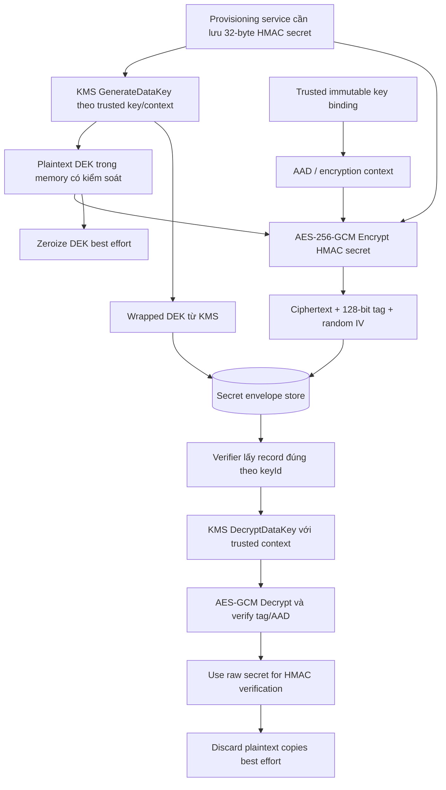
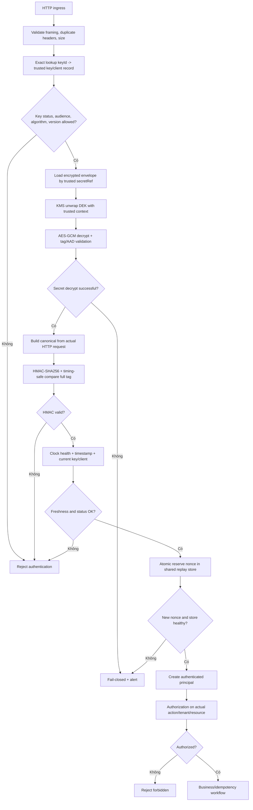

# Secret encryption trong quản lý shared secret cho HMAC request authentication

## 1. Vì sao shared secret của HMAC phải được mã hóa khi lưu trữ?

Trong module `SECURITY_AUTHENTICATION_HMAC_REQUEST_AUTHENTICATION`, một HTTP client và server dùng **shared secret** để xác thực request bằng HMAC. Client tạo **canonical request** từ method, raw URI/query, những HTTP headers đã ký và/hoặc digest của raw body theo một hợp đồng byte-level; server lấy đúng secret rồi tính lại HMAC. Sau bước so chữ ký, hệ thống cần kiểm tra timestamp/nonce chống replay, key rotation, proxy/gateway và thực hiện **authorization riêng** trên action và tài nguyên thực tế.

Bài **“Secret encryption”** thuộc chương **“Secret management”** tập trung vào một vấn đề nằm *trước* bước verify HMAC: **server phải lưu shared secret ở đâu, mã hóa thế nào, ai có quyền giải mã, và làm gì khi khóa mã hóa hoặc secret bị lộ?**

Nếu một cơ sở dữ liệu lưu thông tin:

```text
key_id              client_id          hmac_secret
kid_checkout_v7     cli_checkout_42    plain_32_random_secret_bytes
```

thì kẻ lấy được bản sao database, backup hoặc snapshot có thể có nguyên secret để **tính chữ ký HMAC hợp lệ** cho các request mới. Timestamp và nonce không thể cứu hệ thống nếu attacker đã biết shared secret: họ có thể tự tạo timestamp mới, nonce mới và chữ ký mới.

Giải pháp **encryption at rest** nhằm giảm thiệt hại khi *một số nơi lưu dữ liệu* bị đọc trái phép. Một thiết kế tốt không lưu secret dạng plaintext trong record; nó lưu **ciphertext có xác thực**, kèm metadata mã hóa, còn khóa giải mã được quản lý trong một **ranh giới tin cậy tách biệt** như KMS, Vault hoặc HSM.

```text
Untrusted / less-trusted storage:
    key_id
    client_id
    secret_ciphertext_and_tag
    data_key_wrapped_by_KMS
    AES-GCM IV
    encryption_version

Trusted KMS / secret service:
    wrapping key (KEK) + access policy

Authorized HMAC verifier:
    unwrap data key, decrypt secret when permitted
    calculate HMAC over actual canonical request
    verify time/nonce, then authorize operation
```

**Không nhầm hai thao tác:**

- **Mã hóa shared secret khi lưu (`Secret encryption`):** bảo vệ secret nằm trong database, backup hoặc secret store khỏi truy cập trái phép trong một threat model nhất định.
- **Tính HMAC của HTTP request:** chứng minh request được bên biết shared secret tạo ra, bảo vệ tính toàn vẹn những trường được ký; **không mã hóa body HTTP**, không tự bảo mật dữ liệu khi truyền.

> **Nguyên tắc:** Encryption at rest giảm rủi ro lộ secret từ nơi lưu trữ, nhưng **không** bảo vệ hoàn toàn trước attacker đã kiểm soát tiến trình có quyền gọi KMS giải mã hoặc chiếm được shared secret trên client. Bảo vệ HMAC cần kết hợp encryption, IAM, TLS, key lifecycle, audit, HMAC verification, chống replay và authorization.

### Mục tiêu học tập

Sau bài này, bạn có thể:

1. Phân biệt **HMAC signing key**, **data-encryption key (DEK)**, **key-encryption key (KEK)**, `keyId`, `secretRef` và key version.
2. Giải thích **envelope encryption** và cách dùng **AES-256-GCM** để mã hóa/authenticate secret bytes.
3. Thiết kế encryption context / **AAD** gắn ciphertext với **trusted key ID, client ID, audience và canonical request version**; không đưa thông tin trạng thái mutable vào AAD thiếu suy nghĩ.
4. Sử dụng KMS/Vault/HSM với **least privilege**, không để DEK/KEK plaintext nằm cạnh ciphertext.
5. Viết ví dụ Java 17+ mã hóa/giải mã secret 32 bytes bằng `AES/GCM/NoPadding`, IV 12 bytes và tag 128-bit.
6. Phân biệt **rotate KEK / rewrap DEK** với **rotate shared secret HMAC / cấp key ID mới**.
7. Xử lý fail-closed, cache, memory exposure, backup/restore, revoke và sự cố KMS outage.
8. Tích hợp kiểm tra chữ ký, timestamp/nonce, proxy/gateway và authorization mà không cấp quyền chỉ từ việc decrypt thành công.
9. Thiết kế kiểm thử ciphertext tampering, AAD mismatch, sai key, concurrency, revocation, IAM và recovery.

## 2. Threat model: mã hóa bảo vệ khỏi ai, không bảo vệ khỏi ai?

Không có khái niệm “secret đã được encrypt nên an toàn trước mọi cuộc tấn công”. Phải xác định **attacker lấy được gì**.

| Tình huống | Secret encryption bảo vệ được đến đâu? | Kiểm soát bổ sung |
| --- | --- | --- |
| Attacker đọc bản sao bảng database chứa ciphertext, không có quyền KMS decrypt | **Có thể ngăn lấy plaintext secret** nếu crypto/keys/IAM đúng | Encryption có xác thực, KMS tách biệt, DB least privilege. |
| Lộ backup/snapshot chỉ chứa ciphertext và wrapped DEK | Giảm nguy cơ lộ secret khi KEK không lộ | Backup encryption, policy và retention, tránh export KEK. |
| Attacker chỉ đọc source code, không có credentials | Secret không nên xuất hiện trong source | Secret scanning, CI policy, không hardcode keys. |
| Attacker có quyền ứng dụng gọi KMS decrypt tùy ý | **Không bảo vệ hoàn toàn**; họ có thể yêu cầu ứng dụng/KMS giải mã | IAM theo service/key/context, host isolation, audit, anomaly detection. |
| Attacker chiếm memory JVM đã load plaintext HMAC key | Encryption at rest **không** làm mất plaintext trong RAM | Hardening runtime, giảm lifetime, hạn chế dumps/debug, non-exportable HSM. |
| Attacker giữ secret trên client hợp lệ | Có thể ký request mới; server-side encryption **không giúp** | Client secret hygiene, rotate/revoke, rate limit, authorization. |
| Attacker đọc log chứa `X-HMAC-Signature` của một request | Có thể replay nếu window/store có vấn đề; chưa có secret | Redaction, TLS, timestamp/nonce atomic state. |
| Attacker sửa ciphertext/metadata trong DB | AEAD/AAD có thể phát hiện sửa hoặc đổi binding | Integrity-protected context, metadata ownership, fail-closed. |
| Attacker sửa quyền client/grants trong IAM | Encrypt secret không tự chặn cấp quyền trái phép | IAM authorization, audit, change control, segregation of duties. |
| Attacker nắm quyền admin KMS và database | Có thể vượt ranh giới bảo vệ | Tách nhiệm vụ, approvals, HSM, monitored break-glass. |

### 2.1 “Database encryption” có nhiều mức khác nhau

Có ít nhất bốn cách bảo vệ, không thể đánh đồng:

- **Full-disk / volume encryption:** bảo vệ thiết bị lưu trữ hoặc snapshot vật lý; ứng dụng đọc DB hợp lệ thường vẫn thấy plaintext.
- **Transparent database encryption (TDE):** có thể bảo vệ datafiles/backup theo cấu hình, nhưng tài khoản DB có quyền SELECT thường đọc được giá trị đã giải mã.
- **Application-level envelope encryption:** DB chứa **ciphertext của từng shared secret**; ứng dụng cần gọi KMS/secret provider theo quyền mới giải mã.
- **Vault/HSM-managed secret/key:** ứng dụng lưu **secret reference** và gọi API được cấp quyền; một số HSM/KMS có thể **tính MAC mà không export raw HMAC key**, giảm việc đưa plaintext vào JVM.

Trong threat model “một tài khoản DB read-only bị lộ nhưng KMS được tách quyền”, application-level envelope encryption thường tăng bảo vệ so với chỉ TDE. Nhưng nếu verifier bị chiếm quyền và có quyền decrypt mọi secret, encryption at rest **không phải ranh giới bảo vệ đủ mạnh**.

### 2.2 Không thể thay HMAC secret bằng một hash không đảo ngược

Đối với xác thực password, lưu salted one-way password hash thường phù hợp vì server so kết quả của password nhập vào. HMAC request authentication khác: server phải **tính HMAC từ secret** hoặc nhờ một trusted MAC service tính/verify.

```text
Password verification:
    stored one-way password verifier
    input password -> password KDF -> compare

HMAC request verification:
    trusted HMAC key (raw bytes or non-exportable handle)
    canonical request -> HMAC(key, request bytes) -> expected tag
```

Không thể tùy tiện lưu `SHA256(secret)` rồi dùng hash đó như thể nó là cùng secret: HMAC với `SHA256(secret)` sẽ là **một khóa khác**, và nếu mọi client biết cách tính khóa mới thì đặc tính bảo mật phải được đánh giá như một protocol khác. Nếu chỉ lưu hash mà không thể truy cập key material bằng cơ chế khác, server không thể verify chữ ký đúng hợp đồng ban đầu.

## 3. Phân biệt HMAC key, DEK, KEK, key ID và secret reference

Xét một credential của ứng dụng checkout:

```text
keyId                 = kid_checkout_v7
clientId              = cli_checkout_42
audience              = payments-api/prod
hmacAlgorithm         = HmacSHA256
requestCanonical      = HMAC-REQUEST/SECRET-ENC-V1
hmacKeyPlaintext      = [32 random bytes]       # KHÔNG lưu plaintext
dekPlaintext          = [32 random AES bytes]   # Chỉ tạm thời trong trusted process
dekWrapped            = [ciphertext by KMS]     # Có thể lưu cùng record
kekReference          = kms://security/prod/hmac-secret-wrap-key
secretCiphertext      = [AES-GCM ciphertext + authentication tag]
secretIv              = [12 random bytes]
encryptionFormat      = HMAC-SECRET-ENVELOPE/V1
```

| Thành phần | Vai trò | Ai được sở hữu/quản lý? | Có được gửi trong HTTP request? |
| --- | --- | --- | --- |
| `keyId` | Public-ish selector tìm credential record đúng | Credential registry | **Có**, dưới dạng signed header/auth-param theo contract. |
| `clientId` / principal | Định danh client/actor sau authentication | Trusted client directory/IAM | Không cần; không tin client claim làm principal. |
| **Raw HMAC key** | Secret để `HmacSHA256(canonical)` | Client được cấp + trusted server MAC service | **Không bao giờ** gửi. |
| **DEK** | AES key mã hóa raw HMAC secret ở nơi lưu | KMS generate và/hoặc trusted encryption component | **Không**. |
| **KEK / wrapping key** | Bảo vệ DEK khi DEK được lưu | KMS/HSM/key vault, có key policy riêng | **Không**. |
| `wrappedDek` | DEK đã được wrap/encrypt | Registry/DB có thể lưu ciphertext | **Không**. |
| `secretRef` | Trusted path/identifier tới stored secret/envelope | Registry phía server | **Không** cho client tự chọn. |
| IV/nonce **của AES-GCM** | Bảo đảm uniqueness của AEAD encrypt operation | Encryption component | Không cần gửi trong HMAC HTTP request. |
| `X-HMAC-Nonce` | Chống replay của **HTTP signing attempt** | Client sinh, server atomic reserve | **Có và phải được ký**. |
| `kekKeyVersion` | Xác định phiên bản KEK/wrapping key | KMS/key management | Không phải HMAC key version. |

**Ba tên “key” không được dùng lẫn nhau:**

1. **HMAC key** là secret cấp cho một client để tạo chữ ký request.
2. **DEK** là khóa mã hóa HMAC key **khi lưu**.
3. **KEK** là khóa cấp cao **mã hóa DEK**.

Không dùng **chính raw HMAC secret làm AES encryption key**, không dùng cùng DEK để làm HMAC signing secret, không dùng `keyId` làm AES-GCM IV. Tách chức năng cryptographic keys giảm nhầm lẫn về algorithm, compromise và rotation.

### 3.1 Secret encryption không phải secret encoding

- Base64/hex **chỉ là cách biểu diễn bytes**, không bảo mật.
- `AES/GCM/NoPadding` với khóa bí mật độc lập tạo **ciphertext có xác thực**.
- `KMS wrap` bảo vệ DEK để có thể lưu cùng encrypted secret.
- `SHA-256(secret)` là hash, không phải ciphertext có thể giải mã.
- TLS mã hóa **trong khi truyền**, không thay at-rest encryption.

Một hệ thống lưu `Base64(hmacSecret)` trong DB rồi đặt tên cột `encrypted_secret` **vẫn đang lưu secret ở dạng dễ phục hồi**, không có encryption bảo vệ.

## 4. Envelope encryption: hai tầng khóa và một record bí mật

**Envelope encryption** dùng một DEK để encrypt data, còn một KEK/KMS key để protect DEK. Lưu DEK đã được wrap cạnh data ciphertext là một thực hành bình thường **khi chỉ KMS có thể unwrap và quyền decrypt được kiểm soát**.



### 4.1 Bước encrypt tại thời điểm provisioning

1. Một admin/workflow **được authorization** yêu cầu cấp key cho `cli_checkout_42`.
2. Server cấp key ID duy nhất và tạo **raw HMAC secret 32 bytes** bằng CSPRNG hoặc HSM.
3. Server lấy **client/audience/canonical version** từ metadata đã được phê duyệt, không từ một request ngẫu nhiên.
4. KMS tạo **DEK plaintext 32 bytes** cùng wrapped DEK dưới KEK được phép.
5. Server tạo **IV AES-GCM 12 bytes mới**, dựng AAD từ **trusted immutable binding**.
6. AES-256-GCM encrypt raw HMAC secret với DEK và AAD, sinh `ciphertext||tag`.
7. Lưu **encryption version + wrapped DEK + KEK reference + IV + ciphertext/tag** vào secret store/registry trong một consistency boundary phù hợp.
8. Chỉ gửi raw HMAC secret cho client theo **kênh provisioning bảo mật**, hạn chế số lần hiển thị; loại bỏ plaintext tạm khỏi bộ nhớ ở mức có thể, không đưa vào log.
9. Nếu bất kỳ bước nào lỗi, không đánh dấu key `ACTIVE`; cleanup orphan records/DEKs theo runbook.

### 4.2 Bước decrypt khi xác minh request

1. Ingress kiểm tra framing, header duplicates, byte limits; đọc `keyId` như **untrusted selector**.
2. Registry **exact-lookup** `keyId` ra key record thuộc client, kiểm tra trạng thái/algorithm/audience/canonical version.
3. Verifier chỉ lấy encrypted secret bằng **trusted secretRef / record ID**, không nối raw header thành vault path.
4. KMS unwrap DEK với **trusted encryption context** và identity có `kms:Decrypt` phù hợp.
5. AES-GCM decrypt ciphertext; tag và AAD phải hợp lệ. **Không trả plaintext nếu tag sai**.
6. Dùng raw HMAC secret để tính expected MAC trên canonical HTTP request **do server tự dựng**.
7. So full tag HMAC bằng primitive thích hợp; kiểm tra clock, timestamp/nonce, key/client current rồi tạo principal.
8. Chỉ sau authentication mới xét **authorization** trên tenant/resource thực tế.

Mã hóa secret **không** làm thay đổi bytes của HMAC secret mà client đã được cấp: sau decrypt, verifier phải dùng **đúng raw bytes ban đầu**. Nếu server dùng UTF-8 bytes của chuỗi Base64 ciphertext/wrapped DEK để làm HMAC key, MAC sẽ sai. Nếu decrypt thất bại, **fail-closed**, tuyệt đối không thử “default secret” hoặc chấp nhận request không có HMAC.

### 4.3 Khi không cần tự quản envelope

Nếu một managed secret store đã cung cấp encryption at rest, scoped access và audit phù hợp, application có thể chỉ giữ:

```text
keyId -> trusted secretRef
clientId, status, algorithm, canonicalVersion, audience
```

rồi gọi API `GetSecretValue` tương đương khi verify. Không cần thêm một lớp AES tự viết **chỉ để gọi là an toàn hơn** nếu điều đó tăng plaintext copies và độ phức tạp IAM. Ngoài ra, khi HSM/KMS hỗ trợ **HMAC signing/verification với non-exportable HMAC key**, có thể để raw key material **không bao giờ rời** thiết bị bảo mật.

## 5. Thiết kế storage và binding: ciphertext không nên “đổi chủ”

Một lỗi khó thấy là server lưu ciphertext trong bảng A nhưng không ràng buộc nó với **keyId/clientId/audience**. Attacker có quyền sửa DB có thể **swap ciphertext** của key A sang record B; khi service giải mã, nó có thể dùng nhầm HMAC key rồi gán kết quả verify sai client.

Hệ thống cần hai hàng rào:

- **Trusted registry ownership:** key ID → client ID/secretRef/audience/status là metadata do hệ thống quản lý có integrity và quyền ghi hạn chế.
- **Authenticated encryption binding (AAD):** ciphertext của raw HMAC secret được gắn với một bộ metadata **bất biến**; nếu thay ciphertext/key context hoặc nhầm record, **GCM authentication fail**.

### 5.1 Mẫu database schema

Đây là SQL định hướng quan hệ, không phải migration production hoàn chỉnh:

```sql
CREATE TABLE hmac_credentials (
    key_id              VARCHAR(96) PRIMARY KEY,
    client_id           VARCHAR(96) NOT NULL,
    audience            VARCHAR(128) NOT NULL,
    hmac_algorithm      VARCHAR(32) NOT NULL,
    canonical_version   VARCHAR(64) NOT NULL,
    key_status          VARCHAR(24) NOT NULL,
    key_revision        BIGINT NOT NULL,
    verify_not_before   TIMESTAMPTZ NOT NULL,
    verify_until        TIMESTAMPTZ NOT NULL,

    envelope_version    VARCHAR(48) NOT NULL,
    kek_ref             VARCHAR(256) NOT NULL,
    wrapped_dek         BYTEA NOT NULL,
    gcm_iv              BYTEA NOT NULL,
    secret_ciphertext   BYTEA NOT NULL,

    created_at          TIMESTAMPTZ NOT NULL,
    revoked_at          TIMESTAMPTZ,

    CHECK (hmac_algorithm = 'HmacSHA256'),
    CHECK (key_status IN ('STAGED','ACTIVE',
                         'VERIFY_ONLY','REVOKED')),
    CHECK (verify_not_before < verify_until)
);
```

Ở ví dụ, `secret_ciphertext` lưu `AES-GCM ciphertext||tag`, còn `gcm_iv` lưu đúng IV 12 bytes; `wrapped_dek` là blob do KMS trả về. Kiểu `BYTEA` là ví dụ của PostgreSQL; RDBMS khác có binary/blob tương đương.

**Quan trọng:** Các ràng buộc SQL không tự chứng minh GCM IV đúng 12 bytes, ciphertext đúng format, KMS policy an toàn hoặc key ownership bất biến. Service phải kiểm tra và cơ sở dữ liệu phải dùng constraints/triggers/permissions/audit phù hợp.

### 5.2 AAD bind những trường nào?

Trong ví dụ `HMAC-SECRET-ENVELOPE/V1`, AAD gồm:

```text
encryption-domain-version = HMAC-SECRET-ENVELOPE/V1
keyId                     = kid_checkout_v7
clientId                  = cli_checkout_42
audience                  = payments-api/prod
hmacAlgorithm             = HmacSHA256
requestCanonicalVersion   = HMAC-REQUEST/SECRET-ENC-V1
```

Mỗi thành phần được encode **có length prefix**, không nối bằng delimiter có thể xuất hiện trong giá trị, không lấy trực tiếp JSON chưa xác thực từ request.

**Không nên đưa `keyStatus` hoặc `lastUsedAt` vào AAD** nếu chúng thay đổi thường xuyên: khi chuyển ACTIVE → VERIFY_ONLY → REVOKED, ciphertext sẽ không decrypt được nếu decryption code dùng trạng thái mới làm AAD, trừ khi chủ động re-encrypt; đó là thiết kế không cần thiết và dễ lỗi. **Key status phải được kiểm tra độc lập** bởi registry/IAM.

Nếu thay đổi một trong những metadata **đã được AAD bind**, quy trình phải **re-encrypt có kiểm soát hoặc cấp key mới**, không đổi metadata rồi hy vọng GCM decrypt được. Tránh dùng AAD từ row DB do attacker có quyền sửa trọn vẹn mà không có trusted reference/constraint: AAD chỉ có giá trị bảo vệ theo **nguồn dữ liệu và khóa đúng**.

### 5.3 Length-prefix giải quyết nhập nhằng

Nối mù:

```text
keyId + ":" + clientId + ":" + audience
```

có thể nhập nhằng khi identifier được phép chứa `:`. Với mỗi trường, encode số byte UTF-8 + bytes để giữ biên:

```text
[2-byte length][UTF-8 value]
[2-byte length][UTF-8 value]
...
```

Hai tuple khác nhau không nên cho cùng một chuỗi AAD. AAD không cần bí mật, nhưng phải **được giữ nguyên và được xác thực bởi GCM tag**.

## 6. AES-256-GCM: chọn đúng primitive và tham số

AES-GCM là một **AEAD (authenticated encryption with associated data)**. Nó đảm bảo **confidentiality** cho plaintext và phát hiện thay đổi trái phép ở ciphertext cùng AAD (với xác suất giả mạo rất nhỏ) khi được dùng đúng.

### 6.1 Tham số cho ví dụ của bài

| Tham số | Giá trị mẫu | Giải thích |
| --- | --- | --- |
| AES key / DEK | 32 bytes = 256 bits, CSPRNG/KMS | **Khác** raw HMAC secret 32 bytes. |
| GCM IV | 12 bytes = 96 bits, mới cho mỗi encryption với DEK | Không dùng lại cặp **(DEK, IV)**; uniqueness là bất biến bảo mật. |
| Authentication tag | 128 bits = 16 bytes | `GCMParameterSpec(128, iv)`. |
| Plaintext | 32-byte HMAC secret theo policy bài | Không dùng UTF-8 của hex/Base64 string thay raw key. |
| AAD | Trusted immutable binding keyId/clientId/audience/... | Ràng buộc ciphertext với credential đúng. |
| Output Java JCA | `ciphertext || GCM tag` | `Cipher.doFinal()` trả combined bytes theo provider contract. |
| Envelope version | `HMAC-SECRET-ENVELOPE/V1` | Tách khỏi HMAC request canonical version và KEK version. |
| Wrapping | KMS encrypt/wrap của DEK | KEK plaintext không nằm trong app/DB. |

**IV của GCM không phải HTTP replay nonce.** IV phục vụ encryption at rest; `X-HMAC-Nonce` phục vụ phát hiện HTTP requests trùng. Dùng timestamp làm IV, cố định IV=0 cho nhiều lần encrypt dưới cùng DEK hoặc sao chép IV từ record khác có thể phá GCM.

**Quy tắc quan trọng nhất của GCM:** Với một DEK, **không bao giờ dùng lại cùng IV cho hai lần encrypt**. Dùng **mỗi secret encryption một DEK mới do KMS sinh** giảm sự phụ thuộc vào quản lý IV đa bản ghi; vẫn cần IV random 12 bytes phù hợp và quy trình retry/reencrypt không vô tình tái dùng cặp (DEK, IV). Với yêu cầu cực cao hoặc số lượng rất lớn dưới một DEK, cần strategy uniqueness/counter và cryptographic review, không chỉ dựa vào “khó trùng”.

### 6.2 Vì sao cần authenticated encryption?

AES-CBC với padding tự thiết kế không tự xác thực ciphertext. Nếu quên MAC riêng hoặc xử lý lỗi padding khác nhau, có thể tạo padding oracle/tampering. AES-GCM kết hợp mã hóa và authentication tag.

Ví dụ:

```text
Original:
  AAD = (keyId=A, client=A, audience=prod)
  IV  = IV1
  Ciphertext+tag = C1

Tamper ciphertext C1 -> C1':
  GCM authentication failure -> reject; no plaintext secret returned.

Swap C1 into record keyId=B, but use trusted AAD for B:
  authentication failure -> reject.

Use wrong DEK:
  authentication failure -> reject.
```

**Không bỏ qua `AEADBadTagException`, không trả plaintext một phần** và không có “best-effort decrypt” rồi tiếp tục tính HMAC. Lỗi decrypt là lỗi credential backend/integrity: cần fail-closed, alert và điều tra, không phải tín hiệu để thử một secret không rõ nguồn.

### 6.3 Không tự thiết kế thuật toán mật mã

Các anti-pattern:

```text
encryptedSecret = secret XOR keyIdBytes                // không an toàn
encryptedSecret = Base64(secret)                       // encoding, không encrypt
encryptedSecret = AES-ECB(secret)                      // lộ cấu trúc, thiếu integrity
encryptedSecret = AES-CBC(secret) without integrity     // thiếu authentication
DEK = SHA256(keyId)                                    // public, không bí mật
IV = 000000000000000000000000 for every encryption     // phá GCM uniqueness
sameKey = both raw HMAC secret and AES DEK              // trộn trách nhiệm khóa
```

Ưu tiên thư viện/managed service đã được kiểm định và API AEAD chuẩn. Ví dụ Java 17 bên dưới **minh họa việc sử dụng primitive**, không thay cả quy trình KMS, secret provisioning và đánh giá side-channel production.

## 7. Java 17+: lớp mã hóa/giải mã raw HMAC secret bằng AES-GCM

Lớp `HmacSecretEnvelopeV1` minh họa phần **local AEAD** khi đã có một **32-byte DEK hợp lệ từ nguồn đáng tin**. Nó **không tự tạo hoặc wrap DEK với KMS**, vì mỗi provider có SDK/IAM khác nhau. Quy trình production phải lấy DEK từ KMS/Vault và bảo vệ DEK riêng.

Mã giới hạn:

- Chỉ mã hóa **32-byte raw HMAC secret** của `HmacSHA256`.
- DEK phải đúng 32 bytes, độc lập secret.
- IV do `SecureRandom` sinh **12 bytes mới**.
- Tag 128 bits, ciphertext output phải đúng **48 bytes** cho plaintext 32 bytes.
- AAD được build từ trusted binding với length-prefix UTF-8.
- Envelope record clone mảng để tránh caller sửa dữ liệu đã đóng gói.
- Mọi mismatch/decrypt error bị từ chối; không mặc định trả key rỗng.

### 7.1 `HmacSecretEnvelopeV1`

```java
import java.io.ByteArrayOutputStream;
import java.nio.charset.StandardCharsets;
import java.security.GeneralSecurityException;
import java.security.SecureRandom;
import java.util.Objects;
import javax.crypto.Cipher;
import javax.crypto.SecretKey;
import javax.crypto.spec.GCMParameterSpec;
import javax.crypto.spec.SecretKeySpec;

public final class HmacSecretEnvelopeV1 {
    private static final int HMAC_SECRET_BYTES = 32;
    private static final int AES_256_BYTES = 32;
    private static final int GCM_IV_BYTES = 12;
    private static final int GCM_TAG_BITS = 128;
    private static final int GCM_TAG_BYTES = 16;

    private static final SecureRandom RANDOM = new SecureRandom();
    public static final String FORMAT = "HMAC-SECRET-ENVELOPE/V1";

    private HmacSecretEnvelopeV1() {}

    // Chỉ lấy từ credential metadata đáng tin, không từ raw HTTP headers.
    public record Binding(
            String keyId,
            String clientId,
            String audience,
            String hmacAlgorithm,
            String requestCanonicalVersion) {

        public Binding {
            if (keyId == null
                    || !keyId.matches("[A-Za-z0-9._:-]{1,96}")
                    || clientId == null
                    || !clientId.matches("[A-Za-z0-9._:-]{1,96}")
                    || audience == null
                    || !audience.matches("[A-Za-z0-9._:/-]{1,128}")
                    || !"HmacSHA256".equals(hmacAlgorithm)
                    || !"HMAC-REQUEST/SECRET-ENC-V1"
                        .equals(requestCanonicalVersion)) {
                throw new IllegalArgumentException(
                        "Invalid immutable secret binding");
            }
        }
    }

    public record Envelope(
            byte[] iv,
            byte[] ciphertextAndTag) {

        public Envelope {
            iv = Objects.requireNonNull(iv, "iv").clone();
            ciphertextAndTag = Objects.requireNonNull(
                    ciphertextAndTag, "ciphertextAndTag").clone();
        }

        @Override
        public byte[] iv() {
            return iv.clone();
        }

        @Override
        public byte[] ciphertextAndTag() {
            return ciphertextAndTag.clone();
        }
    }

    /**
     * rawSecret: HMAC shared secret 32 bytes.
     * plaintextDek: 32-byte independent AES DEK from trusted KMS.
     * binding: immutable key/client/audience metadata from registry.
     *
     * Caller owns both inputs and must clear them according to lifecycle.
     * Call exactly once with a fresh DEK + fresh IV for each encryption.
     */
    public static Envelope encrypt(
            byte[] rawSecret,
            byte[] plaintextDek,
            Binding binding) throws GeneralSecurityException {

        Objects.requireNonNull(binding);
        validateSecretAndDek(rawSecret, plaintextDek);

        byte[] iv = new byte[GCM_IV_BYTES];
        RANDOM.nextBytes(iv);

        Cipher cipher = Cipher.getInstance("AES/GCM/NoPadding");
        SecretKey aesKey = new SecretKeySpec(plaintextDek, "AES");
        cipher.init(Cipher.ENCRYPT_MODE, aesKey,
                new GCMParameterSpec(GCM_TAG_BITS, iv));
        cipher.updateAAD(aad(binding));

        byte[] sealed = cipher.doFinal(rawSecret);
        if (sealed.length != HMAC_SECRET_BYTES + GCM_TAG_BYTES) {
            throw new GeneralSecurityException(
                    "Unexpected AES-GCM ciphertext length");
        }
        return new Envelope(iv, sealed);
    }

    /**
     * Nếu IV/ciphertext/AAD/DEK bị thay đổi, không trả plaintext.
     * AEAD authentication failure là một lỗi phải xử lý fail-closed.
     */
    public static byte[] decrypt(
            Envelope envelope,
            byte[] plaintextDek,
            Binding trustedBinding) throws GeneralSecurityException {

        Objects.requireNonNull(envelope);
        Objects.requireNonNull(trustedBinding);
        if (plaintextDek == null
                || plaintextDek.length != AES_256_BYTES) {
            throw new IllegalArgumentException("Invalid AES-256 DEK");
        }

        byte[] iv = envelope.iv();
        byte[] sealed = envelope.ciphertextAndTag();
        if (iv.length != GCM_IV_BYTES
                || sealed.length != HMAC_SECRET_BYTES + GCM_TAG_BYTES) {
            throw new IllegalArgumentException(
                    "Invalid secret envelope structure");
        }

        Cipher cipher = Cipher.getInstance("AES/GCM/NoPadding");
        SecretKey aesKey = new SecretKeySpec(plaintextDek, "AES");
        cipher.init(Cipher.DECRYPT_MODE, aesKey,
                new GCMParameterSpec(GCM_TAG_BITS, iv));
        cipher.updateAAD(aad(trustedBinding));

        // Khi tag/AAD sai sẽ ném AEADBadTagException (subtype
        // của BadPaddingException). Không dùng plaintext bị lỗi.
        byte[] rawSecret = cipher.doFinal(sealed);
        if (rawSecret.length != HMAC_SECRET_BYTES) {
            throw new GeneralSecurityException(
                    "Unexpected HMAC secret length after decrypt");
        }
        return rawSecret;
    }

    private static void validateSecretAndDek(
            byte[] rawSecret, byte[] plaintextDek) {
        if (rawSecret == null
                || rawSecret.length != HMAC_SECRET_BYTES
                || plaintextDek == null
                || plaintextDek.length != AES_256_BYTES) {
            throw new IllegalArgumentException(
                    "Expected 32-byte HMAC secret and independent DEK");
        }
        // Caller/KMS provisioning phải bảo đảm material độc lập.
    }

    /**
     * Từng giá trị được prefix bằng 2 bytes unsigned big-endian length.
     * AAD phải đến từ trusted immutable metadata, không từ HTTP claim.
     */
    private static byte[] aad(Binding binding) {
        ByteArrayOutputStream out = new ByteArrayOutputStream();
        writePart(out, FORMAT);
        writePart(out, binding.keyId());
        writePart(out, binding.clientId());
        writePart(out, binding.audience());
        writePart(out, binding.hmacAlgorithm());
        writePart(out, binding.requestCanonicalVersion());
        return out.toByteArray();
    }

    private static void writePart(
            ByteArrayOutputStream out, String text) {
        byte[] value = text.getBytes(StandardCharsets.UTF_8);
        if (value.length > 512) {
            throw new IllegalArgumentException("AAD field too long");
        }
        out.write((value.length >>> 8) & 0xff);
        out.write(value.length & 0xff);
        out.write(value, 0, value.length);
    }
}
```

**Điểm cần nắm:**

1. `SecretKeySpec` nhận **plaintext DEK**, không nhận raw HMAC secret làm khóa AES. Hệ thống phải có KMS/IAM bảo vệ DEK riêng.
2. `Cipher.getInstance("AES/GCM/NoPadding")` dùng **JCA/JCE**. GCM không có padding block thủ công; `doFinal` encrypt 32-byte plaintext thành 32-byte ciphertext + 16-byte tag.
3. `cipher.updateAAD(aad(binding))` chạy trước `doFinal`, bind ciphertext với key/client/audience/version bất biến.
4. `SecureRandom` sinh IV mới khi encrypt. **Không dùng lại (DEK, IV)** qua retries hoặc re-encrypt operation.
5. `Envelope` sao chép các mảng trong constructor/accessor. Nó chỉ giữ encrypted data; mảng secret/decrypted DEK và provider internal copies vẫn cần lifecycle riêng.
6. `Binding` phải lấy từ **trusted registry**. Attacker không được tự tạo binding bằng `X-Client-Id` hoặc `X-Audience` để bypass ownership.
7. `decrypt` trả raw secret **chỉ sau khi GCM xác thực tag thành công**. Lỗi phải được propagating thành lỗi hạ tầng/integrity, **không** thành secret mặc định.
8. `FORMAT` là **encryption envelope version**, độc lập với version HTTP canonical. Khi đổi format encrypt, cần plan migration và backward-compatibility theo server policy.
9. 32-byte HMAC secret là **lựa chọn policy của mẫu**; những hệ thống có độ dài material khác cần version/threat model tương ứng, không âm thầm cắt/truncate.
10. Việc xóa byte[] tạm chỉ **best effort**: JVM, provider và OS có thể giữ bản sao. Với yêu cầu raw key **không được xuất khỏi HSM**, cần dùng non-exportable MAC service thay vì codec này.

### 7.2 Chú ý các giới hạn của ví dụ

`HmacSecretEnvelopeV1` là **primitive mô phỏng phần AES-GCM**. Nó **không**:

- Kết nối KMS hay phân quyền IAM;
- Sinh, wrap hoặc rewrap DEK thông qua provider;
- Bảo đảm không tồn tại plaintext secret trong heap/dumps;
- Lưu record vào DB transaction;
- Chứng minh GCM nonce uniqueness toàn hệ thống;
- Xử lý client provisioning/rotation/revocation;
- Thực thi authorization cho HTTP request.

Không nên sao chép một ví dụ dùng random DEK vào production rồi **lưu DEK plaintext** cùng envelope. Khi DEK plaintext bị lộ từ cùng DB, mã hóa secret không còn bảo vệ được trong threat model database breach.

## 8. Java 17+: unit test encrypt/decrypt, tamper và AAD mismatch

Ví dụ thử nghiệm dùng **chỉ các khóa random trong memory**, không mở file và không kết nối KMS. Trong production, DEK phải từ hệ thống quản lý khóa được phê duyệt.

### 8.1 Một fixture có thể thực thi với JDK 17

```java
import java.security.MessageDigest;
import java.security.SecureRandom;
import java.util.Arrays;
import javax.crypto.AEADBadTagException;

public final class EnvelopeRoundTripExample {
    public static void main(String[] args) throws Exception {
        SecureRandom rng = new SecureRandom();
        byte[] rawHmacSecret = new byte[32];
        byte[] dek = new byte[32];
        rng.nextBytes(rawHmacSecret);
        rng.nextBytes(dek);

        HmacSecretEnvelopeV1.Binding correct =
                new HmacSecretEnvelopeV1.Binding(
                    "kid_checkout_v7",
                    "cli_checkout_42",
                    "payments-api/prod",
                    "HmacSHA256",
                    "HMAC-REQUEST/SECRET-ENC-V1");

        byte[] recovered = null;
        try {
            var envelope = HmacSecretEnvelopeV1.encrypt(
                    rawHmacSecret, dek, correct);

            recovered = HmacSecretEnvelopeV1.decrypt(
                    envelope, dek, correct);
            if (!MessageDigest.isEqual(
                    rawHmacSecret, recovered)) {
                throw new AssertionError(
                        "HMAC secret did not round-trip");
            }

            // Thay ciphertext nhưng giữ tag => AEAD must fail.
            byte[] tampered = envelope.ciphertextAndTag();
            tampered[0] ^= 0x01;
            var altered = new HmacSecretEnvelopeV1.Envelope(
                    envelope.iv(), tampered);

            expectTagFailure(() ->
                    HmacSecretEnvelopeV1.decrypt(
                            altered, dek, correct));

            // Hoán đổi client binding => AAD mismatch => fail.
            var wrongClient = new HmacSecretEnvelopeV1.Binding(
                    "kid_checkout_v7",
                    "cli_reconcile_42",
                    "payments-api/prod",
                    "HmacSHA256",
                    "HMAC-REQUEST/SECRET-ENC-V1");

            expectTagFailure(() ->
                    HmacSecretEnvelopeV1.decrypt(
                            envelope, dek, wrongClient));
        } finally {
            Arrays.fill(rawHmacSecret, (byte) 0);
            Arrays.fill(dek, (byte) 0);
            if (recovered != null) {
                Arrays.fill(recovered, (byte) 0);
            }
        }
    }

    @FunctionalInterface
    interface CheckedTask {
        void run() throws Exception;
    }

    private static void expectTagFailure(
            CheckedTask task) throws Exception {
        try {
            task.run();
            throw new AssertionError(
                    "Tampered secret envelope was accepted");
        } catch (AEADBadTagException expected) {
            // Expected: no plaintext returned.
        }
    }
}
```

**Test này xác minh tính đúng đắn chức năng**, không chứng minh mọi đường chạy luôn constant-time hoặc KMS production an toàn. Không log `rawHmacSecret` hoặc `recovered` để “nhìn cho rõ”. Với lỗi sai ciphertext length, codec có thể ném `IllegalArgumentException` trước khi thực hiện GCM, đó cũng phải được xử lý fail-closed.

### 8.2 Tách “sai AAD” khỏi “lỗi client secret” trong telemetry

Nếu AES-GCM decrypt fail, server **chưa có trusted raw HMAC secret** để xác minh request. Không nên trả `invalid HMAC signature` rồi âm thầm thử secret khác, vì điều đó che khuất một lỗi dữ liệu/khóa hạ tầng. Nội bộ có thể ghi:

```text
hmac_secret_decrypt_integrity_failure
hmac_kms_unwrap_denied
hmac_kms_unavailable
hmac_key_registry_binding_mismatch
```

Response công khai vẫn cần tránh lộ key tồn tại/trạng thái, nhưng ops phải biết đây là **incident về secret storage**, không phải lỗi canonicalization của một client.

## 9. Tích hợp KMS/Vault/HSM mà không để lộ KEK

Trong production, **KEK nên được quản lý bên ngoài application**, và plaintext DEK chỉ xuất hiện trong bộ nhớ được giới hạn thời gian/quyền nếu cần local AES-GCM.

### 9.1 Hai cách triển khai phổ biến

| Mô hình | Server cần giữ gì? | Ưu điểm | Lưu ý |
| --- | --- | --- | --- |
| **KMS envelope encryption** | Wrapped DEK, IV, AES-GCM ciphertext/tag, trusted metadata | Tách KEK khỏi DB, có KMS policy/audit; encrypt data bằng AEAD local | Plaintext DEK và HMAC secret có mặt tạm trong JVM. |
| **Vault/secret manager** | Trusted `secretRef` và metadata mapping | Đơn giản hóa rotate, truy cập, secret version và audit | `GetSecretValue` có thể trả plaintext vào process; phụ thuộc provider/IAM. |
| **HSM/non-exportable HMAC key** | Key handle / reference, policy | Có thể không export raw key; giảm memory exposure | Không phải mọi provider cho phép raw HMAC theo contract; latency/quota/algorithms cần kiểm chứng. |
| **Tự hardcode AES KEK trong config** | Cả ciphertext và KEK dễ cùng bị compromise | Dễ prototype, **không khuyến nghị** | Phá separation of duties, secret rotation và audit. |

Không khẳng định mọi `KMS.encrypt`/`KMS.decrypt` đều dùng được để tạo **HMAC tag**. Có dịch vụ hỗ trợ API MAC chuyên dụng, có dịch vụ chỉ hỗ trợ encryption/wrapping; thiết kế phải khớp capability thực tế.

### 9.2 Pseudocode provisioning với KMS

```text
function provisionHmacCredential(trustedClient, requestPolicy):
    authorizeAdminToCreateCredential(trustedClient)
    keyId = registry.allocateNeverReusedKeyId()

    rawHmacSecret = secureRandom(32 bytes)
    immutableBinding = {
        keyId,
        trustedClient.clientId,
        serverSelectedAudience,
        hmacAlgorithm = HmacSHA256,
        requestCanonicalVersion = HMAC-REQUEST/SECRET-ENC-V1
    }

    trustedKekRef = policy.chooseWrappingKey(environment=prod)
    encryptionContext = stableContext(immutableBinding)

    // Provider returns plaintext DEK and a wrapped/encrypted DEK.
    dataKey = kms.generateDataKey(
        kekRef=trustedKekRef,
        keySizeBits=256,
        encryptionContext=encryptionContext
    )
    try:
        envelope = localAesGcmEncrypt(
            plaintext=rawHmacSecret,
            plaintextDek=dataKey.plaintext,
            aad=immutableBinding
        )
        registry.insertStagedKeyAndEnvelopeAtomically(
            keyId, immutableBinding, trustedKekRef,
            dataKey.wrapped, envelope)
        deliverSecretOnceOverAuthenticatedSecureChannel(
            trustedClient, rawHmacSecret)
        activateAfterPolicyAndDeliveryChecks(keyId)
    finally:
        clearBestEffort(dataKey.plaintext)
        clearBestEffort(rawHmacSecret)
```

`kms.generateDataKey` là **tên API khái niệm**, không phải một hàm có sẵn trong JDK. Provider có thể có request types và semantics khác; một số không trả raw DEK hoặc sử dụng authenticated encryption context theo cách riêng.

**Lưu ý về transaction:** KMS call không tham gia DB transaction; nếu DB insert fail sau GenerateDataKey, bạn có wrapped key orphan hoặc chưa có credential row. Phải có cleanup/retry chính xác và trạng thái `STAGED`. Không đánh dấu key ACTIVE trước khi envelope hoàn chỉnh và client provisioning được xác nhận.

### 9.3 Pseudocode decrypt khi verify

```text
function loadHmacSecretForVerify(untrustedKeyId):
    assert ingress checked exact one key ID + syntax
    keyRecord = registry.exactLookup(untrustedKeyId)

    if missing / revoked / wrong audience / wrong version:
        rejectAuthenticationGenerically()

    client = clientDirectory.exactLookup(keyRecord.clientId)
    if client disabled:
        rejectAuthenticationGenerically()

    binding = trustedImmutableBinding(keyRecord, client)
    wrappedDek = envelopeStore.get(keyRecord.secretRef).wrappedDek

    plaintextDek = kms.decryptDataKey(
        trustedKekRef=keyRecord.kekRef,
        wrappedDek=wrappedDek,
        encryptionContext=stableContext(binding)
    )
    try:
        rawSecret = localAesGcmDecrypt(
            storedCiphertextAndTag,
            storedGcmIv,
            plaintextDek,
            aad=binding)
        return aTrustedSecretHandleWithScopedLifetime(rawSecret)
    finally:
        clearBestEffort(plaintextDek)
```

`aTrustedSecretHandleWithScopedLifetime` ở đây là abstraction, không phải lớp JDK. Nó phải định nghĩa ai sở hữu plaintext, khi nào xóa và không cho worker bất kỳ giữ secret vô hạn. Không tạo một global mutable `byte[]` rồi mọi code có thể đọc/cập nhật; nếu cache secret, phải có policy rõ như mục 12.

### 9.4 IAM tối thiểu và separation of duties

| Identity | Quyền cần thiết | Không nên có |
| --- | --- | --- |
| Provisioning service | `GenerateDataKey`/encrypt với KEK đã duyệt, ghi credential STAGED | Decrypt toàn bộ keys khác client/environment tùy ý. |
| HMAC verifier service | Read metadata đúng audience; `DecryptDataKey` cho tập key được phép verify | Create/modify credential ownership, export KEK, thay key grants. |
| Rotation worker | Quyền rewrap/re-encrypt có thời hạn và audit | Quyền đọc tài nguyên business/authorization không liên quan. |
| DBA/backup operator | Backup/restore ciphertext và schema | KMS Decrypt cho mọi secret, nếu không thực sự cần. |
| Security admin | Approve revoke, change KMS policy, key lifecycle | Khả năng truy vấn plaintext secret hàng loạt mà không review. |
| Metrics/log collector | Chỉ telemetry redacted | Raw MAC, plaintext secret, wrapped DEK không cần thiết. |

Một KMS policy cần buộc environment/service/tenant **đúng scope**; khi provider hỗ trợ encryption context, nên bind nó với immutable key identity. Giới hạn tần suất decrypt, quản lý grants và audit `GenerateDataKey`/`Decrypt`, thiết kế break-glass có phê duyệt riêng.

## 10. Gắn mã hóa secret vào HMAC verifier mà không nhầm quyền

Mã hóa at rest chỉ là **cách mang raw secret vào bước mật mã HMAC**. Nó không thay canonicalization hay cơ chế chống replay.

### 10.1 Hợp đồng HTTP request minh họa: SECRET-ENC-V1

Ví dụ credential của `cli_checkout_42` có `keyId=kid_checkout_v7`. Hệ thống dùng:

| Thành phần | Quy tắc `HMAC-REQUEST/SECRET-ENC-V1` |
| --- | --- |
| HMAC algorithm | `HmacSHA256`, full 32-byte MAC, Base64 standard padded 44 chars |
| Method | `POST`, đúng HTTP method thực thi |
| Raw target | `/v1/tenants/t-42/payments?mode=instant`; không decode/sort query ngầm |
| Audience | `payments-api/prod` từ server config/key metadata |
| Signed header | `Content-Type: application/json` singleton |
| Key selector | `X-HMAC-Key-Id` singleton, ký nguyên value |
| Timestamp | `X-HMAC-Timestamp` Unix epoch seconds ASCII canonical, ký |
| Replay nonce | `X-HMAC-Nonce` 16 random bytes / 32 lowercase hex, ký |
| Body | SHA-256 của raw application body bytes sau HTTP framing, trước content transform |
| Encoding | 11 dòng UTF-8 nối LF, không LF cuối |
| Secret encryption | **Không xuất hiện trên wire**: envelope DEK/KEK/IV là chi tiết server-side |
| Authorization | Principal từ trusted key/client registry sau HMAC; quyền kiểm tra độc lập |

### 10.2 Canonical request gồm đúng 11 dòng

```text
HMAC-REQUEST/SECRET-ENC-V1
HMAC-SHA256
POST
/v1/tenants/t-42/payments?mode=instant
audience:payments-api/prod
content-type:application/json
x-hmac-key-id:kid_checkout_v7
x-hmac-timestamp:1767268800
x-hmac-nonce:7d46b2dd65d618a32ba74de99da88d80
body-size:<so-byte-body-thuc-te>
body-sha256:<hex-lowercase-SHA256-raw-body>
```

`1767268800` là fixture thời gian `2026-01-01T12:00:00Z`, không phải timestamp hợp lệ mặc định tại thời điểm production khác. Hai placeholder cuối phải được thay bằng size/digest **tính từ byte[] thực gửi**; signature thực phải được tính, không dùng ví dụ text như tag hoàn chỉnh.

### 10.3 Ví dụ HTTP request được ký

```http
POST /v1/tenants/t-42/payments?mode=instant HTTP/1.1
Host: api.example.test
Content-Type: application/json
X-HMAC-Key-Id: kid_checkout_v7
X-HMAC-Timestamp: 1767268800
X-HMAC-Nonce: 7d46b2dd65d618a32ba74de99da88d80
X-HMAC-Signature: <base64-32-byte-hmac-sha256>

{"amountMinor":125000,"currency":"VND"}
```

Client đã có raw HMAC secret do provisioning cấp, **không cần biết** server lưu nó dưới AES-GCM/KMS key nào. Một ngày server rewrap DEK từ KEK v1 sang v2, **client không cần ký lại chỉ vì thay KEK** — raw HMAC key không đổi. Nhưng khi raw HMAC key được rotate sang key ID mới, client phải nhận secret mới và ký bằng `keyId` tương ứng.

### 10.4 Pipeline verify đầy đủ



### 10.5 Server Java 17 pseudocode

```java
// PSEUDOCODE: components below are application-defined, not JDK.
ValidatedRequest req = ingress.parseStrict(http);
// Reject duplicate keyId/signature/timestamp/nonce/content-type,
// request smuggling/ambiguous framing and unsupported transforms.

KeyRecord key = keyRegistry.exactLookup(
        req.uniqueHeader("X-HMAC-Key-Id"));

if (key == null
        || !key.canVerifyNow()
        || !"payments-api/prod".equals(key.audience())
        || !"HmacSHA256".equals(key.algorithm())
        || !"HMAC-REQUEST/SECRET-ENC-V1"
            .equals(key.canonicalVersion())) {
    rejectAuthenticationGeneric();
    return;
}

ClientRecord client = clientDirectory.exactLookup(key.clientId());
if (client == null || !client.enabled()) {
    rejectAuthenticationGeneric();
    return;
}

// Đọc trusted encryption binding, không tin X-Client-Id/Host raw.
SecretEnvelope stored = secretStore.getByTrustedRef(
        key.secretRef());

byte[] dek = kms.unwrapDataKey(
        key.kekRef(), stored.wrappedDek(),
        trustedEncryptionContext(key, client));
byte[] rawHmacSecret = null;

try {
    rawHmacSecret = HmacSecretEnvelopeV1.decrypt(
        stored.aesEnvelope(), dek,
        trustedAadBinding(key, client));

    byte[] canonical = canonicalizer.fromActualHttpRequest(
        req, key); // exactly 11 lines, raw body hash

    if (!hmacVerifier.fullTagEqualsConstantTime(
            rawHmacSecret, canonical, req.signature())) {
        rejectAuthenticationGeneric();
        return;
    }
} finally {
    clearBestEffort(dek);
    clearBestEffort(rawHmacSecret);
}

// Freshness/time/revocation/nonce phải tiếp tục fail-closed.
if (!clockHealth.healthy()
        || !timestampPolicy.accepts(req.timestamp())
        || !keyRegistry.isStillCurrent(key)
        || !clientDirectory.isStillEnabled(client)) {
    rejectAuthenticationOrUnavailable();
    return;
}

if (!nonceStore.reserveAtomically(
        client.id(), key.audience(),
        req.nonce(), configuredNonceTtl)) {
    rejectReplayOrStoreUnavailable();
    return;
}

Principal principal = identity.fromVerifiedClient(client);
if (!authorization.canPerform(
        principal, req.actualAction(), req.actualResource())) {
    rejectForbidden();
    return;
}

businessService.process(principal, req);
```

**Lưu ý:** Không bắt `Exception` tổng quát quanh toàn pipeline rồi trả `authentication=true`. KMS unwrap fail, AEAD tag sai, vault access denied hoặc nonce store outage **đều phải ngăn request đi tới business**. Cần phân loại lỗi nội bộ để alert/recover; thông báo công khai tránh lộ secret existence và chi tiết crypto.

### 10.6 Mã hóa không tạo quyền cho key

Một client `cli_checkout_42` biết HMAC secret hợp lệ có thể tự ký `POST /v1/tenants/t-99/payments`. Encryption at rest của secret không ngăn chủ key **cố tình tạo request tới tenant khác**. Nếu không có grant trên `t-99`, authorization phải từ chối.

**Authentication:** ai có thể chứng minh biết secret tương ứng với key record?

**Authorization:** principal đó có quyền `createPayment` trên **resource thật** mà controller/DB xử lý không?

Hai quyết định độc lập; ciphertext decrypt đúng cũng không tạo role/admin quyền đặc biệt.

## 11. Rotation: ba loại “xoay khóa” không được đánh đồng

Có ít nhất ba hoạt động khác nhau:

| Hoạt động | Thay đổi gì? | Có cần client đổi HMAC secret/key ID? | Mục tiêu |
| --- | --- | --- | --- |
| **KEK rotation / DEK rewrap** | Thay wrapping key hoặc wrapped DEK; HMAC secret và DEK có thể giữ nguyên | **Không**, nếu raw HMAC secret không đổi | Giới hạn rủi ro wrapping key và đáp ứng crypto policy. |
| **DEK rotation / secret re-encryption** | Sinh DEK mới + IV mới, re-encrypt **cùng HMAC secret** | **Không**, nếu raw secret không đổi | Thay đổi data key bảo vệ ciphertext; nâng format/crypto policy. |
| **HMAC secret rotation** | Sinh **raw HMAC secret mới**, cấp **key ID mới** và credential record mới | **Có** | Thu hồi khả năng ký của key cũ; đáp ứng compromise/credential lifetime. |

### 11.1 Rewrap DEK không tương đương revoke HMAC key

Giả sử secret S của key `kid_checkout_v7` bị lộ từ client. Ops rewrap DEK từ KEK A sang KEK B, DB có ciphertext mới hoặc wrapped key mới, nhưng **S vẫn là S**. Attacker đã biết S vẫn có thể tính HMAC cho mọi canonical request thuộc key v7 khi key còn ACTIVE/VERIFY_ONLY.

**Phải rotate HMAC key material và revoke key v7.** Rewrap KEK chỉ xử lý rủi ro ở tầng encryption at rest; nó **không** thu hồi kiến thức về plaintext secret đã bị lộ.

### 11.2 Rewrap đúng

Một quy trình an toàn:

```text
old wrapping KEK + wrapped DEK
       |
       v
KMS ReEncrypt / rewrap under new authorized KEK
       |
       v
new wrapped DEK + new trusted KEK reference
       |
       v
atomic record switch / dual-read migration as explicitly configured
       |
       v
verify decrypt via policy, audit revisions
       |
       v
retire old KEK only after all ciphertext/backups are recoverable
```

Khi provider hỗ trợ **KMS re-encrypt** mà không xuất plaintext DEK về ứng dụng, ưu tiên tính năng đó. Nếu phải unwrap/re-wrap DEK trong process, giới hạn lifetime, audit, cleanup, IAM và bảo vệ plaintext. Không cho verifier tự thử ngẫu nhiên mọi KEK versions khi lỗi: dùng `kekRef`/envelope version **từ trusted metadata** và migration policy rõ ràng.

### 11.3 DEK rotation / re-encrypt raw secret

Để đổi DEK:

1. Xác thực quyền rotation worker và trạng thái record.
2. Dùng old KEK unwrap old DEK và old AES-GCM decrypt raw HMAC secret trong trusted process.
3. KMS sinh **DEK mới độc lập**, worker tạo **IV mới** và encrypt raw secret với AAD theo metadata đáng tin.
4. Lưu envelope mới atomically/versioned, tránh readers thấy **new IV nhưng old ciphertext**.
5. Verify decryption/integrity của bản mới trước cutover; kiểm tra backup/rollback policy.
6. Dọn copies plaintext và retire old wrapped DEK theo retention/audit.
7. **Không đổi keyId/clientId/principal** chỉ vì thay khóa mã hóa at rest.

Nếu binding AAD thay đổi khi migration, đó là **bước riêng** phải có trusted metadata mapping/approval. Không “sửa” AAD mismatch bằng cách bỏ AAD.

### 11.4 Rotation raw HMAC secret

```text
client = cli_checkout_42
  |
  +-- keyId kid_checkout_v7   VERIFY_ONLY, secret S7
  +-- keyId kid_checkout_v8   ACTIVE,      secret S8 (fresh)
```

S7 và S8 là **hai raw secrets khác nhau**, mỗi credential có envelope/DEK/wrapped DEK riêng. Server exact-lookup theo key ID; không thử S7 rồi S8 nếu client khai `kid_checkout_v8`. Khi v7 REVOKED, MAC tính bằng S7 dù đúng vẫn bị từ chối.

**Replay domain** nên được ghim theo client/principal + audience theo contract, không reset chỉ vì đổi key version. Còn authorization kiểm tra principal trên resource; đổi key không tự cấp thêm scopes.

## 12. Secret caching và memory: encryption at rest có điểm mù

Một số verifier giải mã shared secret **trong mỗi request**; số khác cache plaintext secret hoặc key handle để giảm KMS latency. Cả hai có trade-off.

### 12.1 Cache bằng gì và trong bao lâu?

| Phương án | Lợi ích | Rủi ro |
| --- | --- | --- |
| Không cache plaintext, gọi KMS/secret manager mỗi verify | Giới hạn plaintext lifetime, dễ revoke trong nhiều thiết kế | KMS latency/cost, quota, dependency availability. |
| Cache decrypted HMAC secret vài giây/phút | Giảm latency và throughput load | Plaintext nằm trong JVM heap, stale after revoke, memory dumps. |
| Cache encrypted envelope + metadata | Ít plaintext stored in process | Vẫn cần KMS unwrap khi verify; cache metadata status có thể stale. |
| Cache non-exportable HSM key handle | Không mang raw key ra JVM nếu provider hỗ trợ | Policy/handle lifetime và HSM dependency cần quản lý. |
| Persist plaintext key ra local file để “cache qua restart” | Nhanh | Thường phá at-rest encryption và secret lifecycle. |

Khi cache raw secrets, hãy xác định:

- Scope cache theo **exact keyId + immutable key revision/secret version**, không theo raw client claim.
- LRU/TTL bounded, entry size/quota, tránh attacker tạo triệu key IDs làm full cache.
- Revocation/disable client phải invalidate hoặc vượt được cache bằng **authoritative status recheck**.
- Không chia cache key material giữa staging và production.
- Không ghi plaintext ra swap/dump/log/metrics/exception; giới hạn diagnostic tools.
- Có cách shutdown/evict best-effort để xóa mảng nếu implementation cho phép, nhưng không hứa JVM xóa mọi bản sao.

### 12.2 Zeroization trong Java có giới hạn

`Arrays.fill(byteArray, (byte) 0)` có thể giảm lifetime của một số plaintext copies do caller sở hữu. Nhưng:

- `SecretKeySpec` có thể copy key bytes; JCA provider có thể có internal copies.
- JVM GC, JIT, heap dump, swapping hoặc virtual memory có thể giữ dữ liệu.
- Java `String` bất biến, không phải nơi lý tưởng để lưu secret lâu dài vì khó xóa.
- `getEncoded()` có thể tạo một byte[] copy mới; cần quản lý ownership của copy đó.
- Không lưu secret trong record/toString/log; không serialize object secret vào tracing.

**Bảo vệ chính vẫn là least privilege, process isolation và giảm thời gian/độ rộng tiếp xúc**. Nếu threat model không chấp nhận raw HMAC key xuất hiện trong JVM, dùng HSM/MAC service non-exportable thích hợp.

### 12.3 “Decrypt on every request” cũng cần quota

Attacker có thể gửi một triệu request dùng một `keyId` tồn tại nhưng signature sai; nếu verifier gọi KMS decrypt cho tất cả, có thể tạo **KMS cost/latency DoS**.

Trước KMS:

- Validate method, URI/framing, header occurrences, size limits và signature encoding.
- Exact key lookup + policy status/audience/canonical version, rate limit theo nguồn/endpoint.
- Quota/negative-cache bounded cho random key IDs.
- Giới hạn concurrency KMS unwrap và timeouts, circuit breaker **fail-closed**.
- Phân biệt errors và metrics để không lộ existence của key qua response.

**Không chấp nhận MAC sai hay bypass KMS khi quota hết.** Availability được giải bằng cache/quota/architecture, không bỏ authentication.

## 13. Backup/restore, disaster recovery và vòng đời KEK

Một encrypted secret record chỉ có ích nếu tổ chức **có thể phục hồi DEK/KEK đúng policy** khi xảy ra sự cố, nhưng không để backup trở thành đường lộ plaintext.

### 13.1 Backup phải chứa gì?

Nếu dùng envelope encryption, bản backup thường cần:

```text
Credential metadata:
    keyId, clientId, principal binding, audience
    algorithm/canonical version/status/revisions

Encryption metadata:
    envelopeVersion
    trusted KEK reference / provider account+region identity
    wrapped DEK
    AES-GCM IV
    ciphertext + authentication tag
    immutable AAD binding fields

Operational recovery:
    authorization/ownership restoration process
    KMS access recovery and audited policy
    rotation/revocation log
```

Backup **không nên chứa plaintext secret hoặc KEK plaintext** chỉ vì phục hồi cho “dễ”. Nếu KMS key bị hủy không thể phục hồi, wrapped DEKs có thể trở nên **không decrypt được vĩnh viễn**. Cần kế hoạch KMS lifecycle, retention, khóa không thể xóa trước hạn, DR regions và test restore có kiểm soát.

### 13.2 Multi-region KMS và dữ liệu encryption

Các vấn đề cần lên kế hoạch:

- KEK reference có sẵn trong DR region không, hay phải rewrap?
- Có copy ciphertext nhưng **không** có quyền decrypt ở DR region?
- KMS replication/backup có bảo toàn policy/audit và encryption context không?
- Credential metadata/ciphertext có khớp cùng revision sau failover không?
- Restore có vô tình phục hồi key `REVOKED` thành `ACTIVE` hoặc reset nonce replay store không?
- Secret đã revoke có bị “sống lại” nếu restore một DB snapshot cũ không?

**Không coi backup ciphertext là hoàn chỉnh** nếu KMS/secret policy không cho unwrap ở recovery target. Ngược lại, không mở `kms:Decrypt *` toàn tổ chức chỉ để DR dễ. DR access cần least privilege, approval và kiểm tra định kỳ bằng **test credentials**, không làm lộ production secrets.

### 13.3 KMS deletion và crypto-shredding

Xóa KEK có thể khiến ciphertext/wrapped DEKs trở nên không thể decrypt — đây có thể là một phần chiến lược **crypto-shredding**, nhưng rất dễ gây mất dữ liệu nếu nhiều secrets/backup còn phụ thuộc KEK đó. Không thực hiện destructive deletion nếu chưa có dependency graph, retention approval, migration/rewrap và key-recovery policy.

**Revoke HMAC key** không nhất thiết xóa KEK: nhiều credentials khác có thể vẫn phụ thuộc KEK. Ngược lại **revoke client** phải làm verifier không accept key/client đó ngay cả khi secret trong KMS vẫn decrypt được.

## 14. Error handling, observability và kiểm soát rò rỉ secret

### 14.1 Phân loại lỗi nội bộ

| Error category | Ý nghĩa | Phản ứng an toàn |
| --- | --- | --- |
| `KEY_ID_NOT_FOUND` | Selector không có trusted record | Reject authentication generic; không dùng secret default. |
| `KEY_REVOKED_OR_EXPIRED` | Credential không được verify | Reject, invalidate cache theo policy. |
| `CLIENT_DISABLED` | Client ownership không còn hợp lệ | Reject **mọi keys** của client. |
| `KMS_ACCESS_DENIED` | Verifier thiếu quyền unwrap | **Fail-closed**, alert policy/permission. |
| `KMS_UNAVAILABLE` | Vault/KMS outage/quota/network | **Fail-closed**, có thể trả 503 theo policy. |
| `ENVELOPE_VERSION_UNSUPPORTED` | Ciphertext chưa được migration/không được hỗ trợ | Reject, không tự thử legacy cipher. |
| `AEAD_TAG_MISMATCH` | Sai DEK/IV/ciphertext/AAD hoặc tampering | Reject, alert integrity incident; không xuất plaintext. |
| `HMAC_TAG_MISMATCH` | Decrypt được key nhưng request MAC sai | Reject authentication; không reserve nonce. |
| `NONCE_ALREADY_USED` | HMAC pass nhưng signed attempt đã dùng | Reject replay. |
| `NONCE_STORE_UNAVAILABLE` | Không chứng minh uniqueness | **Fail-closed**, không fallback Map local. |
| `AUTHORIZATION_DENIED` | MAC/replay pass nhưng principal thiếu quyền | 403/404 theo API/resource policy; không tạo side effect. |

Không nên trả chính xác “KMS A key version 7 bị disable” hay toàn bộ `secretRef`/AAD ra HTTP response. Public error normalization giúp hạn chế key enumeration. **Telemetry nội bộ** vẫn cần đủ loại sự cố để xử lý đúng, nhưng không chứa secret bytes.

### 14.2 Những dữ liệu không nên ghi log

- Raw HMAC secret, plaintext DEK, plaintext KEK;
- Base64/hex của những khóa đó, kể cả “chỉ 8 ký tự đầu” nếu không có policy;
- HTTP `Authorization`/`X-HMAC-Signature` đầy đủ vì có thể bị replay;
- Full canonical request chứa URL/body/PII/token nhạy cảm;
- KMS decrypt response, raw ciphertext/whole wrapped DEK ngoài môi trường kiểm soát;
- Stack traces/exception object chứa key material trong message;
- Client secret trong audit event của provisioning.

Tín hiệu an toàn hơn có thể là **request correlation ID**, outcome category, bounded key/client ID **đã được xác thực và được phép log**, key revision, envelope version, KMS latency/availability, decrypt failure counts, cache hit ratio và nonce replay counts. Raw key ID chưa HMAC verify **không phải bằng chứng client đó gửi request**.

### 14.3 Các chỉ số nên theo dõi

| Metric | Mục đích |
| --- | --- |
| `hmac_kms_unwrap_latency_seconds` | Theo dõi latency/quota của dependency bảo mật. |
| `hmac_kms_access_denied_total` | Phát hiện IAM drift hoặc request ngoài phạm vi. |
| `hmac_envelope_aead_failure_total` | Cảnh báo tampering, record swap hoặc mismatch metadata. |
| `hmac_envelope_unsupported_version_total` | Phát hiện migration chưa hoàn tất. |
| `hmac_secret_plaintext_cache_entries` | Giám sát giới hạn plain secret memory. |
| `hmac_key_revocation_lag_seconds` | Kiểm tra revocation SLO qua replicas. |
| `hmac_secret_rotation_due_total` | Theo dõi credential sắp hết hạn theo policy. |
| `hmac_nonce_replay_total` | Phân biệt replay khỏi KMS/integrity errors. |
| `hmac_authorization_denied_total` | Phát hiện request authenticated nhưng không có quyền. |

### 14.4 Chẩn đoán KMS outage

1. Kiểm tra KMS/Vault health, quota và IAM grant vừa thay đổi.
2. Xác định chỉ một wrapping key/region bị ảnh hưởng hay tất cả credentials.
3. Không bật bypass decrypt, không chuyển sang secret env var dự phòng plaintext không được phê duyệt.
4. Nếu cần failover, dùng DR key/policy **đã chuẩn bị và test**; không dùng blind fallback KEK.
5. Chuyển instance/traffic khi không có khả năng verify; trả lỗi unavailable phù hợp.
6. Bảo vệ cache plaintext (nếu có) theo documented revocation/SLO thay vì “cache vô hạn để chống outage”.
7. Audit mọi lần thay đổi policy hoặc credential revision; ngăn một bản restore cũ làm sống lại key revoked.
8. Sau khôi phục, kiểm tra HMAC request test-only, clock, nonce store và authorization end-to-end.

## 15. Những anti-pattern về Secret encryption

| Anti-pattern | Rủi ro | Sửa thế nào |
| --- | --- | --- |
| Lưu raw HMAC secret plaintext trong DB/JSON config | Lộ DB = lộ credential | Dùng secret manager hoặc envelope encryption. |
| Đặt tên cột `encrypted_secret` nhưng lưu Base64(secret) | Chỉ encoding, không confidentiality | AEAD + protected DEK/KEK. |
| Lưu ciphertext và plaintext DEK/KEK ở cùng DB | Đánh mất key separation | KMS/HSM key management, wrapped DEK. |
| Hardcode KEK vào source hoặc image/container | Source/image breach = decrypt toàn bộ | KMS, IAM, secret delivery/rotation. |
| Dùng `AES/ECB` hoặc CBC thiếu integrity | Tampering không phát hiện/khả năng oracle | AEAD như AES-GCM với authenticated tag/AAD. |
| Tái sử dụng IV dưới cùng DEK | Có thể phá nghiêm trọng GCM security | Fresh DEK/unique IV policy; audit encryption routines. |
| Dùng timestamp/HMAC nonce làm GCM IV | Confuse hai loại nonce, dễ lặp | Random 12-byte GCM IV riêng, ký HTTP nonce riêng. |
| Bỏ GCM tag check khi decrypt lỗi | Sử dụng plaintext không tin cậy | Fail-closed, không trả một phần plaintext. |
| AAD lấy nguyên `X-Client-Id` do user khai | Record swap/identity confusion | Trusted immutable key/client mapping. |
| Không bind ciphertext với key ID/client/audience | Swap encrypted secret giữa records khó bị phát hiện | Stable AAD + KMS context + registry integrity. |
| Cho key ID tự tạo KMS path | Confused deputy/path traversal | Exact lookup secretRef do server quản lý. |
| Rewrap KEK rồi coi HMAC secret đã được rotate | Attacker biết secret cũ vẫn ký được | Cấp HMAC secret mới/key ID mới, revoke key cũ. |
| Rotate HMAC key bằng cách chỉ đổi key ID nhưng giữ secret | Key compromise không được khắc phục | Fresh independently random raw secret. |
| Cache plaintext secret vô hạn, không invalidation | Key revoke không có hiệu lực, memory exposure | Bounded TTL/revision, fresh status checks. |
| KMS outage → chọn default key hoặc skip HMAC | Authentication bypass | Fail-closed + resilience ở dependency. |
| Giải mã được secret → coi client authorized mọi resource | Bỏ authorization | Verify MAC/time/nonce rồi policy theo actual resource. |
| Dùng HMAC key chung cho nhiều clients | Không phân biệt signer, impersonation | Credential/secret riêng cho mỗi client. |
| Restore DB cũ làm key REVOKED thành ACTIVE | Credential cũ được sống lại | Security state reconciliation/invalidation sau restore. |

### 15.1 Vì sao “mã hóa hai lần” không tự động an toàn gấp đôi?

Hai lớp mã hóa chỉ hữu ích khi có **threat boundaries và key management** rõ. Nếu cả hai khóa AES đều nằm trong cùng environment variable mà ứng dụng/attacker truy cập được, double encryption không thay đổi nhiều rủi ro. Ngược lại, mỗi lớp có thể tăng lỗi cấu hình, trì hoãn rotation và khó recovery.

Ưu tiên **một thiết kế envelope/managed secret store chuẩn, tách quyền, có authenticated encryption, audit và quy trình phục hồi** hơn nhiều lớp crypto tự viết.

## 16. Ma trận kiểm thử Secret encryption và HMAC toàn tuyến

Kiểm thử nên tách **AES-GCM primitive**, **KMS/secret storage integration**, **key lifecycle** và **HTTP authentication/authorization**. Không test một cách vòng tròn chỉ bằng “encrypt rồi decrypt trong cùng process, so secret bằng một hàm có sẵn”, vì KMS IAM, backup, metadata và proxy vẫn có thể sai.

| Case | Tình huống | Kết quả kỳ vọng |
| --- | --- | --- |
| E01 | Sinh 32-byte HMAC secret và 32-byte DEK độc lập bằng CSPRNG. | Hai material khác nhiệm vụ, không derive từ key ID. |
| E02 | AES-256-GCM encrypt một raw HMAC secret 32 bytes. | IV 12 bytes, ciphertext||tag 48 bytes theo ENVELOPE-V1. |
| E03 | Decrypt với đúng DEK/IV/AAD. | Khôi phục chính xác 32 raw HMAC key bytes. |
| E04 | Sửa một byte ciphertext, giữ tag cũ. | GCM tag fail, không trả plaintext. |
| E05 | Sửa một byte tag. | GCM tag fail, fail-closed. |
| E06 | Sửa IV của envelope nhưng giữ tag/ciphertext. | Authentication fail, không dùng secret. |
| E07 | Dùng DEK khác để decrypt. | Authentication fail. |
| E08 | Dùng `clientId` khác làm AAD. | Authentication fail; không swap credential giữa clients. |
| E09 | Dùng `keyId` khác làm AAD. | Authentication fail; mapping immutable. |
| E10 | Dùng audience staging thay production. | AAD/KMS context mismatch; reject. |
| E11 | Dùng canonical version khác trong AAD. | Reject mismatch, không thử nhiều formats bừa bãi. |
| E12 | Lưu plaintext DEK cùng DB ciphertext. | Security review ngăn kiến trúc này. |
| E13 | Lưu Base64(secret) rồi coi encrypted. | Test/inspection phát hiện secret trực tiếp recover được. |
| E14 | Dùng raw HMAC secret làm AES DEK. | Review phát hiện key reuse across purpose. |
| E15 | Hai AES encrypt operations tái sử dụng cùng (DEK,IV). | Test/monitoring phát hiện violation, không ship. |
| E16 | KMS unwrap trả permission denied. | Fail-closed + alert, không dùng default key. |
| E17 | KMS network timeout/outage. | Request không đi tới business; có thể trả 503 theo policy. |
| E18 | KMS encrypt thành công nhưng DB insert fail. | Không activate credential; cleanup/retry an toàn. |
| E19 | Ciphertext row có envelope version lạ. | Reject, không fallback cipher/version không duyệt. |
| E20 | Record bị swap wrapped DEK và ciphertext giữa hai keys. | AAD/KMS context hoặc GCM tag ngăn accept. |
| E21 | Record key clientId đổi trực tiếp mà không re-encrypt. | Reject mutation hoặc AAD mismatch; owner phải immutable. |
| E22 | KeyId duplicate trong provisioning. | Unique constraint từ chối; không overwrite. |
| E23 | Client ID lấy từ HTTP header khác trusted registry. | Không dùng làm AAD/principal; reject nếu policy cấm. |
| E24 | Key secret được cấp nhưng client chưa xác minh provisioning. | Credential STAGED, không ACTIVE sai thời điểm. |
| E25 | Key thuộc client DISABLED; envelope decrypt được. | Không accept dù secret hợp lệ. |
| E26 | Key REVOKED nhưng raw HMAC secret decrypt được. | Reject authentication, không tạo principal. |
| E27 | Key VERIFY_ONLY trong thời gian grace. | Có thể verify theo policy, không coi là ACTIVE để cấp mới. |
| E28 | Client dùng key ID v8 nhưng MAC bằng secret v7. | Exact lookup v8; HMAC fail, không thử fallback v7. |
| E29 | Rewrap KEK thành công, raw HMAC secret không đổi. | Client signature vẫn verify với same key ID. |
| E30 | Chỉ rewrap KEK sau khi raw HMAC secret đã bị lộ. | Incident test chỉ rõ key compromise chưa được xử lý. |
| E31 | Rotate raw HMAC secret v7→v8. | Key ID mới + fresh secret, v7 revoke/expire theo policy. |
| E32 | Re-encrypt same raw HMAC secret bằng DEK mới. | IV mới, ciphertext mới; MAC output client-side không đổi. |
| E33 | KEK cũ bị xóa trước khi backup ciphertext được rewrap. | Restore test thất bại; lifecycle chặn xóa sớm. |
| E34 | Backup được restore nhưng KMS không có đúng KEK/context. | Fail-closed; DR runbook nêu phụ thuộc khóa. |
| E35 | Restore snapshot cũ làm REVOKED thành ACTIVE. | Reconcile security state, reject credential đã revoke. |
| E36 | Cùng request đi qua HTTP/1.1 và HTTP/2 gateway. | Same canonical bytes hoặc reject rewrite; secret encryption độc lập. |
| E37 | Gateway đổi `%2F` thành slash trong raw path. | HMAC mismatch/reject, không blame KMS. |
| E38 | JSON body bị reserialize sau client ký. | Body digest/HMAC mismatch; at-rest decrypt vẫn thành công. |
| E39 | Timestamp bị sửa trong request nhưng MAC không ký field đó. | Test phát hiện protocol bug; timestamp phải được ký. |
| E40 | Replay nguyên signed request trong timestamp window. | Atomic nonce store chặn duplicate; encryption không tự chặn. |
| E41 | Nonce store timeout nhưng HMAC và decrypt đều đúng. | Fail-closed, không xử lý business. |
| E42 | TTL nonce 300s với freshness [-300,+30]. | Test phát hiện replay gap; TTL phải >= acceptance lifetime. |
| E43 | Multi-region nonce stores không đồng bộ. | Test phát hiện duplicate admission; cần consistency. |
| E44 | Cache raw secret chưa invalidation sau key revoke. | Không accept; status/revision recheck/freshness policy. |
| E45 | Attacker có read-only DB, không có KMS Decrypt. | Không thể lấy raw secret trực tiếp chỉ từ ciphertext trong threat model. |
| E46 | Attacker có cả DB và KMS Decrypt rộng. | Threat model ghi nhận breach, tăng least privilege/monitoring. |
| E47 | Attacker đọc heap dump lúc verifier đang giữ raw key. | Test quy trình hardening, không tuyên bố at-rest encryption bảo vệ RAM. |
| E48 | Raw shared secret vô tình được log lúc provisioning. | Secret scanning/log review chặn; rotate nếu lộ. |
| E49 | Client ký HMAC hợp lệ cho tenant ngoài grant. | Authentication pass có thể, authorization DENY. |
| E50 | Một credential client chia raw secret với client khác. | Security test phát hiện cross-client impersonation risk. |
| E51 | AES-GCM decrypt error bị bắt và trả secret 32 zero bytes. | Review/test chặn fallback, fail-closed. |
| E52 | Cùng keyId trỏ secretRef khác sau cache update không revision. | Detect record mismatch, refuse stale binding. |
| E53 | Secret manager cho quyền decrypt không giới hạn audience/env. | IAM test từ chối cross-audience/cross-environment. |
| E54 | High volume MAC-invalid requests gây KMS quota exhaustion. | Rate limiting/quota/admission control; không bypass auth. |
| E55 | Thay mutable `keyStatus` làm AAD rồi revoke key. | Test phát hiện decrypt break; AAD chỉ dùng immutable fields. |
| E56 | Ciphertext length 31 bytes hoặc IV length khác 12. | Reject format trước crypto; không dùng plaintext không đủ. |
| E57 | Base64 signature decode thành 16 bytes nhưng HMAC yêu cầu full 32. | Reject transport; timing-safe compare full tag. |
| E58 | Two clients có keyId gần giống nhau khác case. | Exact lookup + stable binding, không normalize tùy ý. |
| E59 | Gateway tự gửi `X-Verified-Principal` không được bảo vệ. | Strip/overwrite, trusted channel; backend authz riêng. |
| E60 | Independent Java/Go/Node interop fixture với cùng decrypted secret. | Canonical bytes/HMAC tag khớp; KMS/encryption không đổi giao thức. |

### 16.1 Golden vector nên chứng minh cả hai tầng

Một fixture toàn diện phải tách:

**A. Encryption-layer fixture:**

```text
envelopeVersion        = HMAC-SECRET-ENVELOPE/V1
binding.keyId          = kid_checkout_v7
binding.clientId       = cli_checkout_42
binding.audience       = payments-api/prod
binding.hmacAlgorithm  = HmacSHA256
binding.canonical      = HMAC-REQUEST/SECRET-ENC-V1
plaintextHmacSecret    = exact_test_only_32_bytes
plaintextDek           = exact_test_only_32_bytes
iv                     = exact_test_only_12_bytes
aad                    = exact_length_prefixed_utf8_tuple
ciphertextAndTag       = exact_AES256_GCM_test_vector
wrappedDek             = TEST_ONLY_KMS_or_mock_envelope
```

**B. HTTP-layer fixture:**

```text
keyId                  = kid_checkout_v7
method                 = POST
rawTarget              = /v1/tenants/t-42/payments?mode=instant
contentType            = application/json
timestamp              = 1767268800
nonce                  = 7d46b2dd65d618a32ba74de99da88d80
rawBody                = UTF8(exact_json_without_final_newline)
canonical              = 11_lines_UTF8_LF_without_final_LF
expectedRawMac         = HMAC_SHA256(plaintextHmacSecret, canonical)
signature              = standard_padded_base64(expectedRawMac)
verifiedClientId       = cli_checkout_42
authorization          = separately_evaluated_for_actual_resource
```

Đây là **khung dữ liệu fixture** chứ chưa phải các vectors đã được tính số cụ thể; test suite thực phải chứa IV/DEK/secret **test-only** cùng ciphertext/tag, body digest và expected HMAC đã được tính **độc lập**. Không dùng `encrypt` rồi `decrypt` của cùng một class làm toàn bộ bằng chứng interoperability hay storage security.

### 16.2 Test negative theo security boundaries

Các assertions nên kiểm tra **không có side effect**:

```text
assert KMS_UNAVAILABLE -> NO_AUTHENTICATED_PRINCIPAL
assert AEAD_BAD_TAG -> NO_HMAC_VERIFICATION_WITH_FALLBACK_KEY
assert KEY_REVOKED -> NO_AUTHENTICATED_PRINCIPAL
assert BAD_HMAC -> NO_NONCE_RESERVATION
assert NONCE_REPLAY -> NO_BUSINESS_COMMIT
assert AUTHZ_DENY -> NO_RESOURCE_MUTATION
assert SECRET_ROTATED -> OLD_SECRET_NOT_ACCEPTED_AFTER_REVOKE
assert DB_RESTORE -> REVOKED_KEYS_STAY_REVOKED
```

Sau khi lắp ghép thật, kiểm thử cả concurrency, large body streaming, KMS throttling, cache stale, proxy rewrite và failover. **Khóa đúng không đảm bảo business đúng** nếu router/authorization không khớp tài nguyên được ký.

## 17. Tình huống thực hành: database bị đọc trộm, KMS bị cấu hình sai và rotation không hiệu lực

**Bối cảnh:** Một API thanh toán Java 17 dùng HMAC-SHA256. Đội vận hành lưu:

```text
hmac_keys:
   key_id, client_id, ciphertext_secret,
   base64_dek, gcm_iv, key_status
```

DEK được `Base64` rồi lưu thẳng ở DB cùng ciphertext. Ciphertext được tạo bằng AES-GCM nhưng developer **dùng cùng IV cố định** cho mọi lần encrypt với một DEK tái sử dụng. KMS chỉ dùng để mã hóa một bản sao backup, còn API verifier không cần KMS để decrypt DB. Hai clients của một tenant được cấp **cùng raw HMAC secret** để “giảm công provisioning”.

Sau một sự cố, attacker lấy được DB dump. Ops lập tức thay `kekRef` từ KEK-v1 sang KEK-v2 và tuyên bố secrets đã “được rotate”. Nhưng raw HMAC secret trên các clients **không đổi**. Cùng lúc, một gateway chuyển HTTP/2 `:path` thành decoded URL, và backend coi principal từ `X-Verified-Client` mà client có thể tự gửi. API chấp nhận retry thanh toán bằng nonce mới nhưng không có idempotency record.

### 17.1 Phân tích nguyên nhân

1. **DEK lưu Base64 cạnh ciphertext không hề được bảo vệ.** Attacker giải mã Base64 để lấy raw AES DEK, rồi decrypt secret; đó là lỗi separation of keys, không phải lỗi Base64 library.
2. **IV cố định + DEK tái sử dụng phá bất biến GCM uniqueness.** Phải ngừng dùng mô hình đó; ưu tiên một DEK riêng cho mỗi encryption và IV mới, đánh giá lại toàn bộ ciphertext đã tạo bằng scheme sai.
3. **KMS chỉ mã hóa backup không bảo vệ DB dump** trong mô hình khi DEK plaintext nằm ở DB. Cần wrapped DEK và KMS decrypt policy cho đường production, hoặc managed secret store phù hợp.
4. **Hai clients dùng cùng raw HMAC secret** không thể được phân biệt bằng khả năng tạo MAC. Client A có thể mạo danh client B nếu server dùng key IDs khác nhưng cùng secret. Phải cấp material riêng và gán ownership immutable.
5. **Đổi KEK reference không rotate raw HMAC secret.** Attacker đã có secret vẫn ký được; cần **revoke key IDs cũ và cấp secrets mới** cho clients.
6. **Gateway rewrite raw target làm HMAC mismatch hoặc route confusion.** Chọn điểm verify trước rewrite, bảo toàn signed bytes qua trust boundary hoặc nâng canonical contract có version; không thử mọi URL variant để chấp nhận MAC.
7. **Header `X-Verified-Client` client tự khai không đáng tin.** Gateway phải strip/overwrite, backend chỉ tin authenticated context qua kênh nội bộ bảo vệ; authorization vẫn kiểm tra actual resource.
8. **Nonce mới không phải idempotency.** Hai retry mới có thể cùng tạo payment dù HMAC/time/nonce đều pass. Cần signed idempotency key hoặc state server-side, unique constraint/transaction/outbox/reconciliation theo nghiệp vụ.
9. **IAM KMS quá rộng hoặc sai** cần phân tách provisioning, verifier và rotation worker; DB operator không mặc định có quyền decrypt.
10. **Cache/backup cần được kiểm tra:** sau revoke, một replica không được accept key cũ vì plaintext cache stale; restore không được làm sống lại key revoked.

### 17.2 Kế hoạch khắc phục theo thứ tự

```text
CONTAINMENT
  -> disable/revoke compromised HMAC credentials
  -> invalidate verifier caches and stop affected operations
  -> investigate DB access, KMS grants, logs, business side effects

KEY & IDENTITY RECOVERY
  -> generate independent new HMAC secret per client/key version
  -> allocate new never-reused keyIds
  -> deliver over authenticated secure provisioning channel
  -> enforce trusted keyId -> clientId/principal mapping

SECRET STORAGE FIX
  -> use KMS-managed wrapped DEK or managed secret manager
  -> AES-256-GCM with unique IV per DEK and stable trusted AAD
  -> migrate/validate encrypted records and backups
  -> remove plaintext DEK/secret copies from old stores

REQUEST PIPELINE
  -> strict HTTP ingress, raw canonical request
  -> exact key lookup, unwrap/decrypt, HMAC timing-safe verify
  -> timestamp + atomic nonce, key/client current
  -> actual-resource authorization + business idempotency

OPERATIONS
  -> least privilege KMS, revision/invalidation, audit
  -> DR/restore/rotation runbooks and test-only golden vectors
  -> alert on decrypt tag failure, access denied and replay
```

### 17.3 Câu hỏi tự kiểm tra

1. **Mã hóa HMAC secret khi lưu** khác **ký HTTP request bằng HMAC** ở điểm nào?
2. Vì sao một database lưu `Base64(secret)` chưa đáp ứng encryption at rest?
3. DEK, KEK và raw HMAC key phục vụ ba mục đích gì? Có nên dùng cùng bytes không?
4. Một `keyId` đến từ HTTP header có phải là tên client đã xác thực không?
5. Envelope encryption lưu những trường gì bên cạnh ciphertext?
6. Nếu attacker đọc DB dump nhưng không có quyền KMS decrypt, boundary nào giúp bảo vệ secret?
7. Nếu attacker đã chiếm JVM có `kms:Decrypt`, encryption at rest có ngăn họ lấy plaintext không?
8. Vì sao AES-GCM cần IV duy nhất với cùng DEK và authentication tag?
9. IV của GCM khác `X-HMAC-Nonce` HTTP ra sao?
10. AAD dùng làm gì và vì sao lấy `clientId`/`audience` từ trusted registry?
11. Vì sao không đưa mutable `keyStatus` làm AAD nếu nó sẽ đổi khi rotation/revocation?
12. Trong Java 17, `AES/GCM/NoPadding` với tag 128 bits encrypt secret 32 bytes cho ciphertext/tag tổng bao nhiêu bytes?
13. `AEADBadTagException` có cho phép trả plaintext một phần rồi tính HMAC tiếp không?
14. Tại sao rewrap DEK dưới KEK mới **không** giải quyết một raw HMAC secret đã lộ?
15. Rotate HMAC secret cần thay những giá trị nào và vì sao không tái sử dụng key ID?
16. Khi client DISABLED hoặc key REVOKED, decrypted HMAC secret có làm request hợp lệ không?
17. Vì sao plaintext cache trong JVM cần TTL/revision/invalidation và vẫn có memory exposure?
18. Vì sao KMS outage không được xử lý bằng default secret hoặc bypass authentication?
19. Khi restore backup, làm thế nào tránh làm key đã revoke sống lại?
20. Khi HTTP/2 gateway rewrite URI, encryption at rest có giúp signature khớp không?
21. Client có HMAC hợp lệ ký request đến tenant ngoài grant, kiểm soát nào phải từ chối?
22. Hai requests có nonce khác nhau nhưng cùng payment intent có thể tạo double charge không?
23. Những test nào chứng minh ciphertext swap giữa hai client records bị phát hiện?
24. Khi dùng non-exportable HSM MAC key, server có nhất thiết nhận raw HMAC secret bytes vào JVM không?
25. Nếu KEK bị mất vĩnh viễn, điều gì xảy ra với các wrapped DEK và backup?
26. Vì sao không nên dùng cùng IAM principal cho DBA, verifier và security admin?
27. Tại sao golden vector encryption và golden vector HTTP HMAC cần được kiểm tra tách rời?

**Ghi nhớ:** **Secret encryption** bảo vệ **shared secret HMAC khi lưu**, không thay thao tác ký/xác minh HTTP request. Mẫu an toàn là dùng **KMS/Vault/HSM**, tách **raw HMAC key – DEK – KEK**, mã hóa raw secret bằng **AES-256-GCM với IV mới và AAD gắn trusted immutable key/client/audience metadata**, rồi chỉ giải mã trong một trust boundary được cấp quyền. **Rewrap KEK không phải rotate HMAC secret**: secret đã lộ phải được thay bằng material mới, key ID mới và revoke credential cũ. Khi verify, server vẫn phải exact-lookup key ID, tái tạo canonical request từ HTTP thật, so full HMAC tag timing-safe, kiểm tra timestamp/nonce, key/client status và **authorization trên actual resource**; mọi lỗi decrypt/KMS/store phải **fail-closed**, không bypass.

