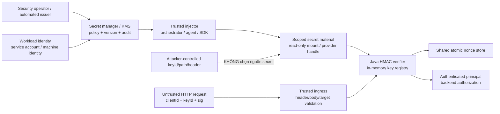
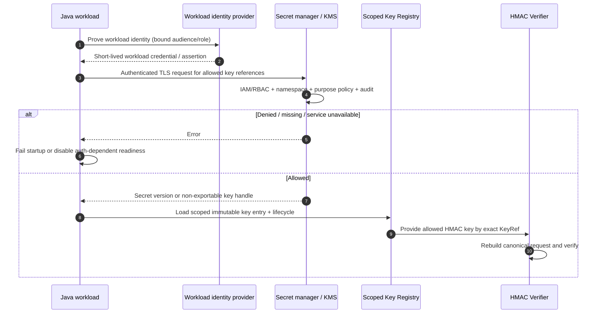
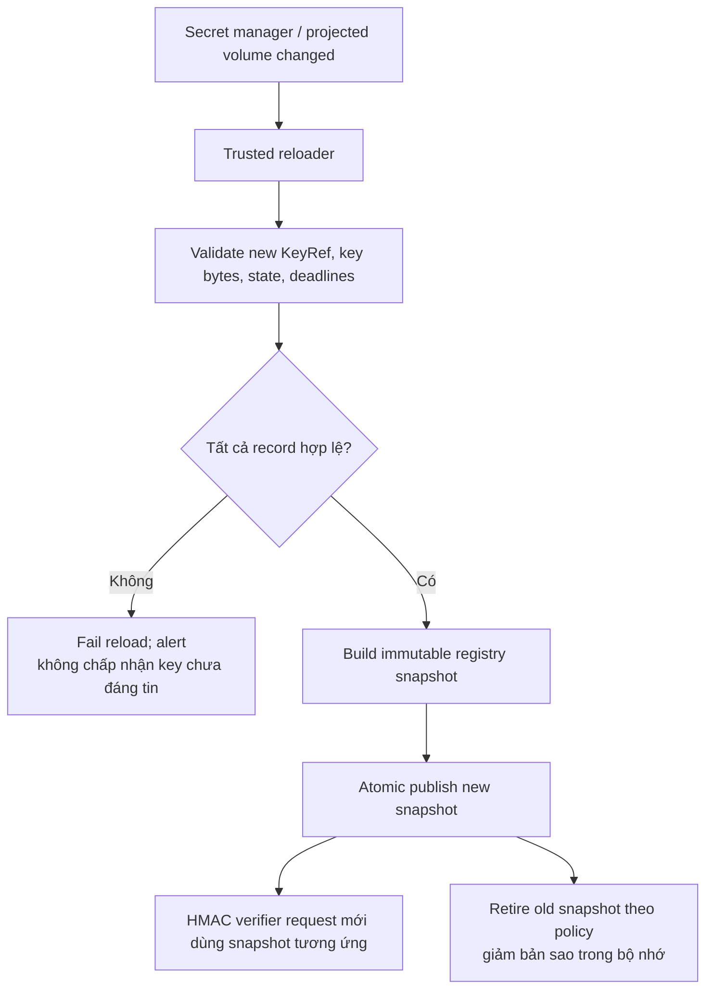

# Secret injection trong Secret management cho HMAC Request Authentication

## Mục tiêu học tập

Sau bài học, bạn có thể:

- Giải thích **secret injection** là quá trình đưa HMAC shared secret vào **đúng workload, đúng thời điểm, đúng phạm vi quyền**, thay vì nhúng trực tiếp secret trong mã nguồn, image, cấu hình công khai hoặc HTTP request.
- Vẽ **trust boundary** từ secret manager/KMS, workload identity, orchestrator/sidecar đến Java process và HMAC verifier; chỉ ra dữ liệu nào được tin trước/sau khi xác minh request.
- So sánh **environment variable**, **mounted secret file/volume**, **SDK gọi secret manager**, **sidecar/agent**, và **KMS/HSM key handle** theo rủi ro lộ dữ liệu, cập nhật khi rotation, độ trễ, tính sẵn sàng và khả năng audit.
- Quy định một hợp đồng injection cụ thể: secret HMAC-SHA256 là **32 bytes thô**, được định danh bằng `(environment, audience, clientId, keyId)`, nạp từ **đường dẫn tệp tin cậy** do deployment cung cấp; **không** nhận secret hay đường dẫn từ client.
- Viết mã Java 17+ đọc bounded raw secret bytes từ volume, kiểm tra trạng thái khóa, tính HMAC bằng `javax.crypto.Mac`, so full 32-byte tag bằng `MessageDigest.isEqual` và từ chối an toàn khi secret thiếu/sai format.
- Phân biệt **rotation của secret material** với cập nhật file/config: secret mới có **key ID mới**, cần rollout client/verifier có thứ tự, hard revoke, cache invalidation và replay namespace không tách theo key version.
- Thiết kế bootstrap, secret lifetime, fail-closed, logging/redaction, backup, incident response và kiểm thử injection trên nhiều replica sau proxy/gateway.
- Kết nối secret injection với **canonical HTTP request**, timestamp/nonce chống replay và sự phân biệt giữa **authentication** và **authorization**.

**Bối cảnh:** Bài thuộc chương **Secret management**, chủ đề trực tiếp **Secret injection**, của module `SECURITY_AUTHENTICATION_HMAC_REQUEST_AUTHENTICATION`. Module hướng tới xác thực HTTP request bằng HMAC với **shared secret** và **canonical request** chứa method, URI, signed headers/body; người học thực hành xác minh chữ ký, timestamp/nonce chống replay, quản lý key rotation, kiểm thử proxy/gateway và phân biệt xác thực với phân quyền. Bài tập trung vào **cách secret đi vào tiến trình** để HMAC verifier có thể dùng đúng secret mà không mở rộng vùng lộ bí mật.

> Tên `hmac-injection-v1`, môi trường, dịch vụ, secret path, HTTP header và lifecycle minh họa trong bài do chúng ta **tự định nghĩa**, không phải một authentication scheme chuẩn. Không có secret thật, credential, token hoặc API key production nào được nhúng vào ví dụ.

## 1. Secret injection là gì? Không chỉ là “đọc một biến môi trường”

Trong cơ chế HMAC, client và verifier cùng có khả năng dùng một **shared secret**. Với request message `M`:

\[
tag = \operatorname{HMAC\text{-}SHA256}(K, M)
\]

`K` là secret; `M` là **canonical bytes** thống nhất giữa client và server. HMAC tag có thể được gửi qua HTTP, nhưng **K không được gửi như một header trong từng request**.

Secret injection giải quyết việc **cung cấp K cho đúng tiến trình vào đúng thời điểm**, qua một kênh có chính sách phân quyền, ghi nhận truy cập, rotation và thu hồi. Những câu hỏi phải trả lời:

1. **Ai** có quyền đọc secret (service identity, cluster namespace, account, client)?
2. Secret được **lưu ở đâu** và có được mã hóa/quản lý vòng đời không?
3. **Bằng cách nào** tiến trình nhận secret: file, environment, API response, provider handle?
4. Secret tồn tại ở **những bản sao nào**: deployment manifests, process memory, logs, crash dumps, telemetry, backups?
5. Khi key bị thay/thu hồi, **mọi replica** nhận thông tin mới nhanh và nhất quán đến mức nào?
6. Nếu không tải được secret hoặc không xác định được key state, **request bị từ chối** hay hệ thống vô tình fallback?

### Một request không bao giờ được “inject secret” vào server

Sai:

```http
POST /v1/orders HTTP/1.1
X-Client-Id: partner-17
X-Shared-Secret: <plaintext-secret>
X-Signature: <tag>
```

Việc đưa secret vào request mỗi lần gọi **phá mô hình HMAC shared-secret authentication** vì secret đi qua nhiều lớp HTTP, tracing, proxy và có thể bị log. HMAC phải hoạt động như sau:

```text
Trusted secret source -> injected K -> HMAC verifier
Client request        -> keyId + signature + signed request data
                                       |
                                       v
                      Key lookup đúng scope -> HMAC(K, canonicalBytes)
                                                   |
                                                   v
                                             Compare tags
```

**`clientId`/`keyId` trên wire là untrusted metadata dùng để tìm bản ghi khóa ứng viên**, không phải bằng chứng caller là ai. **Chỉ sau HMAC đúng** mới có thể gắn principal từ key record.

## 2. Threat model: bảo vệ secret trên đường đến JVM

Secret injection có nhiều trust boundary hơn phép so HMAC. Một số threat actor và mục tiêu:

| Actor/tình huống | Hành vi có thể xảy ra | Điều cần bảo vệ |
|---|---|---|
| Attacker Internet | Gửi `keyId` giả, header sai, body lớn để kích hoạt lookup | Không được chọn path/secret tùy ý, không được bypass verify |
| Client hợp lệ A | Có secret riêng của mình, thử nhận diện khóa B | Không được lookup secret ngoài owner/scope |
| Người có quyền đọc repo/CI logs | Tìm secret trong file cấu hình, variables, artifact | Không hardcode, redact CI, hạn chế quyền và retention |
| Container khác trên host | Tìm secret qua shared filesystem, process env hoặc volume | Isolation, mount riêng, permission và runtime hardening |
| Người có quyền `exec`/debug trong pod | Đọc env, file, process memory | RBAC, audit, hạn chế shell/ephemeral containers |
| Node/root compromise | Đọc volume, RAM, agent cache, dump | Giảm blast radius; không hứa process memory bí mật trước root |
| Sidecar/agent lỗi hoặc quá quyền | Giao sai secret, để lộ response hoặc cache | Workload identity, TLS, policy, log redaction |
| Cache stale sau revocation | Vẫn verify bằng secret đã bị thu hồi | Hard deadline, invalidation, fail-closed khi state không đáng tin |
| Backup/snapshot cũ | Khôi phục key state cũ hoặc material đã revoke | Restore policy, version/tombstone và kiểm toán |

**Giả định an toàn:** một tiến trình đang nắm raw HMAC key **có khả năng tính MAC với key ấy**. Secret injection **không thể** làm key tuyệt đối an toàn nếu chính host/JVM bị toàn quyền kiểm soát. Mục tiêu là **giảm số bản sao**, **phân quyền truy cập** và **giảm thời gian hiệu lực**.

### Sơ đồ trust boundary



Đường nét đứt có nhãn **không được phép**: `keyId` từ HTTP chỉ chọn **một entry đã được provision/allowlist** trong key registry, không trở thành đường dẫn file, tên secret KMS hoặc tên biến môi trường trực tiếp.

## 3. Secret material, secret reference và key ID phải tách biệt

Ba đối tượng thường bị nhầm:

| Đối tượng | Ví dụ | Có thể công khai cho caller? | Vai trò |
|---|---|---|---|
| **Secret material** | 32 raw random bytes | **Không** | HMAC key `K` |
| **Secret reference** | `/var/run/secrets/hmac/k2.bin` hoặc provider resource ID | Chỉ dùng trong cấu hình tin cậy; không nên để caller điều khiển | Định vị nguồn injection |
| **Key ID** | `k2` | Có thể xuất hiện trong Authorization | Chọn bản ghi khóa trong namespace |
| **Client ID** | `partner-17` | Có thể xuất hiện trong Authorization | Lookup claim, chưa có tính xác thực |
| **Authenticated principal** | `svc:partner-17` | Do server tạo sau verify | Căn cứ kiểm tra quyền |
| **HMAC tag** | 32 bytes → Base64URL 43 chars | Gửi trên HTTP | Bằng chứng cryptographic đối với canonical message |

Một key record có thể là:

```text
KeyRef(
    environment = "production",
    audience    = "orders-api",
    clientId    = "partner-17",
    keyId       = "k2"
)
  -> SecretSourceRef   = trusted deployment configuration
  -> KeyState          = ACTIVE / VERIFY_ONLY / REVOKED
  -> VerifyDeadline    = server-controlled
  -> Principal         = svc:partner-17
  -> SecretMaterial    = 32 raw bytes (hoặc non-exportable handle)
```

**Bất biến quan trọng:** `KeyRef` phải xác định bất biến một secret material + algorithm policy. **Secret mới phải có key ID mới**, không ghi đè secret cũ dưới cùng ID. Nếu verifier A cache secret k2 cũ còn verifier B đọc secret k2 mới, request sẽ pass/fail tùy replica và có thể làm thu hồi kém hiệu quả.

### Vì sao không lấy `keyId` nối trực tiếp vào path?

Sai:

```java
// SAI: caller kiểm soát keyId, kéo theo file được đọc.
Path keyFile = Path.of("/secrets/" + request.keyId() + ".txt");
byte[] key = Files.readAllBytes(keyFile);
```

Ngoài path traversal và DoS, cách này bỏ qua **environment, audience, client ownership, lifecycle policy**. Dù đã regex key ID rất chặt, request vẫn không được phép quyết định secret source.

Đúng: chỉ tra trong một **registry được provision trước từ trusted config**, ví dụ:

```text
(KeyRef(production, orders-api, partner-17, k1)) -> allowed source k1.bin
(KeyRef(production, orders-api, partner-17, k2)) -> allowed source k2.bin
Unrecognized KeyRef -> reject (không fallback, không filesystem scan)
```

**Tên file trong bảng này là chi tiết deployment, không được lấy từ request để xây dựng động.**

## 4. Nguồn injection: environment, file, agent hay KMS?

Không có một cơ chế tốt nhất cho mọi hệ thống. Chọn theo khả năng của runtime và threat model, nhưng vẫn phải bảo đảm **provisioning có kiểm soát, identity, key version, permission, rotation và fail-closed**.

| Cách đưa secret tới app | Ưu điểm | Rủi ro/giới hạn | Phù hợp khi |
|---|---|---|---|
| Environment variable **chứa chính secret** | Dễ dùng, phổ biến ở runtime/serverless | Dễ lộ qua diagnostics/process inspection/dump, child process; thường không refresh trong process; dễ copy vào log | Môi trường nhỏ, có policy chặt và không thể dùng nguồn khác |
| Environment variable **chỉ chứa đường dẫn** | Không đưa secret bytes vào env; tương thích Java | App vẫn có quyền đọc file, path phải trusted, mount/perms có thể sai | Container có secret volume hoặc agent |
| **Read-only mounted secret file** | Phân quyền file/volume, tách material khỏi image, cập nhật được qua controlled mount | Pod/node/sidecar có thể đọc, secret mount vẫn là plaintext trong process; cần reload/permission | Kubernetes/VM có volume chuyên biệt |
| Secret manager SDK pull | Workload identity + IAM, version/audit, lấy theo nhu cầu | Bootstrap credentials, network/quota/latency/outage, local cache và handling plaintext | Dịch vụ có secret backend được kiểm soát |
| Agent/sidecar inject file | App đơn giản; agent chịu trách nhiệm identity, renew, templating | Agent có thêm quyền/attack surface, refresh semantics và race, filesystem sharing | Nhiều workload cùng nền tảng secret distribution |
| KMS/HSM **non-exportable key** | Tránh đưa raw key ra JVM khi provider/operation hỗ trợ | Không phải mọi KMS hỗ trợ MAC verify/HMAC cùng thuật toán; network/cost/permissions | Khóa cực nhạy, hệ thống có dịch vụ MAC/verify phù hợp |
| Encrypted config trong image/repo | Có vẻ dễ deploy | Vẫn phải inject **decryption key**, rủi ro log/build/backup và kiểm soát truy cập sai | Chỉ khi có quy trình envelope encryption chuẩn và kiểm toán |

### Environment variable: vấn đề không chỉ là tên biến

`HMAC_SECRET` chứa plaintext là cách nhanh nhất nhưng không có “phép màu” bảo mật: biến môi trường nằm trong process, có thể bị đọc bởi debugger/admin, được truyền cho child processes và đi vào crash reports tùy cấu hình.

Ví dụ kiểu **không nên**:

```bash
# KHÔNG LÀM THẾ NÀY VỚI SECRET THẬT:
export HMAC_SECRET="raw-secret-visible-in-terminal-history"
java -DHMAC_SECRET="another-plaintext-secret" -jar app.jar
```

Vấn đề ở cả **shell history**, **command-line/process arguments**, cấu hình CI, điều tra sự cố và log. Không xuất secret trong ví dụ thật, kịch bản debug hay ticket. System property qua `-D` còn có thể lộ trên command line; chuyển sang `System.getProperty()` không tự làm cơ chế an toàn hơn.

**Mẫu của bài:** environment chỉ chứa **path đến raw key file**, còn secret bytes được inject bằng volume. Đó là một quyết định giảm bề mặt lộ plaintext trong env, **không phải lời bảo đảm bí mật trước người đã có quyền đọc container**.

## 5. Provisioning: secret phải được sinh, lưu và cấp đúng scope

Một quy trình đáng tin nên bắt đầu **trước khi JVM khởi động**.

### 5.1. Sinh HMAC secret mới

Đối với profile HMAC-SHA256 ở đây, chọn **32 bytes lấy từ CSPRNG** và provisioning qua secret manager/KMS. 32 bytes ngẫu nhiên là một lựa chọn mạnh cho secret HMAC-SHA256; không lấy password người dùng hay chuỗi dễ nhớ làm HMAC key.

```java
import java.security.SecureRandom;

byte[] rawKey = new byte[32];
new SecureRandom().nextBytes(rawKey);
// Chỉ dùng ở provisioning tool/fixture có quyền.
// KHÔNG System.out.println(Arrays.toString(rawKey));
// KHÔNG hardcode hoặc ghi rawKey vào repo.
```

`SecureRandom` cung cấp byte output thích hợp khi provider/runtime và entropy source được cấu hình đúng. Việc dùng `nextBytes` không thay thế policy bảo vệ kết quả. Với hệ thống có KMS/HSM tạo key, nên dùng API tạo khóa của provider thích hợp và để key material không xuất hiện ở chỗ không cần thiết.

### 5.2. Chọn định danh và quyền truy cập

Trước khi cấp, định nghĩa:

- `environment=production` hay `sandbox` — không dùng lại secret giữa hai môi trường.
- `audience=orders-api` — không dùng cùng secret cho một API khác nếu có thể, và ký audience/domain separation.
- `clientId=partner-17` — một owner được xác định và mapping principal rõ ràng.
- `keyId=k2` — phiên bản mới, **không tái sử dụng** key ID cũ.
- Quyền `maySign`/`mayVerify` và deadline verify/revoke.
- Identity của workloads được phép **đọc** hoặc **sử dụng** khóa: verifier có cần plaintext? signer có được dùng key riêng của client không?

**Nguyên tắc least privilege:** verifier của dịch vụ A không được đọc key của dịch vụ B; sandbox workload không được lấy production secret; CI build bình thường không có lý do đọc HMAC production key.

### 5.3. Không chuyển secret qua quy trình build

Build image từ source code và dependencies; secret injection xảy ra ở **runtime/deployment**, không qua `Dockerfile ARG`, commit file `.env`, image layer, test fixture hay baked JAR.

```dockerfile
# Anti-pattern: secret xuất hiện trong build context/layer.
# ARG HMAC_SECRET
# ENV HMAC_SECRET=$HMAC_SECRET
# COPY secrets/production.bin /app/production.bin

# Đúng hướng: image KHÔNG chứa secret;
# runtime mount secret volume có quyền đọc tối thiểu.
```

Ngay cả khi file bị xóa ở layer sau, một image/layer hoặc build cache vẫn có thể giữ bản sao. Phải kiểm tra pipeline, artifacts, SBOM và logging policy; không dùng `--build-arg` để “giấu secret”.

## 6. Kubernetes Secret volume: một mẫu injection thực tế

Một cách triển khai là **runtime mount** key material do nền tảng quản lý; JVM chỉ nhận **đường dẫn** từ biến môi trường tin cậy.

### 6.1. Deployment minh họa, không chứa raw secret

```yaml
apiVersion: apps/v1
kind: Deployment
metadata:
  name: orders-hmac-verifier
spec:
  replicas: 3
  selector:
    matchLabels:
      app: orders-hmac-verifier
  template:
    metadata:
      labels:
        app: orders-hmac-verifier
    spec:
      # Quan sát permissions thực tế với runtime/storage driver.
      securityContext:
        runAsNonRoot: true
        runAsUser: 10001
        runAsGroup: 2000
        fsGroup: 2000
      containers:
        - name: verifier
          image: registry.example.test/orders-hmac-verifier:1.0.0
          env:
            # PATH, KHÔNG phải raw secret bytes.
            - name: HMAC_K1_FILE
              value: /var/run/secrets/hmac/k1.bin
            - name: HMAC_K2_FILE
              value: /var/run/secrets/hmac/k2.bin
          volumeMounts:
            - name: hmac-key-material
              mountPath: /var/run/secrets/hmac
              readOnly: true
          securityContext:
            allowPrivilegeEscalation: false
            readOnlyRootFilesystem: true
            capabilities:
              drop: ["ALL"]
          resources:
            requests:
              cpu: "100m"
              memory: "128Mi"
            limits:
              memory: "512Mi"
      volumes:
        - name: hmac-key-material
          secret:
            secretName: orders-partner17-hmac-keys
            defaultMode: 0440
            items:
              - key: k1.bin
                path: k1.bin
              - key: k2.bin
                path: k2.bin
```

**Đây là minh họa topology, không phải manifest đủ cho sản phẩm.** Image URL, quyền chạy, UID/GID, NetworkPolicy, service account, resource sizing và secretName cần chỉnh theo hạ tầng; secret được provision ngoài manifest này. Với key owner khác, không nên cho **mọi tenant key** vào một volume của một workload có phạm vi quá rộng.

Một số điểm cần xác minh thực tế:

- Kubernetes **Secret object không phải encrypted chỉ vì field `data` dùng Base64**; Base64 là encoding, không phải encryption. Cần RBAC, admission, mã hóa dữ liệu at rest ở lớp lưu trữ, node security và audit.
- Secret volume chứa **plaintext raw bytes** ở nơi container được phép đọc. `readOnly: true` ngăn ứng dụng sửa mount, **không** ngăn ứng dụng/attacker trong process đọc.
- Với `runAsUser` khác root và `defaultMode: 0440`, kiểm tra owner/group/permissions trên **runtime cụ thể**; `fsGroup` có thể tác động ownership của projected volume theo thiết lập nền tảng. Không chỉ nhìn YAML rồi giả định process đọc được.
- Secret volume Kubernetes thường dùng **symlink/atomic writer** cho cập nhật. Nếu Java tự reject mọi symlink bằng `NOFOLLOW_LINKS`, có thể vô tình làm hỏng volume cập nhật hợp lệ; phải bảo vệ mount root, deployment quyền và nguồn dữ liệu ở **trusted orchestration boundary**.
- Các mount dùng **`subPath`** có thể không tự nhận cập nhật Secret theo cơ chế volume thông thường. Tránh dùng `subPath` cho keys cần cập nhật, hoặc chấp nhận quy trình restart có kiểm soát.
- Không bảo đảm mọi process tự **nạp lại key** khi file bên dưới thay đổi. JVM đọc file một lần rồi cache sẽ tiếp tục dùng bytes cũ cho đến khi reload/restart hoặc state invalidation.

### 6.2. Điều đặc biệt về bytes trong Kubernetes Secret

Nếu secret được cấp bằng một **file nhị phân 32 bytes**, khi mount, nội dung `k2.bin` là chính **32 bytes ấy**. Cú pháp Base64 trong Kubernetes API `data` chỉ là **encoding để biểu diễn bytes qua YAML/JSON**.

**Không decode Base64 hai lần.** Nếu file chứa 32 raw bytes, Java `Files.readAllBytes(path)` là đủ. Nếu file lại chứa **text Base64** của key thì nó là **giao thức dữ liệu khác**: phải định nghĩa lại và decode **đúng một lần** theo contract, không âm thầm đoán dựa trên độ dài/charset.

Profile bài này chốt **raw binary 32 bytes**, không dùng key dưới dạng UTF-8 password hoặc Base64 text.

### 6.3. Secret API/RBAC không được mở rộng quá mức

Quyền `get/list/watch secrets` ở API cluster có thể làm lộ secret ngoài workload; không cấp rộng cho ứng dụng nếu chỉ cần đọc **mounted volume**. Không đặt quyền đọc secret production vào service account của CI runner hoặc debug pod. NetworkPolicy, admission control và namespace isolation hỗ trợ nhưng **không thay** least privilege, encryption-at-rest và bảo vệ node.

## 7. Bootstrap identity và mô hình app pull / sidecar

Một hệ thống có secret manager bên ngoài không nên giải quyết bootstrap bằng cách hardcode **một secret khác** trong image.

### 7.1. App pull từ secret manager



Các thành phần quan trọng:

- **Identity ngắn hạn** từ workload attestation/service identity thay cho access key vô hạn hardcoded.
- **TLS + server authentication**, không tắt certificate verification khi kết nối secret manager.
- **Phạm vi secret reference được allowlist** theo service/tenant/env, không để `keyId` trên HTTP trở thành tên secret backend API.
- **Audit** ai đọc key version nào, nhưng không lưu plaintext key trong log.
- **Timeout/retry/backoff có giới hạn**; khi secret manager lỗi thì không dùng một “default dev secret” để tiếp tục nhận production requests.

### 7.2. Sidecar/agent inject file

Agent có thể lấy secret thay ứng dụng, ghi vào một vùng file được bảo vệ và hỗ trợ rotation. Nhưng lúc này agent trở thành **một thành phần có quyền cao** cần hardening: authenticating to provider, template rendering, token renewal, cache permission, telemetry và lỗi refresh.

Nếu agent cập nhật file, ứng dụng cần biết khi nào nạp lại và **không đọc key half-written**. Thực hành nên dùng **versioned immutable file/atomic symlink swap** hoặc reload từ provider snapshot với validation, thay vì ghi đè cùng path/key ID không nhất quán.

### 7.3. KMS/HSM non-exportable key: ưu và hạn chế

Một số KMS/HSM/provider hỗ trợ **GenerateMac/VerifyMac** hoặc cơ chế tương đương cho thuật toán MAC cụ thể; JVM có thể giữ **key handle** thay vì raw key. Khi đó raw secret có thể không rời provider.

Nhưng **không thể** giả định mọi KMS có đúng API HMAC-SHA256, mọi key type hoặc mọi quota/latency phù hợp. Cần xác minh với provider cụ thể. Java `SecretKeySpec(rawBytes,"HmacSHA256")` chỉ hoạt động khi có raw key bytes; muốn dùng non-exportable key phải có **provider integration hoặc remote MAC/verify API** thích hợp, không tự lấy một key ID làm `SecretKeySpec`.

**Shared secret giữa client và server** vẫn đặt câu hỏi cấp key cho client: nếu provider chỉ dùng được key ở phía server thì client phải có một cơ chế ký tương thích và được cấp quyền. Không ngẫu nhiên chuyển sang asymmetric signing mà không thay đổi threat model và protocol.

## 8. Java 17+: đọc secret từ mounted file một cách nghiêm ngặt

Mục tiêu code là minh họa **secret injection boundary**. Trước khi xử lý HTTP, deployment đã xác lập **hai đường dẫn cụ thể** cho hai bản ghi `k1`/`k2` bằng `HMAC_K1_FILE` và `HMAC_K2_FILE`. Request bên ngoài chỉ cung cấp `clientId`/`keyId` để tìm key trong registry đã load, **không thể tạo path mới**.

### 8.1. Chính sách nạp key

- Path đến key file được lấy từ **trusted deployment config**, không từ HTTP request.
- Path phải **absolute**, nằm dưới mount root do vận hành quy định, ví dụ `/var/run/secrets/hmac`.
- File được mount read-only, runtime process có quyền đọc; trước khi bật readiness, kiểm tra file tồn tại, đúng **32 raw bytes**, không whitespace, BOM hay newline.
- Nếu thiếu/sai secret, startup **fail closed**; không tạo secret ngẫu nhiên để “cứu” verifier, vì client sẽ không có cùng key và có thể tạo cấu hình sai khó phát hiện.
- Không `String`-hóa secret, không in hex/Base64, không log exception có chứa raw key hoặc file content.
- Key được load vào một **registry có định danh bất biến**; mỗi HTTP request chỉ tra một `KeyRef`. Key state có thể bị thu hồi theo source of truth, không chỉ dựa vào key bytes đã cache từ startup.

### 8.2. Đọc file injection: file size phải theo raw-byte contract

```java
import java.io.IOException;
import java.nio.file.Files;
import java.nio.file.Path;
import java.util.Arrays;

public final class MountedHmacKeyReader {
    // Tập đường dẫn bên dưới do deployment quyết định, không từ HTTP.
    private static final Path ROOT =
            Path.of("/var/run/secrets/hmac").toAbsolutePath().normalize();

    private MountedHmacKeyReader() {}

    public static byte[] readKeyFromEnvironment(String pathVariable)
            throws IOException {
        String rawPath = System.getenv(pathVariable);
        if (rawPath == null || rawPath.isBlank()) {
            throw new IOException("Missing trusted key path configuration");
        }
        Path configured = Path.of(rawPath);
        if (!configured.isAbsolute()) {
            throw new IOException("Secret path must be absolute");
        }
        Path path = configured.normalize();
        if (!path.startsWith(ROOT) || path.equals(ROOT)) {
            throw new IOException("Secret path outside allowed mount");
        }

        // Kubernetes projected secret files có thể là symlinks:
        // chỉ dùng ROOT đã được orchestration/permissions tin cậy.
        if (!Files.isRegularFile(path) || Files.size(path) != 32L) {
            throw new IOException("Invalid mounted HMAC key file");
        }
        byte[] bytes = Files.readAllBytes(path);
        if (bytes.length != 32) {
            Arrays.fill(bytes, (byte) 0);
            throw new IOException("Invalid raw key byte length");
        }
        return bytes; // Caller sở hữu mutable array và phải kiểm soát.
    }
}
```

**Điều đoạn mã kiểm tra được:** absolute/normalized path theo allowlist, file size hợp đồng, **raw key đúng 32 bytes** và fail startup nếu không đáp ứng. Nó **không chứng minh file không bị thay** giữa `Files.size` và `Files.readAllBytes` hay bảo vệ trước một kẻ tấn công có quyền ghi mount root.

Ở production, mount phải đến từ **trusted infrastructure không có writer thù địch**, và nên dùng **versioned immutable source** hoặc provider có semantics atomic. Để chống symlink/path-race ở môi trường có đối thủ ghi vào cây file, cần chính sách OS/container mạnh hơn, API mở file an toàn theo platform và/hoặc non-exportable key handle; không chỉ dựa vào `Path.normalize()`.

### Không lưu secret trong `String`

Java `String` là immutable và không có API bảo đảm xóa mọi bản sao nội dung khỏi heap. Với raw 32 bytes, dùng `byte[]`/`SecretKey` và giới hạn số bản sao; vẫn không thể hứa **zeroization hoàn hảo** vì JVM/JIT/GC, `SecretKeySpec`, provider, crash dump và heap dump có thể giữ các bản sao khác.

Nếu từ secret manager nhận một chuỗi text theo format cụ thể, parser phải decode **đúng một lần**, xác nhận encoding canonical và hạn chế tồn tại của text; không lấy `text.getBytes()` làm HMAC key khi contract thực tế là base64(rawKey).

## 9. Java 17+: verifier dùng key đã inject, không nhận secret từ client

Ví dụ tự chứa dưới đây kết hợp file-based injection với scoped key registry và HMAC verifier. Để tập trung vào injection, `HMAC_K1_FILE`/`HMAC_K2_FILE` được cung cấp bởi deployment; client/HTTP không gửi file path.

Profile `hmac-injection-v1`:

```http
POST /v1/orders HTTP/1.1
Host: api.example.test
Content-Type: application/json
Idempotency-Key: order-2026-001
Authorization: HMAC-V1 client="partner-17", keyid="k2", ts="<epoch-seconds>", nonce="<22-char-base64url>", sig="<43-char-base64url>"

{"orderId":"O-42","amountMinor":120000}
```

Các chuỗi `<...>` là placeholder. Hợp đồng canonical sẽ ký method, URI, trusted Host, Content-Type, Idempotency-Key, environment, audience, client/key ID, timestamp/nonce và SHA-256 exact raw body bytes.

### 9.1. Full Java example (JDK 17+)

```java
import java.io.IOException;
import java.nio.file.Files;
import java.nio.file.Path;
import java.nio.charset.StandardCharsets;
import java.security.GeneralSecurityException;
import java.security.MessageDigest;
import java.security.SecureRandom;
import java.time.Clock;
import java.time.Instant;
import java.util.Arrays;
import java.util.Base64;
import java.util.Map;
import java.util.Optional;
import java.util.Set;
import java.util.concurrent.ConcurrentHashMap;
import java.util.regex.Matcher;
import java.util.regex.Pattern;
import javax.crypto.Mac;
import javax.crypto.spec.SecretKeySpec;

public final class HmacInjectedSecretV1 {
    private static final String CONTRACT = "hmac-injection-v1";
    private static final String ENV = "production";
    private static final String AUD = "orders-api";
    private static final String HOST = "api.example.test";
    private static final String TARGET = "/v1/orders";
    private static final long SKEW_SECONDS = 300L;
    private static final long NONCE_TTL_SECONDS = 605L;
    private static final long MAX_EPOCH = 253402300799L;
    private static final Base64.Encoder B64 =
            Base64.getUrlEncoder().withoutPadding();
    private static final Path KEY_ROOT =
            Path.of("/var/run/secrets/hmac").toAbsolutePath().normalize();

    private static final Pattern ID =
            Pattern.compile("[A-Za-z0-9][A-Za-z0-9._-]{0,63}");
    private static final Pattern IDEM =
            Pattern.compile("[A-Za-z0-9][A-Za-z0-9._-]{0,79}");
    private static final Pattern TS =
            Pattern.compile("[1-9][0-9]{0,11}");
    private static final Pattern NONCE =
            Pattern.compile("[A-Za-z0-9_-]{22}");
    private static final Pattern SIG =
            Pattern.compile("[A-Za-z0-9_-]{43}");
    // Full-match: 1 Authorization, 5 quoted params, fixed order/spacing.
    // Chỉ tên scheme/param case-insensitive; values case-sensitive.
    private static final Pattern AUTH = Pattern.compile(
            "(?i:HMAC-V1) (?i:client)=\"([A-Za-z0-9][A-Za-z0-9._-]{0,63})\", " +
            "(?i:keyid)=\"([A-Za-z0-9][A-Za-z0-9._-]{0,63})\", " +
            "(?i:ts)=\"([1-9][0-9]{0,11})\", " +
            "(?i:nonce)=\"([A-Za-z0-9_-]{22})\", " +
            "(?i:sig)=\"([A-Za-z0-9_-]{43})\"");

    private HmacInjectedSecretV1() {}

    public enum KeyState { ACTIVE, VERIFY_ONLY, REVOKED }

    public record KeyRef(
            String environment, String audience,
            String clientId, String keyId) {}

    public record KeyRecord(
            KeyRef ref, String principal, KeyState state,
            Instant verifyUntil, byte[] secret) {
        public KeyRecord {
            if (secret == null || secret.length != 32) {
                throw new IllegalArgumentException("Bad raw secret");
            }
            secret = secret.clone();
        }
        @Override public byte[] secret() {
            return secret.clone();
        }
        public boolean canVerify(Instant now) {
            return (state == KeyState.ACTIVE ||
                    state == KeyState.VERIFY_ONLY) &&
                    now.isBefore(verifyUntil);
        }
    }

    public record Claims(
            String clientId, String keyId, String timestamp,
            String nonce) {}
    public record Parsed(Claims claims, byte[] receivedTag) {}

    // Dữ liệu này chỉ do trusted HTTP adapter dựng sau parse/limits.
    public record Request(
            String method, String rawTarget, String publicHost,
            String contentType, String idempotencyKey, byte[] rawBody) {
        public Request {
            if (rawBody == null) {
                throw new IllegalArgumentException("Missing raw body");
            }
            rawBody = rawBody.clone();
        }
        @Override public byte[] rawBody() {
            return rawBody.clone();
        }
    }

    public interface KeyDirectory {
        Optional<KeyRecord> find(KeyRef ref);
    }

    public interface NonceStore {
        // Production: atomic claim + TTL, shared mọi replica.
        boolean claim(
                String env, String audience,
                String client, String nonce, long ttl);
    }

    // Chỉ nhận FILE PATH từ deployment config, không nhận request fields.
    public static byte[] readRaw32(String envName) throws IOException {
        String configured = System.getenv(envName);
        if (configured == null || configured.isBlank()) {
            throw new IOException("Missing key file path configuration");
        }
        Path supplied = Path.of(configured);
        if (!supplied.isAbsolute()) {
            throw new IOException("Key path must be absolute");
        }
        Path file = supplied.normalize();
        if (!file.startsWith(KEY_ROOT) || file.equals(KEY_ROOT) ||
                !Files.isRegularFile(file) ||
                Files.size(file) != 32L) {
            throw new IOException("Invalid secret file reference/size");
        }
        byte[] loaded = Files.readAllBytes(file);
        if (loaded.length != 32) {
            Arrays.fill(loaded, (byte) 0);
            throw new IOException("Expected exactly 32 raw key bytes");
        }
        return loaded;
    }

    private static byte[] strictBase64Url(
            String text, Pattern grammar, int n) {
        if (text == null || !grammar.matcher(text).matches()) {
            throw new IllegalArgumentException("Bad Base64URL grammar");
        }
        final byte[] bytes;
        try {
            bytes = Base64.getUrlDecoder().decode(text);
        } catch (IllegalArgumentException invalid) {
            throw new IllegalArgumentException("Bad Base64URL");
        }
        if (bytes.length != n ||
                !B64.encodeToString(bytes).equals(text)) {
            throw new IllegalArgumentException("Noncanonical Base64URL");
        }
        return bytes;
    }

    private static long timestampSeconds(String text) {
        if (text == null || !TS.matcher(text).matches()) {
            throw new IllegalArgumentException("Bad timestamp format");
        }
        long t = Long.parseLong(text);
        if (t > MAX_EPOCH) {
            throw new IllegalArgumentException("Timestamp out of range");
        }
        return t;
    }

    private static Parsed parseAuthorization(String header) {
        if (header == null || header.length() > 512) {
            throw new IllegalArgumentException("Invalid Authorization");
        }
        Matcher m = AUTH.matcher(header);
        if (!m.matches()) {
            throw new IllegalArgumentException("Bad Authorization fields");
        }
        Claims c = new Claims(m.group(1), m.group(2),
                              m.group(3), m.group(4));
        timestampSeconds(c.timestamp());
        strictBase64Url(c.nonce(), NONCE, 16);
        return new Parsed(
                c, strictBase64Url(m.group(5), SIG, 32));
    }

    public static String freshNonce(SecureRandom rng) {
        byte[] nonce = new byte[16];
        rng.nextBytes(nonce);
        return B64.encodeToString(nonce);
    }

    // Client và server CHỈ dùng cùng một hợp đồng canonical.
    private static byte[] canonical(Request r, Claims c)
            throws GeneralSecurityException {
        if (r == null || !"POST".equals(r.method()) ||
                !TARGET.equals(r.rawTarget()) ||
                !HOST.equals(r.publicHost()) ||
                !"application/json".equals(r.contentType()) ||
                r.idempotencyKey() == null ||
                !IDEM.matcher(r.idempotencyKey()).matches() ||
                r.rawBody().length == 0 ||
                r.rawBody().length > 16 * 1024 ||
                c == null || !ID.matcher(c.clientId()).matches() ||
                !ID.matcher(c.keyId()).matches()) {
            throw new IllegalArgumentException("Bad signed request");
        }
        timestampSeconds(c.timestamp());
        strictBase64Url(c.nonce(), NONCE, 16);
        byte[] digest = MessageDigest.getInstance("SHA-256")
                .digest(r.rawBody());
        String text = String.join("\n",
                CONTRACT,
                "POST",
                TARGET,
                "host:" + r.publicHost(),
                "content-type:" + r.contentType(),
                "idempotency-key:" + r.idempotencyKey(),
                "environment:" + ENV,
                "audience:" + AUD,
                "auth-scheme:hmac-v1",
                "client:" + c.clientId(),
                "keyid:" + c.keyId(),
                "ts:" + c.timestamp(),
                "nonce:" + c.nonce(),
                "body-sha256:" + B64.encodeToString(digest));
        return text.getBytes(StandardCharsets.UTF_8);
    }

    private static byte[] calculateTag(
            byte[] keyMaterial, Request r, Claims c)
            throws GeneralSecurityException {
        try {
            Mac mac = Mac.getInstance("HmacSHA256");
            mac.init(new SecretKeySpec(keyMaterial, "HmacSHA256"));
            return mac.doFinal(canonical(r, c));
        } finally {
            // Chỉ xóa bản SAO do KeyRecord.secret() cung cấp.
            // Không hứa xóa mọi bản sao trong JDK/provider/JVM heap.
            Arrays.fill(keyMaterial, (byte) 0);
        }
    }

    // Signer test fixture. Server production không ký hộ request client.
    private static String signForTest(
            KeyRecord key, Request request, Claims claims)
            throws GeneralSecurityException {
        return B64.encodeToString(
                calculateTag(key.secret(), request, claims));
    }

    // Verifier KHÔNG đọc secret file trong mỗi HTTP request.
    // Registry do trusted startup/reload chuẩn bị trước.
    public static Optional<String> authenticate(
            Request incoming, String authorizationValue,
            Clock serverClock, KeyDirectory directory, NonceStore nonces)
            throws GeneralSecurityException {
        final Parsed parsed;
        try {
            parsed = parseAuthorization(authorizationValue);
            canonical(incoming, parsed.claims());
        } catch (IllegalArgumentException malformed) {
            return Optional.empty();
        }

        long now = serverClock.instant().getEpochSecond();
        long t = timestampSeconds(parsed.claims().timestamp());
        if (now < 0 || now > MAX_EPOCH ||
                t - now < -SKEW_SECONDS ||
                t - now > SKEW_SECONDS) {
            return Optional.empty();
        }

        // env + audience từ server; clientId/keyId chỉ là lookup input.
        KeyRef ref = new KeyRef(ENV, AUD,
                parsed.claims().clientId(),
                parsed.claims().keyId());
        Optional<KeyRecord> candidate = directory.find(ref);
        if (candidate.isEmpty()) return Optional.empty();

        KeyRecord key = candidate.get();
        if (!ref.equals(key.ref()) ||
                key.principal() == null ||
                !key.canVerify(serverClock.instant())) {
            return Optional.empty();
        }

        byte[] expected = calculateTag(
                key.secret(), incoming, parsed.claims());
        if (!MessageDigest.isEqual(expected, parsed.receivedTag())) {
            return Optional.empty();
        }

        // Nonce KHÔNG scope theo keyId -> nhất quán qua rotation.
        final boolean fresh;
        try {
            fresh = nonces.claim(ENV, AUD, key.ref().clientId(),
                    parsed.claims().nonce(), NONCE_TTL_SECONDS);
        } catch (RuntimeException storageFailure) {
            return Optional.empty(); // Fail closed.
        }
        if (!fresh) return Optional.empty();

        return Optional.of(key.principal()); // Authn, còn phải authz.
    }

    public static void main(String[] args)
            throws IOException, GeneralSecurityException {
        // Deployment phải inject 2 raw 32-byte key files trước startup.
        // Thiếu file/size sai: chương trình KHÔNG chạy với default key.
        byte[] oldBytes = readRaw32("HMAC_K1_FILE");
        byte[] newBytes = readRaw32("HMAC_K2_FILE");

        KeyRef k1 = new KeyRef(ENV, AUD, "partner-17", "k1");
        KeyRef k2 = new KeyRef(ENV, AUD, "partner-17", "k2");
        Clock clock = Clock.systemUTC();
        Instant now = clock.instant();

        KeyRecord oldKey;
        KeyRecord currentKey;
        try {
            oldKey = new KeyRecord(k1, "svc:partner-17",
                    KeyState.VERIFY_ONLY, now.plusSeconds(600), oldBytes);
            currentKey = new KeyRecord(k2, "svc:partner-17",
                    KeyState.ACTIVE, now.plusSeconds(86400), newBytes);
        } finally {
            Arrays.fill(oldBytes, (byte) 0);
            Arrays.fill(newBytes, (byte) 0);
        }

        // DEMO: production registry phải phản ánh revocation state
        // mới nhất từ source of truth và bảo vệ hard verify deadline.
        Map<KeyRef, KeyRecord> allowed =
                Map.of(k1, oldKey, k2, currentKey);
        KeyDirectory directory = ref ->
                Optional.ofNullable(allowed.get(ref));

        // Fixture local: không có TTL, không durable/multi-replica.
        Set<String> seen = ConcurrentHashMap.newKeySet();
        NonceStore nonces = (env, audience, client, nonce, ttl) ->
                seen.add(env + ":" + audience + ":" + client + ":" + nonce);

        SecureRandom rng = new SecureRandom();
        Claims claims = new Claims("partner-17", "k2",
                Long.toString(clock.instant().getEpochSecond()),
                freshNonce(rng));
        Request request = new Request(
                "POST", TARGET, HOST, "application/json",
                "order-2026-001",
                "{\"orderId\":\"O-42\",\"amountMinor\":120000}"
                        .getBytes(StandardCharsets.UTF_8));

        String tag = signForTest(currentKey, request, claims);
        String header = "HMAC-V1 client=\"" + claims.clientId() +
                "\", keyid=\"" + claims.keyId() +
                "\", ts=\"" + claims.timestamp() +
                "\", nonce=\"" + claims.nonce() +
                "\", sig=\"" + tag + "\"";

        if (!"svc:partner-17".equals(authenticate(
                request, header, clock, directory, nonces).orElse(null))) {
            throw new AssertionError("Injected key verification failed");
        }
        if (authenticate(request, header, clock, directory, nonces)
                .isPresent()) {
            throw new AssertionError("Replay accepted");
        }

        // Attacker thay key ID nhưng không có key mới:
        // không được tìm secret tùy tiện hoặc fallback.
        String changedId = header.replace("keyid=\"k2\"",
                "keyid=\"unknown\"");
        if (authenticate(request, changedId, clock,
                directory, nonces).isPresent()) {
            throw new AssertionError("Unknown keyId accepted");
        }

        System.out.println("Injected secret verifier: PASS");
        // Không in bytes, Base64 secret, tag hoặc Authorization header.
    }
}
```

### 9.2. Những bảo đảm ví dụ đạt được

- **Injection boundary:** `readRaw32` chỉ đọc từ path do deployment cung cấp; **không tạo path từ `keyId`** của HTTP request.
- **Key length:** file phải chứa đúng **32 raw bytes**, không tự đoán bytes là password/Base64 text.
- **Key registry:** mỗi `KeyRef(env,audience,clientId,keyId)` dẫn tới một record đã provision với owner, state và deadline.
- **Rotation:** k1 và k2 là **hai material độc lập**, không ghi đè cùng key ID. Demo cho k1 `VERIFY_ONLY` và k2 `ACTIVE`.
- **Cryptographic:** canonical chứa `keyid`, `client`, timestamp/nonce, method/URI/Host/signed headers và SHA-256 raw body; tag được kiểm tra với **exact scoped key** và `MessageDigest.isEqual`.
- **Replay:** nonce được claim **sau HMAC** vào `NonceStore`. Scope dựa trên client/audience/env, không thêm key ID.
- **No default fallback:** thiếu secret path/file, file sai size hoặc keyId không tồn tại đều **không chuyển sang secret mẫu**.
- **Secret copy:** khi nạp, mảng tạm được xóa sau khi `KeyRecord` clone; khi tính MAC, mảng key copy tạm được xóa. Đây là **giảm dư thừa**, không chứng minh JVM không giữ bản sao.
- **Không có logging secret** trong `main`. Việc hiện `"Injected secret verifier: PASS"` không tiết lộ key bytes.

### 9.3. Những điều demo **không** thể tự bảo vệ

- `Map.of` không tự cập nhật revocation state: k1 trong memory có thể vẫn verify đến deadline dù source of truth vừa revoke. Production phải có **versioned key snapshot/reload/invalidation**, hoặc remote key-state check với policy rõ.
- `ConcurrentHashMap.newKeySet()` chỉ bảo vệ nonce trong **một JVM**, không TTL, không chia sẻ nhiều replica/vùng và không durable.
- File-based injection không thể ngăn attacker đã chiếm host/root/JVM đọc process memory hoặc volume.
- `readRaw32` chỉ an toàn theo **giả định mount root trusted và read-only**; không phải cách chống file-symlink race trước writer thù địch.
- Mã chưa parse raw HTTP network bytes; HTTP adapter phải reject duplicate `Authorization`, Host/`:authority` conflict, request smuggling, duplicate signed headers và body/URI ambiguity.
- `main` dùng `signForTest` để tự kiểm tra đường đi HMAC **không phải API để server production ký thay client**.
- Authorization, rate limiting, audit, KMS/IAM, tenant isolation, key erasure và anti-downgrade policy phải được triển khai ở các tầng tương ứng.

**Một điểm vận hành:** nếu test vô tình inject **cùng 32-byte material** vào hai path k1/k2, profile vẫn có hai ID nhưng **không thực hiện luân chuyển secret thật**. Production provisioning nên bảo đảm material mới được sinh độc lập; không nên so raw key qua logging/telemetry để “kiểm tra khác nhau”.

## 10. Injection tại startup, reload và runtime: chọn vòng đời rõ ràng

### Startup-only injection

```text
Pod start -> runtime mount secret -> Java load k1/k2 -> registry snapshot
                                                     |
                                                     v
                                         HMAC verify mỗi request
```

**Ưu điểm:** ít I/O trên đường request, dễ test readiness và giới hạn lỗi parser secret. **Rủi ro:** JVM giữ key material/state cũ cho tới restart. Nếu Kubernetes secret volume được cập nhật hoặc secret manager đổi phiên bản, process **không tự biết** nếu không reload.

Với **immutable key ID/version** và deployment rollout theo batch, startup-only có thể vận hành tốt nếu quy trình luôn:

1. Provision key ID mới trước.
2. Đảm bảo mọi verifier đã đọc key mới trước khi client cutover.
3. Cutover signer.
4. Enforce hard verify deadline của key cũ.
5. Khi revoke khẩn cấp, **restart/quarantine ngay** các node chưa cập nhật hoặc dùng cơ chế central revocation barrier.

### Runtime reload

Một ứng dụng có thể theo dõi thay đổi source bằng watch/poll và tạo **immutable registry snapshot mới**, thay thế snapshot cũ bằng thao tác atomic pointer swap.



**Không** cho từng request tự đọc một phần file mới và một phần metadata cũ. Nếu HMAC secret k2 và key state/owner bị cập nhật riêng, có thể xảy ra thời điểm **key-material mismatch**.

### Điều kiện fail-safe khi reload lỗi

- Nếu reload key mới thất bại, các request cần key mới không được **fallback sang key cũ**.
- Nếu source báo **REVOKED** nhưng JVM còn giữ bytes cũ, **không tiếp tục verify** chỉ vì bộ nhớ vẫn có secret.
- Nếu không lấy được lifecycle state đáng tin trong thời gian quá ngưỡng chấp nhận theo threat model, nên **fail closed** đối với endpoint nhạy cảm.
- Khi đã tạo một snapshot mới, không hứa “xóa sạch bản cũ” nếu Java GC/provider có bản sao; chỉ giữ lifetime ngắn và loại khỏi active registry theo quy trình.

### Lazy fetch mỗi request: vì sao cần cân nhắc?

Thử gọi KMS/secret manager cho **mọi** request có thể làm traffic authentication phụ thuộc network latency, secret-store rate limit và outage. Mặt khác, cache quá lâu có thể kéo dài hiệu lực key revoked. Cân bằng giữa **cache TTL, revocation freshness, signed token validity, sensitivity và SLO**; không đưa ra quy tắc đơn giản “luôn cache mãi” hoặc “luôn fetch mọi lần”.

## 11. Rotation và revocation khi secret đã được inject

Luân chuyển HMAC secret an toàn đòi có kế hoạch để **mọi nơi dùng đúng version**.

| Giai đoạn | k1 | k2 | Trạng thái injection |
|---|---|---|---|
| Chuẩn bị | `ACTIVE` | `PREPARED` | k2 đã có trong secret manager, chưa cho verify/sign |
| Enable new key | `ACTIVE`/`VERIFY_ONLY` theo cutover | `ACTIVE` | Verifier đã có k2 đúng owner/env/audience |
| Chuyển client ký | `VERIFY_ONLY` trong overlap hữu hạn | `ACTIVE` | Client dùng secret k2 và `keyid=k2` |
| Hết overlap | `REVOKED`/expired | `ACTIVE` | k1 không còn được verify ở bất kỳ replica |
| Emergency key compromise | `REVOKED` ngay | `ACTIVE` hoặc k3 mới | Khẩn cấp invalidate/quarantine cache k1 |

**Key ID mới phải luôn tương ứng secret mới**. Đừng thay bytes file `k1.bin` rồi gọi đó là “rotation”, vì client/verifier có thể đọc phiên bản khác nhau trong cùng key ID.

### Verify-only có giới hạn thật sự

Khi k1 được đánh dấu `VERIFY_ONLY`, client hợp lệ **được yêu cầu** không dùng k1 để ký request mới. Nhưng ai đã biết k1 có thể **tính HMAC mới** với timestamp hiện tại cho tới khi verifier dừng nhận k1. Không thể chứng minh một chữ ký k1 “được tạo từ trước cutover” chỉ dựa trên timestamp tự khai có HMAC bằng chính k1.

Do đó:

- Overlap cần **hard verifyUntil** theo server clock.
- Key compromise cần **revoke ngay**, không chờ hết overlap.
- Cache invalidation và kiểm soát fallback trên mọi replica có thể quan trọng hơn việc có mounted file mới.
- Key registry/version state nên hỗ trợ **revocation tombstone** hoặc cơ chế phục hồi không làm sống lại secret cũ từ backup.

### KMS/HSM và non-exportable key khi rotation

Nếu provider giữ key theo phiên bản không xuất raw bytes, server có thể dùng key handle `(keyVersion, algorithm, state)` để tính/kiểm tra MAC. Client vẫn phải dùng secret/key mechanism tương thích với scheme HMAC đã công bố. Rotation vẫn cần:

1. Provision version mới.
2. Cho verifier nhận đúng version.
3. Client ký theo version mới.
4. Retire/disable version cũ.
5. Phân biệt lỗi provider với MAC mismatch, fail closed theo chính sách.

**Không** dùng metadata `keyid` từ HTTP để gọi một arbitrary provider resource name ngoài allowlist.

## 12. Timestamp, nonce, idempotency và scope khi đổi secret

Secret injection là **đầu vào** cho HMAC, không thay thế các thành phần còn lại của xác thực request.

### Canonical request phải bao gồm dữ liệu bảo vệ

```text
hmac-injection-v1
POST
/v1/orders
host:api.example.test
content-type:application/json
idempotency-key:order-2026-001
environment:production
audience:orders-api
auth-scheme:hmac-v1
client:partner-17
keyid:k2
ts:<unix-seconds>
nonce:<22-char-base64url>
body-sha256:<base64url-sha256-exact-body>
```

LF giữa dòng, không LF cuối, UTF-8 không BOM, HMAC-SHA256 với **key bytes đã inject cho KeyRef cụ thể**, signature raw 32 bytes và Base64URL không padding 43 ký tự.

**Nếu client chỉ đổi `keyId` mà giữ HMAC tag cũ**, verifier sẽ chọn key khác và canonical line `keyid:...` khác, nên không được pass. Không dùng “thử mọi secret cho tới khi khớp” để chữa sai config injection.

### Chống replay vẫn cần atomic nonce store

- Timestamp `ts` nằm trong signed canonical request, validate theo clock server.
- Nonce có 16 bytes CSPRNG → 22 Base64URL chars, nằm trong signed canonical request.
- Chỉ sau HMAC đúng mới **atomic claim nonce** trong shared store có TTL.
- Replay namespace có thể là `(environment, audience, authenticatedClientId, nonce)`, **không nên chia theo keyId** khi muốn uniqueness xuyên rotation.
- Với cửa sổ đối xứng `±W`, fixed TTL từ lúc claim cần bao phủ tới **`2W + margin`**. Ví dụ lab `W=300s`, TTL `605s` nếu margin phù hợp; multi-region clock skew có thể đòi nhiều hơn.
- Nếu nonce store lỗi, không xử lý side effect như thể request mới.

**Một secret rất mạnh không ngăn replay** của request đã ký; HMAC verify vẫn pass khi request nguyên vẹn. Ngược lại, nonce store không ngăn attacker có **secret bị lộ** tạo request hoàn toàn mới với nonce mới.

### Idempotency vẫn tách riêng

Client gửi lần đầu bằng k1, sau timeout retry cùng logical order bằng k2:

```text
Attempt A: keyid=k1, ts=T1, nonce=N1, tag=HMAC(k1, M1)
Attempt B: keyid=k2, ts=T2, nonce=N2, tag=HMAC(k2, M2)
Idempotency-Key: order-2026-001   // giống nhau qua hai attempts
```

Hai HTTP attempts có thể cùng vượt authentication/replay gate nếu từng key hợp lệ lúc verify và nonce mới. Backend dùng idempotency ledger theo **authenticated principal/tenant/operation** để không tạo hai đơn trùng. Không đưa `keyId`/nonce/timestamp vào **business fingerprint** một cách khiến retry sau rotation bị xem là operation khác.

### Authentication không tự cấp quyền

Verifier có thể xác minh tag bằng secret được inject cho `partner-17` và tạo `principal=svc:partner-17`. Backend vẫn phải kiểm tra principal có quyền đối với **order/tenant/action** thực tế. **Secret injection thành công không có nghĩa secret ấy được phép ký mọi route hoặc mọi tenant**.

## 13. Fail closed, readiness, observability và incident response

Một secret-loader lỗi không được âm thầm chuyển sang trạng thái “bypass auth để giữ availability”.

### Startup và readiness

| Sự kiện | Hành vi an toàn |
|---|---|
| Thiếu `HMAC_K2_FILE` | Không load k2; startup/readiness fail nếu k2 bắt buộc |
| File key dài 31/33 bytes | Reject theo raw 32-byte contract |
| File chứa text Base64 thay raw bytes | Reject, không “đoán decoder” |
| Không có quyền đọc mount | Fail startup/reload, báo lỗi cấu hình đã lọc |
| Service account thiếu quyền secret backend | Fail inject; không dùng hardcoded fallback |
| Secret manager/network outage | Backoff có giới hạn; readiness fail hoặc giữ trạng thái chỉ trong policy chấp nhận |
| KMS 403 forbidden | Không chuyển sang env secret debug |
| KMS key version bị disable/revoke | Reject ngay theo revocation policy |
| Key state không đáng tin do cache stale | Fail closed/quarantine cho endpoint nhạy cảm |
| Nonce store unavailable | Reject authentication/replay gate trước side effect |
| HTTP client tự gửi `X-Secret-Path` | Bỏ qua/reject; không dùng để điều khiển injector |

**Liveness khác readiness:** liveness cho biết process còn vận hành, readiness cho biết instance có thể nhận traffic với các dependencies an toàn và key registry hợp lệ. Không để liveness probe gây restart storm liên tục khi chỉ secret manager gặp outage ngắn, nhưng cũng không quảng bá readiness nếu không thể xác minh an toàn.

### Metrics cần thiết, nhưng không tiết lộ secret

| Metric | Ý nghĩa |
|---|---|
| `secret_injection_success` | Workload nạp được key references được phép |
| `secret_injection_fail{category}` | Thiếu, sai size, denied, provider unavailable |
| `key_registry_version` | Snapshot version đang được dùng (metadata đã lọc) |
| `key_state_rejected` | Khóa revoke/expired/prepared |
| `hmac_mismatch` | Wrong secret, canonical drift, tampering |
| `key_not_found` | Client/key ID ngoài scope hoặc chưa provision |
| `nonce_duplicate_rejected` | Replay/retry sai |
| `nonce_store_unavailable` | Không bảo đảm replay |
| `key_cache_age_seconds` | Độ trễ cập nhật lifecycle state |
| `rotation_old_key_traffic` | Client còn dùng k1 sau cutover |

**Không log:** raw secret bytes, Base64 secret, secret manager response, provider access token, Authorization header đầy đủ, expected HMAC tag, heap dump chứa key hoặc raw body nhạy cảm. `keyId` cũng có thể tiết lộ đối tác/rotation; hash/scope và hạn chế quyền đọc log khi cần.

### Khi phát hiện secret lộ

1. Đánh dấu key bị lộ **REVOKED** trong source of truth, không chờ verify-only deadline.
2. Vô hiệu hóa key state trên tất cả replica/vùng; quarantine node stale nếu chưa thể bảo đảm.
3. Provision **secret mới + key ID mới** qua kênh an toàn.
4. Audit requests được verify bằng key bị lộ, so với authorization/business logs và idempotency records.
5. Xóa hoặc giới hạn mọi bản sao trong artifact, CI, logs, debug, backups theo policy; **không** chỉ sửa file production.
6. Xác minh lại bootstrap identity, IAM, node/container controls và quyền đọc secret.
7. Bổ sung rotation regression tests, cảnh báo cache stale và kênh thông báo cho client.

**Không có cách so MAC constant-time hoặc nonce dài nào chữa được secret bị lộ**; người có K có thể tạo signature mới.

## 14. Proxy/gateway và ranh giới mà secret injection không được vượt

Một server có thể inject đúng secret nhưng vẫn bảo vệ sai HTTP request nếu verifier và backend không thống nhất dữ liệu ký.

| Tình huống | Rủi ro | Cách phòng vệ |
|---|---|---|
| Gateway thay `Host` công khai bằng internal Host | Canonical authority lệch | Trusted public authority metadata hoặc verify trước rewrite |
| HTTP/2 `:authority` và `Host` không nhất quán | Router và verifier dùng hai authority khác nhau | Reject conflict theo contract |
| Proxy rewrite path/query | Verifier ký resource A, backend thực thi B | Chốt request-target signed và route semantics |
| JSON bị parse/serialize lại | Raw body hash thay đổi | Hash đúng raw representation mà handler xử lý |
| Duplicate `Authorization` hoặc `keyid` | Parser chọn first/last khác nhau | Reject ingress/auth parser |
| Caller cung cấp `X-Secret-Path` | Remote path-selection / key exposure | Không nhận secret ref từ request |
| Caller khai `X-Environment: production` | Chọn key scope sai | Env/audience lấy từ server trust boundary |
| Gateway chuyển secret/token qua debug headers | Lộ raw key | Không bao giờ đưa K vào HTTP request/response |
| Filter log nguyên Authorization | Signature/metadata bị thu thập để replay | Redact credentials, TLS mọi hop |
| Key store của tenant A dùng chung với B | Cross-tenant key confusion | Scoped KeyRef + secret isolation |
| Proxy retry POST y nguyên | HMAC vẫn đúng, nonce trùng | Replay gate reject; client retry phải re-sign/idempotency |
| Load balancer chuyển replica có cache key stale | Khóa revoked vẫn có thể verify | State invalidation, hard verifyUntil, readiness gate |
| Backend cho gọi trực tiếp bỏ qua verifier | Attacker bỏ qua toàn bộ HMAC | Bảo vệ internal routing, auth context, mTLS khi phù hợp |

**Quy tắc kiến trúc:** secret injector hoạt động ở **trusted runtime/control plane**, không phải một HTTP endpoint cho caller chọn secret theo ý thích. Verifier dùng injected key cho **canonical request tự tái dựng** từ request thực nhận; backend tin principal do verifier phát ra qua hop được bảo vệ, không tin header principal do client khai.

## 15. Kiểm thử secret injection từ unit đến chaos

Một bài kiểm thử chỉ tính `Mac.doFinal` thành công chứng minh JCA có thể tính HMAC, **không chứng minh secret được inject an toàn hoặc đúng owner**.

### 15.1. Ma trận kiểm thử

| Test | Thao tác | Kết quả kỳ vọng |
|---|---|---|
| Inject raw key 32 bytes | Mount đúng file cho k2 | Key record load; không log key |
| Missing file path env | Không có `HMAC_K2_FILE` | Fail startup/readiness, không default secret |
| Relative path | `HMAC_K2_FILE=keys/k2.bin` | Reject |
| Path ngoài mount | `HMAC_K2_FILE=/etc/passwd` | Reject |
| Traversal path | `.../hmac/../other` | Reject sau normalize |
| Missing file | File đã trỏ tới nhưng không có | Fail injection |
| Permission denied | Pod UID không đọc được key | Fail injection, không chmod 777 |
| Raw file dài 31/33 | Key material sai size | Reject |
| Base64 text của 32 bytes | File ~43/44 ASCII chars | Reject vì profile dùng raw bytes |
| BOM/newline appended | Secret file không đúng 32 raw bytes | Reject size, không trim |
| Symlink secret projection | Kubernetes projected volume có link hợp lệ | Test reader với trusted mount; không reject vô cớ |
| Key ID unknown | Request gửi `keyid=missing` | Reject, không tạo path từ input |
| Client ID owner khác | A khai `keyId` của B | Reject scoped lookup |
| Sandbox secret dùng production | Khác `environment` | Reject |
| Orders secret dùng Refunds | Khác `audience` | Reject |
| Key k2 vừa PREPARED | Client ký bằng k2 quá sớm | Reject state |
| Key k2 ACTIVE | HMAC signed request hợp lệ | Authn có thể pass |
| k1 VERIFY_ONLY trong deadline | Tag đúng bằng secret cũ | Verify được theo policy |
| k1 REVOKED | Tag đúng, nonce mới | Reject dù key material vẫn ở memory |
| k1 quá hard deadline | Tag đúng, timestamp hiện tại | Reject theo server time |
| Đổi `keyid=k1→k2` | Giữ signature cũ | HMAC mismatch |
| Fallback sang dev secret | Không load được production key | Test phát hiện **không có fallback** |
| File thay trong runtime | Secret volume rotation | Reload atomically hoặc rollout, không half-snapshot |
| Một replica chưa có k2 | Cutover client quá sớm | Test phát hiện; provision fleet trước |
| Một replica cache k1 sau revoke | Stale state | Phải quarantine/invalidate/fail closed |
| Outage secret manager | Key fetch timeout | Reject/disable readiness theo policy |
| Provider returns wrong owner | Secret ref của client B | Reject metadata/scope |
| HMAC đúng nhưng nonce trùng | Phát lại nguyên signed request | Replay gate reject |
| Timestamp ngoài window | HMAC tag vẫn đúng | Reject |
| Nonce store outage | Claim không xác nhận | Fail closed trước side effect |
| Retry sau rotation | k1 attempt, k2 retry cùng Idempotency-Key | Một business operation, không duplicate |
| Proxy sửa Host/path/body | Signed semantics bị đổi | MAC mismatch/reject |
| Duplicate Authorization | Hai headers hoặc hai `keyid` auth-param | Reject parser |
| Internal auth header giả | Caller tự đặt `X-Authenticated-Principal` | Không bypass verifier |
| HMAC pass, tenant sai | Principal A gọi resource B | Authorization deny |
| Heap/diagnostic dump | Tìm bản sao key trong diagnostic scope | Hạn chế quyền, redaction và dump policy |
| Backup restore | Reintroduce revoked key | Restore policy không hồi sinh key |
| Log scanning | Tìm Base64/hex secret trong logs/artifacts | Không có secret bytes, có audit khi chặn |

### 15.2. Ba cấp kiểm thử thực tế

**Unit:**

- `readRaw32` reject missing/relative/outside root/length sai, chấp nhận exact raw 32 bytes.
- `KeyRef` đúng owner/environment/audience, lookup không fallback.
- `canonical` ràng buộc `keyid`, signed headers, timestamp/nonce và exact body digest.
- HMAC tag sai, signature format sai hoặc key revoked đều bị reject.

**Integration:**

- Pod/VM chạy với injected secret path thật, quyền file đúng UID/GID và read-only.
- Key manager IAM chỉ cho verifier đọc được đúng refs.
- Rotation/cutover k1→k2 giữ nhiều verifier đồng bộ metadata.
- Shared atomic nonce store claim một lần qua nhiều replica.
- Tình huống refresh/sidecar/volume update không làm lộ hoặc dùng half-written secret.

**E2E và chaos:**

- Client ký request, gateway chuyển tiếp, verifier load key và xác minh, backend authorization/idempotency.
- Simulate provider outage, revoked key, KMS 403, stale cache, node restart, restore backup.
- Thử duplicate Authorization, Host/URI rewrite, noncanonical Base64URL và body reserialization.
- Đảm bảo khi secret source/nonce store bị lỗi, **không có side effect** được commit nhờ bỏ qua authentication.

### 15.3. Một bất biến cho production rollout

```text
Given:
  KeyRef k2 provisioned and ACTIVE for orders-api, partner-17
  Every live verifier has a trusted, matching immutable k2 record
  KeyRef k1 later changes to REVOKED in source of truth

Assert:
  all verifier replicas reject any k1-signed request
  all verifier replicas can verify valid k2-signed request
  no verifier uses a default/missing/reinterpreted secret
  no HTTP client can control secret file path/provider reference
  nonce claims remain shared across k1/k2 key versions
  a verified principal is still subject to authorization
```

**Lưu ý:** unit test trong một JVM không thể chứng minh bất biến “all replicas” hoặc tính nhất quán lúc failover. Cần test qua **deployment thực và các failure modes** mà hệ thống có thể gặp.

## 16. Bài tập thực hành: inject HMAC secrets cho Orders API

Một `orders-api` gồm API gateway, ba Java verifier replicas, shared nonce store và backend đa tenant. Client `partner-17` được cấp shared secret k1 hiện tại, chuẩn bị luân chuyển sang k2. Secret manager/KMS lưu material; Kubernetes mount secrets dưới `/var/run/secrets/hmac`. Timestamp window `±300s`. Các request có thể retry sau network timeout.

**Nhiệm vụ:**

1. **Vẽ trust boundary:** ai được cấp secret, ai chỉ được biết keyId, quá trình workload lấy secret bằng service account hoặc agent và những nơi plaintext có thể tồn tại.
2. **Chốt KeyRef:** `(env,audience,clientId,keyId)`, secret mới có **key ID mới**, chính sách ACTIVE/VERIFY_ONLY/REVOKED và hard verify deadline.
3. **Provision key:** tạo 32 raw random bytes **ngoài code/repo**, lưu trong secret backend; không chụp màn hình hoặc log plaintext trong quá trình thực hành.
4. **Viết Kubernetes manifest:** chỉ chứa trusted path injection, read-only volume và permissions phù hợp; giữ secret object material riêng, kiểm tra RBAC/encryption at rest.
5. **Viết Java loader:** nạp đúng 32 raw bytes từ path tin cậy, từ chối path không absolute/outside root/length sai; không dùng `keyId` của request để dựng path.
6. **HMAC verifier:** parser Authorization strict, tra KeyRef, kiểm tra state, tái dựng canonical request phía server, dùng `Mac.getInstance("HmacSHA256")` và `MessageDigest.isEqual`.
7. **Replay protection:** kiểm tra timestamp/nonce được ký, atomic claim trong shared store có TTL đủ phủ cửa sổ; scope không tự tách theo key version.
8. **Rotation:** provision k2 trước khi client dùng, chuyển client signer sang k2, giữ k1 verify-only có deadline, rồi revoke; quan sát replica nào còn k1.
9. **Injected file update:** thử cách refresh trong runtime và restart; bảo đảm k1/k2 không bị overwrite cùng ID, snapshot atomic và không có node stale tiếp tục verify revoked key.
10. **Failure modes:** làm file không tồn tại, bỏ quyền đọc, KMS unavailable, key version revoked, nonce store unavailable; tất cả phải **fail closed** trước business side effect.
11. **Proxy/gateway:** thử duplicate Authorization, method/Host/path/JSON rewrite, forwarded header giả; không cho caller chọn secret source hay bypass verifier.
12. **Idempotency/authorization:** retry cùng order sau key rotation với nonce/HMAC mới nhưng Idempotency-Key ổn định; client A không có quyền trên resource tenant B dù key được inject và HMAC đúng.

**Tiêu chí hoàn thành:** có bằng chứng rằng **trusted workload identity → allowlisted secret reference → exact 32 raw bytes/key version → scoped key registry → server-side HMAC canonical verification → shared nonce claim → authenticated principal → authorization/idempotency** hoạt động, đồng thời **secret không xuất hiện trong mã nguồn, image, CLI/logs, HTTP request hoặc cấu hình công khai**.

---

## Ghi nhớ

Trong module `SECURITY_AUTHENTICATION_HMAC_REQUEST_AUTHENTICATION`, **Secret injection** là đưa **đúng HMAC secret vào đúng workload qua kênh tin cậy**, không phải cho phép HTTP request khai hoặc tải secret. Tách biệt **secret bytes**, **secret source reference** và **key ID**; ưu tiên secret manager/KMS, workload identity, mounted file/agent phù hợp và least privilege. Java chỉ nạp **raw 32-byte HMAC-SHA256 key** theo hợp đồng, tra đúng `(environment,audience,clientId,keyId)`, không fallback sang key khác và không log plaintext. Khi rotate, **key mới có ID mới**, update mọi verifier trước cutover, enforce revocation/hard deadline và fail closed khi state không đáng tin. Việc có secret đúng vẫn chưa đủ: request phải được **canonicalized và HMAC verified**, timestamp/nonce chống replay, proxy/gateway nhất quán, retry qua idempotency và **authorization độc lập theo principal/tài nguyên**.
