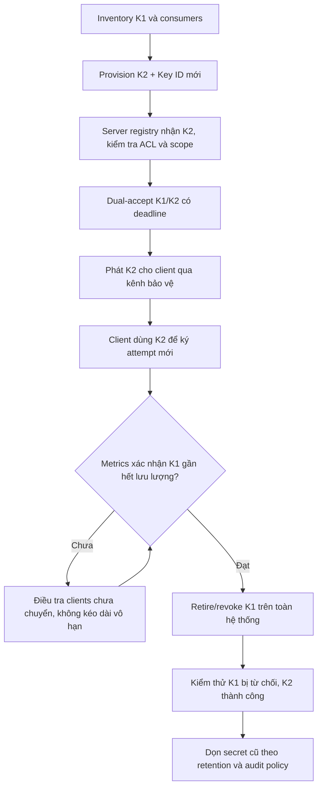
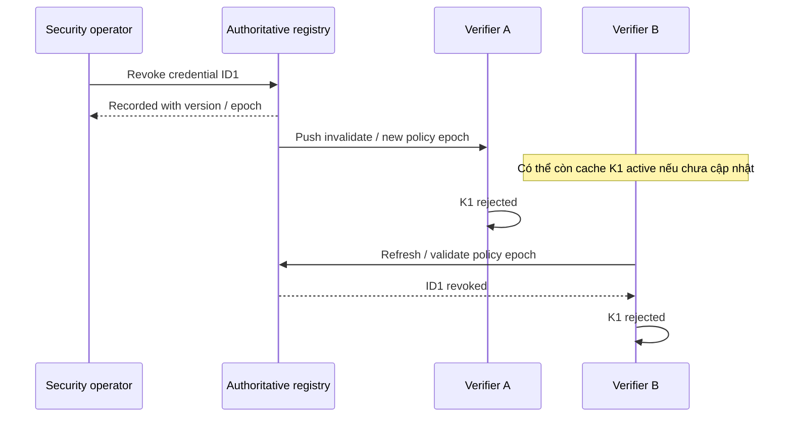

# Secret rotation: xoay khóa bí mật dùng để xác thực HTTP request bằng HMAC

## 1. Vì sao shared secret phải được xoay vòng?

Khi một client ký HTTP request bằng **HMAC**, client và server cùng sở hữu một **shared secret**. Client xây dựng canonical request từ method, URI, các signed headers và/hoặc body, sau đó tính chữ ký. Server lấy secret tương ứng với Key ID, tính lại HMAC và so sánh. Nếu secret bị lộ, kẻ tấn công có thể tạo request **mới với HMAC hợp lệ** trong phạm vi quyền của credential đó. Chỉ có timestamp, nonce hay HTTPS không sửa được việc secret đã bị đánh cắp.

**Secret rotation** là quá trình **phát hành secret mới, chuyển client sang secret đó, ngừng chấp nhận secret cũ và xử lý an toàn trạng thái liên quan**. Rotation có thể diễn ra định kỳ, khi thay đổi hạ tầng/đối tác hoặc khẩn cấp sau sự cố lộ khóa.

Bài **Secret rotation** thuộc chương **Secret management** của module `SECURITY_AUTHENTICATION_HMAC_REQUEST_AUTHENTICATION`. Module hướng dẫn thiết kế xác thực HTTP request bằng **HMAC với shared secret** và canonical request bao gồm method, URI, header hoặc body theo hợp đồng ký; xác minh chữ ký, chống replay bằng timestamp/nonce, quản lý key rotation, kiểm thử proxy/gateway và phân biệt **authentication** với **authorization**. Bài tập trung vào **vòng đời secret HMAC** và cách chuyển đổi mà không làm suy yếu request verification.

Một tình huống thực tế:

```text
T0  Merchant A dùng credential K1 để ký POST /v1/payments.
T1  Server muốn thay K1 bằng secret K2 mà không ngừng dịch vụ.
T2  Server phát hành Key ID mới cho K2, chấp nhận K1 và K2 tạm thời.
T3  Client xác nhận đã chuyển sang ký bằng K2.
T4  Server ngừng chấp nhận K1, dù HMAC với K1 vẫn tính đúng toán học.
```

Nếu **server đổi secret ngay dưới cùng một Key ID** mà client chưa cập nhật, request hợp lệ sẽ lỗi hàng loạt. Nếu **server giữ K1 mãi mãi để tránh lỗi**, rotation không thực sự giảm rủi ro. Thiết kế tốt cần **Key ID phân biệt từng credential**, trạng thái hiệu lực rõ ràng, thời gian chồng lấp có giới hạn và khả năng thu hồi khẩn cấp.

### Những gì secret rotation làm được và không làm được

| Biện pháp | Giúp giải quyết | Không tự giải quyết |
| --- | --- | --- |
| **Rotate secret** | Giảm thời gian phụ thuộc vào secret cũ, chấm dứt khả năng ký mới bằng secret đã retire/revoke. | Request replay với secret mới, credential mới bị lộ, business authorization. |
| **Key ID mới** | Chọn chính xác secret tương ứng; theo dõi client nào còn sử dụng K1. | Không phải khóa bí mật và không chứng minh danh tính khi MAC chưa được verify. |
| **HMAC trên canonical bytes** | Chứng minh request phù hợp secret và không bị thay đổi các trường đã ký. | Không quyết định secret đã bị revoke, request có còn mới hay không. |
| **Timestamp và nonce** | Giới hạn tuổi request, chặn phát lại trong cửa sổ nếu nonce store atomic. | Không ngăn kẻ đã lấy secret tạo request khác với nonce mới. |
| **Idempotency** | Tránh thực thi trùng một logical business operation qua retry đã ký lại. | Không thay thế HMAC, replay protection hay quyền truy cập. |
| **Authorization** | Kiểm tra verified principal có quyền trên action/resource. | Không bảo vệ secret ở client hoặc đường truyền khi bị lộ. |

**Nguyên tắc trung tâm:** secret chỉ được xem là có hiệu lực nếu **credential policy phía server cho phép** tại thời điểm verification. Một phép HMAC toán học đúng với K1 **không thể “cứu” credential K1 đã bị revoke**.

## 2. Thuật ngữ phải phân biệt

| Thuật ngữ | Ý nghĩa trong HMAC request authentication |
| --- | --- |
| **Shared secret / key material** | Byte bí mật mà hai đầu tin cậy dùng làm khóa HMAC; thường được cấp từ CSPRNG hoặc hệ thống cấp khóa chuyên dụng. |
| **Key ID / `kid`** | Định danh công khai của một credential record; dùng để tìm đúng secret và chính sách. |
| **Credential record** | Key ID, secret reference, principal, audience, allowed versions/routes, trạng thái, thời hạn, audit metadata. |
| **Verified principal** | Danh tính được map từ credential đã xác minh; một principal có thể có nhiều Key IDs trong thời gian rotation. |
| **Signature version** | Phiên bản canonicalization/signing protocol; **khác** với Key ID và khác thế hệ secret. |
| **Activation / `notBefore`** | Thời điểm sớm nhất server cho credential tham gia authentication. |
| **Retirement / `acceptUntil`** | Thời điểm server ngừng chấp nhận credential; nên có chính sách biên nhất quán. |
| **Revocation** | Vô hiệu hóa credential theo chính sách, có thể khẩn cấp, bất chấp `acceptUntil` trước đó. |
| **Dual acceptance / overlap** | Khoảng thời gian hữu hạn server chấp nhận cả K1 và K2 **theo Key ID được gửi**, không phải thử cả hai secret cho một ID. |
| **Client cutover** | Client đổi cấu hình signer sang Key ID/secret mới, phát request mới với chữ ký mới. |
| **Rewrap / re-encryption** | Đổi khóa mã hóa dữ liệu secret ở storage; **không đồng nghĩa** đổi shared secret HMAC mà client đang dùng. |

### Key ID là public hint, secret phải được giữ kín

Ví dụ:

```http
X-Key-Id: kid_newOpaqueCredentialId
X-Signature-Version: hmac-rotation-v1
X-Timestamp: 2026-11-28T10:00:00Z
X-Nonce: <nonce mới>
X-Signature: <MAC trên canonical request>
```

Client **không gửi shared secret**. Server dùng **Key ID chính xác** để tìm credential đã đăng ký và secret tương ứng. Không tạo `SecretKeySpec(keyId.getBytes(...))`: ID không phải bí mật. Cũng không lấy secret từ một header `X-Secret`, URL do client khai hoặc đối tượng JSON body.

### Secret rotation khác signature algorithm migration

Xoay secret K1 → K2 trong cùng signature profile `hmac-rotation-v1` là thay **key material và Key ID**. Chuyển `HmacSHA256` sang một thuật toán/schema khác là **signature version migration** với contract độc lập. Nếu thay cả hai cùng lúc, cần kế hoạch phối hợp và golden fixtures cho từng tổ hợp.

**Không tự chuyển sang HmacSHA1 hoặc canonicalizer legacy khi MAC với secret được chỉ định không khớp**. Client không có quyền yêu cầu thuật toán bất kỳ thông qua một `X-Algorithm` tự khai; server lựa chọn từ allowlist theo credential và protocol version.

## 3. Threat model và mục tiêu của rotation

Các tình huống cần xem xét:

1. **Secret lộ từ logs, CI/CD, repository hoặc memory dump.** Kẻ tấn công có thể tạo MAC mới; cần revoke credential bị ảnh hưởng, kiểm tra log/history và phát secret khác.
2. **Client mất thiết bị hoặc nhân viên/đối tác rời tổ chức.** Credential phải được thu hồi theo principal và phạm vi được cấp, không chỉ đổi tên Key ID.
3. **Secret cũ quá lâu không thay.** Cần giới hạn lifetime, khả năng kiểm kê và automation có kiểm soát.
4. **Một số node verifier chưa nhận trạng thái revoke.** Chúng có thể tiếp tục chấp nhận K1; việc phân phối policy cũng là vấn đề bảo mật.
5. **Sai cấu hình trong rollout:** client dùng K2 trước khi server có record, hoặc server retire K1 trước khi tất cả clients cutover.
6. **Replay, nonce store failure, gateway rewrite:** rotation không thay thế HMAC verification, freshness, anti-replay và request snapshot consistency.

Mục tiêu thiết kế:

- **Confidentiality:** secret không lộ qua header, log, telemetry, exception, ticket hỗ trợ, build artifact hoặc kênh phát hành không bảo vệ.
- **Correctness:** server lookup **một** credential theo Key ID, kiểm tra status, audience, route, version và MAC trước khi cấp verified identity.
- **Controlled overlap:** nếu có chuyển tiếp, cả hai secrets chỉ active trong thời gian tối thiểu cần thiết và có deadline rõ.
- **Emergency cutoff:** có thể ngừng chấp nhận credential cũ khi nghi bị lộ; ưu tiên an toàn ngay cả khi gây gián đoạn.
- **Auditability:** có metrics theo credential generation và sự kiện provision/activate/cutover/revoke mà không log raw secret.
- **Recovery:** sau lỗi deploy/secret store, không fallback bằng một secret bị cấm hoặc tắt xác thực.

## 4. Quy trình secret rotation theo từng giai đoạn



### Giai đoạn A — Kiểm kê và chuẩn bị

Xác định những consumer đang dùng secret K1: client SDK, batch job, webhook integration, mobile app, backend service, staging/production. Kiểm tra phạm vi thực tế của credential: principal, tenant, audience, route, thuật toán/profile, thời gian request sống, khả năng retry và idempotency.

Trước khi phát K2, cần có **runbook**, thời hạn overlap, kênh hỗ trợ client, cơ chế alert và quyền revoke. Trường hợp secret đã có dấu hiệu bị lộ phải đi theo **emergency rotation**, không duy trì overlap dài chỉ để chờ tất cả khách hàng.

### Giai đoạn B — Phát hành K2

Server/provisioning authority sinh một shared secret K2 **độc lập** với K1, ví dụ **32 byte ngẫu nhiên từ CSPRNG** cho profile HmacSHA256 minh họa. Cấp **Key ID mới** cho K2 và record trong credential registry:

```text
Credential A:
  keyId = kid_OLD
  secretRef = secrets/orders-api/credential-A
  principalId = merchant-a
  status = ACTIVE
  acceptUntil = cutoverDeadline

Credential B:
  keyId = kid_NEW
  secretRef = secrets/orders-api/credential-B
  principalId = merchant-a
  status = PREPARED -> ACTIVE
  notBefore = activationTime
```

`kid_OLD` và `kid_NEW` ở đây là nhãn khái niệm, **không phải Key IDs hợp lệ theo một grammar production cụ thể**. Trong triển khai, mỗi ID phải tuân format chính xác của hệ thống (ví dụ opaque Base64URL có prefix) và unique trong registry.

Không thiết kế `K2 = SHA-256(K1)` hoặc lấy Key ID/timestamp làm nguồn tạo secret. Dù các cơ chế dẫn xuất có thể an toàn trong một số giao thức được thiết kế riêng, **mặc định cho rotation HMAC shared secret là cấp secret mới độc lập** để tránh liên đới khi K1 đã lộ.

### Giai đoạn C — Server chấp nhận K2 trước khi client chuyển

Đăng ký record K2, bảo đảm mọi verifier có thể lookup Key ID mới, policy active hợp lệ và truy cập secret handle thành công. Thử ký/xác minh golden fixture với K2 **trước** khi đổi signer của client.

Trong giai đoạn dual acceptance, server vẫn xác minh **một Key ID tại một lần request**:

```text
Request keyId=ID1 -> lookup exact ID1 -> HMAC với K1
Request keyId=ID2 -> lookup exact ID2 -> HMAC với K2

KHÔNG: request keyId=ID1 -> thử K1, sai thì thử K2
```

Tính năng chấp nhận cả K1/K2 không có nghĩa verifier được bỏ qua signature version, timestamp, nonce, audience hoặc authorization.

### Giai đoạn D — Client cutover sang K2

Client cập nhật **Key ID và secret như một cặp atomic configuration**, tránh ghép ID2 với secret K1. Với HTTP attempt mới, nó sinh timestamp/nonce mới và tính MAC với K2. Nếu một logical payment đang retry, **idempotency key nghiệp vụ vẫn giữ nguyên**, dù Key ID/secret/nonce/MAC thay đổi.

Khi client có nhiều instance, cần rolling rollout và bảo đảm chúng cùng biết cách lấy credential còn hiệu lực. Không đặt nhiều secret trong log/config snapshot công khai; không đòi client “tắt TLS verification” để kết nối tới provisioning service.

### Giai đoạn E — Retire K1 và xác minh thu hồi

Đến deadline, hoặc ngay khi phát hiện compromise, server đổi K1 sang **RETIRED/REVOKED**. Request mới khai ID1 bị từ chối kể cả HMAC với K1 đúng. Phải kiểm thử cả ingress, verifier caches, vùng/region phụ và job workers.

Giữ **audit metadata** theo policy nhưng không giữ secret K1 không cần thiết. Nếu vẫn phải lưu ciphertext cũ một thời gian để hỗ trợ khôi phục có kiểm soát, cần ACL, hạn chế truy cập và retention rõ ràng; **không** cho verifier tiếp tục chấp nhận khóa đã retired chỉ vì dữ liệu đó còn nằm trong vault.

## 5. Ví dụ lịch rotation và các ranh giới thời gian

Giả sử một đối tác đã lên kế hoạch xoay secret vào **ngày 28/11/2026**, với đồng hồ UTC. Các mốc **chỉ để minh họa**, không phải lịch bắt buộc cho mọi dịch vụ:

| Thời điểm UTC | Client signer | Server verifier | Điều cần xác minh |
| --- | --- | --- | --- |
| Trước 09:30 | K1 | K1 active | Kiểm kê mọi consumer còn dùng ID1. |
| 09:30 | K1 | K1 active, K2 prepared | K2 đã được provision và thử với test fixture nhưng chưa nhất thiết active. |
| 10:00 | K1 hoặc K2 khi client cutover | K1/K2 active | Bắt đầu dual acceptance theo policy. |
| 10:05–10:45 | Tăng tỷ lệ K2 | K1/K2 active | Theo dõi Key ID distribution và MAC failures, xác minh canary. |
| 10:45 | Mục tiêu gần 100% K2 | K1/K2 active | Xác nhận consumer chậm, cron/batch, circuit-breaker và retry. |
| 11:00 | K2 | **K1 retired**, K2 active | Mọi request ID1 bị reject sau mốc; kiểm tra propagation. |
| Sau 11:00 | K2 | Chỉ K2 active | Audit, dọn K1 theo chính sách, không reuse ID1. |

**Ranh giới `acceptUntil` trong bài là exclusive:** tại `now == acceptUntil`, server **không** chấp nhận K1. Điều kiện kiểm tra nên là `now.isBefore(acceptUntil)`, không phải `!now.isAfter(acceptUntil)`.

### Request đang bay trên mạng khi K1 hết hạn

```text
Client ký K1 lúc:     10:59:59Z
Server nhận lúc:      11:00:01Z
acceptUntil(K1):      11:00:00Z
HMAC:                 Có thể đúng
Timestamp:            Còn mới
Credential policy:    ĐÃ RETIRED -> reject
```

Đây là trade-off chủ ý. Nếu sản phẩm muốn cho các request in-flight có thời gian hoàn tất, phải **quy định một `acceptUntil` đủ muộn** và xác nhận cutoff ở toàn hệ thống; không lén thêm fallback “nếu HMAC đúng thì chấp nhận K1 thêm 5 phút” ở từng node.

Đối với **compromise**, không nên dành một grace window chỉ để duy trì tiện lợi: attacker cũng có thể ký bằng K1. Tùy mức độ nguy cơ, cần revoke ngay, buộc client chuyển K2 hoặc tạm dừng endpoint bị ảnh hưởng.

### Thời gian credential khác thời gian timestamp

Server phải kiểm tra **ít nhất ba khía cạnh**:

1. **Key validity ở thời điểm server verify:** K1 có active, không revoke, `notBefore <= now < acceptUntil` không?
2. **Request freshness:** timestamp đã được ký có nằm trong `now - MAX_AGE` đến `now + MAX_FUTURE_SKEW` không?
3. **Replay:** `(credentialId, nonce)` đã được claim thành công nguyên tử chưa?

Không được lấy timestamp do client khai rồi dùng làm **nguồn quyết định key vẫn active**: attacker có K1 đã bị revoke có thể đặt timestamp trước cutoff và ký lại nếu chưa có thêm kiểm tra `now`. Đối với profile này, **revocation/retirement áp dụng theo thời điểm xác minh** và không thể vượt qua chỉ bằng timestamp cũ còn trong cửa sổ.

## 6. Secret management: lưu trữ và phân phối K2 an toàn

Rotation an toàn phải bắt đầu trước bước tính HMAC. Một secret mới nhưng **bị lộ qua pipeline** là một rotation thất bại.

### Cấp phát secret và định danh

```text
provisioning authority
  |
  +-- generate CSPRNG key bytes: K2 (ví dụ 32 byte)
  +-- generate unique opaque Key ID: ID2
  +-- store protected secret under secretRef2
  +-- register (ID2, secretRef2, principal, scope, version, status)
  +-- distribute ID2 + K2 to the authorized client once
  +-- record non-secret audit event
```

**Không dẫn xuất K2 từ ID2** và không dùng một chuỗi dễ đoán như `merchant-2026` làm HMAC secret. Nếu secret được truyền dưới dạng Base64, client phải **decode Base64 thành bytes thực** trước khi `Mac.init`; không dùng UTF-8 của chuỗi Base64 như thể đó là secret bytes.

### Secret Manager, Vault và KMS/HSM

| Nơi lưu | Cách sử dụng phù hợp | Rủi ro cần kiểm soát |
| --- | --- | --- |
| **Secret manager / vault** | Lưu secret mã hóa, ACL theo service/tenant, version và audit, ứng dụng đọc bằng identity được cấp quyền. | Cấp quyền đọc quá rộng, ứng dụng in secret ra log, cache quá lâu làm revoke không có hiệu lực. |
| **KMS/HSM hỗ trợ HMAC operation** | Có thể tính/verify HMAC bên trong service/phần cứng mà không export raw key nếu cả hai bên có một giao thức provisioning hợp lệ. | Không phải mọi KMS/HSM cho phép **cùng shared secret** được export cho client; cần kiểm tra contract, key import/export và độ trễ. |
| **Encrypted application config** | Có thể chấp nhận khi có provisioning và key rotation/ACL rõ, không lưu plaintext trong repo. | Decryption key lộ, env/config dump, rollout nhầm môi trường. |
| **Environment variable / mounted file** | Cách đưa secret vào process tùy nền tảng; cần short-lived access, file permissions, rollout và redaction. | Biến môi trường có thể lộ qua process introspection, crash reports, debug hay lỗi cấu hình; file có thể bị backup/log vô ý. |
| **Client secure storage** | Lưu secret theo bảo vệ của hệ điều hành/keystore/secure enclave khi phù hợp; kênh provisioning bảo vệ. | Trích xuất trên thiết bị bị chiếm quyền; client public/mobile phân phối secret cho nhiều thiết bị có threat model riêng. |

**Điểm phân biệt quan trọng:** secret HMAC phía client và server **phải tương ứng** theo giao thức đã chọn. Một symmetric HMAC key **không export được** từ HSM server không thể tự nhiên trở thành shared secret cho client; cần thiết kế cấp/nhập key phù hợp hoặc đổi mô hình xác thực. Không dùng tên “KMS” như bằng chứng đã giải quyết hết bài toán quản lý secret.

### Không log secret ở bất kỳ hop nào

Tránh:

```text
DEBUG currentSecret=base64:...
ERROR Mac.init failed for keyId=... secretHex=...
CI log: exported HMAC_SECRET=...
curl -H 'X-Secret: ...'
```

Các thông tin có thể log **có kiểm soát**: request ID, signature version, internal credential ID đã che/ẩn danh, phase của rotation, mã lỗi `UNKNOWN_KEY`/`REVOKED_KEY`/`BAD_MAC`, latency lookup và retry metrics. Không log raw secret, expected MAC, full supplied signature hoặc body nhạy cảm. Kiểm tra tracing, exception serialization, test fixtures và support bundles chứ không chỉ application logger.

### Một số bất biến bảo mật của credential store

- Registry có **unique exact Key ID** với collation/case đúng; một ID không trỏ sang nhiều secrets.
- **Phân quyền đọc secret** tối thiểu theo service/identity; rotation operator không nhất thiết có quyền xem plaintext mọi secret.
- Secret reference thuộc về **credential metadata tin cậy**, không được tạo URL/path từ input Key ID chưa được xác minh.
- Không sửa nguyên secret bytes dưới một ID đang active mà không có migration protocol. Mỗi secret mới có ID mới.
- Registry cập nhật trạng thái **atomically** và phân phối revoke tới các verifier với thời gian nhất quán phù hợp risk policy.
- Nếu secret store mất kết nối và verifier không thể xác nhận key hợp lệ, hệ thống **fail closed**; không fallback vào K1 đã bị revoke.
- Secret có thể có nhiều bản copy trong bộ nhớ Java/JCA provider; không hứa rằng `Arrays.fill(secret, (byte)0)` xóa được **mọi** bản sao; ưu tiên giới hạn quyền, phạm vi và lifetime.

## 7. Hợp đồng HMAC-ROTATION-V1 gắn Key ID với canonical request

Để nối quá trình rotation với việc xác thực request, bài dùng profile **tự định nghĩa để giảng dạy**, không phải một chuẩn HTTP áp dụng tự động:

```http
POST /v1/payments?dryRun=false HTTP/1.1
Host: api.example.test
Content-Type: application/json
Idempotency-Key: 550e8400-e29b-41d4-a716-446655440000
X-Key-Id: kid_AAAAAAAAAAAAAAAAAAAAAA
X-Signature-Version: hmac-rotation-v1
X-Timestamp: 2026-11-28T10:00:00Z
X-Nonce: AAAAAAAAAAAAAAAAAAAAAAAAAAAAAAAA
X-Signature: <64 lowercase hex characters>

{"paymentId":"P-42","amount":90000,"currency":"VND"}
```

`kid_A...A` và nonce toàn `A` chỉ là **placeholder đúng hình thức**, không được phát hành vì không có entropy. Một signer thực dùng credential Key ID do server cấp, nonce 24 byte CSPRNG mới cho mỗi HTTP attempt và ID nghiệp vụ theo hợp đồng.

### Profile cụ thể

| Thành phần | Quy tắc `hmac-rotation-v1` |
| --- | --- |
| Method / target | Chính xác `POST`, raw target `/v1/payments?dryRun=false` trong demo. |
| Audience | `https://api.example.test` từ cấu hình routing tin cậy, không lấy tùy tiện từ `Host` hoặc `X-Forwarded-Host` do caller khai báo. |
| Content-Type | Đúng một field `application/json`; body UTF-8 JSON, không hỗ trợ `Content-Encoding` trong demo. |
| Key ID | Chính xác một `X-Key-Id`; format `kid_` + Base64URL-no-padding từ 16 byte, case-sensitive, lookup exact. |
| Version | Chính xác một `X-Signature-Version: hmac-rotation-v1`; thuật toán server quyết định là `HmacSHA256`. |
| Timestamp | Một giá trị UTC `YYYY-MM-DDTHH:mm:ssZ`, max age 300s, future skew 30s, hai biên inclusive. |
| Nonce | Một nonce Base64URL không padding, 24 byte CSPRNG → 32 ASCII chars, **mới cho từng attempt**. |
| Idempotency-Key | UUID v4 lowercase, ký trong canonical; **giữ nguyên theo logical payment** khi retry, kể cả sau key rotation. |
| Signature | Một `X-Signature` dạng **64 lowercase hex** cho HMAC-SHA256 32 byte; không ký chính signature field. |
| Headers | Tất cả signed fields phải xuất hiện đúng một lần theo tên case-insensitive. |
| Body | SHA-256 trên đúng **body bytes sau bỏ transfer framing, trước khi parse/reformat**; demo tối đa 1 MiB. |
| Framing | Dòng canonical nối bằng LF (`0A`), UTF-8, không LF cuối; tên signed header viết chữ thường. |

Canonical message **đúng thứ tự dòng**:

```text
HMAC-ROTATION-V1
POST
https://api.example.test
/v1/payments?dryRun=false
content-type:application/json
idempotency-key:550e8400-e29b-41d4-a716-446655440000
x-key-id:kid_AAAAAAAAAAAAAAAAAAAAAA
x-signature-version:hmac-rotation-v1
x-timestamp:2026-11-28T10:00:00Z
x-nonce:AAAAAAAAAAAAAAAAAAAAAAAAAAAAAAAA
<lowercaseHex(SHA-256(bodyBytes))>
```

Dòng cuối là **placeholder**, phải thay bằng **64 hex chars của digest thực**; không ký dấu `<`/`>`. Client tính:

```text
secretBytes    = secret for ID2 (from protected client credential store)
bodyDigest     = SHA-256(bodyBytes)
canonicalBytes = UTF8(canonical request with bodyDigestHex)
signatureBytes = HMAC-SHA256(secretBytes, canonicalBytes)
signatureHex   = lowercaseHex(signatureBytes)
```

Server **không nhận secret từ client**: nó parse Key ID, tra exact credential record có trạng thái hợp lệ, lấy secret đúng ID, tính MAC trên **cùng canonical bytes** rồi so sánh bằng phép so sánh byte không dừng theo tiền tố sai (ví dụ `MessageDigest.isEqual` với MAC 32 byte). Chỉ sau đó mới kiểm tra freshness, atomic nonce claim và authorization.

### Vì sao Key ID nằm trong canonical?

K1 và K2 dùng **hai Key IDs khác nhau**, cùng một principal có thể được xác thực bởi cả hai trong overlap. Nếu attacker sửa `X-Key-Id` mà giữ MAC, canonical mới khác, và lookup cũng chọn secret khác → request phải thất bại. Điều này giúp chống key confusion/credential swapping.

**Dual acceptance không có nghĩa dual-MAC thử tùy ý**: một request chỉ khai báo **một** Key ID và phải đạt với **đúng secret** tương ứng. Không thực hiện `for (secret : allSecrets) if (hmacMatches) accept` vì làm mất ràng buộc credential ID, scope, status và policy.

### Retry trong giai đoạn rotation

```text
Logical operation = payment P-42, idempotency key I1

Attempt A (trước cutover):
  Key ID = ID1, secret K1, timestamp=T1, nonce=N1, signature=S1

Attempt B (sau cutover):
  Key ID = ID2, secret K2, timestamp=T2, nonce=N2, signature=S2

Server:
  xác thực từng attempt theo đúng credential
  replay cache scope theo immutable credential ID + nonce
  business idempotency scope theo verified principal + operation + I1
```

Nếu attempt A đã tạo payment nhưng response bị mất, attempt B **không được tạo payment thứ hai** chỉ vì Key ID đã đổi. Business idempotency cần gắn với **principal ổn định qua rotation**; ngược lại HMAC nonce replay store có thể gắn với **immutable credential ID** theo contract. Đây là hai namespace với mục đích khác nhau.

## 8. Ví dụ Java 17: provision, dual-accept, retire và revoke

Ví dụ sau là **một class Java 17 độc lập**, tên `HmacSecretRotationDemo.java`. Nó mô phỏng:

- **Server provisioning:** sinh hai Key IDs opaque và **hai secrets độc lập** bằng `SecureRandom`; đăng ký hai credential records có cùng verified principal.
- **Client signing:** giữ Key ID và secret thành **một cặp**, tạo nonce/timestamp mới, ký chính xác canonical request đã công bố.
- **Server verification:** parse header đơn trị, validate Key ID, tra **đúng credential** bằng lookup exact, kiểm tra status/route/version, tính `HmacSHA256`, so MAC bytes bằng `MessageDigest.isEqual`, kiểm tra timestamp và atomic nonce claim.
- **Cutover:** trước deadline K1 và K2 đều có thể xác thực **request riêng**; tại và sau `acceptUntil(K1)`, K1 bị từ chối dù MAC đúng.
- **Revoke:** server ngừng chấp nhận Key ID bị thu hồi ngay; không fallback sang secret khác.

**Lưu ý giới hạn:** registry và nonce cache là **mô phỏng một JVM**, không có durable credential store, KMS, distributed nonce consistency, eviction policy hay revoke propagation. `Request` là snapshot do HTTP adapter tin cậy tạo ra; adapter production phải kiểm tra HTTP framing, duplicate signed headers trước khi framework merge, route/authority, body transformations và source of forwarded metadata. Không dùng sample thay thế triển khai bảo mật production.

```java
import java.nio.charset.StandardCharsets;
import java.security.GeneralSecurityException;
import java.security.MessageDigest;
import java.security.SecureRandom;
import java.time.Clock;
import java.time.Duration;
import java.time.Instant;
import java.time.ZoneOffset;
import java.time.format.DateTimeParseException;
import java.time.temporal.ChronoUnit;
import java.util.ArrayList;
import java.util.Base64;
import java.util.HashMap;
import java.util.HexFormat;
import java.util.List;
import java.util.Locale;
import java.util.Map;
import java.util.Objects;
import java.util.Optional;
import java.util.Set;
import java.util.concurrent.ConcurrentHashMap;
import java.util.concurrent.atomic.AtomicBoolean;
import javax.crypto.Mac;
import javax.crypto.spec.SecretKeySpec;

public final class HmacSecretRotationDemo {
    private static final String VERSION = "hmac-rotation-v1";
    private static final String AUDIENCE = "https://api.example.test";
    private static final String TARGET = "/v1/payments?dryRun=false";
    private static final String CONTENT_TYPE = "application/json";
    private static final HexFormat HEX = HexFormat.of();
    private static final Duration MAX_AGE = Duration.ofSeconds(300);
    private static final Duration FUTURE_SKEW = Duration.ofSeconds(30);
    private static final Duration NONCE_TTL = Duration.ofSeconds(360);
    private static final Set<String> REQUIRED = Set.of(
            "content-type", "idempotency-key", "x-key-id",
            "x-signature-version", "x-timestamp", "x-nonce",
            "x-signature");

    public record HeaderLine(String name, String value) {}

    public record Request(
            String method, String rawTarget, String trustedAudience,
            List<HeaderLine> headers, byte[] body) {
        public Request {
            headers = List.copyOf(
                    Objects.requireNonNull(headers, "headers"));
            body = body == null ? null : body.clone();
        }
        @Override public byte[] body() {
            return body == null ? null : body.clone();
        }
    }

    public record ClientCredential(String keyId, byte[] secret) {
        public ClientCredential {
            secret = secret == null ? null : secret.clone();
        }
        @Override public byte[] secret() {
            return secret == null ? null : secret.clone();
        }
    }

    // Secret record server-side, không trả nguyên record cho HTTP caller.
    public record Credential(
            String keyId, String immutableId, String principal,
            byte[] secret, String audience,
            Instant notBefore, Instant acceptUntil,
            boolean revoked, Set<String> allowedTargets,
            Set<String> allowedVersions) {
        public Credential {
            secret = secret == null ? null : secret.clone();
            allowedTargets = Set.copyOf(allowedTargets);
            allowedVersions = Set.copyOf(allowedVersions);
        }
        @Override public byte[] secret() {
            return secret == null ? null : secret.clone();
        }
        public Credential retiredAt(Instant deadline) {
            return new Credential(keyId, immutableId, principal,
                    secret, audience, notBefore, deadline, revoked,
                    allowedTargets, allowedVersions);
        }
        public Credential revokedCopy() {
            return new Credential(keyId, immutableId, principal,
                    secret, audience, notBefore, acceptUntil, true,
                    allowedTargets, allowedVersions);
        }
    }

    // Registry demo: update atomically trên một JVM.
    public static final class CredentialRegistry {
        private final ConcurrentHashMap<String, Credential> store =
                new ConcurrentHashMap<>();

        public ClientCredential provision(
                String principal, SecureRandom random,
                Instant notBefore, Instant acceptUntil) {
            Objects.requireNonNull(principal);
            Objects.requireNonNull(random);
            if (!notBefore.isBefore(acceptUntil)) {
                throw new IllegalArgumentException("Invalid lifetime");
            }
            for (int attempt = 0; attempt < 5; attempt++) {
                byte[] opaque = new byte[16];
                byte[] secret = new byte[32];
                random.nextBytes(opaque);
                random.nextBytes(secret); // Independent key material.
                String keyId = "kid_" + Base64.getUrlEncoder()
                        .withoutPadding().encodeToString(opaque);
                Credential record = new Credential(
                        keyId, keyId, principal, secret, AUDIENCE,
                        notBefore, acceptUntil, false,
                        Set.of(TARGET), Set.of(VERSION));
                if (store.putIfAbsent(keyId, record) == null) {
                    return new ClientCredential(keyId, secret);
                }
            }
            throw new IllegalStateException("Key ID collision");
        }

        public Credential findExact(String keyId) {
            return store.get(keyId);
        }

        public void retireAt(String keyId, Instant deadline) {
            store.computeIfPresent(keyId, (id, current) -> {
                if (!current.notBefore().isBefore(deadline)
                        || deadline.isAfter(current.acceptUntil())) {
                    throw new IllegalArgumentException(
                            "Retirement deadline invalid");
                }
                return current.retiredAt(deadline);
            });
        }

        public void revoke(String keyId) {
            store.computeIfPresent(
                    keyId, (id, current) -> current.revokedCopy());
        }
    }

    private record NonceKey(String credentialId, String nonce) {}

    public interface NonceStore {
        boolean claim(String credentialId, String nonce,
                Instant now, Duration ttl) throws NonceStoreException;
    }

    public static final class NonceStoreException extends Exception {
        public NonceStoreException(String message) {
            super(message);
        }
    }

    // In-memory atomic claim, KHÔNG dùng cho multi-instance production.
    public static final class DemoNonceStore implements NonceStore {
        private final ConcurrentHashMap<NonceKey, Instant> used =
                new ConcurrentHashMap<>();

        @Override public boolean claim(
                String credentialId, String nonce, Instant now,
                Duration ttl) {
            NonceKey key = new NonceKey(credentialId, nonce);
            AtomicBoolean inserted = new AtomicBoolean(false);
            used.compute(key, (k, oldExpiry) -> {
                if (oldExpiry == null || !oldExpiry.isAfter(now)) {
                    inserted.set(true);
                    return now.plus(ttl);
                }
                return oldExpiry;
            });
            return inserted.get();
        }
    }

    public record Verified(
            String principal, String credentialId, byte[] body) {
        public Verified {
            body = body.clone();
        }
        @Override public byte[] body() {
            return body.clone();
        }
    }

    // Opaque Key ID: prefix + canonical Base64URL(16 bytes) no padding.
    private static boolean validKeyId(String candidate) {
        if (candidate == null
                || !candidate.matches("kid_[A-Za-z0-9_-]{22}")) {
            return false;
        }
        String encoded = candidate.substring(4);
        try {
            byte[] raw = Base64.getUrlDecoder().decode(encoded);
            return raw.length == 16
                    && encoded.equals(Base64.getUrlEncoder()
                            .withoutPadding().encodeToString(raw));
        } catch (IllegalArgumentException bad) {
            return false;
        }
    }

    private static boolean validNonce(String candidate) {
        if (candidate == null
                || !candidate.matches("[A-Za-z0-9_-]{32}")) {
            return false;
        }
        try {
            byte[] raw = Base64.getUrlDecoder().decode(candidate);
            return raw.length == 24
                    && candidate.equals(Base64.getUrlEncoder()
                            .withoutPadding().encodeToString(raw));
        } catch (IllegalArgumentException bad) {
            return false;
        }
    }

    private static String trimOws(String value) {
        int begin = 0;
        int end = value.length();
        while (begin < end && (value.charAt(begin) == ' '
                || value.charAt(begin) == '\t')) begin++;
        while (end > begin && (value.charAt(end - 1) == ' '
                || value.charAt(end - 1) == '\t')) end--;
        return value.substring(begin, end);
    }

    private static Map<String, String> readSignedHeaders(
            List<HeaderLine> rawLines) {
        Map<String, String> found = new HashMap<>();
        for (HeaderLine line : rawLines) {
            if (line == null || line.name() == null
                    || !line.name().matches("[A-Za-z0-9-]{1,128}")
                    || line.value() == null) {
                throw new IllegalArgumentException("Malformed header");
            }
            String name = line.name().toLowerCase(Locale.ROOT);
            // Sample không hỗ trợ transform nội dung hoặc unsigned header.
            if (!REQUIRED.contains(name)
                    && !"host".equals(name)) {
                throw new IllegalArgumentException(
                        "Unsupported header: " + name);
            }
            String value = trimOws(line.value());
            for (int i = 0; i < value.length(); i++) {
                char c = value.charAt(i);
                if (c < 0x20 || c > 0x7e) {
                    throw new IllegalArgumentException(
                            "Unsafe header value");
                }
            }
            if (REQUIRED.contains(name)
                    && found.putIfAbsent(name, value) != null) {
                throw new IllegalArgumentException(
                        "Duplicate signed header: " + name);
            }
        }
        if (!found.keySet().equals(REQUIRED)) {
            throw new IllegalArgumentException(
                    "Missing signed header");
        }
        return Map.copyOf(found);
    }

    private static Instant parseTimestamp(String raw) {
        if (raw == null || !raw.matches(
                "[0-9]{4}-[0-9]{2}-[0-9]{2}T"
                + "[0-9]{2}:[0-9]{2}:[0-9]{2}Z")) {
            throw new IllegalArgumentException("Bad UTC timestamp");
        }
        try {
            Instant value = Instant.parse(raw);
            if (value.getNano() != 0
                    || !value.toString().equals(raw)) {
                throw new IllegalArgumentException(
                        "Noncanonical UTC timestamp");
            }
            return value;
        } catch (DateTimeParseException bad) {
            throw new IllegalArgumentException(
                    "Invalid timestamp", bad);
        }
    }

    private static boolean validFields(Map<String, String> f) {
        return CONTENT_TYPE.equals(f.get("content-type"))
                && f.get("idempotency-key").matches(
                    "[0-9a-f]{8}-[0-9a-f]{4}-4[0-9a-f]{3}-"
                    + "[89ab][0-9a-f]{3}-[0-9a-f]{12}")
                && validKeyId(f.get("x-key-id"))
                && VERSION.equals(f.get("x-signature-version"))
                && validNonce(f.get("x-nonce"))
                && f.get("x-signature").matches("[0-9a-f]{64}");
    }

    private static byte[] canonicalBytes(
            Request r, Map<String, String> f)
            throws GeneralSecurityException {
        String bodySha256 = HEX.formatHex(
                MessageDigest.getInstance("SHA-256").digest(r.body()));
        String canonical = String.join("\n",
                "HMAC-ROTATION-V1",
                r.method(),
                AUDIENCE,
                r.rawTarget(),
                "content-type:" + f.get("content-type"),
                "idempotency-key:" + f.get("idempotency-key"),
                "x-key-id:" + f.get("x-key-id"),
                "x-signature-version:" + f.get("x-signature-version"),
                "x-timestamp:" + f.get("x-timestamp"),
                "x-nonce:" + f.get("x-nonce"),
                bodySha256);
        return canonical.getBytes(StandardCharsets.UTF_8);
    }

    private static byte[] hmacSha256(
            byte[] secretBytes, byte[] canonical)
            throws GeneralSecurityException {
        // Mac instance riêng cho từng lần gọi, không share giữa threads.
        Mac mac = Mac.getInstance("HmacSHA256");
        mac.init(new SecretKeySpec(secretBytes, "HmacSHA256"));
        return mac.doFinal(canonical);
    }

    // Client chỉ được dùng cặp keyId/secret đã được provisioning.
    public static Request sign(
            ClientCredential client, String idempotencyKey,
            byte[] serializedBody, Instant now, SecureRandom random)
            throws GeneralSecurityException {
        if (client == null || !validKeyId(client.keyId())
                || client.secret() == null
                || client.secret().length < 32
                || random == null || now == null
                || idempotencyKey == null
                || !idempotencyKey.matches(
                    "[0-9a-f]{8}-[0-9a-f]{4}-4[0-9a-f]{3}-"
                    + "[89ab][0-9a-f]{3}-[0-9a-f]{12}")
                || serializedBody == null
                || serializedBody.length == 0
                || serializedBody.length > 1_048_576) {
            throw new IllegalArgumentException("Invalid signer input");
        }
        byte[] nonceBytes = new byte[24];
        random.nextBytes(nonceBytes);
        String nonce = Base64.getUrlEncoder().withoutPadding()
                .encodeToString(nonceBytes);
        String timestamp = now.truncatedTo(
                ChronoUnit.SECONDS).toString();

        List<HeaderLine> fields = new ArrayList<>(List.of(
                new HeaderLine("Content-Type", CONTENT_TYPE),
                new HeaderLine("Idempotency-Key", idempotencyKey),
                new HeaderLine("X-Key-Id", client.keyId()),
                new HeaderLine("X-Signature-Version", VERSION),
                new HeaderLine("X-Timestamp", timestamp),
                new HeaderLine("X-Nonce", nonce)));
        Request unsigned = new Request(
                "POST", TARGET, AUDIENCE, fields, serializedBody);
        Map<String, String> inputs = Map.of(
                "content-type", CONTENT_TYPE,
                "idempotency-key", idempotencyKey,
                "x-key-id", client.keyId(),
                "x-signature-version", VERSION,
                "x-timestamp", timestamp,
                "x-nonce", nonce);
        String signatureHex = HEX.formatHex(hmacSha256(
                client.secret(), canonicalBytes(unsigned, inputs)));
        fields.add(new HeaderLine("X-Signature", signatureHex));
        return new Request(
                "POST", TARGET, AUDIENCE, fields, serializedBody);
    }

    // Server trả verified identity CHỈ sau MAC, key policy và nonce.
    public static Optional<Verified> verify(
            Request r, CredentialRegistry registry,
            NonceStore nonces, Clock clock)
            throws GeneralSecurityException {
        if (r == null || registry == null
                || nonces == null || clock == null
                || r.method() == null || r.rawTarget() == null
                || r.trustedAudience() == null || r.body() == null) {
            return Optional.empty();
        }
        if (!"POST".equals(r.method())
                || !TARGET.equals(r.rawTarget())
                || !AUDIENCE.equals(r.trustedAudience())
                || r.body().length == 0
                || r.body().length > 1_048_576) {
            return Optional.empty();
        }

        final Map<String, String> f;
        final Instant issuedAt;
        try {
            f = readSignedHeaders(r.headers());
            if (!validFields(f)) return Optional.empty();
            issuedAt = parseTimestamp(f.get("x-timestamp"));
        } catch (IllegalArgumentException invalid) {
            return Optional.empty();
        }

        String keyId = f.get("x-key-id");
        Credential key = registry.findExact(keyId);
        Instant serverNow = clock.instant();

        // Quan trọng: trạng thái credential dựa vào SERVER NOW.
        // Không dùng timestamp client để hồi sinh key đã revoke.
        if (key == null || key.revoked()
                || !keyId.equals(key.keyId())
                || key.immutableId() == null || key.principal() == null
                || !AUDIENCE.equals(key.audience())
                || serverNow.isBefore(key.notBefore())
                || !serverNow.isBefore(key.acceptUntil())
                || issuedAt.isBefore(key.notBefore())
                || !key.allowedTargets().contains(TARGET)
                || !key.allowedVersions().contains(VERSION)) {
            return Optional.empty();
        }
        byte[] secret = key.secret();
        if (secret == null || secret.length < 32) {
            return Optional.empty();
        }

        // Strict 64 lowercase hex -> 32 MAC bytes.
        byte[] supplied = HEX.parseHex(f.get("x-signature"));
        byte[] expected = hmacSha256(
                secret, canonicalBytes(r, f));
        if (expected.length != 32 || supplied.length != 32
                || !MessageDigest.isEqual(expected, supplied)) {
            return Optional.empty();
        }

        // HMAC đúng vẫn có thể quá cũ hoặc timestamp ở tương lai.
        if (issuedAt.isBefore(serverNow.minus(MAX_AGE))
                || issuedAt.isAfter(serverNow.plus(FUTURE_SKEW))) {
            return Optional.empty();
        }

        try {
            if (!nonces.claim(key.immutableId(), f.get("x-nonce"),
                    serverNow, NONCE_TTL)) {
                return Optional.empty();
            }
        } catch (NonceStoreException unavailable) {
            // Unknown claim outcome: fail closed, không gọi handler.
            return Optional.empty();
        }
        return Optional.of(new Verified(
                key.principal(), key.immutableId(), r.body()));
    }

    private static Request replaceKeyId(
            Request original, String replacement) {
        List<HeaderLine> changed = new ArrayList<>();
        for (HeaderLine line : original.headers()) {
            if ("x-key-id".equalsIgnoreCase(line.name())) {
                changed.add(new HeaderLine(line.name(), replacement));
            } else {
                changed.add(line);
            }
        }
        return new Request(original.method(), original.rawTarget(),
                original.trustedAudience(), changed, original.body());
    }

    private static void require(
            boolean condition, String explanation) {
        if (!condition) throw new AssertionError(explanation);
    }

    public static void main(String[] args) throws Exception {
        SecureRandom random = new SecureRandom();
        CredentialRegistry registry = new CredentialRegistry();
        NonceStore nonces = new DemoNonceStore();

        Instant start = Instant.parse("2026-11-28T10:00:00Z");
        Instant retirement = Instant.parse("2026-11-28T11:00:00Z");
        String idempotencyKey =
                "550e8400-e29b-41d4-a716-446655440000";
        byte[] body = (
                "{\"paymentId\":\"P-42\",\"amount\":90000,"
                + "\"currency\":\"VND\"}")
                .getBytes(StandardCharsets.UTF_8);

        // Hai credential records/secret độc lập, cùng principal.
        ClientCredential k1 = registry.provision(
                "merchant-a", random,
                start.minus(Duration.ofHours(1)),
                retirement.plus(Duration.ofMinutes(30)));
        ClientCredential k2 = registry.provision(
                "merchant-a", random,
                start, start.plus(Duration.ofDays(1)));
        require(!k1.keyId().equals(k2.keyId()),
                "Rotation requires different Key IDs");

        // Planned cutoff: K1 không còn được nhận từ 11:00:00Z.
        registry.retireAt(k1.keyId(), retirement);

        Request r1 = sign(k1, idempotencyKey, body, start, random);
        Request r2 = sign(k2, idempotencyKey, body,
                start.plusSeconds(1), random);
        Clock duringOverlap = Clock.fixed(
                start.plusSeconds(2), ZoneOffset.UTC);

        Verified v1 = verify(r1, registry, nonces, duringOverlap)
                .orElseThrow();
        Verified v2 = verify(r2, registry, nonces, duringOverlap)
                .orElseThrow();
        require("merchant-a".equals(v1.principal())
                && v1.principal().equals(v2.principal()),
                "Both keys must map to the same principal");

        // Hai attempts là hai nonce khác nhau; một request phát lại
        // nguyên vẹn vẫn bị replay cache chặn.
        require(verify(r1, registry, nonces, duringOverlap)
                        .isEmpty(),
                "Duplicate signed request must be rejected");

        // Swap sang một Key ID khác mà không ký lại: MAC phải fail.
        Request swapped = replaceKeyId(r1, k2.keyId());
        require(verify(swapped, registry, nonces, duringOverlap)
                        .isEmpty(),
                "Changing signed Key ID without resign must fail");

        // Đúng Key ID mới nhưng dùng nhầm secret cũ.
        Request mismatchedPair = sign(
                new ClientCredential(k2.keyId(), k1.secret()),
                idempotencyKey, body, start.plusSeconds(3), random);
        require(verify(mismatchedPair, registry, nonces,
                Clock.fixed(start.plusSeconds(3), ZoneOffset.UTC))
                .isEmpty(),
                "Mismatched keyId/secret pair must fail");

        // Hai dòng cùng tên (khác case) phải bị chặn trước lookup.
        List<HeaderLine> duplicateFields = new ArrayList<>(r2.headers());
        duplicateFields.add(
                new HeaderLine("x-key-id", k2.keyId()));
        Request duplicate = new Request(
                r2.method(), r2.rawTarget(), r2.trustedAudience(),
                duplicateFields, r2.body());
        require(verify(duplicate, registry, nonces, duringOverlap)
                        .isEmpty(),
                "Duplicate signed Key ID header must fail");

        // Chính xác biên retire: K1 bị cấm ngay cả khi mới được ký,
        // còn K2 hợp lệ nếu có nonce mới và credential chưa revoke.
        Instant afterRetirement = retirement.plusSeconds(1);
        Clock later = Clock.fixed(
                afterRetirement, ZoneOffset.UTC);
        Request oldAfterDeadline = sign(
                k1, idempotencyKey, body, afterRetirement, random);
        Request newAfterDeadline = sign(
                k2, idempotencyKey, body, afterRetirement, random);
        require(verify(oldAfterDeadline, registry, nonces, later)
                        .isEmpty(),
                "Retired K1 must be rejected even with correct MAC");
        require(verify(newAfterDeadline, registry, nonces, later)
                        .isPresent(),
                "Active K2 must still authenticate");

        // Emergency revoke K2: không còn credential được chấp nhận.
        registry.revoke(k2.keyId());
        Instant afterRevocation = afterRetirement.plusSeconds(1);
        Request revokedRequest = sign(
                k2, idempotencyKey, body, afterRevocation, random);
        require(verify(revokedRequest, registry, nonces,
                Clock.fixed(afterRevocation, ZoneOffset.UTC))
                .isEmpty(),
                "Revoked K2 must not authenticate");

        // Nonce store lỗi: không thể coi là nonce chưa sử dụng.
        NonceStore unavailable = (id, nonce, now, ttl) -> {
            throw new NonceStoreException("Store unavailable");
        };
        // Test với server registry còn K1 active vào thời điểm overlap.
        Request validForOutage = sign(
                k1, idempotencyKey, body, start.plusSeconds(4), random);
        require(verify(validForOutage, registry, unavailable,
                Clock.fixed(start.plusSeconds(4), ZoneOffset.UTC))
                .isEmpty(),
                "Unavailable replay store must fail closed");

        System.out.println("Dual acceptance K1/K2: PASS");
        System.out.println("Replay and key swapping: REJECTED");
        System.out.println("Retired/revoked credentials: REJECTED");
        System.out.println("Nonce store error: FAIL CLOSED");
    }
}
```

### Đọc ví dụ: rotation thay đổi điều gì?

| Dòng thử nghiệm | Key ID / secret | Trạng thái kiểm tra |
| --- | --- | --- |
| Trước cutoff, K1 active | ID1/K1 | MAC đúng, time/nonce đạt → authenticated principal `merchant-a`. |
| Trước cutoff, K2 active | ID2/K2 | MAC đúng, time/nonce đạt → **cùng principal**. |
| Gửi lại nguyên request K1 | ID1/K1, nonce cũ | **Replay reject** dù HMAC vẫn đúng. |
| Thay header ID1 bằng ID2, giữ MAC K1 | ID2 nhưng MAC từ K1 | **MAC mismatch**, không fallback. |
| Dùng ID2 nhưng secret K1 | ID2/K1 | **MAC mismatch**, client cấu hình cặp credential sai. |
| Gửi trùng `X-Key-Id` | Hai field lines | Parser reject trước lookup. |
| Sau `acceptUntil(K1)` | ID1/K1 | **Credential reject**, dù signer vẫn tạo MAC hợp lệ toán học. |
| K2 vẫn active sau cutoff | ID2/K2 | Có thể xác thực nếu time/nonce/scope đạt. |
| K2 bị revoke | ID2/K2 | **Credential reject** ngay cả khi MAC/time đúng. |
| Replay store không khả dụng | K1 còn active tại thời điểm kiểm tra | **Fail closed**, không trả verified identity. |

### Cách chạy sample và những giới hạn cần hiểu

Lưu class trong môi trường thực hành Java 17, sau đó biên dịch/chạy bằng công cụ Java của chính người học. Tài liệu này cung cấp code tự chứa **không yêu cầu thư viện ngoài JDK**; chưa thay thế integration test trên HTTP server, database và vault production.

Code sử dụng `ConcurrentHashMap.compute` cho nonce, đủ để biểu diễn **atomicity trong một JVM** nhưng không bảo đảm ở nhiều node/region. In-memory credential registry cũng không tự lan truyền trạng thái revoke: sản phẩm thực phải có **authoritative registry/secret manager**, cache invalidation hoặc epoch kiểm soát được. Nếu nonce store bị mất dữ liệu/evict trước TTL, request đã nhận có thể bị phát lại khi vẫn nằm trong freshness window.

Trong demo, `CredentialRegistry.provision` trả key bytes vào `ClientCredential` cùng JVM để mô phỏng kênh cấp credential; **production không được cấp secret từ bất kỳ endpoint nào chưa xác thực hoặc đưa secret ra log**. Phải có cơ chế enrollment/phân phối bảo vệ và access control riêng.

## 9. Planned rotation, rollback và emergency rotation

Không có một quy trình “quay lại K1” phù hợp cho mọi tình huống. Phải phân biệt **lỗi rollout thông thường** với **secret bị lộ**:

| Sự kiện | Hành động hợp lý | Điều không được làm |
| --- | --- | --- |
| K2 chưa được server đăng ký ở một region. | Tạm hoãn client cutover; sửa registry propagation, xác minh canary. | Cho request ID2 qua mà không có credential record. |
| Client vừa chuyển K2 nhưng cấu hình ID2/K1 nhầm cặp. | Sửa signer config thành ID2/K2; nếu K1 còn an toàn và đang active, có thể **tạm rollback client sang ID1/K1** trong overlap được duyệt. | Server thử K1 cho request khai ID2. |
| K2 phân phối lỗi, K1 vẫn được tin và trước cutoff. | Dừng rollout, giới hạn tác động, rollback có thời hạn theo runbook. | Kéo dài K1 vô thời hạn hoặc tự mở lại key đã revoke mà không phê duyệt rủi ro. |
| K1 đã bị retire theo lịch, không có dấu hiệu compromise. | Khắc phục K2/khôi phục distribution theo runbook; nếu cần thay đổi cutoff phải có quyết định policy và audit rõ. | Tự động chấp nhận mọi request từ K1 chỉ vì K2 gây lỗi. |
| **K1 nghi bị lộ**. | Revoke K1 nhanh, chặn request cũ, phát K2/K3 từ nguồn độc lập, điều tra phạm vi compromise. | Giữ K1 active để tránh downtime hoặc cho phép fallback về K1. |
| K2 cũng bị lộ trong rollout. | Revoke K2, phát K3 độc lập, có thể tạm dừng operation nhạy cảm, đổi quyền liên quan. | Sử dụng lại K2 hoặc coi thay Key ID nhưng giữ nguyên secret là rotation. |
| Credential registry/secret manager không khả dụng. | Fail closed, trả lỗi dịch vụ theo policy, kích hoạt incident procedure. | Bỏ kiểm tra status, cho qua MAC sai hoặc dùng default secret. |

### Emergency rotation: secret đã bị lộ

Khi K1 bị compromise, **thời gian overlap phải được rút ngắn hoặc loại bỏ**. Các bước điển hình:

1. **Contain:** vô hiệu hóa credential bị ảnh hưởng trong authoritative registry; cập nhật mọi node/region theo chính sách revoke khẩn cấp.
2. **Issue:** tạo K2 từ entropy độc lập ở trust boundary còn an toàn; nếu nguồn provisioning hay máy chủ phát hành bị chiếm quyền, cần xử lý nguyên nhân gốc trước khi tin K2.
3. **Distribute:** gửi Key ID mới và secret mới qua kênh bảo vệ tới client đã xác thực; thông báo yêu cầu đổi signer.
4. **Detect:** đánh giá request đã ký bằng K1 trong giai đoạn nghi bị lộ, phân tích event/nonce/operation IDs bằng logs an toàn và kiểm tra business effects.
5. **Verify cutoff:** chủ động thử request test với K1 phải bị reject tại mọi edge/region; K2 được chấp nhận theo scope.
6. **Reconcile:** kiểm tra transaction/payment, token, credential cache, job queues và kết quả nghiệp vụ liên quan; không coi rotate xong là xóa được hậu quả lệnh giả đã xử lý.
7. **Recover controls:** thay quyền/ACL bị lộ, sửa đường rò, cập nhật scanner và runbook; không tái sử dụng ID/secret cũ.

Nếu attacker đã có K1, họ có thể tạo **timestamp mới, nonce mới và HMAC mới**. Replay cache **không chặn** kiểu giả mạo đó nếu key vẫn active. Vì vậy revoked status authoritative phải được thực thi ngay cả khi request đúng MAC và còn trong freshness window.

### Rollback không đồng nghĩa “đảo ngược revoke”

Trong planned rotation không có compromise, rollback client sang K1 **chỉ có thể an toàn khi K1 vẫn được phép và bảo mật của nó chưa thay đổi**. Sau một revoke khẩn cấp, việc bật lại K1 tương đương **cho attacker dùng secret đã lộ lần nữa**. Do đó runbook phải phân loại sự cố và quy định quyền phê duyệt, không cho hệ thống tự động re-enable revoked credentials khi gặp lỗi deployment.

## 10. Credential cache và khả năng thực thi revoke trên nhiều instance

Trong thực tế, verifier có thể không gọi vault/database mỗi request. Một cache `Key ID -> credential snapshot` giảm latency nhưng tạo rủi ro: một node vẫn giữ `active=true` sau khi trung tâm đã revoke.



Một cách thiết kế là lưu **credential state version/epoch** bên cạnh Key ID, rồi:

- Dùng **cache TTL ngắn có kiểm soát** khi mức rủi ro cho phép.
- Hỗ trợ **push invalidation** khi revoke/retire, có retry/ack và audit.
- Ở endpoint nhạy cảm có thể yêu cầu **authoritative check** hoặc policy freshness cao hơn cho trạng thái revoke.
- Nếu cache không thể chứng minh trạng thái key còn hợp lệ trong policy đã cam kết, **fail closed** thay vì tin “last known good” vô thời hạn.
- Kiểm thử **region bị partition, gateway còn record cũ, process restart, long-lived connection và clock drift**.

Không có một cấu hình cache nào đảm bảo “thu hồi tức thì toàn cầu” trong mọi kiểu mạng phân tán nếu không thiết kế consistency/availability trade-off rõ. Hãy công bố và giám sát **revoke propagation SLO**, xác định hành vi khi một vùng không truy cập được authority và ưu tiên an toàn cho thao tác nhạy cảm.

### Replay cache qua rotation

Trong profile minh họa, replay cache key có thể là:

```text
replay:v1:<immutable-credential-id>:<nonce>
```

Nó **không** bao gồm timestamp, signature hay body digest: cùng nonce dùng lại với timestamp khác vẫn phải bị chặn cho cùng credential. Một credential mới K2/ID2 có namespace nonce riêng; điều này không biến nó thành **cùng business operation**. Business idempotency phải dùng principal/action/idempotency key ổn định nếu retry sau rotation.

TTL nonce cần bao phủ **max age + future skew + margin**, ví dụ `300 + 30 + 30 = 360s`. Nếu cache bị mất entry trước khi request hết hiệu lực, replay có thể được nhận lại. Retire K1 không nên kích hoạt **flush toàn bộ replay cache** cho K2 đang active hoặc phá tính nhất quán giữa các vùng.

## 11. Gateway/proxy: ai là nơi xác minh khi đang rotate?

Một deployment có thể có nhiều điểm xác minh:

```text
Client SDK -> CDN -> API gateway -> service mesh -> backend -> business handler
```

Nếu **gateway verify**, chính gateway phải lookup ID1/ID2, xử lý active/revoked states và claim nonce. Sau khi xác thực, gateway chuyển **verified principal/credential scope/route** qua kênh bảo vệ (ví dụ mTLS) tới backend; backend phải chặn đường truy cập trực tiếp và **không tin header `X-Verified-Principal` do client tự khai**.

Nếu **backend verify**, gateway phải bảo toàn `X-Key-Id`, signed timestamp/nonce, request target/body snapshot và bảo vệ forwarded metadata. Một proxy thay đổi path/query, lowercase Key ID value hoặc reserialize JSON sẽ làm HMAC mismatch; điều đó **không** được sửa bằng việc thử secret khác cho đến khi MAC khớp.

| Lỗi gateway trong rotation | Hệ quả | Kiểm soát |
| --- | --- | --- |
| Edge A biết ID2 nhưng edge B chưa có. | Client K2 bị lỗi không đều theo region. | Stage K2 ở mọi verifier trước client cutover; canary từng region. |
| Edge B giữ trạng thái K1 active sau revoke. | Request K1 có thể vẫn được chấp nhận. | Revoke invalidation + policy epoch/authoritative checks + regional negative tests. |
| Gateway strip `X-Key-Id`. | Backend không biết chọn credential nào. | Reject thiếu header; không default secret hoặc scan mọi keys. |
| Proxy gộp hai `X-Key-Id` khác case. | Verifier/handler có thể hiểu ID khác nhau. | Reject duplicate tại ingress còn thấy field lines. |
| HTTP/2 có `x-key-id` chữ thường. | Code tìm tên case-sensitive có thể không thấy ID. | Tên field case-insensitive, **value vẫn case-sensitive**. |
| CDN rewrite URI/query trước verify. | Canonical ở client/server khác, MAC sai. | Verify trước rewrite hoặc chọn logical canonical target có version và metadata tin cậy. |
| Proxy decompress/serialize lại body. | Body hash khác hoặc handler dùng bytes khác đã ký. | Verify trên body snapshot được bảo vệ theo contract, không transform bất ngờ. |
| Gateway tin `X-Original-URI` do caller gửi. | Audience/target confusion, có thể verify sai route. | Strip untrusted forwarded headers; chỉ tin metadata do ingress được xác thực tạo. |
| Cache trả private response trước auth. | Có thể trả kết quả nhạy cảm mà không kiểm tra Key ID/revoke/rights. | Chặn cache hit không được authorization; với dữ liệu nhạy cảm cân nhắc `Cache-Control: no-store`. |
| Backend trả cached payment theo Key ID thay vì principal. | Retry sau rotation có thể gây duplicate hoặc lộ data. | Idempotency scope theo verified principal và authorization hiện tại. |

### Không dựa vào `Host` không tin cậy để chọn secret

Nếu một credential chỉ được cấp cho `payments.example.test`, server phải ràng buộc **audience từ routing tin cậy** và policy của credential. Không lấy một `X-Forwarded-Host` do Internet caller tự đặt để điều hướng lookup sang secret ở tenant khác hoặc bỏ qua audience. Key ID là **public lookup hint**, không phải quyền chọn mọi vault hoặc region.

### Key rotation và HTTP 401/403

- **Unknown/revoked/retired Key ID, sai HMAC, timestamp không hợp lệ:** thường là authentication failure (ví dụ `401` theo API contract). Nếu dùng `401`, áp dụng `WWW-Authenticate` đúng scheme/challenge đã được thiết kế.
- **Đã xác thực nhưng không được phép tạo payment:** authorization failure, thường là `403` hoặc chính sách che giấu resource tương đương.
- **Credential store/nonce store không thể bảo đảm kết quả:** lỗi dịch vụ, thường theo lớp `5xx` hoặc policy tương ứng, nhưng **không được accept request**.
- **HTTP framing/signed headers malformed:** ingress có thể trả `400` trước khi tiến hành HMAC verification.

Với lỗi công khai, tránh tiết lộ “Key ID này tồn tại”, “K1 bị revoke lúc 10:42”, expected MAC hay secret source path. Metrics nội bộ có thể phân biệt lỗi theo mã sự kiện và generation để xử lý rollout an toàn.

## 12. Monitoring và tiêu chí quyết định cutover

Một rotation có thể đã được triển khai nhưng chưa thật sự **hoàn thành** nếu vẫn có client gửi K1. Nên theo dõi:

| Metric / tín hiệu | Diễn giải | Quyết định liên quan |
| --- | --- | --- |
| `hmac_verified_by_credential_generation` | Số request HMAC thành công theo ID1/ID2 (ID được ẩn danh). | Thấy tỷ lệ signer đã chuyển sang K2. |
| `hmac_unknown_key_total` | Client gửi Key ID chưa đăng ký ở verifier. | Kiểm tra rollout order và vùng chưa nhận ID2. |
| `hmac_bad_mac_total` | ID lookup đúng nhưng MAC không khớp. | Kiểm tra client ghép ID2 với K1, body/canonical mismatch, proxy rewrite. |
| `hmac_revoked_key_attempts_total` | Request khai K1 sau revoke. | Nhận biết client chậm hoặc abuse; không tự re-enable K1. |
| `credential_state_version_lag` | Độ trễ đồng bộ chính sách/key status qua verifier. | Đánh giá mức độ đạt được của revoke propagation SLO. |
| `secret_lookup_latency` / errors | Secret manager/KMS chậm hoặc không khả dụng. | Cần capacity/cache plan và fail-closed incident handling. |
| `hmac_stale_timestamp_total` | Timestamp quá cũ/tương lai. | Kiểm tra client clock và retry SDK; không nới time window vô hạn. |
| `hmac_replay_detected_total` | Nonce bị dùng lại. | Phân biệt retry giữ nguyên signature với replay độc hại. |
| `payment_idempotency_reuse_total` | Retry cùng logical operation đã được commit. | Kiểm tra business consistency sau rotation. |
| `rollout_client_acknowledgment` | Consumer đã xác nhận dùng K2. | Kết hợp metrics thực tế, không tin duy nhất lời xác nhận. |

**Cách quyết định cutoff:** tập hợp tín hiệu **thực tế đang dùng K1**, tình trạng consumers có lịch batch, các request lâu trên mạng, lỗi signer, key-revoke propagation và deadline theo chính sách. Không phụ thuộc duy nhất vào “99% traffic đã dùng K2”: **1% còn lại** có thể là những client quan trọng. Nhưng cũng không kéo dài K1 vô thời hạn chỉ vì một consumer không nâng cấp.

Trong khẩn cấp, **risk/security decision** có thể ưu tiên revoke ngay, kể cả khi còn client chưa cutover. Với planned rotation, có thể đặt mốc cuối theo SLA và thông báo trước, kết hợp hỗ trợ migration, không cho từng node tự quyết định thời hạn khác nhau.

### Audit trail: nên ghi gì?

Một sự kiện rotation ở control plane có thể gồm:

```text
event_type         = CREDENTIAL_PROVISIONED | ACTIVATED |
                     CLIENT_CUTOVER | RETIRED | REVOKED
internal_cred_id   = stable server-side identifier
principal_id       = sanitized/authorized view
state_version      = monotonically increasing policy version
effective_at       = UTC instant
actor              = authorized operator / automation identity
approval_ticket    = reference if policy requires
reason_code        = SCHEDULED | COMPROMISE | ACCESS_CHANGE
result             = APPLIED | REJECTED | PARTIAL
```

Không ghi **raw secret, KMS plaintext material, expected MAC, full authentication headers** vào audit log. Nếu cần chứng minh tuân thủ, lưu **key generation metadata và policy change evidence** với quyền truy cập thích hợp, không lưu secret như một “bằng chứng”.

## 13. Golden fixtures và ma trận kiểm thử secret rotation

Bộ test nên có ít nhất hai credential records độc lập:

```text
K1: keyId=ID1, secret=test-secret-1, principal=merchant-a
K2: keyId=ID2, secret=test-secret-2, principal=merchant-a

serverNow = fixed UTC Clock
keyStatus = active / retired / revoked / notBefore
canonicalBytes = known UTF-8 bytes per request
nonceStoreState = new / already-used / unavailable
expectedOutcome = authentication and business verdict
```

**`test-secret-1` và `test-secret-2` là nhãn**, không phải secret dùng để tính HMAC; fixture thực phải có **byte arrays ngẫu nhiên cố định hoặc vector test phi nhạy cảm**. Không dùng bất kỳ secret production nào trong golden fixtures.

| Ca kiểm thử | Kỳ vọng |
| --- | --- |
| Chỉ có K1 active trước khi provision K2. | ID1/K1 xác thực được; ID2 unknown → từ chối. |
| K2 đã provision nhưng `notBefore` còn ở tương lai. | ID2/K2 bị từ chối trước giờ kích hoạt. |
| Đúng `notBefore(K2)`, K2 đã active. | ID2/K2 có thể qua status + HMAC khi freshness/nonce đạt. |
| Dual-accept K1/K2, mỗi request mang đúng Key ID/secret. | Cả hai xác thực được **request riêng**, cùng verified principal. |
| K2 được cấp nhưng region B chưa cập nhật registry. | Integration test phát hiện ID2 lookup miss ở B; không cutover toàn bộ khi chưa sẵn sàng. |
| Request khai ID2 nhưng MAC được tạo bằng K1. | HMAC mismatch; **không thử K1** để cứu request. |
| Request khai ID1 nhưng MAC K2. | HMAC mismatch; không thử K2 theo fallback. |
| Đổi `X-Key-Id` từ ID1 sang ID2 giữ nguyên signature. | HMAC mismatch vì Key ID được ký và secret lookup khác. |
| ID1 format đúng nhưng chưa có registry record. | Reject exact lookup miss; không default secret. |
| ID1 bị gửi hai lần, một tên `X-Key-Id`, một tên `x-key-id`. | Reject duplicate, kể cả hai giá trị giống nhau. |
| K1 có HMAC đúng ở `10:59:59Z`, được nhận trước deadline. | K1 có thể được chấp nhận nếu mọi policy khác đạt. |
| K1 có HMAC đúng và timestamp còn mới, được nhận tại `11:00:00Z`. | **Reject retired** do `acceptUntil` exclusive. |
| Request ký bằng K1 trước cutoff nhưng đến sau cutoff. | Reject theo **server verification time**, không “hồi sinh” K1 dựa vào signed timestamp. |
| K1 đã revoke khẩn cấp, attacker ký timestamp mới và nonce mới. | Reject credential status **trước business handler** dù MAC đúng. |
| K2 vẫn active sau khi K1 retired. | K2 tiếp tục xác thực; rotation không gây downtime nếu rollout đúng. |
| K2 đã revoke nhưng secret còn trong vault. | Reject K2; ciphertext tồn tại không đồng nghĩa credential active. |
| Client SDK cache Key ID mới nhưng giữ secret cũ. | MAC mismatch, metrics giúp nhận diện cấu hình sai cặp. |
| Client SDK đã đổi secret nhưng vẫn gửi Key ID cũ. | MAC mismatch, không scan tất cả secrets. |
| Key ID khác nhau chỉ ở chữ hoa/thường. | Registry lookup exact/case-sensitive; không lowercase value. |
| Secret có dạng Base64; client dùng UTF-8 text thay vì decode. | MAC mismatch; test provisioning encoding. |
| Client ký K2 bằng canonical target/body đã bị gateway rewrite. | HMAC mismatch; kiểm tra byte fixtures xuyên proxy. |
| HMAC đúng nhưng timestamp cũ hơn 300 giây. | Reject stale; K2 không bỏ qua freshness. |
| HMAC đúng nhưng timestamp đi trước server quá 30 giây. | Reject future skew, không chấp nhận request “đặt trước”. |
| Cùng signed request ID2/nonce N1 được gửi lại. | Replay store reject N1 dù K2 active. |
| Nonce store lỗi, K2/MAC/timestamp đều hợp lệ. | Fail closed; không tạo payment. |
| Hai request cùng nonce đồng thời ở hai server. | Chỉ một atomic claim thắng theo scope đã công bố. |
| Replay cache bị eviction trước TTL trong overlap. | Test phải phát hiện nguy cơ replay; không coi local cache là đủ. |
| K1/K2 có nonce trùng nhưng dùng khác immutable credential ID. | Từng credential có replay namespace riêng theo contract; vẫn phải sinh nonce mới per attempt. |
| Retry cùng logical payment I1 qua K1 → K2. | Mỗi attempt ký lại, nonce mới; business idempotency scope giữ theo verified principal/I1. |
| Client đã bị mất quyền sau K1→K2. | HMAC có thể PASS nhưng **authorization FAIL**; Key ID mới không tự cấp quyền. |
| Revoke K1 tại authority, edge B không nhận update. | Test phát hiện stale credential state; kiểm tra SLO/fail-closed. |
| Secret manager tạm thời không khả dụng. | Không fallback sang K1 retired hoặc default secret; fail closed. |
| Planned rollback khi K1 còn active và chưa compromise. | Có thể quay lại signer ID1/K1 theo runbook có deadline; verifier vẫn chọn exact record. |
| Cố rollback về K1 sau compromise/revoke. | **Bị cấm**; không re-enable credential đã lộ. |
| Logging middleware in raw `secret` hoặc expected MAC. | Security test/scan phát hiện và phải redact. |
| Client dùng HMAC đúng nhưng cố truy cập merchant khác. | Authentication PASS; authorization vẫn từ chối. |

### Kiểm tra biên hiệu lực trong Java

```java
import java.time.Instant;

Instant cutoff = Instant.parse("2026-11-28T11:00:00Z");
Instant before = cutoff.minusNanos(1);
Instant exactly = cutoff;
Instant after = cutoff.plusNanos(1);

assert before.isBefore(cutoff);   // credential có thể còn active
assert !exactly.isBefore(cutoff); // tại deadline đã retired
assert !after.isBefore(cutoff);   // sau deadline đã retired
```

Các assertion này chỉ minh họa semantics biên **`acceptUntil` exclusive**. Trong thực tế, mỗi test HMAC phải dùng byte fixture và verified credential policy đầy đủ. Nếu dùng Java `assert`, bật assertions `-ea` hoặc dùng JUnit; không được coi một phép so thời gian riêng là kiểm thử toàn hệ thống.

## 14. Bài tập thực hành

### Bài tập A — Thiết kế runbook planned rotation

Bạn quản trị một API có 200 đối tác, sử dụng K1 và cần chuyển sang K2. Hãy mô tả các bước **inventory → provision → distribute → dual-accept → cutover → retire → audit**. Định nghĩa:

- Ai được cấp Key ID/secret mới và xác nhận client identity như thế nào?
- Deadline và thời gian overlap tối đa được ai phê duyệt?
- Metrics nào xác nhận clients đã chuyển xong; có xử lý batch jobs không?
- Nếu chưa đủ clients cutover nhưng deadline đến, quyết định dựa trên risk policy nào?

### Bài tập B — Nhầm cặp Key ID/secret

Client giữ `keyId=ID2` nhưng `secret=K1`, và ký request đủ timestamp/nonce. Hãy dự đoán kết quả verifier:

```text
parse ID2 -> lookup record K2 -> HMAC(expected with K2)
client signature -> HMAC(K1)
```

Tại sao không nên thử K1, rồi ghi đè registry ID2 hoặc fallback về ID1 để “tăng success rate”?

### Bài tập C — Retire cutoff và in-flight request

Cho `acceptUntil(K1)=11:00:00Z`, timestamp `10:59:59Z`, request đến lúc `11:00:01Z`. HMAC đúng với K1 và nonce còn mới. Giải thích vì sao vẫn bị từ chối; nếu cần grace window, hãy thiết kế deadline được công bố từ đầu thay vì bỏ qua credential policy.

### Bài tập D — K1 bị compromise

Một secret xuất hiện trong CI log. Hãy xây runbook **containment, secret rotation, revocation propagation, fraud/audit, client notification và business reconciliation**. Giải thích vì sao timestamp/nonce không chặn attacker có K1 đang active tạo request mới, và vì sao không được rollback về K1 sau sự cố.

### Bài tập E — Gateway verify ở hai vùng

Region A đã nhận ID2 và trạng thái revoke ID1; region B vẫn có credential snapshot cũ. Hãy thiết kế một test gửi **ID1/K1 và ID2/K2** đến cả hai region, ghi nhận verdict và cách dừng rollout khi policy propagation chưa đạt.

### Bài tập F — Retry thanh toán qua rotation

Client gọi payment I1 với K1, server commit nhưng response timeout. Client đã chuyển sang K2. Hãy trình bày cách retry với **ID2/K2, nonce/timestamp/signature mới nhưng cùng idempotency key I1 và business body**; giải thích vì sao server dùng **verified principal** để tìm record I1, không dùng Key ID để nhận định operation đã tồn tại.

### Bài tập G — Phân biệt re-encryption và secret rotation

Đội hạ tầng thay khóa KMS dùng mã hóa database chứa HMAC secrets nhưng **không thay nội dung K1**. Phân tích: key-encryption-key rotation đã xảy ra, nhưng request HMAC có còn được ký bằng **cùng shared secret** không? Khi nào cần phát Key ID/secret mới cho client thực sự?

## 15. Checklist triển khai secret rotation

- [ ] Có **inventory** cho mọi credential, consumer, principal, audience, route và signature version đang dùng.
- [ ] Rotation phát hành **secret mới độc lập** từ nguồn entropy phù hợp, với **Key ID mới** unique và không reuse ID cũ.
- [ ] Key ID chỉ là public lookup hint; secret nằm trong vault/secret manager/KMS phù hợp, có ACL tối thiểu và audit không lộ plaintext.
- [ ] Kênh provisioning cho client được xác thực, mã hóa và kiểm soát quyền; không gửi secret qua log, URL hoặc support ticket.
- [ ] Client cập nhật Key ID và secret **thành một cặp**, tránh ID2/K1 hoặc ID1/K2.
- [ ] Server đăng ký K2 tại **mọi điểm verification liên quan** trước khi client chuyển; có canary/golden fixtures kiểm tra HMAC K2.
- [ ] Planned rotation có **overlap hữu hạn, deadline, ownership và runbook**, không giữ K1 active vô hạn.
- [ ] Key validity dùng **server UTC `now`** với biên `notBefore <= now < acceptUntil`; signed timestamp không hồi sinh key revoked.
- [ ] Emergency rotation có thể **revoke K1 ngay**, không duy trì grace chỉ để tránh gián đoạn khi secret đã lộ.
- [ ] Revocation được phân phối và kiểm chứng qua gateway/backend/region/cache với SLO rõ; store lỗi hoặc trạng thái không tin cậy phải fail closed.
- [ ] HMAC verifier **lookup chính xác một credential theo Key ID**, không thử mọi secret khi MAC sai hoặc fallback sang legacy algorithm.
- [ ] Key ID, signature version, method, target, trusted audience, timestamp, nonce, signed headers và body digest được ràng buộc trong canonical request.
- [ ] MAC tính bằng `HmacSHA256` theo contract, dùng **secret bytes đúng encoding**, so MAC cố định độ dài bằng `MessageDigest.isEqual`.
- [ ] HTTP ingress chặn header trùng, malformed framing, value normalization, proxy rewrite và body transform ngoài contract.
- [ ] Timestamp freshness, nonce CSPRNG và atomic replay claim được thực thi **cho từng attempt**, kể cả trong thời gian dual acceptance.
- [ ] Nonce store dùng scope `(immutableCredentialId, nonce)` và TTL đủ bao phủ max age + future skew + margin; không bị eviction trước hạn.
- [ ] Business idempotency dùng verified principal/action/idempotency key **ổn định qua K1→K2**, không trùng lặp payment khi retry.
- [ ] Authorization được thực hiện trên verified principal/current scopes; Key ID mới không tự cấp quyền trên resource.
- [ ] Rollback có phân loại **planned failure** và **compromise**; không tự re-enable revoked K1 hay fallback khi K2 gặp lỗi.
- [ ] Có metrics theo key generation, bad MAC, unknown/revoked key, latency secret lookup, policy propagation, stale timestamp, nonce replay và idempotency reuse.
- [ ] Secrets không xuất hiện trong repository, CI logs, traces, memory dumps không bảo vệ, support bundles hoặc error responses; có secret scanning/redaction.
- [ ] Test cả **K1 active, K2 prepared, dual acceptance, cutoff, revoke, region lag, crash, store outage, gateway/HTTP versions và business effects**.
- [ ] Kiểm tra tài nguyên/giới hạn/truy cập và HTTPS/TLS; secret rotation **không thay thế authentication verification, replay protection hoặc authorization**.

## 16. Tổng kết

**Secret rotation** không đơn giản là thay nội dung một biến `HMAC_SECRET`. Đây là **một chuyển đổi có trạng thái** giữa hai credentials có **Key ID, shared secret, thời gian hiệu lực và chính sách riêng**. Server nên provision K2 trước client cutover, chấp nhận K1/K2 theo Key ID trong overlap được kiểm soát, sau đó ngừng chấp nhận K1 bằng policy rõ ràng và xác minh revoke đã có hiệu lực tại mọi verifier.

Với mỗi HTTP attempt, client vẫn phải ký **canonical method, URI, signed headers, body, Key ID, timestamp và nonce** bằng secret tương ứng; server chỉ lookup **đúng một secret**, so MAC và kiểm tra freshness/replay. Một payment được retry qua rotation dùng **nonce/timestamp/MAC mới**, nhưng vẫn giữ business idempotency key để tránh side effect lặp.

**Điểm cần nhớ:** **Key ID mới phải trỏ tới secret mới; HMAC đúng chưa đủ nếu credential đã retired hoặc revoked.** Rotation cần bảo vệ cả đường cấp phát secret, cache/registry propagation, deadline, rollback, replay và authorization. Nếu secret cũ đã lộ, **revoke ngay theo risk policy** có giá trị bảo mật cao hơn một overlap kéo dài chỉ nhằm giữ tỷ lệ request thành công.
