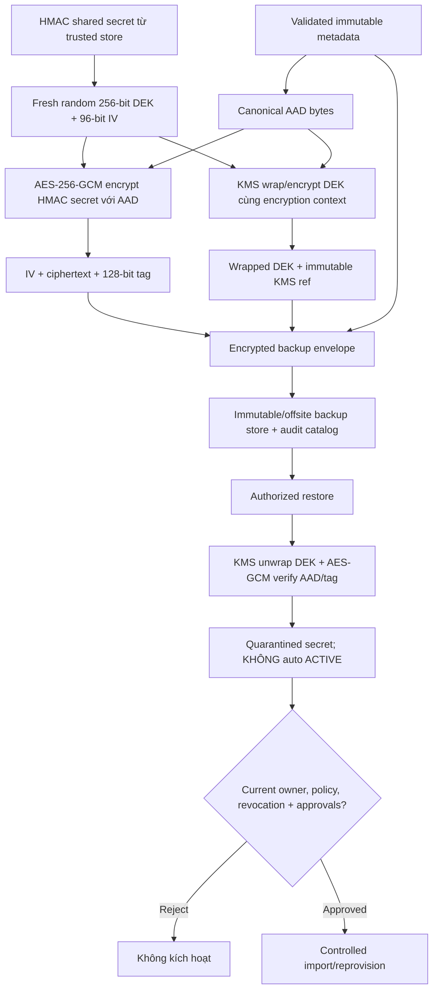
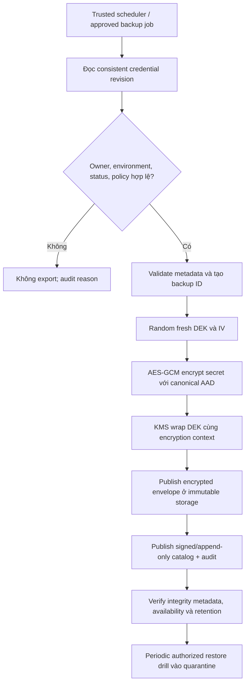
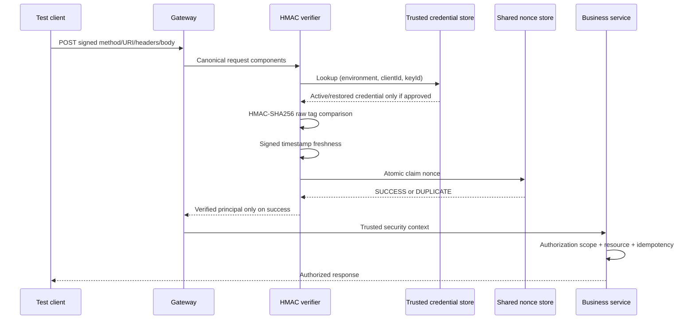

# Secret backup

## 1. Vì sao HMAC shared secret phải có kế hoạch backup riêng?

Trong cơ chế xác thực HTTP request bằng **HMAC với shared secret**, client ký một **canonical request** gồm HTTP method, URI, các signed headers và body hoặc body digest. Verifier phía server lấy secret tương ứng với client/key ID để tính lại HMAC, rồi kiểm tra timestamp, nonce và trạng thái credential. Khi server làm mất secret mà client vẫn đang sử dụng, request hợp lệ cũng không thể được xác minh. Ngược lại, nếu backup vô tình chứa plaintext secret, bất kỳ ai lấy được nó có thể tạo chữ ký HMAC giả cho những request mới.

```text
Client merchant-42                        HMAC API verifier
  HMAC-SHA256(secret-A, canonical)  --->   lookup (clientId, keyId)
                                            kiểm tra trạng thái credential
                                            tính HMAC với secret-A
                                            kiểm tra timestamp + nonce

Sự cố: credential database bị hỏng, key material không truy xuất được

Giải pháp có kiểm soát:
  A. Restore đúng secret/version từ encrypted backup rồi xét policy hiện tại
  B. Hoặc cấp secret/key ID mới và reprovision client an toàn
```

Bài **Secret backup** nằm trong chương *Secret management* của module `SECURITY_AUTHENTICATION_HMAC_REQUEST_AUTHENTICATION`. Module tập trung vào xác thực HTTP bằng HMAC và canonical method/URI/header/body, anti-replay bằng timestamp/nonce, key rotation, gateway/proxy tests và phân biệt **authentication** với **authorization**. Do đó backup không phải chỉ là sao chép dữ liệu; đó là khả năng **khôi phục an toàn credential, trạng thái thu hồi, quyền decrypt và sự nhất quán của các hệ phụ thuộc**.

Mục tiêu của bài:

- Phân loại tài sản cần backup: secret material, client/key metadata, key rotation/revocation state, KMS references, audit log và những trạng thái nghiệp vụ liên quan.
- Phân biệt **replication, encrypted backup, snapshot, secret export, disaster recovery và key rotation**.
- Thiết kế **envelope encryption** dùng random AES-256-GCM DEK và KMS/HSM quản lý key-encryption key (KEK).
- Ràng buộc `environment/clientId/keyId/secretVersion/backupId/KMS reference` vào encrypted secret bằng authenticated additional data (**AAD**).
- Giải thích vì sao GCM chống sửa ciphertext nhưng **không ngăn phục hồi một backup cũ hợp lệ** để làm sống lại credential đã revoked.
- Xây restore runbook, retention và RPO/RTO; dùng least privilege, dual control, immutable backups, cross-region readiness và restore drill.
- Viết Java 17 minh họa encrypted envelope backup, restore vào **quarantine** và kiểm thử metadata/ciphertext tampering.
- Kiểm thử failover, mất nonce store, idempotency store, key rotation, clock và authorization sau khôi phục.

**Nguyên tắc quan trọng:** decrypt được backup **không** đồng nghĩa credential được phép trở lại `ACTIVE`. Tình trạng revoked, owner, allowed algorithm/protocol versions và security policy **hiện hành** phải được áp dụng trước khi verifier tiếp nhận secret.

## 2. Cần sao lưu những gì?

### 2.1. Danh mục tài sản

| Thành phần | Mục đích | Cách bảo vệ |
| --- | --- | --- |
| **Raw HMAC shared secret** | Tính/xác minh HMAC-SHA256 request | Sao lưu bằng envelope encryption; không lưu plaintext |
| **Client ID, key ID, version** | Chọn secret đúng client và thời kỳ rotation | Gắn chặt metadata vào secret version |
| **Owner, algorithm, validity** | Không xác thực chéo tenant/sai thuật toán/key hết hạn | Có authoritative policy để reconcile |
| **Revocation/rotation history** | Ngăn tái kích hoạt key bị lộ hoặc đã ngừng | Append-only/tamper-evident, chống rollback |
| **KMS key reference, encryption context** | Unwrap encrypted DEK khi được phép | Retain đúng immutable key identity và grants |
| **Backup catalog và provenance** | Xác định backup ID, source revision và thời điểm | Versioned/immutable, có audit và kiểm tra completeness |
| **Nonce/replay store** | Chặn request HMAC cũ được gửi lại | Kế hoạch restore/đóng cửa sổ replay riêng |
| **Idempotency/transaction state** | Ngăn thanh toán/đơn hàng bị thực hiện lần hai | Durable journal, unique constraints, reconciliation |
| **Client provisioning state** | Client vẫn biết secret/key ID tương ứng | Đồng bộ qua kênh provisioning tin cậy |

Đừng đưa raw secret vào source code, Git, email, ticket, chat, file cấu hình `.env` commit, ảnh chụp terminal, CI logs hoặc một bản dump dữ liệu plaintext vô kiểm soát. File cấu hình có thể chứa **secret reference** thay vì giá trị secret; ứng dụng dùng IAM/service identity để gọi secret manager.

Nếu đã dùng secret manager có backup/replication được nhà cung cấp hỗ trợ, ưu tiên quy trình chính thức của nó. Một số KMS/HSM **không cho export raw KEK** theo thiết kế; không mặc định rằng có thể copy toàn bộ khóa gốc ra object storage.

### 2.2. Replication và backup không giống nhau

```text
Primary secret store ---> synchronous/async replica
                          (xóa nhầm hoặc dữ liệu sai có thể lan theo)

Primary secret store ---> point-in-time encrypted, versioned backup
                          (độc lập failure domain và quyền xóa)
```

Replication có thể giúp giảm downtime nhưng không bảo vệ chống credential compromise, ransomware, deletion hoặc thao tác xoay khóa sai đã đồng bộ sang replica. Backup có thể cho phép quay về một snapshot cũ, **đồng thời tạo nguy cơ rollback bảo mật** nếu không kiểm tra trạng thái thu hồi hiện hành.

Một chương trình backup đủ nghiêm túc cần **storage, KMS key lifecycle, immutable catalog, access approval và restore tests**. Việc một job ghi được `200 OK` từ object storage chưa phải bằng chứng có thể restore.

### 2.3. Nonce/idempotency có phải cùng một loại backup?

**Không.** HMAC secret và credential metadata thường được lưu lâu; replay nonce có TTL ngắn nhưng cần **tính nhất quán rất mạnh** trong khoảng thời gian hiệu lực. Nếu phục hồi key material mà làm mất nonce đã claim, một request HMAC cũ có thể được phát lại dù chữ ký vẫn đúng.

Idempotency/transaction records có horizon dài hơn; nếu mất chúng, client có thể retry hợp lệ bằng nonce mới và HMAC mới rồi tạo **side effect trùng**. Vì vậy sau disaster recovery cần kiểm tra thêm replay protection và business journal, không chỉ secret.

## 3. Threat model của backup

### 3.1. Kẻ tấn công có thể kiểm soát gì?

Cần xem các trường hợp riêng biệt:

1. Attacker đọc được object backup nhưng **không** có KMS decrypt grant.
2. Attacker có KMS decrypt grant nhưng **không** có quyền đọc object.
3. Attacker sở hữu cả hai quyền do một IAM role quá đặc quyền.
4. Attacker thay/xóa/copy ciphertext hoặc metadata.
5. Attacker chọn một **backup cũ có AES-GCM tag hợp lệ** rồi yêu cầu restore.
6. Attacker chiếm quyền break-glass hoặc tài khoản CI backup writer.
7. Operator restore key sang sai environment/tenant hoặc sai secret version.
8. Một region/cluster mất KMS key, credential store, nonce state hoặc idempotency journal.

| Đe dọa | Hậu quả | Kiểm soát chính |
| --- | --- | --- |
| Plaintext backup bị lấy | Attacker có thể ký HTTP request giả | Encryption + hạn chế plaintext export |
| Quyền đọc bucket và decrypt cùng một role | Lộ hàng loạt credential | Separation of duties, least privilege, approvals |
| Ciphertext/metadata bị sửa | Khôi phục sai secret/owner/version | AES-GCM tag và AAD binding |
| Backup cũ hợp lệ được restore | Revoked key có thể sống lại | Current revocation authority, anti-rollback |
| KMS KEK bị xóa sớm | Wrapped DEK không mở được | KEK retention/re-wrap và restore drill |
| Snapshot chưa nhất quán | Secret v7 bị dán nhãn v8 | Consistent read/source revision |
| Nonce state bị mất | Replay trong timestamp window | Durable replay recovery/fail-closed |
| Business journal mất | Chạy lại payment/payout | Transactional outbox, reconciliation, unique constraints |
| Audit bị sửa hoặc xóa | Không chứng minh được ai restore | Append-only logs, independent access control |

**Backup không chữa key compromise.** Nếu secret đã lộ, restore đúng secret ấy chỉ khôi phục khả năng verifier kiểm tra nhưng attacker vẫn biết secret. Cần revoke/rotate, reprovision client qua kênh an toàn, điều tra misuse và kiểm tra quyền đã cấp.

### 3.2. Bảo mật backup là bài toán nhiều hệ thống

Không chỉ kiểm soát object storage ACL. Cần quan tâm:

- **Storage plane:** ai được read/write/delete/version/purge.
- **Identity plane:** ai có thể tạo service-account credentials hoặc thay IAM grants.
- **Cryptographic plane:** ai được KMS Encrypt/Decrypt/Unwrap với encryption context.
- **Application plane:** ai được import/activate HMAC credential.
- **Audit plane:** ai có thể xóa log hoặc bỏ alerts.

Một bên có toàn bộ các quyền trên gần như có thể bypass mọi giới hạn của backup. Tách vai trò, dùng short-lived credentials, approvals và logging độc lập.

## 4. Envelope encryption thay cho plaintext copy

### 4.1. Các khóa khác nhau



Khái niệm:

- **HMAC shared secret:** dữ liệu nhạy cảm cần backup; client và server dùng cùng secret để ký/xác minh HTTP request.
- **DEK (Data Encryption Key):** khóa AES-256 ngẫu nhiên tạo mới để mã hóa một backup payload; **không phải** HMAC secret.
- **KEK (Key Encryption Key):** khóa dài hạn hơn được KMS/HSM giữ và dùng wrap DEK, không xuất ra ứng dụng production.
- **AES-GCM IV:** nonce của phép mã hóa backup (ví dụ 12 bytes). **Không phải HTTP `X-Nonce`**.
- **AAD:** metadata cần ràng buộc với ciphertext, không được mã hóa nhưng được xác thực.
- **Ciphertext + tag:** dữ liệu lưu trên object storage; AES-GCM verification thất bại nếu bị sửa và không biết key.

Với AES-GCM, **không được reuse cùng (DEK, IV)** cho hai lần encryption. Lab sinh **DEK 32 bytes mới và IV 12 bytes mới cho mỗi backup** bằng `SecureRandom`. Nếu dùng cùng DEK cho nhiều objects, phải quản lý IV uniqueness và các giới hạn sử dụng key một cách nghiêm ngặt.

### 4.2. Authenticated encryption bảo vệ metadata thế nào?

Một manifest khai `environment=prod`, `clientId=merchant-42`, `keyId=key-2026-b`. Nếu attacker sửa thành `clientId=merchant-73` mà không tạo lại đúng GCM tag với secret key, quá trình decrypt phải thất bại nhờ AAD mismatch.

**AAD không được giữ bí mật**: client/key IDs hay trạng thái credential nằm trong metadata vẫn cần access control. Thứ mà AES-GCM cung cấp là *integrity/authenticity của encrypted payload theo DEK* và AAD, **không** phải policy liệu bản backup đã được phép khôi phục hay chưa.

KMS wrapping của DEK cũng cần authentication/context binding. Một interface có `wrap(dek, aad)` và `unwrap(blob, aad)` giúp biểu thị hợp đồng; production KMS adapter phải thực thi policy đúng với **key reference và encryption context** của provider.

### 4.3. AES-GCM không ngăn rollback

```text
Monday:   secret key-a status=ACTIVE -> backup B1 hợp lệ
Tuesday:  key-a REVOKED vì bị lộ
Wednesday: backup B2 chứa trạng thái REVOKED

Attacker chọn restore B1:
  AES-GCM decrypt thành công, vì B1 thực sự hợp lệ lúc tạo
  NHƯNG key-a không được phép ACTIVE trở lại.
```

GCM phát hiện **tampering** trong một envelope nhưng không biết envelope nào là bản **mới nhất**. Để chống restore rollback:

- Khôi phục vào **quarantine**, không tự gán `ACTIVE`.
- Đối chiếu **authoritative revocation registry** và thế hệ (generation/version) **không bị rollback cùng snapshot**.
- Revocation phải thắng giá trị `captureState=ACTIVE` cũ.
- Kiểm tra immutable/source catalog, signed manifests hoặc append-only audit log để nhận biết bản thay thế/xóa/thiếu.
- Nếu secret đã lộ, cấp key mới thay vì mở lại một key cũ.

Không lấy chính `captureState` từ encrypted backup làm current truth; nó chỉ là snapshot tại thời điểm capture.

### 4.4. KMS immutable key reference và key lifecycle

Wrapped DEK phải biết nó được tạo bằng **KEK nào**. Nếu record chỉ lưu một alias có thể đổi sang key khác, restore về sau có thể không xác định được key thật. Nên lưu immutable key identity/version theo provider, ngoài alias dễ dùng trong cấu hình.

**Chú ý riêng với format V1 của bài:** `kmsKeyRef` nằm trong **AES-GCM AAD**. Nếu đổi sang KEK mới và cập nhật `kmsKeyRef` trong manifest, AES-GCM tag cũ không còn hợp lệ. Vì vậy **không thể chỉ rewrap DEK rồi sửa trường key reference** mà giữ nguyên ciphertext. V1 phải tạo **envelope mới được encrypt/authenticate lại với AAD mới** trong quy trình được phê duyệt, hoặc giữ old KEK usable đến khi backup hết retention. Một thiết kế V2 muốn hỗ trợ **DEK-only rewrap** phải tách stable data AAD khỏi mutable wrapper metadata và bảo vệ phần wrapper bằng authenticated/signed manifest riêng; cần review security và golden tests trước khi áp dụng.

Nếu KMS/HSM không cho export key material, **không coi đó là lỗi cần bypass**. Dùng provider-supported replication, HSM backup, key lifecycle và disaster recovery phù hợp.

## 5. Manifest HMAC-SECRET-BACKUP-V1 và golden AAD

Bài định nghĩa **format minh họa** `HMAC-SECRET-BACKUP-V1` cho Java lab, không phải chuẩn bắt buộc của KMS hay HTTP.

### 5.1. Trường của một encrypted envelope

```yaml
formatVersion: 1
backupId: bkp-2026-001
environment: prod
clientId: merchant-42
keyId: key-2026-b
secretVersion: 7
algorithm: HmacSHA256
captureState: ACTIVE
capturedAtEpochSeconds: 1790000000
kmsKeyRef: kms-backup-prod-01

# Placeholders mô tả schema, KHÔNG phải ciphertext thực:
dataIvB64url: "<12-byte AES-GCM IV>"
wrappedDekB64url: "<wrapped 32-byte DEK>"
dataCiphertextB64url: "<GCM ciphertext including tag>"
```

**`captureState=ACTIVE` không phải quyền kích hoạt khi restore.** `secretVersion=7` là version của key material, không phải HTTP authentication Version field, key ID của KMS hay revision của backup format.

| Metadata | Lab validation | Vai trò |
| --- | --- | --- |
| `formatVersion` | Chính xác `1` | Chọn đúng envelope codec |
| `backupId` | ASCII `[A-Za-z0-9._-]{1,64}` | Chọn backup object |
| `environment` | ASCII `[A-Za-z0-9._-]{1,32}` | Chặn restore cross-environment |
| `clientId/keyId` | ASCII `[A-Za-z0-9._-]{1,64}` | Gắn đúng owner và credential |
| `secretVersion` | Integer dương | Chọn đúng credential generation |
| `algorithm` | Chính xác `HmacSHA256` | Tránh algorithm confusion |
| `captureState` | `ACTIVE` hoặc `REVOKED` | Snapshot state để đối chiếu |
| `capturedAtEpochSeconds` | Unix epoch seconds dương | Source timestamp/audit |
| `kmsKeyRef` | ASCII `[A-Za-z0-9._-]{1,64}` | Lab key identity |
| `dataIv` | Raw 12 bytes | AES-GCM IV |
| `wrappedDek` | Blob được KMS authentically wrap | Mở được DEK chỉ khi được phép |
| `dataCiphertext` | Ciphertext kèm 16-byte tag | Confidentiality và integrity |

KMS key identifiers thực tế có thể là ARN/URI chứa ký tự `:` hoặc `/`; production schema phải hỗ trợ đúng định dạng provider nhưng **không cho control characters/newline**, đồng thời đảm bảo AAD canonical không mơ hồ. Regex hẹp của lab không áp dụng cho mọi KMS.

### 5.2. Canonical AAD 10 dòng

Metadata trong fixture tạo thành UTF-8 string nối bằng LF `0x0A`, **không có LF cuối**:

```text
HMAC-SECRET-BACKUP-V1
backup-id:bkp-2026-001
environment:prod
client-id:merchant-42
key-id:key-2026-b
secret-version:7
algorithm:HmacSHA256
capture-state:ACTIVE
captured-at:1790000000
kms-key-ref:kms-backup-prod-01
```

Golden vector được tính **độc lập** từ SHA-256 trên AAD bytes:

```text
AAD line count: 10
AAD UTF-8 bytes: 214
AAD trailing LF: none

SHA-256(AAD), lowercase hex:
ef974ed0db1c065934fb0e271fb14968cb2498fe6610c186b66911add294df4d
```

Đây là golden vector cho **metadata canonicalization**, không phải encrypted HMAC secret. AES-GCM ciphertext **phải khác** giữa các lần backup vì DEK/IV mới được sinh ngẫu nhiên; không viết test đòi ciphertext lặp lại.

### 5.3. Consistent snapshot giữa secret và metadata

Một lỗi tinh vi:

```text
Thread 1 đọc HMAC secret của key version 7
Thread 2 rotate key, active version thành 8
Thread 1 đọc metadata version 8, sao lưu cùng secret v7
```

GCM vẫn xác thực **đúng metadata sai đã nhập**, vì nó không biết business consistency. Backup job phải đọc descriptor và secret từ **cùng source revision/consistent snapshot**, hoặc xác minh revision không đổi trước publish:

```text
read immutable descriptor version 7 + secret material version 7
verify owner/key/version mapping and revision
encrypt/write envelope
publish catalog pointer + audit with source revision
```

Cần có bảo đảm nhất quán từ storage (transaction/snapshot/version token), không chỉ đọc hai API liên tiếp rồi hy vọng dữ liệu không đổi.

## 6. Backup lifecycle: từ tạo snapshot đến kiểm tra khả năng phục hồi

### 6.1. Quy trình backup có thể kiểm toán



Một pipeline có thể triển khai như sau:

1. **Chọn rõ scope:** environment, client/key IDs, generation và loại secret. Backup job chỉ đọc những versions được cấp quyền; không dùng tài khoản administrator của toàn secret manager.
2. **Đọc consistent version:** cùng revision cho descriptor, owner, status-at-capture và raw HMAC secret; nếu đang rotation cần revision token để phát hiện thay đổi đồng thời.
3. **Validate và giới hạn:** metadata schema, raw secret size, encryption algorithm policy, backup request ID và đích lưu trữ. Không tạo filename từ input chưa được kiểm soát.
4. **Mã hóa trong memory bảo vệ:** tạo fresh 256-bit DEK, fresh 96-bit GCM IV, canonical AAD; KMS wrap DEK theo immutable KEK identity và context. Không ghi raw DEK/secret ra disk tạm.
5. **Đẩy encrypted envelope:** object storage với versioning, encryption-at-rest bổ sung, immutable retention/WORM khi thích hợp, backup region/account tách failure domain.
6. **Công bố catalog** có source revision, backup ID, thời điểm, encrypted blob size, ciphertext checksum và KMS key ref; bảo vệ catalog bằng controls ngăn sửa/xóa/rollback.
7. **Báo cáo/audit:** record actor, approvals, source version, object URI, checksum, kết quả, thời gian; tuyệt đối không log secret plaintext.
8. **Kiểm tra thành công thực chất:** object có thể đọc, KMS key identity còn tồn tại, decrypt/restore drill trong môi trường được phê duyệt đạt kết quả, restore policy chặn revoked key.
9. **Quản lý retention:** backup đã hết hạn được xóa theo policy, nhưng kiểm tra legal hold, forensic evidence, KEK dependencies và lịch sử client provisioning.

**Không đánh đồng “backup upload thành công” với “backup phục hồi được”**. Một object đầy đủ nhưng KMS key đã bị xóa, encryption context thiếu hoặc catalog không còn đúng version có thể vô dụng.

### 6.2. RPO và RTO là hai mục tiêu khác nhau

- **RPO (Recovery Point Objective):** lượng trạng thái cập nhật tối đa có thể mất tính theo thời gian nếu khôi phục đến một bản backup.
- **RTO (Recovery Time Objective):** khoảng thời gian mục tiêu để phục hồi dịch vụ theo định nghĩa đã chọn.

Ví dụ học tập: backup credential metadata mỗi 15 phút, muốn **RPO 15 phút** và **RTO 60 phút**. Đây là con số minh họa, không phải SLA cố định cho mọi hệ thống HMAC.

| Tài sản | Rủi ro RPO | Rủi ro RTO |
| --- | --- | --- |
| Shared secret + key versions | Key mới đã phát cho client nhưng chưa có backup | Client hợp lệ không thể ký với secret server đã mất |
| Revocation registry | Mất lệnh thu hồi mới nhất và thấy old ACTIVE | Không được mở traffic khi chưa reconcile revoked |
| KMS KEK + grants | Wrapped DEK nhưng không có decrypt capability | Phục hồi KMS/quyền trước khi mở envelope |
| Nonce/replay records | Lịch sử nonce đã claim bị mất | Phải phục hồi hoặc chờ hết cửa sổ chống replay |
| Idempotency/payment journal | Mất record side effect đã commit | Phải reconcile/rebuild trước khi xử lý lại giao dịch |
| Gateway configuration | Vẫn dùng canonicalizer cũ hoặc secret cache stale | Policy có thể khác giữa các replicas |

Một chỉ số “RTO phục hồi secret = 5 phút” **không đồng nghĩa** endpoint tạo payment đã an toàn. RTO cho nghiệp vụ cần bao gồm KMS, trusted clock, replay state, authorization policy, idempotency journal và canary verification.

### 6.3. Retention và KEK lifecycle

Một backup lâu năm có thể chứa secret chưa từng bị xóa khỏi mọi môi trường. Giữ quá lâu tăng rủi ro exposure; xóa quá sớm làm mất khả năng phục hồi khi client vẫn sử dụng credential version ấy.

Retention policy nên quyết định:

- Backup version nào còn cần khi client đang dùng secret hoặc đang trong rotation migration.
- Backup của key đã `REVOKED` có được giữ như forensic evidence không, trong bao lâu, theo quyền nào.
- Backup đã hết hạn có legal hold hay không; cách purge và xác nhận xóa.
- KEK nào bảo vệ từng wrapped DEK; với format V1 có **KMS ref trong data AAD**, việc thay KEK/ref đòi hỏi re-encrypt/authenticate envelope mới thay vì chỉ sửa metadata; phải test restore trước khi retire KEK.
- Bản sao ở DR region, staging và developer workstation có cùng quy trình dọn không.
- Ai được phép thay retention hoặc thực hiện crypto-erasure; thao tác xóa nguy hiểm có multi-party approval không.

**Không xóa KEK chỉ vì alias đã trỏ sang key mới**. Nếu encrypted DEK cũ vẫn được wrap bởi KEK đó và retention yêu cầu restore, các bản backup sẽ không thể giải mã sau khi KEK bị hủy.

## 7. Kiểm soát truy cập và audit

### 7.1. Phân tách vai trò

| Vai trò | Quyền tối thiểu điển hình | Quyền phải hạn chế |
| --- | --- | --- |
| Backup writer | Read selected secret version, KMS wrap, append encrypted objects | Bulk decrypt/activate/delete backups |
| Backup auditor | Đọc catalog/metrics/log đã lọc | Raw secret, KMS decrypt |
| Restore operator | Đọc **một backup được phê duyệt**, KMS unwrap vào quarantine | Auto-ACTIVE, thay revocation authority |
| Security approver | Xác minh mục đích restore/break-glass, duyệt hành động | Tự dump toàn bộ secret ra terminal |
| KMS admin | Quản lý grants/key lifecycle | Toàn quyền read backup và decrypt ngoài quy trình |
| Runtime verifier | Sử dụng active credential trong trusted secret store | Truy vấn mọi backup và all-key export |
| Incident responder | Revoke, rotate, điều tra misuse | Mở lại revoked secret chỉ vì phục hồi dữ liệu |

Có thể yêu cầu **dual control** cho restore production, tạo decrypt grants tạm có expiration, log độc lập, MFA/approval và policy chặn export ra ngoài environment được định nghĩa.

### 7.2. Backup encryption không thay thế quyền trên storage

Có ít nhất bốn boundary:

1. **Object storage:** ai read/write/delete/overwrite/version/purge backup và catalog.
2. **KMS/crypto:** ai unwrap DEK, theo đúng key ID/encryption context nào.
3. **Credential lifecycle:** ai import secret, đổi trạng thái ACTIVE/REVOKED và sửa allowed auth versions.
4. **Audit/security:** ai xem hoặc xóa logs, tắt alerts, thay retention/approval rules.

Nếu một IAM principal đọc toàn bộ backup, decrypt mọi KEK, sửa credential status và xóa log, attacker chỉ cần chiếm nó. Cần separation of duties và test **policy combinations**, không chỉ test từng quyền riêng lẻ.

### 7.3. Dữ liệu tuyệt đối không đưa vào log

```text
raw HMAC shared secret
raw AES DEK hoặc raw KMS KEK
plaintext backup payload
toString() của object decrypted secret
full Authorization header hoặc full HMAC signature
KMS plaintext decrypt response
dump bộ nhớ process sau restore
```

Có thể log backup ID, source revision, environment, KMS immutable ref, event code, actor được xác thực, approval ID và checksum **ciphertext** với quyền truy cập/retention phù hợp. Metadata tenant/client ID cũng có thể nhạy cảm, nên không tự công khai chúng trong logs.

Metrics như `backup_last_success_age`, `backup_restore_drill_pass`, `kms_decrypt_denied_total`, `backup_integrity_failures`, `restore_blocked_revoked_total`, `revocation_propagation_lag` hữu ích hơn log raw secret. Tránh labels chứa `backupId`/`clientId` tùy ý gây high cardinality.

## 8. Restore runbook: kiểm tra nhiều lớp trước khi phục hồi traffic

### 8.1. Mười hai bước phục hồi production

1. **Xác định nguyên nhân sự cố:** mất storage, hỏng region, xóa nhầm, key compromise hay ransomware. Nếu secret đã lộ, chỉ restore old key không giải quyết compromise; ưu tiên revoke/rotate.
2. **Đặt traffic nhạy cảm vào trạng thái fail-closed** nếu credential state, nonce/idempotency store hoặc clock không đáng tin. Không tắt HMAC để “khôi phục dịch vụ nhanh”.
3. **Chọn backup ID và source revision cụ thể** từ authoritative catalog, xác minh provenance, owner, integrity evidence và approvals. Không chỉ lấy tên file mới nhất.
4. **Kiểm tra KMS decrypt path**, key identity/encryption context và region đang phục hồi. Nếu KEK không thể unwrap, không đổ lỗi HMAC hay thử hard-coded fallback.
5. **Đọc authoritative revocation/rotation registry độc lập với snapshot**. Không dùng `captureState=ACTIVE` làm bằng chứng key hiện hành còn được phép dùng.
6. **Đối chiếu environment/tenant/key ID/version/algorithm/allowedVersions** với trusted policy và destination.
7. **KMS unwrap DEK và AES-GCM decrypt** với AAD chính xác; nếu tag fail, dừng, báo integrity incident, không thử bỏ AAD hoặc decrypt “best effort”.
8. **Chỉ nhận dữ liệu vào quarantine**, không cho runtime verifier dùng ngay. Hạn chế thời gian tồn tại plaintext trong memory, không ghi file tạm hoặc log.
9. **Phê duyệt import/reprovision** theo current policy. Secret revoked/compromised phải bị chặn; trường hợp cần phục hồi client access có thể phải cấp key mới qua provisioning.
10. **Phục hồi/reconcile replay và business state:** atomic nonce store, idempotency/transaction ledger, authoritative clock, gateway canonicalization và key revocation cache.
11. **Chạy canary positive/negative tests:** valid HMAC từ test client, revoked key reject, duplicate header reject, replay reject, no-authz resource deny và idempotency không tạo side effect trùng.
12. **Mở traffic từng phần và audit kết quả:** theo dõi key mismatches, unknown nonce state, failed decrypt, unauthorized requests và khả năng side effects lặp.

### 8.2. Vì sao restore phải vào quarantine?

Bản backup có thể hợp lệ nhưng:

- `captureState=ACTIVE` được lưu **trước lúc key bị revoked**.
- Owner hoặc environment của destination khác bản gốc.
- Secret version thấp hơn generation hiện hành.
- Key đã bị compromise dù vẫn có ciphertext/AES-GCM tag đúng.
- Allowed algorithm/authentication version đã bị vô hiệu theo security policy mới.
- Backup catalog bị rollback dù ciphertext nguyên vẹn.

Vì vậy ví dụ Java sẽ trả **`QuarantinedSecret`** chứa plaintext bytes trong phạm vi test, **không gọi credential activation**. Code thực nên dùng protected secret handle, secret manager import workflow và approval gate riêng. Không tạo một hàm tiện ích `restoreAndActivate` bỏ qua các bước an toàn.

### 8.3. Nếu KMS key không còn thì sao?

Khi KEK đã bị xóa vĩnh viễn và không có key material phục hồi được theo cơ chế provider, wrapped DEK **không thể decrypt**, dù encrypted object hoàn toàn nguyên vẹn.

Các phương án đúng là giữ KEK theo retention, dùng key replication/backup được KMS/HSM hỗ trợ, hoặc tạo **envelope backup mới dưới KEK/AAD mới** có kiểm tra integrity và restore drill trước khi retire old KEK. **Không chỉ rewrap DEK và sửa `kmsKeyRef` trong format V1**, vì trường ấy đã được AES-GCM tag bảo vệ bằng AAD. Nếu không thể mở backup, phải **reprovision/rotate HMAC credentials** với client qua kênh tin cậy.

Không yêu cầu provider export raw master key khi điều đó bị cấm hoặc không được hỗ trợ.

### 8.4. Khôi phục secret nhưng mất nonce state: rủi ro replay

Giả sử HTTP HMAC freshness policy:

```text
serverNow - 300 <= signedTimestamp <= serverNow + 30
```

Nếu nonce store mất những nonce đã claim, request trước sự cố vẫn có HMAC hợp lệ; attacker có thể gửi lại trong cửa sổ và được xem là nonce mới.

Phương án:

- Khôi phục **durable, consistent replay state** trước khi mở traffic.
- Hoặc fail-closed và **đợi toàn bộ signed requests trước sự cố hết hạn** dưới server clock đáng tin, cộng safety margin.
- Hoặc rotate/revoke/invalidate key generation cũ nếu không thể kiểm soát/có rủi ro compromise.

Với `lastPossibleAcceptedAt=t0` và các verifier trước sự cố dùng cùng policy, một request được chấp nhận tại `t0` có thể mang timestamp **tới `t0+30`**. Nó chỉ hết cửa sổ sau **`t0+30+300 = t0+330`**. Vì vậy thời gian drain an toàn cần **qua t0+330 giây cộng margin**, không phải 300 giây, và chỉ khi `t0` có thể tin cậy và không còn đường verifier cũ nhận request.

Nếu không biết `t0`, clock không đáng tin hoặc vẫn có verifier cũ có thể nhận traffic song song, **không tự đoán thời gian an toàn**. Giữ fail-closed, khôi phục replay history hoặc vô hiệu credential generations liên quan.

**Đợi hết timestamp window không khôi phục idempotency/payment journal.** Một client có thể ký request mới (nonce mới) cho cùng nghiệp vụ; nếu mất idempotency state, service vẫn có thể charge/payout lần hai. Phải reconcile business effects và unique references riêng.

## 9. Cách thiết kế test để phân biệt backup “chạy được” với restore “an toàn”

| Lớp test | Bằng chứng cần có | Ví dụ |
| --- | --- | --- |
| **Schema và AAD** | Golden bytes, validation, context consistency | 10 dòng/214 bytes/SHA-256 cố định |
| **Cryptography** | Fresh DEK/IV, AES-GCM tag và KMS wrapped DEK | Wrong AAD/ciphertext/IV fail |
| **Access control** | KMS/storage grants áp đúng actor và environment | Writer không decrypt, auditor không lấy raw secret |
| **Restore policy** | Quarantine, chống rollback/revoked activation | Backup B1 ACTIVE bị current registry REVOKED chặn |
| **Distributed DR** | RPO/RTO, key rotation, replay/idempotency, gateway | Restore drill đa replica/region |

Cần assert không chỉ “AES decrypt ra 32 bytes” mà cả **credential active count, nonce claim behavior và business side effects** sau restore. Bài lab tiếp theo sử dụng Java 17 với key/secret test công khai, không dùng secret production và không thay thế một KMS/HSM thật.

## 10. Java 17: encrypted backup envelope với AES-256-GCM

### 10.1. Thiết kế class

Class `SecretBackupEnvelopeV1` minh họa:

1. Validate metadata và tạo **canonical AAD** có đủ 10 dòng giống golden fixture.
2. Sinh **fresh random 256-bit DEK** và **fresh 96-bit IV** cho mỗi backup.
3. AES-256-GCM encrypt chính xác **32 byte HMAC shared secret** của fixture.
4. Gọi interface `KmsWrapper.wrap(dek,aad)` để mã hóa DEK bằng key do KMS/HSM kiểm soát.
5. Lưu `Envelope` gồm metadata, IV, wrapped DEK, encrypted data+tag; không lưu raw secret/DEK.
6. Restore với metadata **được xác minh từ nguồn tin cậy độc lập**, KMS unwrap và AES-GCM verify tag/AAD.
7. Trả `QuarantinedSecret` **không có API auto-activate**; application policy/approvals xử lý riêng.

**Chỉ dùng secret thử nghiệm** trong code. Một backup production còn cần object serialization, IAM, KMS provider thật, encrypted transport, source revision consistency và durable/audited storage.

### 10.2. Class SecretBackupEnvelopeV1

```java
import java.nio.ByteBuffer;
import java.nio.charset.StandardCharsets;
import java.security.GeneralSecurityException;
import java.security.MessageDigest;
import java.security.SecureRandom;
import java.util.Arrays;
import java.util.HexFormat;
import java.util.Objects;
import javax.crypto.Cipher;
import javax.crypto.spec.GCMParameterSpec;
import javax.crypto.spec.SecretKeySpec;

public final class SecretBackupEnvelopeV1 {
    private static final SecureRandom RANDOM = new SecureRandom();
    private static final int SECRET_BYTES = 32; // HMAC key policy của lab
    private static final int DEK_BYTES = 32;    // AES-256 DEK
    private static final int IV_BYTES = 12;     // GCM 96-bit IV
    private static final int TAG_BITS = 128;    // GCM 128-bit tag
    private static final String FORMAT = "HMAC-SECRET-BACKUP-V1";

    public record Metadata(
        int formatVersion,
        String backupId,
        String environment,
        String clientId,
        String keyId,
        int secretVersion,
        String algorithm,
        String captureState,
        long capturedAtEpochSeconds,
        String kmsKeyRef
    ) {}

    public record Envelope(
        Metadata metadata,
        byte[] dataIv,
        byte[] wrappedDek,
        byte[] ciphertextWithTag
    ) {
        public Envelope {
            Objects.requireNonNull(metadata, "metadata");
            dataIv = Objects.requireNonNull(dataIv, "IV").clone();
            wrappedDek = Objects.requireNonNull(
                wrappedDek, "wrapped DEK").clone();
            ciphertextWithTag = Objects.requireNonNull(
                ciphertextWithTag, "ciphertext").clone();
        }
        @Override public byte[] dataIv() {
            return dataIv.clone();
        }
        @Override public byte[] wrappedDek() {
            return wrappedDek.clone();
        }
        @Override public byte[] ciphertextWithTag() {
            return ciphertextWithTag.clone();
        }
    }

    // Không được dùng secret đang quarantine để ký/xác minh HTTP.
    // Demo có phương thức copy cho TEST, không phải import API production.
    public static final class QuarantinedSecret
            implements AutoCloseable {
        private final Metadata metadata;
        private byte[] secret;

        private QuarantinedSecret(Metadata metadata, byte[] secret) {
            this.metadata = Objects.requireNonNull(metadata);
            this.secret = secret.clone();
        }

        public Metadata metadata() {
            return metadata;
        }

        public synchronized byte[] copyBytesForTest() {
            if (secret == null) {
                throw new IllegalStateException(
                    "Quarantined secret already closed");
            }
            return secret.clone();
        }

        @Override
        public synchronized void close() {
            if (secret != null) {
                Arrays.fill(secret, (byte) 0);
                secret = null;
            }
        }

        @Override
        public String toString() {
            return "QuarantinedSecret[redacted]";
        }
    }

    // Production adapter phải dùng KMS/HSM provider chính thức.
    // KEK KHÔNG được xuất vào code hoặc backup artifact.
    public interface KmsWrapper {
        String immutableKeyRef();

        byte[] wrap(byte[] rawDek, byte[] encryptionContext)
            throws GeneralSecurityException;

        byte[] unwrap(byte[] wrappedDek, byte[] encryptionContext)
            throws GeneralSecurityException;
    }

    private SecretBackupEnvelopeV1() {}

    private static void requireToken(
            String field, String value, int maxLength) {
        if (value == null || !value.matches(
                "[A-Za-z0-9._-]{1," + maxLength + "}")) {
            throw new IllegalArgumentException(
                "Invalid " + field);
        }
    }

    // Một representation duy nhất, không cho newline/control injection.
    public static byte[] canonicalAad(Metadata m) {
        Objects.requireNonNull(m, "metadata");
        if (m.formatVersion() != 1
                || m.secretVersion() <= 0
                || m.capturedAtEpochSeconds() <= 0) {
            throw new IllegalArgumentException(
                "Unsupported backup metadata version/time");
        }
        requireToken("backupId", m.backupId(), 64);
        requireToken("environment", m.environment(), 32);
        requireToken("clientId", m.clientId(), 64);
        requireToken("keyId", m.keyId(), 64);
        requireToken("kmsKeyRef", m.kmsKeyRef(), 64);

        if (!"HmacSHA256".equals(m.algorithm())
                || !("ACTIVE".equals(m.captureState())
                    || "REVOKED".equals(m.captureState()))) {
            throw new IllegalArgumentException(
                "Unsupported credential algorithm/state");
        }

        String canonical = String.join("\n",
            FORMAT,
            "backup-id:" + m.backupId(),
            "environment:" + m.environment(),
            "client-id:" + m.clientId(),
            "key-id:" + m.keyId(),
            "secret-version:" + m.secretVersion(),
            "algorithm:" + m.algorithm(),
            "capture-state:" + m.captureState(),
            "captured-at:" + m.capturedAtEpochSeconds(),
            "kms-key-ref:" + m.kmsKeyRef()
        );
        return canonical.getBytes(StandardCharsets.UTF_8);
    }

    private static Cipher newGcmCipher(
            int mode, byte[] rawAesKey, byte[] iv,
            byte[] aad) throws GeneralSecurityException {
        if (rawAesKey == null || rawAesKey.length != DEK_BYTES
                || iv == null || iv.length != IV_BYTES) {
            throw new IllegalArgumentException(
                "AES-GCM key/IV size mismatch");
        }
        Cipher cipher = Cipher.getInstance("AES/GCM/NoPadding");
        cipher.init(mode, new SecretKeySpec(rawAesKey, "AES"),
            new GCMParameterSpec(TAG_BITS, iv));
        cipher.updateAAD(aad);
        return cipher;
    }

    public static Envelope backup(
            byte[] rawHmacSecret,
            Metadata metadata,
            KmsWrapper kms) throws GeneralSecurityException {
        if (rawHmacSecret == null
                || rawHmacSecret.length != SECRET_BYTES) {
            throw new IllegalArgumentException(
                "Lab requires exact 256-bit HMAC secret");
        }
        Objects.requireNonNull(kms, "KMS wrapper");
        byte[] aad = canonicalAad(metadata);
        if (!metadata.kmsKeyRef().equals(
                kms.immutableKeyRef())) {
            throw new IllegalArgumentException(
                "Unexpected KMS key reference");
        }

        byte[] dek = new byte[DEK_BYTES];
        byte[] iv = new byte[IV_BYTES];
        RANDOM.nextBytes(dek);
        RANDOM.nextBytes(iv);

        try {
            Cipher cipher = newGcmCipher(
                Cipher.ENCRYPT_MODE, dek, iv, aad);
            byte[] encrypted = cipher.doFinal(rawHmacSecret);
            byte[] wrapped = kms.wrap(dek, aad);

            if (wrapped == null || wrapped.length == 0) {
                throw new GeneralSecurityException(
                    "KMS returned no encrypted DEK");
            }
            return new Envelope(
                metadata, iv, wrapped, encrypted);
        } finally {
            // Best effort; JCA/heap có thể giữ thêm copies.
            Arrays.fill(dek, (byte) 0);
        }
    }

    public static QuarantinedSecret restoreToQuarantine(
            Envelope backup,
            Metadata approvedExpectedMetadata,
            KmsWrapper kms) throws GeneralSecurityException {
        Objects.requireNonNull(backup, "envelope");
        Objects.requireNonNull(kms, "KMS");
        // Expected metadata PHẢI đến từ independent trusted catalog
        // và approval, không lấy nguyên backup.metadata() làm nguồn tin.
        if (!backup.metadata().equals(approvedExpectedMetadata)) {
            throw new IllegalArgumentException(
                "Backup metadata differs from approved target");
        }

        byte[] aad = canonicalAad(approvedExpectedMetadata);
        if (!kms.immutableKeyRef().equals(
                approvedExpectedMetadata.kmsKeyRef())) {
            throw new IllegalArgumentException(
                "Incorrect immutable KMS key reference");
        }

        byte[] iv = backup.dataIv();
        byte[] encrypted = backup.ciphertextWithTag();
        byte[] wrapped = backup.wrappedDek();
        // 32 bytes secret + 16 bytes GCM tag trong lab.
        if (iv.length != IV_BYTES
                || encrypted.length != SECRET_BYTES + TAG_BITS / 8
                || wrapped.length == 0) {
            throw new IllegalArgumentException(
                "Malformed encrypted backup envelope");
        }

        byte[] dek = kms.unwrap(wrapped, aad);
        byte[] plaintext = null;
        try {
            if (dek == null || dek.length != DEK_BYTES) {
                throw new GeneralSecurityException(
                    "KMS returned invalid DEK length");
            }
            Cipher cipher = newGcmCipher(
                Cipher.DECRYPT_MODE, dek, iv, aad);
            // Nếu key/AAD/IV/ciphertext/tag khác, doFinal FAIL.
            plaintext = cipher.doFinal(encrypted);
            if (plaintext.length != SECRET_BYTES) {
                throw new GeneralSecurityException(
                    "Unexpected HMAC secret length");
            }

            // Chỉ trả quarantine, chưa trao secret cho runtime authn.
            return new QuarantinedSecret(
                approvedExpectedMetadata, plaintext);
        } finally {
            if (plaintext != null) {
                Arrays.fill(plaintext, (byte) 0);
            }
            if (dek != null) {
                Arrays.fill(dek, (byte) 0);
            }
        }
    }

    public static String aadSha256ForTest(Metadata metadata)
            throws GeneralSecurityException {
        byte[] digest = MessageDigest.getInstance("SHA-256")
            .digest(canonicalAad(metadata));
        return HexFormat.of().formatHex(digest);
    }
}
```

### 10.3. Các giới hạn có chủ đích

- Mã chỉ sao lưu **secret 32 bytes**; thực tế HMAC secret có thể dài khác, nhưng cần validation/policy rõ và tránh key yếu. Không tự cắt secret hoặc lấy password người dùng làm HMAC secret.
- `Envelope` không tự mang đủ **nguồn tin đáng tin** về revocation/backup freshness. `approvedExpectedMetadata` phải đến từ trusted catalog/approval, không chỉ copy `backup.metadata()`.
- `QuarantinedSecret` có bản sao plaintext trong heap **dù chưa ACTIVE**. `close()` xóa best-effort mảng nội bộ, nhưng JVM/JCA có thể đã có bản sao. Production ưu tiên protected secret handle, secret manager import API và hạn chế thời gian/địa điểm có plaintext.
- `KmsWrapper` là interface, không tự cung cấp IAM/dual control/production key management. Provider thật cần key reference, encryption context, request authentication, permissions và audit.
- AES-GCM xác thực integrity theo context đã chọn; **không kiểm tra trạng thái key hiện hành hay tính mới nhất của catalog**. Một ciphertext B1 cũ vẫn decrypt hợp lệ dù credential đã revoked sau B1.
- `backup()` không tự lưu object store hoặc versioned catalog. Việc publish/copy/retention/provenance và source revision consistency thuộc orchestration layer.

## 11. Java 17: fake KMS trong lab và golden/negative tests

### 11.1. Vì sao cần một KMS test double?

Ứng dụng production không nên có raw KEK trong code; KMS/HSM giải quyết policy, key lifecycle và audit. Nhưng để học cách **wrapped DEK ràng buộc với metadata**, ta có thể dựng một `InProcessKmsForLab` chỉ dùng **key công khai test** và một AES-GCM wrapping step trong bộ nhớ. Nó **không thay KMS**, không có IAM/rotation/HA và không dùng trong production.

Ở đây key mã hóa backup data là DEK ngẫu nhiên; key của `InProcessKmsForLab` đóng vai KEK **chỉ để test**. IV riêng cho DEK wrapping cũng được sinh mới. Một KMS thật phải đảm bảo unique IV/nonces và provider encryption-context semantics thích hợp; không nên sao chép implementation test này vào production.

### 11.2. Class InProcessKmsForLab

```java
import java.nio.ByteBuffer;
import java.security.GeneralSecurityException;
import java.security.SecureRandom;
import java.util.Arrays;
import javax.crypto.Cipher;
import javax.crypto.spec.GCMParameterSpec;
import javax.crypto.spec.SecretKeySpec;

public final class InProcessKmsForLab
        implements SecretBackupEnvelopeV1.KmsWrapper {
    private static final SecureRandom RANDOM = new SecureRandom();
    private final String immutableKeyRef;
    private final SecretKeySpec labKek;

    // Chỉ truyền raw KEK có thể nhìn thấy trong LAB.
    // Production KHÔNG export KEK từ HSM/KMS.
    public InProcessKmsForLab(String keyRef, byte[] rawKek) {
        if (keyRef == null || keyRef.isEmpty()
                || rawKek == null || rawKek.length != 32) {
            throw new IllegalArgumentException("Invalid lab KEK");
        }
        immutableKeyRef = keyRef;
        labKek = new SecretKeySpec(rawKek.clone(), "AES");
    }

    @Override
    public String immutableKeyRef() {
        return immutableKeyRef;
    }

    private Cipher cipher(int mode, byte[] iv, byte[] context)
            throws GeneralSecurityException {
        Cipher c = Cipher.getInstance("AES/GCM/NoPadding");
        c.init(mode, labKek, new GCMParameterSpec(128, iv));
        c.updateAAD(context);
        return c;
    }

    @Override
    public byte[] wrap(byte[] rawDek, byte[] context)
            throws GeneralSecurityException {
        if (rawDek == null || rawDek.length != 32) {
            throw new IllegalArgumentException("Wrong DEK length");
        }
        byte[] iv = new byte[12];
        RANDOM.nextBytes(iv);
        byte[] sealed = cipher(
            Cipher.ENCRYPT_MODE, iv, context).doFinal(rawDek);
        return ByteBuffer.allocate(iv.length + sealed.length)
            .put(iv).put(sealed).array();
    }

    @Override
    public byte[] unwrap(byte[] wrappedDek, byte[] context)
            throws GeneralSecurityException {
        if (wrappedDek == null
                || wrappedDek.length != 12 + 32 + 16) {
            throw new IllegalArgumentException(
                "Invalid lab wrapped DEK size");
        }
        byte[] iv = Arrays.copyOfRange(wrappedDek, 0, 12);
        byte[] sealed = Arrays.copyOfRange(
            wrappedDek, 12, wrappedDek.length);
        return cipher(Cipher.DECRYPT_MODE, iv, context)
            .doFinal(sealed);
    }
}
```

### 11.3. Class SecretBackupChecksV1

Chạy các tests với **test data công khai**. Hệ thống thực không được dùng `000102...` làm secret và không được dùng `InProcessKmsForLab` để bao backup production.

```java
import java.security.GeneralSecurityException;
import java.util.Arrays;
import java.util.HexFormat;

public final class SecretBackupChecksV1 {
    private static final String EXPECTED_AAD_HASH =
        "ef974ed0db1c065934fb0e271fb14968"
      + "cb2498fe6610c186b66911add294df4d";

    @FunctionalInterface
    interface ThrowingAction {
        void run() throws Exception;
    }

    private static void expectReject(ThrowingAction action)
            throws Exception {
        try {
            action.run();
            throw new AssertionError(
                "Invalid backup unexpectedly accepted");
        } catch (GeneralSecurityException
                | IllegalArgumentException expected) {
            // Tag/context/metadata validation failed as required.
        }
    }

    private static SecretBackupEnvelopeV1.Metadata metadata() {
        return new SecretBackupEnvelopeV1.Metadata(
            1, "bkp-2026-001",
            "prod", "merchant-42", "key-2026-b",
            7, "HmacSHA256", "ACTIVE",
            1790000000L, "kms-backup-prod-01"
        );
    }

    private static byte[] publicTestHmacSecret() {
        return HexFormat.of().parseHex(
            "000102030405060708090a0b0c0d0e0f"
          + "101112131415161718191a1b1c1d1e1f");
    }

    private static InProcessKmsForLab fakeKms() {
        return new InProcessKmsForLab(
            "kms-backup-prod-01",
            HexFormat.of().parseHex(
                "202122232425262728292a2b2c2d2e2f"
              + "303132333435363738393a3b3c3d3e3f")
        );
    }

    public static void main(String[] args) throws Exception {
        var metadata = metadata();
        byte[] aad =
            SecretBackupEnvelopeV1.canonicalAad(metadata);

        if (aad.length != 214
                || !EXPECTED_AAD_HASH.equals(
                    SecretBackupEnvelopeV1.aadSha256ForTest(
                        metadata))) {
            throw new AssertionError(
                "Metadata AAD golden vector changed");
        }

        byte[] secret = publicTestHmacSecret();
        var kms = fakeKms();
        var envelope = SecretBackupEnvelopeV1.backup(
            secret, metadata, kms);

        // Decrypt thành QUARANTINED bytes, KHÔNG tự ACTIVE.
        try (var restored =
                SecretBackupEnvelopeV1.restoreToQuarantine(
                    envelope, metadata, kms)) {
            byte[] opened = restored.copyBytesForTest();
            try {
                if (!Arrays.equals(secret, opened)
                        || !metadata.equals(restored.metadata())) {
                    throw new AssertionError(
                        "Restore content/metadata mismatch");
                }
            } finally {
                Arrays.fill(opened, (byte) 0);
            }
        }

        // Sửa ciphertext: AEAD integrity check phải fail.
        byte[] badCt = envelope.ciphertextWithTag();
        badCt[0] ^= 1;
        var changedCt = new SecretBackupEnvelopeV1.Envelope(
            metadata, envelope.dataIv(),
            envelope.wrappedDek(), badCt);
        expectReject(() ->
            SecretBackupEnvelopeV1.restoreToQuarantine(
                changedCt, metadata, kms));

        // Sửa IV mã hóa data: GCM tag phải fail.
        byte[] badIv = envelope.dataIv();
        badIv[0] ^= 1;
        var changedIv = new SecretBackupEnvelopeV1.Envelope(
            metadata, badIv,
            envelope.wrappedDek(),
            envelope.ciphertextWithTag());
        expectReject(() ->
            SecretBackupEnvelopeV1.restoreToQuarantine(
                changedIv, metadata, kms));

        // Sửa wrapped DEK: lab KMS unwrap phải fail.
        byte[] badWrapped = envelope.wrappedDek();
        badWrapped[badWrapped.length - 1] ^= 1;
        var changedDek = new SecretBackupEnvelopeV1.Envelope(
            metadata, envelope.dataIv(),
            badWrapped, envelope.ciphertextWithTag());
        expectReject(() ->
            SecretBackupEnvelopeV1.restoreToQuarantine(
                changedDek, metadata, kms));

        // Wrong approved destination metadata -> reject.
        var wrongTenant = new SecretBackupEnvelopeV1.Metadata(
            1, "bkp-2026-001",
            "prod", "merchant-73", "key-2026-b",
            7, "HmacSHA256", "ACTIVE",
            1790000000L, "kms-backup-prod-01"
        );
        expectReject(() ->
            SecretBackupEnvelopeV1.restoreToQuarantine(
                envelope, wrongTenant, kms));

        // Attacker thay ngay envelope metadata: AAD unwrap fail
        // kể cả khi application ngây thơ truyền expected=wrongTenant.
        var relabeled = new SecretBackupEnvelopeV1.Envelope(
            wrongTenant, envelope.dataIv(),
            envelope.wrappedDek(),
            envelope.ciphertextWithTag());
        expectReject(() ->
            SecretBackupEnvelopeV1.restoreToQuarantine(
                relabeled, wrongTenant, kms));

        // Wrong KEK dù key ref giống nhau cũng không mở được.
        var wrongKek = new InProcessKmsForLab(
            "kms-backup-prod-01", new byte[32]);
        expectReject(() ->
            SecretBackupEnvelopeV1.restoreToQuarantine(
                envelope, metadata, wrongKek));

        // Smoke test fresh DEK/IV (không phải proof of RNG quality).
        var another = SecretBackupEnvelopeV1.backup(
            secret, metadata, kms);
        if (Arrays.equals(
                envelope.ciphertextWithTag(),
                another.ciphertextWithTag())) {
            throw new AssertionError(
                "Unexpected identical randomized ciphertext");
        }

        // Chống hồi sinh REVOKED credential là POLICY test riêng:
        // metadata.captureState=ACTIVE là snapshot, không current truth.
        boolean authoritativeRevoked = true;
        if (!authoritativeRevoked) {
            throw new AssertionError(
                "Lab fixture must simulate revoked key");
        }
        // Không có hàm activate trong API backup/restore.
        // Production restore gate phải query authoritative registry.

        Arrays.fill(secret, (byte) 0);
        System.out.println(
            "AAD golden, decrypt/quarantine and tamper tests OK");
    }
}
```

### 11.4. Những test nào chỉ là bước khởi đầu?

Lab kiểm tra **mã hóa/giải mã** và input integrity, nhưng chưa kiểm chứng **IAM/KMS grants, immutable object storage, signed catalog, restore approvals hoặc anti-rollback registry**. Một bản B1 cũ có tag hợp lệ luôn có thể decrypt bằng cùng KEK; chính **security policy** mới ngăn kích hoạt credential bị revoked.

`SecretBackupChecksV1` dùng test KEK public in-process, nonce AES-GCM ngẫu nhiên trong phạm vi nhỏ và không có provider outage/failover. Với backup quy mô lớn, provider KMS thật phải bảo đảm encryption context, key version/ARN, IV/nonce safety, throughput/rate limits và audit.

**Không chạy Java examples này trên secret production.** Các test về KMS/DR thật cần tài khoản staging được phê duyệt, test credentials, controlled grants và không xuất secret ra log hay local temp files.

## 12. Ma trận kiểm thử Secret backup

Một test backup đủ tốt phải ghi rõ **source key version**, **backup object ID**, **metadata/AAD**, **KMS key reference**, **quyền của actor**, **trạng thái hiện hành của credential** và **hệ quả đối với HTTP authentication**. Chỉ assert rằng `AES-GCM.decrypt(...)` trả về 32 bytes là chưa đủ.

### 12.1. Manifest, cryptography và tamper detection

| Test | Input/thao tác | Kết quả bắt buộc |
| --- | --- | --- |
| A01 | Golden metadata trong `5.2` | AAD 10 dòng, 214 UTF-8 bytes |
| A02 | SHA-256 của exact AAD | `ef974ed0...94df4d` |
| A03 | Test HMAC secret raw 32 bytes | Backup thành encrypted payload, restore đúng bytes vào quarantine |
| A04 | Cùng secret/metadata backup hai lần | Fresh random DEK + IV; smoke test encrypted outputs khác nhau |
| A05 | Metadata thiếu `backupId` | Reject trước encryption |
| A06 | Metadata `environment`/`clientId` có CR/LF | Reject schema, không tạo AAD ambiguous |
| A07 | `formatVersion=2` với codec chỉ hỗ trợ V1 | Reject; không tự thử format V1 |
| A08 | `algorithm=HmacSHA1` | Reject algorithm ngoài contract |
| A09 | `secretVersion=0` hoặc âm | Reject metadata |
| A10 | `captureState` không thuộc allowlist | Reject |
| A11 | IV dài không bằng 12 bytes | Reject trước GCM decrypt |
| A12 | Ciphertext thiếu/đổi tag | GCM authentication fail, không có plaintext usable |
| A13 | Đổi một byte ciphertext | GCM tag fail |
| A14 | Đổi một byte IV | GCM tag fail |
| A15 | Đổi `clientId` trong envelope | Mismatch trusted metadata hoặc AAD/KMS authentication fail |
| A16 | Đổi `environment` hoặc `keyId` | Không thể transplant secret sang namespace khác |
| A17 | Sửa `capturedAt`, `secretVersion` hoặc `kmsKeyRef` | Reject metadata/AAD mismatch |
| A18 | Wrapped DEK bị sửa | KMS unwrap fail, không thử secret/algorithm dự phòng |

### 12.2. KMS, quyền truy cập và lifecycle

| Test | Tình huống | Kết quả bắt buộc |
| --- | --- | --- |
| K01 | Backup writer có quyền wrap nhưng không unwrap | Write backup được, bulk restore bị từ chối |
| K02 | Restore operator thiếu approval | Không được KMS decrypt/import |
| K03 | Auditor chỉ xem catalog | Không truy cập raw secret/DEK |
| K04 | Role đọc object nhưng thiếu KMS decrypt | Không mở được backup |
| K05 | Role decrypt nhưng không có storage read | Không enumerate toàn bộ ciphertext |
| K06 | Một role vô tình có cả read + decrypt + activate | IAM review/test phát hiện excessive privilege |
| K07 | KMS wrap API unavailable | Backup fail, không xuất plaintext thay thế |
| K08 | KMS decrypt API unavailable | Restore fail-closed, không auto-activate |
| K09 | KMS decrypt trả sai 32-byte DEK | Reject trước GCM decrypt |
| K10 | KMS unwrap với wrong encryption context | Reject, không dùng context tùy ý |
| K11 | KMS immutable ref không khớp metadata | Reject; không đoán theo alias |
| K12 | KEK vừa bị retired nhưng backup còn retention | Restore drill phát hiện key-lifecycle lỗi |
| K13 | Rotation KEK trong format V1 | Tạo envelope **mới với AAD mới**, không chỉ rewrap rồi đổi ref |
| K14 | Old KEK bị xóa khi còn ciphertext phụ thuộc | Negative DR test/phòng ngừa bằng dependency catalog |
| K15 | KMS grants bị mở rộng ngoài môi trường | Policy guardrails/alerts chặn cross-env decrypt |
| K16 | Một actor tạo/restore rồi xóa audit log | Independent append-only audit ngăn hoặc ghi nhận |
| K17 | Secrets xuất hiện trong CI/env dumps hoặc shell history | Redaction/secret scanning test phát hiện |
| K18 | Cross-region DR với KMS chưa được provision | Readiness test fail, không tuyên bố RTO đạt |

### 12.3. Restore policy, revocation và key rotation

| Test | Setup | Kết quả bắt buộc |
| --- | --- | --- |
| R01 | Backup ACTIVE và authoritative key vẫn ACTIVE | Có thể xét restore **sau approval**, không autoactivate |
| R02 | Backup B1 ACTIVE nhưng registry hiện tại REVOKED | **Không** khôi phục key thành ACTIVE |
| R03 | Secret compromise đã xác nhận | Revoke/rotate, không phục hồi secret cũ làm giải pháp |
| R04 | `clientId` của approved restore khác backup | Reject |
| R05 | Restore prod ciphertext vào staging | Reject trừ khi có **tách policy và re-encrypt/reprovision** được phê duyệt |
| R06 | Secret version 7 trong backup, current generation 8 | Reject automatic downgrade |
| R07 | Source descriptor version 8 nhưng raw secret version 7 | Backup consistent snapshot test phải phát hiện |
| R08 | Key ID đã thuộc owner khác | Không import/cấp principal sai tenant |
| R09 | Key đã hết hạn/not-before chưa tới | Không bỏ qua validity khi restore |
| R10 | Backup ký theo auth version đã bị cấm | Credential allowedVersions policy tiếp tục áp dụng |
| R11 | Operator chỉ có decrypted plaintext trong memory | Không được log/export tùy ý |
| R12 | Restore trả `QuarantinedSecret` | Không tự tạo verified principal hoặc cấp ACTIVE |
| R13 | Restore đã được approval nhưng current registry đổi sang revoked | Recheck policy **ngay trước activation**, reject |
| R14 | Backup catalog bị sửa/xóa/swap object ID | Detect từ trusted provenance/audit/immutability |
| R15 | Ciphertext B1 cũ có GCM tag hợp lệ | Anti-rollback authority vẫn chặn revive |
| R16 | Hai key IDs đang ACTIVE trong migration | Restore đúng version, không thử mọi secret tìm tag khớp |
| R17 | Khôi phục key A khi client đã chuyển key B | Đối chiếu provisioning; không tự buộc client về A |
| R18 | Revocation propagation chưa hoàn tất | Không mở production traffic cho các replica stale |
| R19 | Restore policy admin bị compromise | Dual control/approval/canary phát hiện hoặc giới hạn |
| R20 | Quarantine test secret sau verify | Best-effort zeroization và không lưu local plaintext artifact |

### 12.4. Disaster recovery, replay, idempotency và gateway

| Test | Tình huống | Kết quả bắt buộc |
| --- | --- | --- |
| D01 | Object backup tồn tại nhưng KMS unwrap thất bại | Không báo restore success |
| D02 | Object mới nhất không có trong catalog tin cậy | Không tự chọn theo filename/listing |
| D03 | Credential database mất sau backup gần nhất | RPO đo đúng source revision/secret provisioning impact |
| D04 | Restore mất 5 phút nhưng replay/idempotency chưa sẵn | Không coi full service RTO đã đạt |
| D05 | Nonce store restore được durable claim history | Đã claim nonce thì replay vẫn reject |
| D06 | Nonce store mất, timestamp request cũ còn hợp lệ | Fail-closed, không cho replay |
| D07 | Biết lastAccepted `t0`, past=300/future=30 | Drain qua `t0+330s+margin` trước khi mở, nếu điều kiện clock/boundary tin cậy |
| D08 | Không biết t0 hoặc clock không đáng tin | Không tự tính một số giây cố định rồi mở |
| D09 | Hai replicas dùng local nonce stores sau DR | Integration test phát hiện hai winner |
| D10 | Idempotency journal mất sau payout commit | Reconciliation/unique business reference ngăn payout lần hai |
| D11 | Request HMAC hợp lệ sau restore nhưng thiếu scope | Authorization reject |
| D12 | Gateway restore config canonical URI sai | Golden MAC/integration test phát hiện signer/verifier mismatch |
| D13 | Gateway proxy sửa Host/path/query/body | HMAC không được chấp nhận cho request khác semantics |
| D14 | Backend direct access bỏ gateway | Bị chặn hoặc có verifier tương đương |
| D15 | Attacker gửi `X-Verified-Client` sau restore | Không spoof principal |
| D16 | HTTP/2/HTTP/3 đổi casing tên signed headers | Canonical semantic fields nhất quán |
| D17 | Nonce store unavailable/unknown write outcome | Fail-closed, không thực thi nghiệp vụ |
| D18 | DR failover sang region có revocation cache stale | Revoked credential bị reject ở mọi verifier |
| D19 | Restore secrets thành công nhưng KMS key grant quá rộng | Security gates phải fail readiness |
| D20 | Full DR rehearsal với client test + gateway + data store | Validate HMAC, replay, authz, idempotency, audit, RPO/RTO |

**Tổng cộng: 76 ca kiểm thử được đánh số** (18 nhóm A, 18 nhóm K, 20 nhóm R, 20 nhóm D). Một test suite production cần chuyển mỗi dòng thành fixture, assertion và telemetry cụ thể, không chỉ ghi “pass/fail” thủ công.

### 12.5. Property-based và failure-injection tests

Một số bất biến có thể kiểm tra bằng random generation và fault injection:

- Với mỗi metadata tuple hợp lệ, `canonicalAad(metadata)` phải luôn tạo đúng một representation; thay field bảo mật làm AAD khác.
- Với metadata cùng schema nhưng khác client/environment/version, không được decrypt envelope cũ như backup của tuple mới.
- Với mỗi ciphertext có một byte/bit bị sửa, AEAD verification phải fail trừ xác suất giả mạo tag cực nhỏ.
- Nếu secret được restore, kết quả phải là **quarantine**, không có state transition ACTIVE tự động.
- Với mọi credential current state `REVOKED`, bất kể snapshot cũ ghi ACTIVE và ciphertext còn mở được, activation phải bị từ chối.
- Với mọi KMS decrypt error/timeout/unknown outcome, không tạo raw secret giả hoặc fallback plaintext.
- Với mọi request đã claim nonce trước sự cố và còn trong signed timestamp window, sau DR không được nhận nó lần nữa.
- Với mọi idempotency record đã commit, các retries sau DR không được tạo thêm side effect cho cùng business intent.
- Với mọi migration V1→V2 của backup format, không silent fallback sang parser/algorithm yếu hơn.

Test cryptography không nên tự dùng **một lớp encrypt/decrypt duy nhất làm oracle tuyệt đối**. Golden AAD vector được tính độc lập giúp phát hiện hai đường code cùng serialize metadata sai. Trong production cần thêm external provider integration và signed manifest checks.

## 13. Các ranh giới cần được kiểm tra sau khôi phục

### 13.1. Khôi phục credential rồi xác minh HTTP như thế nào?

Một bản sao lưu HMAC secret đã phục hồi thành công phải được kiểm tra **từ client đến backend**:



Đặc biệt phải chứng minh:

- **Client/server secret consistency:** client đang ký bằng đúng secret và key ID được restore. Server backup của key A không làm SDK tự quay về A nếu client đã chuyển sang B.
- **Canonical request binding:** method, raw URI/query, trusted authority, selected headers và exact body digest vẫn được gateway/backend diễn giải giống hợp đồng.
- **Key state:** revoked key không được xác minh, kể cả HMAC toán học đúng.
- **Replay:** timestamp/nonce được ký, atomic claim chỉ sau MAC và time window.
- **Authorization:** verified principal chỉ chứng minh sở hữu secret; quyền trên account, operation và resource vẫn được kiểm tra riêng.
- **Idempotency:** request retry mới được ký với nonce mới nhưng same business key không tạo side effects lần nữa.

### 13.2. Backup HMAC secret không phải backup private identity của client

HMAC dùng **shared secret**, không dùng cặp private/public key như asymmetric digital signature. Nếu server và client còn giữ cùng secret, restore server-side có thể khôi phục interoperability. Nhưng nếu **client đã mất secret**, server restore không tự khiến client có lại bản sao. Phải có quy trình key provisioning/rotation an toàn, xác minh quyền của client trước khi chia sẻ secret mới.

Đừng gửi secret qua public error response hoặc một endpoint `GET /debug/secrets` chỉ vì cần hỗ trợ khách hàng. Nếu app có chức năng cấp lại secret, nên phát key ID mới, ghi audit, giới hạn quyền và cân nhắc chỉ hiển thị một lần qua kênh được xác thực theo chính sách.

### 13.3. Quản lý đồng hồ và thời điểm sau DR

Trong môi trường HMAC request authentication, timestamp có thể bị reject khi server clock lệch. Restore metadata thành công nhưng clock của gateway B chậm 60 giây có thể khiến request của client đúng giờ bị coi “tương lai quá xa”.

Các test cần:

- So giờ UTC/Unix epoch seconds bằng trusted time source.
- Dùng cùng freshness policy giữa replicas, chẳng hạn ví dụ `[-300,+30]` giây.
- Kiểm tra time unit seconds vs milliseconds và signed timestamp representation.
- Theo dõi NTP offset/clock-health; fail-closed nếu timestamp verification không đáng tin.
- Không lấy `X-Received-At` hoặc timestamp do caller cung cấp để tự sửa server time.

### 13.4. Kế hoạch phục hồi KMS qua region

Cross-region backup không an toàn chỉ vì copy ciphertext sang region B. Cần:

- KMS/HSM key capabilities có sẵn ở destination theo vendor-supported recovery/replication.
- IAM grants đúng region, encryption context và immutable key ID/version.
- Backup catalog/provenance có thể xác minh độc lập.
- Encryption key lifecycle, retention và DRS drills được tập dượt trước sự cố.
- Secret material chỉ xuất hiện trong protected memory/secret manager tại destination có policy phù hợp, không đi qua operator laptop.

Nếu region B không thể decrypt wrapped DEK, hệ thống phải báo **DR not ready** và sửa kiến trúc, không hạ chuẩn bằng cách đưa raw KEK trong backup object.

## 14. Tình huống thực tế có lời giải

### A. “Backup plaintext vào một bucket riêng là đủ”

Team xuất toàn bộ `clientId,keyId,secret` thành CSV và upload vào bucket chỉ một role có quyền đọc.

**Phân tích:** Bucket ACL có thể sai hoặc IAM role bị lộ. Raw secret trong backup có thể tạo chữ ký HMAC giả cho mọi client. Cần envelope encryption, KMS separate grants, encrypted immutable storage, auditing và cấm plaintext export/log.

### B. “Key revoked nhưng backup hôm qua ghi ACTIVE”

Một secret bị lộ hôm nay; bản backup từ hôm qua có `captureState=ACTIVE`, AES-GCM tag hợp lệ. Operator restore và bật credential ngay.

**Phân tích:** Đây là **rollback**. AEAD chỉ chứng minh backup đã được mã hóa xác thực, không chứng minh status là hiện hành. Phải so authoritative revocation source độc lập, chặn autoactivate và cấp key mới nếu compromise.

### C. “Đã copy ciphertext sang region B, DR hoàn tất”

Object store replication thành công nhưng KMS KEK ở region A không có khả năng sử dụng ở B; khi DR cần unwrap thì thất bại.

**Phân tích:** Có ciphertext không đồng nghĩa có thể decrypt. Cần KMS/HSM recovery path, grants, cross-region key policy và restore drill thực tế; RTO chưa đạt nếu unwrap unavailable.

### D. “Xoay KMS key chỉ cần sửa kmsKeyRef”

Operator wrap lại DEK dưới KEK mới, thay `kmsKeyRef` trong manifest và giữ nguyên data ciphertext vì “DEK không đổi”.

**Phân tích:** Format `HMAC-SECRET-BACKUP-V1` đưa `kmsKeyRef` vào **AES-GCM AAD**. Thay field này làm ciphertext/tag cũ không còn hợp lệ. V1 phải tạo envelope mới được re-encrypt/authenticate với metadata mới, hoặc thiết kế format version mới có stable data AAD và bảo vệ wrapper metadata riêng.

### E. “AES-GCM decrypt được 32 bytes nên mở traffic”

Backup mở thành secret 32 bytes, verifier khởi động. Nonce store sau sự cố lại rỗng và các requests đã ký cách đó 60 giây vẫn hợp lệ.

**Phân tích:** Request cũ có thể replay. Cần restore consistent nonce history hoặc fail-closed đến hết signed timestamp window với clock/trust boundary rõ, hoặc rotate affected credentials. **Backup secret thành công chưa đủ**.

### F. “Mất idempotency record nhưng HMAC và nonce đúng”

Một payout đã commit trước sự cố. Sau restore, client retry với idempotency key cũ nhưng timestamp/nonce/HMAC mới. Record nghiệp vụ không còn, server định tạo payout thứ hai.

**Phân tích:** Nonce chống replay cùng request/nonce, không tự chặn retry hợp lệ với nonce mới. Cần restore/reconcile idempotency journal, business unique reference, provider idempotency và transaction audit trước khi mở payout processing.

### G. “Revoke tất cả keys khi backup lỗi?”

Backup job thất bại vì KMS wrap tạm thời unavailable, nhưng runtime credential store vẫn hoạt động đúng.

**Phân tích:** Backup failure là **availability/recovery risk**, không đồng nghĩa secret đang compromise. Phải alert, theo policy hạn chế provisioning nếu không có backup, kiểm tra RPO và phục hồi backup service. Không tự động revoke mọi client chỉ vì một job backup thất bại; ngược lại, khi restore/replay state không đáng tin phải fail-closed theo threat model.

### H. “Một role vừa decrypt vừa xóa log để thao tác nhanh”

Một tài khoản administrator có quyền đọc mọi encrypted backup, KMS Decrypt, active credentials và xóa audit logs.

**Phân tích:** Blast radius quá lớn. Cần least privilege, separation of duties, short-lived grants, dual approval và independent/tamper-evident audit. Kiểm thử IAM phải bao gồm kết hợp các quyền, không chỉ kiểm tra bucket ACL.

### I. “Đã xoay client sang key B, nhưng restore key A”

Client `merchant-42` đã dùng `key-2026-b`, server phục hồi version của `key-2026-a` vì bản backup cũ hơn.

**Phân tích:** HMAC request hiện tại sẽ fail hoặc phục hồi sai trạng thái bảo mật. Phải kiểm tra key ID, credential generation, client provisioning và rotation policy. Không cố chạy try-all secrets để cứu những request không khớp.

### J. “Restore về staging để debug bằng secret production”

Team copy encrypted backup prod vào staging rồi xin Decrypt grant để tái hiện một bug.

**Phân tích:** Đó là cách mở rộng blast radius của production shared secret. Không dùng production secret ở môi trường ít tin cậy. Tạo **test credentials và dữ liệu mô phỏng** hoặc dùng môi trường forensic/quarantine đặc biệt có approval và audit, không cho staging tùy tiện truy xuất prod key.

### K. “Restore xong thì Authorization header tự đáng tin”

Gateway có HMAC verifier phục hồi secret đúng nhưng backend chấp nhận `X-Verified-Client: admin` từ caller ngoài và bỏ qua scope.

**Phân tích:** Backup không sửa được security boundary. Verified principal phải xuất phát từ kết quả xác thực được bảo vệ giữa gateway/backend; service phải kiểm tra authorization theo action/resource. Không tin forwarded identity headers do caller tự gửi.

### L. “Một bản snapshot còn nguyên là bằng chứng backup tốt”

Object backup vẫn tồn tại, có checksum và AES-GCM tag, nhưng thử restore chưa từng được thực hiện; old KEK đã bị scheduled for deletion.

**Phân tích:** Checksum/object existence chỉ là một phần. Cần **restore drill, KMS grant/key lifecycle verification, authoritative state reconciliation và canary HMAC tests** để có bằng chứng backup thực sự phục hồi được.

## 15. Checklist nghiệm thu Secret backup

- [ ] Có inventory HMAC shared secrets, client/key IDs, key versions, validity, status và owner/tenant mapping.
- [ ] Backup policy xác định rõ scope, lịch, RPO/RTO, retention, DR region, legal hold và recovery owner.
- [ ] Không lưu plaintext HMAC secret trong Git, file cấu hình, debug logs, spreadsheet, email, object dumps hoặc shell history.
- [ ] Sử dụng **envelope encryption** hoặc secret-manager/HSM backup chính thức; KMS KEK không export plaintext.
- [ ] Mỗi encrypted payload có **fresh random DEK 256-bit** và GCM IV theo nonce-uniqueness requirements; GCM tag đủ mạnh.
- [ ] AAD bảo vệ environment, client/key IDs, secret version, backup ID, algorithm, capture state, capturedAt và KMS immutable reference theo versioned schema.
- [ ] Golden AAD bytes/format có cross-implementation tests; không tự normalize Unicode/newline/field order khi restore.
- [ ] Source secret và metadata được đọc từ **cùng consistent revision**, không dán nhãn version mới lên secret cũ.
- [ ] Encrypted envelope, wrapped DEK, IV, metadata và catalog được lưu trong immutable/versioned/off-site storage phù hợp threat model.
- [ ] Catalog/provenance và audit history có controls chống sửa, xóa hoặc rollback; AES-GCM tag không tự làm nhiệm vụ anti-rollback.
- [ ] Storage read, KMS decrypt, credential activation, approval và audit admin được **phân tách quyền**; không một role có mọi quyền tùy ý.
- [ ] Restore là workflow được approval, KMS key/context rõ, decrypt vào **quarantine**, không tự ACTIVE.
- [ ] Current authoritative revocation/rotation/allowed-version policy được kiểm tra độc lập; old ACTIVE backup không revive REVOKED credential.
- [ ] Secret compromise dẫn đến revoke/rotate và reprovision client an toàn; không coi restore secret cũ là giải pháp.
- [ ] KMS immutable key reference và key lifecycle còn hợp lệ hết retention; không xóa KEK khi backup còn phụ thuộc.
- [ ] Với format V1 chứa `kmsKeyRef` trong AAD, KEK rotation phải tạo envelope/ciphertext authenticated phù hợp; **không chỉ rewrap rồi sửa ref**.
- [ ] DR region có KMS grants, backup catalog, protected secret store và canary tests được kiểm chứng.
- [ ] Nonce replay history được restore nhất quán hoặc traffic nhạy cảm fail-closed đến hết window với trusted clock/margin.
- [ ] Idempotency/payment journal, business unique constraints và provider reconciliation được kiểm tra trước mở transaction processing.
- [ ] Gateway/proxy/HTTP versions vẫn dùng cùng canonical method, URI, signed headers/body và principal propagation đáng tin.
- [ ] HMAC verifier chỉ dùng key đúng owner/algorithm/ACTIVE/expiry; revoked key bị reject ở mọi replica.
- [ ] Authentication HMAC không thay thế authorization; kiểm tra scope/action/resource trước business side effect.
- [ ] Đã có test encrypt/decrypt, wrong AAD, tampered IV/ciphertext/wrapped DEK, wrong KMS key, wrong environment và anti-rollback.
- [ ] Restore drill có **negative security tests**: revoked key reject, duplicate header reject, replay nonce reject, unauthorized operation deny.
- [ ] Không công bố RTO đạt chỉ vì giải mã được secret; phải xác minh toàn bộ security/data dependencies và nghiệp vụ.
- [ ] Public errors không lộ secret/key state; audit/metrics có quyền kiểm soát, redaction và giới hạn cardinality.
- [ ] Trước release/DR, lưu evidence của tested backup ID, key reference, source revision, approvals và RPO/RTO thực đo.
- [ ] STEP kiểm thử nghiệp vụ xác nhận **không tạo giao dịch trùng** sau mất response, failover hoặc restore cũ.

**Kết luận:** *Secret backup* cho HTTP HMAC authentication là một **quy trình bảo toàn cả tính bí mật lẫn tính đúng đắn khi phục hồi**. Raw shared secret phải được mã hóa bằng DEK/KEK được quản lý, ràng buộc với credential metadata bằng AAD và lưu cùng catalog có thể kiểm chứng. Khi restore, **decrypt thành công mới là bước đầu**: phải chặn rollback/revoked key, kiểm tra key rotation và owner, khôi phục nonce/idempotency state, đồng bộ gateway/clock và xác thực **authorization độc lập** trước khi mở traffic. Bản backup chỉ thực sự có giá trị khi hệ thống đã **thử khôi phục an toàn** với cả positive và negative tests trong các ranh giới được công bố.


