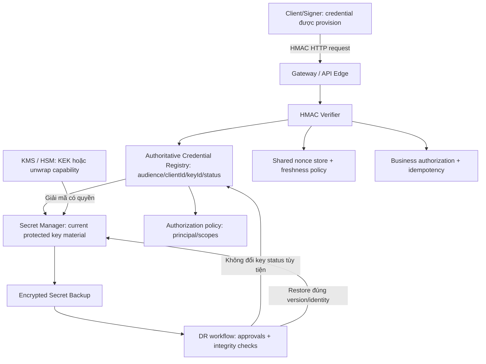
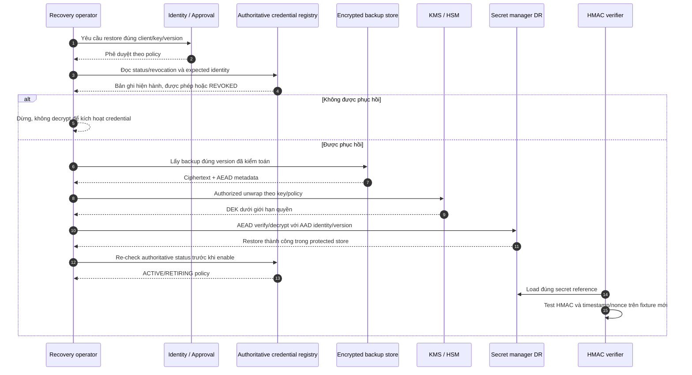

# Secret recovery trong HMAC request authentication

## Mục tiêu học tập

Trong chương **Secret management**, bài **Secret recovery** trình bày cách khôi phục **khả năng sử dụng và xác minh shared secret** khi client mất khóa, secret manager gặp sự cố, bản sao khóa bị hỏng, khóa bị xóa nhầm hoặc hạ tầng chuyển sang phương án dự phòng. Trọng tâm không phải “tìm lại mật khẩu” từ chữ ký; đó là **quy trình khôi phục được kiểm soát**, phân biệt trường hợp cần lấy lại một bản sao secret đã được bảo vệ với trường hợp **bắt buộc cấp khóa mới và thu hồi khóa cũ**.

Nội dung thuộc module `SECURITY_AUTHENTICATION_HMAC_REQUEST_AUTHENTICATION`: thiết kế xác thực HTTP request bằng **HMAC với shared secret**, dựng canonical request từ **phương thức HTTP, URI, header hoặc body** theo hợp đồng ký, kiểm tra chữ ký, chống replay bằng **timestamp/nonce**, quản lý **key rotation**, kiểm thử qua proxy/gateway và phân biệt **authentication** với **authorization**.

Sau bài, bạn có thể:

- Phân biệt **recovery**, **re-provisioning**, **rotation**, **revocation**, **disaster recovery (DR)** và **incident response** của HMAC secret.
- Giải thích vì sao không thể suy ra raw shared secret một cách khả thi từ `keyId`, HMAC signature hay SHA-256 digest nếu khóa mạnh và HMAC được triển khai đúng; đồng thời không giả định tất cả “secret” đều có entropy cao.
- Phân loại đúng sự cố **mất bản sao**, **mất kho lưu trữ**, **mất khóa giải mã backup**, **nghi ngờ lộ**, **khôi phục nhầm phiên bản** và chọn hành động an toàn.
- Xây dựng kiến trúc **secret manager/KMS/HSM, encrypted backup, credential registry, key status và audit** có ranh giới tin cậy rõ.
- Hiểu **envelope encryption**, AES-GCM, DEK/KEK, IV/nonce, AAD và tính toàn vẹn của metadata khi phục hồi backup; không coi Base64 là mã hóa bảo vệ.
- Thiết kế **khôi phục không hồi sinh credential REVOKED**, không rollback audit/policy/nonce store và không mở rộng quyền chỉ để chữa sự cố.
- Đọc và xây dựng ví dụ **Java 17** mô phỏng lưu backup đã mã hóa, mất bản sao làm việc, giải mã có xác thực đúng principal/phiên bản, thử sửa ciphertext/AAD/KEK, và xác minh cùng request HMAC.
- Lập kế hoạch RTO/RPO, diễn tập khôi phục, đo kiểm retry, key rotation, gateway, timestamp, nonce và phân quyền sau khi restore.

## 1. Secret recovery là khôi phục điều gì?

### 1.1. Định nghĩa trong hệ thống xác thực HMAC

Một client muốn gọi API ký:

```text
canonicalBytes = UTF8(canonicalRequest(method, uri, headers, bodyHash,
                                       timestamp, nonce, clientId, keyId))
rawSignature = HMAC-SHA256(sharedSecretBytes, canonicalBytes)
```

Verifier phải có khả năng **định vị secret đã đăng ký** bằng `(audience, clientId, keyId)` và tính lại expected HMAC. Nếu signer hoặc verifier **không còn truy cập được raw shared secret**, chúng không thể tiếp tục dùng credential đó đúng cách.

**Secret recovery** có thể mang hai ý nghĩa:

1. **Khôi phục bản sao vật liệu khóa gốc** từ một nguồn **đã được bảo vệ và được phép** (ví dụ secret manager version còn tồn tại hoặc encrypted backup có KEK còn hoạt động).
2. **Khôi phục khả năng hoạt động**, bằng cách **cấp một secret mới, key ID mới, provision client/verifier và cutover**, khi secret cũ không thể/không nên được sử dụng lại.

Không phải mọi sự cố đều cho phép cách 1. Đặc biệt, khi secret cũ có nguy cơ **đã bị lộ**, lấy bản backup secret cũ về không làm nó an toàn trở lại. Lúc đó cần **revoke/rotate** và xử lý sự cố.

### 1.2. Bốn đối tượng rất dễ bị nhầm

| Đối tượng | Ví dụ | Có thể thay thế raw secret không? | Recovery dùng nó thế nào? |
| --- | --- | --- | --- |
| **Key ID** | `kid_7XqH...` | **Không** | Chỉ định record/phiên bản credential, không chứa secret. |
| **Secret reference** | `vault://payments/prod/key/v7` | **Không** | Locator nội bộ để tìm key material; có thể lộ metadata nên vẫn bảo vệ. |
| **Raw shared secret** | 32 byte ngẫu nhiên | **Có, đây là key HMAC thực** | Chỉ phục hồi qua kênh tin cậy, kiểm toán, hạn chế sao chép. |
| **Encrypted backup** | AES-GCM ciphertext + IV + metadata | **Không nếu không có KEK đúng** | Giải mã có xác thực trong quy trình recovery được cấp quyền. |
| **HMAC signature** | 32 byte MAC, thường Base64URL | **Không** | Có thể làm test vector kiểm chứng secret được khôi phục, không dùng để trích xuất secret. |

**Không lưu raw secret trong `keyId` hoặc encode secret thành một ID công khai** để “dễ khôi phục”. Như vậy vừa phá ranh giới bí mật vừa biến request headers/logs thành kho khóa ký.

### 1.3. Vì sao không thể “reverse HMAC” để lấy secret?

Với một secret được sinh bằng **CSPRNG đủ mạnh** (ví dụ 256 bit), một hay nhiều cặp `(message, HMAC(message))` không cho attacker cách khả thi để **khôi phục raw key** nếu thuật toán HMAC và triển khai không có lỗ hổng. Đây là một trong những tính chất mật mã được thiết kế của HMAC.

```text
Đã biết:
    keyId = K
    canonical request bytes = M
    signature = HMAC-SHA256(S, M)

Không suy ra được một cách khả thi:
    S = "reverseHmac"(M, signature)
```

Nhưng có hai ngoại lệ thực tế phải hiểu:

- Nếu **shared secret yếu, có thể đoán** (ví dụ password đơn giản), cặp `(M, MAC)` cho phép **thử đoán offline** các secret ứng viên; vì vậy không dùng password con người làm HMAC secret nếu thiết kế không có cơ chế bảo vệ/phân phối phù hợp.
- Nếu raw secret vô tình bị **nhúng trong key ID, log, code, URL hoặc support ticket**, đó là lộ dữ liệu trực tiếp, **không phải việc bẻ HMAC**.

**Kết luận:** nếu không còn bản sao được phép khôi phục, không cố tính ngược secret từ MAC. Hãy **re-provision** một secret mới và làm kế hoạch key rotation.

## 2. Phân loại sự cố trước khi chọn recovery hay rotation

Không dùng một nút “Restore secret” cho mọi tình huống. Trước tiên cần biết vấn đề là **không còn truy cập**, **mất dữ liệu**, hay **có khả năng lộ khóa**.

### 2.1. Ma trận quyết định

| Tình huống | Secret cũ còn được tin cậy? | Hướng xử lý ưu tiên |
| --- | --- | --- |
| Client xóa nhầm secret local; bản trong secret manager vẫn tồn tại, không có dấu hiệu lộ | **Có thể**, sau xác minh sự cố | Re-provision qua kênh đã xác thực nếu policy cho phép; cân nhắc rotation để giảm số bản sao. |
| Verifier mất cache RAM nhưng secret manager còn hoạt động | Có | Nạp lại từ secret manager, kiểm tra key status/current version trước khi dùng. |
| Secret manager tạm thời không truy cập được, bản sao bảo vệ còn ở vùng DR | Có điều kiện | DR/failover với authorization, integrity check và chính sách fail-closed khi không thể kiểm chứng. |
| Backup ciphertext còn nhưng **KEK/KMS root key bị mất vĩnh viễn** | Không thể khôi phục bằng ciphertext đơn lẻ | Re-provision/rotate qua authority độc lập; không có phép giải mã thần kỳ. |
| Xóa nhầm một phiên bản secret nhưng encrypted backup và KEK an toàn | Có điều kiện | Restore đúng **key identity/version** sau kiểm tra policy và integrity. |
| Secret xuất hiện trong access log, repository hoặc ticket | **Không nên coi còn tin cậy** | Incident response; revoke/rotate raw secret, điều tra phạm vi lộ. |
| Thiết bị client bị chiếm quyền và có thể đọc secret | Đáng ngờ | Revoke/rotate, thu hồi quyền thiết bị, cấp lại qua kênh sạch. |
| Credential đã `REVOKED` nhưng backup cũ còn secret | **Không** | Không được hồi sinh chỉ vì backup decrypt thành công. |
| Registry bị rollback về bản trước khi revoke | Không chắc | Dừng nhận key liên quan cho tới khi khôi phục **authoritative revocation state**. |
| Kẻ xin khôi phục chỉ chứng minh biết `keyId` hoặc HMAC đã ghi lại | **Chưa có chứng minh quyền** | Không cấp lại secret; yêu cầu identity/approval độc lập. |

### 2.2. Recovery, rotation, revoke, re-provision: đừng đồng nhất

- **Recovery**: tái lấy quyền truy cập một secret/credential version **đã tồn tại**, thường từ bản sao bảo vệ. Có thể giữ `keyId` và raw secret **nếu thật sự an toàn**.
- **Rotation**: tạo **raw secret mới độc lập**, thường có `keyId` mới, chuyển client/verifier trong overlap có giới hạn; cuối cùng ngừng dùng secret cũ.
- **Revocation**: chặn credential **ngay ở tầng xác minh**, bất kể MAC có khớp hay timestamp còn hạn.
- **Re-provisioning**: cấp credential qua quy trình định danh/ủy quyền mới khi client mất khóa, thiết bị thay đổi hoặc cần phục hồi quyền truy cập. Có thể đi cùng rotation.
- **Disaster recovery**: khôi phục **service và dữ liệu được bảo vệ**, không chỉ raw secret; phải bảo toàn metadata active/revoked, audit, mapping client/audience và tính nhất quán của các hệ thống liên quan.

Một thao tác có thể gồm nhiều bước: **revoke secret nghi lộ → provision secret mới → rotate/cutover → reconcile/kiểm toán**. Phục hồi “API hoạt động lại” không tự chứng minh trạng thái security đã đúng.

### 2.3. Phục hồi khóa khác phục hồi quyền của principal

Nếu một client mất secret, đừng cho phép **bất kỳ ai biết client ID/key ID** yêu cầu xuất lại raw secret. Quy trình cấp lại cần xác thực người/operator hoặc workload qua **identity system độc lập** với credential HMAC đang bị mất, chẳng hạn quyền quản trị được phân cấp, workload identity hoặc một kênh recovery đã đăng ký.

Tương tự, người có quyền **restore backup** không mặc nhiên có quyền **chỉnh scopes/tenant**. Tách vai trò:

```text
Credential owner: yêu cầu phục hồi/cấp lại cho workload của mình
Security approver: duyệt trường hợp nhạy cảm
Secret administrator/KMS: khôi phục key material có kiểm soát
Credential registry: authoritative key status + principal binding
API verifier: chỉ đọc secret/key policy cần thiết
Business authorization: quyết định action/resource/tenant
```

Tùy môi trường, có thể cần **hai người duyệt** hoặc tách nhiệm vụ (*separation of duties*) để một account không vừa tự cấp, vừa giải mã, vừa bật quyền cho chính nó.

## 3. Kiến trúc khôi phục chuẩn: secret, registry, KEK và backup

### 3.1. Kiến trúc tham khảo



Đây là **mô hình logic**, không quy định sản phẩm cụ thể. Trong triển khai thật:

- `secret manager` có thể cung cấp version history, replication và khả năng undelete nếu hỗ trợ.
- `KMS/HSM` bảo vệ khóa mã hóa backup (**KEK**), hoặc cung cấp dịch vụ encrypt/decrypt/unwrap không xuất raw KEK cho ứng dụng.
- `credential registry` xác định **key ID nào được phép dùng lúc này**, trạng thái active/revoked, principal/audience và algorithm.
- `encrypted backup` có ciphertext và metadata; không được dùng làm nguồn quyết định **key còn được chấp nhận**.
- `nonce store` giữ dấu đã dùng của từng signed attempt; nó **không** thể bị thay bằng secret backup.
- `authorization` bảo vệ resource/action/tenant; restore secret không được tự mở rộng quyền.

### 3.2. Secret manager version khác registry key status

Một secret manager có thể giữ nhiều phiên bản vật liệu:

```text
SecretManager:
  secretReference /v7 -> encrypted bytes S7
  secretReference /v8 -> encrypted bytes S8

CredentialRegistry:
  (payments-api-prod, client-C, keyId-K7) -> /v7, REVOKED
  (payments-api-prod, client-C, keyId-K8) -> /v8, ACTIVE
```

Nếu restore bản backup `/v7` thành công, điều đó **không** cho phép đổi status K7 từ `REVOKED` sang `ACTIVE`. **Ciphertext decrypt được** chỉ chứng minh vật liệu backup khớp khóa mã hóa/tính toàn vẹn, không chứng minh credential còn quyền sử dụng.

**Trạng thái revoke, version/fencing và ACL phải đến từ nguồn authoritative đủ mới.** Nếu nguồn này không khả dụng, cần fail closed hoặc chế độ vận hành có kiểm soát đã được thiết kế và kiểm chứng. Không đọc “ACTIVE” từ bản backup registry nhiều ngày trước rồi cho credential cũ hoạt động lại.

### 3.3. Backup phải mã hóa có xác thực, không chỉ encode

Các thiết kế **không phải bảo vệ bí mật**:

```text
Base64URL(secretBytes)         # Encoding, đảo ngược được
Hex(secretBytes)               # Encoding, đảo ngược được
gzip(secretBytes)              # Nén, không bảo vệ
"encrypt" bằng XOR constant    # Không phải cryptographic protection
SHA256(secretBytes)            # Không thể dùng làm raw secret HMAC gốc
```

Một backup giữ raw HMAC secret cần được bảo vệ khi lưu và khi vận chuyển. Có thể dùng **authenticated encryption with associated data (AEAD)** như AES-GCM hoặc cơ chế backup/secret manager được nhà cung cấp bảo đảm tương đương, với:

- Khóa mã hóa backup (**KEK**) tách khỏi storage ciphertext.
- Nonce/IV mã hóa đúng kích thước và **không tái sử dụng với cùng key**.
- **AAD** ràng buộc backup với audience, clientId, keyId, secret version và schema version.
- Kiểm tra authentication tag **trước khi xuất plaintext** hoặc sử dụng secret.
- Hạn chế quyền decrypt và có audit các lần yêu cầu phục hồi.

Đừng tự cài AES hoặc HMAC bằng thuật toán thủ công; dùng JCA/provider và dịch vụ quản lý khóa được duyệt.

### 3.4. Envelope encryption: DEK và KEK

Một cách phổ biến là **envelope encryption**:

```text
                          Secure key custody
                      +-------------------------+
                      | KMS/HSM giữ KEK          |
                      +-----------+-------------+
                                  |
                          Wrap/unwrap DEK
                                  |
  Random DEK (per backup)         v
      |                  +--------------------+
      +-- AES-GCM ------>| Wrapped DEK + IV   |
      |                  +--------------------+
      v
  Encrypt raw HMAC secret (AES-GCM, IV + AAD)
      |
      v
  Backup object:
    formatVersion
    audience, clientId, keyId, secretVersion
    dataIV + encryptedSecret + authenticationTag
    wrapIV + wrappedDEK + authenticationTag
    KEK reference (not raw KEK)
```

- **DEK (*data encryption key*)**: khóa mã hóa một bản backup secret; được sinh ngẫu nhiên riêng.
- **KEK (*key encryption key*)**: khóa dùng bọc (wrap) DEK; giữ và điều khiển bởi KMS/HSM hoặc root custody theo chính sách.
- **AAD**: metadata **được xác thực nhưng không được mã hóa**, giúp ngăn tráo ciphertext giữa client/tenant/phiên bản.
- **IV/nonce của AES-GCM**: dùng để mã hóa, **khác** `X-Nonce` của HMAC request replay; cả hai đều cần đúng quy tắc nhưng phục vụ mục đích khác.

**Lưu ý:** nếu KEK bị mất không thể phục hồi và không còn một con đường authorized unwrap nào, ciphertext backup không tự giải mã được. Vì thế **backup secret** và **KMS/KEK disaster recovery** phải được thiết kế cùng nhau. Không đặt raw KEK cùng bucket với ciphertext để “cho chắc có đủ thứ”.

### 3.5. Metadata của backup không được điều khiển recovery mù quáng

Một file backup có thể khai:

```text
audience=payments-api-prod
clientId=payout-worker-prod
keyId=K7
secretVersion=7
encryptedSecret=<ciphertext>
```

Bản backup là **dữ liệu đầu vào phải xác minh**, không phải authority để quyết định identity hoặc trạng thái khóa. Khi restore:

1. Operator chọn **record được phép phục hồi** từ registry/recovery ticket độc lập.
2. Service so khớp backup metadata với **expected audience/client/key/version**.
3. AEAD decrypt dùng **AAD dựng từ expected identity**, không chỉ tin metadata do backup tự đưa ra.
4. Kiểm tra backup version, nonce/tag, secret length, entropy/provenance policy và quyền decrypt.
5. Kiểm tra key status/authorization hiện hành **độc lập với backup**.
6. Chỉ nạp raw secret vào vùng xử lý an toàn cho credential **được phép**.

Một ciphertext của client A được chuyển sang record B phải fail vì **identity/version mismatch** hoặc AEAD tag, không được trở thành secret của B chỉ vì backup đổi nhãn.

## 4. Quy trình vận hành: từ yêu cầu phục hồi đến cutover

### 4.1. Đừng bắt đầu bằng việc export secret

Runbook an toàn nên xác minh trước:

- **Ai yêu cầu?** Workload/operator/owner đã được xác thực bằng phương pháp **độc lập** với HMAC secret đang mất.
- **Sự cố gì?** Mất local copy, secret-manager outage, corruption, DR, hay nghi compromise?
- **Bản nào cần?** Audience, clientId, keyId, secretVersion, trạng thái hiện tại, nơi backup.
- **Có rủi ro lộ không?** Có log/raw secret exposure, thiết bị bị chiếm, credential chia sẻ quá nhiều?
- **Hành động nào được duyệt?** Tải lại bản sao, giải mã backup, tạo secret mới, thu hồi key cũ?
- **Kết thúc khi nào?** Mục tiêu RTO, thời điểm cutover, test rollback, audit evidence.

Chỉ sau những kiểm tra đó mới cho phép các dịch vụ có quyền thực hiện decrypt, reprovision hoặc rotation. **Đừng dùng chính HMAC secret bị mất để chứng minh người yêu cầu có quyền lấy lại nó.**

### 4.2. Trường hợp A — Client mất bản sao, issuer vẫn giữ secret an toàn

Nếu client xóa nhầm credential nhưng nguồn server còn secret hợp lệ:

1. Xác minh client/workload identity và người phê duyệt qua **kênh recovery độc lập**.
2. Đối chiếu credential `keyId`, audience, status và scope với registry.
3. Đánh giá có dấu hiệu thiết bị cũ bị xâm nhập hoặc secret bị phơi bày không.
4. Nếu được phép **re-provision cùng secret**, gửi qua kênh bảo vệ đúng người nhận, hạn chế số bản sao và TTL của artifact; audit sự kiện.
5. Nếu việc xuất lại raw secret trái policy hoặc không thể khẳng định secret cũ chưa lộ, **rotate/cấp mới** thay vì xuất lại.
6. Client cấu hình đúng keyId/secret pair và thử HMAC trên request test với nonce/timestamp mới.
7. Theo dõi MAC fail, credential lookup và truy cập trái scope sau recovery.

Một số secret manager được thiết kế **không bao giờ xuất lại** key material. Trong trường hợp đó không phá policy để trích xuất; dùng workflow cấp credential mới và revoke phiên bản không dùng.

### 4.3. Trường hợp B — Verifier mất cache hoặc secret manager gặp sự cố

Khi backend mất bản sao RAM:

- Ưu tiên **re-fetch theo reference** từ nguồn có quyền, kiểm tra status/version mới nhất trước khi dùng.
- Không dùng fallback `keyId.getBytes(UTF_8)` hoặc secret cứng trong code để “vượt outage”.
- Nếu secret manager tạm thời lỗi, sử dụng chiến lược caching **đã phê duyệt** về TTL, revoke propagation, giới hạn quyền và grace period; không tự giữ secret vô hạn.
- Nếu verifier không thể xác nhận key status hoặc không lấy đúng secret, **từ chối request** thay vì xác thực giả (fail closed).
- Khi phục hồi service, làm sạch cache lỗi và kiểm tra mọi instance đã đồng bộ mapping.

**Cached secret không thay authoritative status.** Một node còn giữ secret của key đã revoke có thể vẫn tính đúng MAC, nhưng **không được** chấp nhận request nếu registry policy nói REVOKED.

### 4.4. Trường hợp C — Restore từ encrypted backup ở DR

Một quy trình restore từ backup:



Các điểm phải kiểm tra:

- Backup là **đúng client, audience, key ID và secret version**.
- **KEK/unwrap quyền hạn** còn hoạt động; audit decrypt.
- AEAD authentication tag hợp lệ; không bỏ qua lỗi tag hay thử nhiều key không được duyệt.
- Policy revocation **mới nhất** không được reset về trạng thái cũ.
- Không chấp nhận request nếu nonce store, timestamp policy hoặc authorization chưa sẵn sàng.
- Có **kênh phục hồi bảo mật** để phát lại credential cho client nếu cần; không in plaintext vào log/ticket.
- Đo và lưu chứng cứ khôi phục cho vận hành, không lưu bản sao raw secret trong artifact test.

### 4.5. Trường hợp D — Không còn secret cũ có thể tin cậy/phục hồi

Khi không có bản sao được phép giải mã hoặc secret đã nghi compromise:

```text
Old credential:
  keyId = K_old
  rawSecret = S_old (mất/không an toàn)
  status = REVOKED

New credential:
  keyId = K_new (opaque ID mới)
  rawSecret = S_new (CSPRNG độc lập)
  status = ACTIVE khi provisioning hoàn tất
```

Hệ thống cần **cấp credential mới qua trust anchor độc lập**: xác thực operator/workload, approve, provision secret mới qua kênh an toàn, cập nhật client/gateway/verifier, rút key cũ và theo dõi. Nếu đối phương có S_old, không để overlap kéo dài chỉ vì client chưa chuyển xong; xử lý theo incident policy.

**Không thể “reconstruct S_old” từ keyId, HMAC hoặc bản mã không có KEK.** Phục hồi chức năng ở đây là **tạo một credential mới**, không giải mã khóa cũ bằng cách đoán.

## 5. Độ tin cậy của backup và chống hồi sinh khóa đã thu hồi

### 5.1. Backup cũ có thể đúng về mật mã nhưng sai về chính sách

Giả sử tại thời điểm T1 một backup chứa credential K7 đang ACTIVE. Đến T2, K7 bị lộ và chuyển **REVOKED**. Tại T3 hệ thống DR khôi phục toàn bộ backup T1:

```text
T1 backup: K7 -> ACTIVE, encryptedSecret(S7)
T2 live:   K7 -> REVOKED
T3 restore backup:
    ciphertext(S7) decrypt OK
    metadata từ backup nói ACTIVE  # CŨ, KHÔNG ĐƯỢC TIN
```

Nếu verifier theo bản backup để chấp nhận K7, attacker giữ S7 có thể ký request mới và vượt authentication. Đây là **rollback of revocation state**, một lỗi bảo mật nghiêm trọng dù AES-GCM tag hoàn toàn đúng.

**Nguyên tắc:** Vật liệu backup chỉ giải quyết **confidentiality/integrity của secret snapshot**. Nó không có quyền thay đổi **current revocation/authorization policy**.

### 5.2. Nguồn policy authoritative và monotonic version

Hệ thống cần trạng thái **không bị hồi lùi** ngoài quy trình cấp quyền đặc biệt:

- Một key đã `REVOKED` không được tự chuyển lại `ACTIVE` do restore backup.
- Version/generation/revision của registry phải được kiểm soát; backup cũ không được ghi đè record có revision mới.
- Có thể lưu **revocation tombstone**, audit trail hoặc danh sách thu hồi ở authority có chính sách DR riêng.
- Nếu primary registry và DR registry bất đồng, không tự chọn bản “cho nhiều request qua hơn”; kiểm tra nguồn authoritative và fail closed khi không thể xác định.
- KMS/secret manager cũng phải có key version binding và audit, không giải mã “bất kỳ bản backup gần nhất” cho credential do request tự khai.

**Phân biệt:** `secretVersion` là phiên bản vật liệu mã hóa; `registryRevision` là phiên bản của **policy/metadata**. Hai số không đồng nhất và không nên dùng thay nhau.

### 5.3. Khôi phục backup có cần phục hồi nonce store không?

Nonce chống replay của HMAC HTTP request là **trạng thái khác** với raw secret. Nếu server khôi phục secret nhưng **quên toàn bộ nonce đã claim** trong khi timestamp của những request cũ vẫn còn hợp lệ, một request có chữ ký đúng bị ghi lại có thể được chấp nhận lần nữa.

Ví dụ:

```text
P = 300 giây, F = 60 giây, margin = 10 giây
Nonce giữ tối thiểu khoảng 370 giây từ claim sớm nhất

T1: signed request N1 được chấp nhận, nonce N1 đã claim
T2: disaster recovery mất nonce store data sau 30 giây
T3: attacker replay y nguyên signed request, còn trong window
=> Nếu nonce store rỗng: nguy cơ được chấp nhận lần hai!
```

Vì vậy:

- Phải coi **nonce store consistency/durability** là một phần threat model DR.
- Nếu mất state, có thể **tạm thời từ chối request** cho đến khi toàn bộ request có khả năng replay từ trước khi mất state **chắc chắn đã hết cửa sổ**, tính biên/skew; hoặc áp chiến lược chống replay mạnh khác đã thiết kế.
- Không đơn thuần tạo Redis mới rỗng rồi bật mọi HMAC verifier ngay nếu endpoint có yêu cầu at-most-once.
- Nếu cần khả dụng trong khi khôi phục, dùng replay authority có durability/quorum thích hợp, hoặc chuyển sang credential mới theo quy trình an toàn; thay key một mình không chặn replay các request ký bằng key cũ nếu key đó còn được chấp nhận.
- Cơ chế business idempotency vẫn cần để chặn double payment khi retry có nonce mới.

### 5.4. Không “chữa” lỗi bằng cách nới timestamp hoặc bypass MAC

Khi service khôi phục, người vận hành có thể bị cám dỗ:

```text
Nếu KMS down -> accept HMAC mà không verify (NGUY HIỂM)
Nếu keyId không tìm thấy -> dùng master secret mặc định (NGUY HIỂM)
Nếu nonce store mất -> bỏ qua replay checking (NGUY HIỂM)
Nếu client clock sai -> cho timestamp ±24h không kiểm soát (NGUY HIỂM)
Nếu key REVOKED -> thử secret backup rồi accept (NGUY HIỂM)
```

Những cách này có thể làm health check/API trông “xanh” nhưng thực tế phá authentication và anti-replay. Khả dụng phải được khôi phục bằng **credential provisioning/DR có kiểm chứng**, không bằng cách giảm điều kiện bảo mật cốt lõi.

## 6. Khôi phục phải có quyền, log và kế hoạch vận hành

### 6.1. Vai trò và phê duyệt

Thao tác “read/decrypt raw shared secret” thường nhạy cảm hơn việc chỉ đọc key ID:

| Hoạt động | Vai trò phù hợp | Bằng chứng/audit nên có |
| --- | --- | --- |
| Xem client/key ID và trạng thái | Operator có quyền giới hạn | ID record, correlation ID, reason. |
| Yêu cầu phục hồi | Credential owner/workload administrator | Ticket/sự cố, identity đã xác minh. |
| Phê duyệt xuất hoặc decrypt key material | Security approver theo policy | Approval ID, scope, expiry của quyền. |
| Unwrap DEK/restore backup | Secret-management service với quyền KMS tối thiểu | Audit log trên KMS và object/version cụ thể. |
| Provision secret mới | Credential issuing service | Key ID/version mới, phép cấp quyền. |
| Revoke secret cũ | Security/credential authority | Revocation event immutable hoặc được bảo vệ chặt. |
| Kích hoạt client/verifier | Deployment controller có quyền | Config revision, rollout và test kết quả. |

Không ghi raw secret, DEK, KEK, plaintext backup hoặc HMAC expected bytes vào log. Audit có thể chứa **key reference đã giới hạn quyền, backup version, kết quả tag verify, operator identity, thời điểm và sự cố**, nhưng không phải dữ liệu cần giữ bí mật.

### 6.2. RTO, RPO và ranh giới bảo mật

- **RTO (*Recovery Time Objective*)**: thời gian mục tiêu để hệ thống lấy lại khả năng ký/xác minh có kiểm soát sau sự cố.
- **RPO (*Recovery Point Objective*)**: mức dữ liệu/phiên bản tối đa có thể mất theo cam kết DR; **không** là quyền cho phép quên revocation hoặc nonce đang sống.
- **Recovery horizon của credential**: còn bản backup/secret version nào, KEK nào, ai có quyền giải mã.
- **Rotation overlap**: khoảng thời gian có thể chấp nhận đồng thời key cũ/mới theo policy; **không** tự suy từ RTO.
- **Nonce replay horizon**: khoảng thời gian signed request có thể còn hiệu lực, không được mất state khi failover.

Ví dụ thiết kế phải đặt các objective như:

```text
- Mục tiêu: khôi phục khả năng verify trong thời gian vận hành chấp nhận được.
- Không đánh đổi: revoked key không được tái active.
- Không đánh đổi: một nonce đã claim không được trở thành "mới" sau failover.
- Kiểm soát: backup restore chỉ khi KMS + approval + authoritative status đều đạt.
- Đánh giá: nếu không đạt các điều kiện trên, phục vụ 503/deny theo API policy.
```

Một hệ thống có backup tốt nhưng chưa kiểm thử KEK recovery, metadata version và replay store **chưa có chiến lược DR đầy đủ**.

### 6.3. Checklist trước và sau thao tác khôi phục

**Trước:**

- Xác nhận phạm vi outage/loss/compromise; đánh giá có phải incident response.
- Xác thực requestor/admin qua **trust channel độc lập**.
- Lấy expected `audience/clientId/keyId/secretVersion` và trạng thái registry hiện tại.
- Xác minh backup source, schema, integrity metadata, KMS/KEK availability và access permission.
- Kiểm tra nonce/idempotency stores, policy cache, gateway routing và hạ tầng clock.
- Có phương án an toàn khi restore lỗi: fail closed, rotate hoặc chặn các endpoint nhạy cảm.

**Sau:**

- Xác minh AEAD tag và identity binding, hash/test vector chức năng được kiểm soát.
- Đối chiếu trạng thái key với authority một lần nữa trước khi bật traffic.
- Test HMAC signer/verifier trong môi trường cô lập, dùng timestamp/nonce mới.
- Test **REVOKED vẫn bị reject**, MAC sai bị reject, replay bị chặn, tenant ngoài quyền bị reject.
- Đồng bộ bản ghi giữa nodes/regions, loại cache stale và kiểm tra gateway giữ đúng signed fields.
- Theo dõi lỗi secret lookup, MAC mismatches, decrypt failures, nonce store và authorization.
- Ghi audit của recovery, thu hồi quyền tạm thời và xóa staging plaintext/artifacts đúng policy.

**Không công bố raw secret như một “bằng chứng” đã phục hồi thành công.** Kết quả test nên là boolean/verdict và reference có kiểm soát.

## 7. Java 17: phục hồi HMAC secret từ backup AES-GCM có xác thực

Để tập trung vào **Secret recovery**, ví dụ `HmacSecretRecoveryDemo.java` mô phỏng ba thành phần:

1. **Authoritative credential policy**: biết credential thuộc audience/client/key/version nào, đang `ACTIVE` hay `REVOKED`; quyết định này **không nằm trong ciphertext backup**.
2. **Encrypted backup**: raw HMAC secret được mã hóa bằng **DEK ngẫu nhiên** và DEK được mã hóa tiếp bằng **KEK**. Cả hai lớp dùng AES-GCM với **IV riêng** và AAD có domain separation + identity + version.
3. **Recovery service**: chỉ nạp secret sau khi đối chiếu expected identity, policy hiện tại, và **cả hai AEAD authentication tags**. Raw secret phục hồi được dùng để xác minh cùng một HMAC test fixture, không in ra màn hình.

Trong thực tế, **KEK phải được quản lý bởi KMS/HSM** và ứng dụng thường gọi API **wrap/unwrap** mà không nhận raw KEK. Mã dưới đây tạo KEK trong RAM để ví dụ chạy được chỉ bằng JDK 17, **không phải triển khai KMS/HSM production**.

### 7.1. Format backup và AAD

Một backup cần mang tối thiểu:

```text
EnvelopeBackupV1 {
  identity = {audience, clientId, keyId, secretVersion}
  encryptedSecret = AES-GCM(DEK, dataIV, rawHmacSecret,
                            AAD="secret-data-v1" + identity)
  wrappedDEK = AES-GCM(KEK, wrapIV, DEK,
                       AAD="dek-wrap-v1" + identity)
  dataIV = 12 random bytes
  wrapIV = 12 random bytes
  formatVersion = 1 (được ràng buộc trong AAD domain)
}
```

- **Raw HMAC secret:** ví dụ 32 byte CSPRNG, độc lập với public key ID.
- **DEK:** 32 byte ngẫu nhiên cho **mỗi lần tạo backup**.
- **KEK:** 32 byte AES-256 được quản lý độc lập; không lưu raw KEK cùng backup.
- **AES-GCM IV:** 12 byte (96 bit) mỗi encryption; phải có chính sách bảo đảm **không tái sử dụng IV với cùng key**. Sinh DEK mới mỗi backup và IV mới riêng cho mỗi phép encrypt chỉ là cách đơn giản cho demo; production tuân policy KMS/provider.
- **Authentication tag:** 128 bit do AES-GCM tạo; tampering ciphertext/AAD/KEK phải làm decrypt thất bại.
- **AAD:** ràng buộc **audience + clientId + keyId + secretVersion + mục đích mã hóa**. Không phải secret, nhưng phải đúng nguyên byte khi restore.

**Chú ý:** Việc mã hóa backup không chứng minh bản backup là phiên bản **được quyền kích hoạt**. Sau decrypt, authoritative registry vẫn quyết định key status. Trạng thái `REVOKED` **không bao giờ được ghi đè bằng ACTIVE chỉ vì backup thành công**.

### 7.2. Mã Java 17 hoàn chỉnh

```java
import java.nio.charset.StandardCharsets;
import java.security.GeneralSecurityException;
import java.security.MessageDigest;
import java.security.SecureRandom;
import java.util.Arrays;
import java.util.Base64;
import java.util.HashMap;
import java.util.Map;
import java.util.Objects;
import java.util.regex.Pattern;
import javax.crypto.AEADBadTagException;
import javax.crypto.Cipher;
import javax.crypto.Mac;
import javax.crypto.spec.GCMParameterSpec;
import javax.crypto.spec.SecretKeySpec;

public final class HmacSecretRecoveryDemo {
    private static final int AES_KEY_BYTES = 32;
    private static final int HMAC_SECRET_BYTES = 32;
    private static final int GCM_IV_BYTES = 12;
    private static final int GCM_TAG_BITS = 128;
    private static final String CIPHER = "AES/GCM/NoPadding";

    private static final Pattern IDENTIFIER =
            Pattern.compile("[A-Za-z0-9_-]{1,64}");
    private static final Base64.Encoder B64 =
            Base64.getUrlEncoder().withoutPadding();

    private HmacSecretRecoveryDemo() {}

    // Secret version là version của KEY MATERIAL, không phải
    // registry revision/revocation sequence number.
    record KeyIdentity(
            String audience, String clientId,
            String keyId, long secretVersion) {}

    enum KeyStatus { ACTIVE, REVOKED }

    // Policy hiện hành KHÔNG được khôi phục đè bởi old backup.
    static final class CurrentCredentialPolicy {
        private final Map<KeyIdentity, KeyStatus> statuses =
                new HashMap<>();

        void provision(KeyIdentity identity) {
            if (statuses.putIfAbsent(identity, KeyStatus.ACTIVE) != null) {
                throw new IllegalArgumentException(
                        "Credential record already exists");
            }
        }

        void revoke(KeyIdentity identity) {
            if (!statuses.containsKey(identity)) {
                throw new IllegalArgumentException("Missing credential");
            }
            statuses.put(identity, KeyStatus.REVOKED);
        }

        KeyStatus status(KeyIdentity identity) {
            return statuses.get(identity);
        }
    }

    record EncryptedBackup(
            KeyIdentity identity,
            byte[] dataIv, byte[] encryptedSecret,
            byte[] wrapIv, byte[] wrappedDek) {
        EncryptedBackup {
            dataIv = Objects.requireNonNull(dataIv).clone();
            encryptedSecret =
                    Objects.requireNonNull(encryptedSecret).clone();
            wrapIv = Objects.requireNonNull(wrapIv).clone();
            wrappedDek = Objects.requireNonNull(wrappedDek).clone();
        }

        @Override public byte[] dataIv() {
            return dataIv.clone();
        }

        @Override public byte[] encryptedSecret() {
            return encryptedSecret.clone();
        }

        @Override public byte[] wrapIv() {
            return wrapIv.clone();
        }

        @Override public byte[] wrappedDek() {
            return wrappedDek.clone();
        }
    }

    static void validateIdentity(KeyIdentity id) {
        if (id == null
                || id.audience() == null
                || !IDENTIFIER.matcher(id.audience()).matches()
                || id.clientId() == null
                || !IDENTIFIER.matcher(id.clientId()).matches()
                || id.keyId() == null
                || !IDENTIFIER.matcher(id.keyId()).matches()
                || id.secretVersion() < 1) {
            throw new IllegalArgumentException("Bad key identity");
        }
    }

    static byte[] aad(String purpose, KeyIdentity id) {
        validateIdentity(id);
        // Các field chỉ có ASCII ID grammar; không thể chứa LF.
        // prefix có domain separation và backup format version.
        String text = String.join("\n",
                "hmac-backup-envelope-v1",
                purpose,
                id.audience(),
                id.clientId(),
                id.keyId(),
                Long.toString(id.secretVersion()));
        return text.getBytes(StandardCharsets.UTF_8);
    }

    static byte[] randomBytes(SecureRandom random, int count) {
        byte[] bytes = new byte[count];
        random.nextBytes(bytes);
        return bytes;
    }

    static byte[] seal(
            byte[] key, byte[] iv,
            byte[] plaintext, byte[] associatedData)
            throws GeneralSecurityException {
        if (key.length != AES_KEY_BYTES || iv.length != GCM_IV_BYTES) {
            throw new IllegalArgumentException("Invalid AES key/IV size");
        }
        Cipher aes = Cipher.getInstance(CIPHER);
        aes.init(Cipher.ENCRYPT_MODE,
                new SecretKeySpec(key, "AES"),
                new GCMParameterSpec(GCM_TAG_BITS, iv));
        aes.updateAAD(associatedData);
        return aes.doFinal(plaintext);
    }

    static byte[] open(
            byte[] key, byte[] iv,
            byte[] ciphertext, byte[] associatedData)
            throws GeneralSecurityException {
        if (key.length != AES_KEY_BYTES
                || iv.length != GCM_IV_BYTES
                || ciphertext.length < GCM_TAG_BITS / 8) {
            throw new IllegalArgumentException(
                    "Invalid AES-GCM input size");
        }
        Cipher aes = Cipher.getInstance(CIPHER);
        aes.init(Cipher.DECRYPT_MODE,
                new SecretKeySpec(key, "AES"),
                new GCMParameterSpec(GCM_TAG_BITS, iv));
        aes.updateAAD(associatedData);
        return aes.doFinal(ciphertext); // AEADBadTagException nếu sai.
    }

    static EncryptedBackup encryptBackup(
            KeyIdentity identity, byte[] rawHmacSecret,
            byte[] demoKek, SecureRandom random)
            throws GeneralSecurityException {
        validateIdentity(identity);
        if (rawHmacSecret == null
                || rawHmacSecret.length != HMAC_SECRET_BYTES
                || demoKek == null
                || demoKek.length != AES_KEY_BYTES) {
            throw new IllegalArgumentException("Invalid key material");
        }

        byte[] dek = randomBytes(random, AES_KEY_BYTES);
        byte[] dataIv = randomBytes(random, GCM_IV_BYTES);
        byte[] wrapIv = randomBytes(random, GCM_IV_BYTES);

        try {
            byte[] secretCiphertext = seal(
                    dek, dataIv, rawHmacSecret,
                    aad("secret-data-v1", identity));
            byte[] wrappedDek = seal(
                    demoKek, wrapIv, dek,
                    aad("dek-wrap-v1", identity));
            return new EncryptedBackup(
                    identity, dataIv, secretCiphertext,
                    wrapIv, wrappedDek);
        } finally {
            Arrays.fill(dek, (byte) 0);
        }
    }

    // expectedIdentity và currentPolicy đến từ trusted recovery
    // workflow/registry, KHÔNG từ HTTP header của người yêu cầu.
    static byte[] recover(
            EncryptedBackup backup,
            KeyIdentity expectedIdentity,
            byte[] demoKek, CurrentCredentialPolicy currentPolicy)
            throws GeneralSecurityException {
        Objects.requireNonNull(backup, "backup");
        Objects.requireNonNull(currentPolicy, "currentPolicy");
        validateIdentity(expectedIdentity);
        if (demoKek == null || demoKek.length != AES_KEY_BYTES) {
            throw new IllegalArgumentException("Invalid KEK");
        }

        if (currentPolicy.status(expectedIdentity)
                != KeyStatus.ACTIVE) {
            throw new SecurityException(
                    "Credential not allowed by current policy");
        }
        if (!expectedIdentity.equals(backup.identity())) {
            throw new SecurityException(
                    "Backup belongs to a different identity/version");
        }

        // Trong production, unwrap DEK bằng quyền KMS/HSM:
        // ứng dụng không giữ raw KEK trong JVM.
        byte[] dek = open(
                demoKek, backup.wrapIv(), backup.wrappedDek(),
                aad("dek-wrap-v1", expectedIdentity));
        try {
            if (dek.length != AES_KEY_BYTES) {
                throw new SecurityException("Unexpected DEK size");
            }
            byte[] secret = open(
                    dek, backup.dataIv(), backup.encryptedSecret(),
                    aad("secret-data-v1", expectedIdentity));
            if (secret.length != HMAC_SECRET_BYTES) {
                Arrays.fill(secret, (byte) 0);
                throw new SecurityException("Unexpected HMAC key size");
            }
            return secret;
        } finally {
            Arrays.fill(dek, (byte) 0);
        }
    }

    static byte[] sha256(byte[] input)
            throws GeneralSecurityException {
        return MessageDigest.getInstance("SHA-256").digest(input);
    }

    static byte[] hmacSha256(byte[] rawHmacSecret, String canonical)
            throws GeneralSecurityException {
        Mac mac = Mac.getInstance("HmacSHA256");
        mac.init(new SecretKeySpec(rawHmacSecret, "HmacSHA256"));
        return mac.doFinal(
                canonical.getBytes(StandardCharsets.UTF_8));
    }

    // Canonical HMAC request theo hợp đồng giáo dục, 12 dòng.
    // Chưa có parser HTTP, nonce store, policy idempotency.
    static String canonical(
            KeyIdentity key,
            String method, String rawTarget, String contentType,
            byte[] exactBody, String timestamp, String nonce)
            throws GeneralSecurityException {
        return String.join("\n",
                "HMAC-SHA256",
                "secret-recovery-v1",
                key.audience(),
                key.clientId(),
                key.keyId(),
                Long.toString(key.secretVersion()),
                method,
                rawTarget,
                contentType,
                B64.encodeToString(sha256(exactBody)),
                timestamp,
                nonce);
    }

    static boolean sameHmac(byte[] oldSecret, byte[] recoveredSecret,
                            String canonical)
            throws GeneralSecurityException {
        byte[] oldMac = hmacSha256(oldSecret, canonical);
        byte[] recoveredMac = hmacSha256(recoveredSecret, canonical);
        return MessageDigest.isEqual(oldMac, recoveredMac);
    }

    static boolean rejectedByAead(
            EncryptedBackup backup, KeyIdentity id,
            byte[] kek, CurrentCredentialPolicy policy) {
        try {
            byte[] secret = recover(backup, id, kek, policy);
            Arrays.fill(secret, (byte) 0);
            return false; // Nếu decrypt được thì test âm thất bại.
        } catch (AEADBadTagException expected) {
            return true;  // Sai tag/AAD/KEK/ciphertext => từ chối.
        } catch (GeneralSecurityException ex) {
            throw new IllegalStateException(
                    "Unexpected crypto error", ex);
        }
    }

    public static void main(String[] args)
            throws GeneralSecurityException {
        SecureRandom random = new SecureRandom();
        // KEK và HMAC key là HAI khóa hoàn toàn khác nhau.
        // KEK chỉ ở heap vì đây là DEMO, không phải production KMS.
        byte[] demoKek = randomBytes(random, AES_KEY_BYTES);
        byte[] rawHmacSecret =
                randomBytes(random, HMAC_SECRET_BYTES);
        KeyIdentity identity = new KeyIdentity(
                "payments-api-prod", "payout-worker-prod",
                "kid-2026-11", 7L);

        CurrentCredentialPolicy policy =
                new CurrentCredentialPolicy();
        policy.provision(identity);

        // Test fixture đã ký bằng secret hợp lệ.
        byte[] body = "{\"probe\":true}"
                .getBytes(StandardCharsets.UTF_8);
        String canonical = canonical(
                identity, "POST",
                "/v1/recovery-probe?tenant=merchant-42",
                "application/json", body, "1700000000",
                "Zycdg97aA19B9iHwuPfv6w");
        byte[] expectedMac = hmacSha256(rawHmacSecret, canonical);

        EncryptedBackup backup = encryptBackup(
                identity, rawHmacSecret, demoKek, random);

        // Giả lập mất bản sao làm việc ở verifier.
        // Backup vẫn có ciphertext, KEK vẫn có quyền unwrap.
        byte[] restored = recover(
                backup, identity, demoKek, policy);
        System.out.println("Recovered bytes reproduce HMAC: "
                + MessageDigest.isEqual(
                        expectedMac, hmacSha256(restored, canonical)));

        byte[] alteredCiphertext = backup.encryptedSecret();
        alteredCiphertext[0] ^= 0x01;
        EncryptedBackup tampered = new EncryptedBackup(
                backup.identity(), backup.dataIv(), alteredCiphertext,
                backup.wrapIv(), backup.wrappedDek());
        System.out.println("Tampered ciphertext rejected: "
                + rejectedByAead(tampered, identity, demoKek, policy));

        // Đổi nhãn identity và expected record thành version 8:
        // metadata mới không khớp AAD đã xác thực ở backup gốc.
        KeyIdentity swapped = new KeyIdentity(
                identity.audience(), identity.clientId(),
                identity.keyId(), 8L);
        policy.provision(swapped);
        EncryptedBackup relabeled = new EncryptedBackup(
                swapped, backup.dataIv(), backup.encryptedSecret(),
                backup.wrapIv(), backup.wrappedDek());
        System.out.println("Swapped version/AAD rejected: "
                + rejectedByAead(relabeled, swapped, demoKek, policy));

        byte[] wrongKek = randomBytes(random, AES_KEY_BYTES);
        System.out.println("Wrong KEK rejected: "
                + rejectedByAead(backup, identity, wrongKek, policy));

        // Backup decrypt được KHÔNG có nghĩa key còn ACTIVE.
        policy.revoke(identity);
        try {
            byte[] invalid = recover(
                    backup, identity, demoKek, policy);
            Arrays.fill(invalid, (byte) 0);
            System.out.println("Revoked key denied: false");
        } catch (SecurityException expected) {
            System.out.println("Revoked key denied: true");
        }

        Arrays.fill(restored, (byte) 0);
        Arrays.fill(rawHmacSecret, (byte) 0);
        Arrays.fill(expectedMac, (byte) 0);
        Arrays.fill(demoKek, (byte) 0);
        Arrays.fill(wrongKek, (byte) 0);
        Arrays.fill(body, (byte) 0);
        Arrays.fill(alteredCiphertext, (byte) 0);
    }
}
```

Kết quả kỳ vọng:

```text
Recovered bytes reproduce HMAC: true
Tampered ciphertext rejected: true
Swapped version/AAD rejected: true
Wrong KEK rejected: true
Revoked key denied: true
```

Các byte raw secret, DEK, KEK, IV và ciphertext được sinh ngẫu nhiên nên thay đổi sau mỗi lần chạy. **Không in khóa hoặc ciphertext trong console** để “kiểm tra” khôi phục; chương trình chỉ in kết quả boolean.

### 7.3. Vì sao AES-GCM bảo vệ backup tốt hơn Base64?

Với `Base64(secret)`, mọi bên có text có thể decode raw secret và ký HMAC. Với **AES-GCM**, ciphertext chỉ khôi phục được khi:

- Có **đúng key mã hóa/unwrap** được cấp quyền.
- Có **đúng IV** và AAD với byte sequence đã dùng khi encrypt.
- Authentication tag còn nguyên và được JCA/provider kiểm chứng.

Nếu sửa một byte ciphertext, đổi metadata AAD hoặc dùng sai KEK, `Cipher.doFinal` ở chế độ decrypt phải **báo lỗi xác thực**, không được trả plaintext rồi “kiểm tra HMAC xem có đúng không”. Trong code, `AEADBadTagException` được xem là trường hợp từ chối dự kiến trong negative test.

Dù ciphertext được mã hóa, không gửi `EncryptedBackup` qua HTTP `keyId`. Nó là **vật liệu backup nhạy cảm cần quyền truy cập giới hạn**, không phải public identifier.

### 7.4. Tại sao phải có AAD ràng buộc audience, client và version?

Giả sử cùng một hệ thống có hai credential:

```text
A: audience=payments-api-prod, client=worker-A, keyId=K1, version=7
B: audience=payments-api-prod, client=worker-B, keyId=K2, version=4
```

Nếu backup chỉ chứa `encryptedSecret` mà không có metadata binding, một lỗi vận hành có thể đặt ciphertext của A vào record B. Mã hóa ciphertext chưa đủ để biết nó thuộc **ai**; ứng dụng cần cùng một cách diễn giải identity khi encrypt và decrypt.

Trong code:

```java
aad("secret-data-v1", identity)
aad("dek-wrap-v1", identity)
```

Chuỗi `purpose` được dùng để **domain-separate** lớp bọc DEK với lớp mã hóa secret. Hai lớp không dùng chung một “ý nghĩa bản mã”. Lúc restore, AAD được dựng từ **expected identity đáng tin**, không lấy mù quáng từ một payload do người yêu cầu gửi.

### 7.5. Vì sao trạng thái revoke không nằm trong encrypted backup?

Ngay cả một backup tạo lúc K7 đang ACTIVE cũng có thể được decrypt nhiều năm sau. Nếu backup chứa `status=ACTIVE` và restore tin nó, một key từng bị REVOKED sẽ bị **hồi sinh**.

Vì vậy `recover` gọi:

```java
currentPolicy.status(expectedIdentity) == KeyStatus.ACTIVE
```

**trước khi** giải mã, rồi chỉ sử dụng expected identity. Trong production, cần kiểm tra lại status **sát thời điểm đưa secret vào traffic** để giảm race giữa restore và revoke. Một production registry phải bảo vệ consistency, version/fencing và authority; `HashMap` của demo không làm được điều đó.

### 7.6. Bảo vệ KEK và secret trong Java heap

Mã dùng `byte[]` và cố xóa buffer tạm bằng `Arrays.fill`. Điều đó chỉ có tác dụng **best-effort** với một số bản sao mảng mà chương trình còn nắm; Java/JCA provider, GC, crash dump hoặc serializer có thể giữ bản sao khác. **Không tuyên bố Java bảo đảm zeroization tuyệt đối**.

Trong sản xuất:

- Không hardcode hay nhúng raw KEK vào container image, environment log hoặc config repo.
- Ưu tiên KMS/HSM với quyền **wrap/unwrap giới hạn** và audit thay vì cấp raw KEK cho ứng dụng.
- Giới hạn thời gian sống của plaintext secret và quyền process/memory dump.
- Không serialize hoặc in `Credential.toString()` nếu record chứa `byte[]` key material.
- Giới hạn số lần restore/decrypt, cần approval và ghi audit của KMS.
- Không tái sử dụng IV với cùng AES-GCM key; theo dõi policy nonce-generation của provider và key lifecycle.

### 7.7. Phạm vi chưa được mô phỏng

Chương trình demo chỉ kiểm tra **backup restore và khả năng tái tính HMAC** trên một canonical fixture. Nó **chưa**:

- Parse HTTP request thực, header trùng, URI rewrite, Content-Encoding hoặc body streaming.
- Kiểm tra timestamp thật với `Clock.systemUTC()` hay claim nonce trong shared store.
- Chạy KMS/HSM thực, rotation KEK, replication/DR của authoritative policy, two-person approval hoặc business authorization.
- Kiểm tra Idempotency-Key, payment transaction, multi-node retry hoặc downstream side effects.
- Phân biệt explicit `RETIRING` deadline với `ACTIVE`; demo **chỉ phục hồi khi policy ACTIVE**.

Vì vậy, **`Recovered bytes reproduce HMAC: true` chỉ là một kiểm tra tính đúng đắn về vật liệu khóa**. Nó **không chứng minh** client được phép thanh toán, backup chưa bị đánh cắp, state nonce đã khôi phục, hoặc toàn bộ API đã sẵn sàng phục vụ production.

## 8. Phục hồi HMAC verifier sau sự cố: cần những điều kiện gì?

### 8.1. Không cho traffic chạy chỉ vì decrypt thành công

Một verifier thực tế không chỉ cần raw secret. Khi bắt đầu nhận request sau sự cố, tối thiểu nó phải biết:

- **Audience và canonical contract**: algorithm `HmacSHA256`, method, raw URI, header được ký, body hashing và phiên bản canonicalization.
- **Credential registry hiện hành**: mapping `(audience, clientId, keyId)`, secret reference, active/retiring/revoked status, principal identity, scopes.
- **Server clock đáng tin**: timestamp Unix epoch seconds, cửa sổ `past/future` và giám sát clock skew.
- **Shared nonce authority**: atomic claim, TTL phủ cả freshness horizon; dữ liệu không được mất sớm trong failover.
- **Proxy/gateway trust boundary**: request được verify ở đâu, header `Authorization`/`X-Key-Id` được bảo toàn thế nào, URI/body có bị rewrite không.
- **Business authorization**: scopes, tenant, resource, action và việc kiểm tra quyền khi truy xuất stored result.
- **Business idempotency**: nếu request tạo side effect, định danh operation và trạng thái giao dịch có thể đã commit trước khi server crash.

Nếu chỉ có secret backup nhưng thiếu **registry state, nonce protection hoặc authorization**, bật lại endpoint có thể tạo **replay gap, privilege regression hoặc double side effect**.

### 8.2. Phục hồi một verifier không được thay đổi contract cho client

Sau khi restore, cùng một signed request test với **raw secret, key ID và canonical bytes giống nhau** phải tạo **HMAC bytes giống nhau**:

```text
Given:
  S = exact raw HMAC secret bytes (được bảo vệ)
  C = canonical request bytes
  expectedMac = HMAC-SHA256(S, C)

After authorized restore:
  S_recovered = decryptAuthenticatedBackup(...)
  assert MessageDigest.isEqual(
      HMAC-SHA256(S_recovered, C),
      expectedMac
  )
```

Nếu test sai, phải điều tra đúng loại lỗi:

| Biểu hiện | Nguyên nhân cần kiểm tra |
| --- | --- |
| AEAD tag mismatch | Sai KEK, sai AAD/identity/version, ciphertext/IV bị sửa hoặc backup hỏng. |
| Decrypt được, raw key length bất thường | Chọn sai secret type/version, dữ liệu đóng gói sai hoặc corruption chưa được kiểm tra. |
| Raw key hợp lệ nhưng MAC khác | Sai canonical bytes, body encoding, thuật toán, key record hoặc test vector. |
| Một node MAC đúng, node khác MAC sai | Cache stale, mapping version không đồng nhất, key rotation rollout lệch. |
| MAC đúng nhưng bị reject | Có thể **đúng**: key revoked/expired, timestamp hết hạn, nonce replay, audience sai hoặc authorization fail. |
| MAC đúng, request cũ đột nhiên được accept | Có thể **nguy hiểm**: mất nonce state, rollback key policy hoặc chấp nhận lại old key. |

**Không dùng cách “bỏ timestamp/nonce/key status để MAC test xanh”.** Một kết quả expected MAC đúng là kiểm tra mật mã, không phải pass của tất cả chính sách xác thực.

### 8.3. Xác minh request lúc DR qua gateway

Ví dụ, client ký:

```text
POST /external/v1/payouts?tenant=merchant-42
Authorization: HMAC-SHA256 clientId=C, keyId=K, ...
Body SHA256 = digest(B_original)
```

Gateway có thể chuyển sang:

```text
POST /internal/v1/payouts?tenant=merchant-42
Body = B_transformed
```

Backend mới restore đúng secret nhưng tính canonical **khác raw target/body đã ký**, do đó MAC fail. Đây là lỗi trust boundary, **không phải lỗi secret recovery**. Hai cách kiến trúc hợp lệ:

1. **Gateway verify trước rewrite**: edge tự dùng secret/crypto service có quyền, kiểm tra timestamp/nonce, rồi chuyển **authenticated principal + validated operation** qua kênh nội bộ chống giả mạo. Edge phải bỏ header principal do client ngoài tự khai.
2. **Backend verify**: edge bảo toàn những trường được ký hoặc chuyển **signed original request metadata đáng tin** theo hợp đồng nội bộ đã bảo vệ. Backend không tin `X-Original-URI` do internet gửi.

Trong DR, phải kiểm thử cả HTTP/1.1 và các biến đổi của HTTP/2/HTTP/3 nếu hệ thống sử dụng, duplicate headers, content-encoding và raw request-target. **Đúng key nhưng sai canonical** không được “chữa” bằng cách accept cả hai target hoặc bỏ bảo vệ URI/body.

### 8.4. Cache secret và revoke propagation sau restore

Một key đã bị revoke trong authoritative registry nhưng cache verifier cũ còn giữ secret vẫn có thể tính expected MAC. Nếu verifier chỉ nhìn “MAC đúng” rồi nhận request, nó có thể **chấp nhận credential bị thu hồi**.

Các biện pháp:

- Mỗi cache entry phải có **principal, keyId, material version và policy revision** phù hợp.
- Có cơ chế invalidation/TTL và theo dõi **revocation propagation** với giới hạn rõ.
- Không load bản backup rồi tự gán mọi record `ACTIVE`.
- Nếu policy service không xác định được trạng thái, áp dụng **fail closed** cho credential nhạy cảm.
- Khi switch region, kiểm tra sự đồng nhất của **registry revision** và key states trước khi thêm verifier vào load balancer.
- Mọi lần reload key material cần audit và không tạo thêm bản secret plaintext trong log/trace.

## 9. Secret recovery, replay, retry và idempotency khi có sự cố

### 9.1. Khôi phục secret không làm nonce cũ “được phép lại”

HMAC request authentication cần tối thiểu:

```text
authenticationAccept =
    credentialRecordPermitted
    AND canonicalRequestMatches
    AND HmacMacValid
    AND timestampInsideWindow
    AND nonceClaimOnceSucceeded
```

Nếu `nonceClaimOnceSucceeded` không thể xác định do kho nonce mất dữ liệu hoặc region partition, **không được cho request qua** chỉ vì backup secret decrypt OK.

Cửa sổ ví dụ:

```text
serverNow - 300 <= signedTimestamp <= serverNow + 60
```

Với `P=300s` và `F=60s`, một timestamp t có thể được chấp nhận trong khoảng `t-60 <= serverNow <= t+300`. Nonce đã claim sớm cần được nhớ tối thiểu **P+F = 360s** cộng margin vận hành phù hợp; ví dụ TTL **370 giây**.

Nếu DR mất nonce records, cần giải pháp bảo đảm không replay trước khi bật lại endpoint: khôi phục một **replay authority đủ nhất quán**, hoặc áp dụng **thời gian cách ly/fail closed** đủ lâu để các request trước sự cố hết window. Thời gian chờ phải được tính theo đồng hồ tin cậy, clock skew và trường hợp đã có timestamp ở tương lai, không chỉ dựa vào thời điểm restart.

### 9.2. Khi client bị mất secret ngay giữa một transaction

Giả sử client tạo payout và response bị mất:

```text
Attempt 1:
  keyId=K_old, secret=S_old
  Idempotency-Key=OP-42
  timestamp=T1, nonce=N1, MAC1

Client mất local key trước khi retry.

Sau recovery an toàn / rotation:
  keyId=K_new, secret=S_new
  Idempotency-Key=OP-42       # Cùng logical operation
  timestamp=T2, nonce=N2      # Mới mỗi signed attempt
  MAC2 = HMAC(S_new, canonical(..., K_new, OP-42, T2, N2))
```

**Nonce phải mới** vì signed attempt cũ đã được claim có thể bị chặn replay. **Idempotency-Key cần giữ nguyên** nếu operation không đổi và API có contract idempotency; nếu đổi operation ID khi retry, có thể tạo **payout thứ hai** dù HMAC và nonce đều hợp lệ.

Ở server:

- Idempotency store scope theo **authenticated principal/audience/operation ID**, không chỉ keyId để retry sau rotation vẫn nhận diện cùng operation.
- Fingerprint nghiệp vụ gồm method, effective URI/tenant, body digest và các semantic fields ổn định; không đưa timestamp, nonce hoặc keyId vào fingerprint nếu contract coi chúng là metadata attempt.
- Nếu outcome attempt đầu chưa rõ, truy vấn/reconcile trạng thái operation; không tự tạo transaction mới chỉ vì client có credential mới.
- **Authorization kiểm tra lại** ở mỗi attempt, kể cả khi operation đã có kết quả. Không cho phép người có key ID hay operation ID đọc dữ liệu khi không có quyền.

Nếu API **không hỗ trợ business idempotency/reconciliation**, tự động retry POST sau timeout không rõ kết quả là không an toàn.

### 9.3. Khi cấp mới mà vẫn muốn chấp nhận request bằng key cũ

Có thể có giai đoạn overlap:

```text
K_old / S_old : RETIRING đến T_cutover
K_new / S_new : ACTIVE
```

Chỉ được dùng overlap nếu **không nghi secret cũ bị lộ** và có policy thời hạn chặt. Nếu nguyên nhân recovery là **compromise**, chính sách có thể yêu cầu **revoke ngay key cũ**. Không lấy “đảm bảo khách hàng không downtime” làm lý do âm thầm kéo dài tuổi của key bị lộ.

Key rotation/recovery không thay đổi vai trò của `Authorization`: header mang credential; việc client có quyền truy cập tenant/resource phải được xác định theo policy, không chỉ theo key ID.

### 9.4. Replay nonce store khác Idempotency-Key store

| Thành phần | Dữ liệu | Vai trò | Khả năng mất dữ liệu nguy hiểm |
| --- | --- | --- | --- |
| Credential registry | Key IDs, versions, status, principal, scopes | Quyết định ai được authenticate | **REVOKED thành ACTIVE**, quyền sai. |
| Secret manager/encrypted backup | Raw key material được bảo vệ | Cho phép ký/verify HMAC đúng key | Mất khóa, nhầm version, lộ secret. |
| Shared nonce store | `(audience, principal, nonce)` + TTL | Chặn replay một signed attempt | Request cũ còn trong window được nhận lần nữa. |
| Business idempotency store | Operation key + fingerprint + status/result | Chặn double business effect qua retry khác nonce | Có thể thực hiện side effect trùng. |
| Authorization policy | Principal/tenant/resource/action permissions | Chặn truy cập trái quyền | Client có MAC đúng nhưng vượt scope. |

Khôi phục **chỉ một store** không đủ bảo đảm an toàn hệ thống. Cần kế hoạch DR đồng bộ theo mức nhất quán/bảo mật của từng thành phần.

## 10. KMS outage, backup replication và multi-region DR

### 10.1. KMS outage và giới hạn của ciphertext backup

Nếu KMS không thể unwrap DEK:

```text
Backup ciphertext: AVAILABLE
Wrapped DEK:        AVAILABLE
KMS authorization:  UNAVAILABLE
KEK raw bytes:      KHÔNG được xuất
=> Không thể cho rằng raw HMAC secret đã phục hồi.
```

Lựa chọn an toàn gồm:

- Dùng KMS failover/replication được nhà cung cấp và tổ chức hỗ trợ, với **key identity và quyền decrypt** được kiểm toán.
- Dùng credential mới/cơ chế xác thực dự phòng **đã thiết kế trước** (không cần secret cũ), nếu có trust anchor độc lập.
- Giới hạn endpoint, trả lỗi theo availability policy; không bật verifier “bỏ qua HMAC”.
- Khi KMS phục hồi, chạy verify AAD/tag/policy và test lại HMAC/canonical, clock/nonce store.

Không tạo bản copy raw KEK trong file cấu hình dùng chung để vượt outage; hành động này phá mục đích KMS và làm tăng khả năng compromise dây chuyền.

### 10.2. Backup replication không đồng nghĩa nhất quán trạng thái khóa

Một region có encrypted backup phiên bản v7 và key registry từng nói ACTIVE; region khác đã chuyển v7 thành REVOKED, v8 ACTIVE. Replicate ciphertext **không giải quyết** trạng thái policy bị lag.

Muốn active-active DR:

- Credential policy/registry có nguồn authoritative, revision/fencing và mô hình nhất quán được kiểm chứng.
- Revocation có cơ chế propagate đủ nhanh cho threat model; không ưu tiên bản stale vì nó accept nhiều requests hơn.
- Nonce authority không cho hai region cùng claim thành công một nonce do split-brain; nếu cần at-most-once mạnh, chọn consistency guarantee tương ứng.
- Idempotency/business store có uniqueness/transaction đủ mạnh để tránh double payment nếu failover.
- Secret/KMS/backup access controls có phạm vi từng region và được kiểm toán.

**Strongly consistent registry mà nonce store eventual vẫn có replay gap**. Mỗi lớp cần đánh giá độc lập và tổng thể.

### 10.3. KEK rotation và backup history

Nếu thay KEK nhưng vẫn muốn giữ khả năng restore encrypted backups cũ, cần có:

- Key version/KEK reference cho từng `wrappedDEK`.
- Quy trình **rewrap** DEK dưới KEK mới hoặc hỗ trợ unwrap bằng KEK cũ trong giai đoạn retention được phép.
- Kiểm soát giới hạn truy cập và lịch thu hồi KEK cũ sau khi backup tương ứng hết hạn hoặc được chuyển đổi đầy đủ.
- Test **backup từ nhiều version** để tránh bất ngờ rằng bản backup còn nhưng KEK đã bị xóa.
- Audit và rollback plan cho lỗi rewrap; không buộc tạm đưa raw DEK/KEK vào log hay request.

Một số KMS cung cấp thao tác **rewrap/re-encrypt** không cần ứng dụng tải raw key material; ưu tiên cơ chế được duyệt. Không tự viết quy trình “download tất cả secret để encrypt lại” khi platform có primitive an toàn hơn.

### 10.4. Split knowledge và recovery control

Trong hệ thống có yêu cầu bảo đảm cao, một số tổ chức sử dụng **split knowledge**, **multi-party approval** hoặc các phương án escrow theo chính sách để không một cá nhân có toàn bộ khả năng khôi phục root key. Các cơ chế này phải do đội mật mã/hạ tầng thiết kế và vận hành, gồm:

- Ngưỡng người duyệt/giữ quyền, quy trình thay thế người quản trị.
- Bảo vệ shares/credentials, revocation và audit.
- Diễn tập mất một phần/quá nhiều người nắm quyền.
- Đảm bảo không có một bản sao master secret “ẩn” trong hướng dẫn vận hành hoặc ticket.

Không tự chế chia secret thành nhiều chuỗi văn bản rồi email cho nhiều người như một phương pháp recovery cryptographic đã được kiểm chứng. Sử dụng tính năng hỗ trợ từ KMS/HSM hoặc cơ chế được review.

## 11. Threat model: khi nào recovery biến thành lỗ hổng?

| Rủi ro | Cách xảy ra | Phòng vệ trọng tâm |
| --- | --- | --- |
| **Recovery identity spoofing** | Người chỉ biết clientId/keyId giả chủ credential để lấy secret. | Xác thực requestor qua kênh độc lập, approvals, scope. |
| **Backup substitution** | Đổi backup của client A thành client B. | Expected identity lấy từ authority, AAD chống tráo, tag verify. |
| **Rollback revocation** | Restore registry backup cũ đánh dấu key đã revoke là ACTIVE. | Authoritative current policy/revision, revocation tombstone, fail closed. |
| **KEK exposure** | Raw KEK bị lưu cùng ciphertext backup. | KMS/HSM, quyền unwrap tối thiểu, audit và tách vị trí lưu. |
| **KEK irrecoverable loss** | Backup còn ciphertext nhưng không còn key unwrap. | KMS DR được diễn tập; nếu không có thì rotate/reprovision. |
| **AES-GCM nonce reuse** | Cùng key/IV bị dùng lại. | CSPRNG/IV uniqueness policy, provider review và key lifecycle. |
| **Wrong AAD domain** | Backup DEK/ciphertext có thể được gán sai mục đích. | Domain separation, format/version binding, strict type checks. |
| **Secret in logs** | Recovery debug in plaintext hay Authorization header. | Redaction, no-plaintext evidence, secure auditing. |
| **Secret in key ID** | ID = Base64(secret) và bị log như metadata public. | Opaque independent ID; revoke/rotate khi phát hiện. |
| **Replay after DR** | Khôi phục key nhưng nonce store trống. | Shared replay authority/TTL/durability, quarantine khi mất state. |
| **Double payout after retry** | Client có key mới và ký lại POST với operation key mới. | Stable Idempotency-Key, fingerprint, atomic business outcome. |
| **Out-of-date key status cache** | Node vẫn cho key đã revoke hoạt động. | Policy revision, cache invalidation, status re-check. |
| **Authz bypass** | Trả business result theo keyId mà không kiểm tra principal. | Authorization per attempt/resource, scope từ registry. |
| **Gateway key confusion** | Edge verify target A, backend thực thi target B. | Signed canonical/effective operation binding và trusted delegation. |
| **Restore all secrets to debug** | Broad export tạo thêm nhiều plaintext copies. | Least privilege, scoped restore, hạn chế khối lượng decrypt. |
| **Timing/key enumeration** | Lỗi khác nhau khi keyId tồn tại/không tồn tại. | Response policy, rate limiting, registry protection. |

### 11.1. Phân biệt mất secret và đã bị compromise

**Mất quyền truy cập** không đồng nghĩa **secret bị lộ**. Ví dụ một cache JVM bị mất do reboot, trong khi secret manager và audit còn nguyên: đó thường là **availability incident**. Ngược lại, một secret xuất hiện trong log đã được nhiều người tải về: đó là **credential exposure incident**, dù tất cả service vẫn đang chạy.

Không gọi một bản backup “đáng tin” chỉ vì nó decrypt được, nếu người giữ KEK hoặc bản backup đã bị chiếm quyền. AEAD tag bảo đảm dữ liệu không bị sửa **khi kẻ tấn công không có khóa xác thực**, nhưng **không** chứng minh quyền/nguồn gốc nghiệp vụ nếu attacker đã kiểm soát key, recovery operator hoặc registry.

### 11.2. Tính bảo mật và tính sẵn sàng có thể xung đột

Trong sự cố lớn, có thể phải chọn **không nhận request** cho đến khi:

- KMS/registry xác nhận key status và raw secret hợp lệ.
- Replay protection không còn khoảng trống.
- Clock/gateway/canonical contract tương thích.
- Authorization và business idempotency có thể thực thi đúng.

Đó là một trade-off vận hành có chủ đích. **Không được đánh đổi toàn vẹn giao dịch hoặc quyền truy cập chỉ bằng cách bỏ qua MAC, revoke hoặc nonce check**.

## 12. Ma trận kiểm thử Secret recovery

Nên có cả unit test crypto, integration test secret manager/KMS, fault injection và DR drill ở môi trường cô lập.

| Test case | Tình huống | Kỳ vọng |
| --- | --- | --- |
| Mất cache RAM | Registry/secret manager vẫn có key ACTIVE | Nạp lại đúng version, verify HMAC như trước. |
| Client mất local secret | Owner request qua kênh recovery độc lập | Provision/rotate theo policy, không cho chỉ có keyId lấy secret. |
| Không có bản backup/unwrap | KEK vĩnh viễn mất | Không giả “reverse HMAC”; re-provision credential mới. |
| Backup đúng identity/version | KEK đúng, AES-GCM tag hợp lệ | Restore 32 byte HMAC secret, MAC test vector khớp. |
| Sai KEK | Ciphertext/IV/AAD đúng nhưng key unwrap sai | AEAD tag failure, không có plaintext. |
| Ciphertext bị sửa | Lật một bit ciphertext | Decrypt fail, không xuất secret. |
| Wrapped DEK bị sửa | Lật một bit wrap ciphertext | Unwrap fail, không thử key dự phòng tùy tiện. |
| Data IV bị sửa | Thay một byte IV | AEAD decrypt fail (trừ xác suất mật mã không đáng kể). |
| AAD sai audience | Backup của môi trường khác | Reject; không cross-environment restore. |
| AAD sai clientId | Copy ciphertext sang client khác | Reject; không cross-client restore. |
| AAD sai keyId | Copy ciphertext sang ID khác | Reject; không key substitution. |
| AAD sai secretVersion | v7 ciphertext nhưng expected v8 | Reject, không dùng version nhầm. |
| Thiếu AEAD tag | Payload bị cắt cụt | Reject input/AEAD failure. |
| Raw secret size sai | Dữ liệu decrypt không đúng loại key | Reject, không dùng làm HMAC key. |
| Backup cũ nhưng key đã REVOKED | Decrypt toán học vẫn thành công | **Không được kích hoạt credential**. |
| Registry policy cũ | Backup nói ACTIVE, authority nói REVOKED | Tin current authority; không rollback. |
| Revocation xảy ra lúc restore | Key chuyển REVOKED trước cutover | Re-check trước khi enable, không cho traffic dùng key. |
| Secret A nhưng client B | Lookup/composite identity sai | Reject, không verify bằng secret khác. |
| HMAC test vector sau restore | Exact canonical bytes và raw key như trước | Expected MAC bytes trùng. |
| Canonical bytes khác | Gateway rewrite method/URI/body | MAC mismatch, không giảm điều kiện ký. |
| Timestamp quá cũ | Signed request ngoài freshness window | Reject dù secret restore đúng. |
| Nonce trùng | Replay request còn hạn sau restore | Reject qua replay store dùng chung. |
| Nonce store mất state sau failover | Request đã claim còn có thể replay | Fail closed/quarantine hoặc restore replay guarantee; không accept lại. |
| Key rotation an toàn | Secret mới độc lập, key ID mới | Key mới hoạt động, key cũ RETIRING hữu hạn/REVOKED theo policy. |
| Compromise secret cũ | Kẻ còn có old key | Revoke, không coi restore backup cũ là khắc phục. |
| Retry sau mất response | Nonce/MAC mới, cùng Idempotency-Key | Không tạo business side effect lần hai. |
| Authorization tenant khác | MAC đúng, secret đúng | Authz deny trước side effect. |
| Secret manager outage | KMS/lookup không dùng được | Fail closed theo policy, không bỏ qua MAC. |
| DR multi-region | Region A đã revoke, B stale | Không accept key đã revoke chỉ vì replica cũ. |
| Keystore/log exposure | Dump plaintext/Authorization trong telemetry | Phát hiện và ngăn; incident process khi lộ thật. |
| Backup recovery permissions | Người không có quyền gọi unwrap | KMS deny, audit request. |
| KMS/KEK rotation | Backup từ key version cũ | Restore theo version/rewrap được phép, không fallback bừa. |

### 12.1. Kiểm thử recovery trong môi trường cô lập

Không dùng production secret, real payment hay end-user payload khi tạo test vector/drill. Có thể dùng:

- Secret test sinh bằng CSPRNG và chỉ lưu ở môi trường kiểm thử được cấp quyền.
- Key IDs, audience, client giả.
- Test HMAC canonical request cố định với UTF-8/LF, method/raw path/body hash/timestamp/nonce đúng contract.
- Mock KMS quyền decrypt, bản backup AES-GCM đã mã hóa, metadata version.
- Fault injection: credential REVOKED, sai AAD, xóa backup, mất KEK, nonce store unavailable, DR region stale.
- Đánh giá **có side effect hay không**, không chỉ trạng thái HTTP `200`.

Các kết quả test nên ghi verdict và metadata đã redacted; **không đưa raw secret/DEK/KEK hoặc plaintext backup vào log**.

## 13. Bài thực hành

Xây dựng một quy trình phục hồi HMAC secret an toàn cho `POST /v1/payouts?tenant={tenantId}`.

1. **Định nghĩa key record:** `(audience, clientId, keyId, secretVersion)`, trạng thái `ACTIVE/RETIRING/REVOKED`, secretReference và scopes. Tách `registryRevision` khỏi `secretVersion`.
2. **Sinh key material:** 32 byte HMAC secret và key ID opaque **độc lập** bằng `SecureRandom`. Không nhúng secret vào ID hoặc log.
3. **Thiết kế storage:** secret trong secret manager có version và quyền; registry giữ mapping, status và authority. KMS/HSM bảo vệ KEK để wrap/unwrap.
4. **Tạo encrypted backup:** DEK mới mỗi backup, AES-GCM data IV riêng, wrap DEK qua KEK với IV riêng; AAD domain-separated chứa audience/client/key/version.
5. **Mô phỏng mất bản sao:** xóa cache secret của verifier, giữ bản backup; chạy luồng recovery có approval để restore đúng identity/version.
6. **Kiểm chứng:** expected HMAC từ canonical 12 dòng phải trùng byte với HMAC sau recovery; không in raw secret.
7. **Thử lỗi metadata:** đổi audience, client ID, key ID, version của backup; tất cả phải bị reject hoặc AEAD tag fail.
8. **Thử tampering:** đổi ciphertext, IV, wrapped DEK, dùng wrong KEK; không được có plaintext được sử dụng.
9. **Thử trạng thái REVOKED:** tạo backup khi ACTIVE, revoke registry, rồi restore backup; hệ thống **không được** bật credential cũ.
10. **Thử mất KEK:** ciphertext còn nhưng unwrap không thể thực hiện; mô phỏng workflow **cấp credential mới** với identity/approval độc lập.
11. **Thử client mất secret:** client chỉ biết keyId và mất raw secret; không cho nhận secret chỉ bằng ID. Đánh giá re-provision so với rotate.
12. **Thử DR nonce store:** sau khi đã claim nonce, xóa store và gửi lại signed attempt còn trong freshness window; kiểm tra hệ thống không accept replay.
13. **Thử lost response:** attempt 1 có thể đã commit payout; sau restore/rotation client ký attempt 2 với nonce mới nhưng cùng Idempotency-Key, backend không được tạo payout thứ hai.
14. **Thử gateway:** path rewrite, header stripping, Content-Encoding/body transformation, multi-node key policy stale; phát hiện mismatch ở đúng trust boundary.
15. **Đo RTO/RPO:** đo thời gian restore an toàn, tỷ lệ decrypt fail, key lookup failure, nonce/idempotency availability, revocation lag và số request bị từ chối có chủ đích.
16. **Đánh giá quy trình:** tách quyền yêu cầu/duyệt/decrypt/enable, lưu audit không chứa key material, thu hồi quyền tạm thời sau drill.

**Câu hỏi tự đánh giá:**

- “Khôi phục secret” khác “khôi phục khả năng ký/xác minh bằng một credential mới” ở điểm nào?
- Vì sao không thể dùng keyId hoặc HMAC signature để lấy lại một shared secret CSPRNG đủ mạnh?
- Nếu client mất secret nhưng secret manager còn một bản, vì sao không được cấp lại chỉ cho người biết `clientId/keyId`?
- Một backup AES-GCM decrypt thành công có chứng minh key ID vẫn còn `ACTIVE` không?
- Vì sao KEK phải có disaster-recovery plan riêng và không được đặt raw KEK cạnh backup ciphertext?
- AAD ràng buộc client/audience/version giải quyết lỗi gì khi restore?
- Vì sao đổi một byte ciphertext hoặc đổi expected identity phải làm quá trình decrypt bị từ chối?
- Nếu restore registry backup cũ khiến key REVOKED thành ACTIVE, attacker có thể làm gì khi còn giữ old secret?
- Nếu nonce store mất sau failover, tại sao việc khôi phục raw HMAC key vẫn chưa đủ an toàn?
- Khi client retry POST sau mất response và rotation, thứ gì phải mới và thứ gì nên giữ ổn định?
- Vì sao secret xuất hiện trong log cần **revoke/rotate**, không chỉ xóa bản log và decrypt lại backup?
- MAC đúng có chứng minh client được quyền trên mọi tenant hoặc được phép đọc stored result của người khác không?

## 14. Tài liệu tham khảo

- **RFC 2104 — HMAC: Keyed-Hashing for Message Authentication:** đặc tính của HMAC và vai trò secret.
- **RFC 4231 — Identifiers and Test Vectors for HMAC-SHA Algorithms:** test vectors cho HMAC-SHA256, dùng xác minh tính tương thích sau restore.
- **RFC 4648 — The Base16, Base32, and Base64 Data Encodings:** Base64URL là encoding, không phải encryption.
- **RFC 9110 — HTTP Semantics:** request method, URI, HTTP fields, authentication và authorization.
- **NIST SP 800-57 Part 1 — Recommendation for Key Management:** key lifecycle, key protection, backup/recovery và separation of keys.
- **NIST SP 800-38D — GCM and GMAC:** cơ chế AES-GCM, IV uniqueness, authentication tag và AAD.
- **NIST SP 800-61 — Computer Security Incident Handling:** tham khảo mô hình incident response khi key material có khả năng đã lộ; áp dụng phiên bản hiện hành trong tổ chức.
- **Java SE 17 API — `javax.crypto.Cipher`, `javax.crypto.spec.GCMParameterSpec`, `javax.crypto.Mac`, `javax.crypto.spec.SecretKeySpec`, `java.security.SecureRandom`, `java.security.MessageDigest`:** primitive AES-GCM và HMAC.
- **OWASP Secrets Management Cheat Sheet và Cryptographic Storage Cheat Sheet:** nguyên tắc bảo quản secret, access control, rotation và encryption.
- **Tài liệu KMS/HSM, secret manager, backup store và gateway của môi trường thực tế:** kiểm chứng behavior của backup version, unwrap, replication, deletion, restore, failover và audit theo nhà cung cấp.

## 15. Kết luận

**Secret recovery** không phải phép giải mật một chữ ký HMAC và cũng không đơn thuần là “download secret cũ”. Đó là **quy trình lấy lại khả năng xác thực request mà không phá ranh giới bí mật và trạng thái bảo mật hiện hành**.

Khi chỉ mất quyền truy cập nhưng secret còn được tin cậy, có thể phục hồi **đúng bản sao đã bảo vệ** thông qua secret manager hoặc backup mã hóa có xác thực, KEK/KMS, AAD identity binding và approval/audit. Khi không còn bản sao hợp lệ hoặc secret nghi đã bị lộ, phải **cấp secret mới độc lập, revoke/rotate credential cũ và thực hiện incident response**. Dù khôi phục raw secret thành công, tuyệt đối không hồi sinh key đã REVOKED, không bỏ qua timestamp/nonce khi replay store mất state, không cho phép gateway thay signed request semantics và không bỏ kiểm tra authorization/idempotency. Chỉ khi toàn bộ chuỗi **credential → HMAC canonical verification → replay protection → authorization → business transaction** được khôi phục nhất quán, HTTP API mới thực sự phục hồi an toàn.


