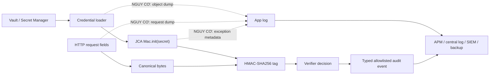
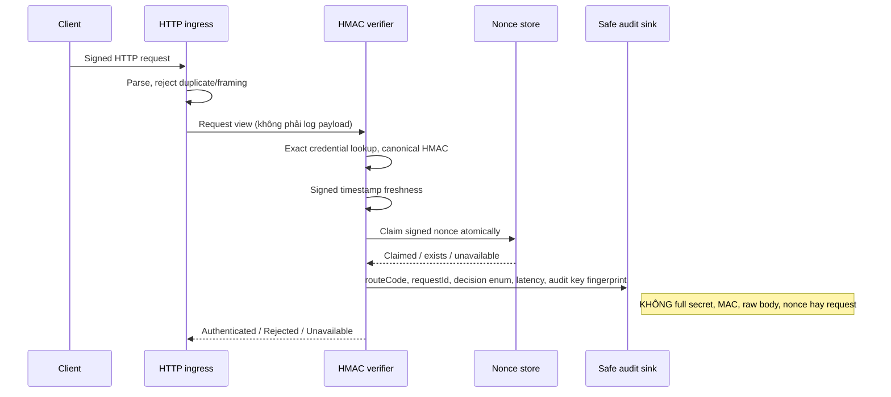
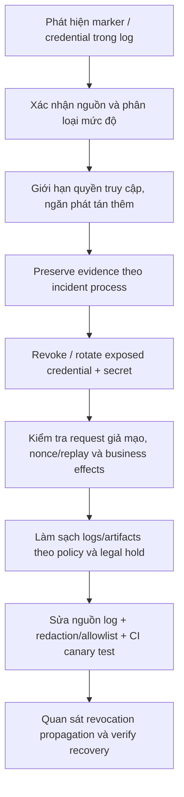

# Không ghi secret ra log: Bảo vệ shared secret trong xác thực HTTP HMAC

Một request HMAC có thể được triển khai đúng thuật toán và canonicalization, nhưng hệ thống vẫn mất an toàn nếu **shared secret bị ghi vào log**. Ví dụ, developer bật chế độ debug của HTTP client, đưa cả object `Credential` vào logger, hoặc ghi exception chứa cấu hình kết nối. Log sau đó đi tới hệ thống tập trung, APM, tracing, ticket hỗ trợ, bản sao lưu và nhiều nhóm người có quyền đọc rộng hơn quyền sử dụng secret.

Với **HMAC request authentication**, ai biết shared secret có thể tạo **chữ ký hợp lệ cho những request mới** trong phạm vi credential còn hiệu lực. Đổi Key ID, bật HTTPS hoặc thêm nonce **không cứu được một secret đã lộ**: attacker có secret có thể tự sinh timestamp/nonce và ký lại. Vì thế **không ghi secret ra log** là một phần của thiết kế secret management, không phải tùy chọn thẩm mỹ của logger.

Bài thuộc chương **Secret management**, chủ đề **Không ghi secret ra log**, trong module `SECURITY_AUTHENTICATION_HMAC_REQUEST_AUTHENTICATION`. Module thiết kế xác thực HTTP request bằng HMAC với shared secret và canonical request ký method, URI, header hoặc body theo hợp đồng; thực hành xác minh chữ ký, chống replay bằng timestamp/nonce, key rotation, kiểm thử proxy/gateway và phân biệt **authentication** với **authorization**. Trọng tâm của bài là nhận diện **mọi đường rò rỉ log và telemetry**, tạo audit an toàn, kiểm thử không lộ secret và ứng phó khi phát hiện rò rỉ.

## 1. Mục tiêu học tập

Sau bài học, bạn có thể:

1. Phân loại đúng **shared secret**, Key ID, client ID, nonce, timestamp, HMAC signature, raw/canonical request, body và token khác theo mức nhạy cảm.
2. Giải thích tại sao lộ shared secret cho phép **giả mạo request mới**, còn lộ nguyên request đã ký có thể tạo điều kiện **replay** khi còn fresh.
3. Kiểm soát các điểm ghi log từ **client SDK, API gateway, Java HTTP filters, service mesh, application logger, exception handler, APM/tracing, metrics, CI và secret manager**.
4. Ưu tiên **allowlist dữ liệu audit có kiểu** và loại bỏ dữ liệu nhạy cảm **trước khi** gửi vào logger, thay vì tin duy nhất vào regex che chuỗi tại log collector.
5. Thiết kế correlation bằng **request ID do server tạo**, status/reason code, route code, policy version và **HMAC fingerprint với audit key riêng** khi cần nhóm credential.
6. Viết demo **Java 17 tự chứa** với HMAC-SHA256, signed Key ID/timestamp/nonce/body, nonce store giả lập, safe audit sink và test canary không xuất hiện trong log.
7. Xây ma trận kiểm thử negative/positive, debug modes, concurrency, key rotation, error paths, proxy/gateway và leak incident response.
8. Tách bạch bảo mật của log với xác thực, chống replay, phân quyền, khóa mã hóa và chính sách retention.

## 2. Phân loại dữ liệu: thứ gì tuyệt đối không được log?

Không phải mọi giá trị trong HTTP HMAC đều là secret. Tuy nhiên **“không phải secret” không đồng nghĩa “có thể log tùy ý”**. Giá trị có thể là định danh khách hàng, dữ liệu riêng tư, tài liệu cho attacker thực hiện replay hoặc dấu vết cấu hình hạ tầng.

| Dữ liệu | Vai trò | Chính sách log mặc định |
| --- | --- | --- |
| **Shared HMAC secret bytes** | Chìa khóa tính/verify `HmacSHA256`. | **TUYỆT ĐỐI không log** dưới raw, UTF-8, hex, Base64, JSON hoặc bất kỳ biểu diễn nào. |
| Secret manager/KMS credential, token truy cập vault | Quyền lấy/dùng shared secret. | **Không log**; mức độ nguy hiểm có thể tương đương lộ secret. |
| Private key, password, API token, cookie/session token | Các loại credential khác trong cùng ứng dụng. | **Không log**. |
| **Full HMAC signature** (`X-Signature`) | MAC của một request cụ thể. | **Không log mặc định**; cùng toàn request có thể tạo replay trong window. |
| **Full signed HTTP request** | Method, target, headers, timestamp, nonce, signature, body. | **Không log** raw toàn bộ; có thể chứa thông tin nhạy cảm và bằng chứng phát lại. |
| Canonical request bytes | Dữ liệu đã ký, có thể chứa URI/query/body digest, signed headers. | **Không log raw**; một số field mang PII hoặc thông tin định danh. |
| Raw body / Authorization header / cookies | Dữ liệu nghiệp vụ/credential khác. | **Không log mặc định**, dù không phải HMAC secret. |
| Key ID | Lookup hint, không phải secret mật mã. | Chỉ log khi policy cho phép; ưu tiên **pseudonym/fingerprint**. |
| Nonce | Giá trị chống replay, không phải secret. | Không cần ghi đầy đủ; ưu tiên fingerprint hoặc outcome `REPLAY`. |
| Signed timestamp | Điều kiện freshness; không phải secret. | Có thể lưu **clock delta / freshness outcome** thay vì whole signed tuple. |
| Client ID / tenant ID | Metadata principal; có thể chứa dữ liệu khách. | Chỉ lưu ở audit có ACL/retention phù hợp hoặc alias. |
| Server-generated request ID | Mã tương quan event, không phải credential. | Thường **cho phép** log nếu được tạo và kiểm tra an toàn. |
| Route code, status enum, policy version, latency | Metadata điều hành có giới hạn giá trị. | **Cho phép** theo schema và quy định retention. |

### Phân biệt lộ secret và lộ request đã ký

- **Lộ shared secret:** attacker có thể ký **request mới** với method, URI, body, timestamp và nonce do họ chọn, trong phạm vi credential còn hiệu lực và policy/authorization cho phép.
- **Lộ signature đơn lẻ:** không đủ để tính signature cho một request tùy ý. Dù vậy việc log full signature thường không cần thiết và có thể giúp liên kết request.
- **Lộ full signed request:** attacker có thể **phát lại nguyên request** khi timestamp còn fresh nếu nonce chưa được claim, store có race/lỗi retention, hoặc client có cơ chế gửi lại không an toàn.
- **Lộ nonce hoặc Key ID đơn lẻ:** không tự tạo được MAC hợp lệ; vẫn có thể hỗ trợ enumeration, correlation hoặc gây lộ thông tin khách hàng.

**Kết luận thực hành:** không xây quy tắc “chỉ che field có tên `password`”. Phải có **phân loại dữ liệu**, danh sách field cho phép và threat model cho cả **request replay** lẫn **credential forgery**.

## 3. Bề mặt rò rỉ: secret đi qua những đâu?

Đường đi hợp lệ của shared secret cần **rất ngắn**: nguồn bí mật có ACL → signer/verifier trong ranh giới tin cậy → JCA `Mac.init(...)`. Log, tracing và dashboard **không nằm** trên đường ấy.



| Nguồn | Mẫu rò rỉ thường gặp | Cách ngăn tại nguồn |
| --- | --- | --- |
| **Startup/config loader** | Log toàn bộ `application.properties`, environment, secret object. | Không dump config; secret refs/values được phân loại và loại khỏi logging. |
| **Client SDK signer** | Log credential pair, signing context, request headers. | Chỉ log outcome, request ID và field đã cho phép; không log shared secret, MAC hoặc full request. |
| **JCA Mac/SecretKeySpec** | Exception handler log serialized key object/bytes. | Catch theo loại lỗi, emit reason code; không đưa secret vào exception text. |
| **HTTP interceptor** | Request/response logging mức FULL/BODY/TRACE. | Tắt body/header dumps ở tuyến HMAC; allowlist metadata an toàn. |
| **Gateway/filter** | Request dump, debug filter, `X-Signature`, `Authorization`. | Redact/drop trước capture; không pass raw request object sang logger. |
| **Framework exception page** | Stacktrace + request parameters, config state, nested exceptions. | Exception mapper có schema, không expose cấu hình/secret. |
| **APM/tracing/span events** | Tự capture HTTP headers, request body, baggage, exception message. | Kiểm soát attribute allowlist và collector/backend access. |
| **MDC/logging context** | Đưa `keyId`, token hoặc full request vào ThreadLocal. | Cho phép request ID do server tạo; clear MDC ở cuối, không chứa secret. |
| **Metrics** | Credential/raw nonce làm label, crash dump sau cardinality explosion. | Label thấp-cardinality: route, outcome, service/region. |
| **CI/test report** | In env vars, toàn bộ headers/fixture, stdout của test lỗi. | Dùng fake secrets, test canary, masking và artifact ACL. |
| **Crash dump/heap dump** | Secret bytes còn trong process memory bị lưu ra disk. | Hạn chế dump, mã hóa, ACL, retention; giảm lifetime secret trong memory. |
| **Support ticket/screenshot** | Paste log nguyên request hoặc config có secret. | Dùng sanitized evidence template và quy trình escalation riêng. |

**Không chỉ kiểm ứng dụng Java.** Một request có thể bị ghi ở **TLS terminator, API gateway, service mesh, reverse proxy, client HTTP library và tracing exporter**. Nếu chỉ xóa `logger.debug(secret)` trong code, những tầng khác vẫn có thể phát tán thông tin.

## 4. Những đoạn mã Java nên tránh

### 4.1. Log trực tiếp shared secret

```java
// SAI: secret chuyển thành String và bị ghi bền vững.
byte[] secret = loadSecretFromSecureSource();
logger.info("HMAC secret=" +
        new String(secret, java.nio.charset.StandardCharsets.UTF_8));
```

Lỗi này còn tạo thêm một `String` có thể tồn tại trong heap và khó kiểm soát thời điểm xóa. **Không** dùng `new String(secret)` hoặc `Arrays.toString(secret)` để debug.

### 4.2. Log toàn bộ Credential, signing context hoặc Request

```java
// SAI: record toString / reflective serializer có thể in bí mật.
logger.debug("credential={}", credential);
logger.debug("signingContext={}", signingContext);
logger.debug("request={}", request);
```

Đặc biệt nguy hiểm khi code generator tự tạo `toString()`, Lombok `@Data`/`@ToString`, Java `record` với component `String secret`, hoặc JSON serializer tự liệt kê fields. Java `byte[]` trong default record `toString` thường hiện dạng tham chiếu đối tượng thay vì raw bytes, **nhưng không được dựa vào tình cờ đó để bảo vệ secret**: custom serializer/debugger khác có thể in nội dung thật.

### 4.3. Logger format lazy vẫn có thể rò rỉ

```java
// SAI: khi DEBUG được bật, message đi đến sink.
logger.debug("key bytes: {}", hex(secret));

// SAI: lambda chỉ trì hoãn tạo message, không biến nó an toàn.
julLogger.fine(() -> "secret=" +
        java.util.Base64.getEncoder().encodeToString(secret));
```

Thậm chí khi level đang tắt, việc **đưa secret vào tham số logging** là rủi ro vì thay đổi config/agent hoặc sink có thể khiến nội dung được ghi. Biện pháp đúng không phải “bọc trong `isDebugEnabled`”, mà là **không đưa secret vào logger từ đầu**.

### 4.4. Exception có chứa secret

```java
// SAI: cả exception text và stacktrace có thể vào APM/ticket.
throw new IllegalStateException(
        "Cannot verify credential " + credential.secret());

// SAI: message có thể chứa raw HTTP request/config.
logger.error("HMAC failure: {}", requestAsJson, error);
```

Thay bằng exception có **mã lỗi và stage** cố định, không đính kèm value nhạy cảm:

```java
// MẪU Ý TƯỞNG, không phải nguyên class chạy độc lập.
logger.warn("auth.verify_failed stage={} outcome={} requestId={}",
        "mac_verify", "INVALID_SIGNATURE", trustedRequestId);
return authenticationRejected();
```

Nếu cần stacktrace để vận hành, chỉ emit exception types/call stack từ các lớp đã được kiểm soát; **không mặc nhiên log `Throwable.getMessage()`**, `cause` hay `suppressed` khi dependency có thể gắn dữ liệu nhạy cảm trong message. Ở production, thiết kế lỗi `SecretProviderUnavailable` và sanitized exception mapping ngay từ nguồn.

## 5. Allowlist logging thay vì chỉ regex redaction

Có hai phương án thường gặp:

- **Blacklist/redaction:** ghi nguyên object/request rồi tìm các tên `secret`, `password`, `Authorization` để thay bằng `***`.
- **Allowlist/structured audit:** **chỉ tạo event** từ các trường được định nghĩa trước: request ID, route code, outcome code, elapsed time, optional credential fingerprint.

**Ưu tiên allowlist tại nguồn.** Regex chỉ là **lớp phòng vệ bổ sung** tại appender/collector, vì nó có thể bỏ sót field mới, tên khác case, nested JSON, Base64/hex, multi-line, escaped Unicode, stacktrace và dữ liệu nằm trong URI/query/body.

### Schema audit tối thiểu

```json
{
  "requestId": "req-7d8040",
  "event": "hmac_request_authentication",
  "routeCode": "orders.create",
  "result": "REJECTED",
  "reason": "INVALID_SIGNATURE",
  "credentialRef": "fp-v1:7b54a0...masked",
  "elapsedMs": 4,
  "policyVersion": "HMAC-SHA256-V1"
}
```

Đây là **dữ liệu giả minh họa**, không phải response user. Event không chứa secret, raw Key ID, signed timestamp/nonce, signature, raw body hoặc canonical request.

**Cách đặt field:**

1. `requestId` nên do **server tạo**, không tin trực tiếp `X-Request-Id` từ Internet; nếu muốn tương quan client ID, validate format/length và gắn ở trường riêng đã lọc.
2. `routeCode` dùng **enum/route template đáng tin**, không là raw URI query chứa token/PII.
3. `reason` là **enum hữu hạn**, không ghép exception message, header value hoặc secret reference vào text.
4. `credentialRef` là pseudonym/fingerprint được **tạo trong service**; cần đủ entropy và ACL để ngăn tra ngược hoặc liên kết sai.
5. `elapsedMs` đo trên monotonic time; không chứa dữ liệu khách.
6. Nếu log principal/tenant, phải có mục đích và data-access policy, không tự kéo từ header chưa xác thực.

### Tránh correlation bằng raw secret hoặc SHA-256 không khóa

Không dùng `SHA256(secret)` làm ID công khai, dù HMAC secret tốt có thể có entropy cao: một hash cố định vẫn tạo định danh lâu dài, có thể bị dùng kiểm thử đoán nếu secret kém và phát tán không cần thiết. Không dùng `SHA256(keyId)` trần nếu Key ID có không gian nhỏ/dễ liệt kê. Khi thực sự cần liên kết các event, dùng **HMAC với audit key riêng**, ngắn gọn và chỉ ở nơi được phép:

\[
\mathrm{credentialFp} =
\operatorname{Truncate}_{128}(
  \operatorname{HMAC}_{\mathrm{SHA256}}
  (K_{\mathrm{audit}},\,\mathrm{UTF8}(\text{audience}\parallel\text{keyId})))
\]

Trong triển khai thật, serialization của audience/keyId cần **không nhập nhằng** (ví dụ length-prefix) và audit key phải khác **mọi client shared secret**, có policy rotation/ACL/retention riêng. Fingerprint **không phải chữ ký request** và không được dùng để xác thực client.

### Không biến log pipeline thành “shadow credential store”

Nếu collector nhận **full request và raw secret** rồi mới xóa ở chặng cuối, dữ liệu đã đi qua network, buffer và nhiều service. Dù dashboard không hiển thị, log transport, retry queues, storage staging hoặc crash artifacts vẫn có thể giữ bản gốc. Chặn **trước khi event rời process**, không chỉ ẩn trên giao diện hiển thị.

## 6. Quản lý vòng đời secret trong Java và secret manager

**Không log secret** quan trọng nhưng chưa đủ: secret phải được sinh/cấp phát, sử dụng, rotation và thu hồi đúng cách.

### Đường đi tối thiểu

```text
Secret manager / HSM / KMS HMAC key
    → credential loader hoặc MAC service (least privilege)
    → HmacSHA256 signing / verification
    → không xuất secret sang logger, tracing, HTTP body hoặc metrics
    → revoke/rotate khi cần, hạn chế lifetime bản sao in-memory
```

- **Sinh secret:** dùng CSPRNG, đủ độ dài/entropy theo policy (ví dụ **32 byte ngẫu nhiên** cho HMAC-SHA256). Đây là provisioning policy minh họa, không phải yêu cầu mọi `SecretKeySpec` trên JDK bắt buộc 32 byte.
- **Lưu secret:** trong secret manager/HSM/KMS có ACL và audit; không commit vào Git, không nhét vào Docker image, test fixtures production hoặc YAML plaintext chia sẻ.
- **Nạp secret:** dùng secure credential provider; nếu có thể cho HSM/KMS làm HMAC mà không export key, đánh giá năng lực và latency/quota của API tương ứng.
- **Memory:** `byte[]` có thể xóa bằng `Arrays.fill` khi không còn dùng, nhưng JVM/JCA/library có thể đã tạo **bản sao**; không thể hứa xóa sạch mọi byte trong heap. `String` khó xóa theo ý muốn, tránh tạo từ secret khi không cần.
- **Rotation:** phát hành **key ID mới + secret mới**, overlap theo chính sách, phân phối cặp credential đồng bộ; revoke key cũ; không log secret A/B trong tiến trình chuyển.
- **Quyền:** service chỉ được đọc/dùng những secrets nó cần theo audience/tenant; cache secret có bounded TTL và invalidation phù hợp revocation SLA.

### Key ID có thể log không?

`X-Key-Id` là **lookup hint**, không phải secret. Nhưng nó có thể chứa tên đối tác, môi trường hoặc lịch rotation. Trong log chung, nên dùng **alias được phép** hoặc credential fingerprint và tránh để raw Key ID thành metric label cardinality cao. Khi cần điều tra chính xác, xây audit store được bảo vệ thay vì ghi tràn vào log ứng dụng.

### Không log full request khi xác minh HMAC thất bại

Khi expected MAC không khớp, nhiều developer in:

```text
receivedCanonical=...
expectedHmac=...
suppliedSignature=...
sharedSecret=...
```

Đây là hướng debug sai. Có thể thay bằng:

```text
requestId=<server-generated>
scheme=HMAC-SHA256-V1
stage=verify_mac
result=INVALID_SIGNATURE
credentialFingerprint=<audit-fp-if-allowed>
bodySizeBucket=1-8KiB
routeCode=orders.create
```

Nếu cần test vector, dùng **fake secret và payload không nhạy cảm trong sandbox**, không xuất dữ liệu production vào artifact. Để phân tích mismatch production, có thể đo **lý do/ràng buộc bị vi phạm** dưới dạng enum, hoặc fingerprint có khóa riêng theo quy trình audit mà không tiết lộ raw input.

## 7. Kiểm soát log ở HTTP client và signer SDK

Client là nơi HMAC shared secret xuất hiện cùng **request chuẩn bị ký**. Nhiều thư viện có chế độ in headers/body để hỗ trợ debug; bật nó trong production có thể phát tán `X-Signature`, nonce, timestamp, cookie và body.

### Các ví dụ cấu hình dễ gây rò rỉ

| Thành phần | Rủi ro khi debug | Gợi ý kiểm soát |
| --- | --- | --- |
| **Java `HttpClient`** và custom instrumentation | Wrapper/interceptor tự log request headers/body; signer context chứa secret. | Tắt raw request dump; tự log action code, request ID, route template. |
| **OkHttp** logging interceptor | Chế độ HEADERS/BODY có thể ghi signed headers và payload. | Không bật chi tiết cho endpoint HMAC production; tránh log body/`X-Signature`. |
| **Feign** full logging | Có thể in request/response headers/body. | Dùng mức log hạn chế, cấu hình audit khác full HTTP log. |
| **RestTemplate/WebClient** interceptors | Có thể ghi body và header sau khi đã ký. | Thiết kế interceptor chỉ lấy allowlisted metadata; kiểm thử proxy/client. |
| **Reactor Netty wiretap** | Có thể ghi dữ liệu ở transport khi bật chế độ chi tiết. | Kiểm soát log level và wiretap ở môi trường chạy thật. |
| **SDK retry diagnostics** | Retry ghi `"send request: " + request` nhiều lần, giữ signed tuple. | Log attempt ID, reason enum, delay, không dump request object. |

Các tính năng trên thay đổi theo phiên bản/thư viện, nên **kiểm tra cấu hình của phiên bản đang chạy**. Không dựa vào tên log level làm bảo đảm tuyệt đối rằng nó không chứa body.

### Ví dụ cách gửi request mà không log dữ liệu ký

```java
// Mảnh tích hợp: signer, bodyBytes, URI đã được tạo đúng contract.
byte[] bodyBytes = jsonSerializer.writeValueAsBytes(orderData);
SigningCredential pair = credentialProvider.currentSnapshot();
String timestamp = clock.instant()
        .truncatedTo(java.time.temporal.ChronoUnit.SECONDS).toString();
String nonce = nonceGenerator.newNonce();

String signature = signer.sign("POST", target, pair.keyId(),
        timestamp, nonce, bodyBytes, pair.secret());

java.net.http.HttpRequest request =
        java.net.http.HttpRequest.newBuilder(uri)
        .header("Content-Type", "application/json")
        .header("X-Key-Id", pair.keyId())
        .header("X-Timestamp", timestamp)
        .header("X-Nonce", nonce)
        .header("X-Signature", signature)
        .POST(java.net.http.HttpRequest.BodyPublishers.ofByteArray(bodyBytes))
        .build();

// Chỉ ghi ID và trạng thái tối thiểu do ứng dụng kiểm soát.
logger.info("client.http attemptCreated route=orders.create "
        + "status=SIGNED");
```

`jsonSerializer`, `credentialProvider`, `nonceGenerator` và `signer` là các thành phần **giả định**, không phải API có sẵn của JDK. Điều quan trọng: **credential pair phải là một snapshot**, body được serialize đúng một lần và **không** log `pair`, `signature`, `bodyBytes` hoặc toàn `request`.

Retry sau timeout phải sinh **timestamp/nonce/signature mới** theo hợp đồng; nếu có Idempotency-Key thì giữ nguyên theo cùng ý định nghiệp vụ. **Không log full request để theo dõi retry**: dùng request/attempt ID do SDK tạo và kết quả retry enum.

## 8. Kiểm soát log tại Gateway, Servlet và APM/tracing

### Gateway không được biến request đã ký thành log artifact

```text
Client
  → TLS terminator / CDN
  → API Gateway / WAF
  → Java Servlet / Spring filter
  → HMAC verifier
  → Authorization
  → Backend / business
```

Ở mỗi tầng, hãy đặt câu hỏi:

1. Có bật **request capture** hoặc **wire log** chứa headers/body không?
2. Logger có ghi `X-Key-Id`, `X-Timestamp`, `X-Nonce` và `X-Signature` **cùng nhau** không?
3. Có ghi cả `Authorization`, `Cookie`, `Set-Cookie` hoặc thông tin cá nhân trong query/body không?
4. Có tạo full exception snapshot, request object hoặc trace span chứa dữ liệu đã ký không?
5. Dữ liệu có đi sang **third-party observability vendor**, hệ thống backup, môi trường test hay support export không?
6. Mỗi lớp có **allowlist ngay từ nguồn** không, hay chỉ masking trên dashboard?

Một số framework có **request logging filter**, **CommonsRequestLoggingFilter** hoặc cấu hình hiển thị chi tiết form/header. Không bật full payload/header logging tại endpoint HMAC trên production; nếu cần quan sát, dùng **security audit filter riêng** phát event đã lọc. Theo dõi chính sách này qua configuration tests vì một thay đổi log level khi xử lý sự cố có thể làm lộ secret.

### APM, OpenTelemetry và MDC

- Chỉ ghi span attributes kiểu `http.route` (template), `http.request.method`, status hoặc internal security outcome nếu được phép.
- Không đưa raw `url.query`, full header map, body, secret hay canonical request vào span attributes/events/baggage.
- `MDC` chỉ giữ server-generated request/trace IDs và metadata allowlisted. Xóa context tại cuối request; chú ý thread pool, asynchronous/reactive context propagation.
- `Throwable` được exporter ghi toàn bộ có thể mang message chứa credential, kể cả code ứng dụng không trực tiếp gọi logger.
- Sampling **không phải** cơ chế bảo vệ secret: một request bị sample vẫn có thể lộ toàn bộ.

**Quan trọng:** nếu gateway xác minh request rồi truyền authenticated principal tới backend, chỉ dùng kênh nội bộ tin cậy và xóa headers identity do client tự gửi. HMAC authentication không loại bỏ nhu cầu authorization theo principal, tenant, resource và scope.

## 9. Chiến lược audit và debug có kiểm soát

Thay vì in “tất cả thứ đã ký” mỗi khi có lỗi, tạo **một bộ event có schema cố định** quanh các decision point:



### Quy tắc audit theo từng kết quả

| Kết quả nội bộ | Log gì để vận hành? | Tuyệt đối không log gì? |
| --- | --- | --- |
| `INVALID_CREDENTIAL` | Reason enum, route, verifier ID, count, optional audit fingerprint. | Raw Key ID dạng tên khách, secret reference hoặc secret. |
| `INVALID_SIGNATURE` | `stage=mac_verify`, outcome, latency, policy version. | Expected MAC, supplied MAC, canonical string hoặc secret. |
| `NOT_FRESH` | Clock delta **theo bucket**, outcome, route. | Bộ timestamp+nonce+signature+body đầy đủ. |
| `NONCE_REPLAY` | Claim result `EXISTS`, request ID, route, region, fingerprint nếu cho phép. | Full nonce/raw request và full signature. |
| `REGISTRY_UNAVAILABLE` | Dependency code, region, retry/timeout class, correlation ID. | Provider config/secrets, URL nội bộ nhạy cảm hoặc exception message raw. |
| `NONCE_STORE_UNAVAILABLE` | Store code, fail-closed outcome, aggregate metrics. | Raw replay key chứa nonce, credential data. |
| `AUTHENTICATED` | Route, outcome, principal pseudonym nếu cần audit. | Shared secret, body/signature, raw credential object. |
| `AUTHORIZATION_DENIED` | Resource template, scope policy code, trusted principal pseudonym. | Secret, body PII, client-supplied identity header. |

**Không dùng log `AUTHENTICATED` để kết luận caller được phép làm việc gì.** Nó xác nhận cryptographic authentication + freshness/replay checks; **authorization** vẫn phải xét method, resource, tenant, scope. Còn idempotency xử lý ý định nghiệp vụ khi một client gửi **attempt mới hợp lệ** sau timeout.

### Khi cần debug mismatch bytes

Với hệ đa ngôn ngữ, lỗi thường nằm ở whitespace, LF/CRLF, header casing/value, raw URI/query, JSON serialization và Content-Encoding. Hãy dùng:

- Test vector **không chứa bí mật thật**: fake secret, sample method/URI, headers, raw body, expected canonical UTF-8 hex, expected HMAC.
- Correlation ID trong audit để so **protocol version** và reason enum giữa gateway/backend.
- Fingerprints **có audit key riêng** nếu phải so dữ liệu sản xuất trong phạm vi được cấp phép; không phát tán raw canonical bytes/secret.
- Bài test đi qua **proxy/gateway thật** nhưng dùng dữ liệu sandbox và credential riêng.

Không yêu cầu client paste shared secret vào ticket “để đội server thử HMAC”, vì đó là hình thức tự phát tán secret ngoài hệ thống quản lý khóa.


## 10. Java 17: HMAC verifier phát audit an toàn và test không rò rỉ

Ví dụ sau là một **chương trình Java 17 tự chứa**, chỉ dùng JDK. Mục tiêu chính là kiểm chứng **dòng dữ liệu secret không được truyền sang logger**, ngay cả khi request bị từ chối hoặc dependency lỗi.

Demo sử dụng hợp đồng HMAC-SHA256-V1 minh họa:

| Thành phần | Quy tắc |
| --- | --- |
| Algorithm | `HmacSHA256`, **full tag 32 bytes**. |
| Audience | `orders-api-prod`, dòng cố định trong canonical string. |
| Method/target | `POST` và `/v1/orders?channel=partner`. |
| `Content-Type` | `application/json`, không chấp nhận content encoding trong demo. |
| `X-Key-Id` | Lowercase ASCII, lookup một credential ACTIVE từ registry. |
| `X-Timestamp` | UTC `YYYY-MM-DDTHH:mm:ssZ`, fresh ±300 giây. |
| `X-Nonce` | 16 byte CSPRNG, Base64URL unpadded (22 ký tự); claim một lần. |
| Body | SHA-256 của **raw body bytes**, hex thường. |
| Canonical bytes | UTF-8, LF giữa dòng, không LF cuối. |
| `X-Signature` | `v1=` + Base64 chuẩn padded của HMAC 32 byte. |
| Audit | **Chỉ** server request ID, route enum, decision enum, elapsedMs và credential HMAC fingerprint với **audit key riêng**. |

Canonical request:

```text
HMAC-SHA256-V1
orders-api-prod
POST
/v1/orders?channel=partner
content-type:application/json
x-key-id:partner-a-202611
x-timestamp:2026-11-28T02:00:00Z
x-nonce:<NONCE_BASE64URL>
sha256:<LOWERCASE_HEX_SHA256_RAW_BODY>
```

`<...>` là placeholder. Bản thân chuỗi canonical **không được ghi vào audit log**.

### Mã nguồn đầy đủ

Lưu nội dung thành `SafeHmacAuditDemo.java`:

```java
import java.nio.charset.StandardCharsets;
import java.security.GeneralSecurityException;
import java.security.MessageDigest;
import java.security.SecureRandom;
import java.time.Clock;
import java.time.Instant;
import java.time.ZoneOffset;
import java.time.format.DateTimeParseException;
import java.util.ArrayList;
import java.util.Arrays;
import java.util.Base64;
import java.util.Collections;
import java.util.HashMap;
import java.util.HexFormat;
import java.util.List;
import java.util.Map;
import java.util.UUID;
import java.util.concurrent.TimeUnit;
import java.util.logging.Logger;
import javax.crypto.Mac;
import javax.crypto.spec.SecretKeySpec;

public final class SafeHmacAuditDemo {
    private static final String SCHEME = "HMAC-SHA256-V1";
    private static final String AUDIENCE = "orders-api-prod";
    private static final String TARGET = "/v1/orders?channel=partner";
    private static final String TYPE = "application/json";
    private static final String SIG_PREFIX = "v1=";
    private static final String ROUTE = "orders.create";
    private static final long WINDOW_SECONDS = 300;
    private static final long MARGIN_SECONDS = 30;

    private SafeHmacAuditDemo() {}

    public enum Decision {
        AUTHENTICATED, INVALID_REQUEST, INVALID_CREDENTIAL,
        INVALID_SIGNATURE, NOT_FRESH, NONCE_REPLAY, UNAVAILABLE
    }

    public record Outcome(Decision decision, String principal) {
        public Outcome {
            if ((decision == Decision.AUTHENTICATED)
                    != (principal != null)) {
                throw new IllegalArgumentException(
                        "Invalid authentication outcome");
            }
        }
        // Defense in depth: prevent accidental principal disclosure.
        @Override
        public String toString() {
            return "Outcome[decision=" + decision + "]";
        }
    }

    public record Credential(
            String keyId, String principalId, String audience,
            boolean active, byte[] secret) {
        public Credential {
            secret = secret.clone();
        }
        @Override
        public byte[] secret() {
            return secret.clone();
        }
        // Never rely on automatically generated record toString()
        // as a log sanitization policy.
        @Override
        public String toString() {
            return "Credential[REDACTED]";
        }
    }

    public record RequestView(
            String method, String target, String contentType,
            boolean contentEncodingPresent, String keyId,
            String timestamp, String nonce, byte[] body,
            String signature) {
        public RequestView {
            if (body != null) {
                body = body.clone();
            }
        }
        @Override
        public byte[] body() {
            return body == null ? null : body.clone();
        }
        @Override
        public String toString() {
            return "RequestView[REDACTED]";
        }
    }

    public record AuditEvent(
            String requestId, String routeCode, Decision decision,
            String credentialFp, long elapsedMs) {
        // Every field is generated/validated by trusted code:
        // no raw user headers, body, MAC, nonce, or secret.
        public String safeLine() {
            return "event=hmac_auth"
                    + " request_id=" + requestId
                    + " route_code=" + routeCode
                    + " decision=" + decision
                    + " credential_fp=" + credentialFp
                    + " elapsed_ms=" + elapsedMs;
        }
        @Override
        public String toString() {
            return safeLine();
        }
    }

    public interface AuditSink {
        void accept(AuditEvent event);
    }

    /** For isolated test runs only; contains sanitized lines. */
    public static final class MemoryAudit implements AuditSink {
        private final List<String> lines =
                Collections.synchronizedList(new ArrayList<>());

        @Override
        public void accept(AuditEvent event) {
            lines.add(event.safeLine());
        }

        public String snapshot() {
            synchronized (lines) {
                return String.join("\n", lines);
            }
        }

        public int size() {
            synchronized (lines) {
                return lines.size();
            }
        }
    }

    /** Example production-facing adapter for sanitized events. */
    public static final class JulAudit implements AuditSink {
        private final Logger logger =
                Logger.getLogger(SafeHmacAuditDemo.class.getName());

        @Override
        public void accept(AuditEvent event) {
            // No generic request/credential object ever reaches logger.
            logger.info(event.safeLine());
        }
    }

    public static class RegistryUnavailable extends Exception {}
    public static class NonceUnavailable extends Exception {}

    public interface CredentialRegistry {
        Credential find(String keyId) throws RegistryUnavailable;
    }

    public static final class LocalRegistry
            implements CredentialRegistry {
        private final Map<String, Credential> entries;
        private final boolean unavailable;

        public LocalRegistry(
                Map<String, Credential> entries, boolean unavailable) {
            this.entries = Map.copyOf(entries);
            this.unavailable = unavailable;
        }

        @Override
        public Credential find(String keyId)
                throws RegistryUnavailable {
            if (unavailable) {
                throw new RegistryUnavailable();
            }
            return entries.get(keyId);
        }
    }

    public interface NonceStore {
        boolean claimIfAbsent(
                String key, Instant expiry, Instant now)
                throws NonceUnavailable;
    }

    /** One-JVM demo. Production requires shared atomic nonce store. */
    public static final class LocalNonceStore implements NonceStore {
        private final Map<String, Instant> used = new HashMap<>();

        @Override
        public synchronized boolean claimIfAbsent(
                String key, Instant expiry, Instant now) {
            used.entrySet().removeIf(
                    e -> !e.getValue().isAfter(now));
            if (!expiry.isAfter(now) || used.containsKey(key)) {
                return false;
            }
            used.put(key, expiry);
            return true;
        }

        public synchronized int entries() {
            return used.size();
        }
    }

    private static boolean validKeyId(String keyId) {
        return keyId != null
                && keyId.matches("[a-z0-9][a-z0-9._-]{0,63}");
    }

    private static boolean validNonce(String value) {
        if (value == null || value.length() != 22) {
            return false;
        }
        try {
            byte[] bytes = Base64.getUrlDecoder().decode(value);
            return bytes.length == 16
                    && Base64.getUrlEncoder().withoutPadding()
                            .encodeToString(bytes).equals(value);
        } catch (IllegalArgumentException invalid) {
            return false;
        }
    }

    private static Instant parseTimestamp(String text) {
        if (text == null || !text.matches(
                "[0-9]{4}-[0-9]{2}-[0-9]{2}T"
                + "[0-9]{2}:[0-9]{2}:[0-9]{2}Z")) {
            throw new IllegalArgumentException("Bad timestamp format");
        }
        try {
            Instant parsed = Instant.parse(text);
            if (!parsed.toString().equals(text)) {
                throw new IllegalArgumentException(
                        "Timestamp is not canonical");
            }
            return parsed;
        } catch (DateTimeParseException invalid) {
            throw new IllegalArgumentException(
                    "Invalid timestamp value", invalid);
        }
    }

    private static boolean validShape(RequestView r) {
        if (r == null || !"POST".equals(r.method())
                || !TARGET.equals(r.target())
                || !TYPE.equals(r.contentType())
                || r.contentEncodingPresent()
                || !validKeyId(r.keyId())
                || !validNonce(r.nonce())
                || r.body() == null || r.body().length > 8192) {
            return false;
        }
        try {
            parseTimestamp(r.timestamp());
            return true;
        } catch (IllegalArgumentException invalid) {
            return false;
        }
    }

    private static byte[] canonicalBytes(RequestView r)
            throws GeneralSecurityException {
        String digest = HexFormat.of().formatHex(
                MessageDigest.getInstance("SHA-256")
                        .digest(r.body()));
        String canonical = String.join("\n",
                SCHEME, AUDIENCE, r.method(), r.target(),
                "content-type:" + r.contentType(),
                "x-key-id:" + r.keyId(),
                "x-timestamp:" + r.timestamp(),
                "x-nonce:" + r.nonce(),
                "sha256:" + digest);
        return canonical.getBytes(StandardCharsets.UTF_8);
    }

    private static byte[] mac(byte[] key, byte[] message)
            throws GeneralSecurityException {
        // 32 bytes is a DEMO provisioning policy, not a JCA rule.
        if (key == null || key.length < 32) {
            throw new GeneralSecurityException(
                    "Invalid HMAC credential configuration");
        }
        Mac instance = Mac.getInstance("HmacSHA256");
        instance.init(new SecretKeySpec(key, "HmacSHA256"));
        return instance.doFinal(message);
    }

    /** Safe to use on decoded full tag bytes, never on strings. */
    private static byte[] decodeSignature(String wire) {
        if (wire == null || wire.length() != 47
                || !wire.startsWith(SIG_PREFIX)) {
            return null;
        }
        String encoded = wire.substring(SIG_PREFIX.length());
        if (!encoded.matches("[A-Za-z0-9+/]{43}=")) {
            return null;
        }
        try {
            byte[] decoded = Base64.getDecoder().decode(encoded);
            return decoded.length == 32
                    && Base64.getEncoder().encodeToString(decoded)
                            .equals(encoded) ? decoded : null;
        } catch (IllegalArgumentException invalid) {
            return null;
        }
    }

    /** HMAC audit key must be independent of every client secret. */
    private static String credentialFingerprint(
            byte[] auditKey, String keyId) {
        if (!validKeyId(keyId)) {
            return "unavailable";
        }
        try {
            // Newline is unambiguous because keyId grammar forbids it;
            // audience is a fixed trusted constant in this demo.
            byte[] data = (AUDIENCE + "\n" + keyId)
                    .getBytes(StandardCharsets.UTF_8);
            byte[] tag = mac(auditKey, data);
            return HexFormat.of().formatHex(
                    Arrays.copyOf(tag, 16));
        } catch (GeneralSecurityException providerUnavailable) {
            // Do not leak the exception text or the key itself.
            return "unavailable";
        }
    }

    private static Outcome finish(
            Decision decision, String principal, String requestId,
            String keyId, long startedNanos,
            byte[] auditKey, AuditSink audit) {
        long elapsedMs = Math.max(0L,
                TimeUnit.NANOSECONDS.toMillis(
                        System.nanoTime() - startedNanos));
        AuditEvent event = new AuditEvent(
                requestId, ROUTE, decision,
                credentialFingerprint(auditKey, keyId), elapsedMs);
        audit.accept(event);
        return new Outcome(decision, principal);
    }

    /**
     * Requires trusted HTTP ingress to reject duplicates, bad framing,
     * smuggling and ambiguous routing BEFORE constructing RequestView.
     */
    public static Outcome verify(
            RequestView request, CredentialRegistry registry,
            NonceStore nonceStore, Clock clock,
            byte[] auditKey, AuditSink audit) {
        long started = System.nanoTime();
        // A server-controlled request ID, never a client header.
        String requestId = UUID.randomUUID().toString();
        String keyId = request == null ? null : request.keyId();

        if (!validShape(request)) {
            return finish(Decision.INVALID_REQUEST, null,
                    requestId, keyId, started, auditKey, audit);
        }

        Credential credential;
        try {
            credential = registry.find(request.keyId());
        } catch (RegistryUnavailable unavailable) {
            return finish(Decision.UNAVAILABLE, null,
                    requestId, keyId, started, auditKey, audit);
        }

        if (credential == null || !credential.active()
                || !AUDIENCE.equals(credential.audience())
                || !request.keyId().equals(credential.keyId())) {
            return finish(Decision.INVALID_CREDENTIAL, null,
                    requestId, keyId, started, auditKey, audit);
        }

        byte[] supplied = decodeSignature(request.signature());
        if (supplied == null) {
            return finish(Decision.INVALID_SIGNATURE, null,
                    requestId, keyId, started, auditKey, audit);
        }

        byte[] keyCopy = credential.secret();
        try {
            byte[] expected = mac(keyCopy, canonicalBytes(request));
            if (!MessageDigest.isEqual(expected, supplied)) {
                return finish(Decision.INVALID_SIGNATURE, null,
                        requestId, keyId, started, auditKey, audit);
            }
        } catch (GeneralSecurityException providerUnavailable) {
            return finish(Decision.UNAVAILABLE, null,
                    requestId, keyId, started, auditKey, audit);
        } finally {
            // Best effort: other JVM/JCA copies may still exist.
            Arrays.fill(keyCopy, (byte) 0);
        }

        Instant now = clock.instant();
        Instant signedTime = parseTimestamp(request.timestamp());
        if (signedTime.isBefore(now.minusSeconds(WINDOW_SECONDS))
                || signedTime.isAfter(now.plusSeconds(WINDOW_SECONDS))) {
            return finish(Decision.NOT_FRESH, null,
                    requestId, keyId, started, auditKey, audit);
        }

        String replayKey = "replay:v1:" + AUDIENCE + ":"
                + credential.keyId() + ":" + request.nonce();
        Instant expiry = signedTime.plusSeconds(
                WINDOW_SECONDS + MARGIN_SECONDS);
        try {
            if (!nonceStore.claimIfAbsent(replayKey, expiry, now)) {
                return finish(Decision.NONCE_REPLAY, null,
                        requestId, keyId, started, auditKey, audit);
            }
        } catch (NonceUnavailable unavailable) {
            return finish(Decision.UNAVAILABLE, null,
                    requestId, keyId, started, auditKey, audit);
        }

        // Only after MAC, freshness and nonce claim is principal trusted.
        return finish(Decision.AUTHENTICATED, credential.principalId(),
                requestId, keyId, started, auditKey, audit);
    }

    private static String nonce(SecureRandom random) {
        byte[] raw = new byte[16];
        random.nextBytes(raw);
        return Base64.getUrlEncoder().withoutPadding()
                .encodeToString(raw);
    }

    /** Fixture signer. No actual production secret should be used. */
    public static RequestView signForTest(
            Credential credential, String timestamp,
            String nonce, byte[] body)
            throws GeneralSecurityException {
        RequestView unsigned = new RequestView(
                "POST", TARGET, TYPE, false, credential.keyId(),
                timestamp, nonce, body, null);
        if (!validShape(unsigned)) {
            throw new IllegalArgumentException("Invalid test request");
        }
        byte[] keyCopy = credential.secret();
        String signature;
        try {
            signature = SIG_PREFIX + Base64.getEncoder()
                    .encodeToString(mac(keyCopy, canonicalBytes(unsigned)));
        } finally {
            Arrays.fill(keyCopy, (byte) 0);
        }
        return new RequestView(
                unsigned.method(), unsigned.target(),
                unsigned.contentType(), false, unsigned.keyId(),
                unsigned.timestamp(), unsigned.nonce(),
                unsigned.body(), signature);
    }

    private static void expect(Decision want, Outcome actual) {
        if (actual.decision() != want) {
            throw new AssertionError(
                    "Expected " + want + " but got " + actual.decision());
        }
        if (want != Decision.AUTHENTICATED
                && actual.principal() != null) {
            throw new AssertionError("Principal leaked on auth failure");
        }
    }

    private static void requireAbsent(
            String logs, String forbidden, String label) {
        if (forbidden != null && !forbidden.isEmpty()
                && logs.contains(forbidden)) {
            throw new AssertionError(
                    "Sanitized audit contains forbidden " + label);
        }
    }

    public static void main(String[] args) throws Exception {
        // TEST CANARY only. It is NOT a real credential.
        String testSecretCanary =
                "LOCAL_FAKE_HMAC_SECRET_CANARY_2026_NEVER_LOG";
        byte[] testSecret = testSecretCanary
                .getBytes(StandardCharsets.UTF_8);

        // Separate TEST audit key; never reuse a client's HMAC secret.
        byte[] auditKey = new byte[32];
        Arrays.fill(auditKey, (byte) 0x5c);
        Credential active = new Credential(
                "partner-a-202611", "partner-a",
                AUDIENCE, true, testSecret);
        Credential revoked = new Credential(
                "partner-a-revoked", "partner-a",
                AUDIENCE, false, testSecret);
        LocalRegistry registry = new LocalRegistry(
                Map.of(active.keyId(), active,
                        revoked.keyId(), revoked), false);

        LocalNonceStore nonces = new LocalNonceStore();
        MemoryAudit audit = new MemoryAudit();
        Clock fixed = Clock.fixed(
                Instant.parse("2026-11-28T02:00:30Z"), ZoneOffset.UTC);
        SecureRandom random = new SecureRandom();
        String bodyCanary = "PRIVATE_FIXTURE_BODY_MARKER_67291";
        byte[] body = ("{\"note\":\"" + bodyCanary + "\"}")
                .getBytes(StandardCharsets.UTF_8);
        String timestamp = "2026-11-28T02:00:00Z";

        RequestView valid = signForTest(
                active, timestamp, nonce(random), body);
        expect(Decision.AUTHENTICATED,
                verify(valid, registry, nonces, fixed, auditKey, audit));

        // Replay must be rejected and still produce ONLY safe audit.
        expect(Decision.NONCE_REPLAY,
                verify(valid, registry, nonces, fixed, auditKey, audit));

        // Tamper body and nonce while retaining the old signature.
        RequestView tampered = new RequestView(
                valid.method(), valid.target(), valid.contentType(),
                false, valid.keyId(), valid.timestamp(), nonce(random),
                "CHANGED_PRIVATE_BODY_FIXTURE"
                        .getBytes(StandardCharsets.UTF_8),
                valid.signature());
        expect(Decision.INVALID_SIGNATURE,
                verify(tampered, registry, nonces, fixed, auditKey, audit));

        // Unknown key: no fallback, no raw key ID in output.
        RequestView unknown = new RequestView(
                valid.method(), valid.target(), valid.contentType(),
                false, "missing-key", valid.timestamp(), nonce(random),
                valid.body(), valid.signature());
        expect(Decision.INVALID_CREDENTIAL,
                verify(unknown, registry, nonces, fixed, auditKey, audit));

        // Invalid key ID must never be echoed in the audit.
        RequestView malformed = new RequestView(
                valid.method(), valid.target(), valid.contentType(),
                false, "../DO-NOT-LOG-KEY-ID", valid.timestamp(),
                nonce(random), valid.body(), valid.signature());
        expect(Decision.INVALID_REQUEST,
                verify(malformed, registry, nonces, fixed, auditKey, audit));

        // Revoked key: no authentication despite known secret.
        RequestView signedRevoked = signForTest(
                revoked, timestamp, nonce(random), body);
        expect(Decision.INVALID_CREDENTIAL,
                verify(signedRevoked, registry, nonces, fixed,
                        auditKey, audit));

        // Timestamp outside allowed window, full MAC still valid.
        RequestView expired = signForTest(
                active, "2026-11-28T01:55:29Z", nonce(random), body);
        expect(Decision.NOT_FRESH,
                verify(expired, registry, nonces, fixed, auditKey, audit));

        // Secret registry unavailable: fail closed; no exception dump.
        CredentialRegistry offline = keyId -> {
            throw new RegistryUnavailable();
        };
        RequestView fresh = signForTest(
                active, timestamp, nonce(random), body);
        expect(Decision.UNAVAILABLE,
                verify(fresh, offline, nonces, fixed, auditKey, audit));

        // Nonce store unavailable: fail closed; no raw replay key dump.
        NonceStore unavailableStore = (key, until, now) -> {
            throw new NonceUnavailable();
        };
        expect(Decision.UNAVAILABLE,
                verify(fresh, registry, unavailableStore, fixed,
                        auditKey, audit));

        String logs = audit.snapshot();
        if (audit.size() != 9
                || !logs.contains("decision=AUTHENTICATED")
                || !logs.contains("decision=NONCE_REPLAY")
                || !logs.contains("decision=UNAVAILABLE")) {
            throw new AssertionError("Missing safe audit events");
        }

        // Canary checks cover plain text, encodings, wire signature,
        // body, nonce and raw Key ID. These are NOT a complete DLP proof.
        requireAbsent(logs, testSecretCanary, "plain secret");
        requireAbsent(logs,
                Base64.getEncoder().encodeToString(testSecret),
                "base64 secret");
        requireAbsent(logs,
                HexFormat.of().formatHex(testSecret), "hex secret");
        requireAbsent(logs, bodyCanary, "raw body");
        requireAbsent(logs, valid.signature(), "full signature");
        requireAbsent(logs, valid.nonce(), "raw nonce");
        requireAbsent(logs, active.keyId(), "raw key ID");
        requireAbsent(logs, "../DO-NOT-LOG-KEY-ID",
                "malformed credential input");

        // Safe event output only: no raw request, secret or signature.
        System.out.println(logs);
        System.out.println("All safe audit canary checks passed.");
    }
}
```

### Chạy ví dụ và hiểu kết quả

```text
javac SafeHmacAuditDemo.java
java SafeHmacAuditDemo
```

Dòng audit sẽ có các giá trị **ngẫu nhiên và phụ thuộc máy**, nhưng hình dạng giống:

```text
event=hmac_auth request_id=<server-generated-uuid> route_code=orders.create decision=AUTHENTICATED credential_fp=<audit-hmac-fp> elapsed_ms=<n>
event=hmac_auth request_id=<server-generated-uuid> route_code=orders.create decision=NONCE_REPLAY credential_fp=<audit-hmac-fp> elapsed_ms=<n>
...
All safe audit canary checks passed.
```

Đây là **minh họa định dạng**, không phải output chính xác của một lần chạy đã thực hiện. Trong phạm vi STEP 4, mã được **soạn và rà soát**, chưa biên dịch/chạy; hãy dùng JDK 17 ở môi trường sandbox để xác minh.

**Điều đáng học từ code:**

- `Credential` và `RequestView` override `toString()` để giảm thiểu rò rỉ vô tình. **Biện pháp chính vẫn là allowlist audit**, không phải trông chờ vào `toString()` hoặc masking logger.
- `verify` dùng Key ID chỉ để tra credential, sau đó so full HMAC bytes, freshness và nonce trước khi trả principal. `Outcome` không có principal khi reject/unavailable.
- `finish` phát **một event có schema** bằng `requestId` server-generated, `routeCode` cố định, enum outcome và credential fingerprint **HMAC với audit key riêng**.
- `MemoryAudit` chỉ nhận `AuditEvent`; không có overload nhận `Object` hay request/credential đầy đủ.
- Exception `RegistryUnavailable` và `NonceUnavailable` không chứa secret trong message. Audit ghi `UNAVAILABLE` thay vì serialize exception.
- `requireAbsent` quét log canary ở nhiều dạng; **kiểm tra canary không thể chứng minh tuyệt đối mọi đường leak**, đặc biệt nếu còn proxy/APM log nằm ngoài tiến trình.
- `Arrays.fill` chỉ xóa best-effort bản copy secret mà ứng dụng quản lý; JVM/JCA có thể giữ bản sao nội bộ. Nó **không thay secret manager**.
- `LocalNonceStore` chỉ đúng trong **một JVM demo**; production cần shared atomic store với TTL an toàn. Demo **không chứng minh** chống replay qua nhiều gateway.
- `JulAudit` minh họa cách đưa **safe event** tới logger thực; demo dùng `MemoryAudit` để kiểm thử, tránh in test credential sang hệ thống bên ngoài.

## 11. Kiểm thử không rò rỉ: canary, negative paths và observability

Test một lần trên happy path không đủ. Secret thường rò khi **xảy ra lỗi**, khi đội vận hành bật TRACE hoặc khi dependency khác thay đổi cấu hình.

### Canary testing có kiểm soát

Trong **môi trường test riêng**, cấp credential **giả và có marker dễ nhận biết**, ví dụ `LOCAL_FAKE_HMAC_SECRET_CANARY_2026_NEVER_LOG`. Gửi signed requests hợp lệ và các request lỗi, sau đó tìm marker ở **mọi sink được phép kiểm tra**:

- Application stdout/stderr và rotated log files.
- API gateway/access/security logs, WAF, CDN/test ingress.
- OpenTelemetry exporter, APM span events/attributes, baggage và exception events.
- CI/test output, JUnit report, test screenshots, artifacts và support diagnostics.
- Dead-letter queue, logging buffer/retry queues và collector staging khi có quyền.
- Crash diagnostics/heap dumps, theo quy trình test riêng nếu hệ thống tạo chúng.

**Không dùng secret production làm canary** và không cố gửi secret thật qua nhiều pipeline để “xem nó có bị log không”.

### Kiểm thử nhiều biểu diễn của cùng secret

Một marker có thể xuất hiện dưới:

```text
plain text:
LOCAL_FAKE_HMAC_SECRET_CANARY_2026_NEVER_LOG

hex:
<HEX_UTF8_OF_TEST_CANARY>

base64:
<BASE64_UTF8_OF_TEST_CANARY>

JSON escaped:
"secret": "LOCAL_FAKE_HMAC_SECRET_CANARY_2026_NEVER_LOG"

array:
[76, 79, 67, ...]   # bytes, mang tính ví dụ
```

Ngoài tìm marker nguyên văn, có thể sinh **hex/Base64 của fake secret bằng test harness** rồi so khớp. Tuy nhiên DLP bằng chuỗi/pattern không bắt được mọi trường hợp: secret có thể bị split, encode hai lần, truncate, obfuscate hoặc đi qua sink không được thu thập. Vì vậy **đánh giá data flow tại nguồn vẫn quan trọng hơn chỉ search log**.

### Các tình huống âm bắt buộc

| Test ID | Tình huống | Kỳ vọng |
| --- | --- | --- |
| `LOG-01` | Ký request HMAC hợp lệ. | Audit có outcome và request ID; **không secret/MAC/raw body**. |
| `LOG-02` | Request signature Base64 sai. | Có `INVALID_SIGNATURE`, không log full header/signature. |
| `LOG-03` | MAC sai sau khi sửa body. | Không log expected/supplied MAC hoặc canonical bytes. |
| `LOG-04` | Key ID không tồn tại. | Generic authentication event, không raw Key ID nhạy cảm hay secret ref. |
| `LOG-05` | Key ID malformed có newline/JSON control. | Ingress reject, không log raw attacker input hoặc tạo log injection. |
| `LOG-06` | Credential REVOKED/EXPIRED. | Không log secret cũ trong error/stacktrace. |
| `LOG-07` | Registry/secret manager timeout. | Fail closed, event có dependency reason code, không dump config/exception chứa secret. |
| `LOG-08` | JCA `InvalidKeyException` hoặc provider unavailable. | Sanitize exception; không log `SecretKeySpec`/key material. |
| `LOG-09` | Nonce replay. | Outcome `NONCE_REPLAY`, không log raw nonce/full request. |
| `LOG-10` | Nonce store timeout/Redis failover. | Fail closed; không log raw replay key chứa nonce. |
| `LOG-11` | Clock skew/expired timestamp. | Outcome/bucket offset; không log đủ signed tuple để replay. |
| `LOG-12` | Key rotation A→B trong client SDK. | Không log secret A/B, credential snapshots hoặc config diff. |
| `LOG-13` | Client bị 401 và bật DEBUG/TRACE. | Không xuất request headers/body và secret trong debug logs. |
| `LOG-14` | API gateway bật access request logging. | Không capture `X-Signature`, `Authorization`, `Cookie`/body. |
| `LOG-15` | HTTP/1.1 → HTTP/2/3, proxy header rewrite. | Logs vẫn chỉ chứa route/status allowlisted; không dump signed headers. |
| `LOG-16` | Spring/HTTP request logging filter được bật nhầm. | Config test phát hiện vi phạm hoặc filter bảo đảm không capture credentials. |
| `LOG-17` | Exception mapper trả HTTP 500. | Client response và APM không chứa secret/canonical request. |
| `LOG-18` | MDC request context qua thread pool. | Chỉ server IDs, được clear đúng; không rò dữ liệu request trước. |
| `LOG-19` | Metrics exporter với nhiều Key IDs. | Raw key ID/nonce không thành label, không tạo high-cardinality leak. |
| `LOG-20` | Signed request được đưa vào support ticket/export. | Sanitization thực hiện **trước export**; full request bị chặn. |
| `LOG-21` | Secret xuất hiện trong Java record `toString()` hoặc JSON debug serializer. | Test rà soát object dump bị chặn/được redacted ngay tại nguồn. |
| `LOG-22` | Fake secret log ở dạng hex/Base64. | Canary scanner phát hiện vi phạm và fail CI. |
| `LOG-23` | Full signature + nonce + timestamp cùng bị in. | Security policy fail; giảm khả năng thu toàn request phục vụ replay. |
| `LOG-24` | Audit fingerprint dùng key riêng và key rotation. | Không lộ raw credential; vẫn nối sự kiện theo version/retention policy đã định. |
| `LOG-25` | Hai gateway có cấu hình logging khác nhau. | Cả hai đều đáp ứng allowlist; không bỏ sót instance mới deploy. |
| `LOG-26` | Authenticated client thiếu quyền tenant. | Event authz denied có mã lý do; không log secret hoặc PII. |
| `LOG-27` | Idempotency retry với nonce mới. | Có request/attempt IDs, không dump original signed request. |
| `LOG-28` | Test endpoint trả 429/503, SDK retry. | Không tự bật full request dump để debug retry. |
| `LOG-29` | Collector log bị thay đổi pipeline/retention. | Policy test/approval xác nhận không copy dữ liệu gốc sang staging. |
| `LOG-30` | Review sau revocation do nghi log leak. | Còn đủ audit outcome, không cần giữ secret để điều tra. |

**Oracle chính:** tổng hợp logs/traces của mỗi test không chứa secret canary, biểu diễn của nó, full signature, raw body marker hoặc value bị cấm. **Oracle bổ sung:** business/authentication vẫn đúng (không fail-open, không mất event quan trọng), policy được enforce ở mọi instance và truy cập log có ACL phù hợp.

## 12. Khác biệt giữa application logs, access logs và audit records

| Loại dữ liệu quan sát | Mục đích | Ví dụ field an toàn |
| --- | --- | --- |
| **Application log** | Debug trạng thái hoặc lỗi thành phần. | Class/stage enum, request ID, elapsed time, dependency code. |
| **Access log** | Thống kê HTTP request/response. | Method, **route template**, status, bytes count bucket, server request ID. |
| **Security audit** | Điều tra quyết định xác thực/phân quyền. | Auth outcome, credential pseudonym có ACL, policy version, nonce claim result. |
| **Distributed trace** | Đo latency/quan hệ giữa service. | Trace ID, span name, route code, latency, status. |
| **Metrics** | Quan sát xu hướng quy mô lớn. | Counters theo route/outcome/region, không raw key ID. |
| **Forensic evidence đặc biệt** | Điều tra đã phê duyệt theo quy trình. | Dữ liệu tối thiểu, mã hóa, ACL, retention và chain-of-custody theo chính sách. |

**Không trộn mục đích.** Một audit record có thể cần principal alias đã xác minh, nhưng access log công khai cho nhiều đội không nhất thiết cần cùng định danh. Một forensic snapshot nhạy cảm (nếu được cho phép) **không nên đi qua logger thông thường**.

### Log injection là rủi ro độc lập

Nếu nhận raw header rồi nối trực tiếp vào text log, attacker có thể đưa newline hoặc chuỗi giả format:

```text
X-Key-Id: partner-a
FAKE severity=INFO auth=accepted
```

Header có CR/LF không hợp lệ phải bị chặn ở HTTP parser. Nhưng ngay cả dữ liệu từ body/query có newline hợp lệ về ứng dụng cũng không nên được ghép thẳng vào message. Dùng **schema với field values do server kiểm soát** và encode JSON an toàn theo logging framework; không dựa vào việc thay `\n` bằng khoảng trắng như biện pháp duy nhất.

### Không để logs trở thành nguồn xác thực

Không bao giờ dùng các bản ghi như `"key=partner-a signed=true"` để backend ra quyết định authenticated. Backend phải nhận **trusted security context** từ gateway/verifier và vẫn thực hiện authorization. Log không phải ACL, credential registry hay nonce store; nó có thể chậm, thiếu và bị replicate.

## 13. Sự cố rò rỉ secret ra log: quy trình ứng phó

Nếu nghi ngờ log đã chứa secret **thật**, cần coi đó là một khả năng **credential compromise**, không chỉ lỗi format.



### Bước 1 — Xác định rò rỉ thật hay false positive

- Phân biệt **fake test canary** với credential production; đừng paste giá trị nghi lộ vào ticket.
- Kiểm tra nơi xuất hiện: stdout, container log, collector, APM, support export, CI artifact, dump, backup.
- Ước lượng **khoảng thời gian, số bản sao, hệ thống và nhóm người có quyền truy cập**.
- Xác định secret thuộc credential nào qua **registry metadata an toàn**, không giải mã secret từ log rồi phát tán thêm.

### Bước 2 — Containment và rotation

Nếu secret thật đã được log ở nơi không được phép, **ngừng phát tán thêm tại nguồn** rồi rotate/revoke credential theo runbook. Cấp **Key ID + secret mới**, cập nhật client an toàn, chọn overlap theo mức độ compromise: nếu secret đã lộ thật, **không mặc định giữ overlap dài**; cần đánh giá rủi ro và ưu tiên revoke nhanh theo khả năng vận hành.

**Xóa log không đủ để khắc phục.** Những bản sao đã đi vào backup, collector, cache hoặc hệ thống người dùng khác có thể vẫn tồn tại. Secret đã lộ cần được coi là không còn đáng tin.

### Bước 3 — Đánh giá tác động

- Kiểm tra request đã được authenticated bằng key bị lộ trong khoảng rủi ro, dấu hiệu canonical/route bất thường, request mới không khớp hành vi client.
- Phân biệt **replay nguyên request** với **forgery dùng secret**: attacker có secret có thể tạo nonce/timestamp/signature mới, nonce store **không tự chặn**.
- Đối chiếu authorization, rate limit, tenant boundaries và business ledger. HMAC đúng không chứng minh chủ sở hữu thật nếu secret đã compromise.
- Xác định side effect cần đối soát hoặc xử lý bù dưới quy trình được ủy quyền.

### Bước 4 — Bảo toàn và làm sạch có kiểm soát

Hạn chế người truy cập bằng ACL ngay; bảo toàn bản bằng chứng tối thiểu trong kho incident bảo vệ nếu quy trình yêu cầu; phối hợp retention, legal hold và deletion. Không xóa hủy chứng cứ điều tra một cách tùy tiện, nhưng cũng không tiếp tục phát tán secret qua các ticket/chat/screenshots.

Không tự xóa toàn bộ nonce store production để “ngăn replay”: việc mất replay state có thể **cho phép request cũ còn fresh được chấp nhận lại**. Phòng thủ khi secret lộ là **rotate/revoke**, kiểm soát quyền và giám sát request, không chỉ reset nonce.

### Bước 5 — Sửa nguồn và ngăn tái diễn

- Xóa code log credential/request ở cả normal và error paths.
- Cấm toàn bộ HTTP request/header/body dump tại service HMAC production.
- Cập nhật safe audit schema và secret-safe exception mapping.
- Thêm test canary chạy trên client, server, gateway, APM export và CI.
- Rà soát chính sách quyền đọc log, thời gian giữ, backup và nhà cung cấp observability.
- Xác thực **revoke propagation** giữa các gateway/region/cache; log không được hiển thị secret mới sau remediation.

## 14. Key rotation, replay protection và phân quyền khi secret lộ

Một nhầm lẫn nghiêm trọng là: “Request còn kiểm tra timestamp và nonce nên dù secret đã nằm trong log vẫn an toàn.”

**Sai.** Với secret, attacker có thể tự tạo:

```text
new timestamp = now
new nonce     = CSPRNG(16 bytes)
new method    = POST
new target    = /v1/orders
new body      = attacker-chosen payload
new signature = HMAC(compromised secret, canonical bytes)
```

Nếu credential vẫn ACTIVE, request mới có thể vượt HMAC/freshness/nonce. Khi đó mức ảnh hưởng phụ thuộc vào **authorization và business controls** còn áp dụng cho credential đó. Do vậy phải áp **least privilege**, quotas, policy theo tenant/resource và có quy trình credential revoke nhanh.

| Cơ chế | Khi secret chưa lộ | Khi secret đã lộ |
| --- | --- | --- |
| HMAC-SHA256 | Bảo đảm chỉ bên có secret tạo được MAC cho signed fields. | Attacker có secret cũng có thể tạo MAC hợp lệ. |
| Timestamp | Giới hạn tuổi của signed request. | Attacker có thể ký timestamp hiện tại. |
| Nonce store | Chặn tái sử dụng nonce trong window theo policy. | Attacker có thể tạo nonce mới cho request mới. |
| Key ID | Chọn đúng credential/version. | Key ID không “thu hồi” secret cũ nếu registry còn ACTIVE. |
| TLS | Bảo vệ kênh truyền, hạn chế nghe lén/giả mạo trên đường. | Không xóa secret đã lộ trong log. |
| Authorization | Giới hạn resource/tenant/scope của principal. | Vẫn giúp giảm blast radius, nếu policy được enforce đúng. |
| Revoke/rotate | Chuyển credential và secret theo lifecycle. | **Biện pháp bắt buộc trong nhiều sự cố lộ secret**, kết hợp incident response. |

**Kết nối với idempotency:** nếu attacker dùng secret ký request tạo đơn nhiều lần bằng nonce mới và idempotency key khác nhau, replay protection và idempotency theo ý định **không tự ngăn** request mới có chủ ý. Authorization, risk engine, quotas và biện pháp nghiệp vụ vẫn cần thiết.

## 15. Quy tắc vận hành cho CI, secrets scanning và log pipeline

Một chính sách có thể áp dụng cho repository/team:

1. **Không commit secrets.** Dùng scanner trên source/config/artifacts và bảo vệ secrets trong CI; scanner không thay code review.
2. **Không in environment/config** (`printenv`, dump JVM/system properties, kube secret manifests) trong job thường.
3. **Fixture test chỉ dùng fake secrets**, được đánh dấu và quản lý riêng; không bao giờ copy credential production vào test.
4. **Static review:** tìm các pattern `toString`, `logger.*(credential)`, `new String(secret)`, `Base64(secret)`, request dump, `Throwable` messages.
5. **Dynamic canary:** gửi request test qua các đường lỗi và kiểm tra nhiều sink, gồm log raw collection trước khi masking dashboard.
6. **Observability policy as code:** định nghĩa header/attribute allowlist và snapshot cấu hình trên gateway, service mesh, APM, logging agent.
7. **Chặn thay đổi DEBUG/TRACE không kiểm soát** trên đường HMAC; có runbook debug không cần raw request.
8. **Log access control:** least privilege, encryption in transit/at rest, retention, export approval, anomaly monitoring.
9. **Incident drills:** giả lập phát hiện test canary trong log để kiểm tra ai được thông báo, cách revoke, trace nguồn, giữ/loại bỏ artifact.
10. **Version và rotation:** đồng bộ Key ID + secret pair; test không xuất secret khi key được provision, refresh hoặc revoke.

### Kết quả CI như thế nào là “đạt”?

```text
CANARY_SCAN:       PASS
APP_LOG_SCAN:      PASS
GATEWAY_LOG_SCAN:  PASS
TRACE_EXPORT_SCAN: PASS
ERROR_PATH_SCAN:   PASS
AUTH_NEGATIVE:     PASS
REPLAY_NEGATIVE:   PASS
POLICY_REVIEW:     PASS
```

Đây là **mẫu report**. Nếu môi trường CI không thu được log của gateway/APM, trạng thái phải là **NOT_COVERED**, không được báo PASS. **Không phát hiện marker trong vài log samples** chưa chứng minh hệ thống không thể lộ secret ở nhánh khác.

## 16. Bài tập thực hành

### Bài 1 — Logger vô tình in `Credential`

`Credential` là Java record có trường `String secretBase64`. Developer gọi `logger.debug("{}", credential)` và nghĩ DEBUG thường tắt. Rủi ro?

**Gợi ý:** Record `toString()` có thể chứa secret, bật DEBUG hoặc log collector có thể ghi vĩnh viễn; `String` tạo thêm bản sao nhạy cảm. Không pass credential object vào logger; chỉ emit event allowlisted và tránh lưu secret dưới String khi không cần.

### Bài 2 — Signature có phải secret?

Một API log `X-Signature` nhưng không log shared secret. Có nên kết luận hoàn toàn an toàn?

**Gợi ý:** Không. Signature không cho ký message tùy ý, nhưng full signed request (signature + nonce/timestamp + method/target/body) có thể bị replay khi còn fresh trong các tình huống anti-replay yếu. Không log full signature/raw request mặc định.

### Bài 3 — Che secret ở dashboard

App ghi raw request/config ra log pipeline, collector chứa bản gốc, dashboard thay `secret` bằng `***`. Đã đáp ứng “không log secret” chưa?

**Gợi ý:** Chưa. Secret đã truyền/lưu qua buffer/collector. Phải loại khỏi log **ngay tại nguồn**; downstream masking chỉ là defense-in-depth.

### Bài 4 — Lộ secret rồi tăng nonce TTL

Một secret thật đã xuất hiện trong APM. Nhóm vận hành tăng nonce TTL từ 5 phút lên 24 giờ và cho rằng attacker không còn ký được. Sai ở đâu?

**Gợi ý:** Attacker có secret có thể sinh **nonce mới**, timestamp mới và MAC mới. Cần containment, rotate/revoke credential, đánh giá tác động/authorization, không chỉ sửa TTL.

### Bài 5 — HMAC fingerprint để điều tra

Nhóm audit muốn nhóm request cùng Key ID nhưng không log Key ID. Họ đề xuất `SHA256(keyId)`. Vì sao nên cân nhắc HMAC với audit key riêng?

**Gợi ý:** Key ID có thể dễ đoán, hash trần cho phép enumerate. HMAC audit key riêng hạn chế tra ngược khi key được bảo vệ. Vẫn cần ACL, retention, versioning và không dùng fingerprint để authenticate.

### Bài 6 — Exception mất kết nối registry

Secret manager timeout; exception message chứa endpoint và tên credential nội bộ. Handler log toàn bộ `Throwable`. Bạn sửa thế nào?

**Gợi ý:** Phát `REGISTRY_UNAVAILABLE`/`UNAVAILABLE`, request ID và dependency category vào safe audit. Tách diagnostic nội bộ đã lọc, không dump raw message/cause; fail closed.

### Bài 7 — Gateway và ứng dụng có chính sách log khác nhau

Ứng dụng không log `X-Signature`, nhưng API Gateway bật capture tất cả headers tại `TRACE` và gửi APM bên thứ ba. Đã đạt chưa?

**Gợi ý:** Chưa. Phải đánh giá **tất cả hop** và cả exporter/buffer; tắt full capture hoặc allowlist an toàn ngay tại gateway, kiểm tra test canary xuyên pipeline.

### Bài 8 — Authenticated khác authorized

Client có HMAC hợp lệ và nonce mới, nhưng không có scope `orders:create`. Verifier có thể log `AUTHENTICATED` và backend vẫn trả `403` không?

**Gợi ý:** Có. Authentication xác minh credential/request, authorization kiểm tra method/tenant/resource/scope riêng. Audit nên có decision codes riêng, không log body hoặc secret trong cả hai bước.

### Bài 9 — CI scanner báo PASS

Một test fake secret không xuất hiện trong `application.log`, nên team kết luận toàn hệ thống không bao giờ log secret. Thiếu gì?

**Gợi ý:** Chưa quét stderr/stdout, proxy/gateway, APM/traces, DEBUG error paths, CI artifacts, crash dumps; chưa rà code/data flow. Test canary hỗ trợ phát hiện, **không phải chứng minh tuyệt đối**.

## 17. Checklist triển khai và kết luận

Trước khi đưa HMAC request authentication vào production:

- [ ] Phân loại **shared secret, KMS/Vault token, signature, canonical request, HTTP body, Key ID, nonce và PII** theo chính sách dữ liệu.
- [ ] Không ghi **secret** dưới raw bytes, String, hex, Base64, JSON, debug `toString()`, exception, metric label hay trace attribute.
- [ ] Không log **full signed HTTP request**; tránh full `X-Signature`, `Authorization`, cookies, nonce/timestamp cùng raw body.
- [ ] Logging dùng **typed allowlist event** thay vì dump Object/HTTP headers/body rồi regex che ở collector.
- [ ] Request ID do server tạo; routeCode, decisionCode, elapsed time và policy version là các field kiểm soát được.
- [ ] Nếu cần correlation credential, dùng **audit HMAC key riêng**, scope và serialization không nhập nhằng; bảo vệ audit key/retention.
- [ ] Exception mappings không đưa secret, canonical bytes, expected/supplied MAC, raw provider messages hoặc secretRef vào log/response.
- [ ] Client SDK signer giữ secret trong đường ký ngắn nhất; rotation chọn snapshot `(keyId,secret)` nhất quán và không dump config.
- [ ] HTTP client interceptors, Feign/OkHttp, Spring filters, WebClient, Netty wiretap và gateway chỉ xuất metadata được phép.
- [ ] APM/tracing/MDC không chứa headers/body/secret; không coi sampling, masking dashboard hoặc log level tắt là bảo đảm an toàn.
- [ ] Collector, queues, backups, CI artifacts và support exports có policy kiểm soát access, encryption, retention và không lưu raw secret.
- [ ] Secret provisioning dùng CSPRNG/secret manager/HSM phù hợp, ACL least privilege, rotation/revocation và cache policy rõ ràng.
- [ ] Verifier chọn đúng credential ACTIVE từ Key ID, ký/canonicalize các field theo contract; **không log dữ liệu để tìm cách làm HMAC khớp**.
- [ ] Timestamp/nonce có freshness, atomic shared-store claim và TTL hợp lệ; **không dựa vào nonce để cứu secret đã lộ**.
- [ ] Authenticated principal chỉ xuất hiện sau MAC/freshness/replay; authorization method/resource/tenant/scope vẫn kiểm tra riêng.
- [ ] Test canary trên **happy path và lỗi**: unknown key, revoked key, bad MAC, expired, replay, store/provider outage, proxy rewrite, retry/rotation.
- [ ] CI quét marker và các biểu diễn của fake secret ở nhiều sink; coverage thiếu phải báo **NOT_COVERED**, không tự nhận PASS.
- [ ] Có runbook xử lý log leak: **contain, preserve evidence, revoke/rotate, impact assessment, controlled cleanup, regression tests**.
- [ ] Không đưa credential thật vào ticket/chat để debug; sử dụng fake test vectors và sanitized audit evidence.

**Kết luận:** **Không ghi secret ra log** là bất biến bảo mật xuyên toàn bộ vòng đời HTTP HMAC — từ client signer, secret manager, Java verifier tới gateway, APM, CI và hỗ trợ vận hành. Shared secret lộ cho phép tạo **request có HMAC mới hợp lệ**; signature/full signed request lộ có thể tạo rủi ro replay. Chiến lược đáng tin là **không đưa dữ liệu nhạy cảm vào logging pipeline ngay từ đầu**, chỉ phát event theo **allowlist có kiểu**, kiểm thử bằng canary/negative paths, giới hạn quyền đọc log và **revoke/rotate** nhanh khi có sự cố. HMAC, timestamp/nonce, idempotency và authorization đều quan trọng, nhưng **không cơ chế nào thay thế được việc giữ kín shared secret**.
