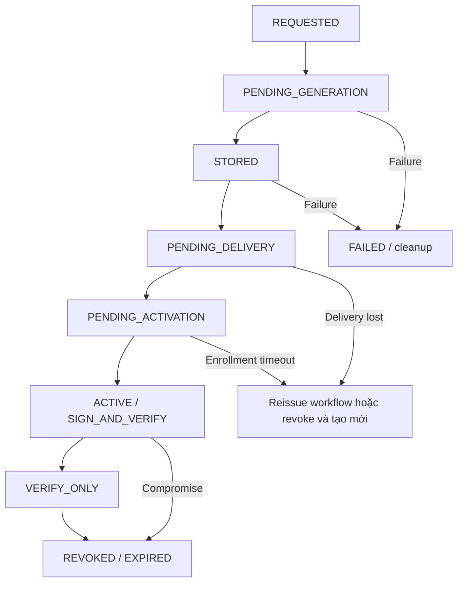
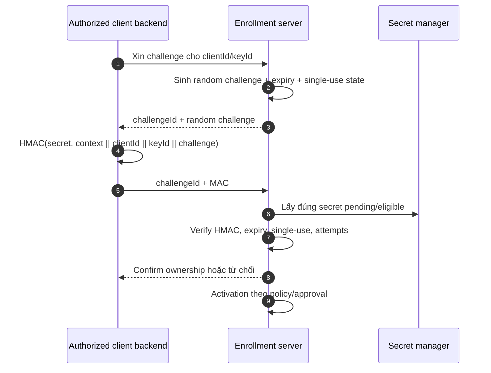
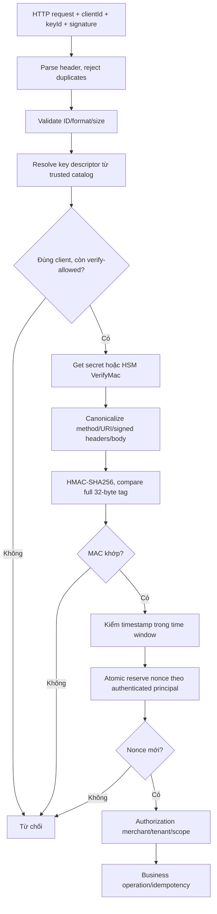

# Tạo credential

## 1. Credential là gì trong xác thực HMAC request?

Khi một đối tác gọi HTTP API bằng **HMAC request authentication**, hai bên cần một **credential** để liên kết danh tính client với khả năng tạo và xác minh chữ ký. Credential không chỉ là một chuỗi “API secret”: nó là một **bản ghi vòng đời** gồm client identity, key version, thuật toán, secret material hoặc secret reference, trạng thái và chính sách sử dụng.

Ví dụ một HTTP request từ client:

```http
POST /v1/payments?merchantId=m-42 HTTP/1.1
Host: api.example.test
Content-Type: application/json
X-Client-Id: client-42
X-Key-Id: k-demo-01
X-Timestamp: 1795856400
X-Nonce: AAAAAAAAAAAAAAAAAAAAAA
X-Signature: <base64-hmac-sha256>

{"orderId":"O-42","amount":250000,"currency":"VND"}
```

Đây là **test request**: timestamp và nonce cố định không phù hợp production, chữ ký ở đây là placeholder. Trong hệ thống thực, client gửi **client ID và key ID** để server chọn secret tương ứng, tự dựng canonical request từ HTTP method, URI, signed headers, body bytes rồi tính expected HMAC.

Bài **“Tạo credential”** thuộc chương **Credential lifecycle**, mô-đun **`SECURITY_AUTHENTICATION_HMAC_REQUEST_AUTHENTICATION`**. Mô-đun này thiết kế xác thực HTTP request bằng HMAC với shared secret và canonical request chứa phương thức, URI, header hoặc body; xác minh chữ ký, chống replay bằng timestamp/nonce, quản lý key rotation, kiểm thử proxy/gateway và phân biệt xác thực với phân quyền.

**Mục tiêu sau bài học:**

- Xác định đúng các thành phần của **HMAC credential** và phân biệt định danh công khai với key bí mật.
- Sinh **shared secret đủ entropy** bằng CSPRNG; sinh key ID có tính duy nhất và không dùng key ID làm secret.
- Tạo metadata và key material an toàn theo **một quy trình provisioning có trạng thái**.
- Thiết kế **lưu secret, cấp phát một lần, xác nhận sở hữu secret, kích hoạt, audit và khả năng rollback**.
- Dùng **Java 17** để tạo credential, encode/decode key bytes đúng định dạng, kiểm thử HMAC bằng golden vector.
- Xử lý client registration, tenant isolation, key rotation, revocation, lỗi giữa hai hệ thống lưu trữ và các cuộc đua khi tạo credential đồng thời.
- Phân biệt **credential creation**, **HMAC authentication**, **replay prevention**, **authorization** và **idempotency**.

**Quy tắc xuyên suốt:** việc tạo credential phải làm phát sinh **một năng lực xác thực có phạm vi rõ ràng**, không được tự cấp mọi quyền truy cập tài nguyên.

## 2. Những thành phần tạo nên một HMAC credential

Một credential của ví dụ **HMAC-SHA256-CREDENTIAL-V1** có thể được mô tả bằng:

| Thành phần | Ví dụ | Bí mật? | Vai trò |
| --- | --- | --- | --- |
| `principalId` | `partner-42` | Không phải secret; vẫn là metadata cần bảo vệ | Danh tính nội bộ sau xác thực |
| `clientId` | `client-42` | Không | ID do server đăng ký cho client |
| `keyId` | `k-2026-11-A` | Không | Chọn phiên bản khóa cho rotation |
| `algorithm` | `HmacSHA256` | Không | Thuật toán MAC cố định theo contract |
| `sharedSecret` | 32 random bytes | **Có** | Khóa HMAC đối xứng |
| `secretFormat` | `BASE64URL_NOPAD_256` | Không | Biểu diễn key khi cấp phát |
| `secretLocator` | `vault://hmac/client-42/...` | Reference, không phải raw key | Vị trí khóa được bảo vệ |
| `status` | `PENDING / ACTIVE / REVOKED` | Không | Trạng thái vòng đời |
| `verifyFrom` | thời điểm UTC | Không | Bắt đầu chấp nhận chữ ký |
| `verifyUntil` | thời điểm UTC | Không | Thời điểm hết quyền xác minh |
| `createdBy` | workload identity của provisioning service | Metadata nhạy cảm | Audit |
| `scopes` | `payments:create` | Không phải secret | Chính sách quyền, không tự được cấp bởi HMAC |

**Phân biệt hai loại dữ liệu:**

```text
Public / metadata:
  clientId, keyId, algorithm, lifecycle state, timestamps

Secret material:
  raw HMAC shared secret bytes

Operational identity:
  principalId, tenantId, scopes, key ownership
```

Attacker biết `clientId` và `keyId` thường **chưa thể tính HMAC** nếu không có secret. Nhưng nếu biết raw secret của client, attacker có thể tạo request với timestamp/nonce mới và signature hợp lệ cho đến khi credential bị vô hiệu.

### 2.1. Credential không đồng nghĩa với quyền truy cập

`client-42` có thể ký request hợp lệ đến:

```http
POST /v1/payments?merchantId=m-99 HTTP/1.1
```

HMAC hợp lệ chỉ xác thực **bên có secret của client-42**. Tầng authorization vẫn phải kiểm **client-42 có được tạo payment cho merchant m-99 không**. Không nên cấp `admin` hoặc mọi tenant resource chỉ vì provisioning tạo credential thành công.

### 2.2. Một client có thể có nhiều credential

Một client cần có thể dùng nhiều key versions trong rotation:

```text
client-42
  ├── k-2026-10 : VERIFY_ONLY
  └── k-2026-11 : ACTIVE

client-99
  └── k-2026-11 : ACTIVE (một key khác, cùng keyId text nếu policy cho phép)
```

Nếu key ID không unique toàn hệ thống, resolver phải tra bằng **tuple `(clientId, keyId)`**. Không bao giờ lấy một `keyId` trần từ HTTP rồi tự suy principal nếu nhiều clients có thể dùng cùng ID.

## 3. Threat model của việc tạo credential

Tạo credential là thao tác có quyền cao: nó có thể phát sinh key được một đối tác dùng để ký request mới.

| Rủi ro | Ví dụ | Kiểm soát quan trọng |
| --- | --- | --- |
| **Sinh secret yếu** | Timestamp hoặc `Random` được dùng làm key | CSPRNG và policy độ dài |
| **Client tự chọn secret đoán được** | `password123` hoặc tên merchant | Server-side generation/entropy policy |
| **Tạo credential cho sai tenant** | Admin API gắn nhầm principal | Authorization trên target client trước tạo |
| **Key ID collision** | Hai key records cùng `clientId,keyId` | Database unique constraint và retry generation |
| **Ghi secret vào logs** | Provisioning service in response/exception | Redaction, tránh log secret |
| **Để secret trong source/container image** | Hardcode `application.yml` | Secret manager và identity-based delivery |
| **Provisioning thành công một nửa** | Metadata ACTIVE nhưng key chưa được ghi | PENDING workflow và compensation |
| **Lộ secret khi chuyển cho client** | URL query, chat, ticket, email công khai | Kênh authenticated + TLS + one-time delivery |
| **Kích hoạt trước khi client nhận key** | Client ký sai, production downtime | Proof-of-possession/enrollment validation |
| **API tạo key thiếu kiểm quyền** | Caller tự tạo key cho client khác | RBAC/ABAC, approval và audit |
| **Rotation vô ý ghi đè key cũ** | Thay bytes nhưng giữ key ID | Immutable key material theo version |
| **Revoke không lan đến cache** | Một API pod tiếp tục nhận key cũ | Revocation propagation và cache invalidation |
| **Tạo nhiều credential khi retry request** | Provision endpoint trả timeout | Idempotency trên credential creation |
| **Một secret dùng chung nhiều client** | Lộ một client làm lộ cả hệ thống | Keyset tách riêng, hạn chế blast radius |

Trong thiết kế, phải quyết định **ai có quyền tạo**, **cho principal nào**, **secret xuất hiện ở đâu**, **sau lỗi trạng thái nào là thật** và **làm sao thu hồi**.

## 4. Hợp đồng tạo credential: đầu vào và kết quả

Một provisioning API chỉ nên nhận **metadata cần thiết**, không để caller tùy ý điền key material hoặc lifecycle state nếu không được ủy quyền.

Ví dụ request từ một operator có quyền quản trị client:

```http
POST /internal/clients/client-42/credentials HTTP/1.1
Content-Type: application/json
Authorization: <short-lived-admin-credential>
Idempotency-Key: provision-client-42-2026-11

{
  "algorithm": "HMAC-SHA256",
  "purpose": "HTTP_REQUEST_AUTH",
  "requestedActivation": "AFTER_PROOF_OF_POSSESSION"
}
```

Đây là **API nội bộ minh họa**, không phải endpoint được chuẩn HTTP định nghĩa. Caller **không tự chọn** secret, `principalId`, target secret store path hay trạng thái `ACTIVE` mà chưa qua policy.

Một response metadata sau khi tạo (không kèm secret qua endpoint đọc lại thông thường) có thể là:

```json
{
  "clientId": "client-42",
  "keyId": "k-JU9Tk9jv7N5aNpdB7k-7TA",
  "algorithm": "HmacSHA256",
  "secretFormat": "BASE64URL_NOPAD_256",
  "status": "PENDING_DELIVERY",
  "deliveryMethod": "ONE_TIME_PROTECTED_CHANNEL"
}
```

Key ID ở đây là **một ví dụ**, không phải kết quả do thuật toán trong code bên dưới đảm bảo. Trong triển khai thật, ID phải phù hợp grammar đã công bố.

### 4.1. Không trả secret trong GET/list API

`GET /clients/client-42/credentials` nên chỉ trả **key ID, state, validity, owner và audit metadata**, không trả raw secret hoặc Base64 secret.

Khi cần client nhận secret, dùng **luồng delivery riêng, có xác thực và thời hạn**, và tránh lưu plaintext trong response cache, browser history, URL query hay debug log. Cần có cách giải quyết trường hợp response chứa secret bị mất giữa đường.

### 4.2. Creation và activation là hai mốc khác nhau

Một credential **đã tạo trong kho** chưa chắc **đã được phép xác minh**:

```text
requested -> generated -> stored -> delivered -> confirmed -> ACTIVE
```

Nếu activation xảy ra trước khi recipient nhận key, client có thể không dùng được API và operator khó biết sai ở bước nào.

Khi cần bảo đảm đăng ký an toàn, có thể yêu cầu client thực hiện **proof-of-possession** với một challenge mới trước khi chuyển trạng thái ACTIVE. Phần sau sẽ làm rõ giới hạn của bước này.

## 5. State machine của vòng đời credential khi mới tạo

Không nên chỉ có boolean `enabled=true/false`. Có các trạng thái mô tả rõ tiến trình provisioning và khả năng ký/xác minh:



Định nghĩa trạng thái minh họa:

| State | Có secret ở storage? | Client được ký request nghiệp vụ? | Server verify request nghiệp vụ? |
| --- | --- | --- | --- |
| `REQUESTED` | Chưa chắc | Không | Không |
| `PENDING_GENERATION` | Chưa/đang tạo | Không | Không |
| `STORED` | Có | Không | Không |
| `PENDING_DELIVERY` | Có | Chưa | Không |
| `PENDING_ACTIVATION` | Có, client có thể đã nhận | Chỉ proof-of-possession theo flow | Không, trừ enrollment endpoint |
| `ACTIVE` | Có | Có | Có |
| `VERIFY_ONLY` | Có | Theo policy client phải ngừng ký mới | Có trong grace window |
| `REVOKED / EXPIRED` | Có thể còn trong backup theo retention | Không | Không |
| `FAILED` | Có thể cần cleanup orphan | Không | Không |

**VERIFY_ONLY là policy server**: server khó chứng minh client đã xóa secret cũ. Nó chỉ quyết định verifier còn nhận những chữ ký đó trong thời hạn hay không.

### 5.1. Mọi chuyển trạng thái cần có kiểm soát

Các transition phải yêu cầu **caller identity và quyền phù hợp**. Ví dụ:

- `REQUESTED → STORED`: provisioning workload được quyền tạo key và ghi secret.
- `PENDING_ACTIVATION → ACTIVE`: sau kiểm enrollment/challenge + approval tùy môi trường.
- `ACTIVE → VERIFY_ONLY`: rotation có kế hoạch.
- `ACTIVE / VERIFY_ONLY → REVOKED`: incident response và policy thu hồi.
- `REVOKED → ACTIVE`: thông thường **không cho tự động hồi sinh** key đã bị thu hồi do compromise.

Nếu hệ thống dùng audit logs, cần ghi **ai thực hiện, thời điểm, lý do và key ID**, không ghi secret.

## 6. Sinh shared secret bằng CSPRNG

Với `HmacSHA256`, lựa chọn đơn giản cho một hệ thống mới là **32 byte ngẫu nhiên mật mã** (256 bit). Secret này là **dãy byte**, không phải một password đáng nhớ.

```text
SecureRandom.nextBytes(byte[32])
          |
          +--> raw key bytes cho HmacSHA256
          |
          +--> Base64URL no-padding (43 chars) để delivery/storage text
```

Không tạo key như:

```java
// BAD: entropy thấp, dễ đoán hoặc không dùng CSPRNG.
String secret = "my-company-hmac-key";
String secret2 = clientId + "-" + System.currentTimeMillis();
byte[] secret3 = Long.toString(System.nanoTime())
        .getBytes(java.nio.charset.StandardCharsets.US_ASCII);
```

Không dùng `Math.random()` hoặc `java.util.Random` để sinh shared secret. Dùng `java.security.SecureRandom`, hoặc nguồn sinh key tương đương trong HSM/KMS có đặc tính CSPRNG phù hợp.

### 6.1. Vì sao key dài 32 byte?

HMAC-SHA-256 tạo **full tag dài 32 byte**. Dùng khóa ngẫu nhiên 32 byte là baseline dễ triển khai và cho entropy cao. Nhưng **độ dài tag không phải lúc nào cũng bằng độ dài key**: không lấy `key.length` làm tag length. Full HMAC-SHA-256 tag vẫn 32 byte dù key material có độ dài khác theo policy.

Một chuỗi dài nhưng entropy thấp, chẳng hạn tên công ty + năm, **không tương đương** 32 byte sinh từ CSPRNG.

### 6.2. Base64URL là encoding, không phải bảo vệ bí mật

Một ví dụ raw key **công khai chỉ dùng trong bài học**:

```text
Hex (32 bytes):
00112233445566778899aabbccddeeff00112233445566778899aabbccddeeff

Base64URL, no padding (43 chars):
ABEiM0RVZneImaq7zN3u_wARIjNEVWZ3iJmqu8zd7v8
```

Cùng một key có thể biểu diễn bằng hex hoặc Base64URL. **Bất cứ ai đọc được text encoded đều giải mã được raw key**; không thể gọi Base64 là encryption hoặc hashing.

Ví dụ lỗi phổ biến:

```java
String encoded = "ABEiM0RVZneImaq7zN3u_wARIjNEVWZ3iJmqu8zd7v8";

// SAI: 43 UTF-8 bytes từ text Base64URL.
byte[] wrong = encoded.getBytes(
        java.nio.charset.StandardCharsets.UTF_8);

// ĐÚNG: 32 raw bytes từ Base64URL decoder.
byte[] rawKey = java.util.Base64.getUrlDecoder().decode(encoded);
```

Hai cách trên tạo **hai HMAC keys khác nhau**, dẫn tới chữ ký client/server không khớp.

## 7. Sinh key ID và client ID đúng vai trò

**Client ID** định danh caller đã đăng ký; **key ID** định danh version của key. Cả hai thường **không bí mật**, vì request HMAC phải gửi chúng để verifier tra key.

### 7.1. Client ID nên được cấp khi đăng ký principal

Trong ví dụ, `client-42` là định danh do hệ thống cấp cho một client đã được onboarding và phân quyền. Tạo credential mới **không đồng nghĩa tự sinh một principal mới** nếu người quản trị đang thêm key cho một client hiện hữu.

Server phải kiểm tra:

- Target client thực sự tồn tại, đang được phép nhận key.
- Caller có quyền **tạo key cho đúng client/tenant**.
- Giới hạn số key đang active/pending trên một client.
- Có approval policy khi tạo credential production.
- Không cho attacker tự gán `clientId=admin` để chiếm danh tính.

### 7.2. Key ID có thể công khai nhưng phải tránh collision

Một thiết kế là key ID **opaque** gồm 16 byte ngẫu nhiên được Base64URL no-padding thành 22 ký tự, thêm tiền tố version `k-`:

```text
k-<22 base64url characters>
```

Key ID **không phải secret** và không thay thế HMAC. Lợi ích của random ID là khó va chạm, không tiết lộ lượng khách hàng và không phải dựa vào timestamp để đặt tên. Nhưng vẫn phải có **unique constraint** ở catalog; không bao giờ chỉ tin “xác suất collision thấp nên khỏi kiểm”.

Nếu hệ thống dùng key ID dạng `k-2026-11` cũng được, miễn namespace, tính duy nhất và cách lookup được quy định rõ; ID dễ đoán **không làm lộ secret** nếu hệ thống quản lý quyền đúng.

## 8. Quy trình provisioning có trạng thái và transaction boundary

Điểm khó không nằm ở một lời gọi `SecureRandom.nextBytes`, mà ở việc ghi **metadata database**, **secret store** và **delivery state** sao cho không xuất hiện credential **ACTIVE nhưng không có secret** hoặc secret bị bỏ rơi không kiểm soát.

```mermaid
sequenceDiagram
    autonumber
    participant O as Authorized operator / onboarding
    participant P as Provisioning service
    participant DB as Key catalog DB
    participant V as Secret manager
    participant C as Client secure channel
    O->>P: Tạo credential cho client-42
    P->>P: AuthZ target client; validate policy
    P->>DB: Insert PENDING record, unique clientId/keyId
    DB-->>P: Claim thành công
    P->>P: Sinh raw key 32 byte CSPRNG
    P->>V: Store key tại trusted secret locator
    V-->>P: Secret reference / version
    P->>DB: Mark STORED/PENDING_DELIVERY
    P->>C: Delivery secret qua kênh được xác thực
    C-->>P: Enrollment proof-of-possession
    P->>DB: Mark ACTIVE nếu policy cho phép
    P-->>O: keyId + state, không log secret
```

### 8.1. Tại sao không thể dùng một transaction SQL cho toàn bộ các bước?

Database và secret manager thường **không cùng một transaction coordinator**. Nếu sau khi ghi catalog PENDING nhưng trước khi ghi secret manager hệ thống crash, record còn tồn tại nhưng key chưa sẵn sàng.

Nếu secret manager ghi thành công nhưng cập nhật catalog thất bại, sẽ có **orphan secret** cần cleanup.

Giải pháp thực tế:

1. Catalog tạo record `PENDING` **không verify được**.
2. Ghi secret với một **locator do server định nghĩa**, không do HTTP client gửi tùy ý.
3. Cập nhật `STORED/PENDING_DELIVERY` khi xác nhận secret material tồn tại.
4. Delivery và activation theo workflow riêng.
5. Có **reconciliation job** đọc state PENDING quá lâu, kiểm artifact, retry bước idempotent hoặc cleanup/revoke.
6. **Không bao giờ** coi lỗi catalog/store là thành công và tự bật ACTIVE.

### 8.2. Retry provisioning endpoint có idempotency riêng

Nếu caller gọi `POST /internal/clients/client-42/credentials` rồi kết nối đứt sau khi hệ thống đã tạo key, caller không biết đã tạo chưa. Nếu retry vô hạn mà mỗi lần sinh key mới, một client có thể nhận hàng chục credentials.

Cần một **provisioning operation ID / idempotency key** ổn định và một record durable để retry tra trạng thái của **cùng operation**, không tự tạo key mới. Nhưng **đừng replay raw secret trong response của một GET/status API thông thường**.

Vấn đề delivery khi response thất lạc cần chính sách riêng: **one-time escrow với thời hạn, authenticated re-delivery** nếu còn an toàn, hoặc revoke credential đó và tạo credential mới. Không hứa “đảm bảo client đã thấy secret đúng một lần” chỉ nhờ flag `delivered=true` ở server.

### 8.3. Dùng unique constraint và optimistic state transitions

Ví dụ schema minh họa:

```sql
CREATE TABLE hmac_credential_catalog (
    client_id            VARCHAR(100) NOT NULL,
    key_id               VARCHAR(100) NOT NULL,
    principal_id          VARCHAR(100) NOT NULL,
    algorithm             VARCHAR(30)  NOT NULL,
    state                 VARCHAR(40)  NOT NULL,
    secret_locator        VARCHAR(500),
    verify_from           TIMESTAMP,
    verify_until          TIMESTAMP,
    created_at            TIMESTAMP NOT NULL,
    version               BIGINT NOT NULL,
    PRIMARY KEY (client_id, key_id)
);
```

**Lưu ý:** đây là schema khái niệm, chưa chỉ định SQL dialect, migration, timezone column, KMS encryption policy hay transaction isolation của một database thật.

Một cập nhật trạng thái nên có điều kiện, ví dụ:

```sql
UPDATE hmac_credential_catalog
SET state = 'PENDING_DELIVERY',
    version = version + 1
WHERE client_id = :client_id
  AND key_id = :key_id
  AND state = 'STORED'
  AND version = :expected_version;
```

Nếu số row updated bằng 0, worker không được mặc nhiên ghi đè state hiện tại. Có thể credential đã bị revoke trong lúc onboarding; retry phải **đọc lại và reconcile** trước khi tiếp tục.

## 9. Bảo vệ secret khi lưu: Vault/KMS/HSM/file/env

Nơi lưu phụ thuộc kiến trúc, nhưng cần **bảo vệ confidentiality, identity, audit và lifecycle**.

| Phương án | Khi phù hợp | Điểm cần review |
| --- | --- | --- |
| **Secret manager/Vault** | Production cần per-client keys, audit, rotation | IAM, scoped locator, encryption at rest, policy, cache |
| **KMS/HSM có MAC API** | Muốn giảm raw key trong application memory | MAC algorithm support, provisioning/import, quota, latency |
| **Database envelope-encrypted** | Catalog/secret cùng domain nhưng muốn tách key encryption | DEK/KEK, IAM decrypt, audit/backup/recovery |
| **Protected file mount** | Workload nhận secret qua agent/CSI/file delivery | OS permissions, rotation propagation, cleanup |
| **Environment variable** | Bootstrap/development hoặc platform delivery phù hợp policy | Process inspection/logging/dumps/child inheritance |
| **Kubernetes Secret** | Cluster có RBAC/secret encryption/sync policy | Base64 không phải encryption, bảo vệ etcd và service account |
| **Hardcode trong repository/image** | **Không phù hợp production** | Git history, image layers và artifact leakage |

Khi dùng **KMS/HSM non-exportable key**, cần giải thích **client lấy cùng secret bằng cách nào**. Nếu key được server tạo trong HSM rồi không thể export, một client ở bên ngoài **không tự biết** secret để HMAC ký. Có thể có quy trình import cùng key đã được provision an toàn, hoặc chọn mô hình khác được provider hỗ trợ.

Một HSM có thể **tính/verify MAC** mà không xuất raw key cho JVM; nhưng không phải mọi KMS/HSM API đều cung cấp HMAC cho mọi thuật toán/loại key. Phải kiểm năng lực và chính sách của dịch vụ cụ thể.

### 9.1. Lưu Base64 secret không phải là mã hóa

```yaml
# Chỉ là minh họa cấu trúc; không commit secret production.
hmac:
  key-id: k-demo-01
  key-format: BASE64URL_NOPAD_256
  secret: ABEiM0RVZneImaq7zN3u_wARIjNEVWZ3iJmqu8zd7v8
```

Giá trị ở đây là **test key công khai**. Với production, người đọc được một chuỗi Base64 secret là người biết raw bytes. Không coi `data:` Base64 trong Kubernetes Secret hay một trường JSON encoded là đủ để bảo vệ bí mật.

### 9.2. Quyền truy cập tối thiểu

- **Provisioning service** có quyền tạo secret cho clients được ủy quyền.
- **HMAC verifier workload** có quyền đọc/dùng secret cần để xác minh theo tenant.
- **Client backend** chỉ nhận secret của chính mình.
- **Analytics/support/UI** không được có quyền export raw secret.
- **CI tests** dùng test keys công khai, không dùng production credentials.
- **Emergency operator** có quyền revoke theo policy và audit; không dùng shared admin password.

Không để raw `clientId/keyId` tự trở thành secret manager path. Dùng key catalog server-side đáng tin để ánh xạ đến locator theo quyền.

## 10. Delivery: làm sao cấp secret cho đối tác an toàn?

Secret dùng trong HMAC phải đến được **sender** và **verifier**. Với client bên ngoài, đây là một **trust boundary nhạy cảm**.

### 10.1. Phương án cấp phát

Một quy trình thường gặp:

1. Admin onboarding xác minh danh tính/ủy quyền của đối tác.
2. Provisioning service tạo key và lưu vào secret manager.
3. Client nhận **key ID + secret** qua một kênh xác thực, mã hóa vận chuyển, có expiry/one-time semantics phù hợp.
4. Client lưu key vào **secret store phía client**, không trong source, frontend JavaScript hoặc mobile public binary.
5. Client xác nhận có thể tạo HMAC với challenge enrollment hoặc một request kiểm thử.
6. Server chuyển credential sang `ACTIVE` sau khi đáp ứng đầy đủ policy.

### 10.2. Không gửi raw key qua query URL, email/chat công khai

Những kênh dễ rò rỉ:

```text
# BAD: secret đi trong query URL -> browser/proxy access logs.
https://api.example.test/credentials?secret=PRODUCTION_SECRET

# BAD: CLI args có thể xuất hiện trong process list/history.
java -Dhmac.secret=PRODUCTION_SECRET -jar app.jar
```

Nên tránh log response chứa secret, không cache response nhạy cảm và không xuất key vào telemetry/tracing. Nếu hệ thống cho phép xem secret một lần qua portal, yêu cầu reauthentication/MFA nếu policy phù hợp, short-lived session, server-side authorization và cơ chế bảo vệ khỏi browser/storage leakage.

### 10.3. “Hiển thị một lần” có giới hạn gì?

Một UI chỉ render secret **một lần** không chứng minh không có bản sao:

- Secret có thể đã tồn tại trong memory, network intermediary, browser devtools.
- Response có thể bị mất sau khi backend đã đánh dấu `delivered`.
- Client có thể copy vào password manager hoặc secret store, đây là hành vi mong muốn khi được phép.
- Support agent có thể cần quy trình xử lý **mất secret** mà không cho xem lại tùy tiện.

Nếu đối tác mất key, policy an toàn có thể là **revoke key chưa kích hoạt và cấp key mới**, thay vì thêm một endpoint `GET /secret` không giới hạn thời gian.

## 11. Enrollment proof-of-possession: chứng minh client thực sự có key

Khi secret được provision, server có thể kiểm client **sở hữu đúng bytes** trước khi kích hoạt quyền gửi request nghiệp vụ.

Một flow đơn giản:



Một message dùng trong challenge có thể là:

```text
HMAC-ENROLLMENT-V1
client-id:client-42
key-id:k-demo-01
challenge-id:<server-issued-id>
challenge:<base64url-random-bytes>
```

**Chú ý:** Đây là **giao thức enrollment riêng**, không phải canonical HTTP payment request. Nó cần ràng buộc challenge với client/key, random challenge đủ entropy, TTL ngắn, số lần thử giới hạn, single-use/atomic consumption và rate limiting.

### 11.1. Proof-of-possession chứng minh điều gì?

Nó chứng minh bên trả lời **có khả năng dùng secret** được liên kết với key ID. Nó **không chứng minh**:

- Secret chưa bị một attacker khác biết.
- Client có quyền với mọi merchant/resource.
- Tất cả các future requests sẽ không bị replay.
- Credential đã được lưu an toàn phía client.
- Server có thể bỏ qua TLS hoặc identity verification lúc cấp key.

Nếu secret vừa bị leak, attacker cũng có thể tạo enrollment MAC. Vì vậy proof-of-possession chỉ là **một bước** trong vòng đời credential.

### 11.2. Không kích hoạt chỉ vì đã gọi endpoint

Sai:

```text
POST /credentials/enroll
-> mark ACTIVE ngay khi nhận request
```

Đúng hơn: validate authenticated client identity, challenge freshness/one-time state, HMAC expected với pending key, compare full tag, check policy và **thực hiện chuyển trạng thái có điều kiện**.

## 12. Java 17: sinh credential ID và 32-byte secret

Ví dụ dưới đây chỉ thực hiện **generation**, chưa lưu secret vào database hay Vault. Nó dùng một `SecureRandom` và trả một đối tượng sở hữu raw bytes, có khả năng close để best-effort clear.

```java
import java.security.SecureRandom;
import java.util.Arrays;
import java.util.Base64;
import java.util.Objects;

public final class HmacCredentialGeneratorV1 {
    private static final SecureRandom RNG = new SecureRandom();

    private HmacCredentialGeneratorV1() {}

    public static final class Generated
            implements AutoCloseable {

        private final String clientId;
        private final String keyId;
        private byte[] rawSecret;

        private Generated(String clientId, String keyId,
                          byte[] rawSecret) {
            this.clientId = clientId;
            this.keyId = keyId;
            this.rawSecret = rawSecret.clone();
        }

        public String clientId() { return clientId; }
        public String keyId() { return keyId; }

        // Caller nhận một copy mới, phải zeroize sau khi dùng.
        public synchronized byte[] copyRawSecret() {
            if (rawSecret == null) {
                throw new IllegalStateException(
                        "Credential material closed");
            }
            return rawSecret.clone();
        }

        // Chỉ dùng để chuyển qua provisioning/delivery
        // channel bảo vệ; không log hoặc cache kết quả.
        public synchronized String exportBase64Url() {
            if (rawSecret == null) {
                throw new IllegalStateException(
                        "Credential material closed");
            }
            return Base64.getUrlEncoder()
                    .withoutPadding().encodeToString(rawSecret);
        }

        @Override
        public synchronized void close() {
            if (rawSecret != null) {
                Arrays.fill(rawSecret, (byte) 0);
                rawSecret = null;
            }
        }
    }

    public static Generated generate(String clientId) {
        Objects.requireNonNull(clientId, "clientId");
        if (!clientId.matches("[A-Za-z0-9._-]{1,80}")) {
            throw new IllegalArgumentException(
                    "Invalid registered client ID");
        }

        byte[] keyIdBytes = new byte[16];
        byte[] secretBytes = new byte[32];

        try {
            RNG.nextBytes(keyIdBytes);
            RNG.nextBytes(secretBytes);
            String keyId = "k-" + Base64.getUrlEncoder()
                    .withoutPadding().encodeToString(keyIdBytes);

            return new Generated(clientId, keyId, secretBytes);
        } finally {
            Arrays.fill(keyIdBytes, (byte) 0);
            Arrays.fill(secretBytes, (byte) 0);
        }
    }
}
```

### 12.1. Cách dùng an toàn hơn trong provisioning

```java
import java.util.Arrays;

try (var generated =
        HmacCredentialGeneratorV1.generate("client-42")) {

    byte[] raw = generated.copyRawSecret();
    try {
        // Nội dung là pseudocode adapter:
        // secretStore.putNewImmutableKey(trustedLocator, raw);
        // catalog ghi trạng thái PENDING, không ACTIVE ngay.
        storeInTrustedSecretManager(
                generated.clientId(),
                generated.keyId(),
                raw);
    } finally {
        Arrays.fill(raw, (byte) 0);
    }

    // Nếu delivery contract cần Base64URL, chỉ export qua
    // secure-delivery sink, không in ra console hay logs.
}
```

Code dùng `storeInTrustedSecretManager` để minh họa adapter, **chưa định nghĩa implementation**. Nó không phải một ứng dụng triển khai hoàn chỉnh; dữ liệu production cần kết nối secret manager và catalog thật.

### 12.2. Những giới hạn cần hiểu

- `Generated` không đảm bảo secret chỉ có một bản sao: `clone`, `SecretKeySpec`, provider và JVM có thể tạo thêm bản copy.
- `Arrays.fill` chỉ là **best-effort memory hygiene**, không bảo đảm xóa mọi vùng nhớ, heap dump hoặc swap.
- `String` trả về từ `exportBase64Url` là immutable; JVM không cam kết zeroize string.
- Key ID 16-byte random gần như không va chạm trong vận hành bình thường, nhưng **database unique constraint** vẫn bắt buộc.
- Không nên dùng generator này cho **front-end browser** hay mobile public binary chứa shared secret production; nên ký request ở backend tin cậy.
- **Không** gọi generator mỗi lần ứng dụng gửi HTTP request. Nó tạo **credential mới cho onboarding/rotation**, còn request bình thường dùng credential đã provision và sinh **timestamp/nonce mới**.

## 13. Java 17: codec Base64URL strict cho secret provisioning

Hợp đồng của bài chọn `BASE64URL_NOPAD_256`: **32 raw bytes** ↔ **43 ASCII chars**, không padding.

```java
import java.util.Base64;
import java.util.regex.Pattern;

public final class CredentialSecretCodecV1 {
    private static final Pattern B64URL =
            Pattern.compile("[A-Za-z0-9_-]{43}");

    private CredentialSecretCodecV1() {}

    public static byte[] decode32(String encoded) {
        if (encoded == null
                || !B64URL.matcher(encoded).matches()) {
            throw new IllegalArgumentException(
                    "Invalid encoded HMAC secret");
        }

        byte[] decoded;
        try {
            decoded = Base64.getUrlDecoder().decode(encoded);
        } catch (IllegalArgumentException invalid) {
            throw new IllegalArgumentException(
                    "Invalid encoded HMAC secret", invalid);
        }

        if (decoded.length != 32
                || !Base64.getUrlEncoder().withoutPadding()
                        .encodeToString(decoded).equals(encoded)) {
            java.util.Arrays.fill(decoded, (byte) 0);
            throw new IllegalArgumentException(
                    "Noncanonical HMAC secret");
        }
        return decoded;
    }
}
```

**Đừng tự đoán encoding** bằng cách thử lần lượt hex, Base64 Basic, Base64URL và UTF-8 literal. Nếu profile đã chốt, input sai encoding phải được từ chối thay vì bí mật được hiểu theo những cách khác nhau ở client và verifier.

### 13.1. Noncanonical pad bits

Một số Base64 decoder có thể chấp nhận các chuỗi có **pad bits không chính tắc** hoặc bỏ padding. Re-encode equality giúp bảo đảm một **biểu diễn duy nhất** cho cùng raw bytes.

Đó là kiểm định **format**, không phải cơ chế bảo vệ bí mật. Dù encoding chính tắc, bất kỳ ai có chuỗi Base64 production vẫn có thể giải mã ra secret.

## 14. Java 17: contract provisioning với key catalog và secret store

Generation chỉ là bước đầu; hệ thống phải thực hiện **registration dưới các transaction boundary**.

Ví dụ các interface:

```java
import java.time.Instant;
import java.util.Optional;

public final class CredentialProvisioningContracts {
    private CredentialProvisioningContracts() {}

    public enum State {
        PENDING, STORED, PENDING_DELIVERY,
        PENDING_ACTIVATION, ACTIVE,
        VERIFY_ONLY, REVOKED, FAILED
    }

    public record Descriptor(
            String clientId,
            String principalId,
            String keyId,
            String algorithm,
            String trustedSecretLocator,
            State state,
            Instant createdAt,
            long version) {}

    public interface CredentialCatalog {
        // Atomic claim dưới unique(clientId,keyId).
        // Operation-level idempotency cần implement riêng.
        boolean insertPending(Descriptor descriptor);

        // CAS: chỉ chuyển nếu state/version đúng.
        boolean compareAndSetState(
                String clientId, String keyId,
                State expectedState, long expectedVersion,
                State newState);

        Optional<Descriptor> find(
                String clientId, String keyId);
    }

    @FunctionalInterface
    public interface SecretStore {
        // Đường dẫn phải sinh từ server-side trusted catalog,
        // không dùng arbitrary URL client gửi.
        void putNewImmutable(String trustedLocator, byte[] rawKey);
    }

    public interface DeliveryChannel {
        // Authenticated encrypted delivery; cấm log secret.
        // Kết quả uncertain phải có reconciliation protocol.
        void deliverOnce(
                String clientId, String keyId,
                byte[] ownedRawKey);
    }
}
```

### 14.1. Vì sao không thể “đơn giản hóa” bằng một hàm save?

Sai về mặt logic:

```java
catalog.insertActive(clientId, keyId);
store.put(secret); // Nếu store lỗi, catalog đã ACTIVE.
deliver(secret);   // Nếu delivery lỗi, client không có key.
```

Một workflow đáng tin phải có **PENDING**, idempotent steps, state transition có điều kiện, cách retry/cleanup, audit và không bắt đầu xác minh production trước khi key có thể dùng đúng.

### 14.2. Tách quyền tạo credential và quyền đọc raw secret

Nhiều hệ thống cho phép một service **đăng ký yêu cầu tạo** nhưng không cho service đó tự đọc mọi production secret. Provisioning workflow có thể chạy bằng một workload identity riêng có quyền ghi/đọc có giới hạn, rồi secret delivery được kiểm soát theo tenant.

Nếu người vận hành cần revoke key, họ không nhất thiết cần xem raw key. RBAC nên tách **create, activate, rotate, revoke, inspect metadata và export material**.

## 15. Kích hoạt credential và gắn với canonical request

Sau khi credential ACTIVE, client dùng secret để ký một HTTP request thật.

Ví dụ contract **HMAC-CREDENTIAL-V1** dùng những dòng:

```text
HMAC-CREDENTIAL-V1
POST
/v1/payments
merchantId=m-42
content-type:application/json
client-id:client-42
key-id:k-demo-01
x-timestamp:1795856400
x-nonce:AAAAAAAAAAAAAAAAAAAAAA
<lowercase-hex-SHA256-of-raw-body>
```

Canonical request trên gồm **10 dòng**, phân cách bởi LF, **không có LF cuối**. Trong triển khai thật, các trường phải được dựng từ method, path, query, headers và body bytes **thực nhận** theo hợp đồng; không dùng một chuỗi hardcode cho mọi endpoint.

### 15.1. Vì sao ký cả clientId và keyId?

Client gửi `clientId/keyId` trước khi HMAC verification để server tìm secret ứng viên. Hai giá trị ấy **chưa được tin cậy**. Đưa chúng vào canonical bytes giúp bảo vệ **metadata chọn khóa và identity** khỏi bị thay sau khi client ký.

Nếu attacker đổi `X-Key-Id` từ `k-demo-01` sang `k-demo-02` nhưng giữ signature cũ, một verifier đúng phải **từ chối** nếu key resolver hoặc canonical/HMAC không còn khớp.

### 15.2. HMAC tạo bằng secret, không truyền secret

```text
canonicalBytes = UTF8(version || method || target || signed headers ||
                      SHA-256(raw request body bytes))

expectedTag = HMAC-SHA-256(rawSharedSecret, canonicalBytes)
wireSignature = Base64.Basic.Padded(expectedTag)
```

Client chỉ gửi `wireSignature`, key ID, timestamp, nonce và request payload. Shared secret được provision từ trước, không xuất hiện trong HTTP headers, query hay body.

## 16. Golden vector độc lập: credential bytes và chữ ký HMAC

Golden vector cho phép kiểm tra cả **key material encoding**, **canonicalization** và **HMAC output**. Các giá trị sau là **test-only**, công khai, tuyệt đối không dùng làm credential production.

Key:

```text
Secret raw bytes, hex (32 bytes):
00112233445566778899aabbccddeeff00112233445566778899aabbccddeeff

Secret Base64URL no-padding (43 chars):
ABEiM0RVZneImaq7zN3u_wARIjNEVWZ3iJmqu8zd7v8
```

HTTP body chính xác, **51 byte UTF-8 không có newline cuối**:

```json
{"orderId":"O-42","amount":250000,"currency":"VND"}
```

SHA-256 của body, lowercase hex:

```text
ea646bb8b1903a83256034142a633e90ffad35b3a40bb4c5f0e8f1eb4f4f27f9
```

Canonical request **10 dòng**, **238 byte UTF-8**, không có LF cuối:

```text
HMAC-CREDENTIAL-V1
POST
/v1/payments
merchantId=m-42
content-type:application/json
client-id:client-42
key-id:k-demo-01
x-timestamp:1795856400
x-nonce:AAAAAAAAAAAAAAAAAAAAAA
ea646bb8b1903a83256034142a633e90ffad35b3a40bb4c5f0e8f1eb4f4f27f9
```

Kết quả HMAC-SHA-256 đầy đủ 32 byte:

```text
Expected tag, lowercase hex:
8db8bd29d4ae9216f043cc18ff6fe7e86282673aa682ae21178355a1cb7c69cb

Expected Base64 Basic padded (44 chars):
jbi9KdSukhbwQ8wY/2/n6GKCZzqmgq4hF4NVoct8acs=
```

**Thử thay chỉ key ID** thành `k-demo-02` trong canonical request, vẫn dùng **cùng test secret** để cô lập ảnh hưởng của signed metadata:

```text
key-id:k-demo-02

Expected new tag Base64:
ATNYttFEwZbEExtm5UBA1pWDyTo6u8k4wkOY5EvPjPo=
```

Hai tags khác nhau. Trong hệ thống thật, key ID khác còn thường trỏ đến **secret khác**, nên resolver phải áp dụng cả key ownership và status policy.

**Chú ý:** việc dùng **cùng secret cho hai key ID** trong phép so kiểm này chỉ để minh họa rằng `keyId` phải nằm trong canonical input. Khi provisioning production, mỗi key version nên có key material riêng và không “alias” nhiều key ID đến cùng raw secret nếu không có lý do đã được đánh giá.

## 17. Java 17 + JUnit 5: kiểm thử key generation, codec và golden HMAC

Ví dụ dưới đây kiểm key material của fixture và tính HMAC bằng JCA. Unit test không chứa secret production và không cần truy cập Vault thật.

### 17.1. Test key format và generation

```java
import static org.junit.jupiter.api.Assertions.*;
import java.util.Arrays;
import org.junit.jupiter.api.Test;

class HmacCredentialGeneratorV1Test {
    private static final String TEST_KEY =
            "ABEiM0RVZneImaq7zN3u_wARIjNEVWZ3iJmqu8zd7v8";

    @Test
    void fixtureDecodesIntoExactly32RawBytes() {
        byte[] key = CredentialSecretCodecV1.decode32(TEST_KEY);
        try {
            assertEquals(32, key.length);
        } finally {
            Arrays.fill(key, (byte) 0);
        }
    }

    @Test
    void createsDistinctOpaqueIdsAndRandomKeys() {
        try (var first =
                HmacCredentialGeneratorV1.generate("client-42");
             var second =
                HmacCredentialGeneratorV1.generate("client-42")) {

            assertTrue(first.keyId().matches(
                    "k-[A-Za-z0-9_-]{22}"));
            assertTrue(second.keyId().matches(
                    "k-[A-Za-z0-9_-]{22}"));

            byte[] a = first.copyRawSecret();
            byte[] b = second.copyRawSecret();
            try {
                assertEquals(32, a.length);
                assertEquals(32, b.length);

                // Probabilistic sanity check, không phải
                // chứng minh chất lượng entropy/CSPRNG.
                assertFalse(Arrays.equals(a, b));
                assertNotEquals(first.keyId(), second.keyId());
            } finally {
                Arrays.fill(a, (byte) 0);
                Arrays.fill(b, (byte) 0);
            }
        }
    }

    @Test
    void rejectsMalformedEncodedSecret() {
        assertThrows(IllegalArgumentException.class,
                () -> CredentialSecretCodecV1.decode32(
                        TEST_KEY + "="));
        assertThrows(IllegalArgumentException.class,
                () -> CredentialSecretCodecV1.decode32(
                        "short"));
        assertThrows(IllegalArgumentException.class,
                () -> CredentialSecretCodecV1.decode32(
                        TEST_KEY + "\n"));
    }
}
```

**Giới hạn:** hai key ngẫu nhiên tình cờ bằng nhau về toán học là cực kỳ khó, nhưng assertion `assertFalse(Arrays.equals(a,b))` không phải chứng minh entropy đúng 256 bit. Chất lượng randomness phụ thuộc CSPRNG, nền tảng và provisioning controls.

### 17.2. Test HMAC khớp golden vector đã tính độc lập

```java
import static org.junit.jupiter.api.Assertions.*;
import java.nio.charset.StandardCharsets;
import java.security.MessageDigest;
import java.util.Arrays;
import java.util.Base64;
import java.util.HexFormat;
import javax.crypto.Mac;
import javax.crypto.spec.SecretKeySpec;
import org.junit.jupiter.api.Test;

class CredentialHmacGoldenVectorTest {
    private static final String TEST_KEY =
            "ABEiM0RVZneImaq7zN3u_wARIjNEVWZ3iJmqu8zd7v8";

    private static String canonical(String keyId, String hash) {
        return String.join("\n",
                "HMAC-CREDENTIAL-V1",
                "POST",
                "/v1/payments",
                "merchantId=m-42",
                "content-type:application/json",
                "client-id:client-42",
                "key-id:" + keyId,
                "x-timestamp:1795856400",
                "x-nonce:AAAAAAAAAAAAAAAAAAAAAA",
                hash);
    }

    @Test
    void exactSecretBytesProduceExpectedTag() throws Exception {
        byte[] key = CredentialSecretCodecV1.decode32(TEST_KEY);
        byte[] body = (
                "{\"orderId\":\"O-42\",\"amount\":250000,"
              + "\"currency\":\"VND\"}"
        ).getBytes(StandardCharsets.UTF_8);

        try {
            assertEquals(51, body.length);
            String digest = HexFormat.of().formatHex(
                    MessageDigest.getInstance("SHA-256")
                            .digest(body));

            assertEquals(
                    "ea646bb8b1903a83256034142a633e90ffad35b3a40bb4c5f0e8f1eb4f4f27f9",
                    digest);

            byte[] bytes = canonical("k-demo-01", digest)
                    .getBytes(StandardCharsets.UTF_8);
            assertEquals(238, bytes.length);

            Mac mac = Mac.getInstance("HmacSHA256");
            mac.init(new SecretKeySpec(key, "HmacSHA256"));
            byte[] tag = mac.doFinal(bytes);

            assertEquals(
                    "8db8bd29d4ae9216f043cc18ff6fe7e86282673aa682ae21178355a1cb7c69cb",
                    HexFormat.of().formatHex(tag));

            assertEquals(
                    "jbi9KdSukhbwQ8wY/2/n6GKCZzqmgq4hF4NVoct8acs=",
                    Base64.getEncoder().encodeToString(tag));
        } finally {
            Arrays.fill(key, (byte) 0);
        }
    }

    @Test
    void keyIdIsBoundIntoSignedCanonicalData() throws Exception {
        byte[] key = CredentialSecretCodecV1.decode32(TEST_KEY);
        byte[] body = (
                "{\"orderId\":\"O-42\",\"amount\":250000,"
              + "\"currency\":\"VND\"}"
        ).getBytes(StandardCharsets.UTF_8);
        String digest = HexFormat.of().formatHex(
                MessageDigest.getInstance("SHA-256").digest(body));

        try {
            Mac mac1 = Mac.getInstance("HmacSHA256");
            mac1.init(new SecretKeySpec(key, "HmacSHA256"));

            Mac mac2 = Mac.getInstance("HmacSHA256");
            mac2.init(new SecretKeySpec(key, "HmacSHA256"));

            String first = Base64.getEncoder().encodeToString(
                    mac1.doFinal(canonical("k-demo-01", digest)
                            .getBytes(StandardCharsets.UTF_8)));
            String changed = Base64.getEncoder().encodeToString(
                    mac2.doFinal(canonical("k-demo-02", digest)
                            .getBytes(StandardCharsets.UTF_8)));

            assertEquals(
                    "jbi9KdSukhbwQ8wY/2/n6GKCZzqmgq4hF4NVoct8acs=",
                    first);
            assertEquals(
                    "ATNYttFEwZbEExtm5UBA1pWDyTo6u8k4wkOY5EvPjPo=",
                    changed);
            assertNotEquals(first, changed);
        } finally {
            Arrays.fill(key, (byte) 0);
        }
    }
}
```

**Bài học STEP 4** cung cấp mã như minh họa; không chạy build/Gradle/JUnit hoặc Content QA chuyên môn trong bước này. STEP 6 sẽ đánh giá sâu các chi tiết sau khi hệ thống sinh các loại nội dung học tập tiếp theo.

## 18. Authentication sau activation: từ credential đến request đã xác minh

Để người học thấy credential vừa tạo được sử dụng thế nào, cần nối nó vào **verify pipeline**, không dừng ở generation.



**Ranh giới tin cậy:**

- `clientId`/`keyId` trong request là **lookup hints chưa xác thực**.
- Principal chỉ được tin **sau khi MAC khớp với key còn hiệu lực của đúng client**.
- Timestamp và nonce phải **nằm trong canonical request được ký**, không chỉ là các headers để đọc riêng.
- Replay store phải có **atomic insert-if-absent**, dùng chung giữa nhiều API instances theo threat model.
- Authorization là lớp độc lập với HMAC: client có secret không tự có quyền với mọi merchant.

### 18.1. Timestamp và nonce được tạo khi nào?

**Credential shared secret** được tạo **khi onboarding hoặc rotation**, thường có thời gian sống dài theo policy.

**Timestamp và nonce** được tạo **cho mỗi HTTP attempt**:

```text
Provisioning time:
  clientId, keyId, sharedSecret  -> ổn định theo key version

Every signed request:
  timestamp -> mới gần thời điểm gửi
  nonce     -> CSPRNG mới cho attempt
  MAC tag   -> tính lại trên canonical bytes của attempt
```

Không tự tạo secret mới cho mỗi request. Không tái dùng nonce giữa retries khi hệ thống có replay protection.

### 18.2. TTL của replay store khác tuổi thọ credential

Một key có thể hiệu lực hàng tuần hoặc tháng; nonce dùng để bảo vệ một request trong **vài phút**. Nếu past window 300 giây và future skew 60 giây, TTL nonce phải bao trùm **thời gian còn chấp nhận signed timestamp**, kể cả future bound và margin vận hành.

Công thức ví dụ với signed timestamp `s`, server now `n` và margin `M`:

\[
\text{TTL} = \max(1, (s + 300 - n) + M)
\]

Chỉ gọi công thức sau khi timestamp đã nằm trong window và tránh overflow. **Không** đặt TTL nonce bằng tuổi thọ credential hoặc ngược lại.

## 19. Rotation, revocation và credential mới

Tạo một credential mới thường xảy ra trong **onboarding** hoặc **rotation**.

```text
Existing client:
  key A = ACTIVE

Provision:
  key B = PENDING -> STORED -> PENDING_ACTIVATION

Activate B:
  key A = VERIFY_ONLY
  key B = ACTIVE

Complete:
  key A = REVOKED
  key B = ACTIVE
```

Một số hệ thống có thể cho nhiều key đồng thời `ACTIVE`, nhưng phải có policy rõ về client signing selection và grace window; không vô tình thử nhiều secret không giới hạn khi key ID sai.

### 19.1. Không thay secret dưới cùng key ID

Nếu tự ghi đè secret của `key A` bằng bytes mới mà vẫn giữ key ID, client chưa cập nhật sẽ ký bằng bytes cũ trong khi server dùng bytes mới. Điều này gây HMAC mismatch, khiến downtime và debug khó khăn.

Dùng key ID **khác** cho version B. Catalog gắn key ID với secret locator/version cố định để cache không nhầm A và B.

### 19.2. Emergency compromise không phải planned rotation

Nếu key A **đã bị lộ**, không thể tiếp tục chấp nhận nó chỉ để client có thời gian chuyển sang B nếu threat model yêu cầu chặn giả mạo ngay. Cần **revoke, invalidate cache, điều tra request và đối chiếu business effects**, rồi cấp mới qua kênh bảo vệ.

Nonces được ký bằng key cũ vẫn có thể còn trong replay store; scope theo **authenticated principal** giúp tránh tái sử dụng cùng nonce khi client chuyển key, nếu policy single-use là trên toàn client.

### 19.3. Key material và secret store cache

Khi tạo key B, một node verifier có thể cache metadata chưa được kích hoạt hoặc cache key A đã bị thu hồi. Cần có **versioned cache**, invalidation hoặc TTL ngắn, revocation SLA, audit và tests qua nhiều nodes.

Không hứa “revoke hiệu lực tức thì” nếu hệ thống cho phép node dùng cache 30 phút mà không kiểm cập nhật.

## 20. Ma trận kiểm thử và failure injection cho tạo credential

Các test về creation phải chạy cả **logic thuần** và **workflow có trạng thái**. Chỉ test `SecureRandom.nextBytes` là chưa đủ.

### 20.1. Unit tests — generation, format, state

| ID | Tình huống | Kỳ vọng |
| --- | --- | --- |
| C01 | Sinh credential cho client hợp lệ | Có key ID đúng grammar, raw secret 32 bytes |
| C02 | Sinh hai key versions cho cùng client | Có hai key IDs khác nhau; unique constraint vẫn bắt buộc |
| C03 | Client ID chứa CRLF/slash/control chars | Từ chối |
| C04 | Secret Base64URL no-pad chính tắc | Decode đúng 32 bytes |
| C05 | Base64URL có `=` thừa | Từ chối theo V1 |
| C06 | Base64 Basic dùng `+`/`/` | Từ chối theo V1 |
| C07 | Secret encoded có newline/whitespace | Từ chối |
| C08 | Decode thành raw 16/31/33 bytes | Từ chối |
| C09 | Dùng encoded text bytes làm HMAC key | Không khớp golden vector |
| C10 | Dùng raw key đúng | Khớp golden HMAC |
| C11 | Đổi key ID nhưng không đổi secret trong fixture | HMAC thay đổi vì key ID được ký |
| C12 | Đổi body/method/URI đã ký | HMAC thay đổi |
| C13 | Metadata state PENDING | Không verify business request |
| C14 | Metadata state ACTIVE, trong verify window | Có thể verify nếu MAC đúng |
| C15 | Metadata REVOKED, request còn hạn | Không verify |
| C16 | Timestamp đúng nhưng nonce đã dùng | Replay bị từ chối |
| C17 | Generated secret holder đã close | Không cho lấy lại raw bytes |
| C18 | Generator trả key với alphabet ID đúng | String format được xác nhận |
| C19 | Key ID collision do fake generator | Unique constraint xử lý, không ghi đè |
| C20 | Lifecycle CAS sai expected version | Không transition |

### 20.2. Integration/security tests — provisioning workflow

| ID | Tình huống | Kỳ vọng |
| --- | --- | --- |
| I01 | Operator không có quyền với client-99 | Không tạo credential cho tenant khác |
| I02 | Provisioning service có quyền ghi đúng secret path | Ghi key thành công với audit |
| I03 | Analytics workload đọc raw key | IAM từ chối |
| I04 | Secret store fail sau PENDING catalog | Key không ACTIVE, có reconciliation |
| I05 | Secret store ghi thành công nhưng catalog update fail | Orphan được cleanup/reconcile, không ACTIVE |
| I06 | Crash sau secret store write | Retry provisioning không tạo key mới bừa bãi |
| I07 | HTTP response mất sau create | Idempotency operation đọc lại trạng thái, không tạo hàng chục key |
| I08 | Secret delivery bị mất giữa đường | Không tự cho phép đọc vô hạn; reissue/rotate theo policy |
| I09 | Enrollment proof-of-possession thành công | Có thể activate theo approval policy |
| I10 | Enrollment HMAC sai | Không activate, rate limit |
| I11 | Challenge hết hạn/đã dùng | Từ chối |
| I12 | Key được tạo nhưng client chưa nhận | Vẫn PENDING_DELIVERY |
| I13 | Secret locator do client tự khai | Từ chối, trusted catalog quyết định |
| I14 | Key scope thuộc tenant khác | Không trả/không dùng secret |
| I15 | Key B ACTIVE, key A VERIFY_ONLY | Theo transition policy, verifier chọn đúng key |
| I16 | Key A bị revoked khẩn cấp | Mọi verifier nodes từ chối trong revocation SLA |
| I17 | Secret manager unavailable tại verify cache miss | Fail closed, không dùng default secret |
| I18 | Audit/logs khi tạo credential | Không chứa raw/encoded secret |
| I19 | Backup restore key đã revoked | Không vô tình bật key cũ thành ACTIVE |
| I20 | Two regions cùng tạo credential | Uniqueness/lifecycle được bảo đảm theo consistency policy |
| I21 | Gateway rewrite URI hoặc body sau khi ký | HMAC không khớp trừ khi có canonical contract hợp lệ |
| I22 | HMAC đúng nhưng principal thiếu quyền merchant | Authorization từ chối |
| I23 | HTTP retries dùng nonce mới | Anti-replay không cản retry hợp lệ; idempotency chặn nghiệp vụ trùng |
| I24 | CI/source secret scan | Test production key bị lộ được phát hiện và incident triggered |

### 20.3. Fault injection cần đánh giá cả cleanup

Để test tạo credential sau **một lỗi giữa hai hệ thống**, tiêm lỗi tại nhiều điểm:

```text
1. Before catalog PENDING insert
2. After catalog PENDING, before secret store write
3. After secret store write, before catalog STORED update
4. After STORED, before delivery
5. After delivery response sent, before receipt confirmation
6. After client proof, before ACTIVE state update
7. During emergency revoke/cache propagation
```

Mỗi điểm đều cần test: **credential có được phép verify không**, liệu **raw key bị rò**, retry có sinh duplicate credentials không, và có **orphan material** cần cleanup không.

## 21. Checklist code review và thực hành

Một PR triển khai credential creation chỉ nên được chấp nhận khi có bằng chứng cho những điều sau:

- [ ] Chỉ service/operator được ủy quyền mới tạo key cho đúng principal/tenant.
- [ ] Request không tự chọn secret yếu, target secret locator hoặc trạng thái ACTIVE trái policy.
- [ ] Secret mới là raw **32 CSPRNG bytes** theo profile được công bố.
- [ ] Key ID có namespace/grammar rõ và được bảo vệ bằng unique constraint.
- [ ] Catalog ghi đúng tuple `(clientId,keyId)` với principal, algorithm, state và secret reference.
- [ ] Raw secret không nằm trong Git, container image, URL, logs, trace, command line, support bundle.
- [ ] Secret manager/HSM/KMS có workload identity, IAM least privilege và audit.
- [ ] Base64URL no-pad là **encoding**, được decode thành đúng 32 bytes trước khi dùng làm HMAC key.
- [ ] Quy trình có trạng thái PENDING/STORED/PENDING_ACTIVATION/ACTIVE, không ACTIVE trước khi đủ điều kiện.
- [ ] Metadata/catalog và secret manager lỗi một phần có reconciliation/compensation.
- [ ] Provisioning endpoint có idempotency operation và giải quyết response lost.
- [ ] Secret delivery qua kênh bảo vệ, có reissue policy nếu mất key.
- [ ] Proof-of-possession nếu áp dụng có challenge fresh, binding, expiry, single-use, rate limit.
- [ ] Enrollment không bị nhầm với authorization nghiệp vụ.
- [ ] Key B được tạo với key ID và material mới, không ghi đè key A.
- [ ] Revocation/rotation thực thi trên mọi nodes với cache invalidation rõ ràng.
- [ ] HMAC canonical request ký client ID/key ID và những thành phần ảnh hưởng đến nghĩa request.
- [ ] MAC verification dùng full tag 32 bytes; timestamp/nonce chống replay; authorization tách biệt.
- [ ] Key compromise có playbook revoke/rotate/audit, không chỉ sửa config.
- [ ] Unit/golden tests, integration IAM/secret manager, multi-node failures và business authz đều có coverage.

## 22. Bài tập thực hành: thiết kế luồng tạo credential cho 500 đối tác

Một API thanh toán chạy **hai region**, có **500 đối tác**, mỗi đối tác dùng HMAC-SHA-256 để ký request. Production sử dụng secret manager, key catalog database, API gateway, replay store và dịch vụ xử lý payment.

**Yêu cầu phân tích:**

1. HMAC credential gồm những thành phần nào? Thành phần nào là raw secret?
2. Nếu client ID đã tồn tại, tạo credential mới có nên tự tạo principal mới không?
3. Vì sao không lấy `clientId + timestamp` làm secret?
4. Sinh 32 random bytes trong Java 17 bằng API nào?
5. 32 raw bytes khi encode Base64URL no padding tạo bao nhiêu ký tự?
6. Tại sao `encoded.getBytes(UTF_8)` không tương đương raw secret?
7. Key ID có cần bí mật không? Tại sao vẫn cần unique constraint?
8. Nếu hai đối tác cùng dùng key ID text `k-demo-01`, resolver cần lookup theo những trường nào?
9. Một operator muốn tạo key cho tenant khác nhưng không có quyền: hệ thống phải dừng ở bước nào?
10. Nếu catalog đã ghi PENDING nhưng secret manager bị timeout, trạng thái nghiệp vụ nên là gì?
11. Secret manager đã ghi key nhưng catalog update thất bại: làm sao phát hiện/cleanup orphan?
12. Provisioning request bị timeout sau khi tạo key: vì sao retry không được sinh key mới mù quáng?
13. Một API dùng `GET /credentials/{keyId}` trả raw secret mọi lần. Rủi ro là gì?
14. Tạo flow one-time delivery an toàn, xử lý trường hợp client không nhận được response ra sao?
15. Proof-of-possession chỉ chứng minh điều gì? Nó có chứng minh merchant authorization không?
16. Key A đã ACTIVE, bạn muốn tạo key B để rotation không downtime. Sắp xếp các bước nào?
17. Nếu key A bị leak thì có nên giữ grace period dài không? Vì sao?
18. HMAC verification server có thể xem `X-Client-Id` là authenticated principal trước khi so MAC không?
19. Nếu attacker đổi key ID trong request đã ký mà không ký lại, phải xảy ra điều gì?
20. Secret manager outage khi verifier chưa có key cache: có được bỏ qua HMAC để giữ availability không?
21. Vì sao timestamp/nonce cần sinh mới **mỗi HTTP attempt**, còn shared secret không sinh lại mỗi attempt?
22. Nonce replay store có ngăn được attacker đã biết secret tạo request mới không?
23. Khi client có HMAC hợp lệ nhưng không có quyền merchant của request, tầng nào từ chối?
24. Những test nào chạy bằng Java/JUnit unit; test nào cần Vault/DB/HTTP gateway thật?
25. Sau khi phát hiện production shared secret xuất hiện trong CI log, phải xử lý gì ngoài xóa log?

### Gợi ý đáp án

1. Client ID, key ID, algorithm, secret/reference, principal, state, validity; **raw secret** là bí mật.
2. Không, thêm key version thuộc principal hiện hữu đã được xác minh.
3. Entropy thấp và đoán được; cần CSPRNG.
4. `SecureRandom.nextBytes(new byte[32])`.
5. **43 ký tự**.
6. Nó tạo bytes của text Base64, không phải raw bytes ban đầu.
7. Không; vẫn cần chống collision và lookup mơ hồ.
8. `(clientId,keyId)` hoặc scope mạnh hơn theo data model.
9. Authorization trên target tenant/client **trước generation**.
10. PENDING/FAILED để reconcile; không ACTIVE.
11. Workflow reconciliation và cleanup/revoke theo trusted locator.
12. Dùng operation idempotency và trạng thái bền vững.
13. Cho phép lấy key lâu dài, tạo bề mặt rò rỉ; cần channel riêng/hạn chế.
14. Authenticated encrypted delivery + receipt/proof, reissue hoặc revoke/tạo mới khi mất.
15. Chỉ chứng minh khả năng dùng secret trong challenge, không chứng minh mọi quyền.
16. Tạo B mới, lưu/delivery, enroll, activate, chuyển signing, A verify-only, rồi revoke.
17. Không nên nếu đã compromise; emergency revoke để ngăn giả mạo.
18. Không, các ID chỉ là lookup hints trước khi MAC hợp lệ.
19. HMAC expected khác hoặc key resolver từ chối.
20. Không; fail closed.
21. Key đại diện credential version; timestamp/nonce đại diện từng attempt.
22. Không, attacker có secret có thể ký request mới với nonce mới.
23. Authorization.
24. Generator/codec/HMAC vector là unit; IAM/secret manager/DB failure/multi-node/gateway cần integration.
25. Revoke/rotate, audit phạm vi lộ, kiểm artifact/cache/backup, điều tra request giả.

## 23. Tổng kết

**Tạo credential** trong HMAC request authentication là quy trình **đăng ký một năng lực ký request cho đúng client**, bao gồm **client ID, key ID, shared secret, metadata ownership và lifecycle state**. Chọn secret **32 byte CSPRNG** theo profile, lưu key material trong nguồn bảo vệ, dùng Base64URL chỉ như encoding để cấp phát và decode đúng raw bytes trước khi tính HMAC.

Phần khó hơn key generation là **quyền tạo và cấp phát, transaction boundary giữa catalog và secret store, one-time delivery, activation có kiểm soát, idempotency khi provisioning retry và khả năng rollback/reconciliation**. Không bật ACTIVE khi chỉ mới sinh bytes, không tự cho xem lại secret vô hạn và không ghi đè bytes dưới cùng key ID khi rotation.

Khi credential được kích hoạt, client dùng **cùng secret trong key version** nhưng tạo **timestamp, nonce và signature mới cho từng HTTP attempt**. Server chọn key theo `(clientId,keyId)` chưa xác thực, dựng đúng canonical method/URI/headers/body, xác minh full HMAC-SHA-256, chống replay bằng timestamp/nonce nguyên tử, rồi thực hiện authorization độc lập.

Một credential thực sự có thể tin cậy khi **source of randomness, bảo vệ secret, registration workflow, delivery, key lifecycle, verifier, gateway và kiểm thử sự cố** cùng đáp ứng một hợp đồng rõ ràng.

