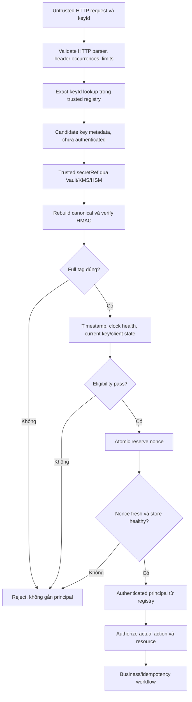
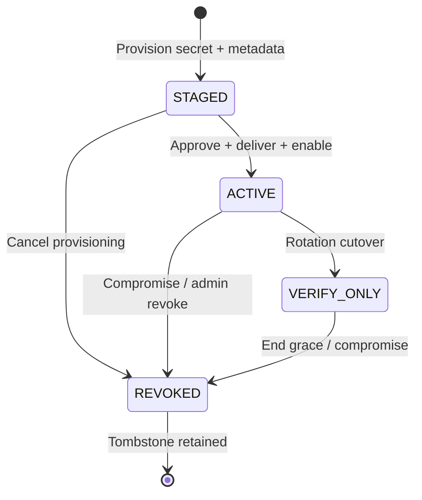

# Credential metadata trong vòng đời khóa xác thực HTTP request bằng HMAC

## 1. Bài toán: chữ ký đúng chưa đủ để xác định credential có hợp lệ

Trong module `SECURITY_AUTHENTICATION_HMAC_REQUEST_AUTHENTICATION`, client sử dụng **shared secret** để tính HMAC trên một **canonical request** gồm phương thức HTTP, raw URI/query, những header được ký và/hoặc digest của body. Server nhận `keyId` từ request, tìm secret tương ứng, dựng lại canonical bytes, xác minh tag, kiểm tra timestamp/nonce chống replay rồi mới kiểm tra **authorization** trên resource thật.

Điểm dễ bị bỏ sót: secret không tồn tại độc lập. Một HMAC tag có thể khớp với một secret đã **bị thu hồi**, một credential của **môi trường staging**, một key dành cho **client đã vô hiệu hóa**, hoặc một **canonical contract phiên bản cũ** không còn được phép. Server cần thông tin đáng tin để quyết định liệu key đó **được phép dùng để verify ngay lúc này**, chứ không chỉ biết giá trị secret.

Tập thông tin có cấu trúc, không phải plaintext secret, được gọi là **credential metadata**. Đây là đề bài trực tiếp của bài học, thuộc chương **“Credential lifecycle”**.

Ví dụ một HTTP request minh họa:

```http
POST /v1/tenants/t-42/payments?mode=instant HTTP/1.1
Host: api.example.test
Content-Type: application/json
X-HMAC-Key-Id: kid_m42_checkout_v7
X-HMAC-Timestamp: 1767268800
X-HMAC-Nonce: 7d46b2dd65d618a32ba74de99da88d80
X-HMAC-Signature: <base64-cua-hmac-sha256-full-tag>

{"amountMinor":125000,"currency":"VND"}
```

Server có thể tìm metadata:

```yaml
# Ví dụ diễn giải; không phải file cấu hình bắt buộc của hệ thống.
keyId: kid_m42_checkout_v7
clientId: cli_checkout_42
principalId: service:merchant-42-checkout
audience: payments-api/prod
algorithm: HmacSHA256
canonicalVersion: HMAC-REQUEST/CRED-META-V1
secretRef: vault://payments/prod/hmac/kid_m42_checkout_v7
status: ACTIVE
verifyNotBefore: '2026-10-01T00:00:00Z'
verifyUntil: '2027-01-01T00:00:00Z'
revision: 27
```

`X-HMAC-Key-Id` **là selector chưa được xác thực**. Client hoặc attacker có thể tự gửi tên key thật của người khác. Chỉ sau khi server xác minh HMAC với đúng secret, kiểm tra freshness/nonce và xác nhận key/client vẫn được phép hoạt động, metadata mới được dùng tạo **authenticated principal**. Metadata về owner tenant hoặc scope của key **không thay** quyết định authorization.



**Mục tiêu:** mô hình hóa một credential record chính xác, bất biến ở phần identity, có state/revision/time window rõ ràng; đưa metadata vào quy trình signing/verifying mà không để client kiểm soát policy.

### Kết quả cần đạt

Sau khi học, bạn có thể:

1. Phân biệt `keyId`, `clientId`, `principalId`, `ownerTenantId`, `secretRef` và **raw HMAC secret**.
2. Thiết kế schema credential metadata có owner, audience, algorithm, canonical version, status, timestamps, revision và audit.
3. Phân nhóm **immutable identity/binding**, **mutable lifecycle state** và **derived eligibility**; biết trường nào không được sửa sau provisioning.
4. Định nghĩa state machine `STAGED → ACTIVE → VERIFY_ONLY → REVOKED`, thời gian hiệu lực và quy tắc rotation.
5. Dùng **exact key lookup + metadata trust boundary** thay vì đoán client theo tiền tố key ID hoặc header do client khai.
6. Viết Java 17+ để validate record, giải quyết key→client, đánh giá policy và đưa đúng secret vào HMAC verification.
7. Giải thích cache/revision/consistency, revoke giữa upload, multi-region, KMS failure và replay nonce xuyên key versions.
8. Xây dựng kiểm thử khi metadata stale, key đổi trạng thái, audience lệch, parser differential, quyền resource hoặc storage hỏng.

## 2. Credential là gì, và metadata khác secret ra sao?

Một **credential** trong bài là một thực thể dùng để xác thực client HTTP. Nó bao gồm **key material** và **thông tin quy định ai được sử dụng key, ở đâu, trong khoảng thời gian nào và theo giao thức nào**.

```text
Logical credential
  |
  +-- Public / selector metadata:
  |     keyId, clientId (trusted binding), algorithm, version, audience
  |
  +-- Lifecycle / policy metadata:
  |     status, time bounds, revision, issuance/revocation audit
  |
  +-- Trusted secret reference:
  |     secretRef -> secret manager / encrypted envelope / HSM handle
  |
  +-- Sensitive material:
        raw shared secret bytes (KHÔNG nằm trong record HTTP)
```

**Credential metadata** là các thuộc tính dùng để **lựa chọn, kiểm soát và giám sát** credential; không phải cách khác để nói “secret”. Một record metadata không nên chứa `secretBase64` ở cùng dòng với tên client nếu điều đó khiến bảng audit/analytics xuất được secret.

### 2.1 Tám đối tượng phải được gọi đúng tên

| Đối tượng | Ví dụ | Nguồn tin cậy | Có phải bằng chứng người gửi đã authenticated? |
| --- | --- | --- | --- |
| `keyId` | `kid_m42_checkout_v7` | Server cấp và lưu; giá trị trong HTTP là **untrusted selector** | **Không**. |
| `clientId` | `cli_checkout_42` | Trusted client directory / credential record | Không trước MAC pass. |
| `principalId` | `service:merchant-42-checkout` | IAM/client directory, có lifecycle riêng | Chỉ là danh tính *có thể gán* sau authentication. |
| `ownerTenantId` | `t-42` | Quy trình đăng ký, IAM/tenant directory | **Không** phải grant trên `/tenants/t-42/*`. |
| `secretRef` | `vault://.../kid_m42_checkout_v7` | Trusted key registry | Không, chỉ là tham chiếu vật liệu mật mã. |
| Raw HMAC secret | 32 byte random theo policy ví dụ | Provisioning + secret service | Khả năng tính HMAC hợp lệ, nhưng chưa có quyền resource. |
| `audience` | `payments-api/prod` | Service policy và key metadata | Ràng buộc dịch vụ/môi trường cho credential. |
| `revision` | `27` | Registry mutation/transaction | Chứng minh snapshot metadata có phiên bản, **không** là chữ ký HMAC. |

**Client** ở đây là **logical application/service/đối tác**. Một tenant có thể đăng ký nhiều clients; một client có thể sở hữu nhiều key versions. Không dùng IP, HTTP user-agent hoặc tên file có tiền tố giống tenant để suy ra principal.

### 2.2 Cardinality và ownership

Trong một thiết kế rõ ràng:

```text
RegisteredClient (clientId) 1 ---- N HmacCredential (keyId)
HmacCredential.keyId      UNIQUE toàn registry
HmacCredential.clientId   owner bất biến
HmacCredential.secretRef  tham chiếu secret riêng của credential
RegisteredClient          -> IAM principal / owner tenant
IAM principal             -> grants / resource-specific permissions
```

- Một **client có nhiều credentials** để rotate hoặc phục vụ nhiều audience theo policy.
- Một credential thuộc **đúng một client owner** đã được cấp phát.
- Cùng tenant có nhiều clients **không đồng nghĩa** các clients được chia sẻ secret.
- Hai key IDs của hai clients **không** được trỏ tới cùng raw secret nếu cần phân biệt signer bằng mật mã.
- **Không tái sử dụng key ID** sau revoke/delete, vì cache và audit lịch sử có thể còn giữ ý nghĩa cũ.

Nếu ai đó chuyển ownership của một client/tenant, không nên âm thầm gán credential đã biết bởi owner cũ cho owner mới. Cần quyền quản trị, đánh giá compromise, revoke/reissue key material và ghi audit.

### 2.3 Những claim từ request chỉ là dữ liệu chưa tin cậy

```http
X-HMAC-Key-Id: kid_m42_checkout_v7
X-Client-Id: cli_admin
X-Tenant-Id: t-99
X-HMAC-Algorithm: HmacSHA1
X-HMAC-Version: legacy
```

Server **không được** dùng `X-Client-Id` làm principal, `X-Tenant-Id` làm permission, hoặc cho `X-HMAC-Algorithm` override algorithm trong metadata. Nếu endpoint chấp nhận một claim ảnh hưởng semantics, claim ấy phải được **ký theo version hợp đồng** và **đối chiếu** với nguồn đáng tin; chữ ký HMAC trên một claim cũng **không làm claim trở thành sự thật** nếu client có quyền ký nhưng không được cấp quyền khai điều đó.

## 3. Anatomy của credential metadata: một record nên có gì?

Một schema tốt phải cho câu trả lời rõ ràng trước mỗi request: *key nào, ai sở hữu, dùng cho đâu, bằng thuật toán/protocol nào, được verify lúc nào, đã bị revoke chưa, và record hiện tại là revision nào?*

### 3.1 Bảng trường cốt lõi

| Field | Ví dụ | Bất biến hay có thể thay đổi? | Quy tắc an ninh |
| --- | --- | --- | --- |
| `keyId` | `kid_m42_checkout_v7` | **Immutable** | Duy nhất, opaque/exact, không tái sử dụng. |
| `clientId` | `cli_checkout_42` | **Immutable ownership binding** | Tra từ registry; không lấy từ HTTP claim. |
| `secretRef` | `vault://payments/prod/hmac/kid_m42_checkout_v7` | **Immutable material identity** (provider envelope có thể rewrap) | Chỉ service được phép mới truy xuất; không nối path từ key ID. |
| `algorithm` | `HmacSHA256` | **Immutable** cho credential | Không nhận algorithm downgrade từ client. |
| `canonicalVersion` | `HMAC-REQUEST/CRED-META-V1` | **Immutable** | Server pin đúng canonical bytes/signed fields. |
| `audience` | `payments-api/prod` | **Immutable** hoặc reissue khi thay | Không verify key staging trên production. |
| `status` | `STAGED`, `ACTIVE`, `VERIFY_ONLY`, `REVOKED` | **Mutable theo state machine** | Chuyển có kiểm soát, revoke không hồi phục tùy protocol. |
| `verifyNotBefore` | `2026-10-01T00:00:00Z` | Lifecycle policy, thay đổi có audit | Biên inclusive, kiểm tra bằng server clock. |
| `verifyUntil` | `2027-01-01T00:00:00Z` | Lifecycle policy, thay đổi có audit | Biên exclusive, không cho verify sau hết hạn. |
| `issuedAt` | `2026-09-28T10:00:00Z` | Immutable | Thời điểm cấp phát do server quyết định. |
| `revokedAt` | `null` hoặc thời điểm revoke | Ghi-once audit/state | Không thay ngược thành null để hồi sinh key. |
| `revision` | `27` | Tăng đơn điệu qua update | Phát hiện cache stale/concurrent update. |
| `purpose`/`usage` | `REQUEST_HMAC_VERIFY` | Immutable hoặc versioned policy | Ngăn dùng nhầm một key cho encryption/JWT/MAC khác. |
| `metadataIssuer` | `credential-registry-prod` | Immutable provenance | Giúp xác định trust domain, không từ client header. |

Trong một sản phẩm, các trường bổ sung có thể cần thiết: `lastUsedAt` (telemetry, không dùng để auth), `rotationGroupId`, `verifyUntil` của key cũ, `ownerOrgId`, `createdBy`, `approvedBy`, `secretMaterialVersion`, `kmsKeyRef`, `revocationReasonCode`, `policyRevision`. Mỗi field thêm mới phải trả lời: **có ảnh hưởng quyết định bảo mật không, nguồn dữ liệu là ai, có cần immutable, có cần ký/bảo toàn khi cache/replication không?**

### 3.2 Chia metadata thành ba nhóm thay vì để mọi field sửa tự do

**A. Identity/cryptographic binding, bất biến:**

```text
keyId
clientId
secretMaterialIdentity / trusted secretRef
algorithm
canonicalVersion
audience
issuedAt
purpose
```

**B. Lifecycle policy, cập nhật qua workflow được phép:**

```text
status
verifyNotBefore
verifyUntil
revokedAt
revision
rotation deadlines
```

**C. Derived/runtime facts, không nên dùng làm trusted mutable input:**

```text
mayVerifyNow = f(status, notBefore, until, serverNow,
                 clientEnabled, keyPolicy, audience, revision)
isExpired = serverNow >= verifyUntil
requestAuthenticated = (MAC && timestamp && nonce && key/client-current)
resourceAuthorized = authorize(principal, action, resource)
```

`isExpired` có thể là **giá trị tính ra** từ `verifyUntil`, không nhất thiết cần một trạng thái database `EXPIRED` được job cập nhật mỗi giây. Nếu có materialized status EXPIRED cho vận hành, verifier vẫn phải kiểm tra **thời gian thực** để không accept key đã hết hạn chỉ vì scheduled job chậm.

### 3.3 Metadata có thể nhạy cảm dù không chứa secret

Key ID, client ID, owner tenant, secretRef, expiry, trạng thái revoke và số lần dùng có thể tiết lộ cấu trúc tổ chức, môi trường, thời điểm rotate hoặc công suất vận hành. Hạn chế quyền read/export các bảng này; **không log full secretRef hoặc mọi thuộc tính metadata** chỉ vì chúng không phải raw secret. Và chắc chắn không để `keyId` untrusted trở thành metric label cardinality vô hạn.

## 4. Vòng đời credential và trạng thái phải có ngữ nghĩa rõ

Một credential nên đi qua các trạng thái tường minh, được cập nhật bởi **management-plane workflow đã xác thực và phân quyền** — không bởi HTTP request từ client.

### 4.1 State machine minh họa



| Trạng thái | Có được dùng key để **verify request**? | Có được cấp để ký **attempt mới**? | Ghi chú |
| --- | --- | --- | --- |
| `STAGED` | **Không** | **Không** | Metadata/secret đang chuẩn bị; chưa hoàn thành provisioning/approval. |
| `ACTIVE` | **Có điều kiện** | **Có**, khi client còn được cấp và trong thời gian hiệu lực | MAC, audience, canonical version, thời gian và nonce vẫn bắt buộc. |
| `VERIFY_ONLY` | **Có điều kiện** | Client **không nên tiếp tục tạo attempt mới** bằng key cũ | Cho phép verify các request còn hợp lệ trong migration grace theo policy. |
| `REVOKED` | **Không** | **Không** | Thu hồi ngay; không “hồi sinh” bằng timestamp cũ. |
| `EXPIRED` (derived) | **Không** nếu `now >= verifyUntil` | **Không** | Có thể không là persisted state. |

**Điều kiện verify “có”** là: trạng thái cho phép, server time trong cửa sổ key validity, key/client còn current, algorithm/version/audience hợp lệ, HMAC đúng, timestamp/nonce hợp lệ. `VERIFY_ONLY` không có nghĩa “ai biết secret thì được auth mãi mãi”; nó vẫn bị giới hạn bởi `verifyUntil` và revocation.

### 4.2 Chuyển trạng thái nào không nên cho phép?

- `REVOKED → ACTIVE`: tránh tái sử dụng credential đã bị thu hồi; cấp **key ID và secret mới**.
- `VERIFY_ONLY → ACTIVE` bằng một HTTP header tự khai: client không có quyền điều khiển lifecycle.
- `STAGED → ACTIVE` khi secret chưa được bảo vệ, chưa provision cho client, owner chưa được approve: không phát hành credential nửa vời.
- `ACTIVE key của client A → ACTIVE key của client B` bằng cập nhật owner: đổi danh tính mà giữ material đã từng được A biết.
- Bỏ qua `verifyUntil` vì status trong cache vẫn ACTIVE: trạng thái persistent không thay time window.

Có thể có các trạng thái khác như `SUSPENDED`, `PENDING_DELETE`, `COMPROMISED` hay `DESTROYED` trong thiết kế thực tế. Cần phân biệt **suspend có thể phục hồi theo quy trình** với **revoke không hồi phục**; bài dùng bộ bốn trạng thái để giảm nhập nhằng.

### 4.3 Một lần revoke là một sự kiện bảo mật, không chỉ SQL UPDATE

Quy trình revoke:

```text
Authenticated, authorized security operator
  -> verify tenant/client ownership, approvals, reason
  -> atomic status=REVOKED, revokedAt=serverNow, revision++
  -> append immutable audit event
  -> publish cache invalidation / revocation event
  -> enforce revocation SLO across verifiers and gateways
  -> prevent future HMAC acceptance with this key
  -> rotate/reissue credential if client remains legitimate
```

Nếu registry ở region A ghi REVOKED nhưng region B vẫn có cache ACTIVE trong nhiều phút, state machine trên giấy **không đủ**. Cần consistency/invalidation/authoritative recheck, fail-closed nếu không bảo đảm freshness theo SLO, và integration test khi revoke trong khi đang xử lý request dài.

## 5. Thời gian: issuedAt, notBefore, verifyUntil và signed timestamp

Có nhiều đồng hồ/giới hạn khác nhau:

- `issuedAt`: server đã cấp metadata lúc nào; là audit, không nhất thiết là thời điểm key bắt đầu verify.
- `verifyNotBefore`: **thời điểm sớm nhất** server cho key xác minh (inclusive).
- `verifyUntil`: **thời điểm đầu tiên key không còn được verify** (exclusive).
- `revokedAt`: sự kiện thu hồi bất kỳ lúc nào, **ưu tiên hơn** mọi mốc thời gian.
- `X-HMAC-Timestamp`: timestamp **do client ký** trên từng request; dùng freshness, **không phải dữ liệu sửa lịch sử trạng thái key**.
- `serverNow`: đồng hồ đáng tin tại **thời điểm server đưa ra quyết định xác thực**.

### 5.1 Khoảng hiệu lực key là half-open interval

```text
Valid key time:
    verifyNotBefore <= serverNow < verifyUntil

Example:
    verifyNotBefore = 2026-10-01T00:00:00Z
    verifyUntil     = 2027-01-01T00:00:00Z

At 2026-10-01T00:00:00Z  => time condition PASS
At 2027-01-01T00:00:00Z  => time condition FAIL
```

Dùng nửa khoảng `[notBefore, until)` giúp transition giữa các đợt rotation dễ rõ nghĩa và không nhận key ngay tại thời điểm hết hiệu lực. Nếu một hệ thống chọn biên khác, phải ghi **chính xác trong contract** và có test boundary.

### 5.2 Timestamp còn mới không hợp thức hóa key revoked

Một lỗi đặc biệt nguy hiểm:

```text
key.status = REVOKED at 12:00:00
request.signedTimestamp = 11:59:50
serverNow = 12:00:05

Wrong:
    signedTimestamp < revokedAt
    => "client signed while key active, accept"

Correct:
    key is REVOKED at verification decision
    => reject regardless of signedTimestamp
```

Server không biết chắc client **thật sự ký** vào thời điểm họ ghi trong request; một chủ thể biết secret có thể ký lại và tự điền timestamp trong freshness window. Đặc biệt khi key bị lộ, cho “grandfather” request theo timestamp khai báo sẽ kéo dài khả năng lạm dụng.

### 5.3 Đừng nhầm key verify window với request freshness window

| Chính sách | Được dùng để | Ví dụ |
| --- | --- | --- |
| Credential `verifyNotBefore/verifyUntil` | Xác định **key được phép verify lúc này** | Hiệu lực hàng ngày/tháng. |
| HMAC request timestamp | Giới hạn **tuổi của từng signed request** | Chấp nhận lệch `[-300s,+30s]`. |
| Nonce retention TTL | Nhớ attempts đã reserve trong toàn freshness lifetime | `>=360s` theo mô hình skew/margin minh họa. |
| Metadata cache TTL | Giới hạn độ cũ dữ liệu key/client status | Theo revocation propagation SLO, không lấy từ nonce TTL. |
| Idempotency retention | Chống trùng **business intent** sau nhiều signed attempts | Theo contract nghiệp vụ, có thể dài hơn nhiều. |

Nếu API mở rộng freshness window, phải tính lại nonce TTL; **không** dùng ngày hết hạn key làm TTL nonce. Nếu key bị revoke, vẫn không nên xóa nonce store một cách mù quáng làm ảnh hưởng security state cho key khác hoặc replay domain.

### 5.4 Đồng hồ lệch và thời điểm kiểm tra

Ví dụ acceptance freshness:

```text
serverNow - 300 <= signedEpochSeconds <= serverNow + 30
```

Timestamp được chuẩn hóa Unix epoch **seconds**, ASCII decimal không leading zeros trừ số `0`, và đưa vào HMAC. Clock health phải được kiểm tra; nếu một replica nhảy lùi nhiều phút, “still ACTIVE” cũng có thể được suy sai theo verifyUntil hoặc nonce retention. Khi clock không đáng tin, **fail-closed**.

Với upload lớn, verify-time policy thường kiểm tra key status và freshness **sau khi đã có body digest**, ngay trước nonce reservation/admission. Nếu key revoke trong thời gian stream, một lookup ở đầu request không đủ.

## 6. Metadata là chính sách của server, không phải đề nghị của client

### 6.1 Key ID chỉ dùng exact lookup

Sai:

```java
String keyId = request.header("X-HMAC-Key-Id");
String client = keyId.split(":")[0]; // SAI: không phải trusted mapping
String algorithm = request.header("X-HMAC-Algorithm"); // SAI: downgrade input
var secret = vault.load("keys/" + keyId); // SAI: path từ raw header
securityContext.setPrincipal(client); // SAI: chưa verify MAC
```

Đúng về mặt kiến trúc:

```text
untrustedKeyId
  -> syntax/length validation
  -> exact lookup in trusted credential registry
  -> immutable key record: clientId, algorithm, version, audience, secretRef
  -> current client directory: principalId + client status
  -> trusted secret provider by secretRef (NOT caller-supplied path)
  -> HMAC verification with precisely this key
  -> timestamp/nonce + current key/client state
  -> authenticated principal and independent authorization
```

**Không thử nhiều secrets** khi HMAC fail: nếu key ID A có tag sai, việc lặp qua keys B/C hoặc legacy algorithms để “cứu request” làm mờ danh tính, tăng timing/DoS, có thể vô tình dùng revoked key.

### 6.2 Domain separation bằng audience và canonical version

Một key có metadata `audience=payments-api/prod` không được dùng để verify ở `payments-api/staging` hoặc `orders-api/prod` chỉ vì client biết secret.

Hợp đồng canonical nên ký một **audience line** do **service policy server xác định** và đối chiếu `credential.audience == expectedAudience`. Không lấy giá trị `Host`, `X-Forwarded-Host` hoặc `X-Audience` do client tự khai để thay server audience.

Tương tự, metadata phải pin:

```text
algorithm = HmacSHA256
canonicalVersion = HMAC-REQUEST/CRED-META-V1
tagLength = 32 raw bytes (full HMAC tag)
signatureEncoding = standard padded Base64
signedFields = method + raw target + selected headers
               + keyId + timestamp + nonce + body digest
```

Nếu client gửi thêm `X-HMAC-Algorithm: HmacSHA1` hoặc `X-HMAC-Version: legacy`, server không được downgrade. Muốn nâng sang thuật toán/version khác, cấp version/key policy rõ ràng và sử dụng golden vectors liên ngôn ngữ.

### 6.3 Không có quyền chỉ vì credential chứa ownerTenantId

Giả sử client thuộc `t-42` có HMAC key hợp lệ. Client tự ký:

```http
POST /v1/tenants/t-99/payments HTTP/1.1
X-HMAC-Key-Id: kid_m42_checkout_v7
X-HMAC-Signature: <tag-hmac-dung-do-client-biet-secret>
```

MAC có thể **đúng** vì client biết secret; request vẫn phải bị **authorization deny** nếu principal không có quyền tạo payment của tenant `t-99`. `ownerTenantId` xác định chủ quản trị credential, **không tự cấp role**, đặc biệt khi có delegation, resource ownership và business limits.

## 7. Một hợp đồng canonical HMAC có sử dụng credential metadata

Để minh họa vị trí các metadata fields trong xác thực, bài dùng hợp đồng học tập `HMAC-REQUEST/CRED-META-V1`. Đây là **protocol tự định nghĩa**, không phải wire standard mặc định cho mọi dịch vụ.

### 7.1 Quy tắc hợp đồng

| Thành phần | Quy định CRED-META-V1 |
| --- | --- |
| HTTP method | `POST` thực nhận; cấm method override. |
| Raw target | Origin-form `/v1/tenants/t-42/payments?mode=instant`, không tự decode/sort query. |
| Audience | `payments-api/prod` từ server config, phải trùng credential metadata. |
| Content-Type | Exactly one header `Content-Type: application/json`. |
| Key ID | Exactly one `X-HMAC-Key-Id`, ASCII allowlist; đưa nguyên value vào canonical. |
| Timestamp | `X-HMAC-Timestamp`, Unix epoch seconds canonical ASCII; ký trong HMAC. |
| Nonce | `X-HMAC-Nonce`, 16 random bytes / 32 lowercase hex; ký trong HMAC. |
| Body | Raw application body bytes sau HTTP framing, trước transform; demo cấm `Content-Encoding`. |
| Digest | SHA-256(raw body bytes), hex lowercase 64 chars. |
| Encoding | **11 dòng** UTF-8 phân cách LF `0x0A`, **không có LF cuối**. |
| MAC | `HmacSHA256`, tag full 32 bytes, Base64 chuẩn có padding. |
| Secret | Lấy từ `secretRef` thuộc trusted key record, **không** gửi trên HTTP. |
| Policy | Metadata algorithm/version/audience/status/client/current được kiểm tra độc lập. |

### 7.2 Canonical bytes 11 dòng

```text
HMAC-REQUEST/CRED-META-V1
HMAC-SHA256
POST
/v1/tenants/t-42/payments?mode=instant
audience:payments-api/prod
content-type:application/json
x-hmac-key-id:kid_m42_checkout_v7
x-hmac-timestamp:1767268800
x-hmac-nonce:7d46b2dd65d618a32ba74de99da88d80
body-size:<actual-raw-body-byte-count>
body-sha256:<lowercase-hex-sha256-exact-body>
```

Hai dòng `body-size`/`body-sha256` chứa **placeholder**, trước khi ký phải thay bằng byte length và digest thật. `1767268800` ứng với **2026-01-01T12:00:00Z**, chỉ là timestamp fixture, không phải request production hợp lệ ở thời điểm khác.

Một client ký:

```text
bodyBytes      = stable snapshot of exact serialized body
bodyDigest     = SHA256(bodyBytes)
canonicalBytes = UTF8(joinLF(exact_11_lines_without_final_LF))
macBytes       = HMAC_SHA256(clientSharedSecret, canonicalBytes)
signature      = BASE64_STANDARD_PADDED(macBytes)
```

Server tự tạo lại canonical từ **request thực nhận tại trust boundary**, không tin client gửi chuỗi `canonicalRequest` đã tính sẵn. Vì `x-hmac-key-id`, timestamp và nonce đã được ký, kẻ không có secret không thể thay chúng mà vẫn giữ MAC hợp lệ. Tuy nhiên **client có secret vẫn có thể ký một claim trái quyền**; trusted metadata và authorization là hàng rào riêng.

### 7.3 Vì sao không ký raw status/revision vào mỗi HTTP request?

Một lựa chọn có vẻ hấp dẫn là yêu cầu client đưa `keyStatus=ACTIVE`, `keyRevision=27` vào HMAC. Nhưng đó là **metadata của server**, có thể đổi khi revoke hoặc rotate, và client không có quyền quyết định nó. Trong hợp đồng này:

- Client ký **key ID**, không tự ký status để yêu cầu service chấp nhận.
- Server lấy **current** key status/revision và client status từ trusted control plane.
- Server dùng phiên bản policy đã được ghim để dựng canonical và verify HMAC.
- Nếu cần signed hint khác, protocol version mới phải chỉ rõ semantics và **vẫn recheck** với registry.

Việc một client ký chuỗi “ACTIVE” chỉ chứng minh họ biết secret; không chứng minh key còn ACTIVE trên server.

## 8. Schema SQL: enforce uniqueness, ownership và audit

SQL sau mô tả **một mô hình gợi ý cho PostgreSQL**; nó không tự mang lại IAM/KMS protection và không phải migration production đã được kiểm chứng.

### 8.1 Client directory và credential registry

```sql
CREATE TABLE registered_api_clients (
    client_id             VARCHAR(96) PRIMARY KEY,
    principal_id          VARCHAR(128) NOT NULL,
    owner_tenant_id       VARCHAR(96) NOT NULL,
    status                VARCHAR(16) NOT NULL
                          CHECK (status IN ('ENABLED', 'DISABLED')),
    revision              BIGINT NOT NULL CHECK (revision >= 1),
    created_at            TIMESTAMPTZ NOT NULL,
    updated_at            TIMESTAMPTZ NOT NULL
);

CREATE TABLE hmac_credentials (
    key_id                VARCHAR(96) PRIMARY KEY,
    client_id             VARCHAR(96) NOT NULL
                          REFERENCES registered_api_clients(client_id),
    key_version           INTEGER NOT NULL CHECK (key_version >= 1),
    secret_ref            VARCHAR(256) NOT NULL UNIQUE,

    algorithm             VARCHAR(32) NOT NULL
                          CHECK (algorithm = 'HmacSHA256'),
    canonical_version     VARCHAR(64) NOT NULL
                          CHECK (canonical_version =
                          'HMAC-REQUEST/CRED-META-V1'),
    audience              VARCHAR(128) NOT NULL,
    usage_purpose         VARCHAR(32) NOT NULL
                          CHECK (usage_purpose = 'REQUEST_HMAC_VERIFY'),

    status                VARCHAR(16) NOT NULL
                          CHECK (status IN
                          ('STAGED','ACTIVE','VERIFY_ONLY','REVOKED')),
    verify_not_before     TIMESTAMPTZ NOT NULL,
    verify_until          TIMESTAMPTZ NOT NULL,
    issued_at             TIMESTAMPTZ NOT NULL,
    revoked_at            TIMESTAMPTZ,

    revision              BIGINT NOT NULL CHECK (revision >= 1),
    updated_at            TIMESTAMPTZ NOT NULL,
    UNIQUE (client_id, key_version),
    CHECK (verify_not_before < verify_until),
    CHECK (status <> 'REVOKED' OR revoked_at IS NOT NULL)
);

CREATE INDEX idx_hmac_credentials_client
    ON hmac_credentials (client_id);
```

**Lưu ý:** SQL `CHECK(status <> 'REVOKED' OR revoked_at IS NOT NULL)` chỉ bắt buộc một revoked record có timestamp. Nó **không** chặn `REVOKED → ACTIVE`, không giữ owner binding bất biến và không bảo đảm field `secret_ref` trỏ đúng material. Các bất biến đó cần quyền ghi hạn chế, transactional workflow, audit/event log, constraint/trigger hoặc append-only registry.

### 8.2 Audit event bất biến

```sql
CREATE TABLE credential_lifecycle_audit (
    event_id              UUID PRIMARY KEY,
    key_id                VARCHAR(96) NOT NULL,
    previous_revision     BIGINT,
    new_revision          BIGINT NOT NULL,
    action                VARCHAR(40) NOT NULL,
    actor_principal_id    VARCHAR(128) NOT NULL,
    reason_code           VARCHAR(64),
    occurred_at           TIMESTAMPTZ NOT NULL,
    request_correlation   VARCHAR(128)
);
```

Một audit trail nên chứng minh **ai** đã provision/activate/rotate/revoke, **khi nào**, với **credential nào**, trước/sau revision nào, và có owner/client mapping ra sao. Không lưu raw shared secret, raw DEK, KEK, expected HMAC hoặc full HTTP Authorization header trong audit.

### 8.3 Lỗi dữ liệu khiến identity trở nên mơ hồ

| Lỗi schema/quy trình | Hậu quả |
| --- | --- |
| Hai records trùng `keyId` | Exact lookup không còn chọn một credential duy nhất. |
| `clientId` của key có thể được đổi tùy ý | Old secret biết bởi owner A có thể được dùng mạo danh owner B. |
| `secretRef` có thể đổi không version/audit | Cache lấy old material nhưng metadata trỏ material mới. |
| `algorithm`/`canonicalVersion` thay đổi tại cùng keyId | Cùng credentials có nhiều cách hiểu chữ ký, nguy cơ downgrade. |
| Không có `revision` hoặc out-of-order update | Region/cache stale không bị phát hiện. |
| Không lưu tombstone sau revoke | Key ID cũ có thể bị tái sử dụng sau delete/restore. |
| Quyền write credential table gắn luôn với API verifier | Runtime compromise có thể tự cấp key/principal mới. |
| Lưu raw HMAC secret trong cột được analytics/DBA đọc rộng rãi | Data leak cho phép attacker ký request mới. |

**Một transaction khi update metadata không đủ** nếu key registry, client directory, secret store và audit nằm ở hệ thống khác nhau. Cần consistency boundary, choreography/outbox cho sự kiện, fail-closed và reconciliation phù hợp.

## 9. Java 17+: mô hình metadata bất biến và điều kiện xác minh

Ví dụ Java 17 sau tách **key metadata** khỏi **client metadata**, đồng thời phân biệt **candidate để kiểm HMAC** với **principal đã authenticated**. Mã minh họa type/policy, không tự làm database/KMS adapter.

### 9.1 `CredentialMetadataV1`

```java
import java.time.Instant;
import java.util.Objects;
import java.util.Optional;
import java.util.regex.Pattern;

public final class CredentialMetadataV1 {
    private static final Pattern KEY_ID =
            Pattern.compile("[A-Za-z0-9._:-]{1,96}");
    private static final Pattern CLIENT_ID =
            Pattern.compile("[A-Za-z0-9._:-]{1,96}");

    public enum KeyState { STAGED, ACTIVE, VERIFY_ONLY, REVOKED }
    public enum ClientState { ENABLED, DISABLED }

    public record KeyRecord(
            String keyId,
            String clientId,
            String secretRef,
            String audience,
            String algorithm,
            String canonicalVersion,
            String usagePurpose,
            KeyState status,
            Instant verifyNotBefore,
            Instant verifyUntil,
            Instant issuedAt,
            Instant revokedAt,
            long revision) {

        public KeyRecord {
            if (keyId == null || !KEY_ID.matcher(keyId).matches()
                    || clientId == null
                    || !CLIENT_ID.matcher(clientId).matches()
                    || secretRef == null || secretRef.isBlank()
                    || !"payments-api/prod".equals(audience)
                    || !"HmacSHA256".equals(algorithm)
                    || !"HMAC-REQUEST/CRED-META-V1"
                            .equals(canonicalVersion)
                    || !"REQUEST_HMAC_VERIFY".equals(usagePurpose)
                    || status == null
                    || verifyNotBefore == null || verifyUntil == null
                    || !verifyNotBefore.isBefore(verifyUntil)
                    || issuedAt == null || revision < 1
                    || (status == KeyState.REVOKED
                        && revokedAt == null)) {
                throw new IllegalArgumentException(
                        "Invalid trusted key metadata");
            }
        }

        public boolean mayVerifyAt(Instant now) {
            Objects.requireNonNull(now);
            return (status == KeyState.ACTIVE
                    || status == KeyState.VERIFY_ONLY)
                    && !now.isBefore(verifyNotBefore)
                    && now.isBefore(verifyUntil)
                    && revokedAt == null;
        }
    }

    public record ClientRecord(
            String clientId,
            String principalId,
            String ownerTenantId,
            ClientState status,
            long revision) {

        public ClientRecord {
            if (clientId == null
                    || !CLIENT_ID.matcher(clientId).matches()
                    || principalId == null || principalId.isBlank()
                    || ownerTenantId == null || ownerTenantId.isBlank()
                    || status == null || revision < 1) {
                throw new IllegalArgumentException(
                        "Invalid trusted client metadata");
            }
        }

        public boolean enabled() {
            return status == ClientState.ENABLED;
        }
    }

    // CANDIDATE là record đủ để thử MAC, không phải identity được grant.
    public record Candidate(
            KeyRecord key,
            ClientRecord client) {
        public Candidate {
            Objects.requireNonNull(key);
            Objects.requireNonNull(client);
            if (!key.clientId().equals(client.clientId())) {
                throw new IllegalArgumentException(
                        "Key/client owner mismatch");
            }
        }
    }

    public interface KeyRegistry {
        Optional<KeyRecord> exactLookup(String keyId);
        // Cần kiểm tra revision/status/immutable binding theo
        // authoritative state và revocation SLO, outage => throw.
        boolean stillCurrentAndAllowed(KeyRecord observed, Instant now);
    }

    public interface ClientDirectory {
        Optional<ClientRecord> exactLookup(String clientId);
        boolean stillCurrentAndEnabled(ClientRecord observed);
    }

    private final KeyRegistry registry;
    private final ClientDirectory clients;

    public CredentialMetadataV1(
            KeyRegistry registry, ClientDirectory clients) {
        this.registry = Objects.requireNonNull(registry);
        this.clients = Objects.requireNonNull(clients);
    }

    public Optional<Candidate> selectCandidate(
            String untrustedKeyId, Instant now) {

        Objects.requireNonNull(now);
        if (untrustedKeyId == null
                || !KEY_ID.matcher(untrustedKeyId).matches()) {
            return Optional.empty();
        }

        // Exact lookup: KHÔNG lấy client từ tiền tố của keyId.
        Optional<KeyRecord> found =
                registry.exactLookup(untrustedKeyId);
        if (found.isEmpty()) return Optional.empty();
        KeyRecord key = found.get();

        if (!untrustedKeyId.equals(key.keyId())
                || !key.mayVerifyAt(now)) {
            return Optional.empty();
        }

        Optional<ClientRecord> clientFound =
                clients.exactLookup(key.clientId());
        if (clientFound.isEmpty()) return Optional.empty();

        ClientRecord client = clientFound.get();
        if (!client.enabled()) return Optional.empty();

        return Optional.of(new Candidate(key, client));
    }

    public boolean recheckAtAdmission(
            Candidate candidate, Instant now) {
        Objects.requireNonNull(candidate);
        Objects.requireNonNull(now);
        return candidate.key().mayVerifyAt(now)
                && registry.stillCurrentAndAllowed(
                        candidate.key(), now)
                && clients.stillCurrentAndEnabled(
                        candidate.client());
    }
}
```

### 9.2 Đọc code như một policy, không như một “chứng chỉ” bảo mật

1. `selectCandidate` chỉ trả record để **thử xác minh HMAC**. Nó không tự sinh `AuthenticatedPrincipal`.
2. Mỗi `KeyRecord` ghim `algorithm`, `canonicalVersion`, `audience` và `usagePurpose`. Không nhận giá trị phiên bản client tự khai để thay metadata.
3. `KeyRecord.mayVerifyAt(now)` kiểm tra `[notBefore, until)` và các trạng thái được verify; `revokedAt != null` luôn chặn.
4. `ClientRecord.enabled()` là điều kiện riêng; key ACTIVE không override client DISABLED.
5. `Optional.empty()` dùng cho không tìm thấy hoặc policy deny khi store **đang khỏe**. Registry/Vault outage phải ném lỗi và được pipeline xử lý **fail-closed**; adapter không được đổi timeout thành empty rồi fallback.
6. `recheckAtAdmission` yêu cầu so snapshot với authoritative revision/status; interface không tự chứng minh DB/cache nhất quán. Đặc biệt cần kiểm soát stale cache trên nhiều replica và revocation timing.
7. `Candidate` record giữ trusted data nhưng **không có bằng chứng MAC pass**. Trong production giới hạn constructor/API visibility của final authenticated context, không cho business tự dựng principal từ candidate.
8. `secretRef` là trusted string từ registry. Chỉ secret provider đã được IAM cấp quyền mới được sử dụng; **không** xây vault path từ raw `X-HMAC-Key-Id`.
9. Đoạn minh họa ghim `payments-api/prod` vì bài trình bày một service. Trong hệ thống đa audience, validate expected audience từ **server endpoint configuration**, không để request chọn audience.
10. `ClientRecord.principalId`/`ownerTenantId` không tự thành quyền resource: authorization vẫn phải hỏi grant hiện tại.

### 9.3 Vì sao record immutable trong Java chưa đủ?

Java `record` bảo đảm các field references không đổi sau construction nhưng **không** làm database immutable, không ngăn những bản ghi khác nhau cùng keyId xuất hiện qua replication và không ngăn người gọi tạo record giả trong unit test.

Tính bất biến an ninh thực tế cần:

- Unique/tombstone policy trong registry, không reuse key ID.
- Quyền quản trị/DB restricted update với key owner/algorithm/version/secret material.
- Revision/CAS và event log khi status/time policy thay đổi.
- Metadata serialization/versioning với validator ở cả producer/consumer.
- Kênh có integrity cho metadata giữa registry, cache, gateway và verifier.
- Kiểm thử stale replicas/restore và audit changes.

**Liên kết sang bước verify:** Sau khi đã có `Candidate` từ metadata đáng tin, server mới được load **đúng secretRef**, tính HMAC từ request thực nhận, kiểm tra freshness/nonce và quyết định có thể gắn principal hay không.

## 10. Java 17+: dùng metadata để dựng canonical request và xác minh MAC

Bước tiếp theo sau `CredentialMetadataV1.selectCandidate` là lấy **đúng HMAC secret từ trusted reference**, nhưng không đưa raw secret vào metadata hoặc HTTP response.

### 10.1 `CredentialCanonicalV1`: canonical builder 11 dòng

Ví dụ class hỗ trợ **một endpoint cố định** của hợp đồng CRED-META-V1. Với nhiều routes/proxy, cần parser raw target và hợp đồng URI canonicalization độc lập được kiểm thử. `Content-Encoding` không được hỗ trợ trong minh họa; ingress phải từ chối nếu header này xuất hiện, kể cả giá trị `identity`, trước khi hash body.

```java
import java.nio.charset.StandardCharsets;
import java.security.GeneralSecurityException;
import java.security.MessageDigest;
import java.util.HexFormat;
import java.util.Objects;

public final class CredentialCanonicalV1 {
    public static final String RAW_TARGET =
            "/v1/tenants/t-42/payments?mode=instant";

    private CredentialCanonicalV1() {}

    public static byte[] build(
            CredentialMetadataV1.KeyRecord trustedKey,
            String actualMethod,
            String actualRawTarget,
            String actualContentType,
            String wireKeyId,
            String signedTimestampSeconds,
            String signedNonceHex,
            byte[] actualRawBody) {

        Objects.requireNonNull(trustedKey);
        Objects.requireNonNull(actualRawBody);

        if (!"POST".equals(actualMethod)
                || !RAW_TARGET.equals(actualRawTarget)
                || !"application/json".equals(actualContentType)
                || !trustedKey.keyId().equals(wireKeyId)
                || !"payments-api/prod".equals(trustedKey.audience())
                || !"HmacSHA256".equals(trustedKey.algorithm())
                || !"HMAC-REQUEST/CRED-META-V1"
                        .equals(trustedKey.canonicalVersion())
                || signedTimestampSeconds == null
                || !signedTimestampSeconds.matches(
                        "(0|[1-9][0-9]{0,11})")
                || signedNonceHex == null
                || !signedNonceHex.matches("[0-9a-f]{32}")) {
            throw new IllegalArgumentException(
                    "Invalid CRED-META-V1 signed request");
        }

        final String bodyDigest;
        try {
            bodyDigest = HexFormat.of().formatHex(
                    MessageDigest.getInstance("SHA-256")
                            .digest(actualRawBody));
        } catch (GeneralSecurityException providerUnavailable) {
            throw new IllegalStateException(
                    "SHA-256 unavailable", providerUnavailable);
        }

        String canonicalText = String.join("\n",
                "HMAC-REQUEST/CRED-META-V1",
                "HMAC-SHA256",
                actualMethod,
                actualRawTarget,
                "audience:" + trustedKey.audience(),
                "content-type:" + actualContentType,
                "x-hmac-key-id:" + wireKeyId,
                "x-hmac-timestamp:" + signedTimestampSeconds,
                "x-hmac-nonce:" + signedNonceHex,
                "body-size:" + actualRawBody.length,
                "body-sha256:" + bodyDigest);

        return canonicalText.getBytes(StandardCharsets.UTF_8);
    }
}
```

**Điểm cần phân tích:**

- `trustedKey` đã được lấy từ **exact registry lookup**, nhưng chưa được coi là identity authenticated. Nó cung cấp audience/algorithm/version đáng tin, không do request chọn.
- `wireKeyId` phải khớp **exact** `trustedKey.keyId` và xuất hiện trong canonical, nên sửa key selector trên wire làm MAC thay đổi.
- `actualRawTarget` và `actualRawBody` phải đến từ **request tại trust boundary sau kiểm tra HTTP framing**; không dùng URI/body được parser khác tự biến đổi hoặc client tự cung cấp canonical string.
- Endpoint được **ghim cố định** vì ví dụ không cố mô phỏng mọi loại URL encoding. Với hệ thống thật cần test encoded slash, percent case, duplicate query, dot segments, HTTP/2 `:path` và routing semantics.
- SHA-256 của body là **digest 64 hex lowercase** được ràng buộc vào HMAC. Đó là digest raw bytes, không phải hash JSON semantic object.
- Không thêm LF cuối. `String.join` với 11 elements tạo 11 dòng đúng contract.
- `body-size` đếm byte, không lấy `Content-Length` hay `String.length()` làm nguồn tin.
- Metadata `status`, `revision` và `clientId` **không nằm trong canonical**: server đánh giá chúng bằng nguồn hiện tại; không để client yêu cầu khôi phục state cũ.

### 10.2 `CredentialMacVerifierV1`: decode strict và so raw full tag

```java
import java.security.GeneralSecurityException;
import java.security.MessageDigest;
import java.util.Arrays;
import java.util.Base64;
import javax.crypto.Mac;
import javax.crypto.SecretKey;

public final class CredentialMacVerifierV1 {
    private CredentialMacVerifierV1() {}

    public static boolean verifyFullTag(
            SecretKey trustedHmacKey,
            byte[] canonicalBytes,
            String suppliedBase64) {

        if (trustedHmacKey == null
                || canonicalBytes == null
                || suppliedBase64 == null
                || !suppliedBase64.matches("[A-Za-z0-9+/]{43}=")) {
            return false;
        }

        final byte[] supplied;
        try {
            supplied = Base64.getDecoder().decode(suppliedBase64);
        } catch (IllegalArgumentException badBase64) {
            return false;
        }

        // Full HMAC-SHA256 tag = 32 bytes; Base64 must be canonical.
        if (supplied.length != 32
                || !Base64.getEncoder().encodeToString(supplied)
                        .equals(suppliedBase64)) {
            Arrays.fill(supplied, (byte) 0);
            return false;
        }

        final byte[] expected;
        try {
            Mac mac = Mac.getInstance("HmacSHA256");
            mac.init(trustedHmacKey);
            expected = mac.doFinal(canonicalBytes);
        } catch (GeneralSecurityException unavailable) {
            Arrays.fill(supplied, (byte) 0);
            // Hạ tầng/provider lỗi không phải authentication success.
            throw new IllegalStateException(
                    "HMAC provider unavailable", unavailable);
        }

        try {
            // 32-byte fixed-length comparison, no early-exit String MAC.
            return expected.length == 32
                    && MessageDigest.isEqual(expected, supplied);
        } finally {
            Arrays.fill(expected, (byte) 0);
            Arrays.fill(supplied, (byte) 0);
        }
    }
}
```

`MessageDigest.isEqual` thích hợp để so **MAC bytes**, thay vì `String.equals` hay vòng lặp return ở byte mismatch đầu tiên. Phép `String.equals` khi re-encode chỉ kiểm tra **format do caller gửi** so với bytes decode từ chính input đó, không so secret-dependent expected tag.

**Điều quan trọng hơn cryptographic primitive:** Không cho verifier thử secret khác/algorithm khác khi tag mismatch. Khi metadata nói `HmacSHA256` và `CRED-META-V1`, phải xác minh đúng một contract. Nếu key registry hoặc vault không sẵn sàng, **fail-closed**; đừng trả `true` hoặc chọn một “default secret”.

### 10.3 Tích hợp trọn pipeline (pseudocode ứng dụng)

Các type/service như `ValidatedRequest`, `secretProvider`, `clockHealth` và `authorization` dưới đây **không thuộc Java JDK**, chỉ là kiến trúc minh họa. Code thật cần adapter HTTP xử lý duplicates và route resource đúng.

```java
// PSEUDOCODE: reject ambiguous framing, duplicate signed headers,
// unsupported Content-Encoding and method override.
ValidatedRequest req = ingress.parseStrict(http);

// keyId trên wire chưa phải identity.
String claimedKeyId = req.uniqueHeader("X-HMAC-Key-Id");
Instant preflightNow = clock.instant();
Optional<CredentialMetadataV1.Candidate> selected =
        credentialMetadata.selectCandidate(
                claimedKeyId, preflightNow);

if (selected.isEmpty()) {
    rejectAuthenticationGenerically();
    return;
}
CredentialMetadataV1.Candidate candidate = selected.get();

// secretRef đến từ trusted metadata, KHÔNG từ raw keyId.
SecretKey secret = secretProvider.loadTrustedHmacKey(
        candidate.key().secretRef());

// HMAC bytes được tính từ request thực nhận.
byte[] canonical = CredentialCanonicalV1.build(
        candidate.key(),
        req.actualMethod(),
        req.actualRawOriginFormTarget(),
        req.uniqueHeader("Content-Type"),
        claimedKeyId,
        req.uniqueHeader("X-HMAC-Timestamp"),
        req.uniqueHeader("X-HMAC-Nonce"),
        req.rawBodyBytes());

if (!CredentialMacVerifierV1.verifyFullTag(
        secret, canonical,
        req.uniqueHeader("X-HMAC-Signature"))) {
    rejectAuthenticationGenerically();
    return;
}

// Verify-time: signed timestamp KHÔNG khôi phục revoked key.
Instant verifiedNow = clock.instant();
if (!clockHealth.healthy()
        || !timestampPolicy.accepts(
                req.uniqueHeader("X-HMAC-Timestamp"), verifiedNow)
        || !credentialMetadata.recheckAtAdmission(
                candidate, verifiedNow)) {
    rejectAuthenticationOrUnavailable();
    return;
}

// NONCE scope server-defined: (clientId, audience, nonce).
// Atomic Redis SET NX EX / DB unique insert with sufficient TTL.
// Unknown storage outcome -> FAIL-CLOSED.
NonceReserveResult nonceResult = nonceStore.reserveAtomically(
        candidate.client().clientId(),
        candidate.key().audience(),
        req.uniqueHeader("X-HMAC-Nonce"),
        nonceRetentionPolicy.seconds());

if (nonceResult != NonceReserveResult.INSERTED) {
    rejectReplayOrUnavailable(nonceResult);
    return;
}

// Chỉ sau authn + replay pass mới tạo principal tin cậy.
AuthenticatedPrincipal principal = identityFactory.fromVerified(
        candidate.client().clientId(),
        candidate.client().principalId(),
        candidate.key().keyId(),
        candidate.key().revision());

// Authorization độc lập dựa vào resource THỰC backend dùng.
if (!authorization.canCreatePayment(
        principal, req.actualTenantId(), req.actualResource())) {
    rejectForbidden();
    return;
}

// AUTHN không bảo đảm idempotency; không đọc một unsigned
// Idempotency-Key từ client để tiết lộ kết quả/skip side effect.
paymentsService.processAuthorized(principal, req);
```

**Thứ tự phải được giữ:** metadata candidate → đúng secret → HMAC → freshness/current state → nonce reserve → authenticated principal → authorization → business. Nếu muốn reorder vì hiệu năng, phải threat-model lại và bảo đảm **không có side effect hoặc privileged data disclosure trước authentication/replay/authorization**.

`CredentialMetadataV1` và các lớp phía trên có thể dùng cho unit test chức năng, nhưng chưa chứng minh correctness của HTTP parser, secret store, Redis replication, IAM hoặc database transaction. Đó là phạm vi integration/security tests.

## 11. Mutation metadata: optimistic locking, revision và audit atomically

Metadata có thể được cập nhật đồng thời bởi rotation worker, operator và tự động hóa hết hạn. Nếu một worker đọc revision 27 còn operator đã revoke ở revision 28, worker **không được ghi lại trạng thái ACTIVE từ snapshot cũ**.

### 11.1 Lost-update race cần được ngăn

```text
t1 Worker rotate đọc key K: ACTIVE, revision=27
t2 Security admin REVOKE K -> REVOKED, revision=28
t3 Worker dùng snapshot cũ ghi K=VERIFY_ONLY, revision=28
t4 Key K bị "hồi sinh" dù đã revoke: SECURITY BUG
```

Giải pháp là thao tác state transition có điều kiện và **compare-and-swap theo revision** trong một consistency boundary. Ví dụ SQL PostgreSQL:

```sql
-- Chỉ ACTIVE revision 27 mới được chuyển VERIFY_ONLY.
UPDATE hmac_credentials
SET status = 'VERIFY_ONLY',
    revision = revision + 1,
    updated_at = CURRENT_TIMESTAMP
WHERE key_id = :key_id
  AND revision = :expected_revision
  AND status = 'ACTIVE'
  AND revoked_at IS NULL
RETURNING key_id, revision, status;
```

Nếu zero rows returned, **không** áp ghi đè mù. Đọc lại authoritative state, xác định transition còn hợp lệ không. Revoke có precedence cao hơn rotation; policy của bài không cho `REVOKED → ACTIVE`.

### 11.2 Revoke bằng một transition nguyên tử

```sql
BEGIN;

UPDATE hmac_credentials
SET status = 'REVOKED',
    revoked_at = CURRENT_TIMESTAMP,
    revision = revision + 1,
    updated_at = CURRENT_TIMESTAMP
WHERE key_id = :key_id
  AND status <> 'REVOKED'
RETURNING key_id, revision, revoked_at;

-- Dựa vào kết quả UPDATE và actor đã được authorize:
-- INSERT audit event đúng revision trong CÙNG transaction.
-- Nếu cần phát invalidation, INSERT outbox event cùng transaction.

COMMIT;
```

Các comments thể hiện việc phải cài **audit/outbox inserts thật**; block không phải migration hoặc chức năng revoke hoàn chỉnh. Cần xử lý idempotent revoke đã tồn tại, retry worker, constraint revision và rollback. Khi audit hoặc outbox quan trọng, ghi chúng **trong cùng DB transaction**; nếu event phát ra ngoài hệ thống, consumer vẫn phải deduplicate.

### 11.3 Bất biến trong transaction không giải quyết multi-region ngay lập tức

Một primary DB có thể chuyển sang REVOKED thành công, nhưng verifier ở region khác đang đọc replica **chưa replicate**. Cần chỉ định:

- Nguồn **authoritative** cho quyết định authentication;
- Có cho đọc từ eventual-consistent replica hay không;
- Revocation SLO đo được và cách xử lý cache lag;
- TTL/invalidation, read-your-writes và consistency token/version;
- Fail-closed khi không thể chứng minh trạng thái key/client còn hiện hành;
- Điểm quyết định security đối với request đang in-flight.

**Revision là cơ chế phát hiện/điều phối**, không phải magic field tự biến eventual consistency thành linearizability. Không thể nói mọi node “đã nhận revision 28” chỉ vì một node tạo revision 28.

### 11.4 Reconciliation giữa registry và secret store

Provision key mới có thể ghi metadata ở DB nhưng upload encrypted secret sang Vault bị lỗi, hoặc ngược lại. Không để record ACTIVE khi `secretRef` trỏ tới material chưa tồn tại.

Mẫu an toàn:

```text
allocate keyId + immutable owner/policy
  -> create STAGED metadata record
  -> store/encrypt raw HMAC secret, verify accessible via trusted ref
  -> secure provision secret to authorized client
  -> approve and transition STAGED -> ACTIVE with revision/audit
  -> invalidate caches / announce active state
```

Nếu bước thứ ba hỏng: giữ STAGED, cleanup orphan material theo quy trình; **không** fallback sang key khác hoặc coi empty secret là hợp lệ. KMS/Vault outage thuộc lỗi hạ tầng; có thể trả 503/fail-closed thay vì tạo principal sai.

## 12. Key rotation là thay credential, không sửa một field secret

Mục tiêu rotation HMAC là chuyển client sang một **raw secret mới**, giữ liên tục dịch vụ theo chính sách và thu hồi key cũ đúng hạn.

### 12.1 Dòng thời gian minh họa

```text
2026-11-01   key v7 ACTIVE, secret S7
2026-11-20   provision key v8 STAGED, secret S8 (S8 != S7)
2026-11-25   activate v8; v7 -> VERIFY_ONLY
2026-12-01   v7 verifyUntil reached, no longer verifies
2026-12-02   revoke/tombstone v7; retain audit
```

| Thuộc tính | Credential v7 | Credential v8 |
| --- | --- | --- |
| `keyId` | `kid_m42_checkout_v7` | `kid_m42_checkout_v8` |
| `clientId` | `cli_checkout_42` | `cli_checkout_42` |
| Raw secret | `S7` (riêng) | `S8` (mới, riêng) |
| `secretRef` | `vault://.../v7` | `vault://.../v8` |
| `algorithm` | `HmacSHA256` | `HmacSHA256` |
| `canonicalVersion` | `CRED-META-V1` | `CRED-META-V1` hoặc version mới có policy |
| `status` trong grace | `VERIFY_ONLY` | `ACTIVE` |
| `audience` | `payments-api/prod` | `payments-api/prod` |
| Principal | `service:merchant-42-checkout` | Cùng principal khi không đổi ownership |

**Tách hai thay đổi:**

- **Key version rotation:** thêm một credential mới cùng client với secret S8, keyId mới. Old key có trạng thái/deadline riêng.
- **Protocol canonical version upgrade:** thay cách tạo canonical, signed field list hoặc algorithm; cần compatibility policy, golden vectors và endpoint migration. Không đổi `canonicalVersion` trên *cùng key ID* làm các request cũ được hiểu theo contract khác.

### 12.2 Không dùng dynamic alias “current secret of client” làm vật liệu verify

Sai:

```text
Request says keyId=v7
registry: v7 -> alias "current-key-of-client"
today alias resolves S8
```

Một keyId phải chọn **material identity ổn định**. Nếu v7 tự đổi sang S8, server không biết client đã ký với secret nào, audit sai attribution, rotation không minh bạch và có thể tạo cửa bypass khi cache lag.

Khi keyId=v8, verifier không được “fallback v7” nếu MAC với S8 sai. **Lỗi chữ ký vẫn là lỗi chữ ký**, không phải lý do thử nhiều secrets hoặc bypass status.

### 12.3 Nonce uniqueness xuyên key versions

Nếu credential v7/v8 cùng client/audience, replay domain bài chọn:

```text
(clientId, audience, nonce)
```

không dùng `(keyId, nonce)`. Nhờ vậy cùng nonce được reserve bằng v7 không tự được phép dùng lại với v8 chỉ vì ID khóa mới. Nếu hai clients khác nhau cùng tenant, namespace tách theo client, đúng với lifecycle model.

**Đây là lựa chọn hợp đồng**, không phải mọi HMAC implementation đều bắt buộc. Nếu hệ thống dùng principal-level scope, cần nêu lý do và kiểm thử quyền share principal/aliases.

### 12.4 Revoke không bị “vô hiệu” bởi timestamp cũ

Một signed request do client đang sở hữu secret v7 tạo với timestamp T trước lúc revoke, nhưng được gửi **sau** revoke, phải bị từ chối. Không dùng `T < revokedAt` làm phép miễn trừ; timestamp do client tự điền và chỉ cung cấp freshness khi MAC đúng.

### 12.5 Đừng nhầm KEK rotation với HMAC credential rotation

Nếu raw HMAC secret S7 được lưu bằng AES-GCM envelope encryption trong KMS/Vault, **rewrap DEK dưới KEK mới** không làm S7 thay đổi. Attacker đã biết S7 vẫn có thể ký request mới nếu key v7 được chấp nhận. Khi raw key lộ: tạo **S8 ngẫu nhiên độc lập**, `keyId=v8`, revoke v7, đồng thời xử lý các copy plaintext đã lộ. Chỉ rewrap KMS **không phải khắc phục compromise của client signing secret**.

## 13. Metadata caching, revocation freshness và nhiều replica

Verifier cần metadata nhanh, nhưng cache thiếu ràng buộc có thể làm hệ thống tiếp tục chấp nhận key đã bị thu hồi.

### 13.1 Ba loại cache

| Loại cache | Dữ liệu | Nguy cơ |
| --- | --- | --- |
| `keyId → KeyRecord` | Owner, secretRef, algorithm/version/audience/status/revision | Stale ACTIVE sau revoke, stale owner binding, lỗi version. |
| `clientId → ClientRecord` | principal, owner tenant, enabled/revision | Client DISABLED vẫn được gắn principal, hoặc mapping owner mới chưa nhận. |
| `secretRef → key handle/raw secret` | Material phục vụ Mac | Cache plaintext JVM, stale secret, thiếu zeroization, dùng key sau revoke. |

Không đồng nhất metadata cache TTL với nonce TTL hoặc key verifyUntil. Một record `verifyUntil` còn 60 ngày **không** có nghĩa nó an toàn khi cache không cập nhật suốt 60 ngày: admin có thể revoke key ngay bây giờ.

### 13.2 Cache key phải có ngữ nghĩa bất biến

Không cache `clientId → currentSecret` rồi đem dùng khi request khai keyId v7: nhiều key cùng client khiến không thể biết secret nào được ký. Cache theo **exact key ID + revision/material identity** để hạn chế nhầm.

Nếu `secretRef` trỏ một Vault secret version, cần bảo đảm **material version** được pin, không tự alias sang new secret tại cùng key ID. Nếu dùng HSM handle, IAM/policy của handle vẫn cần kiểm soát key status và current client state.

### 13.3 Một revocation race thực tế

```text
12:00:00  Region A/B đều cache key K ACTIVE rev=27
12:00:01  Security admin revokes K -> REVOKED rev=28 tại registry
12:00:02  Region A nhận invalidation
12:00:03  Region B bị mất message invalidation
12:00:04  Attacker ký bằng K gửi tới B (K đã lộ)
12:00:05  Region B dùng cached rev=27, HMAC PASS...
```

Nếu region B cho qua, **revocation SLO đã bị vi phạm**. Cần một cơ chế phù hợp với threat model: authoritative recheck, bounded freshness lease, event invalidation có retry/ack, security epoch/version watermark, hoặc cắt traffic trên node không bắt kịp revision. Với yêu cầu gần tức thời, không đủ khi chỉ đặt TTL 30 phút.

### 13.4 Fail-closed với stale/unknown metadata

| Trạng thái | Hành vi bảo mật |
| --- | --- |
| Key metadata không tồn tại nhưng registry khỏe | Generic authentication reject; không dùng default secret. |
| Lookup key timeout/DB error | Fail-closed, có thể 503 theo API policy. |
| Key metadata còn ACTIVE trong cache nhưng không thể xác minh freshness theo SLO | Fail-closed hoặc từ chối admission theo policy; không tiếp tục vì “đã cache”. |
| Client directory unreachable | Không gắn principal từ dữ liệu thiếu kiểm chứng. |
| KMS/Vault không lấy được secretRef đã ghim | Fail-closed, không thử secret key ID khác. |
| Nonce store không reserve được hoặc outcome mơ hồ | Fail-closed; HMAC đúng chưa đủ chống replay. |
| KeyRecord/clientRecord revision mismatch | Reject/reload authoritative state, audit integrity lỗi. |
| Gateway cung cấp verified metadata nhưng kênh không tin cậy | Không chấp nhận; verify tại trusted boundary. |

Fail-closed **không nhất thiết** có nghĩa trả mọi lỗi là 401; lỗi hạ tầng có thể báo unavailable. Điều không thể thay đổi là **không tạo authenticated principal hoặc business side effect** khi không thể chứng minh các dependency bảo mật.

### 13.5 Multi-region conflict và restore

Với active-active registry, hai region không được **đồng thời cấp cùng key ID** cho các owners khác nhau. Đồng bộ status theo last-write-wins một cách mù quáng có thể làm revoke ở A bị update ACTIVE ở B ghi đè. Cần unique namespace/allocator, single source of truth, revision/transition rules, conflict resolution **ưu tiên revoke** và audit.

Restore một DB backup cũ có thể làm key `REVOKED` trở về `ACTIVE`; phải reconcile với authoritative revocation log, secret status và cache invalidations **trước khi nhận traffic**. Không coi DB snapshot timestamp là security-policy truth mới nhất.

## 14. Secret metadata, KMS và bảo vệ integrity của control plane

### 14.1 Secret reference là metadata, plaintext secret không phải

Một registry có thể lưu:

```text
keyId      = kid_m42_checkout_v7
clientId   = cli_checkout_42
secretRef  = vault://payments/prod/hmac/kid_m42_checkout_v7
```

nhưng không lưu:

```text
secretPlaintext = "HMAC_SUPER_SECRET_..."
```

Với **managed secret store**, `secretRef` là pointer tới một secret version được mã hóa và có access policy. Với **application envelope encryption**, record có thể lưu encrypted raw secret, wrapped DEK, IV và AAD metadata; KEK quản lý ở KMS.

**Chỉ key registry mới định nghĩa đúng secretRef cho key ID**, không cho HTTP header làm path lookup. Thêm `secretRef` dưới dạng header để “debug” làm tăng nguy cơ attacker hướng verifier tới secret của client khác (confused deputy).

### 14.2 Cryptographic binding với metadata

Nếu một attacker có quyền sửa secret envelope trong DB, họ có thể thử **swap ciphertext** của key A sang key B. Để phát hiện, có thể dùng AES-GCM AAD hoặc encryption context gắn với:

```text
encryptionFormatVersion
keyId
clientId
audience
algorithm
canonicalVersion
```

Các trường này lấy từ **trusted immutable registry binding** và encode không mơ hồ. Nếu ciphertext hoặc binding bị đổi mà không được phép, AEAD verification phải fail; không dùng plaintext secret từ một decryption có tag sai.

Không đưa những trường **thường xuyên đổi** như `status`, `revision` hoặc `lastUsedAt` vào AAD nếu không thiết kế re-encryption mỗi update: revoke key có thể vô tình làm không decrypt được tất cả envelopes, che mất nguyên nhân lỗi.

### 14.3 KMS/wrapped DEK rotation khác signing-key rotation

| Sự kiện | Có thay raw HMAC secret không? | Có thay keyId không? | Tác động metadata |
| --- | --- | --- | --- |
| KMS KEK rewrap wrapped DEK | Không | Không | Encryption metadata/KEK reference có thể đổi qua migration có kiểm soát. |
| DEK re-encrypt same raw secret | Không | Không | Ciphertext/IV/wrapped DEK thay; trusted credential identity không đổi. |
| HMAC secret rotation | **Có** | **Có**, cấp record mới | Owner/client có thể giữ; status cũ → VERIFY_ONLY/REVOKED. |
| Client ownership transfer | Có thể phải reissue credential mới | Thường **cấp key ID mới** | IAM/owner state và audit phải đổi có phê duyệt. |

**Encryption at rest không quyết định quyền HTTP.** Một secret decrypt thành công, MAC đúng, nhưng key REVOKED hoặc client DISABLED vẫn **không** được accept. Và một client ACTIVE cũng chưa chắc có grant tạo payment trên tài nguyên.

## 15. Proxy/gateway, HTTP parser và metadata provenance

Credential metadata thường được sử dụng **ở gateway**, **backend**, hoặc cả hai. Cần chọn trust boundary rõ ràng.

### 15.1 Verify tại gateway

```text
Internet client
  -> gateway parse HTTP strictly
  -> exact keyId registry, HMAC/timestamp/nonce verify
  -> inject protected authenticated context
  -> backend authorization on actual action/resource
```

Gateway phải:

- Từ chối duplicate `X-HMAC-Key-Id`, timestamp, nonce, signature và signed business headers (kể cả field names khác case).
- Strip/overwrite client-supplied `X-Verified-Client`, `X-Principal`, `X-Tenant-Id` nếu chúng là internal headers.
- Đưa authenticated principal/keyId/credentialRevision qua **kênh nội bộ được bảo vệ**, như mTLS và authorization giữa services, hoặc signed context theo kiến trúc.
- Không để backend tự tin **clientId/key status** do Internet khai.
- Bảo đảm resource backend thực thi tương ứng với request mà gateway đã verify/authorize; mọi path rewrite ảnh hưởng route semantics cần contract rõ.

### 15.2 Verify tại backend

Nếu backend verify HMAC, proxy phải giữ raw signed bytes hoặc cung cấp original-target có **provenance đáng tin**. Không lấy `X-Original-URI` do client tự gửi làm nguồn xác thực.

Ví dụ rủi ro:

```text
Client signs:
  /v1/tenants/t-42/payments?ref=a%2Fb

Gateway transforms to:
  /v1/tenants/t-42/payments?ref=a/b
```

Nếu contract ký raw URI, hai chuỗi **khác byte**. HMAC mismatch là kết quả đúng, không phải lý do fallback sang decoded URI. HTTP/2 `:path` → HTTP/1.1 origin-form, duplicate query, encoded slash/dot segments, proxy normalization và body decompression đều cần interop tests.

### 15.3 Credential status không phải HTTP authorization decision

Một gateway có thể xác thực client nhưng backend mới biết resource thật, ownership và business constraints. Metadata có thể chứa `ownerTenantId=t-42`, nhưng nếu request tới `t-99` mà principal không có grant, backend phải **DENY**. Key ACTIVE + HMAC PASS + nonce fresh chỉ cấp **authenticated identity**, không cấp permission.

## 16. Observability, audit và xử lý sự cố metadata

### 16.1 Metric và event hữu ích

| Tín hiệu | Cần theo dõi | Tránh |
| --- | --- | --- |
| `hmac_unknown_key_total` | Key ID lookup miss sau kiểm tra syntax | Raw attacker keyId làm metric label vô hạn. |
| `hmac_key_policy_denied_total` | Wrong status/version/audience/time | Public response phân biệt chính xác key có tồn tại hay không. |
| `hmac_client_disabled_total` | Client disabled làm tất cả credentials không verify | Coi client enabled từ cache quá cũ. |
| `hmac_key_revocation_lag_seconds` | SLO propagate REVOKED tới mọi verifiers | Chỉ đo event publish mà không đo actual decision. |
| `hmac_metadata_cache_stale_total` | Revision mismatch/cached status stale | Log toàn bộ secretRef hoặc raw credentials. |
| `hmac_credential_transition_total` | STAGED/ACTIVE/VERIFY_ONLY/REVOKED transitions | Cho request internet tạo audit event giả. |
| `hmac_secret_unavailable_total` | Vault/KMS, decrypt permission/outage | Fallback default plaintext secret. |
| `hmac_nonce_duplicate_total` | Duplicate signed attempt sau MAC pass | Lẫn với business duplicate khi nonce khác. |
| `hmac_authorization_denied_total` | MAC pass nhưng principal không có quyền | Coi đó là authentication failure. |
| `hmac_audit_integrity_failure_total` | Ownership/revision/event inconsistencies | Bỏ qua và tiếp tục accept. |

Các log điều tra được phép theo policy có thể ghi `requestId`, `keyId` **đã verify** hoặc pseudonymized identifier, `clientId`, `keyRevision`, `clientRevision`, `canonicalVersion`, `audience`, outcome category và correlation ID. Không ghi raw secret, plaintext DEK, expected MAC, full signature, raw body hay dữ liệu PII không được redacted.

### 16.2 Khi revoke mà key vẫn verify được

Runbook:

1. **Khoanh vùng ảnh hưởng:** key ID nào, client nào, region/gateway nào, thời điểm revoke và request nào được admit sau đó.
2. Kiểm tra authoritative `status=REVOKED`, `revokedAt` và revision; xem outbox/invalidation delivered hay lost.
3. Kiểm tra metadata cache, secret cache, registry read replicas, clock health và route tất cả ingress.
4. Không đổi `revokedAt` hoặc dùng timestamp client để “chứng minh request hợp lệ vì ký từ trước”.
5. Chặn tiếp tục dùng key, invalidate/flush đúng namespace, fail-closed khi node không thể chứng minh trạng thái current.
6. Kiểm tra các business effects xảy ra sau revoke; nếu liên quan thanh toán phải reconcile, không chỉ đếm HTTP 200.
7. Cấp credential mới cho client hợp lệ bằng secret mới, key ID mới, approval/audit.
8. Bổ sung regression test **revoke giữa HMAC body streaming** và **stale cache qua failover**; xác định/khắc phục revocation SLO.

### 16.3 Khi metadata bị hoán đổi giữa clients

Một incident có thể xuất phát từ update trực tiếp `client_id` hoặc restore snapshot sai. Phải đánh giá:

- Credential có được chuyển từ client A sang B mà A vẫn biết raw secret không?
- Có key records khác cùng secret bytes hay cùng secretRef không?
- GCM AAD có gắn đúng immutable identity/owner không?
- HMAC verifier có coi candidate lookup là authenticated trước MAC không?
- Audit đã ghi key owner tại **thời điểm xác minh** hay chỉ join với owner hiện tại?
- Có request cross-tenant được authorization sai hoặc header `X-Verified-Principal` giả mạo không?

Nếu một secret từng thuộc A mà giờ được coi là credential B, **đổi mapping không thu hồi kiến thức của A**. Phương án an toàn thường là revoke/reissue và khôi phục ownership/audit, không “sửa lại clientId” rồi để secret cũ hoạt động.

## 17. Ma trận kiểm thử Credential metadata

Mỗi case nên xác minh **authentication verdict, nonce-store write, authenticated principal và business side effects**, không chỉ HTTP status code. Test ở ba tầng: unit (`record/policy`), integration (`registry/cache/KMS/replay`), end-to-end (`HTTP gateway + authorization + nghiệp vụ`).

| Case | Tình huống | Kết quả kỳ vọng |
| --- | --- | --- |
| C01 | `keyId` tồn tại, key ACTIVE, client ENABLED, HMAC/time/nonce đúng. | Candidate → authenticated client đúng, rồi authorization. |
| C02 | Attacker gửi keyId thật nhưng MAC giả. | Không gắn principal, không reserve nonce, không side effect. |
| C03 | Key ID không tồn tại. | Generic authentication reject, không secret fallback. |
| C04 | Key ID có Unicode, control, slash, trailing space. | Reject theo allowlist trước registry lookup. |
| C05 | Key IDs chỉ khác ASCII hoa/thường. | Exact case-sensitive lookup theo contract, không alias. |
| C06 | Hai occurrences `X-HMAC-Key-Id` khác case. | Ingress reject duplicate, không first/last-wins. |
| C07 | Key ID được dùng làm client ID qua `split(":")`. | Security test phát hiện untrusted identity mapping. |
| C08 | Một client có v7/v8 trong rotation. | Mỗi key ID chọn đúng secret/record, cùng client owner. |
| C09 | Hai keys khác clients cùng tenant nhưng cùng raw secret. | Provisioning test phát hiện impersonation risk, revoke/reissue. |
| C10 | Key ID được tái sử dụng cho client khác sau DELETE. | Tombstone/unique historical policy chặn. |
| C11 | KeyRecord bị đổi `clientId`. | Immutable-binding enforcement từ chối; không chuyển principal. |
| C12 | KeyRecord bị đổi `secretRef` mà không có migration revision. | Reject inconsistent material identity/cache. |
| C13 | KeyRecord algorithm tự đổi thành HmacSHA1. | Reject; pin algorithm/credential version. |
| C14 | KeyRecord canonicalVersion khác endpoint allowed version. | Reject, không fallback formats. |
| C15 | Key metadata audience staging, request đến production. | Reject cross-audience, không tin Host override. |
| C16 | KeyRecord usage purpose khác REQUEST_HMAC_VERIFY. | Reject key use ngoài purpose. |
| C17 | Key STAGED, MAC tính đúng bằng secret đã provision. | Không verify, client chưa được ACTIVE. |
| C18 | Key ACTIVE tại `verifyNotBefore` chính xác. | Time eligibility PASS nếu các kiểm tra khác pass. |
| C19 | Key ACTIVE trước `verifyNotBefore` 1 ns. | Time eligibility FAIL. |
| C20 | Key ACTIVE ngay trước `verifyUntil`. | Time condition PASS (biên cuối exclusive). |
| C21 | Key ACTIVE đúng `verifyUntil`. | Time eligibility FAIL. |
| C22 | Key VERIFY_ONLY trong grace, chưa hết hạn. | Có thể verify theo policy; không khuyến khích ký attempts mới. |
| C23 | Key REVOKED, signature đúng. | Authentication reject ngay theo status hiện tại. |
| C24 | Key REVOKED nhưng signed timestamp trước `revokedAt`. | Vẫn reject, timestamp không hồi tố key. |
| C25 | Key ACTIVE nhưng client DISABLED. | Reject, không tạo principal. |
| C26 | Client principalId đổi giữa candidate lookup và admission. | Recheck revision/identity ngăn stale principal. |
| C27 | Client ownerTenantId khác requested tenant. | HMAC có thể pass; authorization quyết định theo grants thực tế. |
| C28 | Client có HMAC đúng nhưng thiếu quyền createPayment. | Authenticated rồi 403/404 theo policy, không side effect. |
| C29 | Raw `X-Client-Id` khai admin khác trusted client. | Không dùng làm principal; reject nếu contract cấm. |
| C30 | Gateway nhận `X-Verified-Principal` do Internet gửi. | Strip/overwrite, chỉ nhận trusted authenticated context. |
| C31 | Key registry timeout trong exact lookup. | Fail-closed, không trả default key/client. |
| C32 | Client directory timeout. | Fail-closed, không coi status ENABLED mặc định. |
| C33 | KMS/Vault deny secretRef. | Fail-closed, không thử secret của key khác. |
| C34 | Secret envelope AES-GCM tag/AAD sai khi load. | Fail-closed, integrity alert, không dùng plaintext lỗi. |
| C35 | KeyId chọn v8, nhưng MAC được tính với secret v7. | Mismatch, không thử fallback v7. |
| C36 | `X-HMAC-Algorithm` do client gửi yêu cầu HmacSHA1. | Không override server policy; reject nếu header không hỗ trợ. |
| C37 | HTTP method thay đổi sau ký. | HMAC fail hoặc reject method override. |
| C38 | Proxy decode `%2F` trong signed raw target. | Canonical mismatch/reject, không tự thử decoded variant. |
| C39 | Gateway sort query params khác lúc client ký. | MAC mismatch, test raw target provenance. |
| C40 | JSON body reserialize khác whitespace sau ký. | Body SHA-256/HMAC fail. |
| C41 | HTTP body được gzip sau khi ký. | Reject Content-Encoding không được hỗ trợ trong CRED-META-V1. |
| C42 | Signature Base64 thiếu padding/truncated 16-byte tag. | Reject strict transport/full tag. |
| C43 | Timestamp ± biên window [-300,+30]. | PASS đúng biên nếu key/current/nonce hợp lệ. |
| C44 | Timestamp quá cũ/quá xa tương lai. | Reject freshness, không reserve nonce. |
| C45 | Signed request được gửi lại y nguyên. | Atomic nonce store reject duplicate. |
| C46 | Cùng client, key v7 và v8 dùng cùng nonce. | Scope clientId+audience chặn reuse. |
| C47 | Hai clients khác nhau cùng tenant có cùng nonce random. | Không chặn chéo nếu replay domains khác. |
| C48 | Nonce TTL 300s khi timestamp window 300+30s. | Test phát hiện expiry sớm/replay gap. |
| C49 | Nonce store mất kết nối/timeout sau commit mơ hồ. | Fail-closed, không coi nonce mới. |
| C50 | Redis multi-region active-active stores độc lập. | Test phát hiện double reserve; cần consistency/routing. |
| C51 | Admin REVOKE key revision 27→28 trong khi rotate worker giữ rev27. | CAS ngăn lost update/revive. |
| C52 | Region B cache ACTIVE sau revoke vượt SLO. | Không accept; invalidate/recheck/fail-closed theo policy. |
| C53 | Key bị revoke giữa upload 500 MB. | Recheck trước admission, reject sau HMAC completion. |
| C54 | Key revocation event bị mất hoặc trễ. | Test bounded freshness/authoritative recheck; không mở cache vô hạn. |
| C55 | Restore backup cũ ghi đè REVOKED bằng ACTIVE. | Reconcile revocation state, chặn key hồi sinh. |
| C56 | Provision metadata STAGED nhưng secret store upload fail. | Không activate key; cleanup theo workflow. |
| C57 | Provisioning tạo hai key IDs có cùng `secretRef`. | Unique constraint/policy chặn reuse material reference. |
| C58 | Owner transfer từ tenant A sang B nhưng A vẫn biết secret. | Reissue/revoke; không đổi clientId của old key. |
| C59 | Cached idempotency result có key ID mới nhưng principal bị rút quyền. | Current authorization deny, không lộ result. |
| C60 | Client retry với nonce mới nhưng cùng payment intent. | Authn/replay có thể pass; idempotency riêng ngăn duplicate business effect. |
| C61 | Thêm signed header trong protocol mà không đổi canonicalVersion. | Golden vector phát hiện ambiguity; version migration cần rõ. |
| C62 | Replay store trống sau restart dù key metadata còn nguyên. | Security test phát hiện replay exposure khi store không durable đủ TTL. |
| C63 | Key metadata record có duplicate owner do registry conflict. | Không chấp nhận ambiguous mapping; integrity alert. |
| C64 | Attacker gửi nhiều random key IDs để đo client tồn tại. | Generic error, rate limit/negative cache bounded; không lộ key owner. |
| C65 | Audit event thiếu previous/new revision khi update status. | Reconciliation/audit integrity test phát hiện. |
| C66 | Java/Go/Node cùng test-only key và raw request. | Canonical 11 dòng/full HMAC tag giống nhau; metadata verdict khớp. |

### 17.1 Test fixture phải chứa cả metadata và HTTP

```text
metadata:
  keyId                = kid_m42_checkout_v7
  clientId              = cli_checkout_42
  principalId           = service:merchant-42-checkout
  ownerTenantId         = t-42
  algorithm             = HmacSHA256
  canonicalVersion      = HMAC-REQUEST/CRED-META-V1
  audience              = payments-api/prod
  status                = ACTIVE
  verifyNotBefore       = 2026-10-01T00:00:00Z
  verifyUntil           = 2027-01-01T00:00:00Z
  revision              = 27
  secret                = exact_test_only_random_bytes

http:
  method                = POST
  rawTarget             = /v1/tenants/t-42/payments?mode=instant
  contentType           = application/json
  timestamp             = 1767268800
  nonce                 = 7d46b2dd65d618a32ba74de99da88d80
  body                  = UTF8(exact_json_no_final_lf)
  canonical             = exactly_11_UTF8_LF_lines_no_final_LF
  expectedMac           = HMAC_SHA256(testSecret, canonical)
  signature             = standard_padded_base64(expectedMac)

expected:
  candidate             = correct key/client binding
  authenticatedPrincipal= service:merchant-42-checkout
  replay                = INSERTED for first use
  authorization         = evaluated separately for actual tenant/resource
```

Đây là **cấu trúc fixture** chứ chưa phải numeric cryptographic vector: `testSecret`, expected digest/MAC phải được điền bằng **test-only bytes được tính độc lập**. Client và server dùng chung một hàm canonical có thể **cùng sai** mà test vẫn pass. Tối thiểu nên có golden vectors độc lập cho raw path/query, JSON bytes, UTF-8, header duplicates và cross-language implementation.

### 17.2 Assertions phải bao gồm trạng thái và side effects

```text
assert INVALID_MAC -> NO_AUTHENTICATED_PRINCIPAL
assert INVALID_MAC -> NO_NONCE_RESERVATION
assert REVOKED_KEY -> NO_AUTHENTICATED_PRINCIPAL
assert DISABLED_CLIENT -> NO_AUTHENTICATED_PRINCIPAL
assert STALE_REVISION -> RECHECK_OR_FAIL_CLOSED
assert WRONG_AUDIENCE -> NO_AUTHENTICATED_PRINCIPAL
assert NONCE_DUPLICATE -> NO_NEW_BUSINESS_EFFECT
assert UNAUTHORIZED_TENANT -> NO_RESOURCE_MUTATION
assert RETRY_NEW_NONCE -> BUSINESS_IDEMPOTENCY_POLICY_APPLIES
```

Không chỉ quan sát HTTP status. Một 500 sau DB commit có thể đã tạo side effect; một request trả 401 sau revoke phải bảo đảm không có payment mutation nếu nó không được authenticate/authorize.

## 18. Case study: rotation bị race với revoke và client đổi owner

Một API thanh toán có ba thành phần: `credential-registry`, `HMAC-verifier` ở hai region và `payments-service`. Đối tác `cli_checkout_42` có key v7 ACTIVE và đang chuẩn bị key v8.

Dòng sự kiện:

```text
09:00:00  Key v7 ACTIVE, revision 27; client C ENABLED
09:00:02  Rotation worker đọc v7 rev27
09:00:03  Security phát hiện nghi lộ v7, REVOKE => rev28
09:00:04  Region A nhận event REVOKED
09:00:05  Region B chưa nhận event; cache v7 ACTIVE rev27
09:00:06  Rotation worker ghi từ snapshot cũ: v7 VERIFY_ONLY
09:00:07  Attacker biết S7 ký request timestamp T mới, nonce N mới
09:00:08  B verify HMAC đúng và coi v7 còn hiệu lực
09:00:09  Request đến backend, resource tenant t-99
```

Hệ thống còn cho phép update `clientId` của key v7 khi một tenant chuyển ownership; một admin muốn chuyển nó từ `cli_checkout_42` sang `cli_checkout_99` để “đỡ phải bàn giao secret mới”.

### 18.1 Hãy xác định từng lỗi và hậu quả

1. **Lost update:** rotation worker ghi `VERIFY_ONLY` trên v7 sau khi admin đã REVOKED, mở lại credential lộ. Phải dùng CAS revision và state-transition policy; revoke có precedence.
2. **Stale cache:** Region B tin revision 27 dù authoritative state đã là rev28. Revocation SLO phải có cơ chế recheck/invalidate/fail-closed, không chỉ một fire-and-forget event.
3. **Client-signed timestamp không hồi tố key:** Attacker có S7 có thể tự ký request mới bất cứ lúc nào khi key được chấp nhận; `T < revokedAt` hoặc “MAC đúng” không biến key REVOKED thành hợp lệ.
4. **Owner rebind:** Chuyển key v7 sang client 99 mà giữ raw secret S7 có thể cho chủ cũ giả mạo client mới. Phải revoke/reissue credential, không update `clientId` của record đã tồn tại.
5. **SecretRef identity:** Nếu v7 dùng dynamic alias “current secret”, rotation có thể khiến MAC verification chạy dưới vật liệu sai key ID. Mỗi keyId phải pin material identity, chỉ status/validity chuyển theo lifecycle.
6. **Authorization cross-tenant:** Kể cả một request thực sự được ký bởi client hợp lệ của `t-42`, backend phải từ chối thao tác trên `t-99` nếu không có grant; HMAC không cấp phép.
7. **Nonce mới chưa đủ:** Attacker có secret có thể ký N mới. Nonce chặn replay exact attempt, **không** ngăn compromised signer; phải revoke secret + rate-limit + audit.
8. **Multi-region:** Nếu hai region còn dùng nonce stores độc lập, cùng signed request có thể được admit hai lần; cần replay consistency và business idempotency.
9. **Audit provenance:** Nếu truy vết chỉ join request keyId v7 với *client owner hiện tại*, lịch sử có thể ghi sai danh tính. Phải lưu revision/snapshot và event tại thời điểm verification.
10. **Incident response:** Revoke, invalidate all caches, xác định business effects, cấp v8 secret độc lập qua provisioning bảo mật và kiểm thử regression revoke-vs-rotate trước khi bật lại traffic.

### 18.2 Một thiết kế sửa lỗi có thể review

```text
PROVISION:
    authorize admin
    create immutable new keyId + independent raw secret
    bind trusted clientId/audience/algorithm/canonicalVersion
    store secret in KMS/Vault via trusted secretRef
    create STAGED record, audit, activate with CAS

VERIFY:
    strict HTTP parser + signed fields validation
    exact keyId lookup -> candidate key/client
    key policy/status/audience/current time check
    load exactly one trusted secret
    canonical bytes + HMAC full tag compare
    timestamp freshness + clock health + current revisions
    atomic nonce reserve (scoped client+audience)
    create authenticated principal
    authorize actual action/resource
    business idempotency if side effects require it

REVOKE:
    authorized management transition to REVOKED
    audit + outbox + monotonic revision
    invalidate/recheck across all regions
    enforce admission cut-off/revocation SLO
    never restore ACTIVE from stale snapshot

RECOVER:
    reconcile revoked keys against backup/replicas
    rotate compromised material to new keyId
    verify storage/clock/replay/authorization integrity
```

### 18.3 Câu hỏi tự kiểm tra

1. `keyId` là danh tính authenticated hay chỉ là selector? Vì sao?
2. Những thuộc tính nào nên immutable trong HMAC credential record?
3. `clientId` và `principalId` khác `ownerTenantId` và resource grant ra sao?
4. Nếu client có hai HMAC key versions, làm thế nào server chọn đúng secret để verify?
5. Vì sao không tự nhận `X-HMAC-Algorithm` hoặc `X-HMAC-Version` từ request làm policy?
6. Tại sao `secretRef` phải đến từ trusted registry, không ghép path từ raw key ID?
7. Key `STAGED` có được verify request không? Chuyển ACTIVE cần điều kiện gì?
8. Trạng thái `VERIFY_ONLY` dùng làm gì trong rotation grace?
9. `REVOKED` khác `EXPIRED` derived theo thời gian ở điểm nào?
10. Tại sao `verifyUntil` trong bài có biên **exclusive**?
11. Nếu timestamp request trước `revokedAt` nhưng verify diễn ra sau revoke, kết luận ra sao?
12. Metadata `revision` giúp phát hiện lỗi gì, và vì sao nó không tự tạo strong consistency?
13. CAS revision ngăn rotation worker ghi đè revoke như thế nào?
14. HMAC credential metadata có cần ghi raw secret bytes không? Nếu không, server lấy key ở đâu?
15. Vì sao một client ID tự khai, kể cả được ký, không đủ để chứng minh ownership?
16. Tại sao HMAC canonical request cần ký `x-hmac-key-id` nhưng không ký raw `keyStatus`?
17. Vì sao audience phải được server pin và đưa vào canonical?
18. HMAC đúng có tự cho phép tạo payment trên tenant khác với owner tenant không?
19. Vì sao nonce replay domain nên được xác định theo client/principal thay vì keyId khi rotate trong policy này?
20. Khi server có clock error và freshness window [-300,+30], vì sao nonce TTL 300 giây không đủ?
21. Stale key metadata cache ở region B có thể làm revoke thất bại như thế nào?
22. Backend có được tin `X-Verified-Principal` do client Internet gửi không?
23. Nếu raw URI bị gateway đổi `%2F` thành `/`, server có nên thử decoded URI để cứu HMAC không?
24. Tại sao rewrap KMS KEK không thay thế rotation của shared HMAC secret đã lộ?
25. Nếu một database backup cũ làm key REVOKED thành ACTIVE, cần kiểm soát gì?
26. Khi secret store, key registry hoặc nonce store unavailable, vì sao phải fail-closed?
27. Golden vectors cần chứa những metadata và byte fields nào để kiểm thử interoperability?
28. Trong tình huống client chuyển owner, vì sao không sửa `clientId` của một key đang tồn tại?
29. Một client retry với nonce mới nhưng cùng business intent có thể gây double payment không? Ai ngăn?
30. Bạn sẽ đặt điểm kiểm tra **current key/client state** ở đâu trong pipeline upload lớn?

**Ghi nhớ:** **Credential metadata** là hợp đồng đáng tin cho việc một `keyId` thuộc **client/principal nào**, dùng **secretRef nào**, với **algorithm, canonical version, audience, status và validity window** nào. Tách rõ **bất biến của credential** khỏi **trạng thái lifecycle có revision/audit**, không cho client hoặc proxy tự khai quyền/scheme để override. Verifier phải exact-lookup metadata, dùng đúng secret tính HMAC trên canonical request, kiểm tra timestamp/nonce và **key/client current state** rồi mới tạo authenticated principal; **authorization** vẫn quyết định quyền đối với resource thực tế. Rotation cần key ID/secret mới; revoke phải thắng cache stale và lost update. KMS, gateway, multi-region replay, backup/restore và idempotency đều là các ranh giới phải test **fail-closed**, không được suy an toàn chỉ từ một HMAC tag đúng.


