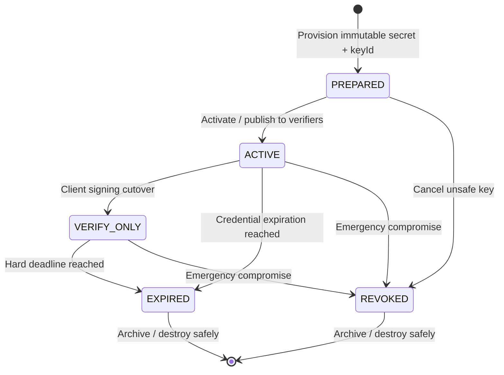
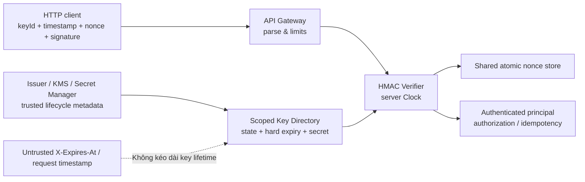
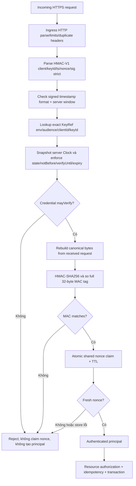

# Credential expiration trong HMAC Request Authentication

## Mục tiêu học tập

Sau bài học, bạn có thể:

- Giải thích **credential expiration** đối với shared secret dùng để ký HTTP request bằng HMAC: khóa có thể vẫn tồn tại trong bộ nhớ, nhưng **server không còn được phép xác minh request bằng khóa đó** sau hạn hiệu lực.
- Phân biệt **credential/key expiry**, mốc **ngừng ký request mới**, thời hạn **verify-only**, **thu hồi khẩn cấp**, thời hạn **timestamp của request**, TTL của **nonce store** và retention của **idempotency ledger**.
- Định nghĩa chính xác điều kiện thời gian **`notBefore ≤ serverNow < verifyUntil`**, với giới hạn cứng `credentialExpiresAt`, sử dụng **`Clock`** đáng tin của server và quy tắc biên rõ ràng.
- Hiểu vì sao không thể “cứu” một credential hết hạn bằng cách gửi timestamp cũ, tăng clock-skew window hoặc chấp nhận một chữ ký toán học đúng.
- Thiết kế vòng đời `PREPARED → ACTIVE → VERIFY_ONLY → EXPIRED/REVOKED`, luân chuyển `keyId`/shared secret an toàn trước khi credential cũ hết hạn, và tách biệt signer policy với verifier policy.
- Viết mã Java 17 dùng `Instant`, `Clock`, `Mac.getInstance("HmacSHA256")`, `MessageDigest.isEqual`, scoped `KeyDirectory` và `NonceStore`; kiểm thử **mốc ngay trước, đúng bằng và ngay sau expiration**.
- Xử lý cache key state, nhiều replica/region, KMS outage, secret injection, proxy/gateway rewrite, request retries và key compromise theo chính sách **fail closed**.
- Phân biệt credential còn hiệu lực để **authentication** với quyền **authorization** trên tài nguyên, và giải thích vì sao replay/idempotency vẫn phải được xử lý độc lập.

**Ngữ cảnh:** Bài thuộc chương **Credential lifecycle**, chủ đề **Credential expiration**, của module `SECURITY_AUTHENTICATION_HMAC_REQUEST_AUTHENTICATION`. Module hướng đến xác thực HTTP request bằng **HMAC với shared secret** và **canonical request** bao gồm phương thức HTTP, URI, signed headers hoặc body theo hợp đồng ký; người học thực hành xác minh chữ ký, chống replay bằng timestamp/nonce, key rotation, kiểm thử proxy/gateway và phân biệt xác thực với phân quyền.

> Tên scheme `HMAC-V1`, các trường `client/keyid/ts/nonce/sig`, endpoint và mốc thời gian ở đây là **profile học tập tự định nghĩa**, không phải tiêu chuẩn mặc định của mọi HMAC API. Các thời điểm cố định trong ví dụ Java dùng cho unit test; production phải lấy thời gian từ đồng hồ server được quản lý.

## 1. “Credential hết hạn” thực sự nghĩa là gì?

Trong mô hình **symmetric HTTP HMAC**, credential thường gồm một **shared secret** và metadata xác định phạm vi sử dụng của nó:

```text
CredentialRecord
  environment          = production
  audience             = orders-api
  clientId             = partner-17
  keyId                = k1
  secret               = 32 bytes từ CSPRNG (KHÔNG hiển thị)
  principal            = svc:partner-17
  state                = ACTIVE | VERIFY_ONLY | REVOKED | ...
  notBefore            = 2026-11-01T00:00:00Z
  signUntil            = 2026-11-28T00:00:00Z
  verifyUntil          = 2026-11-28T00:01:30Z
  credentialExpiresAt  = 2026-11-28T00:01:30Z
```

Các mốc trên là **ví dụ**, không phải giá trị chung cho mọi credential. Secret có thể vẫn được lưu trên máy client, trong KMS hoặc RAM server **sau** `credentialExpiresAt`; nhưng theo policy, verifier phải từ chối nó.

Vì thế, **expiration là một quyết định kiểm soát truy cập dựa trên metadata và đồng hồ server**, chứ không phải phép biến đổi mật mã khiến secret “tự mất khả năng tạo HMAC”.

### Một chữ ký đúng không đồng nghĩa credential còn hiệu lực

Giả sử attacker còn giữ secret k1 và tự ký:

```text
now = 2026-11-28T00:01:30Z
tag = HMAC-SHA256(secret-k1, canonical-request)
```

Tag có thể **đúng về mặt toán học**, nhưng nếu k1 hết hạn tại `00:01:30Z`, verifier phải **reject** dù timestamp/nonce và canonicalization đều hợp lệ. `Mac.doFinal` không có kiến thức về `expiresAt`. **Chính ứng dụng hoặc KMS policy phải enforcement expiration**.

### Vì sao đặt hạn credential?

- **Giảm thời gian sử dụng credential cũ:** bí mật bị lộ hoặc client không còn được phép truy cập sẽ không được dùng mãi.
- **Buộc rotation định kỳ:** tạo cơ hội nâng cấp provisioning, kiểm toán owner, key policy và loại bỏ secret cũ.
- **Giới hạn credential của đối tác tạm thời:** một integration, môi trường test hoặc chiến dịch chỉ có thời hạn.
- **Kiểm soát chi tiết lifecycle:** ngừng ký mới trước khi hoàn toàn ngừng xác minh để giảm gián đoạn in-flight traffic.

Expiration **không bảo đảm** một credential đã bị lộ không thể bị lạm dụng **trước** khi hết hạn. Sự cố compromise phải xử lý bằng **revocation sớm**, không ngồi chờ `expiresAt`.

## 2. Sáu loại “thời hạn” dễ bị trộn lẫn

Trong hệ thống HMAC authentication, từ “TTL” hoặc “expiry” có thể nói đến **những vật khác nhau**.

| Loại thời hạn | Áp dụng cho | Ví dụ | Điều nó không thay thế |
|---|---|---|---|
| **Credential expiration** | Một key record `(env,audience,clientId,keyId)` | `credentialExpiresAt` | Không tự kiểm tra MAC, replay hay quyền |
| **Signing cutoff** | Signer tạo **request mới** | `signUntil` | Không tự ép ai đã giữ secret phải ngừng tính MAC |
| **Verification deadline** | Verifier nhận chữ ký theo key ID | `verifyUntil` | Không phải timestamp request |
| **Timestamp window** | Một **HTTP request** cụ thể | `now−300 ≤ t ≤ now+300` | Không kéo dài key lifetime |
| **Nonce TTL** | State của nonce đã claim | `≥ 2W + margin` | Không quản lý credential hoặc business duplicate |
| **Idempotency retention** | Một logical business operation | Ví dụ 24 giờ theo API contract | Không chống exact request replay |

Khi key hết hạn, request bị reject **ngay cả khi timestamp còn trong cửa sổ**. Khi request timestamp hết hạn, request bị reject **ngay cả khi key vẫn ACTIVE**. Cả hai là các điều kiện độc lập và đồng thời cần thỏa mãn.

### Cơ sở kỹ thuật

Trong request profile:

```http
POST /v1/orders HTTP/1.1
Host: api.example.test
Content-Type: application/json
Idempotency-Key: order-2026-001
Authorization: HMAC-V1 client="partner-17", keyid="k1", ts="<unix-seconds>", nonce="<22-char-base64url>", sig="<43-char-base64url>"

{"orderId":"O-42","amountMinor":120000}
```

`ts` là **thời điểm client tự khai được HMAC bảo vệ**; `credentialExpiresAt` là **metadata tin cậy do server/provider kiểm soát**. Không thay thế metadata server bằng một `expires` do client tự điền.

## 3. Quy tắc thời gian: dùng serverNow và so biên nghiêm ngặt

Chọn ba thời điểm (Java `Instant`):

- `notBefore`: mốc sớm nhất key bắt đầu có hiệu lực;
- `verifyUntil`: mốc cuối cho phép xác minh request với key;
- `credentialExpiresAt`: **hard expiration** của credential, không được kéo dài bởi yêu cầu trên wire.

Server được phép verify tại thời điểm `serverNow` nếu:

\[
\mathrm{notBefore} \leq \mathrm{serverNow}
\quad\land\quad
\mathrm{serverNow} < \mathrm{verifyUntil}
\quad\land\quad
\mathrm{serverNow} < \mathrm{credentialExpiresAt}
\]

Ngoài ra `state` phải cho phép verify và key không bị revoke.

**Biên trên là exclusive:** đúng lúc `serverNow == credentialExpiresAt` hoặc `serverNow == verifyUntil` là **hết quyền**. Điều này tránh cách diễn đạt nhập nhằng “đến hết ngày 28/11” giữa các timezone/độ chính xác timestamp.

### Lấy thời điểm từ đâu?

**Đúng ở Java:**

```java
import java.time.Clock;
import java.time.Instant;

Clock serverClock = Clock.systemUTC(); // Production: clock OS được vận hành.
Instant serverNow = serverClock.instant();
boolean inTime = !serverNow.isBefore(notBefore) &&
                 serverNow.isBefore(verifyUntil) &&
                 serverNow.isBefore(credentialExpiresAt);
```

Không dùng `LocalDateTime.now()` để so với mốc UTC đã khai báo, hoặc format theo timezone hệ điều hành rồi parse lại. `Instant` mô tả một **thời điểm tuyệt đối**; `Clock` cho phép test các biên mà không `Thread.sleep`.

### Không dùng timestamp của client để kiểm tra key expiry

**Sai:**

```java
// Sai: t được client tự khai, dù đã ký bằng chính secret hết hạn.
boolean keyStillValid =
        requestTimestamp < credentialExpiresAtEpochSeconds;
```

Kẻ còn biết secret k1 có thể tự tạo **một request mới với `ts` cũ** rồi tính lại HMAC k1. Nếu verifier chấp nhận dựa trên “ts trước expiresAt”, đặc biệt với clock window lớn, key bị lộ có thể tiếp tục được sử dụng sau deadline.

**Đúng:** key policy so với **serverNow đáng tin**. Signed timestamp chỉ phục vụ freshness window của request, không phải bằng chứng một chữ ký được phát hành khi key còn hạn.

### Bảng boundary tại mốc hết hạn

Giả sử `verifyUntil = credentialExpiresAt = 2026-11-28T00:01:30Z`, key `VERIFY_ONLY`, chưa revoke.

| `serverNow` | HMAC đúng? | Credential policy | Quyết định |
|---|---|---|---|
| `00:01:29.999Z` | Có | Trước deadline | Có thể tiếp tục kiểm tra replay/authz |
| **`00:01:30.000Z`** | Có | **Đúng expiration** | **Reject** |
| `00:01:30.001Z` | Có | Sau deadline | **Reject** |
| `00:01:29Z` | Không | Key còn hạn | Reject do MAC sai |
| `00:01:29Z` | Có nhưng key đã REVOKED | State không cho phép | **Reject** |

Bảng này chỉ nói về **key policy**. Muốn xử lý nghiệp vụ còn cần timestamp hợp lệ, nonce chưa dùng, quyền tài nguyên và idempotency policy.

## 4. Key lifecycle: expiration, verify-only và revocation khác nhau

Nên quản lý từng phiên bản secret như một bản ghi **bất biến về key material**. Ví dụ các trạng thái:

| Key state | Được dùng ký **request mới**? | Verifier được nhận? | Điều kiện bổ sung |
|---|---|---|---|
| `PREPARED` | Không | Không | Secret đã provision nhưng chưa activate |
| `ACTIVE` | Có | Có | Trong `[notBefore, signUntil)` để sign; chưa quá hard verify deadline |
| `VERIFY_ONLY` | Không theo signer policy | Có | Chưa vượt `verifyUntil` và `credentialExpiresAt` |
| `EXPIRED` (suy ra bởi clock hoặc lưu riêng) | Không | Không | `serverNow ≥ effective expiration` |
| `REVOKED` | Không | Không | Thu hồi bất kỳ lúc nào, ưu tiên cao nhất |

Sơ đồ:



**Một sắc thái quan trọng:** `EXPIRED` có thể là **kết quả tính tại thời điểm verify** chứ không nhất thiết phải có một job chuyển state chính xác từng mili giây. Dù DB row vẫn ghi `state=ACTIVE`, server phải reject nếu `serverNow ≥ credentialExpiresAt`.

### Cách dùng ba mốc ký/xác minh/hết hạn

Với một key chưa bị revoke:

- **Signer:** chỉ ký bằng key `ACTIVE` khi `notBefore ≤ signerNow < signUntil` và `signerNow < credentialExpiresAt`.
- **Verifier:** cho `ACTIVE` hoặc `VERIFY_ONLY` verify khi `notBefore ≤ serverNow < verifyUntil` và `serverNow < credentialExpiresAt`.
- Policy cấu hình hợp lệ nên thỏa `notBefore < signUntil ≤ verifyUntil ≤ credentialExpiresAt` trong profile này.

`signUntil` là policy signer phía client/SDK. Nếu attacker nắm key ở `VERIFY_ONLY`, anh ta vẫn có thể **tính HMAC mới**: server không thể phân biệt “MAC thật sự ký trước cutover” với “MAC vừa mới tạo bằng secret cũ”, nếu không có chứng cứ tin cậy bổ sung. Vì vậy **verify-only phải có deadline cứng**, không kéo dài vô hạn.

### Key state và key ID

Khi cấp secret mới, phải tạo **key ID mới**. Không đổi 32 bytes bên dưới cùng `keyid=k1` rồi bảo “credential đã được gia hạn”: verifier A có thể giữ secret cũ, verifier B nhận secret mới, request pass/fail tùy replica và làm revoke khó tin cậy.

## 5. Scope, nguồn dữ liệu và trust boundary của credential

Một key record nên được định danh theo:

```text
KeyRef = (
  environment = "production",
  audience    = "orders-api",
  clientId    = "partner-17",
  keyId       = "k1"
)
```

| Trường | Nguồn đáng tin | Lưu ý |
|---|---|---|
| `environment` | Runtime/ingress/server config | Client không được tự đổi từ sandbox sang production |
| `audience` | Route/service policy đã xác minh | Không lấy từ `X-Forwarded-Host` untrusted |
| `clientId` | Từ header, chỉ là **lookup claim** | Identity chỉ tin sau khi HMAC khớp key đúng owner |
| `keyId` | Từ header, chỉ là **lookup claim** | Không dùng để tạo arbitrary file/KMS path |
| `principal` | Key directory do server kiểm soát | Dùng cho authorization sau khi verify |
| `notBefore/signUntil/verifyUntil/expiresAt` | Credential issuer/key registry | Không lấy thời hạn từ HTTP headers do caller kiểm soát |
| `secret` | Secret manager/KMS/volume được provision | Không hardcode, không đưa vào HTTP request/log |

**Không** lookup chỉ bằng `keyId` toàn cục, không “thử mọi secret cho tới khi tag khớp” và không cho key của client A dùng trên audience B. Sự tồn tại của key record **không tự chứng minh** caller được xác thực.

### Security boundaries khi key hết hạn



Secret còn trong JVM sau expiry không tự cho phép verify. Ngược lại, việc xóa secret khỏi một JVM nhưng quên cập nhật key state ở replica khác cũng **chưa đảm bảo revoke/expiration toàn fleet**.

## 6. Credential expiration khác timestamp freshness của request

Hai phép kiểm tra dùng **cùng đồng hồ server**, nhưng áp dụng lên hai dữ kiện khác nhau.

### Kiểm tra freshness

Giả sử request có signed timestamp `t` là Unix epoch seconds, server tính `nowSec` và cửa sổ `W=300`:

\[
nowSec-W \leq t \leq nowSec+W
\]

Ở ví dụ này, **hai biên time window được chấp nhận**. Timestamp cần parse strict ASCII decimal, không nhận milliseconds/ISO 8601 tự động và phải được HMAC ký.

### Kiểm tra credential

Key có thời hạn `expiryInstant`:

\[
serverNowInstant < expiryInstant
\]

Không có cơ chế “±300 giây theo expiry” chỉ vì request cho phép lệch đồng hồ ±300 giây. Đây là **hai policy riêng**. Nếu muốn cho phép verify-only grace, phải phát hành `verifyUntil` riêng, công bố deadline, theo dõi overlap và tuyệt đối không vượt `credentialExpiresAt` đã định.

### Ví dụ tấn công khi dùng nhầm timestamp

```text
Server now        = 2026-11-28T00:01:31Z
k1 expiresAt      = 2026-11-28T00:01:30Z
Attacker owns k1 secret and sends:
  ts = 2026-11-28T00:01:29Z
  nonce = fresh value
  tag = HMAC(k1, canonicalRequestWithTs)

Request freshness = PASS (age 2 seconds)
HMAC mathematics   = PASS (attacker has k1)
Credential expiry  = FAIL (server now >= expiresAt)
Overall            = REJECT
```

Nếu verifier xét expiry theo `ts`, attacker có thể vượt qua chính sách mặc dù thời hạn credential đã kết thúc. **Đừng dùng timestamp có HMAC làm mốc tin cậy để miễn thời hạn key.**

### Clock skew của server

Các replica phải đồng bộ thời gian bằng NTP/chrony hoặc cơ chế vận hành phù hợp và quan sát drift. Một replica chậm 500 ms có thể còn chấp nhận key ở ngay sát expiration trong khi replica khác từ chối. Chính sách cần xác định **mức sai lệch clock tối đa**, giám sát, gate readiness hoặc cách dùng nguồn authoritative phù hợp. Không hứa rằng `Clock.systemUTC()` bảo đảm clock giữa các máy giống nhau.

**Không dùng `Thread.sleep` để test thời hạn.** Dùng `Clock.fixed` với những mốc biên chính xác, tránh flaky test và sự phụ thuộc timezone máy thử nghiệm.

## 7. Rotation trước expiration: timeline không làm gián đoạn dịch vụ

Một ví dụ cho client `partner-17`:

```text
T0: k1 ACTIVE, k2 PREPARED
    Provision k2 tới tất cả verifier

T1: k2 ACTIVE; client chuyển sang ký k2
    k1 chuyển sang VERIFY_ONLY với verifyUntil cứng

T2: k1 credentialExpiresAt / verifyUntil
    mọi verifier phải REJECT k1 kể cả signature hợp lệ

T3: k1 retire/archive/destroy; k2 tiếp tục ACTIVE
```

`T1 < T2` giúp xử lý in-flight requests và client rollouts trễ. Nhưng **khoảng overlap có giới hạn** khiến credential cũ vẫn có thể bị lạm dụng nếu đã lộ. Policy bảo mật phải cân bằng khả năng nâng cấp client, latency, thời gian queue và rủi ro bị lộ.

### Runbook theo thứ tự

1. **Inventory:** liệt kê key owner, client SDK, replica/region, deadline, traffic theo key ID; không ghi secret.
2. **Provision:** sinh secret k2 độc lập, cấp key ID mới, lưu trong secret manager/KMS; không thay bytes dưới k1.
3. **Rollout verifier trước:** tất cả replica biết k2 và key state mới trước khi client ký bằng k2.
4. **Activate:** chuyển k2 từ `PREPARED` sang `ACTIVE`, kiểm tra HMAC canary với k2 từ end-to-end client.
5. **Cutover signer:** client mới và queue worker bắt đầu dùng `keyid=k2`, sinh timestamp/nonce/HMAC mới; **giữ Idempotency-Key** khi retry cùng logical operation.
6. **Overlap hữu hạn:** k1 ở `VERIFY_ONLY`, chỉ verify tới `verifyUntil`, không kéo `credentialExpiresAt` vô hạn.
7. **Expire/revoke k1:** mọi verifier reject k1 tại deadline; cập nhật/invalidate cache, vùng failover và trạng thái KMS.
8. **Audit:** loại bỏ references cũ ở CI, secret mounts, backups và quyền truy cập theo chính sách; kiểm chứng không còn request k1 được chấp nhận.

### Sign cutoff không phải “ký trước thì được nhận mãi”

Một request có HMAC ký trước cutover nhưng **đến sau hard key expiry** phải bị từ chối theo policy này. Nếu kinh doanh cần xử lý batch/queue kéo dài, phải chọn kiến trúc **ký gần thời điểm gửi** bằng key còn hiệu lực hoặc **một cơ chế chứng từ khác có thời gian hiệu lực riêng**, không bỏ qua expiry vì tin một timestamp client khai.

## 8. Hợp đồng ký HMAC có ràng buộc key ID và timestamp

Profile `hmac-credential-expiry-v1` cho `POST /v1/orders`:

```http
POST /v1/orders HTTP/1.1
Host: api.example.test
Content-Type: application/json
Idempotency-Key: order-2026-001
Authorization: HMAC-V1 client="partner-17", keyid="k2", ts="<unix-seconds>", nonce="<22-char-base64url>", sig="<43-char-base64url>"

{"orderId":"O-42","amountMinor":120000}
```

Các giá trị `<...>` chỉ là placeholder. Giả sử body có đúng UTF-8 bytes hiển thị, **không newline cuối**.

Canonical text:

```text
hmac-credential-expiry-v1
POST
/v1/orders
host:api.example.test
content-type:application/json
idempotency-key:order-2026-001
environment:production
audience:orders-api
auth-scheme:hmac-v1
client:partner-17
keyid:k2
ts:<unix-seconds>
nonce:<22-char-base64url>
body-sha256:<base64url-sha256-of-exact-raw-body>
```

**Byte-level contract:**

- Thứ tự dòng cố định, nối bằng **LF** (`0x0A`), **không LF cuối**.
- Encode canonical text thành **UTF-8 không BOM**.
- Method/URI/Host/Content-Type/Idempotency-Key lấy từ **incoming request đã parse theo profile**, không chỉ từ tham số do SDK lưu.
- `environment` và `audience` là giá trị cấu hình/phạm vi đáng tin; verifier **không** lấy từ một `X-Environment` untrusted để đổi key namespace.
- `client`, `keyid`, `ts`, `nonce` từ **một Authorization HMAC-V1 đã parse**. `keyid` bắt buộc được ký để ràng buộc phiên bản key.
- `body-sha256` tính từ **exact raw body bytes**, không hash JSON tự serialize lại.
- `sig` **không nằm trong canonical text**, vì chính nó là tag đang được tính.

Tính:

```text
bodyDigest = SHA256(exactRawBodyBytes)
msgBytes   = UTF8(canonicalText)
tag        = HMAC-SHA256(secretForExactKeyRef, msgBytes)
sigText    = Base64URL_NoPadding(tag)  // 32 bytes -> 43 chars
```

**Credential expiration không phải một field client được quyền ký để “tự quyết hạn”.** Thời hạn thuộc key record phía server. Một header `exp="<date>"` do client khai, dù có HMAC bằng key đã hết hạn, **không** có quyền gia hạn credential.

## 9. Quy trình verifier: expiry gate nằm ở đâu?

Pipeline cần giữ các bất biến:



Một số hệ thống làm timestamp prefilter sớm để giảm tải; điều đó không biến timestamp thành principal. Những bất biến không đổi:

1. **Không** tin client/key ID trước HMAC; chỉ dùng cho lookup ứng viên có giới hạn.
2. **Không** xác minh bằng credential đã hết hạn hoặc revoked dù tag có thể tính đúng.
3. **Không** nhận một key khác bằng fallback nếu key ID đang khai đã hết hạn.
4. **Không** claim nonce khi HMAC chưa đúng; không thực hiện side effect khi nonce claim thất bại.
5. **Không** bỏ authorization sau authentication/replay gate.

### Race giữa expiry và in-flight request

Nếu credential hết hạn giữa **bắt đầu verify** và **business commit**, cần chính sách rõ ràng:

- Profile bài này **lấy một `serverNow` snapshot tại điểm quyết định authentication**, enforce expiry ở đó. Một request được xác minh **trước** deadline có thể tiếp tục xử lý theo transaction policy ngay cả khi clock vượt deadline trong lúc backend làm việc.
- Nếu endpoint đòi “tuyệt đối không commit sau deadline” thì cần **kiểm tra quyền/key state lại ở điểm commit**, hoặc một authorization lease/fencing model; việc sample clock đầu request chưa đủ.
- **Revocation ngay tức thì trên mọi replica** còn khó hơn: phải giải quyết propagation/active-request policy. Đừng mô tả một cache có TTL vài phút là chứng minh đã revoke tức thì.

Đây là **lựa chọn kiến trúc**, không thể suy ra chỉ từ tên field `credentialExpiresAt`.

## 10. Java 17: mô hình key expiry, signer và HMAC verifier

Ví dụ này cố định **endpoint, Host và canonical version** để nhấn mạnh **credential expiration**. Các lớp `KeyDirectory` và `NonceStore` là interface; HTTP adapter cần tạo `Request` từ dữ liệu thực nhận và phát hiện **duplicate Authorization header** trước khi gọi verifier.

**Điểm bảo mật chính:** secret mới phải có key ID mới; signer kiểm tra `signUntil`, verifier kiểm tra `verifyUntil` và `credentialExpiresAt` theo **server clock**, không dùng timestamp từ client để chọn trạng thái key.

### 10.1. Mã Java tự chứa

```java
import java.nio.charset.StandardCharsets;
import java.security.GeneralSecurityException;
import java.security.MessageDigest;
import java.security.SecureRandom;
import java.time.Clock;
import java.time.Instant;
import java.time.ZoneOffset;
import java.util.Arrays;
import java.util.Base64;
import java.util.Map;
import java.util.Optional;
import java.util.Set;
import java.util.concurrent.ConcurrentHashMap;
import java.util.regex.Matcher;
import java.util.regex.Pattern;
import javax.crypto.Mac;
import javax.crypto.spec.SecretKeySpec;

public final class CredentialExpirationHmacV1 {
    private static final String CONTRACT = "hmac-credential-expiry-v1";
    private static final String ENV = "production";
    private static final String AUD = "orders-api";
    private static final String HOST = "api.example.test";
    private static final String TARGET = "/v1/orders";
    private static final String TYPE = "application/json";
    private static final long SKEW_SEC = 300L;
    private static final long NONCE_TTL_SEC = 605L;
    private static final long MAX_EPOCH = 253402300799L;
    private static final Base64.Encoder B64 =
            Base64.getUrlEncoder().withoutPadding();

    private static final Pattern ID =
            Pattern.compile("[A-Za-z0-9][A-Za-z0-9._-]{0,63}");
    private static final Pattern IDEM =
            Pattern.compile("[A-Za-z0-9][A-Za-z0-9._-]{0,79}");
    private static final Pattern TS =
            Pattern.compile("[1-9][0-9]{0,11}");
    private static final Pattern NONCE =
            Pattern.compile("[A-Za-z0-9_-]{22}");
    private static final Pattern SIGNATURE =
            Pattern.compile("[A-Za-z0-9_-]{43}");
    // Profile: đúng 5 quoted params, fixed order và spacing.
    // Scheme/param names case-insensitive; values case-sensitive.
    private static final Pattern AUTH = Pattern.compile(
            "(?i:HMAC-V1) (?i:client)=\"([A-Za-z0-9][A-Za-z0-9._-]{0,63})\", " +
            "(?i:keyid)=\"([A-Za-z0-9][A-Za-z0-9._-]{0,63})\", " +
            "(?i:ts)=\"([1-9][0-9]{0,11})\", " +
            "(?i:nonce)=\"([A-Za-z0-9_-]{22})\", " +
            "(?i:sig)=\"([A-Za-z0-9_-]{43})\"");

    private CredentialExpirationHmacV1() {}

    public enum State { PREPARED, ACTIVE, VERIFY_ONLY, REVOKED }

    public record KeyRef(
            String environment, String audience,
            String clientId, String keyId) {}

    public record KeyRecord(
            KeyRef ref,
            String principal,
            State state,
            Instant notBefore,
            Instant signUntil,
            Instant verifyUntil,
            Instant credentialExpiresAt,
            byte[] secret) {

        public KeyRecord {
            if (ref == null || principal == null ||
                    state == null || notBefore == null ||
                    signUntil == null || verifyUntil == null ||
                    credentialExpiresAt == null || secret == null ||
                    secret.length != 32 ||
                    !notBefore.isBefore(signUntil) ||
                    signUntil.isAfter(verifyUntil) ||
                    verifyUntil.isAfter(credentialExpiresAt)) {
                throw new IllegalArgumentException("Invalid key record");
            }
            secret = secret.clone(); // Không giữ array do caller sở hữu.
        }

        @Override
        public byte[] secret() {
            return secret.clone();
        }

        // Signer policy; không thể ép người đã biết secret ngừng ký.
        public boolean maySign(Instant now) {
            return state == State.ACTIVE &&
                    !now.isBefore(notBefore) &&
                    now.isBefore(signUntil) &&
                    now.isBefore(credentialExpiresAt);
        }

        // Verifier policy dựa trên SERVER NOW, không request timestamp.
        public boolean mayVerify(Instant now) {
            return (state == State.ACTIVE ||
                    state == State.VERIFY_ONLY) &&
                    !now.isBefore(notBefore) &&
                    now.isBefore(verifyUntil) &&
                    now.isBefore(credentialExpiresAt);
        }
    }

    public record Claims(
            String clientId, String keyId, String timestamp,
            String nonce) {}

    public record Parsed(Claims claims, byte[] suppliedTag) {}

    public record Request(
            String method, String rawTarget, String publicHost,
            String contentType, String idempotencyKey, byte[] rawBody) {
        public Request {
            if (rawBody == null) {
                throw new IllegalArgumentException("Missing raw body");
            }
            rawBody = rawBody.clone();
        }
        @Override
        public byte[] rawBody() {
            return rawBody.clone();
        }
    }

    public interface KeyDirectory {
        Optional<KeyRecord> find(KeyRef ref);
    }

    public interface NonceStore {
        // Production: atomic insert-if-absent + TTL across ALL replicas.
        boolean claim(String env, String audience,
                      String authenticatedClient, String nonce,
                      long ttlSeconds);
    }

    public static String freshNonce(SecureRandom random) {
        byte[] bytes = new byte[16];
        random.nextBytes(bytes);
        return B64.encodeToString(bytes);
    }

    private static byte[] decodeCanonical(
            String text, Pattern grammar, int expectedSize) {
        if (text == null || !grammar.matcher(text).matches()) {
            throw new IllegalArgumentException("Invalid Base64URL format");
        }
        final byte[] decoded;
        try {
            decoded = Base64.getUrlDecoder().decode(text);
        } catch (IllegalArgumentException malformed) {
            throw new IllegalArgumentException("Invalid Base64URL");
        }
        if (decoded.length != expectedSize ||
                !B64.encodeToString(decoded).equals(text)) {
            throw new IllegalArgumentException("Noncanonical Base64URL");
        }
        return decoded;
    }

    private static long timestampSeconds(String text) {
        if (text == null || !TS.matcher(text).matches()) {
            throw new IllegalArgumentException("Invalid timestamp text");
        }
        long ts = Long.parseLong(text);
        if (ts > MAX_EPOCH) {
            throw new IllegalArgumentException("Timestamp out of range");
        }
        return ts;
    }

    private static void validateClaims(Claims c) {
        if (c == null || c.clientId() == null ||
                !ID.matcher(c.clientId()).matches() ||
                c.keyId() == null ||
                !ID.matcher(c.keyId()).matches()) {
            throw new IllegalArgumentException("Invalid key identity");
        }
        timestampSeconds(c.timestamp());
        decodeCanonical(c.nonce(), NONCE, 16);
    }

    private static void validateRequest(Request r) {
        if (r == null ||
                !"POST".equals(r.method()) ||
                !TARGET.equals(r.rawTarget()) ||
                !HOST.equals(r.publicHost()) ||
                !TYPE.equals(r.contentType()) ||
                r.idempotencyKey() == null ||
                !IDEM.matcher(r.idempotencyKey()).matches() ||
                r.rawBody().length == 0 ||
                r.rawBody().length > 16 * 1024) {
            throw new IllegalArgumentException("Invalid signed request");
        }
    }

    public static Parsed parseAuthorization(String value) {
        // HTTP adapter PHẢI reject duplicate Authorization trước.
        if (value == null || value.length() > 512) {
            throw new IllegalArgumentException("Invalid Authorization");
        }
        Matcher m = AUTH.matcher(value);
        if (!m.matches()) {
            throw new IllegalArgumentException("Bad auth-param format");
        }
        Claims claims = new Claims(
                m.group(1), m.group(2), m.group(3), m.group(4));
        validateClaims(claims);
        byte[] tag = decodeCanonical(m.group(5), SIGNATURE, 32);
        return new Parsed(claims, tag);
    }

    public static byte[] canonical(Request r, Claims c)
            throws GeneralSecurityException {
        validateRequest(r);
        validateClaims(c);
        byte[] bodyHash = MessageDigest.getInstance("SHA-256")
                .digest(r.rawBody());
        String text = String.join("\n",
                CONTRACT,
                "POST",
                TARGET,
                "host:" + r.publicHost(),
                "content-type:" + r.contentType(),
                "idempotency-key:" + r.idempotencyKey(),
                "environment:" + ENV,
                "audience:" + AUD,
                "auth-scheme:hmac-v1",
                "client:" + c.clientId(),
                "keyid:" + c.keyId(),
                "ts:" + c.timestamp(),
                "nonce:" + c.nonce(),
                "body-sha256:" + B64.encodeToString(bodyHash));
        return text.getBytes(StandardCharsets.UTF_8);
    }

    private static byte[] hmac(byte[] secret, Request r, Claims c)
            throws GeneralSecurityException {
        try {
            Mac mac = Mac.getInstance("HmacSHA256");
            mac.init(new SecretKeySpec(secret, "HmacSHA256"));
            return mac.doFinal(canonical(r, c));
        } finally {
            // Xóa bản sao tạm, không hứa zeroize mọi bản trong JVM.
            Arrays.fill(secret, (byte) 0);
        }
    }

    private static boolean timeWindowAccepts(
            long signedSeconds, long nowSeconds) {
        if (nowSeconds < 0 || nowSeconds > MAX_EPOCH) {
            return false;
        }
        long delta = signedSeconds - nowSeconds;
        return delta >= -SKEW_SEC && delta <= SKEW_SEC;
    }

    // Chỉ sử dụng cho test/client; server không ký hộ client production.
    public static String sign(
            KeyRecord key, Request request,
            Claims claims, Clock signerClock)
            throws GeneralSecurityException {
        if (key == null || claims == null ||
                !key.ref().clientId().equals(claims.clientId()) ||
                !key.ref().keyId().equals(claims.keyId()) ||
                !ENV.equals(key.ref().environment()) ||
                !AUD.equals(key.ref().audience()) ||
                !key.maySign(signerClock.instant()) ||
                !timeWindowAccepts(
                        timestampSeconds(claims.timestamp()),
                        signerClock.instant().getEpochSecond())) {
            throw new IllegalArgumentException("Cannot sign with this key");
        }
        String tag = B64.encodeToString(
                hmac(key.secret(), request, claims));
        return "HMAC-V1 client=\"" + claims.clientId() +
                "\", keyid=\"" + claims.keyId() +
                "\", ts=\"" + claims.timestamp() +
                "\", nonce=\"" + claims.nonce() +
                "\", sig=\"" + tag + "\"";
    }

    public static Optional<String> authenticate(
            Request incoming, String authorizationValue,
            Clock serverClock, KeyDirectory directory, NonceStore nonces)
            throws GeneralSecurityException {
        final Parsed parsed;
        try {
            parsed = parseAuthorization(authorizationValue);
            validateRequest(incoming);
        } catch (IllegalArgumentException badFormat) {
            return Optional.empty();
        }

        // MỘT serverNow snapshot dùng cho timestamp + credential policy.
        Instant now = serverClock.instant();
        long ts = timestampSeconds(parsed.claims().timestamp());
        if (!timeWindowAccepts(ts, now.getEpochSecond())) {
            return Optional.empty();
        }

        // KeyRef lấy env/audience từ server; không chấp nhận client tự đổi.
        KeyRef ref = new KeyRef(
                ENV, AUD,
                parsed.claims().clientId(),
                parsed.claims().keyId());
        Optional<KeyRecord> found = directory.find(ref);
        if (found.isEmpty()) return Optional.empty();

        KeyRecord key = found.get();
        if (!ref.equals(key.ref()) || key.principal() == null ||
                !key.mayVerify(now)) {
            return Optional.empty();
        }

        byte[] expected = hmac(key.secret(), incoming, parsed.claims());
        if (!MessageDigest.isEqual(expected, parsed.suppliedTag())) {
            return Optional.empty();
        }

        // Chỉ claim nonce khi key CHƯA expired, MAC đúng.
        boolean fresh;
        try {
            fresh = nonces.claim(
                    ENV, AUD, key.ref().clientId(),
                    parsed.claims().nonce(), NONCE_TTL_SEC);
        } catch (RuntimeException unavailable) {
            return Optional.empty(); // Fail closed.
        }
        if (!fresh) return Optional.empty();
        return Optional.of(key.principal()); // Authn, chưa authz.
    }

    public static void main(String[] args)
            throws GeneralSecurityException {
        Instant cutover = Instant.parse("2026-11-28T00:00:00Z");
        Instant oldDeadline = cutover.plusSeconds(90);
        Clock beforeCutover = Clock.fixed(
                cutover.minusSeconds(1), ZoneOffset.UTC);
        Clock atCutover = Clock.fixed(cutover, ZoneOffset.UTC);
        Clock beforeExpiry = Clock.fixed(
                oldDeadline.minusMillis(1), ZoneOffset.UTC);
        Clock atExpiry = Clock.fixed(
                oldDeadline, ZoneOffset.UTC);

        SecureRandom random = new SecureRandom();
        byte[] oldBytes = new byte[32];
        byte[] newBytes = new byte[32];
        random.nextBytes(oldBytes);
        random.nextBytes(newBytes);

        KeyRef oldRef = new KeyRef(ENV, AUD, "partner-17", "k1");
        KeyRef newRef = new KeyRef(ENV, AUD, "partner-17", "k2");
        Instant activated = cutover.minusSeconds(86400);

        // Client k1 signing trước cutover; server k1 VERIFY_ONLY sau.
        KeyRecord oldSigner = new KeyRecord(
                oldRef, "svc:partner-17", State.ACTIVE,
                activated, cutover, oldDeadline, oldDeadline, oldBytes);
        KeyRecord oldVerifyOnly = new KeyRecord(
                oldRef, "svc:partner-17", State.VERIFY_ONLY,
                activated, cutover, oldDeadline, oldDeadline, oldBytes);
        KeyRecord current = new KeyRecord(
                newRef, "svc:partner-17", State.ACTIVE,
                cutover.minusSeconds(1),
                cutover.plusSeconds(3600),
                cutover.plusSeconds(5400),
                cutover.plusSeconds(5400), newBytes);
        Arrays.fill(oldBytes, (byte) 0);
        Arrays.fill(newBytes, (byte) 0);

        Map<KeyRef, KeyRecord> records =
                Map.of(oldRef, oldVerifyOnly, newRef, current);
        KeyDirectory keys = ref -> Optional.ofNullable(records.get(ref));

        // TEST ONLY: local, không TTL, không shared các replica.
        Set<String> accepted = ConcurrentHashMap.newKeySet();
        NonceStore nonces = (env, audience, client, nonce, ttl) ->
                accepted.add(env + "|" + audience + "|" +
                             client + "|" + nonce);

        Request order = new Request(
                "POST", TARGET, HOST, TYPE, "order-2026-001",
                "{\"orderId\":\"O-42\",\"amountMinor\":120000}"
                        .getBytes(StandardCharsets.UTF_8));

        Claims oldClaims = new Claims(
                "partner-17", "k1",
                Long.toString(beforeCutover.instant().getEpochSecond()),
                freshNonce(random));
        String oldHeader = sign(
                oldSigner, order, oldClaims, beforeCutover);

        // Chữ ký k1 tạo trước cutover còn verify trong grace.
        if (!"svc:partner-17".equals(authenticate(
                order, oldHeader, atCutover, keys, nonces).orElse(null))) {
            throw new AssertionError("Valid old in-flight MAC rejected");
        }
        if (authenticate(order, oldHeader, atCutover,
                keys, nonces).isPresent()) {
            throw new AssertionError("Replay accepted");
        }

        // Signing cutoff: đúng cutover, k1 không được ký mới.
        if (oldSigner.maySign(cutover) ||
                oldVerifyOnly.maySign(cutover)) {
            throw new AssertionError("Old key signed after cutover");
        }

        // Một request k1 khác chưa dùng nonce, tag đúng.
        Claims oldUnclaimed = new Claims(
                "partner-17", "k1", oldClaims.timestamp(),
                freshNonce(random));
        String oldFreshHeader = sign(
                oldSigner, order, oldUnclaimed, beforeCutover);
        if (!"svc:partner-17".equals(authenticate(
                order, oldFreshHeader, beforeExpiry,
                keys, nonces).orElse(null))) {
            throw new AssertionError("Just-before-expiry rejected");
        }

        // Request k1 thứ ba có MAC đúng, nonce CHƯA claim:
        // đúng expiration phải bị reject bởi key policy,
        // dù timestamp vẫn trong ±300 giây.
        Claims expiryProbe = new Claims(
                "partner-17", "k1", oldClaims.timestamp(),
                freshNonce(random));
        String expiryHeader = sign(
                oldSigner, order, expiryProbe, beforeCutover);
        if (authenticate(order, expiryHeader, atExpiry,
                keys, nonces).isPresent()) {
            throw new AssertionError("Expired credential accepted");
        }

        // Chuyển sang k2 cho HTTP attempt mới; cùng principal.
        Claims newClaims = new Claims(
                "partner-17", "k2",
                Long.toString(atCutover.instant().getEpochSecond()),
                freshNonce(random));
        String newHeader = sign(
                current, order, newClaims, atCutover);
        if (!"svc:partner-17".equals(authenticate(
                order, newHeader, atCutover, keys, nonces).orElse(null))) {
            throw new AssertionError("New credential rejected");
        }

        // Header keyid bị sửa sau ký: không fallback thử k1/k2.
        String changedId = expiryHeader.replace(
                "keyid=\"k1\"", "keyid=\"k2\"");
        if (authenticate(order, changedId, atCutover,
                keys, nonces).isPresent()) {
            throw new AssertionError("Changed keyId accepted");
        }

        // Revoked key: reject cả trước expiration.
        KeyRecord revokedOld = new KeyRecord(
                oldRef, "svc:partner-17", State.REVOKED,
                activated, cutover, oldDeadline, oldDeadline,
                oldVerifyOnly.secret());
        KeyDirectory afterRevoke = ref ->
                Optional.ofNullable(
                        Map.of(oldRef, revokedOld, newRef, current).get(ref));
        if (authenticate(order, expiryHeader, atCutover,
                afterRevoke, nonces).isPresent()) {
            throw new AssertionError("Revoked credential accepted");
        }

        // Ranh giới freshness độc lập với credential policy.
        long t = atCutover.instant().getEpochSecond();
        if (!timeWindowAccepts(t - 300, t) ||
                !timeWindowAccepts(t + 300, t) ||
                timeWindowAccepts(t - 301, t) ||
                timeWindowAccepts(t + 301, t)) {
            throw new AssertionError("Bad timestamp boundaries");
        }

        System.out.println("Credential expiration checks: PASS");
    }
}
```

### 10.2. Điều mã thể hiện

- `KeyRef` phân biệt **environment/audience/clientId/keyId**, nên không có fallback tìm secret của client khác.
- `KeyRecord` clone 32-byte HMAC key, có `notBefore`, `signUntil`, `verifyUntil`, `credentialExpiresAt` và `State`; một key ID mới đại diện material mới.
- `maySign` chỉ cho `ACTIVE` trong signing window; `mayVerify` cho `ACTIVE` hoặc `VERIFY_ONLY` **trước hard deadline**.
- `authenticate` dùng **một `Clock.instant()` snapshot đáng tin** để kiểm tra freshness và key expiration, không lấy client timestamp làm mốc expiry.
- `parseAuthorization` chỉ chấp nhận một serialization `HMAC-V1` chặt; nonce Base64URL decode đúng 16 byte, tag đúng 32 byte, re-encode canonical.
- `canonical` ký `client/keyid/ts/nonce` cùng method/URI/Host/headers/body digest; `Mac.doFinal` tính full HMAC-SHA256 tag.
- `MessageDigest.isEqual` so bytes của tag; **không tự xử lý key expiry**, nên kiểm tra policy phải tồn tại riêng.
- `NonceStore.claim` gọi **chỉ sau MAC và key-state hợp lệ**. Trong `main`, local `Set` chỉ là test fixture: không TTL/durable/đa replica.
- `main` có test **trước cutover**, **ngay cutover**, **trước expiry 1 ms**, **đúng expiry**, **replay**, **key ID bị sửa**, **REVOKED** và biên `±300 giây`.
- `KeyDirectory` ở production phải tích hợp secret manager/KMS/revocation source of truth. `Map.of` chỉ là snapshot fixture, không thể phản ánh trạng thái thay đổi khi app chạy.

### 10.3. Giới hạn production cần xử lý

Mã chưa parse raw HTTP framing, duplicate header occurrences, client SDK thật, distributed cache/key state, nor nonce store persistence, server authorization hoặc transaction/idempotency service. `Request` là snapshot do **trusted HTTP adapter** tạo; adapter phải reject ambiguous Host/`:authority`, duplicate `Authorization`, method override, URI rewrite và body framing mismatch.

`KeyRecord.secret()` trả clone để tránh sửa mảng gốc; `Arrays.fill` trong `hmac` chỉ xóa **bản sao tạm**. Không thể bảo đảm JVM/JCA/GC xóa hoàn toàn mọi bản sao key khỏi heap. Key material production nên được provision qua secret manager/KMS, bảo vệ quyền, giảm thời gian sống và không log.

**Lưu ý test:** mốc `atExpiry` của k1 xảy ra khi `oldClaims.timestamp` vẫn nằm trong window, nên từ chối không thể bị giải thích bằng “request quá hạn”. Nonce của `expiryProbe` chưa được claim, nên kết quả còn phân biệt được **key expired** với replay.

## 11. Expiry, cache và nhiều replica: lỗi nguy hiểm nhất thường nằm ngoài HMAC

Một key có deadline chính xác nhưng **các replica thấy metadata khác nhau** thì kết quả vẫn không đáng tin.

### 11.1. Cache cũ làm sống lại credential

```text
T0: Key directory đánh dấu k1 REVOKED.
    Replica A refresh cache -> REVOKED.
    Replica B cache stale -> VERIFY_ONLY, còn verifyUntil xa.
T0+1s: Request được ký bằng secret k1.
    A reject.
    B có thể accept nếu không có revocation barrier.
```

`credentialExpiresAt` hard deadline do app kiểm tra giúp ngăn chấp nhận **sau mốc cố định**, nhưng **không tự bảo đảm thu hồi sớm** nếu metadata stale. Khi production yêu cầu revocation nhanh:

- Cấu hình cache lifetime, push invalidation/version checks hoặc read-through vào source có policy rõ.
- **Revocation tombstone/version** để restart/restore không khôi phục trạng thái k1 cũ.
- Đối với client/endpoint nhạy cảm, nếu không biết key state đáng tin, **fail closed**.
- Quarantine replica/region không thể xác nhận policy mới, thay vì âm thầm chấp nhận k1 vì cache còn secret.

### 11.2. Đừng để key mới đến server sau client

Nếu client bắt đầu ký bằng `k2` trước khi tất cả verifier đã nạp key mới, các request sẽ fail ngẫu nhiên tùy load balancer chọn replica. Cần provisioning/activation barrier hoặc canary rollout đảm bảo **fleet ready trước signer cutover**.

### 11.3. Clock skew và kiểm tra expiration

| Tình huống | Rủi ro | Cách giảm |
|---|---|---|
| Replica A chậm hơn B 2 giây | A còn chấp nhận credential sau deadline thực tế | Đồng bộ clock, phát hiện drift, chặn/quarantine node lệch lớn |
| Clock OS nhảy lùi | Một key vừa expired có vẻ còn hạn | Clock health, fail closed khi nguồn thời gian không đáng tin |
| Clock OS nhảy tiến | Key còn hạn bị từ chối sớm | Monitoring, retry policy có giám sát |
| Cache key state quá lâu | Revoked key còn usable | TTL/invalidation, central revocation source |
| Failover sang backup cũ | Trạng thái ACTIVE hồi sinh | Versioned/tombstoned metadata, restore reconciliation |
| `verifyUntil` ngoài `credentialExpiresAt` | Policy tự mâu thuẫn | Reject record lúc provisioning/load |
| Kubernetes volume update nhưng JVM không reload | App dùng metadata/secret cũ | Restart hoặc immutable snapshot reload |
| Region split-brain | Hai phía có expiry/state khác nhau | Strong revocation policy, stop serving nếu không thể xác định |

**Một expiry check trong code không tạo global consistency.** Phải có runbook vận hành để toàn bộ nodes kiểm chứng cùng policy, đặc biệt khi có khả năng secret compromise.

## 12. Secret injection và thu hồi credential

Shared secret được đưa vào Java qua **trusted control plane**: mounted file/volume, secret manager SDK, agent hoặc KMS/HSM. Expiration là metadata **đi cùng phiên bản key**, không phải một giá trị do request gửi để chỉnh.

### Những quy tắc thiết yếu

- **Không hardcode secret** vào source, image, config công khai, logs hoặc demo.
- **Không nhận secret** qua `X-Secret` hoặc để request `keyId` tự dựng file path/KMS resource tùy ý.
- Key ID và secret material phải **bất biến theo phiên bản**; khi rotate, cấp k2 có secret mới.
- Nếu JDK process giữ key đã expired trong RAM, **vẫn phải reject**; xóa/retire key material để giảm rủi ro lộ và tồn dư memory.
- Khi KMS/secret manager không khả dụng, không dùng “dev default secret” để giữ availability.
- Nếu KMS cung cấp **non-exportable HMAC key/remote VerifyMac** phù hợp, có thể giảm việc xuất plaintext vào JVM; không phải mọi KMS hoặc provider đều hỗ trợ đúng thuật toán/latency.
- Nếu chỉ kiểm tra expiration lúc startup rồi cache `mayVerify=true` vô hạn, key có thể được nhận **sau deadline**. Phải tính lại policy với **serverNow trên từng request**, hoặc dùng cơ chế expiring lease có semantics tương đương và chặt chẽ.

### Tách plaintext key khỏi lifecycle state

Khi secret k1 còn tồn tại nhưng state là `REVOKED`, verifier **không được** tính MAC rồi chấp nhận chỉ vì tag đúng. Khi key record không thể đọc state do provider outage, endpoint nhạy cảm nên **không xử lý signed request** thay vì “hạ cấp kiểm tra”.

Rotation sớm hơn expiry là mục tiêu của vận hành; **credential expiration là rào chặn cuối**, không phải hệ thống thay thế việc quản lý secret.

## 13. Nonce TTL và retry khi credential hết hạn

### Nonce chống replay vẫn cần thiết

Ngay cả khi key còn ACTIVE, attacker có thể phát lại **nguyên request** với timestamp, nonce và HMAC hợp lệ trong time window. Verifier phải dùng shared nonce store với **atomic insert-if-absent** sau MAC, trước side effect.

Với time window đối xứng `±W`, timestamp `t` được nhận từ `t-W` đến `t+W`: khoảng tồn tại tối đa **`2W`**. Nếu nonce được claim lúc sớm nhất và TTL chỉ là `W`, record có thể hết hạn khi chữ ký vẫn hợp lệ.

```text
W = 300 giây
nonce TTL (fixed, tính từ claim) >= 2*W + margin
ví dụ lab: 600 + 5 = 605 giây
```

**Credential expiration có thể sớm hơn nonce TTL**, nhưng không dùng việc key sắp hết hạn để tự rút ngắn nonce retention không có phân tích. Nonce store có thể còn phải bảo vệ replay của request được xác minh với key khác hoặc các đường xử lý độc lập; thiết kế TTL/scope phải nhất quán với lifecycle.

### Retry sau khi k1 hết hạn

Giả sử client đã gửi một đơn bằng k1, server tạo thành công nhưng response mất. Khi client retry sau `credentialExpiresAt(k1)`:

- **Không** gửi lại Authorization k1 hoặc dùng timestamp cũ để xin nhận.
- Client có thể ký attempt mới bằng **k2 ACTIVE** đã provision: timestamp mới, nonce mới, signature HMAC mới; **Idempotency-Key nghiệp vụ giữ nguyên**.
- Nonce gate nhận attempt k2 là mới; backend dùng idempotency ledger theo **authenticated principal/tenant/operation** để **không tạo đơn trùng**.
- Nếu client **không có credential còn hợp lệ**, phải xin cấp/rotate credential theo kênh an toàn; không mở lại k1 để “retry cho tiện”.

### Không tách nonce/idempotency namespace theo key version

Trong cùng client/audience, nếu dùng `(clientId,keyId,nonce)` làm replay key, rotation tạo hai vùng nonce riêng. Nếu mục tiêu là uniqueness xuyên versions, chọn `(environment,audience,authenticatedClientId,nonce)`. Idempotency scope của một logical operation cũng **không nên đổi chỉ vì key ID đổi**.

## 14. Proxy/gateway và quy tắc phản hồi khi expired credential

| Tình huống | Rủi ro | Hành vi phòng vệ |
|---|---|---|
| Gateway bỏ `Authorization` | Verifier không thể lấy keyId/ts/nonce/tag | Reject route hoặc sửa forwarding policy |
| Hai `Authorization` headers | Parser lựa chọn first/last khác nhau | Reject duplicate ở ingress |
| `keyid` auth-param bị gộp | Chọn secret khác dữ liệu canonical | Strict parser, reject ambiguity |
| Proxy đổi Host public sang internal Host | MAC mismatch, audience confusion | Trusted public authority/verify trước rewrite |
| Path/query rewrite | Backend thực thi target khác signed target | Canonicalize đúng request-target theo contract |
| Body JSON được serialize lại | Digest khác dù JSON tương đương | Hash exact raw bytes, giữ representation |
| Gateway thêm `X-Expires-At` | Caller có thể gây confusion với policy | Bỏ qua; expiry chỉ từ key record |
| Gateway tin `X-Forwarded-Host` từ Internet | Audience/key namespace bị lừa | Strip/overwrite tại trusted proxy |
| Retry tự động với expired k1 | HMAC có thể đúng nhưng policy expired | Re-sign bằng key còn hạn hoặc reject |
| Redirect sang origin khác | Authorization bị lộ hoặc ký sai đích | Không forward credential tự động; chốt destination |
| Verifier A cache stale, B cache fresh | K1 pass/fail tùy node | Cache/state propagation và readiness barrier |
| Backend nhận `X-Authenticated-Principal` từ caller | Bypass HMAC/expiry | Chỉ tin identity từ trusted verifier qua hop an toàn |

### Phản hồi cho caller

Khi credential expired, API có thể dùng lỗi authentication chung (ví dụ `401 Unauthorized` với `WWW-Authenticate` phù hợp authentication scheme). Một số API công bố mã lỗi `credential_expired` để hỗ trợ client rotation, nhưng cần cân nhắc khả năng enumeration: không tiết lộ key IDs tồn tại hoặc trạng thái secret của client khác.

Phản hồi ví dụ:

```http
HTTP/1.1 401 Unauthorized
WWW-Authenticate: HMAC-V1 realm="orders-api"
Cache-Control: no-store
Content-Type: application/json

{"error":"authentication_failed"}
```

**Không** trả raw secret, expected MAC, key-store path, KMS token hoặc đầy đủ Authorization header. Lỗi `403 Forbidden` thường áp dụng khi caller **đã xác thực** nhưng không có quyền thao tác; key hết hạn là lỗi ở bước **authentication**, không phải lời từ chối authorization trên tài nguyên.

## 15. Ma trận kiểm thử Credential expiration

| Test | Thao tác | Kỳ vọng |
|---|---|---|
| Before `notBefore` | Key ACTIVE nhưng serverNow sớm hơn activation | Reject |
| At `notBefore` | Đúng thời điểm bắt đầu hiệu lực | Có thể verify nếu policy khác pass |
| Just before `signUntil` | Signer dùng key ACTIVE | Cho ký |
| At `signUntil` | Signer dùng key ACTIVE | Không cho ký mới |
| VERIFY_ONLY before verifyUntil | Tag/key hợp lệ, serverNow còn trước deadline | Có thể verify |
| Just before credential expiry | `serverNow=expiresAt−1ms`, tag đúng | Có thể verify |
| **At credential expiry** | `serverNow=expiresAt`, tag đúng | **Reject** |
| After expiry | `serverNow>expiresAt` | **Reject** |
| Expiry vs signed timestamp | `ts<expiresAt` nhưng `serverNow≥expiresAt` | **Reject** |
| Timestamp stale | Key ACTIVE nhưng `t<now−W` | Reject request freshness |
| Timestamp future | Key ACTIVE nhưng `t>now+W` | Reject request freshness |
| Timestamp boundary | `t=now±W` | Pass time-window theo profile |
| Credential state REVOKED | Chưa tới expiry, tag đúng | Reject ngay |
| Credential PREPARED | Đã provision secret, chưa activate | Reject |
| Unknown key ID | Không tìm được đúng KeyRef | Reject, không fallback |
| Key ID tamper | Đổi `keyid=k1` thành k2, giữ tag | HMAC mismatch |
| Key scope client khác | K2 của A bị khai cho B | Reject owner lookup |
| Environment mismatch | Sandbox key ở production | Reject |
| Audience mismatch | Orders key dùng Refunds | Reject |
| Invalid expiry metadata | `verifyUntil>credentialExpiresAt` | Reject record lúc provision/load |
| Expired key vẫn trong RAM | Secret bytes còn ở cache | Reject theo time/state |
| Cache stale sau revoke | Một replica vẫn thấy VERIFY_ONLY | E2E phát hiện; invalidation/quarantine |
| Multi-region clock skew | Replica A/B thấy khác thời điểm expiry | Clock health/fail-closed policy |
| Secret manager outage | Không xác định được key state | Không bypass kiểm tra |
| Nonce reuse | Replay cùng signed request khi key còn hạn | Reject atomic nonce claim |
| Nonce store outage | Claim không xác nhận | Fail closed trước side effect |
| Nonce TTL quá ngắn | Replay cuối timestamp window sau xóa record | Test phát hiện và sửa TTL |
| Key rotation retry | k1 attempt, k2 attempt cùng Idempotency-Key | Không tạo business duplicate |
| Gateway rewrite signed Host/path/body | Canonical bytes khác client | Reject/MAC mismatch |
| Duplicate Authorization | Hai headers hoặc tham số `keyid` trùng | Reject ingress/parser |
| Authorization bypass | Caller tự khai internal principal header | Không được bỏ qua verifier |
| HMAC đúng nhưng sai tenant | Client A gọi resource B | Authn pass, authorization deny |
| Concurrent requests at expiry | Nhiều request tại ranh giới deadline | Chính sách snapshot now rõ; không pass sau deadline theo verifier time |
| Revoked during processing | Key bị revoke sau authn trước commit | Theo active-request/commit policy đã công bố, có audit |

### Kiểm thử bốn tầng

1. **Unit:** `Clock.fixed`, `maySign`/`mayVerify`, timestamp parser, canonical builder, HMAC tag, boundary −1 ms / exactly / +1 ms.
2. **Integration:** key directory/KMS state, injection, cache expiry, nonce TTL/atomic claim, rotation và revocation.
3. **E2E:** client HTTP → proxy/gateway → verifier → backend, xác nhận original Host/URI/headers/body và authz/idempotency.
4. **Chaos:** clock skew, key directory outage, secret manager timeout, replica cache stale, region failover, restore backup và cutover trong lúc in-flight requests đang xử lý.

**Lưu ý:** việc một JUnit test pass với `Clock.fixed` không chứng minh mọi node thực tế có cùng thời gian và key state. Phải kết hợp kiểm tra clock health, cache invalidation và routing khi triển khai.

## 16. Bài tập thực hành: hết hạn khóa HMAC của Orders API

Một hệ thống `orders-api` chạy sau API gateway với ba Java verifier replicas, một key directory/KMS, shared nonce store và backend đa tenant. Đối tác `partner-17` có key k1 sẽ hết hạn lúc `2026-11-28T00:01:30Z`; key k2 chuẩn bị thay thế. API chấp nhận timestamp lệch `±300 giây`.

**Nhiệm vụ:**

1. **Thiết kế credential metadata:** KeyRef `(env,audience,clientId,keyId)`, principal, state, `notBefore`, `signUntil`, `verifyUntil`, `credentialExpiresAt`. Quy định upper bound exclusive và kiểm tra `signUntil ≤ verifyUntil ≤ credentialExpiresAt`.
2. **Thiết kế HMAC contract:** method, raw URI, trusted Host, signed headers, environment/audience, client/key ID, timestamp/nonce, SHA-256 raw body, LF/UTF-8 và signature Base64URL 43 ký tự.
3. **Viết signer Java:** chỉ ký khi key `ACTIVE` trước `signUntil`; sinh timestamp/nonce mới sát thời điểm gửi, dùng `Mac.getInstance("HmacSHA256")`.
4. **Viết verifier Java:** lấy một `serverNow=Clock.instant()` đáng tin, kiểm tra key state/hard expiry, xác minh full HMAC tag bằng `MessageDigest.isEqual`; không dựa vào `ts` để kéo dài credential.
5. **Boundary tests:** với `Clock.fixed`, thử `notBefore−1ms`, `notBefore`, `signUntil−1ms`, `signUntil`, `expiresAt−1ms`, `expiresAt`, `expiresAt+1ms`. Mỗi test phải kiểm tra đúng policy mà không bị che bởi replay hoặc stale timestamp.
6. **Rotation:** provision k2 cho verifier trước, cho client chuyển ký k2, đặt k1 verify-only hữu hạn, revoke/expire k1 đúng deadline.
7. **Replay:** nonce 16 bytes CSPRNG/22-char Base64URL được ký; dùng shared atomic nonce store, TTL đủ che phủ timestamp window và không tách theo keyId.
8. **Retry/idempotency:** request k1 đã commit đơn nhưng mất response; client re-sign bằng k2 với nonce mới, **giữ Idempotency-Key**, backend không tạo đơn trùng.
9. **Cache/clock failure:** một replica chậm clock và một replica cache k1 cũ; thiết kế cách phát hiện, quarantine, invalidate hoặc fail closed trước khi xử lý request.
10. **Secret compromise:** thu hồi k1 **trước hạn** khi phát hiện lộ; không áp dụng grace, không dùng k1 từ backup hoặc rollback.
11. **Gateway tests:** duplicate Authorization, header rewrite, Host/`:authority` mismatch, body reserialization, forwarded Host giả, request smuggling và backend bypass.
12. **Authorization:** k2 HMAC đúng và chưa expired nhưng principal `partner-17` không được sửa order thuộc `partner-42`; backend phải deny theo resource/tenant.

**Tiêu chí hoàn thành:** chứng minh chuỗi **scoped key lookup → server-clock expiry/state check → HMAC trên canonical bytes → nonce claim nguyên tử → authenticated principal → authorization/idempotency**; đồng thời chứng minh **một chữ ký tạo bằng secret đã hết hạn vẫn có thể đúng về toán học nhưng không được server chấp nhận**.

---

## Ghi nhớ

Trong `SECURITY_AUTHENTICATION_HMAC_REQUEST_AUTHENTICATION`, **Credential expiration** là **giới hạn hiệu lực của bản ghi khóa do server kiểm soát**, không phải thuộc tính mà HMAC tag hay timestamp tự chứng minh. So hạn bằng **`serverNow` theo UTC `Instant`**, với `notBefore ≤ now < verifyUntil` và `now < credentialExpiresAt`; **đúng thời điểm expiry phải reject**, kể cả HMAC, timestamp và nonce đều hợp lệ. Muốn không gián đoạn, provision **secret + key ID mới**, triển khai verifier trước signer, dùng verify-only overlap hữu hạn, sau đó expire/revoke khóa cũ trên **mọi replica**. Tuy nhiên, expiry không thay thế **canonical request integrity, nonce chống replay, idempotency, secret injection/rotation, proxy/gateway consistency hay authorization theo tài nguyên**.
