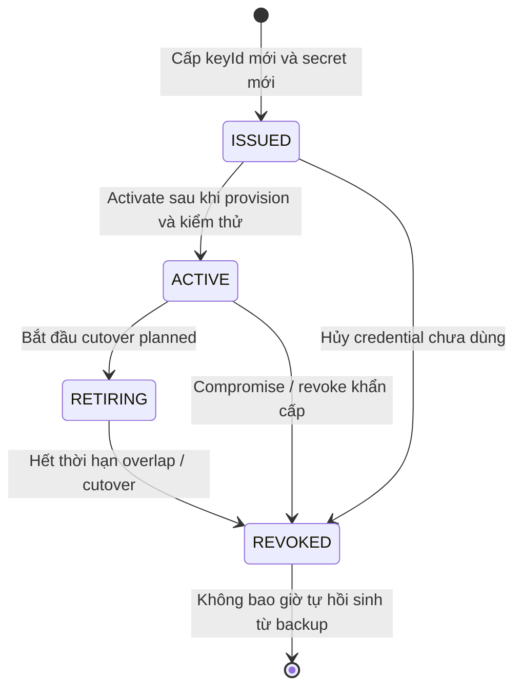
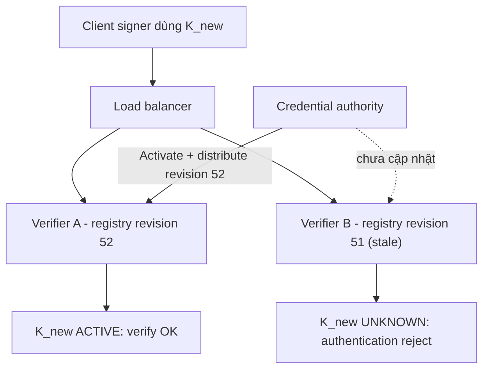

# Credential rotation trong xác thực HTTP request bằng HMAC

## Mục tiêu học tập

Trong chương **Credential lifecycle**, **Credential rotation** là quá trình thay một credential đang sử dụng bằng credential mới theo một kế hoạch kiểm soát: **tạo khóa mới → phân phối an toàn → cho phép verifier nhận khóa mới → chuyển client sang ký bằng khóa mới → rút và thu hồi khóa cũ**. Với HTTP request authentication bằng HMAC, đây không đơn thuần là đổi chuỗi `keyId`; bản chất là thay **raw shared secret**, quản lý trạng thái khóa và bảo đảm mọi verifier chỉ chấp nhận các khóa **đang được phép dùng**.

Bài thuộc module `SECURITY_AUTHENTICATION_HMAC_REQUEST_AUTHENTICATION`: thiết kế xác thực HTTP request bằng **HMAC với shared secret** và **canonical request** có method, URI, header hoặc body theo hợp đồng ký; người học thực hành xác minh chữ ký, chống replay bằng timestamp/nonce, quản lý key rotation, kiểm thử qua proxy/gateway và phân biệt xác thực với phân quyền.

Học xong, bạn có thể:

- Phân biệt **credential issuance**, **activation**, **scheduled rotation**, **emergency rotation**, **retirement**, **revocation**, **expiry** và **recovery**.
- Lập kế hoạch chuyển khóa với giai đoạn verifier chấp nhận **hai khóa được chỉ định** nhưng client chỉ **ký bằng một khóa hiện hành cho mỗi attempt**.
- Thiết kế `(audience, clientId, keyId)` làm composite lookup, sinh `keyId` và raw HMAC secret độc lập, ký `keyId` trong canonical request để chặn key substitution.
- Áp dụng **not-before**, **not-after**, **cutover deadline**, trạng thái `ACTIVE/RETIRING/REVOKED` và quy tắc fail closed khi registry/policy không đáng tin.
- Giải thích vì sao **key bị revoke không được chấp nhận ngay cả khi HMAC toán học đúng**, và vì sao rollback sang khóa đã lộ không phải recovery hợp lệ.
- Phối hợp **timestamp/nonce**, key rotation và Idempotency-Key để xử lý request retry mà không cho replay hoặc tạo side effect trùng.
- Viết Java 17 mô phỏng signer/verifier, registry nhiều khóa, chuyển signer, cửa sổ overlap, thu hồi và các bài thử từ chối.
- Thiết lập runbook, telemetry, rollback, canary và kiểm thử failover/multi-region trước khi triển khai.

## 1. Credential rotation là gì và vì sao cần làm?

### 1.1. Credential HMAC gồm những thành phần nào?

Một record có thể biểu diễn:

```text
Credential {
  audience          = payments-api-prod
  clientId          = payout-worker-prod
  principalId       = service-account-payout-worker
  keyId             = kid_V7qv30DdLVKzzbE7DZ4tjA
  rawSecretRef      = secret-manager://payments/clients/worker/v7
  algorithm         = HmacSHA256
  canonicalVersion  = hmac-rotation-v1
  status            = ACTIVE
  notBefore         = 2026-11-01T00:00:00Z
  verifyUntil       = 2026-12-01T00:00:00Z
  allowedScopes     = [payouts:create]
  allowedTenants    = [merchant-42]
}
```

`keyId` là **định danh có thể được gửi trong HTTP request**. Nó **không phải raw secret**, không phải bearer token và không phải bằng chứng được phép thao tác. `rawSecretRef` chỉ đến nơi lưu bí mật có kiểm soát; verifier phải lấy **raw secret bytes** từ kho bảo vệ (hoặc gọi primitive ký/xác minh của một cryptographic service theo kiến trúc phù hợp).

Bên ký và bên xác minh chia sẻ cùng key material. Kẻ chiếm được **raw secret** có thể tạo **HMAC mới**, với timestamp và nonce mới, cho những request mà credential đó được phép ký. Vì vậy vòng đời khóa phải có cơ chế thay khóa thường xuyên theo chính sách và **thu hồi ngay khi bị lộ**.

### 1.2. Hai động cơ rotation khác nhau

| Loại | Mục tiêu | Có nên có overlap dài? | Cách xử lý khóa cũ |
| --- | --- | --- | --- |
| **Planned/scheduled rotation** | Giảm thời gian sống của key, bảo trì định kỳ, tuân thủ policy. | **Có thể** có overlap hữu hạn nếu secret cũ chưa bị nghi lộ. | `ACTIVE → RETIRING → REVOKED` theo cutover. |
| **Emergency/compromise rotation** | Hạn chế thiệt hại khi secret có dấu hiệu bị đánh cắp/lộ. | **Không kéo dài overlap để giữ availability** nếu điều đó duy trì credential đã lộ. | Revoke ngay theo incident policy, cấp lại trên kênh sạch. |

Nếu secret manager tạm thời không truy cập được nhưng secret chưa có dấu hiệu lộ, đó trước hết là **availability/recovery incident**. Không tự động coi là compromise, nhưng cũng không sử dụng bất kỳ secret mặc định nào để bỏ qua kiểm tra HMAC.

### 1.3. Những điều rotation không giải quyết tự động

Thay raw HMAC secret **không tự**:

- Sửa canonicalization không nhất quán giữa client/gateway/server.
- Chặn replay trong cửa sổ timestamp nếu không có nonce store.
- Chặn hai POST cùng logical operation nhưng nonce khác nhau khi thiếu business idempotency.
- Thu hồi quyền truy cập tài nguyên của principal nếu policy authorization chưa được cập nhật.
- Loại bỏ secret đã bị lưu trong repository, logs, crash dumps, support tickets hoặc backup.
- Bảo đảm mọi node/region đã nhận trạng thái `REVOKED`.

Mục đích rotation là **thay và quản trị key material**, không dùng nó để thay thế các lớp bảo vệ request khác.

## 2. Mô hình trạng thái credential và các mốc thời gian

### 2.1. State machine minh họa



**Đây là mô hình của bài**, không phải danh sách trạng thái chuẩn bắt buộc cho mọi vendor. Có platform dùng `PENDING`, `SECONDARY`, `DISABLED`, `EXPIRED`, `DESTROYED` hoặc hai boolean riêng. Dù tên khác nhau, policy phải trả lời hai câu hỏi **độc lập**:

- Credential này có được **client dùng ký request mới** tại thời điểm hiện tại không?
- Credential này có được **server dùng xác minh request đang đến** tại thời điểm hiện tại không?

Trong planned rotation, một khóa cũ ở trạng thái `RETIRING` thường **không còn được signer chọn làm key mặc định**, nhưng verifier có thể **vẫn xác minh bằng nó** tới một deadline hữu hạn.

### 2.2. Phân biệt `notBefore`, `retireAt` và `verifyUntil`

Xét timeline ví dụ:

```text
Thời gian UTC -------------->

T0: K_old ACTIVE, K_new ISSUED
    |
T1: phân phối K_new an toàn tới client/verifier
    |
T2: K_new ACTIVE cho verify; K_old vẫn ACTIVE
    |
T3: đổi signer chọn K_new; K_old trở thành RETIRING
    |
T4: quan sát không còn client hợp lệ ký K_old
    |
T5: hết verifyUntil của K_old; REVOKED/DISABLED
    |
T6: dọn secret cũ theo chính sách retention/forensics
```

Một thiết kế có thể quy định:

```text
K_new.notBefore      = T2
K_old.retireAt       = T3
K_old.verifyUntil    = T5 (exclusive)
K_old.status         = RETIRING trong [T3, T5)
```

**`verifyUntil` không phải timestamp do client gửi**. Đó là thời điểm **server hiện tại** ngừng chấp nhận credential. Nếu một request được ký lúc T4 nhưng đến server sau T5, nó **không tự được chấp nhận** chỉ vì `X-Timestamp` vẫn trong freshness window. Verifier đánh giá **credential policy tại thời điểm verify**.

### 2.3. Chặn key bị revoke ngay cả khi signature còn đúng

Giả sử client có raw secret của key cũ:

```text
signedTimestamp = nowEpochSeconds()
nonce = random16Bytes()
rawMac = HMAC-SHA256(oldSecret, canonical(method, uri, body, ...))
```

Nếu registry đánh dấu `K_old = REVOKED`, verifier **phải từ chối trước khi tạo authenticated principal**, kể cả `rawMac` khớp toán học khi tính bằng `oldSecret`. Không có “ngoại lệ timestamp còn hạn” cho key bị thu hồi, trừ một policy riêng được thiết kế và được chấp thuận — nhưng với key bị nghi lộ, không được mặc định giữ quyền chỉ để tránh downtime.

### 2.4. Overlap không phải vô hạn

Overlap phục vụ chuyển đổi dần giữa client SDK, proxy, server nodes và vùng triển khai. Tuy nhiên, chấp nhận đồng thời K_old và K_new:

- Làm tăng số vật liệu khóa còn có thể xác thực trong khoảng này.
- Đòi hỏi định nghĩa rõ **deadline**, trạng thái và điều kiện dừng.
- Có thể gây duplicate nghiệp vụ nếu Idempotency-Key store bị scope sai theo `keyId`.
- Cần giám sát có bao nhiêu request còn dùng K_old và từ client/instance nào.

Không để khóa cũ ở `RETIRING` nhiều tháng chỉ vì “vẫn có một client chưa kịp nâng cấp”; hãy có chủ sở hữu/đơn vị quản lý sự cố, deadline và kế hoạch cô lập/thu hồi phù hợp.

## 3. Thiết kế key ID, secret và credential registry an toàn

### 3.1. Secret mới phải độc lập với secret cũ

Đúng:

```java
SecureRandom rng = new SecureRandom();

byte[] keyIdBytes = new byte[16];
rng.nextBytes(keyIdBytes);
String newKeyId = "kid_" + Base64.getUrlEncoder()
        .withoutPadding().encodeToString(keyIdBytes);

byte[] newRawSecret = new byte[32];
rng.nextBytes(newRawSecret); // Secret mới, không derive từ key cũ.
```

Đây chỉ là đoạn minh họa; code đầy đủ ở phần sau.

**Sai:**

```text
newKeyId = "2026-12"
newRawSecret = oldRawSecret     # Không đổi key material.

newRawSecret = Base64URL(oldSecret)
newRawSecret = SHA256(oldSecret)       # Không phải một quy trình
                                      # cấp secret độc lập chuẩn.

newKeyId = Base64URL(newRawSecret)    # Lộ raw secret qua public ID.
```

Khi yêu cầu thay khóa bị lộ, **chỉ đổi key ID** không làm kẻ đang biết secret cũ mất khả năng tính HMAC. Re-encoding key material hoặc tự băm secret cũ không thay thế thiết kế **tạo secret CSPRNG độc lập** và thu hồi credential đã lộ.

### 3.2. Tại sao namespace lookup gồm ba thành phần?

```text
registry.lookup(
  expectedAudience,    # Được định nghĩa từ service/route policy server
  claimedClientId,     # Chưa tin khi mới parse header
  claimedKeyId         # Chưa tin khi mới parse header
)
```

| Thành phần | Ví dụ | Vai trò |
| --- | --- | --- |
| Audience | `payments-api-prod` | Chống dùng cùng credential không đúng service/môi trường. |
| Client ID | `payout-worker-prod` | Tìm nhóm credential của một danh tính. |
| Key ID | `kid_abcd...` | Chọn bản ghi phiên bản khóa cụ thể. |

Hai client **có thể trùng văn bản key ID** mà vẫn có secret, scopes và lịch rotation khác nhau. Nếu verifier chỉ tra theo `keyId`, có thể dùng nhầm key của một client khác.

`clientId` và `keyId` đều là **untrusted lookup hints** cho tới khi MAC được xác minh. Authenticated principal và scopes phải lấy từ **credential record đã chứng thực**, không từ trường tùy ý do client gửi.

### 3.3. Key status và secret reference phải được bảo vệ riêng

Một record minh họa:

```text
CredentialRecord {
  audience, clientId, keyId,
  principalId,
  secretRef,
  algorithm="HmacSHA256",
  canonicalVersion="credential-rotation-v1",
  status=ACTIVE|RETIRING|REVOKED|ISSUED,
  notBefore, verifyUntil,
  policyRevision,
  scopes, tenantBindings
}
```

- **Secret manager/KMS/HSM:** bảo vệ raw secret và quyền đọc/unwrap, audit truy cập.
- **Credential registry:** là authority về key ID, principal/audience, policy và trạng thái hiện hành.
- **Verifier:** không tự ý fallback sang secret khác, không đổi thuật toán theo nội dung người gọi yêu cầu.
- **Signer:** chọn đúng key ID đi với raw secret đã cấp cho client, không gửi raw secret trong HTTP header.

Không log secret hoặc nguyên `Authorization` trong gateway logs. Key ID thường có thể xuất hiện trong request nhưng vẫn cần giới hạn metadata disclosure, rate limiting và kiểm soát key enumeration.

### 3.4. Chính sách cấp khóa khi client làm mất credential

Nếu client mất secret nhưng issuer vẫn có bản sao bảo vệ, có thể có workflow re-provision qua trust channel độc lập. Tuy nhiên khi nghi compromise, **phải rotate/revoke**, không gửi lại secret đã có thể bị lộ. Không cho bất kỳ ai chỉ biết `keyId` nhận raw secret.

Nếu secret đã bị xóa hoàn toàn và không có bản sao được phép phục hồi, không cố suy ngược từ HMAC signature hoặc `keyId`. Thay bằng credential mới có key ID/secret độc lập, cập nhật client/verifier và thu hồi bản cũ theo policy.

## 4. Planned rotation không gián đoạn: triển khai theo giai đoạn

### 4.1. Mô hình dual verification, single signing

Trong giai đoạn overlap:

```mermaid
sequenceDiagram
    autonumber
    participant O as Security / Credential Issuer
    participant R as Registry + Secret Manager
    participant V as Verifier Fleet
    participant C as Client Signer
    O->>R: Cấp K_new + secret mới ở ISSUED
    R-->>V: Phân phối record/key policy mới
    V->>V: Sẵn sàng verify K_new sau activate
    O->>R: Activate K_new; mark K_old RETIRING
    O->>C: Chuyển config signer từ K_old sang K_new
    C->>C: Sinh timestamp/nonce mới, tính HMAC bằng K_new
    C->>V: Authorization keyId=K_new + MAC_new
    V->>R: Kiểm tra status và record K_new
    V->>V: HMAC validate, timestamp, nonce claim
    V-->>C: Request được xác thực nếu policy đạt
    Note over O,V: Quan sát lưu lượng K_old tới deadline
    O->>R: REVOKE K_old tại cutover
    R-->>V: Invalidate stale record K_old
```

**Dual verification** nghĩa là verifier **chấp nhận request được ký bằng một trong hai key IDs đã được registry cho phép ở thời điểm đó**, chứ **không** có nghĩa nó thử mọi secret có sẵn cho một request.

**Single signing** nghĩa là client nên có một **credential được chọn rõ ràng cho mỗi attempt**; một client có thể đổi cấu hình và tạo attempt tiếp theo bằng K_new nhưng không gửi “một request ký bằng tất cả khóa và server chọn khóa nào khớp”. Việc gửi nhiều chữ ký nếu cần là **một giao thức khác**, phải thiết kế riêng.

### 4.2. Checklist từng giai đoạn

| Giai đoạn | Hành động | Bằng chứng trước khi qua bước tiếp |
| --- | --- | --- |
| **Prepare** | Kiểm kê signer instances, gateway nodes, key consumers; chốt contract, owner, deadline. | Mọi nơi sử dụng K_old đã được nhận diện. |
| **Issue** | Sinh K_new và raw secret độc lập; lưu protected store, trạng thái ISSUED. | Registry unique, secret được bảo vệ, audit provisioning. |
| **Distribute** | Provision secret mới vào client/secret delivery, hỗ trợ rollback có kiểm soát. | Client biết keyId + secret đúng; không in secret ra log. |
| **Activate verification** | Các verifier sẵn sàng kiểm tra K_new, registry status ACTIVE khi đúng thời điểm. | Canary test HMAC K_new đạt ở các region. |
| **Switch signer** | Chuyển client sang chỉ ký K_new; K_old RETIRING tới deadline. | Lưu lượng ký bằng K_new tăng, lỗi MAC không tăng bất thường. |
| **Drain** | Chờ in-flight requests, retries và các client còn dùng K_old chuyển sang K_new. | Metrics K_old gần 0; deadline được xác nhận. |
| **Revoke** | Ngừng chấp nhận K_old theo authoritative policy; invalidate cache. | Negative test với K_old bị từ chối ở mọi node. |
| **Cleanup** | Thu hồi secret cũ khỏi client/secret cache theo retention và incident policy. | Audit/owner sign-off, không có bản sao không được phép. |

**Không đảo thứ tự** theo cách client đổi sang K_new trước khi verifier sẵn sàng: request hợp lệ có thể bị từ chối hàng loạt. Ngược lại, nếu tất cả verifier nhận K_new trước, client có thể chuyển dần mà không cần dừng toàn bộ dịch vụ.

### 4.3. Canary, config revision và rollback

Một rollout có kiểm soát nên:

- Chọn nhóm client/verifier canary, theo dõi `keyId` (metadata đã redacted/giới hạn quyền), MAC failures và latency.
- Kiểm thử ở **đúng trust boundary**, không chỉ test trực tiếp backend bỏ qua gateway.
- Dùng **configuration revision** để nhận diện version được deploy ở từng node; không để mỗi pod tự đoán key hiện hành.
- Có bước **rollback signer từ K_new về K_old** chỉ khi K_old **chưa bị revoke/compromise**, policy vẫn cho phép và deadline chưa hết.
- Sau khi K_old đã `REVOKED`, rollback client về K_old **không hợp lệ**. Nếu K_new gặp sự cố, cần sửa/fix hoặc cấp key mới, không hồi sinh K_old.
- Phát hiện không đồng nhất giữa verifier regions: K_new ACTIVE ở vùng A nhưng chưa được provision ở B có thể gây lỗi ngẫu nhiên theo load balancer.

Một canary thành công chỉ chứng minh một số request đạt; để kết luận rotation thành công, phải có **negative tests** chứng minh K_old bị từ chối sau thời điểm revoke ở **mọi** đường vào.

### 4.4. Deadline chấp nhận khóa cũ có liên hệ gì với timestamp?

Giả sử freshness policy:

```text
now - P <= signedTimestamp <= now + F
P = 300 giây
F = 60 giây
```

Nếu client ký bằng K_old tại `T_cutover - 1` nhưng request đến server tại `T_cutover + 1`, dù timestamp **còn nằm trong window**, key có thể đã **bị cấm verify** vì hiện tại vượt `verifyUntil`.

Hai kiểm tra là **độc lập**:

```text
Accept request = (
    keyStatusAllowsVerificationAt(serverNow)
    AND timestampInsideWindow(serverNow, signedTimestamp)
    AND validHmacWithSelectedKey
    AND nonceClaimedAtomically
    AND authorizedForEffectiveResource
)
```

Nếu muốn “drain” request đang bay, cần đặt `verifyUntil` của K_old **muộn hơn thời gian chuyển signer** một khoảng được cân nhắc (network/queue/time window/client retries), nhưng chỉ khi secret cũ không bị nghi lộ. Không kéo dài deadline thông qua việc sửa `X-Timestamp` hoặc bỏ kiểm tra revoke.

## 5. Emergency rotation khi secret bị lộ

### 5.1. Khi nào bỏ qua overlap?

Những dấu hiệu đáng xem xét kích hoạt incident response:

- Raw secret xuất hiện trong source repository, access logs, crash dump, artifact CI, ticket hoặc chat.
- Máy chủ/client signer bị xâm nhập có khả năng đọc secret.
- Kẻ không được cấp quyền chứng minh có thể ký một request mới hợp lệ bằng credential đó.
- Secret bị chia sẻ vượt phạm vi hoặc thất lạc không thể xác định người có quyền đọc.
- Nghi vấn secret được đặt trong `keyId` hoặc chứa trong URL/header loggable.

Quy trình khẩn cấp:

```text
Detect suspected compromise
  |
  v
Contain access / isolate workload
  |
  v
Authoritative REVOKE K_old (có thể ngay lập tức)
  |
  v
Provision K_new + S_new độc lập qua kênh sạch
  |
  v
Roll out verified client/server key records
  |
  v
Audit HMAC requests, scopes, data and business side effects
  |
  v
Remove exposed copies / patch source of leak
  |
  v
Document incident and prevent recurrence
```

Việc revoke ngay có thể làm client hợp lệ gián đoạn, nhưng **đó có thể là lựa chọn cần thiết để cắt quyền của attacker**. Không giữ key đã lộ ở `RETIRING` vô hạn vì “chờ tất cả SDK cập nhật”.

### 5.2. Thu hồi key khác thu hồi principal

Một principal có thể có **nhiều credential**. Revoke K_old không nhất thiết khóa toàn bộ principal, nhưng cũng không được mặc định credential K_new an toàn nếu hệ thống cấp khóa, máy signer hay tài khoản operator đã bị chiếm.

Cần phân biệt:

- **Revoke một key**: chặn một `(audience, clientId, keyId)`.
- **Disable principal/client**: chặn toàn bộ credential thuộc danh tính đang bị xâm nhập.
- **Revoke quyền nghiệp vụ**: thay scopes/tenants/permissions, áp dụng kể cả key vẫn ACTIVE.
- **Rotate secret**: cấp raw key material mới, không tự thu hồi các access tokens, sessions hoặc key bản sao khác.

Incident policy phải đánh giá **phạm vi compromise**: chỉ một secret bị log, hay toàn bộ workload/secret manager đã bị chiếm. Chỉ cấp K_new trên một máy **vẫn đang bị điều khiển** có thể làm lộ cả khóa mới.

### 5.3. Không dùng bản backup cũ để “cứu” key revoked

Nếu backup chứa secret của K_old và được phục hồi thành công, không có nghĩa K_old được phép hoạt động lại. Registry phải giữ **revocation status authoritative** độc lập với backup, có revision/fencing phù hợp, và không bị ghi đè bởi bản snapshot cũ đánh dấu `ACTIVE`.

**HMAC khớp** và **AES-GCM backup decrypt được** là kiểm tra về cryptography; chúng **không thay** quyết định credential policy hiện hành.

## 6. Binding key ID vào HMAC canonical request

### 6.1. Hợp đồng `credential-rotation-v1`

Ví dụ API tạo báo cáo/chuyển tiền có side effect:

```http
POST /v1/payouts?tenant=merchant-42 HTTP/1.1
Host: payments.example.test
Content-Type: application/json
Authorization: HMAC-SHA256 clientId="payout-worker-prod", keyId="kid_V7qv30DdLVKzzbE7DZ4tjA", timestamp="<epoch-seconds>", nonce="<22-char-base64url>", signature="<43-char-base64url>"
Idempotency-Key: <22-char-operation-id>
X-Content-SHA256: <43-char-base64url-body-sha256>

{"amount":120000,"currency":"VND"}
```

Các giá trị trong dấu `<...>` là placeholder. `HMAC-SHA256` là scheme **tùy chỉnh minh họa**; không phải scheme HMAC mặc định được mọi HTTP framework nhận diện. Client và server phải công bố cùng grammar và canonical contract.

Canonical request **12 dòng UTF-8**, LF giữa dòng, **không LF cuối**:

```text
HMAC-SHA256
credential-rotation-v1
payments-api-prod
payout-worker-prod
kid_V7qv30DdLVKzzbE7DZ4tjA
POST
/v1/payouts?tenant=merchant-42
application/json
<sha256-of-exact-body-base64url>
<idempotency-key-base64url>
<timestamp-epoch-seconds>
<nonce-base64url>
```

| Dòng | Dữ liệu | Ràng buộc |
| --- | --- | --- |
| 1–2 | Thuật toán và phiên bản canonical | Chốt `HMAC-SHA256`/`credential-rotation-v1`, không downgrade. |
| 3 | Audience | Do verifier biết từ route/service policy, không tự tin header client. |
| 4 | Client ID | ID được parse, phải thuộc credential record đã xác minh. |
| **5** | **Key ID** | **Được MAC ký nguyên text**, thay K_old sang K_new phải tạo MAC mới. |
| 6–7 | Method và raw request-target | Phải đúng method/URI gateway và verifier cùng nhìn. |
| 8–9 | Content-Type và body SHA-256 | Hash **exact body bytes**, không serialize lại JSON. |
| 10 | Idempotency-Key | Giữ nguyên khi retry cùng logical operation, gắn vào MAC. |
| 11–12 | Timestamp/nonce | Mới cho mỗi signed attempt; freshness và chống replay. |

Cách tính:

```text
bodyDigest   = SHA256(exactBodyBytes)
bodyHashText = Base64URL_NoPadding(bodyDigest)
canonical    = join(LF, 12 fields)
macBytes     = HMAC-SHA256(rawSecretBytesForKeyId, UTF8(canonical))
signature    = Base64URL_NoPadding(macBytes)       # 32 B -> 43 ký tự
```

**Không** dùng `keyId.getBytes(UTF8)` làm key HMAC. Server phải tra **secret của đúng record** và kiểm tra trạng thái. Nếu K_old và K_new vô tình dùng chung raw secret vì lỗi provision, việc **ký keyId trong canonical** vẫn khiến đổi text `keyId` rồi giữ MAC cũ bị từ chối.

### 6.2. Parser và registry lookup trong overlap

Một request có thể gửi:

```text
Authorization:
  scheme=HMAC-SHA256
  clientId=C
  keyId=K_old hoặc K_new
  timestamp=T
  nonce=N
  signature=S
```

Verifier phải:

1. Nhận **đúng một** Authorization header, giới hạn chiều dài và reject duplicate auth-params.
2. Parse tên scheme/auth-param theo quy tắc HTTP, nhưng validate **giá trị** key ID với exact grammar (case-sensitive), không tự lowercase/URL-decode/truncate.
3. Lookup **một** record theo `(expectedAudience, clientId, keyId)`.
4. Kiểm tra `ISSUED/ACTIVE/RETIRING/REVOKED`, algorithm, canonicalVersion, notBefore/verifyUntil.
5. Tự tính body hash/canonical, lấy secret raw bytes của record, tính expected MAC và so bằng `MessageDigest.isEqual`.
6. Chỉ sau MAC hợp lệ mới tin authenticated principal và claim nonce trong kho dùng chung.
7. Sau authentication/replay, kiểm tra **authorization** và business idempotency/transaction.

Không thử mọi key ACTIVE cho đến khi MAC khớp: điều đó làm mơ hồ `keyId`, tăng CPU, có nguy cơ key/algorithm mix-up và khó chặn key revoked. **Một request chọn đúng một key ID**, server phải đối chiếu chính ID đó.

### 6.3. Gateway và thay đổi request bytes

Key rotation có thể vô tình đi kèm nâng cấp gateway. Nếu edge rewrite URI/query, đổi header hoặc gzip/JSON reserialize body trước khi backend verify, MAC fail dù secret mới hoàn toàn đúng. Đừng dùng kết quả “K_new MAC fail” để kết luận key manager cấp sai secret khi canonical bytes chưa được đối chiếu.

Chọn trust boundary rõ:

- **Gateway verify** request trước rewrite, kiểm tra key status/nonce; chuyển authenticated principal và effective operation qua kênh nội bộ có xác thực/toàn vẹn, xóa header principal do internet tự khai.
- **Backend verify** với signed request bytes/metadata gốc được bảo toàn và chống giả mạo; không tin `X-Original-URI` từ client ngoài.
- **Delegation signing** nếu có phải là contract khác có keyId/principal/audience và audit riêng; proxy không được âm thầm thay `keyId` và reuse MAC cũ.

## 7. Đồng bộ rotation trên client, server và nhiều region

### 7.1. Chọn signer key khác với quyết định verify key

Trong hệ thống nhiều pod, client SDK có thể được triển khai dần:

```text
Client signer instance A: chọn K_old đến khi nhận config mới
Client signer instance B: chọn K_new sau khi switch

Verifier node 1: registry chấp nhận K_old (RETIRING), K_new (ACTIVE)
Verifier node 2: registry chấp nhận K_old (RETIRING), K_new (ACTIVE)
```

Đây là trạng thái overlap có thể hợp lệ **trong thời hạn đã công bố**. Tuy nhiên nếu verifier node 2 chưa có K_new, request sẽ thất bại ngẫu nhiên theo load balancer. Cần kiểm thử rollout ở cả vùng, không chỉ nhìn một canary.

### 7.2. State authoritative, invalidation và sự cố split-brain

Rủi ro lớn hơn lỗi 401 là một region **đã revoke K_old** nhưng region khác vẫn chấp nhận nó. Kiến trúc cần:

- Một nguồn **authoritative credential status** và revision/generation có kiểm soát.
- Cache invalidation có độ trễ được định nghĩa; **revocation SLA** đủ mạnh theo threat model.
- Khi policy không thể kiểm chứng trong sự cố nghi compromise, **fail closed** với credential liên quan.
- Chống rollback status từ backup/stale replica, không để `REVOKED → ACTIVE` một cách tự động.
- Negative test K_old phải bị từ chối tại **mọi ingress endpoint/region** sau deadline, cả khi failover.
- Tránh cho hai region tự chọn “key đang ACTIVE” theo cấu hình cục bộ mà không có convergence bảo đảm.

Đối với hệ thống đòi thu hồi gần tức thời, một cache verifier tự duy trì hàng giờ dù authority đã đổi status là không phù hợp. Cần chọn trade-off giữa availability, latency của status lookup và thời gian tối đa key bị lộ còn được nhận.

### 7.3. Phối hợp clock và các deadline

Client chọn `X-Timestamp` theo clock của nó; verifier kiểm tra server clock. Ngoài ra, key status có `notBefore/verifyUntil`. Khi nhiều node có clock skew:

- Node A có thể nghĩ K_new đã ACTIVE, B cho rằng còn ISSUED.
- Node A có thể tiếp tục accept K_old trong khi B đã hết deadline.
- Với timestamp ở sát biên, cùng request có thể bị accept/reject khác nhau.

Cần **time sync đáng tin**, giám sát skew và hiểu rõ deadline inclusive/exclusive. Một chính sách đơn giản là `notBefore <= now < verifyUntil`; **verifyUntil exclusive**. Clock skew phải được tính vào thời điểm rollout và test, không “giải quyết” bằng cách nới verification window vô hạn.

### 7.4. Secret distribution và operational hygiene

Raw secret mới phải được provision tới đúng client/verifier qua **secret manager/workload identity hoặc kênh bảo vệ được phê duyệt**, tránh để secret trong:

- Source code, image build layers, CI logs và test artifacts.
- URL/query params, public keyId, error response và raw `Authorization` logging.
- Chat/ticket/email không có phân quyền như kênh cấp phát credential.
- Metrics labels, tracing baggage hoặc structured logging của gateway.

Cần audit ai tạo key, ai activate, ai đọc/distribute, ai revoke, thời điểm và reason. `keyId` thường không được thiết kế làm secret, nhưng metadata này vẫn có giá trị cho enumeration nên chỉ log theo policy tối thiểu.

## 8. Java 17: mô phỏng dual-key verification, cutover và revoke

Ví dụ `CredentialRotationHmacDemo.java` dùng **JDK 17+**. Nó chủ ý gom registry và nonce store vào một JVM để người học quan sát **trạng thái khóa thay đổi cách verifier đánh giá cùng một loại request**, không coi bộ nhớ JVM là nền tảng bảo mật phân tán.

Chương trình thực hiện:

1. Cấp hai credential với **key ID ngẫu nhiên độc lập** và **secret HMAC 32 byte ngẫu nhiên độc lập**.
2. K_old khởi đầu `ACTIVE`, K_new ở `ISSUED`: request ký bằng K_new vẫn bị từ chối mặc dù HMAC có thể tính đúng.
3. Chuyển K_new sang `ACTIVE`, K_old sang `RETIRING` với `verifyUntil = t0 + 120s`; trong overlap, request dùng **một trong hai key** hợp lệ.
4. Thay `keyId` trong một attempt K_old nhưng giữ nguyên MAC: bị từ chối dù K_new đang ACTIVE.
5. Cố ý tái sử dụng **cùng nonce** với K_new khi K_old đã claim: replay store theo principal chặn dùng lại nonce xuyên key rotation.
6. Khi đồng hồ server tới đúng `verifyUntil` (exclusive), K_old bị từ chối ngay cả khi MAC đúng và timestamp còn mới.
7. Khi K_old bị `REVOKED`, attempt mới được tính bằng secret cũ vẫn bị từ chối.
8. K_new hoạt động bình thường sau cutover; sau khi revoke khẩn cấp chính K_new, verifier cũng phải từ chối nó.
9. Mọi attempt sử dụng **cùng Idempotency-Key của một logical operation** để chứng minh đổi key ID không đồng nghĩa operation mới; ví dụ không tự thực hiện payout.

### 8.1. Mã nguồn hoàn chỉnh

```java
import java.nio.charset.StandardCharsets;
import java.security.GeneralSecurityException;
import java.security.MessageDigest;
import java.security.SecureRandom;
import java.time.Clock;
import java.time.Instant;
import java.time.ZoneOffset;
import java.util.Arrays;
import java.util.Base64;
import java.util.Objects;
import java.util.Set;
import java.util.concurrent.ConcurrentHashMap;
import java.util.concurrent.ConcurrentMap;
import java.util.regex.Pattern;
import javax.crypto.Mac;
import javax.crypto.spec.SecretKeySpec;

public final class CredentialRotationHmacDemo {
    private static final String AUDIENCE = "payments-api-prod";
    private static final String CLIENT = "payout-worker-prod";
    private static final String PRINCIPAL = "svc-payout-worker";
    private static final long PAST = 300L;
    private static final long FUTURE = 60L;

    private static final Pattern CLIENT_ID = Pattern.compile(
            "[A-Za-z0-9_-]{1,64}");
    private static final Pattern KEY_ID = Pattern.compile(
            "kid_[A-Za-z0-9_-]{22}");
    private static final Pattern TARGET = Pattern.compile(
            "/v1/payouts\\?tenant=[A-Za-z0-9_-]{1,64}");
    private static final Pattern TIMESTAMP = Pattern.compile(
            "[1-9][0-9]{0,11}");

    private static final Base64.Encoder ENC =
            Base64.getUrlEncoder().withoutPadding();
    private static final Base64.Decoder DEC =
            Base64.getUrlDecoder();

    private CredentialRotationHmacDemo() {}

    enum Status { ISSUED, ACTIVE, RETIRING, REVOKED }

    record KeyRef(String audience, String clientId, String keyId) {}

    record Credential(
            KeyRef ref, String principalId, byte[] secret,
            Status status, long notBefore, long verifyUntil) {
        Credential {
            secret = Objects.requireNonNull(secret).clone();
        }

        @Override public byte[] secret() {
            return secret.clone();
        }

        Credential transition(Status next, long newVerifyUntil) {
            return new Credential(
                    ref, principalId, secret, next,
                    notBefore, newVerifyUntil);
        }
    }

    record Operation(
            String method, String rawTarget, String contentType,
            byte[] body, String idempotencyKey) {
        Operation {
            body = Objects.requireNonNull(body).clone();
        }

        @Override public byte[] body() {
            return body.clone();
        }
    }

    record SignedAttempt(
            KeyRef credential, Operation operation,
            String timestamp, String nonce, String bodyHash,
            String signature) {}

    enum Verdict {
        ACCEPTED, INVALID_INPUT, INVALID_CREDENTIAL,
        OUTSIDE_WINDOW, BAD_MAC, REPLAYED, FORBIDDEN
    }

    static final class Registry {
        private final ConcurrentMap<KeyRef, Credential> records =
                new ConcurrentHashMap<>();

        Credential issue(
                SecureRandom random, String audience,
                String clientId, String principal,
                Status initialStatus, long notBefore) {
            if (!CLIENT_ID.matcher(clientId).matches()) {
                throw new IllegalArgumentException("Invalid client ID");
            }
            for (int i = 0; i < 10; i++) {
                byte[] idBytes = new byte[16];
                byte[] rawSecret = new byte[32];
                // Độc lập: không derive secret từ ID hoặc key cũ.
                random.nextBytes(idBytes);
                random.nextBytes(rawSecret);
                String id = "kid_" + ENC.encodeToString(idBytes);

                KeyRef ref = new KeyRef(audience, clientId, id);
                Credential record = new Credential(
                        ref, principal, rawSecret, initialStatus,
                        notBefore, Long.MAX_VALUE);
                Arrays.fill(idBytes, (byte) 0);
                Arrays.fill(rawSecret, (byte) 0);

                if (records.putIfAbsent(ref, record) == null) {
                    return record;
                }
            }
            throw new IllegalStateException("No unique ID allocated");
        }

        Credential lookup(KeyRef ref) {
            return records.get(ref);
        }

        void activate(KeyRef ref) {
            records.compute(ref, (ignored, old) -> {
                if (old == null || old.status() != Status.ISSUED) {
                    throw new IllegalStateException("Cannot activate");
                }
                return old.transition(Status.ACTIVE, Long.MAX_VALUE);
            });
        }

        void retire(KeyRef ref, long untilExclusive) {
            records.compute(ref, (ignored, old) -> {
                if (old == null || old.status() != Status.ACTIVE
                        || untilExclusive <= old.notBefore()) {
                    throw new IllegalStateException("Cannot retire");
                }
                return old.transition(Status.RETIRING, untilExclusive);
            });
        }

        void revoke(KeyRef ref) {
            records.compute(ref, (ignored, old) -> {
                if (old == null) {
                    throw new IllegalStateException("Unknown credential");
                }
                if (old.status() == Status.REVOKED) {
                    return old;
                }
                return old.transition(Status.REVOKED, 0L);
            });
        }
    }

    static final class DemoNonceStore {
        // Chỉ RAM trên một JVM; không có TTL/failover/multi-node.
        private final Set<String> claimed =
                ConcurrentHashMap.newKeySet();

        boolean claim(
                String audience, String principal, String nonce) {
            return claimed.add(
                    audience + "|" + principal + "|" + nonce);
        }
    }

    static boolean matches(Pattern p, String text) {
        return text != null && p.matcher(text).matches();
    }

    static byte[] strictBase64Url(
            String text, int textLength, int byteLength) {
        if (text == null || text.length() != textLength
                || !text.matches("[A-Za-z0-9_-]+")) {
            throw new IllegalArgumentException("Bad Base64URL");
        }
        byte[] raw = DEC.decode(text);
        if (raw.length != byteLength
                || !ENC.encodeToString(raw).equals(text)) {
            throw new IllegalArgumentException(
                    "Noncanonical Base64URL");
        }
        return raw;
    }

    static String newToken(SecureRandom random) {
        byte[] bytes = new byte[16];
        random.nextBytes(bytes);
        String text = ENC.encodeToString(bytes);
        Arrays.fill(bytes, (byte) 0);
        return text;
    }

    static void validate(SignedAttempt attempt) {
        if (attempt == null || attempt.operation() == null
                || attempt.credential() == null) {
            throw new IllegalArgumentException("Missing request");
        }
        KeyRef id = attempt.credential();
        if (!AUDIENCE.equals(id.audience())
                || !matches(CLIENT_ID, id.clientId())
                || !matches(KEY_ID, id.keyId())) {
            throw new IllegalArgumentException("Invalid credential ID");
        }
        strictBase64Url(id.keyId().substring(4), 22, 16);
        Operation op = attempt.operation();
        if (!"POST".equals(op.method())
                || !matches(TARGET, op.rawTarget())
                || !"application/json".equals(op.contentType())
                || op.body().length == 0
                || op.body().length > 1_048_576) {
            throw new IllegalArgumentException("Bad HTTP operation");
        }
        strictBase64Url(op.idempotencyKey(), 22, 16);
        if (!matches(TIMESTAMP, attempt.timestamp())) {
            throw new IllegalArgumentException("Invalid epoch seconds");
        }
        strictBase64Url(attempt.nonce(), 22, 16);
    }

    static byte[] sha256(byte[] bytes)
            throws GeneralSecurityException {
        return MessageDigest.getInstance("SHA-256").digest(bytes);
    }

    static String canonical(SignedAttempt a, String bodyHash) {
        validate(a);
        strictBase64Url(bodyHash, 43, 32);
        KeyRef id = a.credential();
        Operation op = a.operation();
        return String.join("\n",
                "HMAC-SHA256",
                "credential-rotation-v1",
                AUDIENCE,
                id.clientId(),
                id.keyId(), // Được ký: đổi ID -> phải đổi MAC.
                op.method(),
                op.rawTarget(),
                op.contentType(),
                bodyHash,
                op.idempotencyKey(),
                a.timestamp(),
                a.nonce());
        // Đúng 12 dòng UTF-8, LF, không LF cuối.
    }

    static byte[] hmac(byte[] secret, String canonicalText)
            throws GeneralSecurityException {
        Mac engine = Mac.getInstance("HmacSHA256");
        engine.init(new SecretKeySpec(secret, "HmacSHA256"));
        return engine.doFinal(
                canonicalText.getBytes(StandardCharsets.UTF_8));
    }

    static SignedAttempt sign(
            Credential signingCredential, Operation operation,
            String timestamp, String nonce)
            throws GeneralSecurityException {
        // Crypto helper cho test. Nó KHÔNG áp signer status policy.
        // Dùng được cả key revoked để thử verifier PHẢI reject.
        KeyRef id = signingCredential.ref();
        String bodyHash = ENC.encodeToString(sha256(operation.body()));
        SignedAttempt unsigned = new SignedAttempt(
                id, operation, timestamp, nonce, bodyHash, "");
        String signature = ENC.encodeToString(hmac(
                signingCredential.secret(),
                canonical(unsigned, bodyHash)));
        return new SignedAttempt(
                id, operation, timestamp, nonce, bodyHash, signature);
    }

    static boolean keyPermitted(Credential record, long now) {
        // ACTIVE, RETIRING có thể verify trong thời hạn.
        // ISSUED và REVOKED không được verify.
        return (record.status() == Status.ACTIVE
                    || record.status() == Status.RETIRING)
                && record.notBefore() <= now
                && now < record.verifyUntil();
    }

    static Verdict verify(
            SignedAttempt received, Registry registry,
            Clock serverClock, DemoNonceStore store)
            throws GeneralSecurityException {
        try {
            validate(received);
            KeyRef id = received.credential();

            // Các ID ban đầu chỉ là lookup hints chưa được tin.
            Credential record = registry.lookup(id);
            if (record == null) {
                return Verdict.INVALID_CREDENTIAL;
            }
            long now = Instant.now(serverClock).getEpochSecond();
            if (!keyPermitted(record, now)) {
                return Verdict.INVALID_CREDENTIAL;
            }

            long signedAt = Long.parseLong(received.timestamp());
            if (signedAt < Math.subtractExact(now, PAST)
                    || signedAt > Math.addExact(now, FUTURE)) {
                return Verdict.OUTSIDE_WINDOW;
            }

            byte[] bodyHashBytes = sha256(
                    received.operation().body());
            byte[] declaredBodyHash = strictBase64Url(
                    received.bodyHash(), 43, 32);
            if (!MessageDigest.isEqual(
                    bodyHashBytes, declaredBodyHash)) {
                return Verdict.BAD_MAC;
            }

            byte[] suppliedMac = strictBase64Url(
                    received.signature(), 43, 32);
            byte[] expectedMac = hmac(
                    record.secret(),
                    canonical(
                            received,
                            ENC.encodeToString(bodyHashBytes)));
            if (!MessageDigest.isEqual(expectedMac, suppliedMac)) {
                return Verdict.BAD_MAC;
            }

            // Phạm vi nonce theo principal ổn định qua rotation.
            if (!store.claim(
                    AUDIENCE, record.principalId(), received.nonce())) {
                return Verdict.REPLAYED;
            }

            // Mock authorization: chỉ được payout merchant-42.
            if (!"/v1/payouts?tenant=merchant-42".equals(
                    received.operation().rawTarget())) {
                return Verdict.FORBIDDEN;
            }
            return Verdict.ACCEPTED;
        } catch (IllegalArgumentException | ArithmeticException ex) {
            return Verdict.INVALID_INPUT;
        }
    }

    static Clock fixed(long seconds) {
        return Clock.fixed(
                Instant.ofEpochSecond(seconds), ZoneOffset.UTC);
    }

    public static void main(String[] args)
            throws GeneralSecurityException {
        long t0 = 1_700_000_000L; // Fixture, KHÔNG phải giờ hiện tại.
        SecureRandom rng = new SecureRandom();
        Registry registry = new Registry();
        DemoNonceStore nonceStore = new DemoNonceStore();

        Credential oldKey = registry.issue(
                rng, AUDIENCE, CLIENT, PRINCIPAL, Status.ACTIVE, t0);
        Credential newKey = registry.issue(
                rng, AUDIENCE, CLIENT, PRINCIPAL, Status.ISSUED, t0);

        Operation op = new Operation(
                "POST", "/v1/payouts?tenant=merchant-42",
                "application/json",
                "{\"amount\":120000,\"currency\":\"VND\"}"
                    .getBytes(StandardCharsets.UTF_8),
                newToken(rng));

        SignedAttempt beforeCutover = sign(
                oldKey, op, Long.toString(t0), newToken(rng));
        System.out.println("Old ACTIVE key: "
                + verify(beforeCutover, registry, fixed(t0), nonceStore));

        // New key được provision nhưng chưa ACTIVATE để verify.
        SignedAttempt notActivated = sign(
                newKey, op, Long.toString(t0), newToken(rng));
        System.out.println("New ISSUED key: "
                + verify(notActivated, registry, fixed(t0), nonceStore));

        registry.activate(newKey.ref());
        registry.retire(oldKey.ref(), t0 + 120L);

        long during = t0 + 30L;
        SignedAttempt oldDuringOverlap = sign(
                oldKey, op, Long.toString(during), newToken(rng));
        SignedAttempt newDuringOverlap = sign(
                newKey, op, Long.toString(during), newToken(rng));

        System.out.println("Old RETIRING during overlap: "
                + verify(oldDuringOverlap, registry,
                        fixed(during), nonceStore));
        System.out.println("New ACTIVE during overlap: "
                + verify(newDuringOverlap, registry,
                        fixed(during), nonceStore));

        // Thay keyId nhưng giữ MAC cũ, verifier tra secret mới,
        // canonical cũng đã đổi -> BAD_MAC.
        SignedAttempt keyIdSwapped = new SignedAttempt(
                newKey.ref(), op, oldDuringOverlap.timestamp(),
                oldDuringOverlap.nonce(),
                oldDuringOverlap.bodyHash(),
                oldDuringOverlap.signature());
        System.out.println("Swapped keyId with old MAC: "
                + verify(keyIdSwapped, registry,
                        fixed(during), nonceStore));

        // Test âm: cố tái dùng nonce đã claim bằng KEY KHÁC
        // của CÙNG principal, nhưng ký MAC mới hợp lệ.
        SignedAttempt sameNonceDifferentKey = sign(
                newKey, op, Long.toString(during),
                oldDuringOverlap.nonce());
        System.out.println("Nonce replay across key IDs: "
                + verify(sameNonceDifferentKey, registry,
                        fixed(during), nonceStore));

        long cutoff = t0 + 120L; // verifyUntil EXCLUSIVE.
        SignedAttempt oldAfterCutoff = sign(
                oldKey, op, Long.toString(cutoff), newToken(rng));
        System.out.println("Old at expiry boundary: "
                + verify(oldAfterCutoff, registry,
                        fixed(cutoff), nonceStore));

        SignedAttempt newAfterCutoff = sign(
                newKey, op, Long.toString(cutoff), newToken(rng));
        System.out.println("New after cutover: "
                + verify(newAfterCutoff, registry,
                        fixed(cutoff), nonceStore));

        registry.revoke(oldKey.ref());
        SignedAttempt oldAfterRevoke = sign(
                oldKey, op, Long.toString(cutoff + 1L), newToken(rng));
        System.out.println("Old REVOKED key: "
                + verify(oldAfterRevoke, registry,
                        fixed(cutoff + 1L), nonceStore));

        // Mô phỏng revoke khẩn cấp cả key mới.
        registry.revoke(newKey.ref());
        SignedAttempt newAfterRevoke = sign(
                newKey, op, Long.toString(cutoff + 1L), newToken(rng));
        System.out.println("Emergency revoke new key: "
                + verify(newAfterRevoke, registry,
                        fixed(cutoff + 1L), nonceStore));

        System.out.println("Logical operation key preserved: "
                + op.idempotencyKey().equals(
                        oldDuringOverlap.operation().idempotencyKey()));
    }
}
```

Kết quả kỳ vọng (key ID và nonce đều được sinh ngẫu nhiên):

```text
Old ACTIVE key: ACCEPTED
New ISSUED key: INVALID_CREDENTIAL
Old RETIRING during overlap: ACCEPTED
New ACTIVE during overlap: ACCEPTED
Swapped keyId with old MAC: BAD_MAC
Nonce replay across key IDs: REPLAYED
Old at expiry boundary: INVALID_CREDENTIAL
New after cutover: ACCEPTED
Old REVOKED key: INVALID_CREDENTIAL
Emergency revoke new key: INVALID_CREDENTIAL
Logical operation key preserved: true
```

### 8.2. Phân tích điều demo mô tả đúng

**Đổi key ID phải làm MAC đổi.** Canonical 12 dòng chứa `keyId` và client ID. Sau khi client chọn K_new, chữ ký phải được tính từ **raw secret tương ứng K_new** cùng timestamp, nonce và request bytes thực tế. Chỉ thay tên ID trong header nhưng dùng MAC cũ không phải rotation.

**Trạng thái từ registry thắng MAC toán học.** Khi `ISSUED`, `REVOKED` hoặc ngoài khoảng `notBefore <= now < verifyUntil`, verifier từ chối dù helper `sign` vẫn có thể tính MAC bằng secret. Đây là chủ ý để kiểm tra rằng **credential status** độc lập với MAC correctness.

**Nonce scope ổn định giữa các key IDs.** Test cố ý ký bằng K_new nhưng tái sử dụng nonce K_old đã claim: signature mới tính đúng, song nonce store nhận ra `(audience, principal, nonce)` đã tồn tại. Khi retry hợp lệ, client phải sinh nonce khác.

**Idempotency-Key giữ nguyên cho logical operation** nhưng code không xử lý thanh toán. Một request `ACCEPTED` không nghĩa một payout đã được commit đúng một lần; production phải dùng idempotency store và transaction riêng.

### 8.3. Những giới hạn cố ý của code

`Registry` và `DemoNonceStore` chỉ sống trong **một JVM**. `ConcurrentHashMap` cung cấp atomicity cho map đó, **không** cung cấp linearizability qua hai process, region hoặc datastore replication. Code không có:

- Persistence và secret manager/KMS, quyền provision/unwrap hoặc key audit.
- Registry revisions, real-time revoke propagation, cache invalidation và failover.
- Nonce expiry, atomic claim trong shared store hoặc xử lý mất nonce state.
- HTTP parser thực với duplicate `Authorization`/`Idempotency-Key`/`Content-Type`, Content-Encoding, body streaming, raw URI/query normalization và proxy.
- Rate limiting, Idempotency-Key result store, authorization scopes động hoặc payment transaction.
- Workload-specific clock sync và dynamic signer config rollout.

**Không dùng production**. Ví dụ chỉ là nền để viết unit tests deterministic với `Clock.fixed`. Trong hệ thống thật, signer phải chọn **credential đang được phép ký** theo cấu hình và version, không dùng `sign` helper trên key `REVOKED` như test cố tình làm; verifier phải lấy trạng thái từ authority đáng tin.

### 8.4. Phân biệt kết quả HMAC với response HTTP

Trong ví dụ, `Verdict.INVALID_CREDENTIAL` và `Verdict.BAD_MAC` được in riêng để học tập. Endpoint công khai có thể trả thông điệp xác thực chung theo policy để tránh key enumeration, cùng `WWW-Authenticate` challenge nếu áp scheme HTTP tương ứng.

Một request có MAC đúng nhưng principal không được quyền tenant đích phải từ chối **authorization**, thường qua `403 Forbidden` theo API contract. Không coi biết `keyId` hoặc raw secret là đủ quyền trên mọi resource.

## 9. Rotation, timestamp, nonce và idempotent retry

### 9.1. Chữ ký request cũ không tự được miễn kiểm tra trạng thái khóa

Nếu request đã ký bằng K_old:

```text
Key ID        = K_old
Timestamp     = T1
Nonce         = N1
Signature     = HMAC(S_old, canonical(..., K_old, T1, N1))
```

một verifier đang ở trạng thái K_old `REVOKED` phải **từ chối** dù nó có thể kiểm tra MAC toán học. Nếu request được ký trong lúc key còn ACTIVE nhưng đến **sau khi key bị thu hồi**, thông thường vẫn **không accept**: policy tại thời điểm xử lý mới là authority.

**Không** sử dụng `X-Timestamp` do client ký để “quay ngược thời gian policy” và coi K_old còn ACTIVE, bởi bên giữ secret cũ có thể tự ký bất kỳ timestamp nào trong cửa sổ chấp nhận. Với sự cố compromise, mục tiêu là cắt quyền của secret cũ **ngay từ thời điểm revoke có hiệu lực**.

### 9.2. Nonce store phải nhận ra replay xuyên key rotation

Cùng client principal có K_old và K_new. Nếu replay key được tạo từ:

```text
WRONG: replayKey = (keyId, nonce)
BETTER: replayKey = (audience, authenticatedPrincipal, nonce)
```

khi đổi key ID, một nonce có thể đi vào namespace mới và bỏ qua việc đã từng được claim. Nếu protocol muốn uniqueness theo **principal ổn định**, dùng `(audience, authenticatedPrincipal, nonce)` và kiểm tra nó **sau HMAC**, vì clientId/keyId chưa được xác thực trước đó.

Cửa sổ minh họa:

```text
now - P <= signedTimestamp <= now + F
P = 300s (past)
F = 60s  (future)
```

Biến đổi:

```text
t - F <= serverNow <= t + P
```

Nonce được claim tại biên sớm nhất `t-F` vẫn có thể bị replay đến biên muộn `t+P`. Vì vậy **TTL từ lúc claim** cần xét cả hai phía:

```text
minimumHorizon = P + F = 360s
suggestedTTL    = P + F + safetyMargin = 370s (ví dụ +10s)
```

Không lấy TTL bằng `P=300s` trong hệ thống có `F>0`. Nhưng **TTL đúng cũng không bảo vệ** nếu Redis primary failover làm mất nonce đã ACK, hoặc mỗi region sử dụng một kho riêng. Thao tác claim phải **nguyên tử và nhất quán theo threat model**.

### 9.3. Client retry trong lúc rotation

Một logical payout operation có Idempotency-Key `OP`:

```text
Attempt A: K_old, OP, timestamp=T1, nonce=N1, MAC_old
Attempt B: K_new, OP, timestamp=T2, nonce=N2, MAC_new
```

Nếu response attempt A bị mất **sau khi server đã commit**, attempt B có thể vượt qua HMAC/nonce vì dùng MAC mới và nonce mới. Để không tạo hai payout:

- **Idempotency-Key giữ nguyên** cho cùng logical operation.
- **Fingerprint của operation ổn định** (audience, principal, method, effective URI/tenant, body hash, semantic headers), không chứa keyId/nonce/timestamp vì chúng thay đổi theo signed attempt.
- Idempotency store scope theo **(audience, authenticatedPrincipal, Idempotency-Key)** hoặc một namespace được công bố tương đương; không chỉ theo key ID.
- Reservation và outcome phải **atomic/durable theo business effect**; dùng transaction/unique constraint, state machine/reconciliation và downstream idempotency khi cần.
- Mọi attempt vẫn phải kiểm tra HMAC, key status, replay và authorization **trước khi** trả stored result nhạy cảm.

**Không** dùng nonce làm Idempotency-Key: nonce cần mới theo từng signed attempt, trong khi Idempotency-Key phải giữ qua retry. **Không tự động retry POST** nếu API không hỗ trợ idempotency hoặc cách xác định outcome không rõ.

### 9.4. Vì sao không gửi lại header Authorization cũ?

Khi client có thể phải chờ backoff, retry-after hoặc cutover:

```text
Attempt #1 at T1: Authorization keyId=K_old, timestamp=T1, nonce=N1, MAC1
wait(backoff)
Attempt #2 at T2: Authorization keyId=K_new, timestamp=T2, nonce=N2, MAC2
```

Retry hợp lệ phải:

1. Chọn credential hiện được phép **ký** từ config/registry đáng tin.
2. Giữ nguyên payload và operation key của cùng logical operation (nếu được retry).
3. Lấy timestamp **sau khi chờ** backoff, tránh ký sớm khiến timestamp hết hạn.
4. Sinh **nonce mới 16 byte CSPRNG** cho attempt này.
5. Dựng canonical từ **exact method/raw URI/headers/body bytes** thực gửi.
6. Tính MAC bằng **secret của key ID đã chọn** và phát Authorization mới.
7. Tôn trọng quota, max attempts, deadline và `Retry-After`; không chuyển secret sang audience/host lạ.

Nếu proxy HTTP tự retry **nguyên request đã ký** sau khi nonce đã được claim, verifier sẽ trả replay. Chức năng retry cần phối hợp signer; không tự bỏ qua nonce để phục vụ retry.

### 9.5. Key rotation không thay authorization

Một client biết S_new vẫn có thể ký request khác tenant:

```http
POST /v1/payouts?tenant=merchant-99 HTTP/1.1
Authorization: HMAC-SHA256 clientId="payout-worker-prod", keyId="<K_new>", timestamp="<fresh>", nonce="<new>", signature="<valid-mac>"
```

Với một principal chỉ có scope trên `merchant-42`, HMAC và nonce có thể đạt nhưng authorization phải từ chối. Rotation **không tự cấp thêm permissions**, và verify một key mới không được gắn với principal khác chỉ vì tên key ID giống nhau.

## 10. Gateway, proxy và rollout nhiều node trong rotation

### 10.1. Vì sao chuyển khóa có thể làm lộ lỗi canonicalization cũ?

Giả sử hệ thống cũ chấp nhận key K_old ở gateway nhưng sau rotation K_new chỉ có ở backend. Một request có thể được xử lý:

```text
Client: POST /public/v1/payouts?tenant=merchant-42, body bytes B1
Gateway: rewrite thành /internal/v1/payouts?tenant=merchant-42
Backend: hash body B2 sau JSON transformation
```

Nếu signer tính MAC trên `/public/...` và B1 còn backend tính trên `/internal/...` và B2, MAC không thể khớp, **không liên quan việc raw secret K_new đúng hay sai**.

Không chữa bằng cách “nếu K_new fail thì bỏ URI/body ra khỏi canonical”. Thay vào đó:

- Chọn chính xác **điểm HMAC verify** (gateway trước rewrite hoặc backend với signed raw request gốc qua trusted metadata).
- Đồng bộ **canonical contract version** cho cả K_old/K_new trong giai đoạn chuyển nếu không dự định nâng version.
- Nếu cần nâng protocol, làm migration riêng với version pinning/test vectors; không lặng lẽ đổi cách xử lý body/query.
- Loại header principal/role từ client không đáng tin trước khi gateway thiết lập thông tin authenticated principal.
- Test qua đường vào production (HTTP/1.1, HTTP/2, reverse proxy, compression, header normalization), không chỉ gọi thẳng service nội bộ.

### 10.2. Authorization header và key ID phải nhất quán

Trong custom scheme minh họa, `keyId` nằm trong `Authorization`. Gateway có thể tự động strip hoặc thay `Authorization` khi bật plugin auth khác (ví dụ Bearer). Backend chỉ verify được HMAC nếu thông tin scheme, key ID, timestamp, nonce, MAC và signed request bytes còn được bảo toàn.

Các vấn đề cần reject:

- Hai field lines `Authorization` hoặc hai auth-params `keyId` / `KEYID` trùng.
- Key ID thiếu/rỗng/quá dài/không theo grammar.
- Gateway chọn key ID đầu tiên còn backend chọn key ID cuối.
- Trường `X-Original-URI` do bên ngoài tự khai để bypass raw-target binding.
- Đổi `keyId=K_old` sang `K_new` nhưng giữ `signature=MAC_old`.
- Một plugin bỏ qua status của K_old vì “MAC vẫn khớp”.
- Gateway chấp nhận old key đã revoke còn backend đã reject do cache stale.

Đặc biệt, **key ID value có phân biệt hoa/thường** theo contract; HTTP field name và authentication scheme có thể có quy tắc case-insensitive riêng. Không lowercase key ID value trước lookup/canonical.

### 10.3. Rotation qua nhiều node phải kiểm tra cả negative path



Đây là kiểu lỗi **một phần traffic bị 401**. Nguy hiểm hơn là sau revoke, verifier B vẫn có registry stale và **nhận K_old đã lộ**.

Trước cutover, cần xác nhận:

- Tất cả ingress/verifier instances dùng policy revision đủ mới và có K_new.
- Version/canonical rules được pin giống nhau.
- K_new có thể verify trên từng region với test credential/phân quyền hợp lệ.
- K_old bị từ chối đồng nhất sau cutover/revoke.
- Hệ thống không có emergency fallback chấp nhận K_old khi lookup K_new lỗi.

## 11. Vận hành, metrics, runbook và rollback

### 11.1. Metrics có ích và giới hạn quan sát

| Tín hiệu | Ý nghĩa |
| --- | --- |
| `hmac_verify_success_total` theo key status / cohort | Theo dõi client chuyển từ K_old sang K_new; tránh cardinality cao. |
| `hmac_verify_failure_total` theo category nội bộ | Tách `unknown-key`, `revoked`, `bad-mac`, `expired-timestamp` và `replay`. |
| `credential_last_use_at` | Phát hiện client còn ký bằng khóa cũ gần deadline. |
| `credential_policy_revision` theo verifier instance | Kiểm tra drift giữa nodes và regions. |
| `credential_revocation_propagation_seconds` | Đo chậm trễ từ authoritative revoke tới verifier. |
| `secret_manager_lookup_errors_total` | Theo dõi lỗi lấy đúng secret reference. |
| `hmac_nonce_replay_rejected_total` | Phát hiện SDK retry nguyên attempt cũ hoặc replay. |
| `hmac_idempotency_conflict_total` | Phân biệt nghiệp vụ trùng với MAC/replay. |
| `clock_offset_seconds` | Phát hiện clock skew gây lỗi ở notBefore/verifyUntil. |

Không log raw shared secret, toàn bộ `Authorization`, HMAC key bytes hay body nhạy cảm. Key ID là metadata, nhưng có thể để lộ cấu trúc khách hàng/credential và gây cardinality cao nếu đưa nguyên vào metrics labels. Nên dùng cohort/hashed identifier và quyền truy cập có kiểm soát.

### 11.2. Khi MAC failures tăng ngay sau bật K_new

Chẩn đoán theo thứ tự:

1. **Credential issuance:** client có đúng cặp `keyId + raw secret` không? Secret có bị nhầm Base64 text với raw bytes không?
2. **Authority status:** K_new đã được ACTIVE, đúng audience/clientId/algorithm và deadline chưa?
3. **Rollout:** mọi verifier/region đã load registry revision mới chưa?
4. **Canonical bytes:** method, raw path/query, Content-Type, body digest, timestamp, nonce và Idempotency-Key có đúng byte như client không?
5. **Encoding:** HMAC-SHA256 raw MAC 32 byte, Base64URL không padding 43 ký tự, strict decode.
6. **Gateway:** có strip Authorization, URI rewrite, header duplicate hoặc body transformation không?
7. **Clock/replay:** timestamp có trong cửa sổ? Nonce có bị retry/reuse?
8. **Authorization/business:** MAC đạt nhưng tenant/scope không hợp lệ hoặc Idempotency-Key fingerprint conflict?

**Không** thử tất cả secrets, không tắt HMAC và không mở rộng timestamp window vô hạn để chữa lỗi. Nếu lỗi rollout và K_old **chưa bị thu hồi, chưa nghi lộ**, có thể rollback signer trong deadline theo runbook; nếu K_old đã bị revoke, **không rollback sang K_old**.

### 11.3. Ví dụ runbook rotation theo đợt

```text
RUNBOOK credential-rotation-v1 (planned)

PRECONDITIONS
- Có owner, change ticket, cutoff UTC, mục tiêu và rollback policy.
- K_old chưa bị nghi compromise.
- Mọi signer/verifier và trust boundary đã được kiểm kê.
- Nonce store, time sync, registry consistency đều khỏe.

ISSUE
- Sinh K_new và secret mới độc lập.
- Registry ISSUED; secret manager lưu encrypted/protected.
- Kiểm tra identity, algorithm, canonical version và quyền.

PREPARE VERIFIERS
- Deploy/verify K_new ở canary và tất cả regions.
- Chỉ ACTIVE khi authority cho phép; kiểm tra status revisions.

CUTOVER
- Chuyển signer sang K_new (new signed attempts).
- K_old RETIRING với verifyUntil cụ thể.
- Quan sát MAC error, retry, nonce, Idempotency-Key, authz.

DRAIN
- Theo dõi last-use của K_old tới deadline.
- Thông báo/di chuyển client còn sót; không mở overlap vô hạn.

REVOKE
- Gán K_old REVOKED trong authoritative registry.
- Invalidate stale caches; test negative ở mọi ingress.

CLOSE
- Thu hồi phân phối secret cũ, audit, ghi lesson learned.
- Không in key material trong ticket hoặc log.
```

### 11.4. Emergency runbook rút gọn

```text
SUSPECTED_SECRET_COMPROMISE
- Xác định phạm vi credential/identity bị ảnh hưởng.
- Contain và revoke key cũ theo incident policy.
- Không giữ K_old RETIRING vì cần chuyển SDK chậm.
- Cấp K_new/S_new qua kênh sạch, kiểm tra principal và scopes.
- Hạn chế business routes nếu chưa bảo đảm replay/authz.
- Điều tra request giả mạo, hoạt động bên thứ ba và side effects.
- Xác nhận revoked key bị từ chối tại tất cả verifier/regions.
- Thu hồi copies bị lộ, sửa quy trình cấp phát/logging.
```

Nếu dấu hiệu compromise thuộc **toàn bộ client workload/secret manager** chứ không riêng một secret, cần cách ly và làm sạch trust anchor trước khi cấp key mới. Cấp K_new lên máy vẫn bị chiếm có thể lộ khóa mới ngay lập tức.

## 12. Ma trận kiểm thử credential rotation

Đặt các mốc tường minh để test deterministic:

```text
T0 = 1_700_000_000 (Unix epoch seconds, fixture)
T_activateNew = T0
T_retireOld   = T0 + 30
T_verifyUntil = T0 + 120 (exclusive)
Freshness: P=300s, F=60s, inclusive boundaries
Nonce TTL: ít nhất 370s trong ví dụ (margin 10s)
```

| Test | Điều kiện | Kết quả mong đợi |
| --- | --- | --- |
| K_old ACTIVE trước rotation | MAC đúng, timestamp/nonce mới | ACCEPTED nếu có quyền. |
| K_new ISSUED chưa ACTIVE | MAC toán học có thể đúng | **INVALID_CREDENTIAL**. |
| K_new ACTIVE | MAC bằng S_new, canonical có keyId mới | ACCEPTED. |
| K_old RETIRING trước verifyUntil | Client cũ ký K_old, MAC đúng | ACCEPTED trong overlap nếu policy cho phép. |
| K_old đúng tại `verifyUntil - 1` | MAC/timestamp/nonce đạt | Có thể ACCEPTED. |
| K_old đúng tại `verifyUntil` | Boundary exclusive | **INVALID_CREDENTIAL**. |
| K_old sau `verifyUntil` | MAC đúng dù timestamp fresh | **INVALID_CREDENTIAL**. |
| K_old REVOKED trước deadline | Compromise/revoke khẩn cấp | **INVALID_CREDENTIAL**, không chờ deadline. |
| K_new REVOKED | MAC đúng bằng S_new | Reject credential; không fallback. |
| Thay keyId K_old → K_new sau ký | Giữ MAC cũ | **BAD_MAC** hoặc invalid credential, không accept. |
| Thay clientId hoặc audience sau ký | MAC không đổi | Reject, không cross-client/service. |
| Hai client cùng text keyId | Secrets khác, audience/client khác | Lookup đúng composite key, không nhầm. |
| Hai IDs trỏ cùng secret trong fixture lỗi | Thay ID nhưng giữ MAC | MAC fail vì keyId đã được ký. |
| Dùng secret cũ nhưng keyId mới | Raw secret/key ID không khớp | BAD_MAC, không thử fallback. |
| Base64 secret bị dùng như raw bytes | Signer/verifier key bytes khác | BAD_MAC, không “normalize” tùy tiện. |
| Cả hai key hợp lệ cùng lúc | Hai requests với nonce riêng | Có thể ACCEPTED, theo cùng principal policy. |
| Reuse cùng nonce trên K_new | N đã claim bằng K_old | **REPLAYED**, scope theo principal. |
| Same signed attempt replay | Same K_old/T/N/MAC | REPLAYED hoặc credential reject nếu đã revoke. |
| Sai timestamp quá khứ | `t < now-P` | OUTSIDE_WINDOW. |
| Sai timestamp tương lai | `t > now+F` | OUTSIDE_WINDOW. |
| Clock lệch giữa nodes | Một node sát boundary | Phát hiện inconsistency, điều chỉnh time sync, không mở rộng window mù. |
| Key status stale trên một region | K_old revoked ở authority | Region stale **không được accept** theo policy bảo mật. |
| Registry không sẵn sàng | Không chứng minh status | Fail closed cho key cần authoritative check. |
| Nonce store không sẵn sàng | Không atomic claim được | Fail closed, không bỏ anti-replay. |
| Nonce store failover mất state | Cùng request còn window | Detect replay gap, chặn/cô lập theo DR plan. |
| Client retry sau response lost | K_new/T2/N2/MAC2 mới, same operation key | Authentication có thể đạt; business effect không trùng. |
| Fingerprint đổi, Idempotency-Key cũ | Amount/tenant khác | Conflict, không tạo payout mới như retry. |
| Client dùng tenant không có quyền | MAC mới đúng | **403/authz reject**, không mở scope. |
| Gateway thay raw URI | Signer/verifier thấy different target | BAD_MAC hoặc reject contract. |
| Gateway thay body bytes | Exact SHA-256 khác | BAD_MAC/body mismatch. |
| Gateway strip Authorization | Thiếu keyId/signature | Reject hoặc xử lý qua trusted delegation đúng protocol. |
| Duplicate keyId param | `keyId=old` và `KEYID=new` | Reject trước key lookup. |
| Duplicate Authorization field | Hai field lines | Reject, không chọn first/last. |
| Primary/region split-brain | Revocation không đồng nhất | Fault-injection phải tìm được gap, cần authority/consistency. |
| Backup restore sau revoke | Bản backup cũ nói ACTIVE | Không hồi sinh K_old REVOKED. |
| Emergency rotation | S_old nghi lộ | Revoke đúng scope, K_new độc lập, review incident. |

### 12.1. HMAC test vector để kiểm tra signer/verifier sau rotation

Bên cạnh integration test, một bộ cross-language test vector với **secret giả** nên gồm:

- Audience, clientId, principal test, keyId K_old/K_new với **hai raw secrets độc lập**.
- Method/raw request-target, Content-Type và exact body bytes.
- Body SHA-256 raw 32 byte và Base64URL không padding.
- Idempotency-Key, timestamp, nonce và canonical request **12 dòng UTF-8**, LF không LF cuối.
- HMAC-SHA256 raw MAC 32 byte, signature Base64URL 43 ký tự cho mỗi key.
- State/deadline tại thời điểm verify; expected result cho ACTIVE, ISSUED, RETIRING và REVOKED.
- Negative cases thay keyId sau ký, sai audience/client, truncation, padding, duplicate Authorization/header, nonce replay, tenant denial.

Không công bố production secret hoặc payload tiền thật trong test vector. MAC khác nhau là bằng chứng cần debug byte/canonical/key selection, **không** là lý do thử bừa mọi key ID.

## 13. Bài thực hành có hướng dẫn

Thiết kế API thử nghiệm `POST /v1/payouts?tenant={tenantId}` dùng HMAC-SHA256 và thực hiện một lần planned rotation rồi một emergency rotation.

1. **Định nghĩa credential record:** `audience, clientId, keyId, principalId, secretRef, algorithm, canonicalVersion, status, notBefore, verifyUntil, policyRevision, scopes`.
2. **Tạo key pair về mặt provisioning (không phải khóa bất đối xứng):** sinh một opaque keyId 16 byte và raw shared secret 32 byte **độc lập** bằng `SecureRandom`. Không dùng keyId để derive raw secret.
3. **Khởi tạo registry:** K_old ACTIVE, K_new ISSUED; hai secret độc lập, mỗi record có status và quyền riêng.
4. **Viết signer Java:** xây canonical 12 dòng `credential-rotation-v1`, hash exact body bytes bằng SHA-256, MAC qua `Mac.getInstance("HmacSHA256")` và chuyển raw MAC thành Base64URL không padding.
5. **Viết verifier:** parse đúng một Authorization header, strict-decode signature và body hash, tra `(audience, clientId, keyId)`, kiểm tra trạng thái/deadline hiện hành, so MAC bằng `MessageDigest.isEqual`.
6. **Kích hoạt K_new:** cho tất cả verifier nhận K_new trước khi client switch signer; canary test ở mọi region/ingress.
7. **Chuyển signer:** signed attempt mới chọn K_new; K_old RETIRING tới một deadline cụ thể. Mọi request vẫn phải có timestamp/nonce mới.
8. **Kiểm thử binding ID:** sửa keyId sau ký, giữ MAC cũ; từ chối. Tạo fixture hai IDs cùng secret để phát hiện lỗi thiếu `keyId` trong canonical.
9. **Kiểm thử boundary:** bằng `Clock.fixed`, chấp nhận K_old tại `verifyUntil-1` và reject chính xác tại `verifyUntil`.
10. **Kiểm thử revoke khẩn cấp:** chuyển K_old REVOKED trước deadline, chứng minh HMAC đúng bằng S_old vẫn bị từ chối.
11. **Thêm nonce store dùng chung:** atomic claim scope theo `(audience, authenticatedPrincipal, nonce)`; TTL che phủ `past+future+margin`, reject replay xuyên K_old/K_new.
12. **Thêm business idempotency:** retry POST sau mất response giữ cùng Idempotency-Key và operation fingerprint, dù keyId/nonce/MAC thay đổi; không tạo hai payout.
13. **Kiểm thử proxy:** API gateway strip/rewrite `Authorization`, raw URI, query và body; bảo đảm verifier làm việc ở đúng trust boundary.
14. **Kiểm thử đa node:** làm stale registry revision trên một node, mô phỏng primary failover và kiểm tra revoked K_old không lọt qua.
15. **Lập runbook:** owner, approval, cutover UTC, rollback predicate, canary, deadline, metrics, negative tests và secret cleanup.
16. **Diễn tập compromise:** mô phỏng raw secret K_new có thể đã bị lộ ở môi trường giả lập; revoke và phát key độc lập trên kênh sạch, không dùng lại S_new.

**Câu hỏi tự đánh giá:**

- Vì sao đổi `keyId` nhưng giữ nguyên raw secret không phải một key rotation thực sự?
- Tại sao cần cho verifier biết K_new **trước** khi client signer chuyển sang K_new?
- `RETIRING` khác `REVOKED` ở chỗ nào? Khi nào phải bỏ qua overlap?
- Nếu request được ký bằng K_old ngay trước `verifyUntil` nhưng đến sau mốc đó, tại sao timestamp còn hạn vẫn không đủ?
- Vì sao không thử mọi secret đang ACTIVE cho tới khi MAC khớp?
- Điều gì có thể xảy ra nếu verifier region A đã revoke K_old còn region B dùng registry cache cũ?
- Vì sao phải đưa `keyId` vào canonical request, kể cả khi key IDs thường có secrets khác nhau?
- Nonce có cần mới khi retry từ K_old sang K_new không? Idempotency-Key có cần đổi không?
- Tại sao TTL nonce cần xét cả phía tương lai của timestamp window?
- Nếu secret K_old lộ và attacker có thể tạo MAC mới, một bản backup giải mã thành công có giúp K_old an toàn trở lại không?
- MAC mới đúng có tự cấp quyền cho client trên tenant chưa được cho phép không?
- Vì sao rollback signer về key đã REVOKED không phải một cách cứu availability hợp lệ?

## 14. Tài liệu tham khảo và kết luận

### 14.1. Tài liệu tham khảo

- **RFC 2104 — HMAC: Keyed-Hashing for Message Authentication:** cơ sở tính HMAC bằng shared secret.
- **RFC 4231 — Identifiers and Test Vectors for HMAC-SHA Algorithms:** test vectors HMAC-SHA256 để đối chiếu raw MAC.
- **RFC 4648 — The Base16, Base32, and Base64 Data Encodings:** Base64URL là encoding, không phải cơ chế bảo vệ secret.
- **RFC 9110 — HTTP Semantics:** HTTP method, Authorization field, authentication/authorization và semantics response.
- **RFC 9421 — HTTP Message Signatures:** ví dụ một giao thức chuẩn hóa khác custom `credential-rotation-v1`; không tự coi tương thích.
- **NIST SP 800-57 Part 1 — Recommendation for Key Management:** vòng đời khóa, phân loại sử dụng, key protection, rotation và revocation.
- **OWASP Secrets Management Cheat Sheet:** quản lý secret, phân phối, rotation, revocation và audit.
- **Java SE 17 API — `java.security.SecureRandom`, `javax.crypto.Mac`, `javax.crypto.spec.SecretKeySpec`, `java.security.MessageDigest`, `java.time.Clock`, `java.util.Base64`:** sinh secret, HMAC, so MAC và deterministic test clock.
- **Tài liệu của secret manager/KMS, API gateway, credential registry và idempotency store đang sử dụng:** kiểm tra SLA revocation, cache invalidation, overlap, failover và semantics triển khai thực tế.

### 14.2. Kết luận

**Credential rotation** là thay **raw shared secret và trạng thái credential** có kiểm soát, không chỉ đổi tên `keyId`. Với planned rotation, hãy **issue và provision khóa mới độc lập**, chuẩn bị verifier trên mọi node/region, **activate K_new**, chuyển client sang ký K_new, cho K_old `RETIRING` trong overlap hữu hạn rồi **revoke** đúng deadline. Khi nghi secret bị lộ, hãy **revoke và incident-response** theo mức khẩn cấp, không giữ khóa cũ hoạt động chỉ để tránh downtime.

Một hệ thống HMAC request authentication an toàn phải **ký keyId cùng method/URI/header/body**, kiểm tra authoritative status tại thời điểm verify, chống replay bằng timestamp/nonce với store đủ nhất quán, giữ business Idempotency-Key qua retry và thực thi authorization theo principal/tenant/resource. Chỉ khi có rollout, negative tests, rollback policy và observability rõ ràng, rotation mới vừa giảm rủi ro lộ secret vừa bảo vệ tính đúng đắn của các HTTP request và tác động nghiệp vụ.


