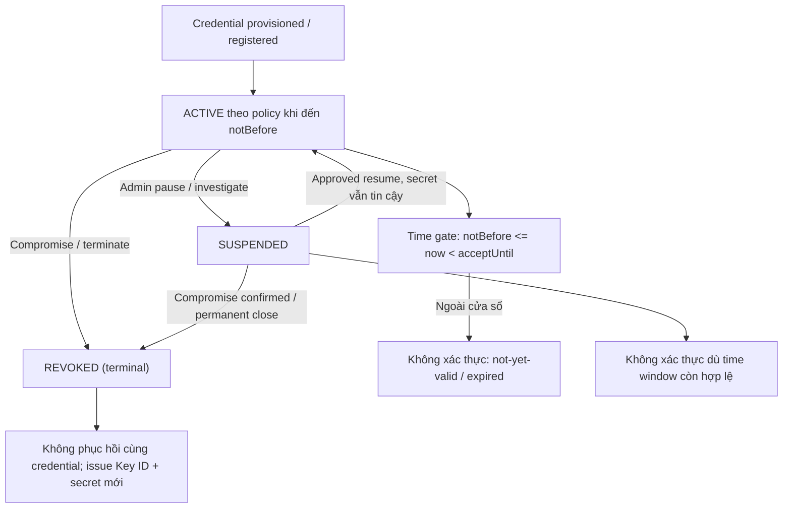
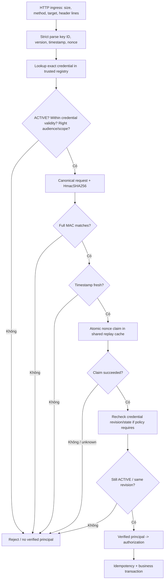
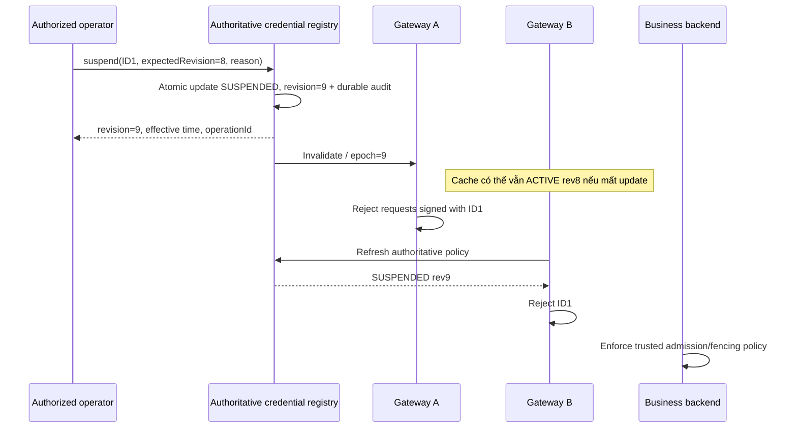
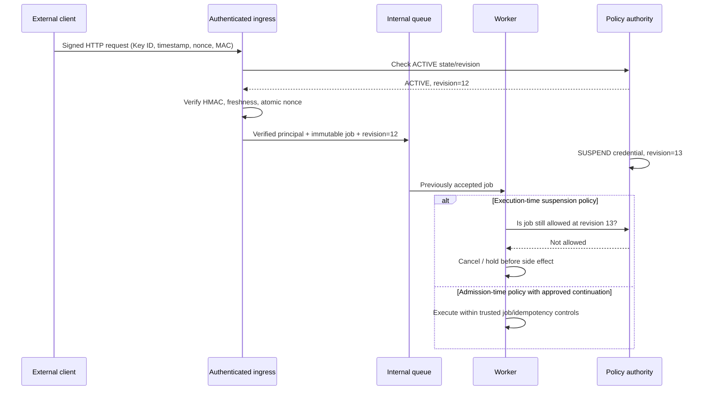

# Credential suspension: tạm ngưng credential trong xác thực HTTP request bằng HMAC

## 1. Credential suspension là gì?

**Credential suspension** là quyết định **tạm thời không chấp nhận một credential** để xác thực request, ngay cả khi Key ID tồn tại, shared secret đúng và chữ ký HMAC tính toán hoàn toàn khớp. Khác với xóa hoặc thu hồi vĩnh viễn, suspension có thể được **khôi phục (resume)** sau khi điều kiện tạm ngưng được giải quyết và người có thẩm quyền xác nhận credential vẫn đáng tin.

Bài **Credential suspension** thuộc chương **Credential lifecycle** của module `SECURITY_AUTHENTICATION_HMAC_REQUEST_AUTHENTICATION`. Module hướng dẫn thiết kế xác thực HTTP request bằng **HMAC với shared secret** và canonical request chứa phương thức HTTP, URI, signed headers hoặc body; xác minh chữ ký, chống replay bằng timestamp/nonce, quản lý key rotation, kiểm thử proxy/gateway và **phân biệt xác thực với phân quyền**. Trong ngữ cảnh đó, trạng thái tạm ngưng phải là **quyết định của credential registry phía server**, không phải một header mà client tự khai.

Ví dụ một đối tác đang có quyền gọi API tạo thanh toán:

```http
POST /v1/payments?dryRun=false HTTP/1.1
Host: api.example.test
Content-Type: application/json
Idempotency-Key: 550e8400-e29b-41d4-a716-446655440000
X-Key-Id: kid_AAAAAAAAAAAAAAAAAAAAAA
X-Signature-Version: hmac-suspension-v1
X-Timestamp: 2026-11-28T10:00:00Z
X-Nonce: AAAAAAAAAAAAAAAAAAAAAAAAAAAAAAAA
X-Signature: <64 ký tự lowercase hex>

{"paymentId":"P-42","amount":90000,"currency":"VND"}
```

`kid_A...` và nonce toàn chữ `A` ở đây chỉ là **placeholder minh họa cấu trúc**, không có entropy phù hợp cho hệ thống thật. Production phải sử dụng Key ID đã được provisioning, nonce CSPRNG mới ở mỗi attempt và MAC thực từ shared secret.

Giả sử credential này bị đội bảo mật **tạm ngưng lúc 10:01:00 UTC** vì chưa xác minh được hoạt động bất thường. Khi request được nhận lúc 10:01:02:

- Key ID vẫn có thể lookup ra credential record.
- Client vẫn có thể biết shared secret và tạo **MAC đúng**.
- Timestamp vẫn nằm trong cửa sổ 5 phút; nonce có thể hoàn toàn mới.
- Nhưng **credential đang SUSPENDED**, nên server **không cấp verified principal** và **không thực thi thanh toán**.

Đây chính là yêu cầu trọng tâm: **HMAC đúng chỉ chứng minh quyền sở hữu secret tương ứng, không chứng minh credential đang được phép sử dụng tại thời điểm xác minh**.

### Suspension giải quyết những tình huống nào?

| Tình huống | Vì sao cân nhắc tạm ngưng? | Điều cần làm tiếp |
| --- | --- | --- |
| Phát hiện burst bất thường từ một tích hợp | Cần dừng việc ký request mới trong lúc điều tra mà chưa kết luận secret bị lộ. | Điều tra, đối chiếu audit; resume nếu credential vẫn đáng tin hoặc revoke nếu có compromise. |
| Đối tác yêu cầu “pause integration” | Họ muốn tạm dừng API credentials nhưng giữ thông tin provisioning để phục hồi. | Xác nhận danh tính yêu cầu, ghi reason và quy trình resume. |
| Chưa hoàn tất xác minh vận hành hoặc compliance | Tạm khóa khả năng dùng credential mà không xóa business account. | Hoàn thành kiểm tra, có approval và audit trước resume. |
| Rate-limit abuse lặp lại | Có thể cần một biện pháp chặn trong khoảng thời gian xử lý incident. | Phân biệt rate limiting với suspension; cảnh báo không dùng state flip từng giây. |
| Nghi secret bị lộ | Suspension là biện pháp containment ban đầu. | **Ưu tiên revoke/rotate** nếu nghi compromise có cơ sở; không tự resume secret đã lộ. |
| Billing/contract hold | Cần dừng một credential hoặc một sản phẩm theo chính sách thương mại. | Tách credential suspension với business authorization/entitlement; không ngầm mở quyền khi resume. |

## 2. Phân biệt suspension, expiration, revocation, rotation và authorization

| Khái niệm | Đặc tính | Có thể dùng lại cùng secret? |
| --- | --- | --- |
| **ACTIVE** | Credential được phép tham gia xác thực, nếu còn hạn và đúng scope. | Có, khi HMAC/time/nonce hợp lệ. |
| **SUSPENDED** | Tạm thời **không** cho phép xác thực, còn giữ record để điều tra/khôi phục có kiểm soát. | **Không trong lúc suspended**; chỉ có thể dùng sau resume được phê duyệt. |
| **REVOKED** | Đã thu hồi; trạng thái terminal trong hợp đồng bài này. | **Không**; muốn sử dụng tiếp phải cấp credential/secret mới. |
| **NOT_YET_VALID** | Đã cấp nhưng chưa tới `notBefore`; là hiệu lực theo thời gian, không nhất thiết là lifecycle state riêng. | Không trước thời điểm kích hoạt. |
| **EXPIRED** | Đã đến `acceptUntil` / `expiresAt`; không được xác thực sau hạn. | Không sau hạn; phải phát credential mới. |
| **ROTATION** | Phát K2/ID2 và chuyển khách hàng khỏi K1/ID1, có overlap hạn chế. | K1 có thể còn dùng **nếu ACTIVE và chưa hết hạn**; trạng thái SUSPENDED/REVOKED vẫn phải được tôn trọng. |
| **AUTHORIZATION DENIED** | Caller có thể đã xác thực, nhưng thiếu quyền trên action/resource. | Secret có thể vẫn ACTIVE; không đồng nghĩa suspend credential. |
| **RATE LIMITED** | Quá hạn mức traffic theo chính sách. | Credential có thể ACTIVE; request bị từ chối/throttled ở lớp khác. |

Ví dụ: một `merchant-a` có hai Key IDs `ID1` và `ID2` cùng map về **verified principal**. Nếu chỉ **ID1 bị SUSPENDED**, request ký bằng ID2 có thể tiếp tục đạt xác thực nếu ID2 có quyền, trừ khi chính sách cần **suspend toàn principal/account**. Không được tự giả định suspension của một credential tự động khóa mọi credential của principal.

Ngược lại, nếu mục tiêu là **dừng mọi quyền truy cập của principal**, chỉ đổi trạng thái một Key ID chưa đủ; cần chính sách account/principal entitlement hoặc mass credential suspension có phạm vi rõ.

### Suspension không đơn giản là xóa secret

Xóa secret khi suspend khiến việc resume khó kiểm soát và có thể biến “tạm ngưng” thành “thu hồi” không chủ ý. Giữ secret ở trạng thái bảo vệ trong vault có thể hợp lý nếu **còn khả năng tin cậy**, nhưng server vẫn phải chặn credential ở **trạng thái SUSPENDED**. Nếu secret bị nghi lộ, việc “giữ lại để tiện resume” không phải lý do an toàn để bật credential lên lại.

## 3. Mô hình trạng thái credential theo hợp đồng minh họa

Bài dùng các **trạng thái lifecycle lưu trong registry**:

```text
ACTIVE | SUSPENDED | REVOKED
```

Và hai giới hạn thời gian:

```text
notBefore <= serverNow < acceptUntil
```

`NOT_YET_VALID` và `EXPIRED` là trạng thái **hiệu lực suy ra từ thời gian UTC**. Nó không nhất thiết có nghĩa record phải chuyển enum trong database khi đồng hồ đi qua mốc.



### Chuyển trạng thái nào được phép?

| Hiện tại | Lệnh control-plane | Kết quả theo profile bài | Lý do |
| --- | --- | --- | --- |
| ACTIVE | `suspend(reason, expectedRevision)` | SUSPENDED, revision tăng. | Tạm dừng, giữ record và audit reason. |
| SUSPENDED | `resume(approved, expectedRevision)` | ACTIVE, revision tăng **nếu reason cho phép**. | Chỉ phục hồi sau điều tra/phê duyệt. |
| SUSPENDED do **suspected secret compromise** | `resume` | **Reject** theo chính sách bảo mật mẫu. | Không dùng lại secret có thể đã lộ; rotate/revoke. |
| ACTIVE | `revoke(expectedRevision)` | REVOKED, revision tăng. | Thu hồi. |
| SUSPENDED | `revoke(expectedRevision)` | REVOKED, revision tăng. | Kết thúc credential không còn đáng tin hoặc không cần. |
| REVOKED | `resume` hoặc `suspend` | **Reject**. | REVOKED là terminal, không hồi sinh. |
| SUSPENDED | `suspend` lần nữa | Trả conflict hoặc idempotent status theo API control-plane đã công bố. | Tránh ghi chồng reason/approvals âm thầm. |
| ACTIVE | `resume` | Reject hoặc no-op theo contract; bài chọn reject. | Control-plane phải có semantics rõ. |

**Nguồn sự thật là registry phía server**, không phải `X-Credential-Status: active` do client gửi. Mọi thao tác suspend/resume/revoke phải được **ủy quyền, audit và cập nhật nguyên tử theo version/revision**.

### Vì sao phải có `policyRevision`?

Giả sử hai người vận hành xử lý song song:

```text
T0: Credential C, state=ACTIVE, revision=8
Admin A: suspend C (từ revision 8)
Admin B: resume C theo màn hình cũ thấy revision 8
T1: Admin A cập nhật thành SUSPENDED, revision=9
T2: Admin B không được ghi đè ACTIVE dựa trên snapshot revision=8
```

Sử dụng **compare-and-swap** hoặc conditional update `WHERE revision = :expectedRevision`, tăng revision khi chuyển trạng thái thành công. Nếu version không khớp phải trả conflict và yêu cầu operator đọc lại trạng thái mới. Với quy trình security-sensitive, **approval và reason** cũng cần được gắn vào sự kiện chuyển đổi đã audit.

## 4. Kiểm tra suspension ở thời điểm nào?

Một nguyên tắc dễ sai: `X-Timestamp` là thời gian **client khai báo và được HMAC ký**, không phải nguồn xác định credential ACTIVE hay SUSPENDED. Hãy dùng **server clock và authoritative state** khi xác minh.

```text
Client signs at       09:59:58Z   credential C còn ACTIVE
Security suspends at  10:00:00Z   C chuyển SUSPENDED
Server receives at    10:00:02Z   MAC đúng, timestamp mới

Verdict = REJECT (C đang SUSPENDED lúc xác minh)
```

Không cho phép “request được ký trước khi suspend” mặc nhiên vượt qua suspension. Nếu sản phẩm có yêu cầu đặc biệt để xử lý in-flight đã nhận trước cutoff, phải thiết kế **trust boundary, acceptance point và audit** rõ ràng, không tự bỏ qua trạng thái trên từng node.

### Thứ tự xử lý request thường dùng



**Không claim nonce cho request bị từ chối ngay do SUSPENDED hoặc MAC sai**, để tránh cho một attacker chưa biết secret chiếm replay entries. Nếu một request đã claim nonce rồi bị từ chối do credential đổi state trước lúc xử lý, **không xóa nonce để “đền bù”**; việc đó có thể mở lại cửa replay trong thời gian request còn hợp lệ.

### Kiểm tra hai lần có loại bỏ mọi race?

**Không.** Việc đọc state trước MAC, rồi đọc lại ngay trước handler chỉ **thu hẹp** khoảng race: suspend vẫn có thể đến **sau lần kiểm tra cuối** nhưng **trước business commit**. Nếu hệ thống cam kết “mọi side effect bắt đầu sau thời điểm suspension đã commit đều bị chặn”, cần phối hợp tại **điểm ra quyết định có tính nguyên tử/linearizable**, ví dụ gateway admission và backend work-token được fence theo policy epoch, transaction kiểm tra version cùng DB commit hoặc cơ chế khóa/fencing phù hợp. Với side effect ở payment provider ngoài hệ thống, cần thêm downstream idempotency và reconciliation.

Bài Java phía dưới làm **pre-check và revision recheck**, đồng thời ghi rõ đây **không phải chứng minh global atomic suspension** trong mạng phân tán.

## 5. Vì sao “MAC đúng” vẫn không cho phép credential tạm ngưng?

HMAC-SHA256 kiểm tra:

```text
expectedMac = HMAC-SHA256(sharedSecret, canonicalRequestBytes)
receivedMac = strictHexDecode(X-Signature)
macMatches = constantTimeEquals(expectedMac, receivedMac)
```

Khi suspend, **không nhất thiết thay đổi secret bytes**. Client vẫn tính ra `receivedMac` đúng như trước. **Trạng thái lifecycle** là một policy gate **ngoài toán học HMAC**:

```text
authenticated =
    credentialFound
    AND credentialActiveAtServerDecision
    AND notBefore <= serverNow < acceptUntil
    AND audience/route/version allowed
    AND HMAC full signature valid
    AND timestamp fresh
    AND nonce claimed atomically
```

Chỉ sau khi đạt authentication mới tạo `VerifiedPrincipal`/security context. **Authorization** là bước riêng: principal này có được gọi `POST /v1/payments`, tạo giao dịch cho account đó hoặc vượt hạn mức không?

Một anti-pattern:

```java
// SAI: MAC khớp rồi coi credential có quyền mặc cho state SUSPENDED.
if (MessageDigest.isEqual(expectedMac, receivedMac)) {
    return principal;
}
```

Phải kiểm tra **credential state** và quyền từ **server-side registry**, không chỉ MAC. Điều này cũng có nghĩa nếu credential `SUSPENDED`, việc client **ký lại bằng nonce mới** không giúp vượt chặn. Client chỉ có thể chờ quy trình resume hoặc được **provision credential khác theo approval**.

### Suspension ở cấp credential hay principal?

Giả sử:

```text
principal merchant-a
    credential ID1 -> SUSPENDED
    credential ID2 -> ACTIVE
```

- **Credential-level suspension:** chỉ ID1 bị chặn, ID2 có thể tiếp tục nếu được cấp hợp lệ và account không bị hạn chế thêm. Dùng khi nghi cấu hình sai của một integration hoặc cần pause một API key.
- **Principal/account-level suspension:** chặn mọi credentials thuộc merchant-a, cần một **policy gate riêng** để tránh client đi vòng bằng ID2.
- **Route/audience suspension:** có thể khóa quyền trên một endpoint hoặc audience trong policy, không bắt buộc chuyển toàn credential sang SUSPENDED.

Phải **định nghĩa đối tượng bị suspend** trong control plane, audit và API error mapping. Đừng dùng từ “account suspended” để mô tả thao tác chỉ đổi trạng thái **một Key ID**; điều đó gây hiểu lầm trong incident response.

## 6. API quản lý suspension thuộc control plane, không phải data plane

`POST /v1/payments` là **data plane**, nơi client sử dụng credential để ký request. Lệnh `suspendCredential`, `resumeCredential`, `revokeCredential` là **control plane**, chỉ được thực hiện bởi administrator/operator/service đã xác thực và được ủy quyền.

Pseudocode của một control-plane operation:

```text
suspendCredential(
  immutableCredentialId,
  expectedPolicyRevision,
  suspensionReason,
  actorIdentity,
  approvalReference,
  requestId
):
  require role/permission "credentials.suspend" for that principal/scope
  require reason in allowed enum
  require audit context; approval if policy requires
  atomically change ACTIVE -> SUSPENDED if revision still expected
  increment revision, store reason/time/actor
  emit durable audit event / outbox
  propagate policy invalidation to verifiers
  return state + new revision
```

Tương tự, `resumeCredential` phải có:

- **Tái xác nhận identity và quyền của actor**, không cho chính credential đang suspended tự xác thực để tự bật lại.
- **Reason và bằng chứng xử lý sự cố**, phân biệt administrative pause với suspected compromise.
- **Điều kiện secret còn đáng tin**; nếu nghi lộ thì revoke/rotate thay vì resume.
- **Expected revision**; không ghi đè thay đổi mới hơn của security team.
- **Tái kiểm tra `notBefore`, `expiresAt`, tenant/account policy và scope**; resume không tự gia hạn credential hoặc thêm quyền.
- **Audit, change ticket/approval khi cần**, và xác minh policy update đến mọi verifier.

### Tránh nhầm “resume” với “rotate”

**Resume** của C1 nghĩa là **tiếp tục dùng cùng Key ID/secret của C1** sau khi đã có cơ sở tin cậy. **Rotate** nghĩa là **phát một secret khác và Key ID khác**, có thể để C1 tiếp tục suspended/revoked.

Nếu C1 bị suspended vì **nghi lộ secret**, resume C1 có nguy cơ cho attacker tiếp tục ký HMAC. Trong profile bài này, lý do `SUSPECTED_COMPROMISE` **không được resume**; phải revoke C1 và phát credential mới C2 qua quy trình provisioning đã xác thực.

### Có nên tự động hết suspension sau 15 phút?

Phụ thuộc nguyên nhân và threat model. Suspension do **nghẽn traffic/quota** có thể cần circuit breaker/rate limiting thay vì lifecycle state. Suspension do **nghi lộ secret** không được tự động hết hạn theo timer. Nếu sản phẩm hỗ trợ `suspendedUntil` cho administrative hold, phải quy định ai phê duyệt, cần audit nào và trạng thái chính thức được cập nhật ra sao; không suy rằng hết timer đồng nghĩa secret an toàn.

Trong bài học, mọi resume đều **chủ động**, sau approval; **không auto-resume** theo một header, signed timestamp hay đồng hồ client.

## 7. Hợp đồng HMAC-SUSPENSION-V1: Key ID được ký và trạng thái chỉ ở server

Để kết nối credential suspension với HTTP request authentication, ta xây profile **`hmac-suspension-v1`**, **chỉ là hợp đồng minh họa của bài**, không phải tiêu chuẩn HTTP tự có.

```http
POST /v1/payments?dryRun=false HTTP/1.1
Host: api.example.test
Content-Type: application/json
Idempotency-Key: 550e8400-e29b-41d4-a716-446655440000
X-Key-Id: kid_AAAAAAAAAAAAAAAAAAAAAA
X-Signature-Version: hmac-suspension-v1
X-Timestamp: 2026-11-28T10:00:00Z
X-Nonce: AAAAAAAAAAAAAAAAAAAAAAAAAAAAAAAA
X-Signature: <64 lowercase hex characters>

{"paymentId":"P-42","amount":90000,"currency":"VND"}
```

### Quy tắc ký và xác minh

| Thành phần | Contract cụ thể của bài |
| --- | --- |
| Method và target | `POST` và raw target `/v1/payments?dryRun=false`; không tự reorder query/path sau khi ký. |
| Audience | `https://api.example.test` từ cấu hình routing tin cậy; credential phải được cấp đúng audience. |
| Body | UTF-8 JSON không rỗng, tối đa 1 MiB trong demo, không có `Content-Encoding`; ký SHA-256 digest của **body bytes sau transfer framing nhưng trước JSON parser**. |
| `Content-Type` | Chính xác một `application/json` đã được kiểm tra. |
| `Idempotency-Key` | Chính xác một UUID v4 lowercase, được ký; giữ nguyên theo logical payment qua retry. |
| `X-Key-Id` | Chính xác một field; opaque `kid_` + Base64URL no-padding của 16 random bytes, phân biệt case và lookup exact. |
| `X-Signature-Version` | `hmac-suspension-v1` ánh xạ sang canonical schema và `HmacSHA256`; không cho client chọn thuật toán tuỳ ý. |
| `X-Timestamp` | UTC `YYYY-MM-DDTHH:mm:ssZ`, signed, `MAX_AGE=300s`, `MAX_FUTURE_SKEW=30s`, cả hai biên bao gồm. |
| `X-Nonce` | 24 byte ngẫu nhiên từ CSPRNG, Base64URL no-padding 32 ký tự; mới mỗi HTTP attempt, signed. |
| `X-Signature` | 64 lowercase hex của HMAC-SHA256 đầy đủ 32 bytes, chính field này **không** vào canonical message. |
| Field lines | Tên field case-insensitive, mỗi signed field đúng **một field line**; reject duplicate trước khi framework merge. |
| Canonical framing | Các dòng nối bằng LF `0A`, encode UTF-8, **không LF cuối**; tên signed header viết chữ thường. |

Canonical message:

```text
HMAC-SUSPENSION-V1
POST
https://api.example.test
/v1/payments?dryRun=false
content-type:application/json
idempotency-key:550e8400-e29b-41d4-a716-446655440000
x-key-id:kid_AAAAAAAAAAAAAAAAAAAAAA
x-signature-version:hmac-suspension-v1
x-timestamp:2026-11-28T10:00:00Z
x-nonce:AAAAAAAAAAAAAAAAAAAAAAAAAAAAAAAA
<64 lowercase hex characters of SHA-256(bodyBytes)>
```

Dòng cuối là **placeholder** phải thay bằng digest thật, **không ký các dấu `<`/`>`**. Client tính:

```text
bodyDigest = SHA-256(bodyBytes)
canonicalBytes = UTF8(fixed canonical lines with bodyDigestHex)
signature = lowercaseHex(HMAC-SHA256(sharedSecretForKeyId, canonicalBytes))
```

**Credential state không do client quyết định và không nằm trong request.** Không có signed field `X-Credential-Status: ACTIVE` nào có thể override trạng thái authoritative. Nếu một caller đổi Key ID để tránh suspension nhưng không biết secret tương ứng, HMAC phải thất bại; nếu caller thực sự có một credential **khác còn active**, việc chặn toàn principal phải được giải quyết bằng policy riêng.

### Client vẫn ký được khi credential bị suspended

Đây là đặc điểm quan trọng của HMAC symmetric secret: **suspension không tự thu hồi knowledge** của client về secret. Một SDK cũ có thể tiếp tục ký và gửi request với Key ID suspended. Verifier phải **fail closed**; không đưa request tới handler và không tự chuyển sang Key ID/secret khác khi HMAC với record suspended không được chấp nhận.

### Vì sao không “thử tất cả secrets”?

Trong giai đoạn rotation có hai credentials K1/ID1 và K2/ID2. Nếu ID1 bị suspended, một request khai **ID1** không được thử HMAC với K2 hoặc secrets khác rồi nhận là ID2:

```text
Client sends X-Key-Id: ID1
server -> exact lookup(ID1)
if state(ID1) != ACTIVE -> REJECT
else -> verify HMAC only with secret(ID1)
```

Việc fallback/scan phá vỡ ranh giới định danh, trạng thái, phạm vi quyền và audit; có thể làm credential suspended vẫn truy cập được hệ thống qua secret của ID khác.

## 8. Timestamp, nonce và idempotency không thay thế suspension

Một request tới từ credential suspended có thể có:

```text
MAC VALID                  true
timestampFresh             true
nonceNeverUsed             true
credentialState            SUSPENDED
result                     REJECT
```

Khi resume credential sau administrative pause, **không được dùng lại request cũ đã quá 5 phút**, dù HMAC vẫn tính đúng. Client phải tạo **request attempt mới** với timestamp/nonce/MAC mới. Nếu đây là cùng logical payment, client giữ **idempotency key** để server không tạo payment lần hai trong trường hợp outcome trước đó không chắc chắn.

### Nonce có bị giữ khi suspend/resume không?

- Nếu request bị chặn **từ đầu vì SUSPENDED**, không nên claim nonce: cache phải được dành cho request đã qua credential policy/MAC/time window; tránh nonce poisoning.
- Nếu request đã qua MAC và **đã claim nonce** trước khi bị suspend giữa luồng, cache entry **vẫn giữ tới TTL**; không xóa nonce khi suspend/resume.
- Khi resume, request đã claim nonce nhưng chưa xử lý business vẫn phải được retry bằng **nonce mới**, không được phát lại request cũ.
- Nonce cache phải **chia sẻ qua các node** với atomic insert-if-absent và TTL bao phủ time window; in-memory map chỉ là mô phỏng.
- Không coi trạng thái cache cũ là “credential active”: **key lifecycle** phải được kiểm tra riêng.

### Suspension và business idempotency

Giả sử attempt A của payment P-42 đã được xử lý trước suspension nhưng response bị mất. Sau khi được resume, client gửi attempt B cùng payment và **cùng idempotency key**, nhưng timestamp/nonce/MAC mới. Idempotency store theo **verified principal + action + key** phải trả outcome cũ, không tạo payment lần nữa. Đổi Key ID qua rotation cũng không được làm mất idempotency scope của cùng principal.

### Một điểm tinh tế: request đã ký trong lúc suspended có thể còn hợp lệ sau resume

Với profile HMAC minh họa, **server không claim nonce** của request bị từ chối chỉ vì credential SUSPENDED. Vì thế, nếu credential được resume rất nhanh, một request đã được ký trước hoặc trong thời gian tạm ngưng nhưng **chưa dùng nonce** và **timestamp vẫn trong cửa sổ 300 giây** có thể vượt qua verifier **sau resume**. Điều này **không đồng nghĩa nó được phép khi đang suspended**: quyết định authentication được đưa ra ở **thời điểm server nhận request sau resume**, khi state đã ACTIVE.

```text
10:00:00  C trở thành SUSPENDED
10:00:30  Client ký R với timestamp=10:00:30, nonce=N (MAC đúng)
10:00:31  R tới server: SUSPENDED -> reject, chưa claim N
10:01:00  Authorized operator RESUME C
10:01:01  Cùng R tới server: ACTIVE, timestamp fresh, N chưa claim
           -> theo HMAC-SUSPENSION-V1 đơn giản, có thể ACCEPT
```

**Khuyến nghị client:** sau resume phải tạo HTTP attempt mới với timestamp/nonce/HMAC mới, không phát lại request cũ. Tuy nhiên, một **khuyến nghị cho client không tự biến thành bất biến bảo mật** ở server. Nếu threat model yêu cầu mọi request được ký trước resume **không thể được chấp nhận sau resume**, cần thêm cơ chế **epoch/generation có ràng buộc vào signature**:

- Server tăng **credential admission epoch** khi suspend/resume và công bố epoch hiện tại cho client đã được xác thực qua provisioning/control plane.
- Client đưa `X-Credential-Epoch` vào **canonical request được HMAC ký**, server yêu cầu epoch đó **bằng chính xác epoch authoritative hiện hành** sau resume.
- Request có epoch cũ sẽ thất bại ngay cả khi timestamp/nonce còn hợp lệ. Đổi riêng epoch trong header mà giữ signature cũ cũng sẽ thất bại do MAC mismatch.
- Bản thân epoch **không phải secret** và không thay thế việc kiểm tra state, HMAC, timestamp, nonce hoặc authorization; caller có secret còn active vẫn có thể ký attempt **mới** theo epoch mới.

Nếu chọn biến thể có epoch, phải công bố signature profile/version và golden fixtures riêng (ví dụ `hmac-suspension-v2`), không tự thêm header vào canonical V1 rồi tuyên bố clients V1 vẫn tương thích. **Java demo phía dưới chỉ triển khai V1, không có epoch trong chữ ký**, nên minh họa sự khác nhau giữa “credential bị từ chối khi SUSPENDED” và “mọi request đã ký trước resume bị vô hiệu hóa vĩnh viễn”.

## 9. Java 17+: state machine và HMAC verifier tôn trọng SUSPENDED

Ví dụ dưới đây là một class **Java 17 độc lập** tên `CredentialSuspensionDemo.java`. Nó kết hợp control-plane state machine với data-plane HMAC verification nhằm trả lời câu hỏi cốt lõi: **MAC đúng nhưng credential SUSPENDED thì chuyện gì xảy ra?**

Các phần được minh họa:

1. **Provisioning:** server sinh Key ID opaque và secret **độc lập** từ `SecureRandom`, đăng ký record với principal, audience, allowed route/version và thời hạn.
2. **Control plane:** `suspend`, `resume`, `revoke` sử dụng **expected revision** với `ConcurrentHashMap.compute` để chống stale update trong **một JVM**; `SUSPECTED_COMPROMISE` không được resume.
3. **Client signing:** mỗi attempt có timestamp/nonce mới; Key ID, idempotency key và body digest là signed components.
4. **Server verification:** strict header parsing, exact Key ID lookup, credential state/time/scope check, HMAC-SHA256, constant-time MAC comparison, freshness và nonce claim; sau claim kiểm tra lại **policy revision**.
5. **Các ca test:** ACTIVE PASS, SUSPENDED từ chối dù client vẫn ký đúng, approved resume, replay, stale timestamp, revoke, new credential cùng principal, duplicate header, tampering, outage và trạng thái thay đổi **ngay trong lúc verify**.

**Giới hạn quan trọng:** đây là mô phỏng **một JVM**. Registry, audit và nonce cache trong code **không bền vững, không phân tán và không có persistence bảo đảm revoke**. `Request` đã được HTTP adapter tin cậy tạo từ field lines, raw request target và body snapshot; demo không tự triển khai HTTP parser, TLS/mTLS, distributed transaction, database, KMS hay business handler.

```java
import java.nio.charset.StandardCharsets;
import java.security.GeneralSecurityException;
import java.security.MessageDigest;
import java.security.SecureRandom;
import java.time.Clock;
import java.time.Duration;
import java.time.Instant;
import java.time.ZoneOffset;
import java.time.format.DateTimeParseException;
import java.time.temporal.ChronoUnit;
import java.util.ArrayList;
import java.util.Base64;
import java.util.HashMap;
import java.util.HexFormat;
import java.util.List;
import java.util.Locale;
import java.util.Map;
import java.util.Objects;
import java.util.Set;
import java.util.UUID;
import java.util.concurrent.ConcurrentHashMap;
import java.util.concurrent.atomic.AtomicBoolean;
import javax.crypto.Mac;
import javax.crypto.spec.SecretKeySpec;

public final class CredentialSuspensionDemo {
    private static final String VERSION = "hmac-suspension-v1";
    private static final String AUDIENCE = "https://api.example.test";
    private static final String TARGET = "/v1/payments?dryRun=false";
    private static final String TYPE = "application/json";
    private static final HexFormat HEX = HexFormat.of();
    private static final Duration MAX_AGE = Duration.ofSeconds(300);
    private static final Duration FUTURE_SKEW = Duration.ofSeconds(30);
    private static final Duration NONCE_TTL = Duration.ofSeconds(360);
    private static final Set<String> REQUIRED_HEADERS = Set.of(
            "content-type", "idempotency-key", "x-key-id",
            "x-signature-version", "x-timestamp", "x-nonce",
            "x-signature");

    public enum Lifecycle { ACTIVE, SUSPENDED, REVOKED }
    public enum SuspendReason {
        ADMIN_HOLD, CLIENT_REQUEST, SUSPECTED_COMPROMISE
    }
    public enum Verdict {
        ACCEPTED, MALFORMED, UNKNOWN_KEY, INACTIVE,
        OUT_OF_SCOPE, BAD_MAC, STALE_TIMESTAMP,
        FUTURE_TIMESTAMP, REPLAY, STORE_UNAVAILABLE, POLICY_CHANGED
    }

    public record FieldLine(String name, String value) {}

    // Immutable snapshot, copy body để signer/verifier dùng cùng bytes.
    public record Request(
            String method, String rawTarget, String trustedAudience,
            List<FieldLine> headers, byte[] body) {
        public Request {
            headers = headers == null ? null : List.copyOf(headers);
            body = body == null ? null : body.clone();
        }
        @Override public byte[] body() {
            return body == null ? null : body.clone();
        }
    }

    public record ClientKey(String keyId, byte[] secret) {
        public ClientKey {
            secret = secret == null ? null : secret.clone();
        }
        @Override public byte[] secret() {
            return secret == null ? null : secret.clone();
        }
    }

    // Server-side credential record. secret không được trả qua HTTP.
    public record Credential(
            String keyId, String immutableId, String principalId,
            byte[] secret, Lifecycle lifecycle, SuspendReason reason,
            long revision, Instant notBefore, Instant expiresAt,
            String audience, Set<String> allowedTargets,
            Set<String> allowedVersions) {
        public Credential {
            secret = secret == null ? null : secret.clone();
            allowedTargets = Set.copyOf(allowedTargets);
            allowedVersions = Set.copyOf(allowedVersions);
        }
        @Override public byte[] secret() {
            return secret == null ? null : secret.clone();
        }
        public Credential changed(
                Lifecycle next, SuspendReason why) {
            return new Credential(keyId, immutableId, principalId,
                    secret, next, why, revision + 1,
                    notBefore, expiresAt, audience,
                    allowedTargets, allowedVersions);
        }
    }

    public record Verified(
            String principalId, String credentialId,
            long policyRevision, String idempotencyKey, byte[] body) {
        public Verified {
            body = body.clone();
        }
        @Override public byte[] body() { return body.clone(); }
    }

    public record Verification(Verdict verdict, Verified verified) {
        static Verification denied(Verdict why) {
            return new Verification(why, null);
        }
        static Verification accepted(Verified verified) {
            return new Verification(Verdict.ACCEPTED, verified);
        }
    }

    public static final class CredentialRegistry {
        private final ConcurrentHashMap<String, Credential> records =
                new ConcurrentHashMap<>();

        // Chỉ minh họa provisioning trong cùng JVM; K1 secret độc lập ID1.
        public ClientKey provision(
                String principal, SecureRandom random,
                Instant notBefore, Instant expiresAt) {
            Objects.requireNonNull(principal);
            Objects.requireNonNull(random);
            if (notBefore == null || expiresAt == null
                    || !notBefore.isBefore(expiresAt)) {
                throw new IllegalArgumentException("Invalid lifetime");
            }
            for (int i = 0; i < 8; i++) {
                byte[] opaque = new byte[16];
                byte[] secret = new byte[32];
                random.nextBytes(opaque);
                random.nextBytes(secret);
                String keyId = "kid_" + Base64.getUrlEncoder()
                        .withoutPadding().encodeToString(opaque);
                Credential record = new Credential(
                        keyId, keyId, principal, secret,
                        Lifecycle.ACTIVE, null, 0, notBefore,
                        expiresAt, AUDIENCE,
                        Set.of(TARGET), Set.of(VERSION));
                if (records.putIfAbsent(keyId, record) == null) {
                    return new ClientKey(keyId, secret);
                }
            }
            throw new IllegalStateException("Key ID collision");
        }

        public Credential findExact(String keyId) {
            return keyId == null ? null : records.get(keyId);
        }

        // Cập nhật atomic theo key và optimistic expected revision.
        public Credential suspend(
                String keyId, long expectedRevision,
                SuspendReason reason) {
            Objects.requireNonNull(reason, "suspension reason");
            return records.compute(keyId, (id, old) -> {
                if (old == null) {
                    throw new IllegalArgumentException("Unknown key ID");
                }
                if (old.revision() != expectedRevision) {
                    throw new IllegalStateException("Revision conflict");
                }
                if (old.lifecycle() != Lifecycle.ACTIVE) {
                    throw new IllegalStateException("Not ACTIVE");
                }
                return old.changed(Lifecycle.SUSPENDED, reason);
            });
        }

        public Credential resume(
                String keyId, long expectedRevision, Instant serverNow) {
            Objects.requireNonNull(serverNow, "server time");
            return records.compute(keyId, (id, old) -> {
                if (old == null) {
                    throw new IllegalArgumentException("Unknown key ID");
                }
                if (old.revision() != expectedRevision) {
                    throw new IllegalStateException("Revision conflict");
                }
                if (old.lifecycle() != Lifecycle.SUSPENDED) {
                    throw new IllegalStateException("Not SUSPENDED");
                }
                if (old.reason() == SuspendReason.SUSPECTED_COMPROMISE) {
                    throw new IllegalStateException(
                            "Compromised secret requires rotation/revoke");
                }
                if (serverNow.isBefore(old.notBefore())
                        || !serverNow.isBefore(old.expiresAt())) {
                    throw new IllegalStateException(
                            "Credential outside validity period");
                }
                return old.changed(Lifecycle.ACTIVE, null);
            });
        }

        public Credential revoke(String keyId, long expectedRevision) {
            return records.compute(keyId, (id, old) -> {
                if (old == null) {
                    throw new IllegalArgumentException("Unknown key ID");
                }
                if (old.revision() != expectedRevision) {
                    throw new IllegalStateException("Revision conflict");
                }
                if (old.lifecycle() == Lifecycle.REVOKED) {
                    throw new IllegalStateException("Already REVOKED");
                }
                return old.changed(Lifecycle.REVOKED, old.reason());
            });
        }
    }

    private record NonceKey(
            String credentialId, String nonce) {}

    public static final class StoreUnavailableException extends Exception {
        public StoreUnavailableException(String message) {
            super(message);
        }
    }

    public interface NonceStore {
        boolean claim(
                String credentialId, String nonce,
                Instant now, Duration ttl) throws StoreUnavailableException;
    }

    // Chỉ đảm bảo atomicity trong một JVM; production dùng shared store.
    public static final class InMemoryNonceStore implements NonceStore {
        private final ConcurrentHashMap<NonceKey, Instant> used =
                new ConcurrentHashMap<>();

        @Override public boolean claim(
                String credentialId, String nonce,
                Instant now, Duration ttl) {
            if (ttl.isNegative() || ttl.isZero()) {
                throw new IllegalArgumentException("Bad nonce TTL");
            }
            AtomicBoolean inserted = new AtomicBoolean(false);
            used.compute(new NonceKey(credentialId, nonce),
                    (key, previousExpiry) -> {
                if (previousExpiry == null
                        || !previousExpiry.isAfter(now)) {
                    inserted.set(true);
                    return now.plus(ttl);
                }
                return previousExpiry;
            });
            return inserted.get();
        }
    }

    private static String trimOws(String value) {
        int start = 0, end = value.length();
        while (start < end && (value.charAt(start) == ' '
                || value.charAt(start) == '\t')) start++;
        while (end > start && (value.charAt(end - 1) == ' '
                || value.charAt(end - 1) == '\t')) end--;
        return value.substring(start, end);
    }

    // HTTP adapter phải giữ từng field line, kể cả các field trùng.
    private static Map<String, String> readHeaders(
            List<FieldLine> rawLines) {
        if (rawLines == null) {
            throw new IllegalArgumentException("Missing headers");
        }
        Map<String, String> values = new HashMap<>();
        for (FieldLine h : rawLines) {
            if (h == null || h.name() == null || h.value() == null
                    || !h.name().matches("[A-Za-z0-9-]{1,128}")) {
                throw new IllegalArgumentException("Malformed header");
            }
            String name = h.name().toLowerCase(Locale.ROOT);
            // Demo chỉ nhận đúng các signed fields và optional Host.
            if (!REQUIRED_HEADERS.contains(name)
                    && !"host".equals(name)) {
                throw new IllegalArgumentException(
                        "Unsupported header");
            }
            String value = trimOws(h.value());
            for (int i = 0; i < value.length(); i++) {
                char c = value.charAt(i);
                if (c < 0x20 || c > 0x7e) {
                    throw new IllegalArgumentException(
                            "Control/non-ASCII header value");
                }
            }
            if (REQUIRED_HEADERS.contains(name)
                    && values.putIfAbsent(name, value) != null) {
                throw new IllegalArgumentException(
                        "Duplicate signed header");
            }
        }
        if (!values.keySet().equals(REQUIRED_HEADERS)) {
            throw new IllegalArgumentException(
                    "Missing signed header");
        }
        return Map.copyOf(values);
    }

    private static boolean canonicalKeyId(String value) {
        if (value == null
                || !value.matches("kid_[A-Za-z0-9_-]{22}")) {
            return false;
        }
        String token = value.substring(4);
        try {
            byte[] decoded = Base64.getUrlDecoder().decode(token);
            return decoded.length == 16
                    && token.equals(Base64.getUrlEncoder()
                            .withoutPadding().encodeToString(decoded));
        } catch (IllegalArgumentException bad) {
            return false;
        }
    }

    private static boolean canonicalNonce(String value) {
        if (value == null
                || !value.matches("[A-Za-z0-9_-]{32}")) {
            return false;
        }
        try {
            byte[] decoded = Base64.getUrlDecoder().decode(value);
            return decoded.length == 24
                    && value.equals(Base64.getUrlEncoder()
                            .withoutPadding().encodeToString(decoded));
        } catch (IllegalArgumentException bad) {
            return false;
        }
    }

    private static Instant parseTimestamp(String value) {
        if (value == null || !value.matches(
                "[0-9]{4}-[0-9]{2}-[0-9]{2}T"
                + "[0-9]{2}:[0-9]{2}:[0-9]{2}Z")) {
            throw new IllegalArgumentException("Bad UTC timestamp");
        }
        try {
            Instant parsed = Instant.parse(value);
            if (parsed.getNano() != 0
                    || !parsed.toString().equals(value)) {
                throw new IllegalArgumentException(
                        "Noncanonical timestamp");
            }
            return parsed;
        } catch (DateTimeParseException invalid) {
            throw new IllegalArgumentException(
                    "Invalid timestamp", invalid);
        }
    }

    private static boolean validFields(Map<String, String> fields) {
        return TYPE.equals(fields.get("content-type"))
                && fields.get("idempotency-key").matches(
                    "[0-9a-f]{8}-[0-9a-f]{4}-4[0-9a-f]{3}-"
                    + "[89ab][0-9a-f]{3}-[0-9a-f]{12}")
                && canonicalKeyId(fields.get("x-key-id"))
                && VERSION.equals(fields.get("x-signature-version"))
                && canonicalNonce(fields.get("x-nonce"))
                && fields.get("x-signature")
                        .matches("[0-9a-f]{64}");
    }

    private static byte[] canonicalBytes(
            Request request, Map<String, String> fields)
            throws GeneralSecurityException {
        String bodyDigest = HEX.formatHex(
                MessageDigest.getInstance("SHA-256")
                        .digest(request.body()));
        String text = String.join("\n",
                "HMAC-SUSPENSION-V1",
                request.method(),
                AUDIENCE,
                request.rawTarget(),
                "content-type:" + fields.get("content-type"),
                "idempotency-key:" + fields.get("idempotency-key"),
                "x-key-id:" + fields.get("x-key-id"),
                "x-signature-version:"
                        + fields.get("x-signature-version"),
                "x-timestamp:" + fields.get("x-timestamp"),
                "x-nonce:" + fields.get("x-nonce"),
                bodyDigest);
        return text.getBytes(StandardCharsets.UTF_8);
    }

    private static byte[] hmac(
            byte[] secret, byte[] canonical)
            throws GeneralSecurityException {
        Mac mac = Mac.getInstance("HmacSHA256");
        mac.init(new SecretKeySpec(secret, "HmacSHA256"));
        return mac.doFinal(canonical);
    }

    // Client đã được provisioning cặp Key ID / secret.
    public static Request sign(
            ClientKey client, String idempotencyKey, byte[] body,
            Instant now, SecureRandom random)
            throws GeneralSecurityException {
        if (client == null || !canonicalKeyId(client.keyId())
                || client.secret() == null
                || client.secret().length < 32
                || random == null || now == null
                || idempotencyKey == null
                || !idempotencyKey.matches(
                    "[0-9a-f]{8}-[0-9a-f]{4}-4[0-9a-f]{3}-"
                    + "[89ab][0-9a-f]{3}-[0-9a-f]{12}")
                || body == null || body.length == 0
                || body.length > 1_048_576) {
            throw new IllegalArgumentException("Invalid signer inputs");
        }
        byte[] nonceBytes = new byte[24];
        random.nextBytes(nonceBytes);
        String nonce = Base64.getUrlEncoder()
                .withoutPadding().encodeToString(nonceBytes);
        String timestamp = now.truncatedTo(
                ChronoUnit.SECONDS).toString();

        List<FieldLine> lines = new ArrayList<>(List.of(
                new FieldLine("Content-Type", TYPE),
                new FieldLine("Idempotency-Key", idempotencyKey),
                new FieldLine("X-Key-Id", client.keyId()),
                new FieldLine("X-Signature-Version", VERSION),
                new FieldLine("X-Timestamp", timestamp),
                new FieldLine("X-Nonce", nonce)));
        Request unsigned = new Request(
                "POST", TARGET, AUDIENCE, lines, body);
        Map<String, String> signed = Map.of(
                "content-type", TYPE,
                "idempotency-key", idempotencyKey,
                "x-key-id", client.keyId(),
                "x-signature-version", VERSION,
                "x-timestamp", timestamp,
                "x-nonce", nonce);
        String signature = HEX.formatHex(hmac(
                client.secret(), canonicalBytes(unsigned, signed)));
        lines.add(new FieldLine("X-Signature", signature));
        return new Request("POST", TARGET, AUDIENCE, lines, body);
    }

    public static Verification verify(
            Request request, CredentialRegistry registry,
            NonceStore nonceStore, Clock clock)
            throws GeneralSecurityException {
        if (request == null || registry == null
                || nonceStore == null || clock == null
                || request.method() == null || request.rawTarget() == null
                || request.trustedAudience() == null
                || request.body() == null) {
            return Verification.denied(Verdict.MALFORMED);
        }
        if (!"POST".equals(request.method())
                || !TARGET.equals(request.rawTarget())
                || !AUDIENCE.equals(request.trustedAudience())
                || request.body().length == 0
                || request.body().length > 1_048_576) {
            return Verification.denied(Verdict.MALFORMED);
        }

        Map<String, String> fields;
        Instant issuedAt;
        try {
            fields = readHeaders(request.headers());
            if (!validFields(fields)) {
                return Verification.denied(Verdict.MALFORMED);
            }
            issuedAt = parseTimestamp(fields.get("x-timestamp"));
        } catch (IllegalArgumentException invalid) {
            return Verification.denied(Verdict.MALFORMED);
        }

        String requestedKeyId = fields.get("x-key-id");
        Credential initial = registry.findExact(requestedKeyId);
        if (initial == null) {
            return Verification.denied(Verdict.UNKNOWN_KEY);
        }
        Instant serverNow = clock.instant(); // một giá trị now duy nhất
        if (initial.lifecycle() != Lifecycle.ACTIVE
                || serverNow.isBefore(initial.notBefore())
                || !serverNow.isBefore(initial.expiresAt())) {
            return Verification.denied(Verdict.INACTIVE);
        }
        if (!requestedKeyId.equals(initial.keyId())
                || !AUDIENCE.equals(initial.audience())
                || !initial.allowedTargets().contains(TARGET)
                || !initial.allowedVersions().contains(VERSION)
                || initial.principalId() == null) {
            return Verification.denied(Verdict.OUT_OF_SCOPE);
        }
        byte[] secret = initial.secret();
        if (secret == null || secret.length < 32) {
            return Verification.denied(Verdict.INACTIVE);
        }

        byte[] expected = hmac(
                secret, canonicalBytes(request, fields));
        byte[] received = HEX.parseHex(fields.get("x-signature"));
        if (expected.length != 32 || received.length != 32
                || !MessageDigest.isEqual(expected, received)) {
            return Verification.denied(Verdict.BAD_MAC);
        }
        if (issuedAt.isBefore(serverNow.minus(MAX_AGE))) {
            return Verification.denied(Verdict.STALE_TIMESTAMP);
        }
        if (issuedAt.isAfter(serverNow.plus(FUTURE_SKEW))) {
            return Verification.denied(Verdict.FUTURE_TIMESTAMP);
        }

        try {
            if (!nonceStore.claim(
                    initial.immutableId(), fields.get("x-nonce"),
                    serverNow, NONCE_TTL)) {
                return Verification.denied(Verdict.REPLAY);
            }
        } catch (StoreUnavailableException unavailable) {
            return Verification.denied(Verdict.STORE_UNAVAILABLE);
        }

        // Kiểm tra lại state sau nonce claim để phát hiện các lần
        // suspend/resume/revoke chen vào. Không xóa nonce đã claim.
        Credential latest = registry.findExact(requestedKeyId);
        if (latest == null || latest.lifecycle() != Lifecycle.ACTIVE
                || latest.revision() != initial.revision()
                || serverNow.isBefore(latest.notBefore())
                || !serverNow.isBefore(latest.expiresAt())) {
            return Verification.denied(Verdict.POLICY_CHANGED);
        }
        return Verification.accepted(new Verified(
                initial.principalId(), initial.immutableId(),
                latest.revision(), fields.get("idempotency-key"),
                request.body()));
        // Handler vẫn phải kiểm tra authorization và business idempotency.
    }

    private static Request withChangedKeyId(
            Request original, String newKeyId) {
        List<FieldLine> changed = new ArrayList<>();
        for (FieldLine h : original.headers()) {
            if ("x-key-id".equalsIgnoreCase(h.name())) {
                changed.add(new FieldLine(h.name(), newKeyId));
            } else {
                changed.add(h);
            }
        }
        return new Request(original.method(), original.rawTarget(),
                original.trustedAudience(), changed, original.body());
    }

    private static void expect(
            String testName, Verification actual, Verdict wanted) {
        if (actual.verdict() != wanted) {
            throw new AssertionError(
                    testName + ": wanted " + wanted
                            + ", received " + actual.verdict());
        }
        System.out.println(testName + ": " + actual.verdict());
    }

    private static void expectConflict(Runnable action) {
        try {
            action.run();
            throw new AssertionError("Expected lifecycle conflict");
        } catch (IllegalStateException correct) {
            System.out.println("Invalid transition: REJECTED");
        }
    }

    public static void main(String[] args) throws Exception {
        SecureRandom random = new SecureRandom();
        CredentialRegistry registry = new CredentialRegistry();
        NonceStore nonces = new InMemoryNonceStore();
        Instant t0 = Instant.parse("2026-11-28T10:00:00Z");
        Instant beforeActivation = t0.minusSeconds(86_400);
        Instant expiry = t0.plusSeconds(86_400);
        String idemKey = UUID.randomUUID().toString();
        byte[] body = (
                "{\"paymentId\":\"P-42\",\"amount\":90000,"
                + "\"currency\":\"VND\"}")
                .getBytes(StandardCharsets.UTF_8);

        // Hai credentials khác Key ID/secret nhưng cùng principal.
        ClientKey k1 = registry.provision(
                "merchant-a", random, beforeActivation, expiry);
        ClientKey k2 = registry.provision(
                "merchant-a", random, beforeActivation, expiry);
        if (k1.keyId().equals(k2.keyId())) {
            throw new AssertionError("Key IDs must be unique");
        }

        Request first = sign(k1, idemKey, body, t0, random);
        Clock clock0 = Clock.fixed(t0, ZoneOffset.UTC);
        expect("Initially ACTIVE",
                verify(first, registry, nonces, clock0),
                Verdict.ACCEPTED);

        // Administrative suspension: request có thể được ký
        // toán học đúng nhưng KHÔNG được authentication.
        Credential suspended = registry.suspend(
                k1.keyId(), 0, SuspendReason.ADMIN_HOLD);
        if (suspended.revision() != 1
                || suspended.lifecycle() != Lifecycle.SUSPENDED) {
            throw new AssertionError("Suspension transition failed");
        }
        Instant t1 = t0.plusSeconds(1);
        Request duringPause = sign(k1, idemKey, body, t1, random);
        expect("Signed during SUSPENDED",
                verify(duringPause, registry, nonces,
                        Clock.fixed(t1, ZoneOffset.UTC)),
                Verdict.INACTIVE);

        // Bản điều khiển cũ revision=0 không thể ghi đè revision=1.
        expectConflict(() -> registry.resume(k1.keyId(), 0, t1));
        Credential resumed = registry.resume(k1.keyId(), 1, t1);
        if (resumed.lifecycle() != Lifecycle.ACTIVE
                || resumed.revision() != 2) {
            throw new AssertionError("Resume transition failed");
        }

        // Retry hợp lệ dùng request attempt MỚI sau resume.
        Instant t2 = t0.plusSeconds(2);
        Request afterResume = sign(k1, idemKey, body, t2, random);
        Clock clock2 = Clock.fixed(t2, ZoneOffset.UTC);
        expect("After approved RESUME",
                verify(afterResume, registry, nonces, clock2),
                Verdict.ACCEPTED);
        expect("Same nonce replay",
                verify(afterResume, registry, nonces, clock2),
                Verdict.REPLAY);

        // MAC hợp lệ vẫn không cứu timestamp quá cũ.
        Request stale = sign(
                k1, idemKey, body, t0.minusSeconds(301), random);
        expect("301 seconds old",
                verify(stale, registry, nonces, clock0),
                Verdict.STALE_TIMESTAMP);
        Request future = sign(
                k1, idemKey, body, t0.plusSeconds(31), random);
        expect("31 seconds future",
                verify(future, registry, nonces, clock0),
                Verdict.FUTURE_TIMESTAMP);

        // Sửa Key ID nhưng giữ HMAC cũ: signed field không thể đổi.
        Request swapped = withChangedKeyId(
                afterResume, k2.keyId());
        expect("Swapped signed Key ID",
                verify(swapped, registry, nonces, clock2),
                Verdict.BAD_MAC);

        // Đúng Key ID1 nhưng ký nhầm bằng secret của Key ID2.
        Request mismatched = sign(
                new ClientKey(k1.keyId(), k2.secret()),
                idemKey, body, t2.plusSeconds(1), random);
        expect("Wrong Key ID / secret pair",
                verify(mismatched, registry, nonces,
                        Clock.fixed(t2.plusSeconds(1), ZoneOffset.UTC)),
                Verdict.BAD_MAC);

        // Duplicated signed header dù tên khác case.
        List<FieldLine> duplicated = new ArrayList<>(afterResume.headers());
        duplicated.add(new FieldLine("x-key-id", k1.keyId()));
        Request duplicate = new Request(
                afterResume.method(), afterResume.rawTarget(),
                afterResume.trustedAudience(), duplicated,
                afterResume.body());
        expect("Duplicate X-Key-Id",
                verify(duplicate, registry, nonces, clock2),
                Verdict.MALFORMED);

        // Cache lỗi: không được cho handler chạy.
        NonceStore unavailable = (id, nonce, now, ttl) -> {
            throw new StoreUnavailableException("Storage unavailable");
        };
        Request forOutage = sign(
                k2, idemKey, body, t2.plusSeconds(2), random);
        expect("Replay store outage",
                verify(forOutage, registry, unavailable,
                        Clock.fixed(t2.plusSeconds(2), ZoneOffset.UTC)),
                Verdict.STORE_UNAVAILABLE);

        // Giả lập suspend xảy ra ngay SAU atomic nonce claim,
        // trước recheck revision. Request không được authenticated.
        Instant raceTime = t2.plusSeconds(3);
        Request racing = sign(k1, idemKey, body, raceTime, random);
        NonceStore changesPolicy = (id, nonce, now, ttl) -> {
            boolean first = nonces.claim(id, nonce, now, ttl);
            registry.suspend(
                    k1.keyId(), 2, SuspendReason.ADMIN_HOLD);
            return first;
        };
        expect("Suspend during verification",
                verify(racing, registry, changesPolicy,
                        Clock.fixed(raceTime, ZoneOffset.UTC)),
                Verdict.POLICY_CHANGED);

        // Chỉ request attempt MỚI sau resume mới được thử.
        Credential activeAgain = registry.resume(
                k1.keyId(), 3, raceTime);
        if (activeAgain.revision() != 4) {
            throw new AssertionError("Unexpected policy revision");
        }

        // Suspicion of compromise không được resume cùng secret.
        Credential suspicious = registry.suspend(
                k1.keyId(), 4, SuspendReason.SUSPECTED_COMPROMISE);
        expectConflict(() -> registry.resume(
                k1.keyId(), suspicious.revision(), raceTime));
        registry.revoke(k1.keyId(), suspicious.revision());
        Request revokedRequest = sign(
                k1, idemKey, body, t2.plusSeconds(4), random);
        expect("Revoked K1",
                verify(revokedRequest, registry, nonces,
                        Clock.fixed(t2.plusSeconds(4), ZoneOffset.UTC)),
                Verdict.INACTIVE);
        expectConflict(() -> registry.resume(
                k1.keyId(), 6, raceTime)); // REVOKED là terminal.

        // Cấp K2 mới vẫn map về principal cũ.
        Request stillActive = sign(
                k2, idemKey, body, t2.plusSeconds(5), random);
        Verification acceptedK2 = verify(
                stillActive, registry, nonces,
                Clock.fixed(t2.plusSeconds(5), ZoneOffset.UTC));
        expect("Another active credential",
                acceptedK2, Verdict.ACCEPTED);
        if (!"merchant-a".equals(
                acceptedK2.verified().principalId())) {
            throw new AssertionError("Principal mapping incorrect");
        }
        System.out.println("Note: business authorization still required.");
    }
}
```

### Đọc kết quả: điều gì chứng minh suspension thực sự hoạt động?

| Case | HMAC có thể đúng? | Lifecycle / điều kiện khác | Verdict nội bộ |
| --- | --- | --- | --- |
| Request đầu K1, ACTIVE | Có | Nonce mới | `ACCEPTED`. |
| Request mới ký bằng K1 sau `suspend(ADMIN_HOLD)` | **Có** | K1 là `SUSPENDED` | `INACTIVE`; không trả verified identity. |
| Operator `resume` với revision cũ | Không liên quan | Revision đã thay đổi | Conflict, không đổi state. |
| `resume` đúng revision, reason cho phép; attempt mới | Có | ACTIVE, nonce mới | `ACCEPTED`. |
| Gửi lại attempt đã được chấp nhận | Có | Nonce đã claim | `REPLAY`. |
| Request quá 300 giây | Có | Timestamp stale | `STALE_TIMESTAMP`. |
| Thay Key ID mà giữ MAC cũ | Không | Lookup K2 nhưng MAC K1 | `BAD_MAC`. |
| Claim nonce đúng lúc security suspend K1 | Có | Policy revision đổi sau claim | `POLICY_CHANGED`, không gọi handler. |
| `resume` khi reason nghi lộ secret | Không liên quan | `SUSPECTED_COMPROMISE` | Conflict; cần revoke/rotate. |
| K1 đã `REVOKED` nhưng client vẫn ký được | Có | Terminal state | `INACTIVE`. |
| K2 cùng principal còn ACTIVE | Có | Chưa có principal-level block | Có thể `ACCEPTED`; authorization vẫn riêng. |

### Tại sao demo dùng `expectedRevision`?

Việc `ConcurrentHashMap.compute` bảo đảm **atomic state update cho cùng một key trong một JVM**. Kết hợp revision giúp ngăn operator A và B ghi chồng trên stale snapshot:

```text
ACTIVE rev0
  suspend(Admin hold, expected rev0) -> SUSPENDED rev1
  resume(expected rev0)             -> CONFLICT
  resume(expected rev1)             -> ACTIVE rev2
```

Trong production, dùng database **conditional update + audit/outbox trong transaction**, hoặc storage có CAS/conditional write phù hợp. State thay đổi và audit event phải được reconcile; bản ghi audit trong một biến local **không đủ** chứng minh ai suspend/resume credential.

### Vì sao dùng `MessageDigest.isEqual`?

Trong profile, signature là **64 lowercase hex** → decode thành **32 MAC bytes**. So sánh MAC đầy đủ bằng `MessageDigest.isEqual(expected, received)` tránh so sánh dừng ngay ở byte đầu không khớp như một số cách so sánh tự viết. Điều này **không bảo đảm toàn bộ HMAC verifier constant-time** (lookup, trạng thái, length validation, network latency vẫn khác nhau). Không log expected MAC hay secret để debug.

### Giới hạn race và business side effects

Recheck revision trong demo chỉ giúp phát hiện một suspension xảy ra **trước lần recheck**, không loại bỏ được suspension xảy ra **ngay sau khi trả `ACCEPTED`**. Với yêu cầu cutoff tuyệt đối, business layer cần cơ chế **admission/fencing/transaction commit nhất quán** với lifecycle authority, đặc biệt nếu side effect ra hệ thống ngoài.

`Verified` trong demo **không phải authorization grant**. Caller vẫn phải được kiểm tra principal scope, resource ownership, limits, current entitlement và idempotency trước khi xử lý thanh toán.

## 10. Thực thi suspension nhất quán trên nhiều node và region

Trong production, một API HMAC có thể được xác minh ở load balancer, gateway hoặc backend, với các cache credential khác nhau. Một thao tác `suspend(ID1)` chỉ an toàn theo cam kết nếu **mọi điểm còn quyền chấp nhận ID1** áp dụng trạng thái đó trong khoảng thời gian đã quy định.



### Đặt định nghĩa “suspension có hiệu lực” rõ ràng

Một security runbook cần trả lời:

- **Control plane đã ghi SUSPENDED** lúc nào? Giá trị trả cho operator đã đại diện trạng thái authoritative hay chưa?
- **Thời hạn propagation** tới gateway/backend/region là bao lâu? Có cần ack từ tất cả nodes không?
- Node không truy cập registry được có được dùng **cached ACTIVE** thêm một khoảng TTL không? Với operation nhạy cảm, có thể phải **fail closed** nếu cache vượt policy freshness.
- Có trực tiếp backend bypass gateway không? Những request đó có thể tránh enforcement point.
- Khi đã có in-flight request trước suspension, hệ thống sẽ cho kết thúc, cancel hay fence theo policy nào?
- Nếu suspend **toàn principal**, các credentials khác có được chặn bằng account-level authority không?

Một API quản lý trả `200 OK` “đã suspend” không nên làm operator hiểu nhầm rằng **mọi region đã đồng bộ tức thì**, nếu thực tế chỉ mới cập nhật một database với replication bất đồng bộ. Tài liệu cần phân biệt **committed state**, **propagation acknowledged**, **fully enforced** và **unknown/partial**.

### Credential cache là điểm thường bị bỏ sót

Ví dụ node A và B đều cache ID1:

```text
T0: A thấy ACTIVE rev7; B thấy ACTIVE rev7.
T1: Control plane cập nhật SUSPENDED rev8.
T2: A nhận invalidation, B bị mất kết nối.
T3: Request tới B với ID1 và HMAC hợp lệ.
```

Nếu B cho request qua chỉ dựa trên snapshot `ACTIVE rev7`, suspension **chưa có hiệu lực tại B**. Cần một trong các cơ chế **được chứng minh theo threat model**: cache TTL ngắn với bounded staleness, epoch validation, centralized admission, push invalidation có xác nhận, policy gate khi commit hoặc kết hợp nhiều cơ chế. Không có giải pháp mạng phân tán nào tự đảm bảo vừa **always available** vừa **instant global revocation/suspension** trong mọi partition.

### Policy epoch, fencing token và TOCTOU

Một pattern nâng cao:

```text
registry:
    credential ID1 => SUSPENDED, revision=18

gateway:
    verifies MAC and ACTIVE revision=17 (stale)  <- không đủ!

backend:
    require trusted admission epoch >= authoritative policy epoch
    reject old epoch 17 if required by guarantee
```

Nếu backend không thể kiểm tra epoch có tính tin cậy và tính mới đúng mức, **đừng gắn nhãn** cơ chế đó là global immediate suspension. Một số hệ thống dùng **lease thời gian ngắn**, central authorization service hoặc giao dịch kiểm tra state đồng thời ghi business record. Với các side effects ở hệ thống ngoài, cần tránh chấp nhận nhiệm vụ mới sau cutoff qua fencing, và dùng idempotency/reconciliation để xử lý nhiệm vụ đã bắt đầu.

### Nên dùng bộ nhớ cục bộ cho điều gì?

`ConcurrentHashMap` có ích trong unit test, cache metadata tạm và mô phỏng atomic update **trong một JVM**. Nó **không phải registry authoritative** giữa các instances. Sau restart, local cache có thể trống hoặc stale; không nên suy “lookup miss nghĩa là credential mới/active”. Khi registry hoặc replay store không đủ tin cậy, **không cấp verified identity**.

## 11. Suspension khác credential revocation/rotation khi nghi compromise

Một hệ thống thường gặp ba trường hợp:

| Tình huống | Quyết định phù hợp | Lý do |
| --- | --- | --- |
| Client muốn tạm ngừng tích hợp khi bảo trì, không có dấu hiệu secret lộ. | SUSPEND; có thể RESUME sau xác thực/approval. | Secret vẫn có thể được tin và lifecycle cần đảo ngược có kiểm soát. |
| Traffic bất thường, nguyên nhân chưa rõ. | SUSPEND để containment, điều tra ngay. | Chặn request trong khi đánh giá liệu secret có bị lộ không. |
| Secret được phát hiện trong public repository/CI log hoặc đã bị dùng trái phép. | **REVOKE credential và ROTATE secret**; không resume secret cũ. | Attacker có thể tạo HMAC mới, timestamp/nonce mới nếu key còn active. |

**Suspension không xóa việc kẻ tấn công đã học được shared secret.** Nếu secret bị lộ, chuyển `SUSPENDED → ACTIVE` mà giữ nguyên K1 chỉ mở lại khả năng impersonation của attacker. Đúng hơn là cấp **K2/ID2 độc lập**, thu hồi K1/ID1 và điều tra các request đã được ký trong giai đoạn nghi lộ.

### Không dùng suspension để “đóng băng account” một cách nửa vời

Nếu một principal có nhiều credentials, suspend ID1 trong khi ID2 vẫn active có thể là **đúng** với yêu cầu khóa một integration. Nhưng với incident ở cấp principal/account, kẻ xấu có thể tiếp tục dùng ID2. Khi mục tiêu là chặn toàn account, cần **account-level deny policy hoặc bulk revocation/suspension** cùng cơ chế nhất quán. Hãy ghi rõ scope ở audit và API response.

### Suspension và các request đang trong queue

Một worker có thể xử lý job **đã được gateway xác thực trước khi suspend**. Điều đó không giống HTTP request mới đi vào sau suspend. Có hai policy nghiệp vụ khác nhau:

1. **Admission-time policy:** chỉ request được nhận và xác thực trước suspension mới được enqueue; job nội bộ đã được tin có thể hoàn thành sau đó, trong giới hạn business policy.
2. **Execution-time policy:** các job chưa commit phải kiểm tra current credential/account policy trước khi thực hiện side effect; suspension có thể yêu cầu stop/cancel và fencing.

Phải quyết định rõ phương án nào được áp dụng. Nếu chọn (2), dùng một **trusted job envelope** có verified principal/credential ID, immutable payload, admission revision và cơ chế audit; không tiếp tục tin `X-Timestamp` của HTTP client như lời giải thích duy nhất về tính mới của job. Nếu công việc kéo dài hàng giờ, không nên buộc worker kiểm tra lại freshness HMAC HTTP của request đã được nhận từ nhiều giờ trước; hãy tách trust boundary của queue khỏi request ở ingress.



## 12. HTTP gateway, proxy và trường hợp bypass suspension

Vấn đề bảo mật lớn nhất trong kiến trúc gateway là **nhiều nơi cùng tự coi mình có quyền quyết định một credential ACTIVE** nhưng không đồng bộ state.

| Tình huống | Rủi ro | Cách phòng vệ |
| --- | --- | --- |
| Gateway A biết credential SUSPENDED, gateway B còn snapshot ACTIVE. | Request đến B vẫn được chấp nhận. | Revocation/suspension propagation SLO, version check, conservative fail-closed. |
| Backend có route Internet trực tiếp bypass gateway. | Request đi vòng qua điểm chặn. | Network policy chặn direct access; xác thực service-to-service và enforcement tại backend khi cần. |
| Gateway verify HMAC rồi tự thêm `X-Verified-Principal`. | Client có thể tự gắn header để mạo danh nếu không được strip. | Strip untrusted identity headers; chuyển metadata qua channel đã xác thực, ví dụ mTLS. |
| Proxy lowercase **giá trị** `X-Key-Id`. | Lookup sai record hoặc canonical HMAC mismatch. | Header **name** case-insensitive, Key ID **value** case-sensitive. |
| Hai header `X-Key-Id` khác case cùng xuất hiện. | Một tầng chọn first, tầng khác last. | Reject duplicate field lines tại ingress trước khi merge. |
| Gateway strip hoặc sửa timestamp/nonce. | HMAC mismatch hoặc freshness/replay bị bỏ qua ở tầng sau. | Các signed headers được bảo toàn theo contract; không “sửa giờ” request bị stale. |
| HTTP/1.1 ↔ HTTP/2/`Host` ↔ `:authority` rewrite. | Signed target/audience không nhất quán. | Dựng logical target/audience đáng tin và kiểm thử xuyên các hop. |
| Proxy decompress hoặc serialize lại JSON. | Body được xử lý khác với body digest đã ký; nguy cơ parser differential/TOCTOU. | Capture body snapshot một lần và ký/verify đúng bytes cùng handler. |
| CDN cache private response trước authentication. | Bỏ qua trạng thái SUSPENDED hoặc lộ kết quả của principal khác. | Không cache chung response nhạy cảm; cân nhắc `Cache-Control: no-store`. |
| Gateway trả “ACTIVE” từ cache trong khi central authority suspend. | Biến bounded-staleness thành authorization bypass. | Kiểm soát TTL, epoch và behavior khi không đủ freshness; không giả định mọi cache là authoritative. |
| Service B nhận request nội bộ với Key ID nhưng không kiểm tra identity từ gateway. | Caller có thể spoof verified state. | Trust channel + audience binding, không dựa vào arbitrary HTTP header. |

### Xác minh ở gateway hay backend?

**Gateway verify trước rewrite:** gateway giữ raw request semantics, kiểm tra Key ID state và HMAC; sau đó chuyển **verified principal + credential identity + trusted route + policy revision** theo kênh được bảo vệ. Backend phải chặn truy cập trực tiếp, kiểm tra authorization và nếu cần execution-time policy thì kiểm tra revision/current state.

**Backend verify sau gateway:** gateway phải giữ signed header/body/target theo contract, chuyển field lines đủ để reject duplicate và không biến đổi signed values. Backend cần truy cập registry authoritative hoặc cache với freshness bảo đảm cho việc suspend; không được dựa vào `X-Original-URI` hay `X-Verified-Client` do Internet caller tự gửi.

**Không thử secret khác khi credential bị suspend.** Nếu có credential ID2 active của cùng principal, caller phải thực sự ký request mới bằng secret ID2, và authorization/account policy quyết định ID2 có được sử dụng hay không.

## 13. Database, audit và tính nguyên tử của lệnh suspend/resume

Ví dụ **sơ đồ dữ liệu** trong một hệ quản trị quan hệ:

```sql
-- Minh họa thiết kế, không phải migration production.
CREATE TABLE hmac_credentials (
    credential_id     text        PRIMARY KEY,
    key_id            text        NOT NULL UNIQUE,
    principal_id      text        NOT NULL,
    secret_reference  text        NOT NULL,
    lifecycle_state   text        NOT NULL
        CHECK (lifecycle_state IN ('ACTIVE', 'SUSPENDED', 'REVOKED')),
    suspension_reason text,
    policy_revision   bigint      NOT NULL DEFAULT 0,
    not_before        timestamptz NOT NULL,
    accept_until      timestamptz NOT NULL,
    allowed_audience  text        NOT NULL,
    updated_at        timestamptz NOT NULL,
    CHECK (not_before < accept_until)
);

CREATE TABLE credential_policy_events (
    event_id          text        PRIMARY KEY,
    credential_id     text        NOT NULL,
    previous_state    text        NOT NULL,
    new_state         text        NOT NULL,
    old_revision      bigint      NOT NULL,
    new_revision      bigint      NOT NULL,
    actor_id          text        NOT NULL,
    reason_code       text        NOT NULL,
    approval_ref      text,
    happened_at       timestamptz NOT NULL
);
```

Trên database thật, cần cấu hình **case-sensitive/binary lookup** cho `key_id` nếu Key ID phân biệt hoa/thường, unique constraint phù hợp và quyền truy cập tách biệt cho registry/secret manager. Không lưu raw shared secret plaintext trong các bảng audit.

### Cập nhật trạng thái kiểu compare-and-swap

Sau khi caller đã được **control-plane authorization** và reason/approval hợp lệ:

```sql
BEGIN;

UPDATE hmac_credentials
SET lifecycle_state = 'SUSPENDED',
    suspension_reason = :validated_reason,
    policy_revision = policy_revision + 1,
    updated_at = now()
WHERE credential_id = :immutable_credential_id
  AND lifecycle_state = 'ACTIVE'
  AND policy_revision = :expected_revision
RETURNING credential_id, policy_revision;

-- Ứng dụng PHẢI kiểm tra đúng một row được UPDATE.
-- Nếu không có row: xử lý conflict / already suspended /
-- revoked / not found, không ngầm coi là thành công.
-- Ghi audit event và transactional outbox event trong CÙNG transaction.
-- Nếu insert audit/outbox thất bại, rollback toàn bộ.

COMMIT;
```

`UPDATE` bên trên **chưa tự ghi audit/outbox**; các bước comment phải được triển khai thực tế trong cùng transaction. Việc ghi state trước rồi mới viết log/outbox ở một service khác có thể khiến update đã có hiệu lực nhưng mất bằng chứng và không thông báo invalidation. Dùng transactional outbox hoặc cơ chế tương đương để vừa ghi **state thay đổi**, vừa có **event bền vững** cho hệ thống propagation.

### Resume phải nghiêm ngặt hơn một UPDATE ngược

```text
resumeCredential(C, expectedRev, actor, approval):
    check current state == SUSPENDED
    check reason NOT IN security-compromise blocked reasons
    check actor has permission for C and principal
    check approval evidence + remediation completion
    check credential still within time validity, scope unchanged
    CAS transition SUSPENDED -> ACTIVE, revision+1
    audit + publish invalidation
```

Việc resume **không tự xóa lịch sử suspend** trong audit, không gia hạn expiry và không thêm quyền. Nếu reason là `SUSPECTED_COMPROMISE`, ví dụ này **không cho resume**, dù operator có quyền chung; cần quy trình incident và rotation/revoke.

### Idempotency của control-plane commands

Client quản trị có thể retry `suspend` sau khi mất response. Việc retry không nên tạo thêm transition hay đổi reason âm thầm. Có thể dùng **control-plane request ID**, expected revision và kết quả operation để trả trạng thái nhất quán, thay vì chỉ trả “success” nếu state đang SUSPENDED bởi một actor khác. Tránh dùng chung **HMAC request nonce** của data plane làm idempotency key cho lệnh quản trị.

### Audit những gì?

| Thuộc tính | Nên ghi | Không nên ghi |
| --- | --- | --- |
| Actor và authorization | Internal actor ID, role/approval context, operation ID. | Password, access token, raw session secret. |
| Credential | Immutable internal ID, phiên bản policy, scope đã che nếu cần. | Raw shared secret, private provisioning material. |
| State transition | ACTIVE→SUSPENDED, reason, effective time, from/to revision. | Thay đổi không có actor/reason khi policy yêu cầu audit. |
| Propagation | Event ID, region/node ack, lag và timeout. | Full HMAC signature hoặc body khách hàng. |
| Incident | Case/ticket reference, remediation evidence, revoke/rotate decision. | PII nhạy cảm hoặc secret trong ticket/log. |

Đội vận hành phải có cách xác nhận **SUSPENDED đã được enforce** tại edge/backend, không chỉ thấy database row đổi trạng thái. Khi không thể xác nhận enforcement trên một region, cần báo **partial/unknown** thay vì tuyên bố “đã khóa hoàn toàn” không có cơ sở.

## 14. Phản hồi HTTP và hướng dẫn client

Trong data plane, trả lỗi nên có thông điệp **ổn định và không lộ credential enumeration**. Ví dụ một response công khai cho authentication failure:

```http
HTTP/1.1 401 Unauthorized
Content-Type: application/problem+json
Cache-Control: no-store
WWW-Authenticate: HMAC-Suspension realm="api.example.test"

{"type":"about:blank","title":"Authentication failed","status":401}
```

**Đây là phản hồi minh họa cho một scheme được sản phẩm định nghĩa**; `HMAC-Suspension` không phải scheme chuẩn mặc định và `WWW-Authenticate` phải thực sự khớp scheme/challenge mà hệ thống đã triển khai. Không tùy tiện gửi một challenge không có contract.

Nội bộ có thể phân biệt:

```text
UNKNOWN_KEY
SUSPENDED_CREDENTIAL
REVOKED_CREDENTIAL
NOT_YET_VALID
EXPIRED
BAD_SIGNATURE
STALE_TIMESTAMP
REPLAY_NONCE
OUT_OF_SCOPE
CREDENTIAL_POLICY_STALE
STORE_UNAVAILABLE
```

Nhưng ra ngoài không nhất thiết phải công khai `SUSPENDED_CREDENTIAL` nếu điều đó tiết lộ Key ID có tồn tại; thông tin vận hành cụ thể nên được cung cấp qua **dashboard/control-plane đã xác thực và được ủy quyền**. Các trạng thái HTTP phụ thuộc API contract, thường:

- **400 Bad Request**: request framing hoặc signed headers malformed và bị ingress từ chối.
- **401 Unauthorized**: thiếu/sai chứng cứ xác thực, credential không được chấp nhận, freshness/replay thất bại theo policy.
- **403 Forbidden**: authentication đã đạt nhưng **thiếu authorization**, hoặc policy account/entitlement không cho phép, tùy API semantics.
- **429 Too Many Requests**: rate limiting, không tự đồng nghĩa credential SUSPENDED.
- **503 Service Unavailable** hoặc lớp 5xx phù hợp: hệ thống không thể quyết định vì registry/nonce store không khả dụng, **fail closed**.

### Client nên làm gì khi credential suspended?

- **Không** tăng retry rate hoặc đổi timestamp/nonce liên tục để thử “đánh thức” credential: client không tự thay đổi server-side state.
- Không tự hạ cấp signature algorithm, chuyển sang unsigned route hay dùng default secret.
- Báo tới operator qua kênh đã xác thực, tra trạng thái và remediation instructions ở control plane.
- Nếu được resume, tạo **new HTTP attempt** với UTC timestamp/nonce/MAC mới; nếu cùng logical payment, giữ idempotency key.
- Nếu credential đã bị revoke vì nghi compromise, thay bằng **Key ID và secret mới** theo provisioning, không cố resume K1.

### Không gửi secret hay trạng thái bảo mật qua URL query

Tránh endpoint kiểu `GET /resume?keyId=...&secret=...` hoặc yêu cầu client chứng minh quyền resume chỉ bằng việc biết Key ID. Key ID là định danh công khai; kênh quản trị phải có **authentication, authorization, CSRF/same-origin controls theo môi trường, audit và approval policy** phù hợp. Việc suspend/resume có side effect nên không được thực hiện bằng một GET dễ bị prefetch.

## 15. Monitoring và cảnh báo về credential suspension

| Metric / tín hiệu | Diễn giải | Hành động |
| --- | --- | --- |
| `credential_state_transitions_total` | Số chuyển ACTIVE→SUSPENDED, SUSPENDED→ACTIVE, →REVOKED theo reason. | Audit operator/automation và phát hiện bất thường. |
| `credential_policy_revision_conflicts_total` | CAS update gặp stale expected revision. | Kiểm tra concurrent admins và stale dashboard state. |
| `hmac_suspended_credential_attempts_total` | Request dùng Key ID đang suspended. | Phân biệt client chưa biết state, retry storm và abuse; không tiết lộ secret. |
| `credential_policy_propagation_lag_seconds` | Thời gian từ authoritative update tới enforcement points. | Alert khi vượt SLO, chặn traffic ở vùng chưa đồng bộ nếu policy yêu cầu. |
| `hmac_active_credential_verifications_total` | Số request được xác minh theo credential state/version. | Phát hiện requests vẫn được accept sau cutoff. |
| `hmac_policy_changed_during_verify_total` | Credential revision đổi giữa các lần read trong verifier. | Theo dõi race và đánh giá cần fencing mạnh hơn. |
| `credential_registry_error_total` | Lỗi đọc authoritative state/cache freshness. | Fail closed và kích hoạt incident response. |
| `hmac_nonce_claim_error_total` | Replay store unavailable/uncertain. | Không cho business side effect tiếp tục. |
| `credential_resume_after_approval_total` | Resume đã được xác minh/phê duyệt. | Kiểm tra lý do resume, thời gian và người phê duyệt. |
| `unexpected_request_after_suspend_total` | Request accepted hoặc effect xảy ra sau effective cutoff theo guarantee. | Cảnh báo mức độ bảo mật cao; kiểm tra bypass/caches/fencing. |

Đếm theo **internal credential ID được ẩn danh**, principal scope và region có kiểm soát cardinality; tránh metric label là raw secret, full Key ID không giới hạn, full signature hoặc body. Không log các giá trị HMAC expected, private headers, session tokens hay payment data nhạy cảm.

### Những dashboard cần có khi incident

Một dashboard hữu ích nên hiển thị **trạng thái authoritative** và revision, thời gian suspend, reason code, actor/approval, tình trạng propagation từng region, số request còn đến bằng credential bị chặn và số business effects được tiếp nhận sau cutoff. Tránh hiển thị “ACTIVE” từ một cache cũ mà không có timestamp/version.

## 16. Những anti-pattern thường gặp

| Anti-pattern | Tại sao nguy hiểm | Phương án đúng |
| --- | --- | --- |
| `if (macValid) accept` không kiểm tra lifecycle. | Credential SUSPENDED vẫn được dùng. | Require ACTIVE/validity/scope từ server-side policy trước cấp identity. |
| Lấy trạng thái từ `X-Credential-State: ACTIVE`. | Caller tự khai trạng thái. | Registry authoritative, client header không override. |
| Suspend trong DB nhưng các node dùng cache ACTIVE vô thời hạn. | Request vẫn qua vùng stale. | Bounded policy freshness, invalidation, epoch, fail-closed khi cần. |
| `resume` chỉ cần Key ID. | Key ID công khai, ai cũng có thể khôi phục credential. | Authenticated/authorized control plane, CAS, approval/audit. |
| Tự resume K1 bị nghi compromise sau 15 phút. | Attacker giữ K1 có thể ký mới khi hết timer. | Revoke/rotate, không auto-resume compromise. |
| Suspend chỉ một API key để chặn toàn principal có nhiều keys. | Có thể đi vòng bằng ID2. | Chọn đúng credential-level hay principal-level policy. |
| Sau resume, cho phát lại nguyên signed HTTP attempt cũ. | Có thể reuse nonce, stale timestamp hoặc tạo business effect lặp. | Attempt mới với nonce/time/MAC mới; business idempotency key ổn định. |
| Cache nonce bị flush khi suspend/resume. | Replay window của request đã accepted có thể mở lại. | Giữ nonce TTL đủ dài, shared atomic store. |
| HMAC không ký Key ID. | Key confusion khi thay ID hoặc fallback. | Ràng buộc Key ID vào canonical request. |
| Thử mọi secret nếu Key ID suspended. | Bypass trạng thái, sai scope/audit. | Exact lookup một credential, fail closed. |
| Business handler gọi trước khi auth/nonce/policy check. | Side effects xảy ra dù request bị chặn. | Enforce tại admission + authorization + idempotency trước commit. |
| Chỉ pre-check và post-check state rồi tuyên bố “global atomic”. | Suspension có thể xảy ra giữa post-check và side effect. | Transaction/fencing/admission guarantee thực tế. |
| Quên key rotation khi resume không an toàn. | Secret đã lộ vẫn được sử dụng. | Cấp Key ID/secret mới, revoke K1. |

## 17. Ma trận kiểm thử Credential suspension

Để chứng minh một hệ thống chặn credential đang tạm ngưng, cần **golden fixtures với MAC đúng**, không chỉ gửi MAC sai rồi thấy response bị từ chối. Một request từ credential SUSPENDED có thể được signer hợp lệ ký với cùng secret; bài kiểm thử phải xác nhận server **từ chối vì lifecycle state** ngay cả khi toán học HMAC không sai.

Fixture mẫu:

```text
principal           = merchant-a
keyId               = kid_<canonical test Key ID>
secretBytes         = <test secret, tuyệt đối không dùng production secret>
immutableCredential = cred-42
policyRevision      = 10
lifecycle           = ACTIVE / SUSPENDED / REVOKED
notBefore           = 2026-01-01T00:00:00Z
acceptUntil         = 2027-01-01T00:00:00Z
trustedAudience     = https://api.example.test
method              = POST
target              = /v1/payments?dryRun=false
bodyBytes           = exact UTF-8 test payload bytes
timestamp           = exact canonical UTC string
nonce               = 24 bytes Base64URL no padding
signature           = HmacSHA256(testSecret, canonicalBytes)
serverNow           = fixed Clock.instant()
nonceStore          = fresh / used / error
expectedVerdict     = per-case
```

`<...>` là placeholder trong mô tả fixture, không phải giá trị được ký nguyên văn. Test phải tính **canonical body digest và MAC** thực tế; lưu expected byte vector cho cả client signer và server verifier để phát hiện khác biệt encoding.

| Ca kiểm thử | Kỳ vọng |
| --- | --- |
| ACTIVE, còn hạn, HMAC đúng, nonce mới. | Authentication đạt, tiếp tục authorization. |
| ACTIVE nhưng HMAC sai. | Từ chối `BAD_MAC`, không claim nonce. |
| ACTIVE nhưng timestamp quá 300 giây tuổi. | Từ chối freshness, không claim nonce. |
| ACTIVE, timestamp ở tương lai 31 giây. | Từ chối future skew. |
| ACTIVE, gửi lại nguyên request cùng nonce. | Replay cache từ chối dù MAC còn đúng. |
| **SUSPENDED**, HMAC đúng, timestamp mới, nonce mới. | **Reject do state**, không cấp verified principal, không gọi handler. |
| SUSPENDED, caller tạo timestamp/nonce/MAC mới nhiều lần. | Vẫn reject; không coi request mới là resume. |
| SUSPENDED, client gửi `X-Credential-State: ACTIVE`. | Header tự khai không override; reject/không hỗ trợ header theo contract. |
| SUSPENDED chỉ ở ID1, ID2 cùng principal còn ACTIVE. | ID1 bị chặn; ID2 theo policy riêng có thể xác thực. |
| Principal/account-level suspension được bật. | Cả ID1 và ID2 đều bị chặn nếu scope chính sách yêu cầu. |
| SUSPENDED do `ADMIN_HOLD`, resume đúng revision sau approval. | ACTIVE trở lại; **attempt mới** có thể được xác minh nếu còn hạn/quyền. |
| Resume nhưng credential đã expired. | Control plane trong demo **từ chối resume**; dù có hệ thống cho đổi enum, verifier vẫn **không xác thực** nếu `now >= expiresAt`. |
| Request ký khi SUSPENDED, chưa claim nonce, được gửi lại ngay **sau resume**. | Với V1 đơn giản, **có thể được accept** nếu còn fresh; dùng signed credential epoch mới nếu bắt buộc vô hiệu hóa mọi request tiền-resume. |
| Resume với expected revision cũ. | CAS conflict, không ghi đè policy mới. |
| Operator gửi suspend cho credential đã SUSPENDED. | Theo control-plane contract: conflict/idempotent response rõ, không âm thầm đổi reason. |
| Resume cho credential đang ACTIVE. | Reject transition theo profile bài. |
| Resume cho credential đã REVOKED. | Reject; REVOKED terminal. |
| SUSPENDED do `SUSPECTED_COMPROMISE`, operator thử resume. | Reject; buộc revoke/rotate theo profile. |
| REVOKED nhưng MAC vẫn đúng toán học. | Reject credential state. |
| Key ID đúng format nhưng không tồn tại. | Exact lookup miss, không thử secret của credential khác. |
| Key ID ID1 đang SUSPENDED, verifier thử K2 khi MAC K1 không được nhận. | Test phải phát hiện fallback sai; **không được thử secret khác**. |
| Đổi Key ID trong signed header giữ nguyên MAC. | Từ chối key confusion/MAC mismatch hoặc inactive state. |
| HTTP request có hai `X-Key-Id` khác case. | Reject duplicate tại ingress trước khi chọn credential. |
| Signed timestamp/nonce header trùng field line. | Reject duplicate, không chọn giá trị first/last. |
| Gateway rewrite raw target hoặc JSON body. | MAC mismatch hoặc contract reject; không bypass suspension. |
| Header `X-Verified-Principal` giả từ caller Internet. | Không được cấp identity; strip tại ingress. |
| Admin suspend ID1 ngay sau khi HMAC pre-check nhưng trước nonce claim. | Revision recheck phải từ chối nếu nhận được state mới; không gọi handler. |
| Admin suspend ID1 **sau nonce claim, trước final recheck**. | Reject `POLICY_CHANGED`; nonce đã claim vẫn giữ tới TTL. |
| Admin suspend **sau final recheck, trước DB commit**. | Kiểm thử admission/fencing/transaction guarantee; double-check đơn lẻ **không đủ**. |
| Admin suspend + resume rất nhanh giữa hai lần read. | Revision đã tăng hai lần, request mang revision cũ phải bị từ chối trong profile recheck. |
| Hai admin suspend/resume từ cùng snapshot revision=12. | Chỉ conditional update hợp lệ thắng; stale operation conflict. |
| Suspend state đã commit nhưng invalidation event chưa tới region B. | Test phát hiện B dùng stale ACTIVE; đảm bảo enforcement theo propagation SLO/fail-closed policy. |
| Registry timeout khi đọc current state. | Fail closed, không sử dụng default credential hoặc cache quá hạn. |
| Nonce store unavailable trong lúc credential ACTIVE. | Reject/fail closed, không thực hiện nghiệp vụ. |
| Cache credential trả stale ACTIVE sau SUSPENDED. | Test phát hiện acceptance trái với guarantee; cần epoch/TTL/invalidation. |
| Suspended request bị cache/CDN trả response private trước auth. | Security test phải phát hiện bypass và chặn caching không đúng. |
| Backend nhận request bypass gateway. | Phải chặn network hoặc enforce auth trực tiếp với trust boundary phù hợp. |
| Request đã vào queue trước khi suspend, job chạy sau đó. | Kết quả đúng theo **admission-time hoặc execution-time policy** đã công bố, có audit/fencing. |
| Request đến gateway sau suspension nhưng client timestamp trước suspension. | Vẫn reject; không dùng timestamp client để “hồi sinh” credential. |
| Resume rồi client gửi lại request đã dùng nonce N1. | Nếu N1 đã claim, replay reject dù credential ACTIVE. |
| Resume rồi client ký attempt mới với nonce N2 nhưng cùng payment key I1. | Auth có thể đạt; **idempotency store** bảo vệ không tạo payment lần hai. |
| Credential K1 suspended và rotate sang ID2/K2 cùng principal. | K1 bị chặn; K2 theo policy riêng; business identity/authorization vẫn đúng. |
| Client đổi secret nhưng vẫn gửi Key ID K1. | HMAC mismatch, không fallback. |
| Business authorization không cho merchant-a tạo payment cho account B. | HMAC/credential có thể ACTIVE, nhưng **authorization reject**. |
| Rate limiting 429 với credential ACTIVE. | Không tự đổi state thành SUSPENDED nếu không có lifecycle policy. |
| Control-plane suspend command từ actor không được cấp quyền. | Reject và audit, không đổi state. |
| Resume command dùng key ID mà không có quản trị authentication/approval. | Reject; Key ID là public hint. |
| Audit event/transactional outbox ghi thất bại. | Rollback hoặc recover nhất quán theo contract; không bỏ sót evidence. |
| Secret được xác nhận lộ khi credential đang SUSPENDED. | Revoke/rotate; không auto-resume theo timer. |

### Cách tổ chức bộ test

Kết hợp **unit tests** cho state machine + revision, **golden HMAC fixtures** cho canonical bytes, **integration tests** trên HTTP adapter/gateway, **load/concurrency tests** cho nonce claim và **failure-injection tests** khi mất registry, message propagation hoặc region bị partition.

Đừng coi test `assert verify(request).isEmpty()` là đủ: phải chứng minh **vì sao** bị từ chối. Một test suspension đúng cần đặt credential SUSPENDED nhưng MAC **được tạo bằng đúng secret**, request nằm trong time window, nonce chưa dùng và mọi trường khác đạt. Như vậy mới cô lập được lifecycle gate.

### Test ranh giới hiệu lực thời gian

Cho credential:

```text
notBefore = 2026-11-28T09:00:00Z
expiresAt = 2026-11-28T11:00:00Z
```

Server chấp nhận khi `now >= notBefore` và `now < expiresAt`. `11:00:00Z` là **biên exclusive** của hiệu lực credential, khác với biên **inclusive** `now-300s <= signedTimestamp <= now+30s` của request freshness. Cần test riêng hai chính sách; không được dùng signed timestamp để thay server verification time khi kiểm tra lifecycle.

## 18. Bài tập thực hành

### Bài tập A — MAC đúng nhưng credential bị suspend

Bạn có một request:

```text
credential key ID  = ID1
secret             = K1 (client biết K1)
HMAC               = valid
signed timestamp   = serverNow - 2 seconds
nonce              = new
registry state     = SUSPENDED
```

Hãy xác định **những bước nào đạt**, bước nào từ chối và vì sao handler không được gọi. Thử sửa `X-Timestamp` hoặc dùng nonce mới, ký lại MAC; giải thích tại sao không thể làm state SUSPENDED trở thành ACTIVE.

### Bài tập B — Admin pause so với suspected compromise

Trường hợp 1: đối tác chủ động pause integration để bảo trì; sau 1 giờ hoàn thành và muốn bật lại. Trường hợp 2: K1 xuất hiện trong repository công khai nhưng đã bị xóa sau 1 giờ. Thiết kế **resume policy** cho từng trường hợp. Vì sao xóa secret khỏi repository không thể chứng minh attacker chưa từng sao chép K1?

### Bài tập C — Hai control-plane admins

Hai admin cùng đọc record `ACTIVE rev=8`. Admin A suspend, admin B resume theo snapshot cũ. Hãy viết câu SQL `UPDATE ... WHERE revision = :expected` và mô phỏng kết quả. Nếu B cố resume với revision 8 sau khi A đã ghi rev9, hành vi đúng là gì?

### Bài tập D — Suspend một Key ID hay toàn principal?

Merchant có ID1, ID2, ID3. Đội vận hành suspend **ID1** vì client job sử dụng ID1 hoạt động sai, nhưng các job khác dùng ID2/ID3. Khi nào chặn ID1 là đủ? Khi nào phải chuyển sang **account-level deny**? Mô tả cách audit scope của quyết định.

### Bài tập E — Proxy và stale policy cache

Gateway A nhìn thấy `SUSPENDED rev13`, gateway B còn `ACTIVE rev12`. Attacker có request HMAC đúng. Thiết kế test gửi request tới cả A/B và cách chặn B chấp nhận request sau suspension. Giải thích giới hạn của eventual consistency và sticky session.

### Bài tập F — Suspension chen vào giữa verification

Trong `CredentialSuspensionDemo`, hãy thêm test làm `NonceStore.claim` chuyển state ACTIVE→SUSPENDED ngay sau khi claim. Tại sao `revision` recheck trả `POLICY_CHANGED`? Nếu suspend xảy ra **ngay sau** recheck, giải pháp nào cần thêm để bảo đảm ranh giới business commit?

### Bài tập G — Retry payment sau resume

Client đã gửi payment I1 khi credential ACTIVE nhưng không nhận response. Credential bị suspended rồi được resume. Client cần retry như thế nào? So sánh vai trò của nonce, signed timestamp, HMAC signature và **idempotency key I1**. Đảm bảo không charge hai lần khi thanh toán đầu đã commit.

### Bài tập H — Queue và công việc đã được chấp nhận trước suspension

Một webhook được gateway xác minh lúc 09:58, credential suspended lúc 10:00, worker xử lý webhook lúc 10:10. Đề xuất **hai policy hợp lệ khác nhau** cho job đã được nhận, và trình bày ranh giới authentication, trusted internal queue, policy epoch, authorization và business idempotency ở mỗi phương án.

### Bài tập I — Nguy cơ client tự resume

Thiết kế một API quản trị cho phép resume một credential. Actor phải chứng minh những gì? Vì sao chỉ biết Key ID, possession of HMAC shared secret hoặc thêm header `X-Credential-State: ACTIVE` là **không đủ**? Những sự kiện nào phải có audit trail?

## 19. Checklist triển khai Credential suspension

### Trạng thái, policy và control plane

- [ ] Có lifecycle state rõ ràng: `ACTIVE`, `SUSPENDED`, `REVOKED`; phân biệt `notBefore`/`expiresAt` với state lưu trong registry.
- [ ] **SUSPENDED chặn authentication dù MAC HMAC đúng**, timestamp mới và nonce chưa từng dùng.
- [ ] `REVOKED` là terminal theo contract; không tự đổi ngược sang ACTIVE.
- [ ] Định nghĩa chính xác scope **credential-level** hay **principal/account-level**, không nhầm suspend một Key ID với khóa toàn account.
- [ ] `suspend` và `resume` chỉ được gọi qua **control plane đã xác thực, phân quyền, audit**, không qua header tự khai.
- [ ] Resume đòi kiểm tra reason/remediation/approval và **secret còn được tin cậy**; suspected compromise phải revoke/rotate thay vì resume.
- [ ] Không tự resume theo một timer chung khi chưa xác minh điều kiện an toàn.
- [ ] Định nghĩa rõ liệu signed requests **chưa claim nonce trước resume** có được chấp nhận sau resume hay không; nếu cần chặn tuyệt đối, thêm **signed credential epoch** theo signature profile mới.
- [ ] Mỗi transition tăng `policyRevision`; control-plane writes dùng **CAS/expected revision** để tránh stale updates.
- [ ] State transition, audit event và propagation outbox có **atomic/durable guarantees** phù hợp; không ghi thiếu bằng chứng.
- [ ] Resume không ngầm gia hạn expiry, mở rộng route/audience, đổi principal hoặc cấp quyền nghiệp vụ mới.

### HMAC verifier và HTTP boundary

- [ ] Key ID được lookup **exact** trong credential registry, có format/case-sensitivity rõ; không prefix-match, scan mọi secrets hoặc fallback sang key khác.
- [ ] Key ID, signature version, timestamp, nonce, method, target, signed headers và body digest được ràng buộc trong canonical request đúng profile/version.
- [ ] Dùng shared secret đúng record, MAC `HmacSHA256` đúng byte representation và so MAC **32 byte** bằng `MessageDigest.isEqual`.
- [ ] Xác minh credential ACTIVE, đúng audience, route/version, `notBefore <= serverNow < expiresAt`; **server clock** quyết định trạng thái.
- [ ] Không dùng `X-Timestamp` do client ký làm bằng chứng credential “đã ACTIVE trước suspension”.
- [ ] Kiểm tra request freshness hai phía và nonce CSPRNG; không bỏ anti-replay chỉ vì credential mới được resume.
- [ ] Chỉ claim nonce sau khi policy, MAC và timestamp đạt; nonce store dùng **atomic insert-if-absent kèm TTL**.
- [ ] Không xóa nonce đã claim khi suspend/resume hoặc khi recheck phát hiện policy changed.
- [ ] HTTP adapter chặn signed header thiếu/trùng, request smuggling/framing nhập nhằng, body quá lớn, raw URI và proxy normalization ngoài contract.
- [ ] Verifier và handler sử dụng **cùng snapshot body và signed target**, tránh parser differential/TOCTOU.
- [ ] Không cấp verified identity hoặc gọi business handler khi credential SUSPENDED, REVOKED, expired hoặc policy không tin cậy.
- [ ] Phân biệt **authentication** với **authorization theo principal/resource**, rate limiting và business validation.

### Phân tán, cache và vận hành

- [ ] Registry authoritative có policy revision/epoch và cơ chế invalidation/refresh cho mọi gateway/backend/region có quyền chấp nhận request.
- [ ] Công bố **effective-time semantics và propagation SLO**; không tuyên bố suspension toàn cục tức thời nếu chưa bảo đảm.
- [ ] Có fail-closed behavior khi credential state quá stale, registry không sẵn sàng hoặc nonce store không thể xác định claim outcome.
- [ ] Recheck revision trước handler khi phù hợp, nhưng không nhầm recheck với guarantee tuyệt đối; với yêu cầu mạnh hơn cần **transaction/fencing/admission boundary**.
- [ ] Chặn backend bypass gateway và xác thực metadata nội bộ (verified principal, credential ID, policy revision).
- [ ] Kiểm thử HTTP/1.1, HTTP/2/HTTP/3, CDN/gateway/proxy rewrites, HTTP header names case-insensitive và header values case-sensitive.
- [ ] Thiết kế rõ **admission-time** hoặc **execution-time** suspension cho các job async đã được xác thực trước cutoff.
- [ ] Replay cache không dựa vào `ConcurrentHashMap` cục bộ trong multi-node; có TTL đủ dài và không eviction sớm.
- [ ] Business idempotency scope ổn định theo **verified principal + action + key** khi client retry sau resume hoặc rotate Key ID.
- [ ] Với incident nghi compromise, dừng credential nhanh, đánh giá các request đã xử lý, phát secret độc lập mới và không re-enable secret cũ.
- [ ] Logs/metrics/audit không chứa raw secret, expected MAC, full signature hoặc body nhạy cảm; hạn chế quyền xem mapping Key ID → principal.
- [ ] Giám sát transition/revision conflict, suspended attempts, propagation lag, policy-changed races, cross-region acceptance và unexpected business side effects.
- [ ] Test riêng **SUSPENDED + HMAC hợp lệ**, **resume được duyệt**, **resume bị cấm do compromise**, **REVOKED terminal**, expiry boundary, concurrent admins, stale caches và storage outage.

## 20. Tóm tắt kiến thức

**Credential suspension** là một **policy gate tạm thời** trong vòng đời credential HMAC. Nó chặn việc sử dụng một Key ID/secret tại thời điểm server xác minh, **không làm secret biến mất** và không thay thế việc thu hồi/rotation khi secret bị lộ.

Một request chỉ được xác thực khi **credential ACTIVE và còn hiệu lực theo server-side policy**, MAC khớp trên canonical request, timestamp hợp lệ và nonce chưa được dùng. Việc tạm ngưng không thể được vượt qua bằng cách đổi timestamp, nonce, signature version hoặc gửi `X-Credential-State: ACTIVE` tự khai.

**Resume** chỉ phù hợp với lý do tạm ngưng có thể khắc phục và secret vẫn đáng tin; **REVOKED** phải được coi là terminal. Control plane cần authorization, expected policy revision, approval/audit và propagation đáng tin cậy. Ở hệ thống phân tán, cache và in-flight requests đòi hỏi **fencing hoặc transaction guarantees** tương ứng với yêu cầu “ngừng xử lý kể từ cutoff”.

**Điểm cần nhớ:** **HMAC hợp lệ không thắng được trạng thái SUSPENDED.** Credential lifecycle quyết định **secret nào đang được phép dùng**; HMAC kiểm tra **tính xác thực của signed request**; timestamp/nonce chống replay, còn **authorization và idempotency** quyết định một thao tác nghiệp vụ có được thực hiện hay không và có bị làm lặp hay không. Cần kiểm thử đủ cả các lớp, đặc biệt dưới key rotation, gateway/proxy, multi-region và tình huống resume sau sự cố.
