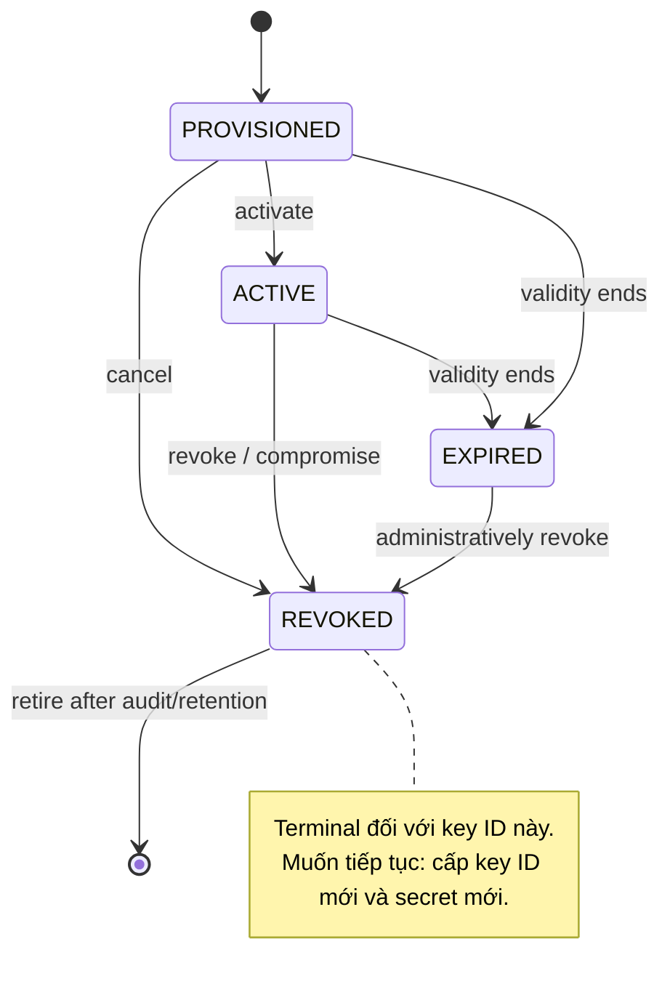

# Credential revocation: Thu hồi credential HMAC đúng lúc, đúng phạm vi và có thể kiểm chứng

Một đối tác gọi API bằng header `X-Key-Id: partner-a-202611` và chữ ký HMAC-SHA256. Hôm nay đội vận hành phát hiện shared secret của credential ấy xuất hiện trong một log không được phép. Dù server vẫn kiểm tra timestamp và nonce, người biết secret có thể tạo **request hoàn toàn mới** với timestamp hiện tại, nonce mới và HMAC hợp lệ. Để chặn lạm dụng, hệ thống phải **thu hồi credential** — không chỉ xóa log, giảm thời hạn nonce hoặc đổi tên Key ID.

**Credential revocation** (*thu hồi thông tin xác thực*) là quyết định của bên cấp phát khiến **một credential không còn được phép xác thực request** từ thời điểm hiệu lực đã công bố, kể cả khi MAC của request đúng về mặt mật mã. Vấn đề khó không chỉ là đổi trạng thái từ `ACTIVE` sang `REVOKED`: còn có **cache ở gateway**, nhiều region, request đang xử lý dở, registry outage, rotation overlap, audit và việc client chuyển sang credential mới.

Bài **Credential revocation** thuộc chương **Credential lifecycle** trong module `SECURITY_AUTHENTICATION_HMAC_REQUEST_AUTHENTICATION`. Phạm vi module là thiết kế xác thực HTTP request bằng **HMAC với shared secret** và canonical request bảo vệ method, URI, header hoặc body; thực hành xác minh chữ ký, chống replay bằng timestamp/nonce, quản lý key rotation, kiểm thử proxy/gateway và phân biệt **authentication** với **authorization**. Bài tập trung vào quy tắc thu hồi, ranh giới nhất quán phân tán và các phép kiểm chứng cần thiết để một credential bị thu hồi **thật sự ngừng được chấp nhận**.

## 1. Mục tiêu học tập

Sau bài học, bạn có thể:

1. Phân biệt **credential revocation**, secret rotation, credential expiry, client suspension, thu hồi quyền (**authorization**) và xóa dữ liệu audit.
2. Thiết kế vòng đời `PROVISIONED → ACTIVE → REVOKED` với trạng thái **REVOKED là terminal**, key ID mới khi cấp secret mới.
3. Mô tả chính xác tiêu chí eligibility: **trusted audience, exact Key ID, trạng thái, thời hạn, protocol version và principal state**.
4. Giải thích vì sao MAC đúng, timestamp fresh và nonce mới **không thể vượt qua lệnh revoke**; ngược lại, vì sao nonce store không khắc phục secret lộ.
5. Phân tích **revocation effective time**, revoke propagation SLA, cache stale, invalidation, failover, region partition và race với request đang xử lý.
6. Triển khai ví dụ **Java 17** dùng HMAC-SHA256, signed Key ID, timestamp/nonce, registry có revision, revoke key, kiểm tra lại trạng thái trước khi trả principal và kiểm thử âm.
7. Xây test cho **key rotation overlap**, revoke một key, disable cả client, error paths, concurrent replay và gateway/proxy.
8. Đưa ra runbook thu hồi an toàn, cách điều tra request sau revoke và các metric/audit không lộ secret.

## 2. Revocation thực sự có nghĩa gì?

Một hệ thống HMAC có thể cấp nhiều credential cho cùng một client:

```text
clientId = partner-a, tenantId = tenant-42
audience = orders-api-prod

Key ID                  Secret            Trạng thái
partner-a-202611        Secret A          ACTIVE
partner-a-202702        Secret B          ACTIVE (rotation overlap)
partner-a-202608        Secret Z          REVOKED
```

Giả sử verifier nhận:

```http
POST /v1/orders?channel=partner HTTP/1.1
Host: api.example.test
Content-Type: application/json
X-Key-Id: partner-a-202608
X-Timestamp: 2026-11-28T02:00:00Z
X-Nonce: Zq8DxKtUokcwPGNj3d_yvQ
X-Signature: v1=<BASE64_FULL_HMAC_SHA256>

{"sku":"BK-42","quantity":2}
```

Dấu `<...>` là placeholder. Dù requester biết **Secret Z** và ký chính xác canonical bytes, verifier vẫn phải **từ chối tại credential eligibility** vì `partner-a-202608` đã `REVOKED`.

| Thuộc tính | MAC đúng có chứng minh được? | Revocation bổ sung điều gì? |
| --- | --- | --- |
| Caller biết secret tương ứng với Key ID | Có thể chứng minh possession của secret qua MAC. | Secret đó **còn được phép dùng hay không** là quyết định policy riêng. |
| Các trường method/URI/body đã ký không bị đổi | Có, nếu hợp đồng canonical đủ trường. | Không cấp quyền xác thực khi credential bị thu hồi. |
| Timestamp còn mới | Không; cần freshness check. | Credential có thể bị revoke **trong khi timestamp vẫn fresh**. |
| Nonce chưa dùng | Không; cần atomic nonce claim. | Một nonce mới không hợp thức hóa key đã revoke. |
| Client được quyền tạo order | Không; cần authorization. | Revoke có thể chặn cả authentication của credential, còn quyền resource kiểm riêng. |

**Revocation là quyết định tin cậy ở server**, không phải một bit client có thể tự gửi. Không nhận các header như `X-Credential-State: active`, `X-Revoke: false` hoặc `X-Client-Role: admin` làm sự thật.

### Thu hồi credential khác tạm khóa client

- **Revoke một credential:** chỉ key ID/secret version bị thu hồi. Một key mới **được cấp riêng và còn ACTIVE** cho cùng client có thể tiếp tục xác thực.
- **Disable/suspend toàn client:** mọi credential đang ánh xạ về client đó phải bị chặn theo chính sách, kể cả key mới nếu client-level ban vẫn còn hiệu lực.
- **Thu hồi scope/quyền:** client vẫn có thể được xác thực nhưng authorization từ chối method/resource/tenant không còn được phép. Nếu scopes lưu cùng credential, thay đổi entitlement cũng cần cache invalidation.
- **Expire key:** policy từ chối theo `validUntil` mà không cần sự kiện quản trị revoke thủ công; thường dùng thời điểm **exclusive**.
- **Rotation:** thay secret theo kế hoạch bằng key ID mới; overlap là khoảng **hai credential đều được phép**, không tương đương một key đã bị revoke.

## 3. Credential lifecycle: trạng thái và bất biến

Một state machine minh họa:



Không có một enum state machine chung cho mọi HMAC API. Hệ thống có thể tính `EXPIRED` từ thời gian thay vì lưu hẳn enum, hoặc có trạng thái `SUSPENDED` phục hồi theo quy trình riêng. **Revocation của secret đã bị compromise nên được xem là không thể đảo ngược với cùng key ID và secret**.

| Bất biến | Ý nghĩa |
| --- | --- |
| `ACTIVE` là điều kiện cần, **không đủ** để authentication thành công. | Còn phải verify full HMAC, freshness và nonce. |
| `REVOKED` không được chuyển trở lại `ACTIVE` với cùng key ID. | Tránh tái dùng secret đã lộ và làm sai audit/nonce namespace. |
| Không **recycle Key ID** cho secret khác. | Giữ nguyên lịch sử, cache consistency và semantics của replay key. |
| Registry phải có **monotonic revision/event sequence** cho thay đổi trạng thái. | Phát hiện snapshot cũ và đối soát rollout/failover. |
| Credential có **audience, scheme, clientId/tenantId và validity** rõ. | Tránh cross-service/cross-tenant và downgrade. |
| Revoke event do **đầu mối được ủy quyền** phát hành. | Tránh attacker vô quyền tự vô hiệu hóa credential của người khác. |
| Không xóa bằng chứng đã được phép lưu chỉ để “làm biến mất key”. | Phục vụ điều tra, đối soát và tuân retention. |

### Revoke có cần xóa secret ngay?

Khi credential bị revoke, lý tưởng là khóa không còn được sử dụng để xác minh và **key material được retire/xóa theo chính sách**, nhưng việc xóa secret khỏi vault **không đồng nghĩa** mọi bản sao trong cache/JVM/HSM đã biến mất. Ngược lại, chỉ đổi `state=REVOKED` trong DB mà cache verifier vẫn giữ `ACTIVE` cũng chưa bảo đảm chặn được request.

Cần phối hợp **state enforcement, cache invalidation, propagation, memory lifetime và secret destruction**. Audit thường giữ **metadata** về key ID/revocation, không giữ raw secret.

## 4. Các nguyên nhân phải thu hồi credential

| Tình huống | Nguy cơ | Hành động khuyến nghị theo mức độ |
| --- | --- | --- |
| Shared secret xuất hiện trong log/APM/ticket không được phép. | Attacker có thể ký **request mới**. | Contain log, **revoke/rotate**, rà soát truy cập và business impact. |
| Thiết bị client hoặc CI runner bị chiếm. | Secret và signing capability có thể bị sử dụng trái phép. | Revoke credential ảnh hưởng, điều tra các request đã ký. |
| Cấp credential cho nhầm client/tenant/audience. | Cross-tenant hoặc privilege confusion. | Revoke ngay ID sai và sửa registry/ACL. |
| Hết hợp đồng/offboarding đối tác. | Client không còn phải được xác thực. | Revoke toàn bộ credentials liên quan, xét client disable. |
| Key rotation hoàn tất. | Secret cũ không còn cần dùng; tăng blast radius nếu giữ ACTIVE. | Revoke key cũ theo mốc chuyển đã thỏa thuận. |
| Key hết hạn. | Chính sách validity đã hết. | Từ chối theo `validUntil`; dọn/lưu metadata phù hợp. |
| Phát hiện credential signing behavior bất thường. | Có thể là misuse hoặc attacker đã lấy secret. | Xác minh bằng chứng, contain/revoke theo incident runbook. |
| Một scope không còn phù hợp. | Caller có thể dùng quyền quá rộng. | Revoke/điều chỉnh authorization theo mô hình, không nhất thiết xóa mọi credential. |

**Không cần biết ai đánh cắp secret mới được phép revoke.** Trong incident response, có thể cần quyết định khẩn cấp dựa trên độ tin cậy của bằng chứng và rủi ro, nhưng phải ghi audit về người ra quyết định, nguyên nhân, ảnh hưởng và thời gian hiệu lực.

### Attacker có secret vẫn tạo nonce mới

```text
Secret đã lộ = biết K

Attacker chọn:
  method = POST
  target = /v1/orders?channel=partner
  timestamp = thời điểm hiện tại
  nonce = 16 random bytes mới
  body = payload họ muốn

signature = HMAC-SHA256(K, canonicalRequest)
```

Timestamp window và atomic nonce store chỉ bảo vệ **request replay theo nonce**, không ngăn tạo request mới khi người gửi đã biết secret. Revoke credential được đánh giá **trước khi chấp nhận MAC đúng như một điều kiện authentication**. Khi đã revoke, **mọi attempt** dưới key ID ấy bị từ chối, kể cả request chưa từng xuất hiện.

## 5. Hợp đồng credential registry cần có để revoke chính xác

Đặt một schema minh họa:

| Trường | Ví dụ | Vai trò |
| --- | --- | --- |
| `keyId` | `partner-a-202611` | ID duy nhất của **một credential version**. |
| `audience` | `orders-api-prod` | Chỉ hợp lệ ở service/environment cụ thể. |
| `clientId` | `partner-a` | Identity ánh xạ sau khi verify thành công. |
| `tenantId` | `tenant-42` | Đầu vào chính sách tenant/resource. |
| `scheme` | `HMAC-SHA256-V1` | Protocol/canonicalization đã được phép. |
| `state` | `ACTIVE / REVOKED` | Quyết định eligibility. |
| `validFrom` | `2026-11-01T00:00:00Z` | Chưa dùng trước thời điểm này. |
| `validUntil` | `2027-03-01T00:00:00Z` | Hết hiệu lực tại **biên exclusive**. |
| `revokedAt` | `2026-11-28T02:01:00Z` | Thời điểm quyết định thu hồi có hiệu lực theo policy. |
| `revision` | `1459` | Tăng đơn điệu cho record để đối chiếu cache. |
| `secretRef` | `vault://opaque-id` | Tham chiếu **nội bộ**, không phát lên HTTP/log. |
| `revocationReason` | `EXPOSURE_CONFIRMED` | Mã lý do **đã lọc**, không kèm raw incident evidence. |

Đây là mô hình giảng dạy, không phải schema bắt buộc của HTTP hoặc một sản phẩm vault. Có hệ thống đặt `clientState` trong kho khác hoặc dùng allowlist/denylist bổ sung. Điều quan trọng là **verifier không chỉ đọc secret** mà phải đọc **quyết định còn được phép dùng** từ nguồn tin cậy với mức nhất quán phù hợp.

### Điều kiện eligible

Với request nhận tại thời điểm server `now`, credential `c` minh họa có thể xác thực chỉ khi:

\[
\begin{aligned}
\mathrm{eligible}(c, now) ={}&
(c.state = \mathrm{ACTIVE})\\
&\land (c.audience=\mathrm{trustedAudience})\\
&\land (c.scheme=\mathrm{allowedScheme})\\
&\land (c.validFrom \le now < c.validUntil)\\
&\land \mathrm{clientAccountEnabled}(c.clientId).
\end{aligned}
\]

**Key ID là input chưa xác minh.** Verifier chỉ dùng nó làm lookup hint trong namespace `(trustedAudience,keyId)`; không suy client/tenant từ tên ID, không tin `X-Audience` hoặc `X-Role` do client tự khai.

### Revoke một key hay một client?

Nếu chỉ revoke `partner-a-202611` trong khi `partner-a-202702` vẫn ACTIVE, key B vẫn có thể authenticate và cùng tạo principal `partner-a`. Nếu yêu cầu **đình chỉ đối tác hoàn toàn**, cần **client-level deny/suspend** hoặc revoke tất cả credentials đang liên kết, kèm kiểm tra race khi có key mới provision trong lúc xử lý. Test phải thể hiện rõ phạm vi quyết định.

## 6. Revocation trong chuỗi xác minh HMAC request

Một trình tự minh họa:

```mermaid
sequenceDiagram
    participant C as HTTP Client
    participant G as Gateway / Ingress
    participant R as Credential Registry
    participant V as HMAC Verifier
    participant N as Shared Nonce Store
    participant B as Backend / Authorization

    C->>G: Method + raw URI + signed headers/body + keyId
    G->>G: Check framing/duplicate headers; trusted route
    G->>V: Parsed request view (raw bytes)
    V->>R: Exact lookup(trustedAudience, keyId)
    R-->>V: Credential snapshot + state/revision
    V->>V: Reject REVOKED / EXPIRED / wrong audience/version
    V->>V: Verify full HMAC over canonical bytes
    V->>V: Check signed timestamp freshness
    V->>N: Atomic nonce claim (audience,keyId,nonce)
    N-->>V: Claimed / exists / unavailable
    V->>R: Optional final policy/revision check
    R-->>V: Current state or unavailable
    alt Eligible + MAC + freshness + nonce + policy pass
        V->>B: Trusted principal / credential context
        B->>B: Authorization method/resource/tenant/scope
    else Rejected / Unavailable
        V-->>G: No authenticated principal
    end
```

**Các điểm cần chốt:**

1. **Ingress:** chặn duplicate `X-Key-Id`, `X-Timestamp`, `X-Nonce`, `X-Signature`, request smuggling, raw target ambiguity trước khi có request view đáng tin.
2. **Trusted audience:** xác định qua route/authority tin cậy, **không** do `X-Audience` Internet đưa vào.
3. **Exact key lookup:** chọn **một secret/version** theo key ID; không thử secret cũ nếu HMAC với key đã chọn sai.
4. **Eligibility trước khi chấp nhận:** REVOKED/EXPIRED/disabled client bị từ chối **dù MAC tính được**.
5. **HMAC:** server tự dựng canonical bytes, so **raw full tag** bằng `MessageDigest.isEqual`, không log secret/expected MAC.
6. **Freshness:** signed timestamp phải nằm trong cửa sổ; nonce là signed value và claim atomically **sau MAC hợp lệ**.
7. **Final policy check** có thể giảm rủi ro revoke trong lúc tính HMAC; **không tự đảm bảo zero race** khi revoke diễn ra ngay sau check.
8. **Principal** chỉ được tạo khi mọi kiểm tra đạt. **Authorization** vẫn xét resource/tenant/scope và trạng thái account.

### Tại sao không thử lại secret cũ sau revoke?

Sai:

```java
// SAI: revoked key A không khớp hoặc bị đánh dấu không dùng;
// verifier thử key khác B để "giúp client tiếp tục".
for (Credential credential : registry.allKeysForClient(clientId)) {
    if (verifyHmac(credential.secret(), canonicalRequest)) {
        return authenticatedAs(clientId);
    }
}
```

Nếu server làm vậy, **Key ID không còn ràng buộc phiên bản credential** và có thể vô tình chấp nhận secret bị revoke. Khi rotation, client phải **chuyển sang Key ID B và secret B**, ký lại request. Không cho verifier “hồi sinh” secret A để sửa lỗi SDK.

### Revoke phải thắng cả timestamp và nonce

Request đã ký bởi A tại `02:00:00Z`, server policy freshness ±300 giây. Credential A bị revoke tại `02:01:00Z`. Request đến lúc `02:01:05Z`, MAC đúng và timestamp còn fresh, nonce chưa từng dùng. Nếu policy áp dụng revoke **tức thời tại verifier**, request vẫn **phải bị từ chối**. Không miễn trừ “request đã ký trước revoke” trừ khi một hợp đồng có yêu cầu riêng rất đặc biệt được thiết kế và chấp thuận.

## 7. Vấn đề phân tán: revoke đã ghi DB nhưng gateway còn cache ACTIVE

Trong hệ thống nhiều node:

```text
                    Registry primary (REVOKED, revision 1460)
                             |
            +----------------+----------------+
            |                                 |
        Gateway A                         Gateway B
    cache revision 1459               cache revision 1460
        state ACTIVE                       state REVOKED
            |                                 |
       May accept MAC                    Reject request
```

**Đây là rủi ro revocation propagation.** Việc update registry thành công **không tự chứng minh** mọi verifier đều ngừng chấp nhận key.

### Các chiến lược và đánh đổi

| Chiến lược | Lợi ích | Giới hạn cần ghi thành policy |
| --- | --- | --- |
| **Lookup live tới nguồn mạnh nhất quán** ở mỗi request | Giảm stale state. | Latency, availability, chi phí; vẫn có race sau check. |
| **Bounded positive cache TTL** | Giảm tải registry. | Revoke có thể trễ đến TTL (và lỗi invalidation). |
| **Push invalidation với version** | Giảm delay sau revoke. | Mất event, subscriber offline, out-of-order; cần reconcile. |
| **Version watermark / epoch** | Node phát hiện snapshot cũ so với revision tối thiểu. | Cần nguồn watermark tin cậy và xử lý khi không thể đọc. |
| **Central revocation denylist** được kiểm với consistency rõ | Chặn key cũ dù credential metadata còn cached. | Denylist cũng cần availability, replication và retention. |
| **Short-lived credentials** | Giảm lifetime key khi không revoke được tức thì. | Không thay revoke khẩn cấp cho key còn hạn. |
| **Gateway chỉ một điểm xác minh** | Dễ thống nhất state và provenance. | Phải ngăn backend bypass và bảo vệ trusted identity assertion. |
| **Pause/quarantine credential** khi nghi compromise | Giảm rủi ro khi điều tra. | Tác động availability client hợp lệ; cần runbook thông báo. |

Không thể gọi hệ thống là “revoke immediate” nếu gateway dùng cache ACTIVE 15 phút không invalidation. Phải công bố và đo **revocation enforcement SLA**, ví dụ mọi verifier ngừng nhận key trong một khoảng tối đa sau commit (con số do yêu cầu rủi ro quyết định, **không** tự mặc định).

### Định nghĩa thời điểm cho kiểm thử

```text
T0  Incident/operator quyết định revoke key A
T1  Registry commit REVOKED(revision=1460)
T2  Event invalidation được phát
T3  Gateway A nhận event và xóa cache
T4  Gateway B nhận event và xóa cache
T5  Điểm xác minh cuối cùng ngừng chấp nhận key A
```

Revocation propagation đo từ **mốc mà contract định nghĩa** (ví dụ registry commit `T1`) đến mốc kiểm tra cuối `T5`, không đo từ lúc nhân viên mở ticket. Nếu policy yêu cầu **không chấp nhận bất kỳ request nào sau T1**, chỉ push invalidation bất đồng bộ **không đủ**; cần một thiết kế đồng bộ/consistency có thể chứng minh hoặc chấp nhận hạn chế availability.

## 8. Race với request đang xử lý: “revoke ngay” nghĩa là đến đâu?

Giả sử:

```text
02:00:00.100Z  Gateway A lookup -> credential ACTIVE
02:00:00.110Z  Gateway A HMAC valid + timestamp fresh
02:00:00.115Z  Operator commits REVOKED at registry
02:00:00.120Z  Gateway A claims nonce
02:00:00.121Z  Gateway A publishes authenticated principal
02:00:00.130Z  Backend creates order
```

Nếu verifier chỉ check ACTIVE tại `02:00:00.100Z`, nó **có thể cho qua** sau khi revoke commit. Có hai loại hợp đồng cần phân biệt:

| Phạm vi thu hồi | Mô tả | Hệ quả triển khai |
| --- | --- | --- |
| **Revoke cho authentication attempts bắt đầu sau thời điểm commit** | Request đã vượt checkpoint trước commit có thể tiếp tục. | Cần audit chính xác mốc checkpoint và cache SLA; vẫn kiểm business authorization. |
| **Revoke chặn cả in-flight operations chưa commit** | Không side effect nào sau commit được dùng credential cũ. | Phải phối hợp với authorization/business point-of-use, cancellation/transaction barrier hoặc giao thức nhất quán mạnh; một recheck đơn lẻ **không đủ**. |
| **Bounded propagation** | Chấp nhận độ trễ có SLA, đo trên gateway/region. | Không được quảng bá thành zero-delay; có mitigation cho key compromise khẩn cấp. |

**Không thể dùng `Clock.now()` đơn lẻ để quyết định một cuộc đua phân tán.** Server timestamps giữa các vùng có clock skew; cần log registry revision, request IDs, quyết định policy tại checkpoint, phiên bản deployment và nguồn thời gian tin cậy. Nếu nghiệp vụ rất nhạy cảm, cân nhắc **authorization check tại point of use** và transactional/central gate cho trạng thái principal, không chỉ check lần đầu ở edge.

### Final recheck có ích nhưng không thần kỳ

Đọc lại state sau HMAC/nonce và trước khi phát hành principal có thể bắt được nhiều sự kiện revoke xảy ra giữa chừng. Nhưng một revoke có thể commit **ngay sau recheck**. Bảo đảm mạnh hơn cần định nghĩa **linearization point** và phối hợp trạng thái/side effect theo cùng cơ chế nhất quán.

Việc nonce đã claim rồi phát hiện revoked ở final recheck **không phải lý do xóa nonce**: làm vậy có thể mở race/replay. Request muốn thử lại với key B phải dùng **nonce/timestamp/signature mới**; idempotency key (nếu có) theo cùng business intent vẫn giữ nguyên theo contract.

## 9. Canonical HMAC contract có signed Key ID, timestamp và nonce

Bài dùng một **hợp đồng minh họa `HMAC-SHA256-V1`**, không phải chuẩn mặc định mọi API:

| Thành phần | Quy tắc |
| --- | --- |
| Algorithm | `HmacSHA256`; full 32-byte tag. |
| Signature wire | `X-Signature: v1=` + Base64 chuẩn padded 44 ký tự. |
| Audience | `orders-api-prod`, lấy từ trusted route và đưa vào canonical string. |
| Method | Chính xác `POST`. |
| Request target | Chính xác `/v1/orders?channel=partner`. |
| Header có ký | `Content-Type`, `X-Key-Id`, `X-Timestamp`, `X-Nonce`. |
| Content-Type | Chính xác một `application/json`. |
| Content-Encoding | Không được hiện diện trong V1. |
| Body | SHA-256 của **raw HTTP content bytes**, không serialize lại JSON. |
| Timestamp | UTC `YYYY-MM-DDTHH:mm:ssZ`; cửa sổ ±300 giây. |
| Nonce | 16 byte từ CSPRNG, Base64URL unpadded 22 ký tự. |
| Canonical bytes | UTF-8, LF giữa dòng, không LF cuối. |

```text
HMAC-SHA256-V1
orders-api-prod
POST
/v1/orders?channel=partner
content-type:application/json
x-key-id:partner-a-202611
x-timestamp:2026-11-28T02:00:00Z
x-nonce:Zq8DxKtUokcwPGNj3d_yvQ
sha256:<LOWERCASE_HEX_SHA256_RAW_BODY>
```

Giá trị `<LOWERCASE_HEX_SHA256_RAW_BODY>` là placeholder; client phải thay bằng **64 ký tự hex lowercase** của SHA-256 trên raw body thực gửi.

\[
\begin{aligned}
D &= \operatorname{SHA256}(\mathrm{rawBodyBytes}),\\
C &= \operatorname{UTF8}(\mathrm{canonicalStringWithHex}(D)),\\
T &= \operatorname{HMAC}_{\mathrm{SHA256}}(K_{\mathrm{keyId}}, C),\\
S &= \texttt{v1=} \Vert \operatorname{Base64}_{\mathrm{padded}}(T).
\end{aligned}
\]

**Key ID và audience phải được ràng buộc trong dữ liệu ký.** Nếu attacker đổi Key ID A → B nhưng giữ MAC A, verifier tra B và tính canonical có Key ID B nên từ chối. Verifier **không thử A** nếu HMAC dưới B không khớp.

### Nonce và revocation hoạt động độc lập

Replay key V1 có thể là:

```text
replay:v1:<trustedAudience>:<keyId>:<nonce>
```

Đây là namespace **theo credential**, không chứa timestamp. Nonce claim phải atomic ở **shared store**. Với cửa sổ `now - 300s ≤ signedTimestamp ≤ now + 300s`, entry cần giữ đến ít nhất:

```text
nonceExpiresAt = signedTimestamp + allowedPast + safetyMargin
```

Vì signed timestamp ở tương lai có thể được chấp nhận **sớm hơn 300 giây**, TTL chỉ 300 giây kể từ lần nhận đầu có thể làm nonce biến mất **trước khi request hết hạn**.

**Revoke không có nghĩa xóa toàn bộ nonce store.** Xóa replay state có thể khiến request cũ của các credential **khác còn ACTIVE** lại được nhận. Một key đã REVOKED bị chặn bởi eligibility; anti-replay của những key còn dùng vẫn phải giữ nguyên.


## 10. Java 17: Registry hỗ trợ revoke và verifier fail closed

Ví dụ sau là **chương trình Java 17 tự chứa** (không cần thư viện bên ngoài). Nó không mở HTTP socket hay truy cập Redis/KMS thật. Thay vào đó, `RequestView` biểu diễn request đã đi qua ingress tin cậy, và một `CredentialRegistry` trong memory mô phỏng **commit trạng thái revoke và revision**.

Mục tiêu test:

- Registry lưu credential theo **`(trustedAudience, keyId)`** và không cho **recycle ID**.
- `Credential.state=REVOKED` là terminal; record revoked **không cung cấp secret** trong registry.
- HMAC chỉ dùng **một** secret từ key ID đã chọn; canonical bytes bao gồm signed Key ID/audience/method/target/body digest.
- Không tạo principal khi credential revoked, expired, sai audience, MAC sai, timestamp quá hạn, nonce đã dùng hoặc dependency lỗi.
- Revoke key A **không tự revoke** key B đang ACTIVE của cùng client; disable client riêng mới chặn toàn client.
- `verifyWithProbe` chỉ để test: mô phỏng **revocation ngay sau nonce claim nhưng trước final policy check**; verifier phải từ chối.
- Dùng `SecureRandom` sinh nonce 16 byte và `MessageDigest.isEqual` so full HMAC tag.
- Có test hai luồng cùng signed nonce; `LocalNonceStore` chỉ atomic **trong một JVM**.
- Không log raw secret, full signature, canonical bytes hoặc body.

### Mã nguồn

Lưu vào `CredentialRevocationHmacDemo.java` và chạy với JDK 17:

```java
import java.nio.charset.StandardCharsets;
import java.security.GeneralSecurityException;
import java.security.MessageDigest;
import java.security.SecureRandom;
import java.time.Clock;
import java.time.Instant;
import java.time.ZoneOffset;
import java.time.format.DateTimeParseException;
import java.util.Arrays;
import java.util.Base64;
import java.util.HashMap;
import java.util.HashSet;
import java.util.HexFormat;
import java.util.Map;
import java.util.Set;
import java.util.concurrent.Callable;
import java.util.concurrent.CountDownLatch;
import java.util.concurrent.ExecutorService;
import java.util.concurrent.Executors;
import java.util.concurrent.Future;
import javax.crypto.Mac;
import javax.crypto.spec.SecretKeySpec;

public final class CredentialRevocationHmacDemo {
    private static final String SCHEME = "HMAC-SHA256-V1";
    private static final String PROD = "orders-api-prod";
    private static final String SANDBOX = "orders-api-sandbox";
    private static final String TARGET = "/v1/orders?channel=partner";
    private static final String TYPE = "application/json";
    private static final String SIGNATURE_PREFIX = "v1=";
    private static final long PAST_SECONDS = 300L;
    private static final long FUTURE_SECONDS = 300L;
    private static final long NONCE_MARGIN_SECONDS = 30L;

    private CredentialRevocationHmacDemo() {}

    enum KeyState { ACTIVE, REVOKED }
    enum RejectCode {
        BAD_REQUEST, INVALID_CREDENTIAL, INVALID_SIGNATURE,
        NOT_FRESH, NONCE_REPLAY, POLICY_CHANGED
    }
    enum FailureCode {
        REGISTRY_UNAVAILABLE, CRYPTO_UNAVAILABLE,
        NONCE_STORE_UNAVAILABLE
    }

    sealed interface Verdict permits Allowed, Denied, Unavailable {}

    record Principal(
            String clientId, String tenantId, Set<String> scopes) {
        Principal {
            scopes = Set.copyOf(scopes);
        }
    }

    record Allowed(
            Principal principal, String credentialId,
            long credentialRevision) implements Verdict {}

    record Denied(RejectCode reason) implements Verdict {}
    record Unavailable(FailureCode reason) implements Verdict {}

    /**
     * The registry representation is immutable. For revoked credentials,
     * secret is null: no verification key material is returned.
     */
    record Credential(
            String keyId, String clientId, String tenantId,
            String audience, String scheme, KeyState state,
            Instant validFrom, Instant validUntil, Instant revokedAt,
            long revision, byte[] secret, Set<String> scopes) {
        Credential {
            if (state == KeyState.ACTIVE
                    && (secret == null || secret.length < 32)) {
                throw new IllegalArgumentException(
                        "ACTIVE credential must have 32+ test key bytes");
            }
            secret = secret == null ? null : secret.clone();
            scopes = Set.copyOf(scopes);
        }
        @Override
        public byte[] secret() {
            return secret == null ? null : secret.clone();
        }
        @Override
        public String toString() {
            return "Credential[REDACTED]";
        }
    }

    record RegistryKey(String audience, String keyId) {}

    record RequestView(
            String method, String rawTarget, String contentType,
            boolean contentEncodingPresent, String keyId,
            String timestamp, String nonce, byte[] body,
            String signature) {
        RequestView {
            if (body != null) {
                body = body.clone();
            }
        }
        @Override
        public byte[] body() {
            return body == null ? null : body.clone();
        }
        @Override
        public String toString() {
            return "RequestView[REDACTED]";
        }
    }

    static final class RegistryUnavailable extends Exception {}
    static final class NonceUnavailable extends Exception {}

    interface CredentialRegistry {
        Credential lookup(String trustedAudience, String keyId)
                throws RegistryUnavailable;
        boolean clientEnabled(String clientId)
                throws RegistryUnavailable;
    }

    static final class InMemoryRegistry implements CredentialRegistry {
        private final Map<RegistryKey, Credential> credentials =
                new HashMap<>();
        private final Set<String> disabledClients = new HashSet<>();
        private boolean online = true;

        public synchronized void register(Credential candidate) {
            RegistryKey key = new RegistryKey(
                    candidate.audience(), candidate.keyId());
            if (credentials.containsKey(key)) {
                throw new IllegalStateException(
                        "Never recycle an existing credential ID");
            }
            credentials.put(key, candidate);
        }

        @Override
        public synchronized Credential lookup(
                String trustedAudience, String keyId)
                throws RegistryUnavailable {
            if (!online) {
                throw new RegistryUnavailable();
            }
            return credentials.get(
                    new RegistryKey(trustedAudience, keyId));
        }

        @Override
        public synchronized boolean clientEnabled(String clientId)
                throws RegistryUnavailable {
            if (!online) {
                throw new RegistryUnavailable();
            }
            return !disabledClients.contains(clientId);
        }

        public synchronized void revoke(
                String audience, String keyId, Instant at) {
            RegistryKey key = new RegistryKey(audience, keyId);
            Credential old = credentials.get(key);
            if (old == null) {
                throw new IllegalArgumentException(
                        "Unknown credential in trusted registry");
            }
            if (old.state() == KeyState.REVOKED) {
                return; // Idempotent revoke; never reactivate this ID.
            }
            // Terminal tombstone: no secret returned for this key.
            Credential revoked = new Credential(
                    old.keyId(), old.clientId(), old.tenantId(),
                    old.audience(), old.scheme(), KeyState.REVOKED,
                    old.validFrom(), old.validUntil(), at,
                    old.revision() + 1, null, old.scopes());
            credentials.put(key, revoked);
        }

        public synchronized void disableClient(String clientId) {
            disabledClients.add(clientId);
        }

        public synchronized void setOnline(boolean value) {
            online = value;
        }
    }

    interface NonceStore {
        boolean claim(
                String replayKey, Instant expiresAt, Instant now)
                throws NonceUnavailable;
    }

    /**
     * Demo only: synchronized makes claim atomic inside this JVM.
     * Production needs a shared store with durable uniqueness and TTL.
     */
    static final class LocalNonceStore implements NonceStore {
        private final Map<String, Instant> used = new HashMap<>();

        @Override
        public synchronized boolean claim(
                String key, Instant expiresAt, Instant now) {
            used.entrySet().removeIf(
                    e -> !e.getValue().isAfter(now));
            if (!expiresAt.isAfter(now) || used.containsKey(key)) {
                return false;
            }
            used.put(key, expiresAt);
            return true;
        }
    }

    private static boolean validKeyId(String keyId) {
        return keyId != null
                && keyId.matches("[a-z0-9][a-z0-9._-]{0,63}");
    }

    private static boolean validNonce(String nonce) {
        if (nonce == null || nonce.length() != 22) {
            return false;
        }
        try {
            byte[] bytes = Base64.getUrlDecoder().decode(nonce);
            return bytes.length == 16
                    && Base64.getUrlEncoder().withoutPadding()
                            .encodeToString(bytes).equals(nonce);
        } catch (IllegalArgumentException malformed) {
            return false;
        }
    }

    private static Instant parseTimestamp(String value) {
        if (value == null || !value.matches(
                "[0-9]{4}-[0-9]{2}-[0-9]{2}T"
                + "[0-9]{2}:[0-9]{2}:[0-9]{2}Z")) {
            throw new IllegalArgumentException("Bad timestamp format");
        }
        try {
            Instant parsed = Instant.parse(value);
            if (!parsed.toString().equals(value)) {
                throw new IllegalArgumentException(
                        "Noncanonical UTC timestamp");
            }
            return parsed;
        } catch (DateTimeParseException malformed) {
            throw new IllegalArgumentException(
                    "Bad timestamp value", malformed);
        }
    }

    private static boolean validShape(RequestView r) {
        if (r == null || !"POST".equals(r.method())
                || !TARGET.equals(r.rawTarget())
                || !TYPE.equals(r.contentType())
                || r.contentEncodingPresent()
                || !validKeyId(r.keyId())
                || !validNonce(r.nonce())
                || r.body() == null || r.body().length > 8192) {
            return false;
        }
        try {
            parseTimestamp(r.timestamp());
            return true;
        } catch (IllegalArgumentException malformed) {
            return false;
        }
    }

    private static byte[] canonicalBytes(
            String audience, RequestView r)
            throws GeneralSecurityException {
        String bodyDigest = HexFormat.of().formatHex(
                MessageDigest.getInstance("SHA-256").digest(r.body()));
        String canonical = String.join("\n",
                SCHEME, audience, r.method(), r.rawTarget(),
                "content-type:" + r.contentType(),
                "x-key-id:" + r.keyId(),
                "x-timestamp:" + r.timestamp(),
                "x-nonce:" + r.nonce(),
                "sha256:" + bodyDigest);
        return canonical.getBytes(StandardCharsets.UTF_8);
    }

    private static byte[] calculateMac(
            byte[] secret, byte[] canonical)
            throws GeneralSecurityException {
        if (secret == null || secret.length < 32) {
            throw new GeneralSecurityException(
                    "Invalid test HMAC key policy");
        }
        Mac mac = Mac.getInstance("HmacSHA256");
        mac.init(new SecretKeySpec(secret, "HmacSHA256"));
        return mac.doFinal(canonical);
    }

    private static byte[] decodeMac(String wire) {
        if (wire == null || wire.length() != 47
                || !wire.startsWith(SIGNATURE_PREFIX)) {
            return null;
        }
        String base64 = wire.substring(SIGNATURE_PREFIX.length());
        if (!base64.matches("[A-Za-z0-9+/]{43}=")) {
            return null;
        }
        try {
            byte[] decoded = Base64.getDecoder().decode(base64);
            return decoded.length == 32
                    && Base64.getEncoder().encodeToString(decoded)
                            .equals(base64) ? decoded : null;
        } catch (IllegalArgumentException malformed) {
            return null;
        }
    }

    private static boolean eligible(
            Credential c, String audience, Instant now) {
        return c != null && c.state() == KeyState.ACTIVE
                && audience.equals(c.audience())
                && SCHEME.equals(c.scheme())
                && !now.isBefore(c.validFrom())
                && now.isBefore(c.validUntil());
    }

    static final class Verifier {
        private final String trustedAudience;
        private final CredentialRegistry registry;
        private final NonceStore nonces;
        private final Clock clock;

        Verifier(String trustedAudience, CredentialRegistry registry,
                NonceStore nonces, Clock clock) {
            this.trustedAudience = trustedAudience;
            this.registry = registry;
            this.nonces = nonces;
            this.clock = clock;
        }

        Verdict verify(RequestView request) {
            return verifyWithProbe(request, () -> {});
        }

        /**
         * TEST ONLY: probe runs after nonce claim and before final policy
         * check, making the revoke-in-flight race deterministic.
         * The probe is trusted test code, never controlled by HTTP input.
         */
        Verdict verifyWithProbe(
                RequestView request, Runnable beforeFinalCheck) {
            if (!validShape(request)) {
                return new Denied(RejectCode.BAD_REQUEST);
            }
            Instant now = clock.instant();
            Credential snapshot;
            try {
                snapshot = registry.lookup(
                        trustedAudience, request.keyId());
                if (!eligible(snapshot, trustedAudience, now)
                        || !request.keyId().equals(snapshot.keyId())
                        || !registry.clientEnabled(snapshot.clientId())) {
                    return new Denied(RejectCode.INVALID_CREDENTIAL);
                }
            } catch (RegistryUnavailable unavailable) {
                return new Unavailable(FailureCode.REGISTRY_UNAVAILABLE);
            }

            byte[] supplied = decodeMac(request.signature());
            if (supplied == null) {
                return new Denied(RejectCode.INVALID_SIGNATURE);
            }
            byte[] secretCopy = snapshot.secret();
            try {
                byte[] expected = calculateMac(secretCopy,
                        canonicalBytes(trustedAudience, request));
                if (!MessageDigest.isEqual(expected, supplied)) {
                    return new Denied(RejectCode.INVALID_SIGNATURE);
                }
            } catch (GeneralSecurityException cryptoUnavailable) {
                return new Unavailable(FailureCode.CRYPTO_UNAVAILABLE);
            } finally {
                // Best effort only: JCA and JVM may hold other copies.
                if (secretCopy != null) {
                    Arrays.fill(secretCopy, (byte) 0);
                }
            }

            Instant signedTime = parseTimestamp(request.timestamp());
            if (signedTime.isBefore(now.minusSeconds(PAST_SECONDS))
                    || signedTime.isAfter(now.plusSeconds(FUTURE_SECONDS))) {
                return new Denied(RejectCode.NOT_FRESH);
            }

            String replayKey = "replay:v1:" + trustedAudience + ":"
                    + snapshot.keyId() + ":" + request.nonce();
            Instant expiresAt = signedTime.plusSeconds(
                    PAST_SECONDS + NONCE_MARGIN_SECONDS);
            try {
                if (!nonces.claim(replayKey, expiresAt, now)) {
                    return new Denied(RejectCode.NONCE_REPLAY);
                }
            } catch (NonceUnavailable unavailable) {
                return new Unavailable(FailureCode.NONCE_STORE_UNAVAILABLE);
            }

            // Exercise the revocation race in a deterministic test.
            beforeFinalCheck.run();

            // Second lookup catches revocation between the two checkpoints.
            // This reduces but does NOT eliminate an after-check race.
            try {
                Credential current = registry.lookup(
                        trustedAudience, request.keyId());
                if (!eligible(current, trustedAudience, now)
                        || current.revision() != snapshot.revision()
                        || !registry.clientEnabled(snapshot.clientId())) {
                    return new Denied(RejectCode.POLICY_CHANGED);
                }
            } catch (RegistryUnavailable unavailable) {
                return new Unavailable(FailureCode.REGISTRY_UNAVAILABLE);
            }

            Principal trusted = new Principal(
                    snapshot.clientId(), snapshot.tenantId(),
                    snapshot.scopes());
            return new Allowed(
                    trusted, snapshot.keyId(), snapshot.revision());
        }
    }

    private static String newNonce(SecureRandom random) {
        byte[] bytes = new byte[16];
        random.nextBytes(bytes);
        return Base64.getUrlEncoder().withoutPadding()
                .encodeToString(bytes);
    }

    /** Fixture signer: uses only fake keys and produces no debug dump. */
    private static RequestView signForTest(
            Credential credential, String timestamp,
            String nonce, byte[] rawBody)
            throws GeneralSecurityException {
        RequestView unsigned = new RequestView(
                "POST", TARGET, TYPE, false, credential.keyId(),
                timestamp, nonce, rawBody, null);
        if (!validShape(unsigned)) {
            throw new IllegalArgumentException("Invalid test request");
        }
        byte[] secretCopy = credential.secret();
        try {
            String signature = SIGNATURE_PREFIX
                    + Base64.getEncoder().encodeToString(
                            calculateMac(secretCopy,
                                    canonicalBytes(
                                            credential.audience(), unsigned)));
            return new RequestView(
                    unsigned.method(), unsigned.rawTarget(),
                    unsigned.contentType(), false, unsigned.keyId(),
                    unsigned.timestamp(), unsigned.nonce(),
                    unsigned.body(), signature);
        } finally {
            if (secretCopy != null) {
                Arrays.fill(secretCopy, (byte) 0);
            }
        }
    }

    private static Allowed mustAllow(Verdict outcome) {
        if (!(outcome instanceof Allowed allowed)) {
            throw new AssertionError("Expected allowed outcome");
        }
        return allowed;
    }

    private static void mustDeny(RejectCode expected, Verdict outcome) {
        if (!(outcome instanceof Denied denied)
                || denied.reason() != expected) {
            throw new AssertionError(
                    "Expected rejection: " + expected);
        }
    }

    private static void mustUnavailable(
            FailureCode expected, Verdict outcome) {
        if (!(outcome instanceof Unavailable unavailable)
                || unavailable.reason() != expected) {
            throw new AssertionError(
                    "Expected fail-closed: " + expected);
        }
    }

    public static void main(String[] args) throws Exception {
        Clock clock = Clock.fixed(
                Instant.parse("2026-11-28T02:00:30Z"), ZoneOffset.UTC);
        SecureRandom random = new SecureRandom();
        byte[] keyA = new byte[32];
        byte[] keyB = new byte[32];
        byte[] keyC = new byte[32];
        Arrays.fill(keyA, (byte) 0x31); // Fake test secrets only.
        Arrays.fill(keyB, (byte) 0x32);
        Arrays.fill(keyC, (byte) 0x33);

        Instant from = Instant.parse("2026-01-01T00:00:00Z");
        Instant until = Instant.parse("2028-01-01T00:00:00Z");
        Credential a = new Credential(
                "partner-a-202611", "partner-a", "tenant-42",
                PROD, SCHEME, KeyState.ACTIVE, from, until, null,
                1L, keyA, Set.of("orders:read"));
        Credential b = new Credential(
                "partner-a-202702", "partner-a", "tenant-42",
                PROD, SCHEME, KeyState.ACTIVE, from, until, null,
                1L, keyB, Set.of("orders:read"));
        Credential other = new Credential(
                "partner-c-202611", "partner-c", "tenant-99",
                PROD, SCHEME, KeyState.ACTIVE, from, until, null,
                1L, keyC, Set.of("orders:create"));
        Credential expired = new Credential(
                "partner-a-expired", "partner-a", "tenant-42",
                PROD, SCHEME, KeyState.ACTIVE, from,
                clock.instant(), null, 1L, keyA,
                Set.of("orders:read"));
        Credential sandbox = new Credential(
                a.keyId(), "sandbox-partner", "tenant-test",
                SANDBOX, SCHEME, KeyState.ACTIVE, from, until, null,
                1L, keyC, Set.of("orders:read"));

        InMemoryRegistry registry = new InMemoryRegistry();
        registry.register(a);
        registry.register(b);
        registry.register(other);
        registry.register(expired);
        registry.register(sandbox);
        LocalNonceStore nonces = new LocalNonceStore();
        Verifier prod = new Verifier(PROD, registry, nonces, clock);
        Verifier sandboxVerifier = new Verifier(
                SANDBOX, registry, new LocalNonceStore(), clock);

        byte[] body = "{\"sku\":\"BK-42\",\"quantity\":2}"
                .getBytes(StandardCharsets.UTF_8);
        String timestamp = "2026-11-28T02:00:00Z";

        RequestView requestA = signForTest(
                a, timestamp, newNonce(random), body);
        Allowed acceptedA = mustAllow(prod.verify(requestA));
        if (!"partner-a".equals(acceptedA.principal().clientId())
                || !a.keyId().equals(acceptedA.credentialId())) {
            throw new AssertionError("Incorrect authenticated principal");
        }
        mustDeny(RejectCode.NONCE_REPLAY, prod.verify(requestA));

        // Swapping key ID does not make the old signature valid.
        RequestView swapped = new RequestView(
                requestA.method(), requestA.rawTarget(),
                requestA.contentType(), false, b.keyId(),
                requestA.timestamp(), requestA.nonce(),
                requestA.body(), requestA.signature());
        mustDeny(RejectCode.INVALID_SIGNATURE, prod.verify(swapped));

        // Same key ID is allowed in an isolated sandbox registry
        // only if audience and credential policy are correctly scoped.
        mustDeny(RejectCode.INVALID_SIGNATURE,
                sandboxVerifier.verify(requestA));

        RequestView expiredRequest = signForTest(
                expired, timestamp, newNonce(random), body);
        mustDeny(RejectCode.INVALID_CREDENTIAL,
                prod.verify(expiredRequest));

        RequestView tooOld = signForTest(
                a, "2026-11-28T01:55:29Z",
                newNonce(random), body);
        mustDeny(RejectCode.NOT_FRESH, prod.verify(tooOld));

        RequestView requestB = signForTest(
                b, timestamp, newNonce(random), body);
        Allowed acceptedB = mustAllow(prod.verify(requestB));
        if (!acceptedA.principal().clientId()
                .equals(acceptedB.principal().clientId())) {
            throw new AssertionError("Rotation principal mismatch");
        }

        // Two threads replay same B request: exactly one is accepted.
        RequestView raced = signForTest(
                b, timestamp, newNonce(random), body);
        ExecutorService pool = Executors.newFixedThreadPool(2);
        CountDownLatch gate = new CountDownLatch(1);
        Callable<Verdict> task = () -> {
            gate.await();
            return prod.verify(raced);
        };
        try {
            Future<Verdict> f1 = pool.submit(task);
            Future<Verdict> f2 = pool.submit(task);
            gate.countDown();
            Verdict x = f1.get();
            Verdict y = f2.get();
            int ok = (x instanceof Allowed ? 1 : 0)
                    + (y instanceof Allowed ? 1 : 0);
            int replay = (x instanceof Denied dx
                    && dx.reason() == RejectCode.NONCE_REPLAY ? 1 : 0)
                    + (y instanceof Denied dy
                    && dy.reason() == RejectCode.NONCE_REPLAY ? 1 : 0);
            if (ok != 1 || replay != 1) {
                throw new AssertionError("Nonce claim was not atomic");
            }
        } finally {
            pool.shutdownNow();
        }

        // Simulate revoke AFTER MAC and nonce claim, BEFORE
        // the final registry/policy checkpoint in this request.
        RequestView inFlightA = signForTest(
                a, timestamp, newNonce(random), body);
        mustDeny(RejectCode.POLICY_CHANGED,
                prod.verifyWithProbe(inFlightA,
                        () -> registry.revoke(
                                PROD, a.keyId(), clock.instant())));

        // A is revoked. Even a freshly signed request made using
        // the old, copied secret must not authenticate.
        RequestView signedAfterRevoke = signForTest(
                a, timestamp, newNonce(random), body);
        mustDeny(RejectCode.INVALID_CREDENTIAL,
                prod.verify(signedAfterRevoke));

        // Revocation is terminal: cannot register A again.
        try {
            registry.register(a);
            throw new AssertionError("Recycled credential ID");
        } catch (IllegalStateException expected) {
            // Correct: duplicate ID is blocked, even if REVOKED.
        }

        // B remains ACTIVE after only A has been revoked.
        RequestView freshB = signForTest(
                b, timestamp, newNonce(random), body);
        mustAllow(prod.verify(freshB));

        // Registry outage is not the same as unknown credential.
        registry.setOnline(false);
        RequestView duringOutage = signForTest(
                b, timestamp, newNonce(random), body);
        mustUnavailable(FailureCode.REGISTRY_UNAVAILABLE,
                prod.verify(duringOutage));
        registry.setOnline(true);

        // Nonce-store failure also fails closed.
        NonceStore offlineNonce = (key, untilAt, now) -> {
            throw new NonceUnavailable();
        };
        Verifier withOfflineNonce = new Verifier(
                PROD, registry, offlineNonce, clock);
        mustUnavailable(FailureCode.NONCE_STORE_UNAVAILABLE,
                withOfflineNonce.verify(duringOutage));

        // Disable the entire client: B must also be refused.
        registry.disableClient("partner-a");
        RequestView disabledB = signForTest(
                b, timestamp, newNonce(random), body);
        mustDeny(RejectCode.INVALID_CREDENTIAL,
                prod.verify(disabledB));

        // A different client is unaffected.
        RequestView requestC = signForTest(
                other, timestamp, newNonce(random), body);
        Allowed acceptedC = mustAllow(prod.verify(requestC));
        if (!"partner-c".equals(acceptedC.principal().clientId())) {
            throw new AssertionError("Client-level disable leaked scope");
        }

        // HMAC-authenticated A had only orders:read; it was
        // never authorized to create orders by this result alone.
        if (acceptedA.principal().scopes().contains("orders:create")) {
            throw new AssertionError("Authorization policy bypass");
        }

        System.out.println(
                "Credential revoke, rotation, in-flight policy, "
                + "fail-closed and replay checks passed.");
    }
}
```

### Kết quả và ý nghĩa

```text
javac CredentialRevocationHmacDemo.java
java CredentialRevocationHmacDemo

Credential revoke, rotation, in-flight policy, fail-closed and replay checks passed.
```

Dòng cuối là **kết quả dự kiến** nếu mọi assertion đạt; trong STEP 4, mã được soạn và đọc lại nhưng **chưa biên dịch/chạy**, và còn cần kiểm thử tích hợp/QA sau này.

Đặc biệt chú ý:

- `InMemoryRegistry.revoke` tạo **tombstone REVOKED** với revision tăng và `secret=null`; Key ID cũ không được đăng ký lại. Đây là mô hình đơn giản của registry; **các snapshot cũ ở client hoặc heap vẫn có thể giữ secret**, nên không thể khẳng định mọi byte bí mật đã được xóa.
- `verifyWithProbe` là **test-only hook** mô phỏng revoke đúng giữa các checkpoint. Không đưa hook đó ra HTTP API.
- Final recheck dùng `revision` để phát hiện policy thay đổi trong lúc verify; nó **không đảm bảo** không có revoke sau check và trước commit ở backend.
- `clientEnabled` là kiểm tra riêng, giúp thể hiện **revoke một key** khác **disable cả client**.
- Mỗi request chọn một credential qua `(trustedAudience,keyId)`. `sandboxVerifier` có registry riêng theo audience, nên request ký cho PROD không được phát lại nguyên trạng vào SANDBOX.
- `LocalNonceStore` được `synchronized` nên concurrency test đúng trong một JVM. Muốn chống replay qua nhiều gateway cần shared atomic store và đánh giá durability.
- `secret`, body và full signature **không xuất hiện trong log**. Trong production phải còn bảo vệ vault/HSM, caches, log exporters và incident artifacts.
- `requestA` đã được authenticated trước revoke; việc thu hồi sau đó **không thể tự hoàn tác** một business commit đã thực hiện. Với giao dịch nhạy cảm cần point-of-use policy và đối soát.


## 11. Key rotation, overlap và revocation khi nghi lộ secret

**Rotation** và **revocation** thường đi cùng nhau nhưng giải quyết hai tình huống khác nhau:

| Khía cạnh | Rotation theo lịch | Revocation khẩn cấp |
| --- | --- | --- |
| Động cơ | Giảm tuổi khóa, hoàn thiện lifecycle. | Secret có thể đã bị compromise, cấp sai hoặc không còn được phép. |
| Chuẩn bị | Provision secret B + key ID B, thử SDK/gateway. | Có thể phải chặn A ngay, dù client chưa có B. |
| Overlap | Có thể cho A/B cùng ACTIVE trong thời gian có kiểm soát. | Không tự giữ A ACTIVE nếu đã xác nhận compromise chỉ để tránh downtime. |
| Mốc kết thúc | Client chuyển hẳn sang B. | A bị REVOKED và enforcement đạt SLA; incident response tiếp tục. |
| Audit | Key create, activation, migration, deprecation. | Actor, incident ID, reason, revision, commit, propagation. |
| Rollback | Có thể quay về A **nếu A chưa bị compromise và còn ACTIVE** theo policy. | **Không re-enable** cùng key ID/secret đã revoke vì compromise. |

### Chuỗi chuyển từ A sang B

```mermaid
sequenceDiagram
    participant O as Credential owner
    participant R as Registry / secret manager
    participant C as Client SDK
    participant G as Gateway

    O->>R: Create key B + independent secret B
    R-->>O: B PROVISIONED
    O->>C: Securely deliver credential pair B
    O->>R: Activate B
    C->>G: HTTP request signed by B
    G->>R: Lookup B => ACTIVE and correct audience/version
    G-->>C: Authenticated request
    Note over O,G: Overlap chỉ khi policy cho phép
    O->>R: Revoke A; revision n+1
    R-->>G: Invalidate A / propagate revocation
    C->>G: Old signed request under A
    G-->>C: Authentication rejected
```

**Client SDK phải lấy cặp `(keyId, secret)` từ một snapshot nhất quán.** Nếu hot reload đọc key ID B nhưng secret A, verifier lookup B rồi tính MAC bằng B và từ chối. Không biến lỗi SDK thành lý do bật “try-all-keys” ở server.

### Retry POST sau revoke

Request POST ký bằng A đã commit đơn hàng, nhưng response bị mất. Client có thể chuyển B và retry dưới **timestamp/nonce/signature mới**. Nếu endpoint hỗ trợ **Idempotency-Key**, client giữ nguyên key cho cùng business intent, và store nên được scope theo **authenticated principal/tenant**, không chỉ key ID, để rotation không tạo đơn trùng.

Không vì key A từng tạo đơn mà cho A đã REVOKED đọc lại kết quả cached. Mỗi attempt, kể cả retry, cần xác thực credential ACTIVE và phân quyền trước khi truy cập idempotency result.

## 12. Quản trị revocation: API, RBAC và audit

Revocation là **control-plane operation** được bảo vệ riêng, không phải một header do client HMAC tự khai.

Một contract **chỉ để minh họa**:

```http
POST /internal/credentials/partner-a-202611/revoke HTTP/1.1
Content-Type: application/json
Authorization: <ADMIN_CREDENTIAL_PLACEHOLDER>
If-Match: "<EXPECTED_RECORD_VERSION>"

{"reasonCode":"SECRET_EXPOSURE","incidentRef":"INC-2026-142"}
```

Endpoint nội bộ phải có authenticated administrator, RBAC/ABAC, approval theo mức độ và audit. Không dùng secret bị revoke để tự cấp quyền thu hồi credential khác.

### Bất biến của control-plane revoke

1. **Authorized actor:** chỉ operator/service được phép trong đúng audience và tổ chức mới revoke được credential.
2. **Exact ID targeting:** thao tác chỉ đến ID đã chỉ rõ; không match prefix mơ hồ hoặc tự mở rộng sang tenant khác.
3. **Idempotency:** revoke một ID hai lần không được re-activate key hoặc sinh secret mới.
4. **Monotonic revision:** commit state transition có concurrency control/compare-and-set; event cũ không được đảo ngược `REVOKED`.
5. **State + event:** nếu invalidate cache qua queue, nên dùng transactional outbox/retry/reconciliation để tránh commit DB nhưng mất thông báo.
6. **No secrets in events:** audit không chứa raw shared secret, full signature, canonical request hoặc secret manager token.
7. **Explicit control-plane result:** phân biệt committed, already revoked, not found, unavailable **nội bộ**.
8. **Enforcement evidence:** registry commit **không đồng nghĩa** mọi gateway đã áp revoke; report trạng thái propagation đúng thực tế.

Nếu control-plane request timeout sau khi registry đã commit, caller không nên suy “revoke thất bại”. Có thể truy vấn theo operation ID/revision và retry **idempotently**.

### Revoke một key và disable client cùng lúc

Operator disable client A trong lúc một workflow khác provision key B. Chỉ revoke key A đã biết có thể để sót B mới được activate. Cần **client-level disable gate** áp cho mọi credential hiện tại và mới, phối hợp với authorization của control-plane provision/activation.

## 13. Trả lỗi và observability: không nhập nhằng policy với outage

| Tình huống | Internal result | HTTP behavior minh họa |
| --- | --- | --- |
| Key ID unknown/sai audience | `INVALID_CREDENTIAL` | Authentication failed, thường `401`. |
| Key ID `REVOKED` | `CREDENTIAL_REVOKED` hoặc generic internal credential error | Authentication failed, không tiết lộ trạng thái cho attacker. |
| Key ID `EXPIRED`/chưa đến validity | `INVALID_CREDENTIAL` | Reject, không thử secret khác. |
| Header ID B nhưng ký bằng secret A | `INVALID_SIGNATURE` | Reject MAC, không fallback. |
| MAC valid, timestamp quá cũ | `NOT_FRESH` | Reject freshness. |
| MAC valid, nonce đã claim | `NONCE_REPLAY` | Reject replay. |
| Registry revision thay đổi khi đang verify | `POLICY_CHANGED` | Reject, không publish principal. |
| Registry/secret manager/nonce store timeout | `UNAVAILABLE` | **Fail closed**, thường `503` và alert. |
| Principal đã authenticated nhưng thiếu quyền tenant/resource | `AUTHORIZATION_DENIED` | Thường `403`; không phải lỗi revoke. |
| Admin revoke lại ID đã revoked | `ALREADY_REVOKED` | Kết quả control-plane idempotent theo policy. |

Status HTTP chỉ là ví dụ, không phải quy tắc cho mọi HMAC scheme. Nếu dùng `401 Unauthorized`, contract cần tuân thủ `WWW-Authenticate`/challenge semantics phù hợp. Response Internet không nên nói `"key partner-a-202611 vừa bị revoke lúc..."`: chi tiết đó hỗ trợ key enumeration.

### Audit event an toàn

```json
{
  "eventType": "CREDENTIAL_REVOKED",
  "operationId": "op-71c2",
  "credentialRef": "audit-fp-v1:9b4d...masked",
  "audience": "orders-api-prod",
  "policyRevision": 1460,
  "committedAtUtc": "2026-11-28T02:01:00Z",
  "reasonCode": "SECRET_EXPOSURE",
  "actorRef": "operator-pseudonym",
  "enforcementStatus": "PROPAGATING"
}
```

Log chỉ nên chứa mã định danh/metadata đã lọc. Nếu cần link events theo credential, dùng pseudonym hoặc HMAC fingerprint với **audit key riêng** và chính sách ACL/retention; không log shared secret, full MAC, raw body/PII hay canonical request.

### Metrics để đo hiệu quả thực tế

| Metric | Ý nghĩa |
| --- | --- |
| `credential_revoke_commits_total` | Các transition đã commit theo audience/reason bucket được phép. |
| `credential_revocation_enforcement_lag_ms` | Khoảng từ registry commit tới verifier cuối có bằng chứng ngừng chấp nhận. |
| `credential_cache_invalidation_failures_total` | Lỗi phát event, queue, subscriber hoặc cache. |
| `credential_stale_revision_rejections_total` | Các request bị chặn vì snapshot policy đã lỗi thời. |
| `authentication_rejected_total{reason}` | Internal reason enum, không đưa raw key ID thành label. |
| `registry_unavailable_total` | Lỗi hạ tầng riêng với credential unknown. |
| `auth_attempts_after_revoke_total` | Cần điều tra; không tự khẳng định attacker. |
| `inflight_policy_rechecks_total` | Mức bao phủ final check cho endpoint nhạy cảm. |

## 14. Proxy/gateway và ranh giới tin cậy sau revocation

Một request có thể đi qua:

```text
Client → TLS terminator/CDN → API Gateway → Service Mesh → Backend
```

Nếu gateway chặn key đã revoke nhưng backend vẫn cho phép đường vào trực tiếp hoặc tin `X-Authenticated-Client` do Internet gửi, attacker có thể bypass toàn bộ authentication.

| Tình huống | Rủi ro | Biện pháp |
| --- | --- | --- |
| Gateway A nhận revoke, B còn cache ACTIVE. | Request dưới key cũ còn được xác thực tại B. | Enforcement SLA, invalidation/watermark/strong check, test đa node. |
| Backend có network route bypass gateway. | Không kiểm credential và nonce. | Chặn ingress bypass, mTLS, trusted identity assertion. |
| Client tự gửi `X-Authenticated-Client: partner-a`. | Header giả mạo principal. | Strip untrusted headers và bảo vệ kênh metadata nội bộ. |
| Gateway verify `POST /v1/orders` nhưng rewrite sang route khác. | Business action không còn khớp signed target. | Ràng buộc effective route và context tin cậy. |
| Hai `X-Key-Id` khác casing trong cùng request. | Các tầng chọn ID khác nhau. | Reject duplicate trước khi merge. |
| HTTP/1.1 → HTTP/2 đổi tên `X-Key-Id` thành `x-key-id`. | Tên header thay đổi case là hợp lệ. | Canonical lowercase **tên**, không sửa **value**. |
| Proxy retry request cũ từ queue sau revoke. | Request có MAC đúng được phát lại sau lệnh revoke. | Kiểm policy tại lúc xử lý, không grandfather request. |
| Key A bị revoke khi backend xử lý job đã nhận. | Side effect có thể hoàn tất sau revoke. | In-flight contract, point-of-use authorization/cancel nếu cần. |
| Proxy/Backend dùng audience khác với gateway. | Wrong key selection/principal confusion. | Trusted audience, versioned routing/config và integration test. |

**Edge verify một lần hay backend recheck?** Cả hai có thể hợp lệ tùy kiến trúc, nhưng phải rõ **ai sở hữu nonce claim** và backend có được bypass gateway không. Defense-in-depth recheck policy tại point-of-use không có nghĩa claim cùng nonce lần hai một cách vô thức.

## 15. Runbook thu hồi credential khi secret bị lộ

### Giai đoạn A — Xác minh sự cố và bảo toàn bằng chứng

1. Phân biệt **shared secret thật** với Key ID, signature, giả lập/test canary; không paste secret vào ticket.
2. Xác định audience, credential ID, client/tenant, phạm vi quyền và thời gian có thể bị lạm dụng.
3. Giới hạn người truy cập log/CI/APM nơi lộ, bảo toàn evidence tối thiểu có ACL theo quy trình.
4. Kiểm tra secret có trong logger, tracing, backup, crash dump, cache, SDK, ticket hoặc support export không.
5. Xác định incident authority, SLA revoke, điểm quyết định và rủi ro downtime.

### Giai đoạn B — Contain và revoke

1. Áp biện pháp tạm phù hợp phạm vi (credential block, traffic shedding hoặc feature restriction) theo người có thẩm quyền.
2. Provision **key ID B + secret B độc lập** nếu cần giữ client hợp lệ; không mặc định overlap dài khi A đã compromise.
3. Commit revoke A với **operation ID, registry revision và commit timestamp**.
4. Propagate invalidation/denylist tới mọi gateway/region và đo enforcement theo SLA.
5. Kiểm tra key A **không được xác thực** dù MAC đúng, timestamp fresh, nonce mới; dùng sandbox/test credential hoặc quy trình an toàn được duyệt.
6. Không xóa nonce store production: điều đó có thể mở lại replay của các key vẫn ACTIVE.

### Giai đoạn C — Đánh giá ảnh hưởng

1. Đối chiếu request đã authenticated bằng key ảnh hưởng trong khoảng nguy cơ và **sau revoke commit**.
2. Dùng evidence từ verifier decision, revision, nonce store, client SDK, route, mTLS/network và business traces.
3. Kiểm số business effects ở order/payment ledger, DB/outbox; không dựa chỉ `201` từ gateway.
4. Xác minh key B vẫn mapping đúng principal/tenant và authorization; key A không được fallback.
5. Điều tra node cache stale, failover, registry outages và attempts sau revoke.
6. Lập RCA: timeline, trigger, root cause, mức chắc chắn, side effects, remediation và test evidence.

### Giai đoạn D — Hardening

- Khắc phục đường log leak, thêm canary scan và least-privilege vault access.
- Kiểm thử invalidate out-of-order, stale cache và node restart trong nhiều region.
- Alert khi verifier chấp nhận revision thấp hơn watermark bắt buộc.
- Diễn tập revoke khẩn cấp bằng **fake credential** và đo SLA thực tế.
- Điều chỉnh offboarding, expiry/retention và secret destruction policy.

Một báo cáo đúng cần phân biệt **registry committed**, **cache informed**, **request enforcement** và **business effects stopped**: đây có thể là **bốn thời điểm khác nhau**.

## 16. Ma trận kiểm thử credential revocation

| ID | Tình huống | Kết quả mong đợi |
| --- | --- | --- |
| `REV-01` | Key ACTIVE, đúng audience/validity, full MAC và nonce mới. | Authenticated với principal registry. |
| `REV-02` | Key REVOKED, caller còn secret. | Reject dù MAC hợp lệ. |
| `REV-03` | Request đã ký trước revoke, tới sau revoke. | Reject theo contract enforcement. |
| `REV-04` | Revoke ngay sau nonce claim trước final check. | `POLICY_CHANGED`, không cấp principal. |
| `REV-05` | Revoke ngay **sau** final check. | Test in-flight contract; không khẳng định zero-race. |
| `REV-06` | Revoke key A, key B ACTIVE cùng client. | A rejected; B vẫn có thể accepted. |
| `REV-07` | Client-level disable với B ACTIVE. | B bị chặn theo client policy. |
| `REV-08` | Client C độc lập. | Không bị disable cùng A. |
| `REV-09` | Key hết hạn đúng `validUntil` exclusive. | Reject. |
| `REV-10` | Key chưa đến `validFrom`. | Reject. |
| `REV-11` | Thay Key ID A→B giữ signature A. | HMAC mismatch, không fallback. |
| `REV-12` | Client khai B nhưng ký bằng secret A. | Reject, sửa SDK snapshot. |
| `REV-13` | Gửi control-plane revoke lặp. | Idempotent no-op, không re-activate. |
| `REV-14` | Cố register secret mới dưới ID đã REVOKED. | Registry từ chối ID recycling. |
| `REV-15` | Registry timeout tại initial lookup. | `UNAVAILABLE`, fail closed. |
| `REV-16` | Registry timeout sau nonce claim tại final recheck. | Fail closed, không hoàn lại nonce. |
| `REV-17` | Nonce store unavailable. | Fail closed, không business handler. |
| `REV-18` | Hai request song song cùng nonce. | Tối đa một claim trên shared atomic store. |
| `REV-19` | Gateway A/B nhận invalidate trễ khác nhau. | Đo enforcement lag và kiểm SLA. |
| `REV-20` | Gateway restart với cache stale. | Reconcile/watermark trước khi accept. |
| `REV-21` | Event invalidation tới duplicate/out-of-order. | Monotonic revision; không resurrect key. |
| `REV-22` | Redis failover/cache eviction. | Không fail open; đánh giá replay TTL riêng. |
| `REV-23` | Request ký cho PROD gửi sang SANDBOX. | Audience/MAC/credential policy từ chối. |
| `REV-24` | Proxy rewrite signed URI/header value. | MAC mismatch hoặc policy reject. |
| `REV-25` | Duplicate `X-Key-Id`/`X-Signature` khác case. | Reject trước merge. |
| `REV-26` | Key ID value đổi uppercase. | Reject grammar/lookup/MAC theo contract. |
| `REV-27` | Secret bị lộ được dùng ký timestamp/nonce **mới**. | Key REVOKED vẫn bị từ chối. |
| `REV-28` | Request authenticated rồi revoke trước backend commit. | Tuân **in-flight business policy**. |
| `REV-29` | Retry intent bằng B sau khi A revoked. | Auth B + authorization + idempotency đúng. |
| `REV-30` | HMAC đúng nhưng thiếu quyền tenant/scope. | Authorization reject, thường `403`. |
| `REV-31` | Caller vô quyền gửi lệnh revoke. | Control-plane authorization reject/audit. |
| `REV-32` | Revoke commit nhưng admin response mất. | Idempotent retry không khôi phục ACTIVE. |
| `REV-33` | Audit revoke chứa secret hoặc full signature. | Fail data-leak test, sửa allowlist. |
| `REV-34` | Cache ACTIVE tồn tại quá revocation SLA. | Test fail, alert và invalidation/reconciliation. |
| `REV-35` | Registry primary/replica khác revision. | Đúng consistency policy; không silently accept stale state. |

### Thử nghiệm nhiều instance

1. Triển khai **hai gateway**, một registry có revision, shared nonce store và backend thử nghiệm vô hại.
2. Provision credential fixture, ký fresh requests với nonce mới; xác minh baseline ACTIVE ở tất cả điểm.
3. Commit revoke, ghi `T1` và revision, đồng thời gửi requests test qua từng gateway/region.
4. Xác định **last observed acceptance** và **first verified denial** từng gateway; đối chiếu policy SLA.
5. Inject invalidation lost/out-of-order, stale cache, node restart, registry outage, failover và clock skew.
6. Assert authentication và **business effect count** theo in-flight contract; kiểm DB/outbox chứ không chỉ HTTP status.
7. Lặp lại cho rotation A/B và client-level disable để bảo đảm thu hồi đúng phạm vi.

Không gửi loạt POST có side effect vào production chỉ để thử revoke. Dùng sandbox/fixture và quyền vận hành phù hợp.

## 17. Bài tập thực hành

### Bài 1 — MAC hợp lệ sau revoke

Key A bị REVOKED lúc `02:01:00Z`. Request ký lúc `02:00:00Z` đến `02:01:10Z` có MAC đúng, nonce chưa dùng, timestamp fresh. Có được chấp nhận?

**Gợi ý:** Không theo contract revoke có hiệu lực tại verifier. Request ký trước revoke không được tự miễn trừ; nếu gateway cache ACTIVE còn nhận thì đó là propagation issue.

### Bài 2 — Hai key cùng client

Client A có key cũ `a-202611` và key mới `a-202702` cùng principal; operator revoke key cũ, key mới vẫn hoạt động. Đây là lỗi không?

**Gợi ý:** Không nếu chỉ định revoke **một credential**. Muốn chặn toàn client cần client-level disable hoặc thu hồi toàn bộ credentials.

### Bài 3 — Stale cache 10 phút

Registry commit revoke lúc `12:00Z`, gateway cache ACTIVE đến `12:10Z` mà không invalidation. Hệ thống quảng bá “revoke instant”. Nhận định nào sai?

**Gợi ý:** Tuyên bố instant không được chứng minh; cần consistency/propagation SLA và cơ chế invalidate/strong check tương xứng.

### Bài 4 — Race khi đang verify

Gateway đã lookup ACTIVE rồi operator revoke, nhưng gateway vẫn gửi principal xuống backend. Thêm một final read có bảo đảm không race không?

**Gợi ý:** Không. Revoke có thể commit ngay sau final read. Cần quy định in-flight và point-of-use/transactional coordination nếu phải chặn mọi effect.

### Bài 5 — Secret lộ nhưng nonce dài hơn

Secret A xuất hiện trong log. Team đề xuất tăng nonce TTL lên 24 giờ thay vì revoke. Có giải quyết vấn đề không?

**Gợi ý:** Không. Attacker có secret có thể ký nonce/timestamp mới. Cần revoke/rotate và điều tra sử dụng trái phép.

### Bài 6 — Quay lại A khi B lỗi

A đã REVOKED vì nghi compromise, B bị `INVALID_SIGNATURE` do SDK ghép ID B với secret A. Có nên re-activate A?

**Gợi ý:** Không. Sửa SDK snapshot/provision B hoặc cấp key mới; không hồi sinh credential đã compromise.

### Bài 7 — Retry idempotency sau revoke

POST A đã commit nhưng response mất; client dùng B và nonce mới, giữ business Idempotency-Key. Backend có được tạo order thứ hai?

**Gợi ý:** Không nếu cùng intent và idempotency contract bảo đảm dedupe. Authentication B/authorization phải pass, idempotency phải scope theo authenticated client/tenant/intent.

### Bài 8 — Registry timeout

Gateway trả `401 unknown_key` cho mọi request khi registry timeout. Đây có phải fail open? Có vấn đề gì?

**Gợi ý:** Nếu không cho qua thì không fail open về quyền, nhưng phân loại lỗi sai và che dependency outage. Cần `UNAVAILABLE` nội bộ, HTTP 5xx phù hợp, alert và không fallback.

### Bài 9 — Duplicate headers

Proxy nhận `X-Key-Id: A` và `x-key-id: B` trong cùng request; gateway chọn A còn backend chọn B. Cách sửa?

**Gợi ý:** Chặn duplicate security header ở ingress trước merge, vì tên HTTP field không phân biệt case.

### Bài 10 — Event đảo thứ tự

Gateway nhận revision 101=REVOKED trước revision 100=ACTIVE. Nếu luôn apply last-arrived, nguy cơ gì?

**Gợi ý:** Revoked key bị hồi sinh do stale event. Chỉ accept monotonic revision cao hơn và reconcile với nguồn truth.

## 18. Mẫu báo cáo kiểm thử và điều tra

```text
Scenario: Emergency revoke for synthetic credential A
Audience: orders-api-prod
Credential: <AUDIT_FINGERPRINT> (không ghi raw secret)
Registry commit: 2026-11-28T02:01:00Z, revision 1460
Propagation contract: <POLICY_SLA>
Gateway instances: gw-a, gw-b
Last observed acceptance after commit: <VALUE_OR_NONE>
First verified denial per gateway: <TIMESTAMPS>
Nonce store availability: <STATE>
In-flight business effect check: <COUNT_AND_TXN_REFS>
Key B still active after A revoked: PASS / FAIL
Client-level disable: PASS / FAIL / NOT_COVERED
Fail-closed on registry outage: PASS / FAIL
Overall: PASS / FAIL / NOT_COVERED
```

Dấu `<...>` là placeholders. Không tự báo `PASS` cho môi trường chưa kiểm. Phải tách **revocation committed** khỏi **revocation enforced**. Với multi-region, lưu policy version, dependency status và thời gian propagation thực tế.

### Kiểm chứng hậu quả nghiệp vụ

Request đã authenticated trước revoke có thể tạo side effect sau revoke. Cần đối chiếu **registry commit, verifier policy checkpoint, request ID và transaction commit time** để kết luận theo hợp đồng in-flight. Khi cần chặn cả business effect đang chạy, bài test phải bao phủ **authorization/transaction**, không chỉ HMAC middleware.

## 19. Checklist triển khai và kết luận

- [ ] Phân biệt revoke một key, disable client, thu hồi scope, expiry, rotation và audit retention.
- [ ] Registry định danh một credential version bằng Key ID duy nhất, có secret độc lập, audience, scheme, principal/tenant, status, validity và revision.
- [ ] `REVOKED` terminal; không re-enable hay recycle ID đã compromise.
- [ ] Control-plane revoke có admin authentication/authorization, exact targeting, idempotent operation, revision và audit.
- [ ] Verifier từ chối credential REVOKED **dù MAC đúng, timestamp fresh và nonce chưa dùng**.
- [ ] Signed canonical request ràng buộc Key ID, audience, method/raw URI, headers, body digest, timestamp và nonce.
- [ ] Verifier chọn **chính xác một secret** theo `(trustedAudience,keyId)`, không thử secret khác hoặc downgrade scheme.
- [ ] Registry/secret manager/nonce store unavailable → **fail closed**, không tạo principal hoặc xử lý business.
- [ ] Positive cache có TTL/invalidation/version/watermark, reconcile sau restart, đo **revocation enforcement SLA**.
- [ ] Event out-of-order, duplicate hoặc stale replica không được làm credential REVOKED thành ACTIVE lại.
- [ ] Khi cần bảo đảm mạnh về in-flight, có point-of-use/transactional checks; một final recheck không loại bỏ mọi race.
- [ ] Nonce claim chỉ sau MAC; shared atomic store với TTL giữ qua signed timestamp freshness window.
- [ ] Không xóa toàn bộ nonce store khi revoke vì có thể mở lại replay của các key khác.
- [ ] Rotation cấp **ID mới + secret mới**, client dùng atomic pair snapshot, overlap chỉ khi policy cho phép.
- [ ] Khi secret đã lộ, không dùng timestamp/nonce làm lý do trì hoãn revoke; thực hiện containment, rotation và impact assessment.
- [ ] Revoke A không tự disable B; client-level disable phải áp đúng cho mọi credential của client.
- [ ] Gateway/backend không bị bypass, trusted principal context được bảo vệ và signed resource route không bị tráo.
- [ ] Authorization method/resource/tenant/scope luôn chạy riêng sau authentication.
- [ ] Retry POST với B sau revoke A cần nonce/signature mới, Idempotency-Key ổn định theo business intent.
- [ ] Logs/audit/metrics không ghi secret/full signature/canonical request hay PII không cần thiết.
- [ ] Test bao phủ revoked/expired/unknown, mid-flight revoke, cache stale, wrong audience, duplicate header, outage, rotation, replay concurrency và business effects.
- [ ] Báo cáo tách commit, propagation, observed enforcement và side effects; phần chưa thử ghi `NOT_COVERED`.

**Kết luận:** **Credential revocation là quyết định policy phải được thực thi nhất quán, không chỉ là một cờ trong database.** Request dùng key đã revoke phải bị từ chối **ngay cả khi full HMAC đúng, timestamp còn mới và nonce chưa dùng**. Để bảo đảm điều đó trong hệ phân tán, cần **registry có status/revision tin cậy, không recycle Key ID, cache invalidation và SLA đo được, fail-closed, chính sách in-flight, audit và test đa instance**. Key rotation thay credential, nonce chống replay, idempotency chống trùng business intent, còn **authorization** giới hạn resource/tenant/scope. Không biện pháp nào thay thế thu hồi secret đã bị compromise.
