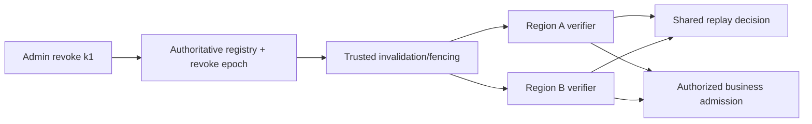

# Credential deletion trong HMAC request authentication: thu hồi hiệu lực, xóa khóa và giữ dấu vết an toàn

> **Chương:** Credential lifecycle  
> **Bài học:** Credential deletion  
> **Phạm vi:** `SECURITY_AUTHENTICATION_HMAC_REQUEST_AUTHENTICATION` — thiết kế xác thực HTTP request bằng shared secret và HMAC trên canonical request gồm phương thức, URI, header và/hoặc body theo hợp đồng ký. Bài này tập trung vào **xóa credential HMAC** mà không mở cửa cho request cũ, không tái sử dụng key ID, không làm mất bằng chứng giao dịch và không nhầm việc xóa dữ liệu khóa với phân quyền.

## 1. Xóa credential không đơn thuần là xóa một hàng database

Một client được cấp:

```text
keyId    = merchant-a-k1          # Identifier, không bí mật
secret   = <32 bytes ngẫu nhiên>   # Shared HMAC key, PHẢI bí mật
principal= merchant-A
tenant   = merchant-a
status   = ACTIVE
```

Client dùng shared key tính tag:

\[
\mathrm{tag}=\operatorname{HMAC\!-\!SHA256}
   \bigl(K,\ \mathrm{UTF8}(\mathrm{stringToSign})\bigr)
\]

Server tìm credential theo `keyId`, lấy đúng `K`, kiểm signature, timestamp và nonce. Khi người quản trị yêu cầu **delete credential**, có nhiều câu hỏi cần được trả lời:

- Các request mới ký bằng k1 có bị từ chối **ngay** không?
- Có request đã được xác thực trước khi xóa nhưng chưa thực hiện nghiệp vụ?
- Các verifier pods có cache secret và registry state cũ không?
- Secret ở Vault KV v2 còn những version cũ có thể undelete không?
- Client vẫn giữ bản sao secret; xóa trong server có làm bản sao đó biến mất không?
- Replay database, idempotency records, payment audit và backup có được phép xóa cùng lúc không?
- Nếu sau này tạo một credential mới dùng lại `merchant-a-k1`, request đã ký từ trước có thể được diễn giải sai không?

**Định nghĩa làm việc:** *Credential deletion* là một **quy trình có trạng thái** để trước tiên **thu hồi quyền xác thực**, sau đó quản lý việc xóa vật liệu khóa và metadata theo retention policy, trong khi giữ đủ tombstone/audit để ngăn reactivation hoặc reuse ngoài ý muốn.

**Bất biến an toàn quan trọng nhất:**

> Sau khi việc thu hồi credential được hệ thống xác nhận là có hiệu lực tại trust boundary, không có **lần xác thực mới** nào được chấp nhận chỉ dựa vào credential đó, dù client vẫn biết secret hoặc Vault còn giữ dữ liệu.

Để bảo đảm điều này **trên nhiều node**, kiến trúc phải có cơ chế consistency/fencing, không chỉ gửi một sự kiện invalidation không đồng bộ rồi tuyên bố “revoke tức thời”.

### Khi học xong, cần làm được

1. Phân biệt `disable`, `revoke`, `expire`, `soft delete` và `hard purge`.
2. Thiết kế state machine không cho credential bị xóa “sống lại” do cache, rollback hay key ID reuse.
3. Thiết kế API/quy trình xóa có xác thực quản trị, authorization, optimistic concurrency và audit.
4. Biết xóa một secret trong Vault KV v2 khác gì với xóa version, metadata, cache và backup.
5. Xử lý đúng request đang bay, key rotation, timestamp/nonce, replay/idempotency và multi-region failover.
6. Thử verifier Java 17+ với state transition, key binding, revoke, purge, fail-closed và negative tests.
7. Phân biệt **credential deletion** của HMAC API với **xóa dữ liệu cá nhân** hoặc business transaction.

## 2. Năm khái niệm dễ nhầm

| Khái niệm | Ý nghĩa | Có ngăn request dùng secret cũ? | Có xóa key material? |
| --- | --- | --- | --- |
| **Disable / suspend** | Tạm không cho credential dùng để xác thực theo chính sách; có thể có lộ trình bật lại. | Có, nếu verifier thực thi đồng nhất. | Không nhất thiết. |
| **Revoke** | Thu hồi quyền sử dụng credential theo quyết định có thẩm quyền. | **Phải có** ở mọi điểm xác minh phù hợp. | Không bắt buộc xóa tức thì. |
| **Expiration** | Credential tự hết hiệu lực khi đến mốc thời gian được quy định. | Có, nếu verifier kiểm deadline. | Không tự xóa vật liệu. |
| **Soft delete / quarantine** | Đánh dấu không phục vụ và giữ dữ liệu có thời hạn để điều tra/khôi phục theo quy trình. | Chỉ nếu đã chặn trạng thái xác thực trước đó. | Dữ liệu có thể vẫn phục hồi được. |
| **Hard purge / destruction** | Xóa key material khỏi các kho đang hoạt động và các versions áp dụng theo chính sách. | Không thể thay bước revoke; cần phối hợp. | Có ở phạm vi đã xác minh; **không tự bảo đảm xóa mọi backup/copy**. |

**Revoke khác delete.** Nếu xóa ngay bản ghi registry trước khi phân phối một tín hiệu revoked, một verifier có cache cũ có thể tiếp tục chấp nhận request. Nếu chỉ soft-delete trong Vault mà không đổi trạng thái registry, verifier có cached secret cũng có thể tiếp tục HMAC verify.

**Expiration khác retention.** Expired credential cần bị từ chối dù key material còn để audit. Retention của audit/idempotency không phụ thuộc trực tiếp vào ngày hết hạn credential.

**Key rotation khác deletion.** Rotation thường tạo **k2 mới** rồi rút dần k1. Xóa k1 trước khi client kịp chuyển sang k2 có thể làm ngưng dịch vụ; nhưng khi k1 bị đánh cắp, **revoke khẩn** phải ưu tiên kiểm soát rủi ro, không giữ overlap để “cho tiện”.

## 3. Threat model: vì sao xóa sai có thể gây sự cố bảo mật?

### 3.1. Attacker đã đánh cắp secret

Attacker biết `K1`, có thể tự tạo:

```http
POST /v1/payments?orderId=42 HTTP/1.1
Host: api.example.test
Content-Type: application/json
X-Key-Id: merchant-a-k1
X-Timestamp: 1767225600
X-Nonce: 87a3d56ea72d40af89f5b68cb3e831d4
X-Signature: v1=<HMAC_TAG>

{"amount":100000}
```

Dù timestamp còn tươi, nonce chưa được dùng và HMAC toán học đúng, **registry state = REVOKED** phải khiến request bị từ chối. Secret không cần bị xóa vật lý trước thì việc revoke mới có hiệu lực về mặt authentication.

### 3.2. Cache và replica chưa nhận lệnh revoke

```text
Control plane: merchant-a-k1 -> REVOKED
Verifier A: revision 15, REVOKED
Verifier B: revision 14, ACTIVE    <-- VÙNG RỦI RO
```

Nếu B tiếp tục dùng snapshot cũ mà không có điều kiện freshness/revision check, B có thể nhận request dùng k1 sau thời điểm quản trị đã công bố revoke.

Giải pháp có thể bao gồm:

- Tra **authoritative credential status** ở điểm quyết định cần tính nhất quán mạnh.
- Phân phối **monotonic revision / deny epoch** qua một kênh đáng tin và buộc nodes xác nhận (ack) trước khi công bố hiệu lực.
- Dùng **fencing** để chặn admission sau revocation, xử lý request in-flight theo chính sách.
- Cô lập/fail closed node không đáp ứng status freshness budget; không dựa đơn thuần vào TTL cache khi có yêu cầu revoke ngay.

Không nên hứa “instant revoke” nếu kiến trúc chỉ có eventual invalidation và vẫn cho node stale nhận traffic.

### 3.3. Rollback tạo resurrection

Sau khi k1 bị revoke, một bản backup registry cũ hoặc một deployment rollback có thể chứa `ACTIVE`. Nếu restore mà **không đối chiếu tombstones/revocation ledger**, key cũ bị bật lại.

**Quy tắc:** State của credential phải **tiến một chiều theo phiên bản/epoch** đối với revoke/delete. Mọi recovery phải kiểm lại revocation/tombstone state đáng tin trước khi mở traffic.

### 3.4. Tái sử dụng key ID

`merchant-a-k1` đã bị purge. Năm sau provisioner tạo một secret mới `Knew` nhưng cũng đặt `keyId=merchant-a-k1`. Client cũ có thể vẫn giữ K1 và logs/audit cũ cũng ghi `merchant-a-k1`; việc tái sử dụng gây khó phân tích lịch sử, đứt identity và có thể tương tác sai với cache/aliases.

**Khuyến nghị:** Không reuse một key ID đã từng cấp. Giữ **tombstone tối thiểu** ngay cả khi secret đã bị hủy, hoặc cấp credential identity mới với định danh duy nhất không lặp.

## 4. State machine cho credential deletion

Một lifecycle minh họa:

```mermaid
stateDiagram-v2
    [*] --> PREPARED: Provision key chưa kích hoạt
    PREPARED --> ACTIVE: Activate theo policy
    ACTIVE --> VERIFY_ONLY: Rotation / stop signing mới
    ACTIVE --> REVOKED: Revoke thường hoặc khẩn
    VERIFY_ONLY --> REVOKED: Hết overlap
    PREPARED --> REVOKED: Hủy key chưa kích hoạt
    REVOKED --> QUARANTINED: Xác nhận điều kiện retention
    QUARANTINED --> PURGE_PENDING: Bắt đầu xóa vật liệu
    PURGE_PENDING --> PURGED: Xác minh purge thành công
    PURGE_PENDING --> PURGE_PENDING: Thất bại/timeout; retry idempotent
    PURGED --> [*]: Chỉ kết thúc xử lý; tombstone vẫn giữ
```



`PREPARED`, `ACTIVE`, `VERIFY_ONLY`, `REVOKED`, `QUARANTINED`, `PURGE_PENDING` và `PURGED` là **các trạng thái do ứng dụng định nghĩa**, không phải trạng thái có sẵn của HashiCorp Vault.

### 4.1. Ý nghĩa cụ thể

| State | Có được tạo request mới bằng key này? | Verifier có thể chấp nhận request? | Có thể còn secret trong Vault? |
| --- | --- | --- | --- |
| `PREPARED` | Không. | Không, trừ canary policy riêng có giới hạn. | Có. |
| `ACTIVE` | Có. | Có nếu HMAC/freshness/replay/policy đúng. | Có. |
| `VERIFY_ONLY` | Client không nên ký attempt mới. | Có trong overlap window được phép. | Có. |
| `REVOKED` | **Không.** | **Không.** | Có; cần giữ tạm theo runbook. |
| `QUARANTINED` | Không. | Không. | Có thể có bản được giữ để điều tra/recovery. |
| `PURGE_PENDING` | Không. | Không. | Có thể còn version chưa xóa hoặc outcome chưa xác định. |
| `PURGED` | Không. | Không. | Đã xử lý xóa ở các kho có thẩm quyền trong phạm vi runbook; backup/copy có lifecycle riêng. |

`VERIFY_ONLY` là state cho **key rotation**, không phải trạng thái để một client tự tiếp tục signing vĩnh viễn. `REVOKED` không nên được chuyển ngược `ACTIVE` bằng một rollback tự động.

### 4.2. Tombstone không chứa secret

Sau purge, thay vì xóa mất mọi dấu vết identity, có thể lưu:

```json
{
  "credentialId": "cred-merchant-a-001",
  "keyId": "merchant-a-k1",
  "principalId": "merchant-A",
  "state": "PURGED",
  "revision": 19,
  "revokedAt": "2026-11-28T02:00:00Z",
  "purgedAt": "2026-12-29T02:00:00Z",
  "purgeOperationId": "purge-op-example-42",
  "keyMaterialPresent": false
}
```

Đây là **fixture**. Giá trị timestamp minh họa, không đại diện trạng thái hệ thống thật.

Không lưu `secret_b64`, HMAC test key, raw client tokens hoặc response nhạy cảm trong tombstone. Metadata có thể vẫn là dữ liệu cần bảo vệ theo privacy/retention policy; không nhất thiết phải lưu đầy đủ principal ID vĩnh viễn nếu không cần.

### 4.3. Trạng thái phải được chốt ở nguồn có thẩm quyền

Một state transition phải có phiên bản:

```text
revision 15: ACTIVE
revision 16: REVOKED
revision 17: QUARANTINED
revision 18: PURGE_PENDING
revision 19: PURGED
```

Không thể xem `revision=14 ACTIVE` từ một replica cũ là mới hơn `revision=19 PURGED`. Khi restore/replicate, chỉ được tiếp nhận update phù hợp **thứ tự/consistency contract**, không lấy timestamp client tự khai để quyết định state.

## 5. Thứ tự an toàn: revoke trước, purge sau

```mermaid
sequenceDiagram
    participant Admin as Admin/Control plane
    participant R as Authoritative Registry
    participant V as Verifiers + Cache
    participant KV as Vault KV v2
    participant J as Purge Job / Audit
    Admin->>R: Revoke(k1, expectedRevision, reason)
    R->>R: Commit REVOKED + revision + audit/outbox
    R-->>Admin: Revocation committed
    R-->>V: Deny epoch / invalidation + acknowledgement flow
    V->>V: Block new authentication for k1
    Admin->>J: Schedule deletion after retention/dependency checks
    J->>R: CAS REVOKED -> QUARANTINED -> PURGE_PENDING
    J->>KV: Destroy/delete covered key versions per runbook
    alt Vault operation confirmed and material absent
        KV-->>J: Confirmed
        J->>R: CAS PURGE_PENDING -> PURGED; keep tombstone
    else Timeout or failed/ambiguous
        KV-->>J: Unknown/failure
        J->>R: Leave PURGE_PENDING, retry/reconcile
    end
```

**Không đảo thứ tự:**

```text
SAI:  xóa secret từ Vault -> đợi cache hết hạn -> cập nhật registry
ĐÚNG: chặn credential ở verifier -> xử lý in-flight/retention
      -> purge material -> giữ tombstone
```

Nếu cố xóa secret trước rồi để registry ACTIVE, verifier có cache vẫn xác thực thành công; verifier chưa cache lại báo lỗi do key material mất. Kết quả có thể phân tán và khó kiểm soát.

### 5.1. “Revoke committed” có đồng nghĩa mọi pod đã chặn chưa?

**Không mặc nhiên.** Một `UPDATE` thành công ở primary registry chỉ chứng minh state đã commit tại đó; các pods có thể đang dùng cached state cũ.

Doanh nghiệp cần định nghĩa khi nào người quản trị thấy `REVOKED_EFFECTIVE`:

- **Mô hình authoritative check:** mọi admission đọc state ở nguồn nhất quán, và kết quả status mới phải được dùng ở điểm chấp nhận.
- **Mô hình distributed acknowledgements/fencing:** revoke event phân phối tới mọi verifier có thể nhận traffic, xác nhận revision và route/drain nodes stale.
- **Mô hình bounded staleness:** xác định rõ tối đa bao lâu request cũ còn có thể được chấp nhận; **không** quảng cáo instant revoke nếu không có guarantee.

Với endpoint thanh toán quan trọng, nếu không thể xác định trạng thái credential an toàn, nên **fail closed** thay vì tự tiếp tục accept trên snapshot đã quá hạn.

## 6. Quy trình delete có kiểm soát cho người quản trị

Một API quản trị có thể hỗ trợ:

```http
POST /admin/credentials/merchant-a-k1/revoke HTTP/1.1
Authorization: Bearer <ADMIN_ACCESS_TOKEN>
If-Match: "revision-15"
Content-Type: application/json

{"reason":"customer_requested","ticketId":"SEC-1234"}
```

Đây là **API minh họa**, không phải endpoint có sẵn của Vault. Nó được gọi bởi **admin control plane**, không phải HMAC request của khách hàng.

### 6.1. Phân quyền quản trị

Một thao tác xóa credential cần kiểm:

1. Admin đã **xác thực** bằng cơ chế quản trị phù hợp (SSO/MFA/workload identity).
2. Admin có **quyền** trên tenant/client và loại thao tác: `credential:revoke` khác `credential:purge`.
3. Nếu policy yêu cầu, có **two-person approval / separation of duties** cho hard purge.
4. Có lý do, correlation/ticket ID, scope, key ID và expected state revision.
5. Có retention/legal hold/incident evidence checks trước khi xóa vật liệu.
6. Không ghi raw secret vào request/response/log; không yêu cầu client gửi lại secret để “xác nhận”.
7. Thiết lập idempotency cho thao tác quản trị lặp sau timeout, không tạo hai purge jobs xung đột.

**Không trao quyền purge cho credential mà chính nó đang bị xóa** chỉ vì client ký HMAC đúng. HMAC authentication và admin authorization là hai trust boundaries khác nhau.

### 6.2. Idempotent API với optimistic concurrency

```text
POST revoke(k1, expectedRevision=15):
    if current revision=15 and state=ACTIVE:
        COMMIT REVOKED, revision=16, revocation event/audit
        return 200/202 with operationId
    if already REVOKED for same operationId:
        return prior outcome, không tạo transition mới
    if revision mismatched:
        return conflict/precondition failed; admin re-read state
```

Tách:
- **Idempotency key cho admin operation**: retry cùng lệnh revoke không thực hiện transition hai lần.
- **Revision/CAS**: chống hai operators ghi đè state lẫn nhau.
- **Replay nonce của HMAC client**: không liên quan admin authorization token.

### 6.3. Xóa nhầm cần quy trình khác phục hồi dữ liệu

Nếu credential đã `REVOKED` hoặc `PURGED`, không nên tự bật lại cùng key ID khi operator bấm Undo. Có thể **cấp credential mới** với key ID/secret mới rồi liên kết lại business principal. Nếu tổ chức muốn hỗ trợ một trạng thái `SUSPENDED` có thể bật lại, phải thiết kế nó **tách khỏi irreversible revoke** ngay từ đầu.

## 7. Thiết kế bảng registry và tombstone ở SQL

Ví dụ PostgreSQL schema:

```sql
CREATE TABLE hmac_credential_registry (
    credential_id VARCHAR(128) PRIMARY KEY,
    key_id VARCHAR(128) NOT NULL UNIQUE,
    principal_id VARCHAR(128) NOT NULL,
    tenant_id VARCHAR(128) NOT NULL,
    vault_path VARCHAR(512),
    state VARCHAR(32) NOT NULL,
    revision BIGINT NOT NULL DEFAULT 0,
    created_at TIMESTAMPTZ NOT NULL DEFAULT clock_timestamp(),
    revoked_at TIMESTAMPTZ,
    retention_until TIMESTAMPTZ,
    purged_at TIMESTAMPTZ,
    purge_operation_id VARCHAR(128),
    CONSTRAINT ck_credential_state CHECK (
        state IN (
            'PREPARED','ACTIVE','VERIFY_ONLY','REVOKED',
            'QUARANTINED','PURGE_PENDING','PURGED'
        )
    )
);

CREATE INDEX idx_credential_state_retention
    ON hmac_credential_registry (state, retention_until);

-- Tombstone: GIỮ lại key_id sau purge để chống re-issue.
-- Không DROP row chỉ vì secret đã bị destroy.
```

### 7.1. Revocation bằng compare-and-set

```sql
UPDATE hmac_credential_registry
SET state = 'REVOKED',
    revision = revision + 1,
    revoked_at = clock_timestamp()
WHERE key_id = ?
  AND revision = ?
  AND state IN ('ACTIVE', 'VERIFY_ONLY');
```

`rowsUpdated = 1` nghĩa là update thành công tại database transaction đang dùng; phải đảm bảo **COMMIT** thành công rồi mới tuyên bố state mới. `rowsUpdated = 0` là conflict/đã đổi trạng thái, không ngầm báo success.

Cùng transaction nên ghi audit/outbox (nếu architecture dùng) để event không mất giữa registry commit và message publish.

### 7.2. Không dùng `DELETE FROM registry` thay tombstone

```sql
-- ANTI-PATTERN: làm mất lịch sử identity và cho phép key ID reissue
DELETE FROM hmac_credential_registry WHERE key_id = ?;
```

Trong một số quy trình quyền riêng tư, có thể buộc xóa hoặc ẩn danh metadata; vẫn nên giữ **non-reuse identifier/tombstone phù hợp luật và retention policy** mà không giữ dữ liệu cá nhân thừa. Không tự lưu toàn bộ profile vĩnh viễn để chống reuse; cần chính sách dữ liệu độc lập.

### 7.3. Chuyển `PURGE_PENDING` sau retention

```sql
UPDATE hmac_credential_registry
SET state = 'PURGE_PENDING',
    revision = revision + 1,
    purge_operation_id = ?
WHERE key_id = ?
  AND state = 'QUARANTINED'
  AND revision = ?
  AND retention_until <= clock_timestamp();
```

Nếu chưa đến deadline, không được bỏ qua để xóa bí mật đang bị legal hold/forensics theo policy. Nếu xóa khẩn do incident, đó là **quy trình được phê duyệt riêng**, không phải hack thay `retention_until` tùy tiện.

### 7.4. Hoàn tất purge chỉ sau khi có xác minh

```sql
UPDATE hmac_credential_registry
SET state = 'PURGED',
    revision = revision + 1,
    purged_at = clock_timestamp(),
    vault_path = NULL
WHERE key_id = ?
  AND state = 'PURGE_PENDING'
  AND revision = ?
  AND purge_operation_id = ?;
```

**Điểm giới hạn:** SQL statement không thể chứng minh Vault đã xóa material. Purge worker phải xác minh outcome Vault theo quy trình, có operation ID/fencing và audit; nếu kết quả mơ hồ **giữ PURGE_PENDING**. Không gọi update cuối chỉ vì HTTP request tới Vault trả timeout.

## 8. Vault KV v2: soft delete, destroy version và delete metadata khác nhau

Với KV v2 mount tên `kv`, logical path:

```text
services/prod/payments/hmac/merchant-a-k1
```

API paths:

| Thao tác KV v2 | Ví dụ HTTP endpoint | Ngữ nghĩa cần biết |
| --- | --- | --- |
| Read data | `GET /v1/kv/data/services/prod/payments/hmac/merchant-a-k1` | Đọc payload của version cho phép; yêu cầu quyền `read`. |
| Soft delete latest | `DELETE /v1/kv/data/services/prod/payments/hmac/merchant-a-k1` | Soft-delete latest version theo API; **không mặc nhiên hủy mọi versions**. |
| Soft delete selected versions | `POST /v1/kv/delete/services/prod/payments/hmac/merchant-a-k1` + `{"versions":[1,2]}` | Đánh dấu versions được chọn là deleted; có thể có quy trình undelete. |
| Undelete versions | `POST /v1/kv/undelete/services/prod/payments/hmac/merchant-a-k1` | Phục hồi soft-deleted versions nếu chưa destroyed, khi policy cho phép. |
| Destroy selected versions | `POST /v1/kv/destroy/services/prod/payments/hmac/merchant-a-k1` + `{"versions":[1,2]}` | Hủy dữ liệu key material của **những versions đã chỉ định**. |
| Delete metadata + versions | `DELETE /v1/kv/metadata/services/prod/payments/hmac/merchant-a-k1` | Xóa metadata và tất cả versions của logical path theo API KV v2. |

**Không nhầm `data/`, `delete/`, `undelete/`, `destroy/` và `metadata/`.** Chúng là API subpaths của KV v2; quyền ACL có thể khác nhau. API chính xác, quyền và khả năng khôi phục phải được kiểm theo phiên bản Vault đang triển khai. Bảng này **không phải yêu cầu thực hiện xóa thật**.

### 8.1. Soft delete KHÔNG chứng minh không thể phục hồi secret

Nếu một key có KV versions `1`, `2`, `3`, soft delete latest chỉ ảnh hưởng phiên bản được chỉ định; versions cũ có thể còn. Ứng dụng **không được thử secret ở version cũ** nếu tag sai, vì như thế biến Vault history thành một danh sách credentials được tự ý chấp nhận.

**Verifier chỉ nhận đúng key material được ánh xạ qua trusted credential registry và trạng thái đang được phép.** Khi registry `REVOKED`, không read Vault rồi cố kiểm k1 chỉ vì version còn tồn tại.

### 8.2. Hard deletion trong Vault không đồng nghĩa mọi bản sao trên thế giới đã biến mất

Với KV v2, destroy/delete metadata có thể làm key không còn truy cập được qua store API đang hoạt động. Nhưng cần xét:

- Vault snapshots/backups và cơ chế retention/restore.
- Vault Agent templates hoặc rendered files trên disk/volume.
- Secret đã nạp trong JVM memory, cache của verifier, heap dump.
- CI/CD artifacts, logs, container layers, operator workstations.
- Bản sao shared secret **đã cấp cho client**.
- Replica/DR topology và các systems dùng credential ngoài Vault.

Do đó không nên ghi trạng thái `“vĩnh viễn xóa toàn bộ bytes”` nếu chưa chứng minh được scope thực. Hãy ghi **“purged from authoritative active secret store”**, kèm backup/copy retention và incident controls được phê duyệt.

### 8.3. Provisioner và verifier phải có quyền khác nhau

Verifier HMAC cần `read` đúng path; không được có `destroy`/`delete` chỉ vì nó là service xử lý credential.

Ví dụ policy minh họa:

```hcl
# Read-only policy cho API verifier
path "kv/data/services/prod/payments/hmac/*" {
  capabilities = ["read"]
}
```

Việc destroy/delete metadata do **privileged purge job** với identity/policy riêng, approval riêng và path allowlist rõ. Nếu verifier bị compromise, nó không nên tự xóa mọi secret của khách hàng.

Tránh để HTTP caller đưa raw Vault path vào purge API. Admin request gửi key ID/credential ID đã chuẩn hóa; backend dùng **registry mapping đáng tin** và xác minh ownership/tenant.

## 9. Xóa credential phải xử lý cache và request in-flight

### 9.1. Cache invalidation

Verifier thường cache secret bytes để tránh gọi Vault cho mỗi HTTP request:

```text
keyId=merchant-a-k1
secretBytes=<cached>
registryRevision=15
state=ACTIVE
loadedAt=...
hardExpiry=...
```

Nếu revoke mà chỉ xóa KV path, cache vẫn giữ secret. Nếu revoke mà chỉ phát event qua message bus eventual-consistent, một pod mất kết nối có thể tiếp tục dùng revision 15.

**Cần contract cho admission:**

- Không được chấp nhận revision cũ hơn revoke epoch đã xác nhận.
- Nếu authoritative status không xác định và cache không đủ điều kiện tin cậy, **fail closed**.
- Cache value có thể tiếp tục tồn tại để phục vụ drain/forensics có kiểm soát, nhưng **không được dùng để ACCEPT** credential REVOKED.
- Khi invalidation, xóa tham chiếu, giảm lifetime, best-effort overwrite `byte[]` nếu phù hợp, nhưng không hứa xóa sạch Java heap.
- Cấu hình `hardExpiry` và revocation freshness độc lập, không biến token TTL của Vault thành credential validity.

### 9.2. Request đã qua HMAC nhưng chưa qua authorization/business

Một luồng có thể xảy ra:

```text
10:00:00.001 — Verifier đọc ACTIVE, HMAC đúng
10:00:00.005 — Admin revoke k1
10:00:00.008 — Verifier chuẩn bị ACCEPT / gọi business
```

Một **re-check** credential status trước authorization/side effect giúp giảm race, nhưng **không** tạo bằng chứng tuyệt đối nếu revoke chen vào ngay sau re-check.

Nếu yêu cầu mạnh là “không có business admission sau commit revoke”, cần một **fence/linearization point chung** giữa verifier admission và revoke, hoặc một cơ chế drain/cancel các in-flight operations có thể chứng minh. Ví dụ:

- Việc cấp request admission token gắn credential revision và do một authoritative service quyết định.
- Revoke tăng epoch; mọi admission sau epoch mới phải bị reject.
- Những business operations dài hoặc external side effects cần policy rõ cho request đã được admitted trước revoke.
- Khi không kiểm được trạng thái tin cậy, fail closed.

**Không tự hủy/rollback một payment đã commit** chỉ vì credential bị xóa sau đó. Việc xử lý giao dịch đã hoàn tất thuộc business reconciliation, không phải secret deletion.

### 9.3. Multi-region/HA



Nếu region B bị partition, **không** cho nó nhận request bằng credential state quá cũ chỉ để giữ availability. Thiết kế phải lựa chọn consistency và availability theo threat model; đừng dựa vào eventual updates để hứa revoke tức thời.

## 10. Replay nonce và idempotency KHÔNG được xóa theo credential

Khi xóa credential k1, dễ mắc lỗi “dọn sạch mọi thứ liên quan key ID”:

```text
Delete HMAC secret
Delete replay nonce rows
Delete idempotency rows
Delete business audit
Delete payment records
```

Cách này có thể phá các bảo đảm quan trọng.

### 10.1. Replay database

Replay record:

```text
(credentialId=cred-A-1, nonce=N, expiresAt=T+pastWindow+margin)
```

Một request cũ ký bằng k1 phải bị reject ngay sau revoke. Tuy nhiên **không nên xóa nonce đang hoạt động** chỉ vì đổi key, do:

- Có thể xảy ra rollback/re-activation sai config.
- Những alias/credential migrations cần lưu replay context theo scope đã ký.
- Xóa record đang valid mở lại lịch sử nonce nếu một node stale vẫn cho dùng k1.

Replay database có retention riêng dựa trên **freshness window của timestamp đã ký**. Với policy `N-P≤T≤N+F`, record cần giữ tới tối thiểu `T+P+margin`. Không dùng thời điểm Vault purge để rút ngắn thời hạn bảo vệ replay.

### 10.2. Idempotency store

Một POST thanh toán có:

```text
Idempotency-Key: pay-order-42
nonce: N1  (request ký bằng k1)
paymentId: pay_42
```

Sau rotation sang k2, client retry hợp lệ với `nonce=N2` và **cùng Idempotency-Key**. Nếu idempotency record đã bị xóa theo k1, hệ thống có thể tạo thanh toán `pay_43` trùng.

**Scope idempotency theo stable principal/tenant/operation**, không chỉ key ID. Credential deletion không được xóa lịch sử business intent khi chưa hết retention và reconciliation obligations.

### 10.3. Audit và transaction history

Audit logs, invoices, payment records, abuse signals và incident evidence có lifecycle/retention/legal requirements riêng. Không đánh đồng “xóa khóa xác thực” với “xóa mọi dữ liệu khách hàng”. Nếu user yêu cầu xóa dữ liệu cá nhân, xử lý bằng workflow privacy/compliance riêng với tối thiểu hóa và căn cứ pháp lý phù hợp.

## 11. Deletion, key rotation, alias và credential reuse

### 11.1. Rotation thường

```text
k1 ACTIVE
    ↓ chuẩn bị k2 với secret độc lập
k2 ACTIVE, k1 VERIFY_ONLY (overlap có giới hạn)
    ↓ sau client cutover và drain
k1 REVOKED
    ↓ retention / quarantine
k1 PURGE_PENDING → PURGED
k2 ACTIVE không bị ảnh hưởng
```

Không ghi đè secret K1 ở cùng key ID `k1` chỉ để “đổi key”. Cách này có thể tạo ambiguity giữa client và server, phá rollback và khiến verifier thử nhiều phiên bản secret ngoài policy.

### 11.2. Emergency revocation

Nếu K1 bị lộ:

- Chặn k1 **ngay theo policy revoke**, không giữ overlap cho client chưa migrate.
- Phát key ID mới k2/secret mới qua quy trình cấp credential có xác thực.
- Điều tra misuse: timestamp/nonce vẫn không ngăn kẻ biết K1 ký request mới trước revoke.
- Kích hoạt incident/audit safeguards; cân nhắc bảo quản evidence trước physical purge theo policy.
- Không bật lại K1 để sửa lỗi deployment; dùng credential mới.

### 11.3. Alias cũ và stable identity

Nếu `merchant-a-k1` và một alias khác tham chiếu **cùng material**, hai cách lookup phải chịu một revocation identity. Xóa một tên alias mà để tên khác ACTIVE với cùng secret có thể khiến credential tưởng đã xóa vẫn ký được request.

Quy định một **stable credential identity** ở registry; aliases phải được thu hồi/khóa đồng bộ, đồng thời replay namespace được thiết kế trên identity đáng tin khi cần.

## 12. Thiết kế delete job idempotent và có recovery

Không thể có một transaction duy nhất bao trùm **PostgreSQL registry**, **Vault KV v2**, **cache ở nhiều pods**, **backup systems** và **client devices**. Vì vậy hard purge thường là **workflow/saga** với checkpoint.

### 12.1. Các checkpoint

```text
1. VERIFY_ADMIN_AUTHZ
2. SELECT_CREDENTIAL_BY_TRUSTED_ID
3. REVOKE_COMMIT + AUDIT + REVOCATION_EVENT
4. VERIFY_REVOCATION_EFFECTIVE / APPLY_FENCING
5. CHECK_RETENTION_AND_DEPENDENCIES
6. QUARANTINED
7. PURGE_PENDING (durable operationId)
8. VAULT_DESTROY / DELETE METADATA + CHECK OUTCOME
9. VERIFY_ACTIVE_COPIES / CACHE REMEDIATION
10. PURGED TOMBSTONE + COMPLETION AUDIT
11. BACKUP/COPY RETENTION AND LATER RECONCILIATION
```

### 12.2. Timeout lúc gọi Vault

```text
Purge job:
  POST/DELETE Vault API
  network timeout sau khi gửi request
```

Có thể Vault **đã xóa** nhưng response bị mất; cũng có thể chưa. Không đánh dấu `PURGED` chỉ vì “đã gửi lệnh”, và **không revert về ACTIVE**. Giữ `PURGE_PENDING`, đọc lại **metadata/material state qua authorized API** và quyết định retry idempotently.

### 12.3. Two-person approval và emergency deletion

Hard destruction có thể không phục hồi được. Tùy tổ chức, dùng hai người phê duyệt/quorum trước khi xóa vĩnh viễn, nhưng **không** dùng thủ tục này để trì hoãn việc khóa một credential đang bị lộ; revoke và purge có thể là hai thao tác quản trị với SLAs khác nhau.

### 12.4. Audit cần lưu gì?

- operation ID, actor/workload identity, approval ID, reason.
- credential ID/key ID, principal/tenant đã được kiểm quyền, revocation epoch.
- old/new state + revision, timestamps UTC, Vault path metadata **không kèm secret**.
- outcome mỗi bước (queued, success, ambiguous, retry, completed), retention decision.
- bằng chứng các verifier đã cập nhật/đã bị cô lập nếu có yêu cầu revoke nhanh.

Không log Base64 secret, raw HMAC tag hoặc Vault token, kể cả “để debug deletion”.

## 13. HMAC verifier có kiểm trạng thái trước khi nhận request

Request có header:

```http
POST /v1/payments?orderId=42 HTTP/1.1
Host: api.example.test
Content-Type: application/json
X-Key-Id: merchant-a-k1
X-Timestamp: 1767225600
X-Nonce: 87a3d56ea72d40af89f5b68cb3e831d4
X-Signature: v1=<BASE64URL_NO_PADDING_TAG>

{"amount":100000}
```

Verifier phải thực hiện các lớp kiểm:

1. Parse/validate strict HTTP grammar, method, URI, query, covered headers và raw body limits.
2. `keyId` chỉ làm input cho **trusted credential registry lookup**, không tự chứng minh danh tính.
3. Nếu state = `REVOKED` / `QUARANTINED` / `PURGE_PENDING` / `PURGED`, **từ chối trước khi tra secret**.
4. Với `ACTIVE` / `VERIFY_ONLY` hợp lệ theo policy, lấy đúng secret version/key ID, dựng lại canonical request và kiểm HMAC bằng constant-time byte comparison.
5. Kiểm signed timestamp freshness.
6. Claim nonce nguyên tử trong replay store theo stable credential namespace.
7. Kiểm authorization action/resource/tenant riêng, rồi business idempotency nếu là POST.
8. Dùng revocation/fencing contract phù hợp để tránh race giữa authorization/admission và delete.

**Không được thử tất cả old keys/old KV versions** khi HMAC không khớp. Key ID phải chọn **một credential** với trạng thái hợp lệ.

### HMAC đúng với secret đã revoke vẫn phải bị từ chối

```text
HMAC(K1, request) == supplied tag  → YES
registry("merchant-a-k1").state   → REVOKED
authentication result              → REJECT
```

Đây là **điều kiện chính sách**, không phải thất bại của thuật toán HMAC.

## 14. Java 17+ runnable demo: registry tombstone, Vault giả lập và HMAC verifier

Ví dụ này là **chương trình một tệp chạy offline bằng JDK 17+**, không kết nối Vault, PostgreSQL hay gateway thật. Mục tiêu là minh họa:

- Registry với state `ACTIVE → REVOKED → QUARANTINED → PURGE_PENDING → PURGED`, revision CAS và tombstone.
- Không cho provision lại `keyId` cũ kể cả sau `PURGED`.
- Secret reader giả lập bản ghi Vault và phản hồi unavailable.
- HMAC-SHA256 trên canonical method/authority/path/query/signed headers/raw-body digest, full tag Base64URL không padding.
- Signed timestamp/nonce, freshness ±300 giây và local atomic replay store.
- Credential revoked bị từ chối **dù secret còn tồn tại** và HMAC đúng.
- Không đánh dấu PURGED khi store delete timeout, hoặc khi retention deadline chưa tới.
- Credential mới `k2` tiếp tục hoạt động khi `k1` bị purge.
- Những ca kiểm HMAC sai, timestamp stale, replay, authorization denial, store outage.

**Giới hạn bắt buộc:** `ConcurrentHashMap` chỉ atomic trong một JVM, không bền vững, không có cross-node revocation guarantees. Một HTTP adapter production phải cung cấp đúng fields thực nhận tại wire; code cố định endpoint để tập trung vào credential deletion. Sử dụng secret/key IDs **chỉ là public test fixtures**.

### 14.1. Signing contract `CREDENTIAL-DELETE-V1`

```text
Method: POST
Authority: api.example.test
Path: /v1/payments
Query: orderId=42
Content-Type: application/json
X-Key-Id: merchant-a-k1
X-Timestamp: Unix epoch seconds
X-Nonce: 32 lowercase hex chars
Body: raw UTF-8 bytes, SHA-256 hex

canonical =
    "POST\n"
  + "api.example.test\n"
  + "/v1/payments\n"
  + "orderId=42\n"
  + "content-type:application/json\n"
  + "x-key-id:<keyId>\n"
  + "x-nonce:<nonce>\n"
  + "x-timestamp:<epochSeconds>\n"
  + "content-type;x-key-id;x-nonce;x-timestamp\n"
  + "<SHA256_HEX_OF_RAW_BODY>"

bytesToSign = UTF8("HMAC-SHA256/CREDENTIAL-DELETE-V1\n" + canonical)
tag = HMAC-SHA256(secretBytes, bytesToSign)
signature = "v1=" + Base64URLNoPadding(tag)
```

Các dấu `<...>` là placeholders. Đây là **custom demo contract**, không phải RFC 9421 hay scheme dùng chung cho mọi API.

### 14.2. Java code

```java
import java.nio.charset.StandardCharsets;
import java.security.GeneralSecurityException;
import java.security.MessageDigest;
import java.time.Clock;
import java.time.Instant;
import java.time.ZoneOffset;
import java.util.Arrays;
import java.util.Base64;
import java.util.HexFormat;
import java.util.Map;
import java.util.Objects;
import java.util.concurrent.ConcurrentHashMap;
import java.util.concurrent.atomic.AtomicBoolean;
import java.util.concurrent.atomic.AtomicReference;
import javax.crypto.Mac;
import javax.crypto.spec.SecretKeySpec;

public final class CredentialDeletionDemo {
    private static final HexFormat HEX = HexFormat.of();
    private static final long PAST = 300;
    private static final long FUTURE = 300;
    private static final long NONCE_MARGIN = 60;
    private static final String PREFIX =
            "HMAC-SHA256/CREDENTIAL-DELETE-V1\n";
    private static final String SIGNED_NAMES =
            "content-type;x-key-id;x-nonce;x-timestamp";

    private CredentialDeletionDemo() {}

    enum State {
        ACTIVE, VERIFY_ONLY, REVOKED, QUARANTINED,
        PURGE_PENDING, PURGED
    }

    enum Decision {
        ACCEPT, MALFORMED, UNAUTHENTICATED, STALE,
        REPLAY, FORBIDDEN, UNAVAILABLE
    }

    // Tombstone được giữ trong Registry; KHÔNG xóa row sau purge.
    record Credential(
            String keyId, String principal, String vaultPath,
            State state, long revision,
            long revokedAt, long retentionUntil) {
        Credential {
            Objects.requireNonNull(keyId);
            Objects.requireNonNull(principal);
            Objects.requireNonNull(vaultPath);
            Objects.requireNonNull(state);
        }
    }

    static final class Registry {
        private final ConcurrentHashMap<String, Credential> rows =
                new ConcurrentHashMap<>();
        volatile boolean unavailable;

        Credential get(String keyId) {
            if (unavailable) {
                throw new IllegalStateException("Registry unavailable");
            }
            return rows.get(keyId);
        }

        void provision(Credential entry) {
            if (entry.state() != State.ACTIVE
                    || entry.revision() != 0
                    || rows.putIfAbsent(entry.keyId(), entry) != null) {
                throw new IllegalStateException(
                        "Credential exists or invalid initial state");
            }
        }

        Credential revoke(
                String keyId, long expectedRevision,
                long now, long retentionSeconds) {
            if (retentionSeconds < 0) {
                throw new IllegalArgumentException("Negative retention");
            }
            AtomicReference<Credential> changed = new AtomicReference<>();
            rows.compute(keyId, (ignored, old) -> {
                requireRevision(old, expectedRevision);
                if (old.state() != State.ACTIVE
                        && old.state() != State.VERIFY_ONLY) {
                    throw new IllegalStateException(
                            "Cannot revoke from state " + old.state());
                }
                Credential next = new Credential(
                        old.keyId(), old.principal(), old.vaultPath(),
                        State.REVOKED, old.revision() + 1, now,
                        Math.addExact(now, retentionSeconds));
                changed.set(next);
                return next;
            });
            return changed.get();
        }

        Credential quarantine(String keyId, long expectedRevision) {
            return change(keyId, expectedRevision,
                    State.REVOKED, State.QUARANTINED, -1);
        }

        Credential beginPurge(
                String keyId, long expectedRevision, long now) {
            return change(keyId, expectedRevision,
                    State.QUARANTINED, State.PURGE_PENDING, now);
        }

        Credential confirmPurged(
                String keyId, long expectedRevision,
                SecretStore store) {
            Credential old = get(keyId);
            requireRevision(old, expectedRevision);
            if (old.state() != State.PURGE_PENDING
                    || store.contains(old.vaultPath())) {
                throw new IllegalStateException(
                        "Purge not confirmed");
            }
            return change(keyId, expectedRevision,
                    State.PURGE_PENDING, State.PURGED, -1);
        }

        private Credential change(
                String keyId, long expectedRevision,
                State from, State to, long nowOrMinusOne) {
            AtomicReference<Credential> changed =
                    new AtomicReference<>();
            rows.compute(keyId, (ignored, old) -> {
                requireRevision(old, expectedRevision);
                if (old.state() != from) {
                    throw new IllegalStateException(
                            "Invalid state transition");
                }
                if (to == State.PURGE_PENDING
                        && nowOrMinusOne < old.retentionUntil()) {
                    throw new IllegalStateException(
                            "Retention deadline not reached");
                }
                Credential next = new Credential(
                        old.keyId(), old.principal(), old.vaultPath(),
                        to, old.revision() + 1,
                        old.revokedAt(), old.retentionUntil());
                changed.set(next);
                return next;
            });
            return changed.get();
        }

        private static void requireRevision(
                Credential old, long wantedRevision) {
            if (old == null || old.revision() != wantedRevision) {
                throw new IllegalStateException(
                        "Missing credential or stale revision");
            }
        }
    }

    // Fake Vault record: key bytes chỉ là public test material.
    record Secret(String credentialId, byte[] key, int kvVersion) {
        Secret {
            key = key.clone();
        }
        @Override public byte[] key() {
            return key.clone();
        }
    }

    static final class SecretStore {
        private final ConcurrentHashMap<String, Secret> records =
                new ConcurrentHashMap<>();
        volatile boolean unavailable;

        void put(String path, Secret secret) {
            records.put(path, secret);
        }

        Secret read(String path) {
            if (unavailable) {
                throw new IllegalStateException("Vault unavailable");
            }
            return records.get(path);
        }

        boolean contains(String path) {
            if (unavailable) {
                throw new IllegalStateException(
                        "Cannot verify purge state");
            }
            return records.containsKey(path);
        }

        // Chỉ mô phỏng hard purge của active fake store.
        // Vault KV v2 thực có versions/metadata và API riêng.
        void destroyAll(String path) {
            if (unavailable) {
                throw new IllegalStateException(
                        "Vault purge not confirmed");
            }
            records.remove(path);
        }
    }

    record Request(String keyId, String timestamp, String nonce,
                   byte[] rawBody, String signature) {
        Request {
            Objects.requireNonNull(keyId);
            Objects.requireNonNull(timestamp);
            Objects.requireNonNull(nonce);
            Objects.requireNonNull(rawBody);
            Objects.requireNonNull(signature);
            rawBody = rawBody.clone();
        }
        @Override public byte[] rawBody() {
            return rawBody.clone();
        }
    }

    interface ReplayStore {
        boolean claim(String scopedNonce, long expiry, long now);
    }

    // Chỉ atomic trong MỘT JVM, không shared cluster.
    static final class LocalReplayStore implements ReplayStore {
        private final ConcurrentHashMap<String, Long> used =
                new ConcurrentHashMap<>();
        @Override public boolean claim(
                String scopedNonce, long expiry, long now) {
            if (expiry <= now) {
                throw new IllegalStateException("Invalid nonce expiry");
            }
            AtomicBoolean inserted = new AtomicBoolean(false);
            used.compute(scopedNonce, (ignored, oldExpiry) -> {
                if (oldExpiry == null || oldExpiry <= now) {
                    inserted.set(true);
                    return expiry;
                }
                return oldExpiry;
            });
            return inserted.get();
        }
    }

    private static void validate(Request r) {
        if (!r.keyId().matches("[A-Za-z0-9._-]{1,64}")
                || !r.timestamp().matches("[1-9][0-9]{9,10}")
                || !r.nonce().matches("[0-9a-f]{32}")
                || r.rawBody().length > 64 * 1024) {
            throw new IllegalArgumentException(
                    "Malformed signing request");
        }
    }

    private static long parseTimestamp(String text) {
        validateTimestamp(text);
        return Long.parseLong(text);
    }

    private static void validateTimestamp(String text) {
        if (!text.matches("[1-9][0-9]{9,10}")) {
            throw new IllegalArgumentException(
                    "Timestamp must be epoch seconds");
        }
    }

    private static String canonical(Request r)
            throws GeneralSecurityException {
        validate(r);
        String digest = HEX.formatHex(MessageDigest
                .getInstance("SHA-256").digest(r.rawBody()));
        return String.join("\n",
                "POST", "api.example.test", "/v1/payments",
                "orderId=42", "content-type:application/json",
                "x-key-id:" + r.keyId(),
                "x-nonce:" + r.nonce(),
                "x-timestamp:" + r.timestamp(),
                SIGNED_NAMES, digest);
    }

    private static byte[] hmac(Request r, byte[] secret)
            throws GeneralSecurityException {
        Mac mac = Mac.getInstance("HmacSHA256");
        mac.init(new SecretKeySpec(secret, "HmacSHA256"));
        byte[] input = (PREFIX + canonical(r))
                .getBytes(StandardCharsets.UTF_8);
        return mac.doFinal(input);
    }

    private static String encode(byte[] tag) {
        if (tag.length != 32) {
            throw new IllegalArgumentException("Bad tag length");
        }
        return "v1=" + Base64.getUrlEncoder()
                .withoutPadding().encodeToString(tag);
    }

    private static byte[] decode(String wire) {
        if (!wire.matches("v1=[A-Za-z0-9_-]{43}")) {
            throw new IllegalArgumentException(
                    "Noncanonical HMAC tag");
        }
        String b64 = wire.substring(3);
        byte[] tag = Base64.getUrlDecoder().decode(b64);
        if (tag.length != 32
                || !b64.equals(Base64.getUrlEncoder()
                    .withoutPadding().encodeToString(tag))) {
            throw new IllegalArgumentException(
                    "Noncanonical tag encoding");
        }
        return tag;
    }

    static Request sign(
            String keyId, String timestamp, String nonce,
            String json, byte[] clientSecret)
            throws GeneralSecurityException {
        Request unsigned = new Request(
                keyId, timestamp, nonce,
                json.getBytes(StandardCharsets.UTF_8), "");
        return new Request(
                keyId, timestamp, nonce, unsigned.rawBody(),
                encode(hmac(unsigned, clientSecret)));
    }

    static Decision verify(
            Request request, Registry registry, SecretStore vault,
            ReplayStore replay, Clock clock, boolean authorized) {
        try {
            validate(request);
            byte[] received = decode(request.signature());
            Credential before = registry.get(request.keyId());
            if (before == null
                    || (before.state() != State.ACTIVE
                        && before.state() != State.VERIFY_ONLY)) {
                return Decision.UNAUTHENTICATED;
            }

            Secret record = vault.read(before.vaultPath());
            if (record == null
                    || !record.credentialId().equals(before.keyId())
                    || record.kvVersion() < 1
                    || record.key().length != 32) {
                return Decision.UNAVAILABLE;
            }

            byte[] key = record.key();
            byte[] expected;
            try {
                expected = hmac(request, key);
            } finally {
                Arrays.fill(key, (byte) 0); // Best effort only.
            }
            if (!MessageDigest.isEqual(expected, received)) {
                return Decision.UNAUTHENTICATED;
            }

            long timestamp = parseTimestamp(request.timestamp());
            long now = clock.instant().getEpochSecond();
            if (timestamp < now - PAST || timestamp > now + FUTURE) {
                return Decision.STALE;
            }

            // Recheck giảm stale acceptance nhưng KHÔNG chứng minh
            // linearizable revoke/admission trong distributed system.
            Credential current = registry.get(request.keyId());
            if (current == null
                    || current.revision() != before.revision()
                    || current.state() != before.state()) {
                return Decision.UNAUTHENTICATED;
            }

            long expiry = timestamp + PAST + NONCE_MARGIN;
            String scopedNonce = current.keyId() + ":" + request.nonce();
            if (!replay.claim(scopedNonce, expiry, now)) {
                return Decision.REPLAY;
            }
            if (!authorized) {
                return Decision.FORBIDDEN;
            }
            return Decision.ACCEPT;
        } catch (IllegalArgumentException malformed) {
            return Decision.MALFORMED;
        } catch (GeneralSecurityException cryptoFailure) {
            return Decision.UNAVAILABLE;
        } catch (RuntimeException infrastructureError) {
            return Decision.UNAVAILABLE; // Fail closed.
        }
    }

    private static void expect(
            Decision actual, Decision wanted) {
        if (actual != wanted) {
            throw new AssertionError(
                    "Expected " + wanted + ", got " + actual);
        }
    }

    private static void check(boolean condition, String message) {
        if (!condition) throw new AssertionError(message);
    }

    public static void main(String[] args) throws Exception {
        // Public test keys: không bao giờ dùng cho production.
        byte[] k1 = HEX.parseHex(
                "000102030405060708090a0b0c0d0e0f"
              + "101112131415161718191a1b1c1d1e1f");
        byte[] k2 = HEX.parseHex(
                "f0e0d0c0b0a090807060504030201000"
              + "ffeeddccbbaa99887766554433221100");

        String path1 = "services/prod/payments/hmac/merchant-a-k1";
        String path2 = "services/prod/payments/hmac/merchant-a-k2";
        Registry registry = new Registry();
        registry.provision(new Credential(
                "merchant-a-k1", "merchant-A", path1,
                State.ACTIVE, 0, 0, 0));
        registry.provision(new Credential(
                "merchant-a-k2", "merchant-A", path2,
                State.ACTIVE, 0, 0, 0));

        SecretStore vault = new SecretStore();
        vault.put(path1, new Secret("merchant-a-k1", k1, 7));
        vault.put(path2, new Secret("merchant-a-k2", k2, 1));

        long t = 1767225600L;
        Clock fixed = Clock.fixed(
                Instant.ofEpochSecond(t), ZoneOffset.UTC);
        String n1 = "aaaaaaaaaaaaaaaaaaaaaaaaaaaaaaaa";
        String n2 = "bbbbbbbbbbbbbbbbbbbbbbbbbbbbbbbb";
        Request first = sign(
                "merchant-a-k1", "1767225600", n1,
                "{\"amount\":100000}", k1);
        LocalReplayStore replay = new LocalReplayStore();
        expect(verify(first, registry, vault,
                replay, fixed, true), Decision.ACCEPT);
        expect(verify(first, registry, vault,
                replay, fixed, true), Decision.REPLAY);

        // Invalid HMAC: không chứng minh sở hữu key.
        Request wrongKey = sign(
                "merchant-a-k2", "1767225600", n2,
                "{\"amount\":100000}", k1);
        expect(verify(wrongKey, registry, vault,
                new LocalReplayStore(), fixed, true),
                Decision.UNAUTHENTICATED);

        // Authenticated nhưng không authorized.
        expect(verify(first, registry, vault,
                new LocalReplayStore(), fixed, false),
                Decision.FORBIDDEN);

        // Revoke state trước khi xóa key material.
        // Trong code thật: commit transaction + audit + invalidate.
        Credential revoked = registry.revoke(
                "merchant-a-k1", 0, t, 3600);
        check(revoked.revision() == 1
                && revoked.state() == State.REVOKED,
                "Revoke revision/state wrong");
        check(vault.contains(path1),
                "Revoke must not require immediate material loss");
        expect(verify(first, registry, vault,
                new LocalReplayStore(), fixed, true),
                Decision.UNAUTHENTICATED);

        // Không thể re-enable/recreate key ID khi vẫn có tombstone.
        try {
            registry.provision(new Credential(
                    "merchant-a-k1", "merchant-A", path1,
                    State.ACTIVE, 0, 0, 0));
            throw new AssertionError("keyId re-use was allowed");
        } catch (IllegalStateException expected) {
            // PASS: old key ID is reserved.
        }

        // Revoke cũ với stale revision không được ghi đè state.
        try {
            registry.revoke("merchant-a-k1", 0, t, 3600);
            throw new AssertionError("Stale revision was allowed");
        } catch (IllegalStateException expected) {
            // PASS.
        }

        Credential quarantined = registry.quarantine(
                "merchant-a-k1", 1);
        check(quarantined.state() == State.QUARANTINED,
                "Quarantine failed");

        // Retention chưa hết: không được hard purge.
        try {
            registry.beginPurge("merchant-a-k1", 2, t + 3599);
            throw new AssertionError("Retention bypassed");
        } catch (IllegalStateException expected) {
            // PASS.
        }

        Credential pending = registry.beginPurge(
                "merchant-a-k1", 2, t + 3600);
        check(pending.state() == State.PURGE_PENDING,
                "Not marked pending");

        // Vault outage khiến purge chưa chắc thành công:
        // vẫn PURGE_PENDING và auth đã bị chặn từ REVOKED.
        vault.unavailable = true;
        try {
            vault.destroyAll(path1);
            throw new AssertionError("Purge outage was ignored");
        } catch (IllegalStateException expected) {
            // PASS: no unverified PURGED state.
        }
        vault.unavailable = false;
        check(registry.get("merchant-a-k1").state()
                == State.PURGE_PENDING, "Purged prematurely");

        // Xóa fake active material, xác minh absent, giữ tombstone.
        vault.destroyAll(path1);
        check(!vault.contains(path1),
                "Fake secret material still present");
        Credential purged = registry.confirmPurged(
                "merchant-a-k1", 3, vault);
        check(purged.state() == State.PURGED,
                "Tombstone not persisted");
        expect(verify(first, registry, vault,
                new LocalReplayStore(), fixed, true),
                Decision.UNAUTHENTICATED);

        // k2 ACTIVE vẫn hoạt động khi k1 đã purge.
        Request replacement = sign(
                "merchant-a-k2", "1767225600", n2,
                "{\"amount\":100000}", k2);
        expect(verify(replacement, registry, vault,
                new LocalReplayStore(), fixed, true),
                Decision.ACCEPT);

        // Vault outage khiến key ACTIVE không verify được.
        vault.unavailable = true;
        expect(verify(replacement, registry, vault,
                new LocalReplayStore(), fixed, true),
                Decision.UNAVAILABLE);
        vault.unavailable = false;

        // Registry unavailable phải fail closed.
        registry.unavailable = true;
        expect(verify(replacement, registry, vault,
                new LocalReplayStore(), fixed, true),
                Decision.UNAVAILABLE);
        registry.unavailable = false;

        // Timestamp cũ đúng HMAC cũng bị từ chối.
        Request stale = sign(
                "merchant-a-k2", "1767225299", n1,
                "{}", k2);
        expect(verify(stale, registry, vault,
                new LocalReplayStore(), fixed, true),
                Decision.STALE);

        // Revoke toán học không làm tag cũ sai; policy mới từ chối.
        byte[] correctTag = hmac(first, k1);
        check(MessageDigest.isEqual(
                correctTag, decode(first.signature())),
                "Fixture HMAC changed unexpectedly");

        System.out.println(
                "PASS: credential deletion / HMAC / revoke / purge");
    }
}
```

Lưu file đúng tên `CredentialDeletionDemo.java` rồi chạy với JDK 17+:

```bash
javac CredentialDeletionDemo.java
java CredentialDeletionDemo
```

Nếu các assertions thực sự đạt, chương trình in:

```text
PASS: credential deletion / HMAC / revoke / purge
```

**Chú ý về kiểm chứng:** Nội dung là mã mẫu để học; không khẳng định nó đã được biên dịch/thử trên workspace, DB hoặc Vault cluster production. Hướng dẫn STEP 4 không yêu cầu chạy build hay vòng Content QA của STEP 6.

### 14.3. Những gì demo KHÔNG chứng minh

1. **Không có HTTP server thật**: method, authority, path, query, Content-Type là constants trong `canonical()`. Production phải lấy đúng các thành phần từ HTTP adapter và reject duplicate security headers trước khi map chúng.
2. `Registry` dùng `ConcurrentHashMap` trong một JVM: không bảo đảm credential revocation tức thời across pods/regions, không có durability, policy RBAC, admin approval hoặc SQL/outbox.
3. `SecretStore` chỉ xóa một fake record, **không** thực hiện Vault KV v2 destroy versions/metadata, backup rotation, cache invalidation hay physical media sanitization.
4. `confirmPurged` đọc fake store rồi đổi fake registry state; đây **không phải transaction phân tán**, production phải có workflow reconciliation khi state có thể đổi giữa read và update.
5. `LocalReplayStore` chỉ chặn nonce trong một JVM; production cần shared atomic store có consistency/durability và retention theo `T+P+margin`.
6. Recheck registry sau HMAC giảm race nhưng **không đủ để chứng minh không có admission sau revoke**. Nếu yêu cầu đó, cần fencing/linearization rõ.
7. `boolean authorized` không thay thế kiểm principal/action/resource/tenant. Một credential ACTIVE không có quyền mặc định tạo thanh toán.
8. `Arrays.fill` trên bản sao `byte[]` là best effort; không bảo đảm mọi bản copy trong JVM, JCA provider, heap dump hoặc client đều được xóa.
9. Test keys/timestamps/nonces là **public fixtures**, không được dùng để cấp credentials thật.

## 15. API deletion trả response thế nào?

Một giao diện quản trị nên hiển thị **trạng thái chính xác**, không đồng nhất “đã nhận yêu cầu” với “đã xóa tất cả”.

```json
{
  "credentialId": "cred-merchant-a-001",
  "keyId": "merchant-a-k1",
  "state": "REVOKED",
  "revision": 16,
  "revocationCommitted": true,
  "revocationEffectiveAcrossVerifiers": "PENDING_CONFIRMATION",
  "purgeState": "NOT_STARTED",
  "operationId": "admin-op-123"
}
```

Một response sau khi purge đã hoàn tất trong phạm vi runbook có thể là:

```json
{
  "credentialId": "cred-merchant-a-001",
  "keyId": "merchant-a-k1",
  "state": "PURGED",
  "revision": 19,
  "activeSecretStoreMaterial": "ABSENT_CONFIRMED",
  "backupCopies": "SUBJECT_TO_BACKUP_RETENTION_POLICY",
  "tombstoneRetained": true
}
```

**Đừng trả** raw Vault secret, token, private backup locations, full request signatures hoặc thông tin của tenant không được phép. Quyền đọc trạng thái deletion cũng là một **admin authorization check**.

### HTTP status gợi ý

| Tình huống | Response có thể áp dụng | Chú ý |
| --- | --- | --- |
| Revoke thành công ở control plane | `200 OK` / `202 Accepted` | Mô tả rõ mức hiệu lực, chưa tự tuyên bố mọi pod ack. |
| Xóa bất đồng bộ đã được nhận | `202 Accepted` + operation ID | Client có thể tra trạng thái; không tuyên bố PURGED trước confirmation. |
| Cùng operation ID gọi lại | Trả prior operation state/outcome | Idempotency của admin request. |
| Expected revision không còn khớp | `412 Precondition Failed` / `409 Conflict` | Không ghi đè state mới hơn. |
| Caller không có quyền admin | `403 Forbidden` hoặc response theo policy | Không lấy HMAC credential làm quyền purge chính nó. |
| Key ID chưa từng có | `404` hoặc response giảm lộ enumeration | Theo admin visibility policy. |
| Retention/legal hold còn hiệu lực | `409` hoặc policy error cụ thể | Không hard purge sớm. |
| Vault/control plane unavailable | `503` hoặc operation pending | Fail closed; trạng thái chưa rõ phải được reconcile. |

Các status ở đây là **gợi ý API design**, không phải một chuẩn HTTP “credential deletion” duy nhất.

## 16. Race conditions phải giải quyết trong production

### 16.1. Hai admins cùng revoke

Hai lệnh:

```text
Admin A: revoke k1, expectedRevision=15
Admin B: revoke k1, expectedRevision=15
```

Với atomic compare-and-set chỉ một transition cập nhật `revision=16` thành công. Caller còn lại thấy conflict/đã xử lý; không được overwrite state bằng dữ liệu cũ.

### 16.2. Revoke và rotate cạnh tranh

Nếu một process đang đổi `k1 ACTIVE → VERIFY_ONLY` trong lúc incident responder gọi revoke, **REVOKED phải thắng** theo quyền ưu tiên đã thiết kế. Không cho job rotation trả k1 về `ACTIVE/VERIFY_ONLY` sau khi một revoke đã commit. Dùng state transition constraints + revision/fencing và kiểm thứ tự sự kiện.

### 16.3. Purge và restore backup cạnh tranh

Restore backup cũ có thể tạo lại secret trong Vault path cũ sau khi hệ thống đã đánh dấu `PURGED`. Phải so registry/tombstone với restore state và **cấm dùng material đó để verify**. Có thể cần quét/remediate kho restored theo runbook.

### 16.4. Cache refresh và deletion cạnh tranh

Một pod bắt đầu `loadSecret(k1)` khi k1 ACTIVE; trước khi Vault GET trả về, control plane đã revoke. Nếu pod publish cache entry cũ sau revoke, nó có thể resurrect credential trong cache.

Cần **revision/deny epoch check trước khi publish snapshot** và trước admission; cache refresh không được ghi đè state mới hơn bằng response load cũ.

### 16.5. Hard purge và request đang chạy

Nếu request đã được admitted trước revoke, hard purge không tự hủy side effect đã bắt đầu. Chính sách cần nêu request in-flight có được hoàn thành, hủy, hay reconcile; đặc biệt với thanh toán/outbox/PSP phải tránh tạo trạng thái không xác định.

## 17. Logging, audit và privacy khi xóa credential

Không nên giải quyết xóa credential bằng cách ghi toàn bộ secret ra audit “để sau này phục hồi được”.

**Nên ghi:** actor/approval, key ID đã được giới hạn quyền đọc, credential identity, state transition, revision, deadline, operation ID, Vault path descriptor, số lượng versions bị xử lý, kết quả/cache acknowledgments, thời điểm UTC.

**Không nên ghi:** secret Base64/hex, Vault token/AppRole SecretID, raw full signature, body thanh toán/PII, token của client hoặc nội dung file Vault Agent.

### “Right to erasure” và audit

Một yêu cầu xóa dữ liệu cá nhân có thể đòi hỏi tối thiểu hóa/ẩn danh metadata, nhưng nghĩa vụ lưu chứng từ giao dịch, điều tra bảo mật và quy định retention có thể khác nhau theo tổ chức/jurisdiction. Đây là bài về **credential lifecycle**, không phải hướng dẫn pháp lý. Đưa privacy/legal review vào purge planning thay vì mặc định “xóa hết” hoặc “giữ mãi”.

### Không được suy “Vault destroyed ⇒ compliance deletion complete”

Hủy key trong active Vault path không chứng minh backups, snapshots, exported secrets, client copies và audit logs không còn thông tin nhạy cảm. Hoàn thành compliance deletion phải có **định nghĩa scope và bằng chứng riêng**, không chỉ một HTTP 204 của Vault.

## 18. Ma trận kiểm thử credential deletion

Các test dưới đây nên chạy ở unit level, database/Vault integration và end-to-end qua gateway. Mọi secret dùng trong test là public fixture, không dùng production keys.

| # | Tình huống | Kết quả mong đợi |
| --- | --- | --- |
| 1 | Credential ACTIVE và HMAC đúng, timestamp/nonce hợp lệ. | Authn pass; đi tiếp replay/authz. |
| 2 | Credential ACTIVE nhưng HMAC sai. | Reject, không claim nonce. |
| 3 | Key ID unknown. | Reject, không đoán Vault path/khóa khác. |
| 4 | HMAC đúng nhưng timestamp stale. | Reject freshness. |
| 5 | HMAC đúng nhưng nonce đã claim. | Reject replay. |
| 6 | HMAC đúng nhưng principal không có quyền tenant. | Authorization deny, không business side effect. |
| 7 | Admin revoke credential ACTIVE với revision đúng. | Commit REVOKED và revision mới. |
| 8 | Revoke credential đang VERIFY_ONLY. | REVOKED; không verify nữa. |
| 9 | Revoke từ PREPARED theo policy. | Không activate key; chuyển sang trạng thái không dùng. |
| 10 | Hai admins revoke cùng expected revision. | Một update, còn lại conflict/đã xử lý. |
| 11 | Operator thiếu quyền revoke. | Reject admin authz, registry không đổi. |
| 12 | Operator có revoke nhưng không có purge. | Không thực hiện destroy Vault material. |
| 13 | Admin token hết hạn hoặc thiếu MFA theo policy. | Reject admin request. |
| 14 | Revoke thiếu expected revision. | Reject hoặc xử lý theo contract có idempotency/fencing. |
| 15 | Revoke sai tenant hoặc credential ownership. | Không thay đổi key của tenant khác. |
| 16 | Revoke thành công, secret vẫn ở Vault. | HMAC với K cũ bị từ chối **do state**. |
| 17 | Revoke thành công, verifier có cached secret cũ. | Không ACCEPT sau revoke-effective boundary. |
| 18 | Verifier đang partition khỏi registry. | Fail closed hoặc cô lập theo SLA. |
| 19 | Cache hardExpiry chưa hết nhưng revoke khẩn. | Invalidation/deny epoch ngăn accept. |
| 20 | Cache load bắt đầu trước revoke, publish sau revoke. | Reject stale revision; không resurrect cache. |
| 21 | Request in-flight qua HMAC trước revoke. | Xử lý theo admission/fencing policy; không tạo bypass mới. |
| 22 | Request mới tới sau revoke commit. | Từ chối theo consistency contract, không dùng K cũ. |
| 23 | Rotation job update VERIFY_ONLY sau REVOKED. | Không thể ghi đè revoke vì CAS/state transition. |
| 24 | Registry restore backup cũ ACTIVE. | Tombstone/revoke ledger phát hiện rollback, không bật lại. |
| 25 | Revoke state bị replicate eventual tới region B. | Test phát hiện acceptance window; điều chỉnh kiến trúc. |
| 26 | Key ID bị dùng lại khi provision. | Unique tombstone chặn reissue. |
| 27 | Credential đã PURGED nhưng key ID được provision lại. | Reject, giữ history identity. |
| 28 | Credential aliases cùng secret, chỉ một alias bị revoke. | Test phát hiện bypass; stable credential identity cần được revoke toàn alias. |
| 29 | Registry key ID k1 map sai Vault path k2. | Reject key binding; không xác thực bằng K khác. |
| 30 | Verifier tự thử mọi KV versions khi tag sai. | Test fail; phải chọn một credential/secret duy nhất. |
| 31 | KV v2 soft delete latest version. | Không coi mọi versions/copies đã bị hard-purged. |
| 32 | KV v2 soft delete versions [1,2]. | Versions có soft-delete semantics; có thể undelete theo Vault policy. |
| 33 | KV v2 destroy selected versions. | Material của versions chỉ định bị hủy theo API contract. |
| 34 | KV v2 delete metadata path. | All versions/metadata scope được xử lý theo API contract. |
| 35 | Verifier workload thử gọi Vault destroy. | ACL deny; chỉ có read rights. |
| 36 | Purge job có quyền nhưng path do HTTP caller cung cấp. | Reject untrusted path; dùng registry mapping. |
| 37 | Retention deadline chưa tới. | Không chuyển PURGE_PENDING. |
| 38 | Legal hold/forensics yêu cầu giữ material. | Không hard purge theo runbook; auth vẫn REVOKED. |
| 39 | Hai purge jobs cùng credential, revision khác. | Idempotent checkpoint/fencing, không overwrites. |
| 40 | Vault trả timeout sau lệnh destroy. | Trạng thái chưa xác định, vẫn PURGE_PENDING. |
| 41 | Vault hard purge xác nhận và active secret absent. | Mark PURGED theo operation ID; giữ tombstone. |
| 42 | Đã PURGED nhưng backup restore lại Vault material. | Verifier vẫn reject vì registry/tombstone. |
| 43 | Vault Agent file còn secret sau purge. | Remediation theo file/volume policy; không coi Vault API đủ. |
| 44 | Heap dump chứa old secret. | Kiểm protections và retention/dump disposal. |
| 45 | Client vẫn giữ secret cũ sau server purge. | Không thể dùng để xác thực nếu revoked; hướng dẫn xóa client copy. |
| 46 | Redis replay store còn nonce k1. | Giữ theo freshness retention, không xóa do credential deletion. |
| 47 | Xóa nonce k1 quá sớm rồi key resurrect ở stale node. | Test phát hiện replay vulnerability; giữ nonce đúng TTL. |
| 48 | Idempotency record thanh toán tạo bằng k1. | Giữ theo business SLA, retry k2 không tạo payment mới. |
| 49 | Retry POST với k2, nonce mới, idem key cũ. | Authn k2, idem returns existing business outcome. |
| 50 | k1 revoked nhưng request cùng idem key có cached response. | Không trả response trước authn/authz mới. |
| 51 | Admin DELETE được gửi lại sau timeout. | Idempotent operation ID; không hai jobs vô kiểm soát. |
| 52 | Admin purge response báo completed trước Vault confirmation. | Test fail; phân biệt PENDING vs PURGED. |
| 53 | Purge bị retry sau ambiguous response. | Reconcile Vault state, không rollback REVOKED. |
| 54 | Audit log chứa secret_b64 hoặc Vault token. | Redaction/security test fail, revoke compromised material nếu lộ. |
| 55 | Tenant B gọi admin endpoint của tenant A. | Authorization deny, không leak state/metadata. |
| 56 | Gateway rewrite URI/body của request HMAC. | Signature mismatch hoặc verify đúng trust boundary. |
| 57 | Gateway verify rồi backend tự claim cùng nonce lần hai. | Cần một authoritative claim point, không double-claim. |
| 58 | HTTP duplicate `X-Key-Id` / `X-Nonce` / `Authorization`. | Reject ambiguous headers trước khi merge. |
| 59 | Registry unavailable khi verify credential ACTIVE. | Fail closed, không accept theo guess. |
| 60 | Vault unavailable khi verify ACTIVE không có cache đáng tin. | Fail closed; không sử dụng hardcoded secret fallback. |
| 61 | Secret bị lộ và revoke khẩn được gửi. | Không giữ overlap; các verifiers áp deny policy trước xử lý mới. |
| 62 | Không đồng bộ thời gian giữa regions. | Freshness, nonce TTL, retention/deadlines được kiểm với clock policy. |
| 63 | Purge state có tombstone nhưng privacy erasure khác SLA. | Privacy/legal workflow độc lập, dữ liệu tối thiểu hóa. |
| 64 | Kết quả provider/payment đã commit trước revoke. | Không xóa business truth; reconciliation đúng. |
| 65 | Client ký đúng bằng K1 sau khi PURGED. | Tag vẫn có thể tính toán ở client, server **reject** theo state. |

### Các assertions quan trọng hơn HTTP status

- Registry/tombstone **không** chuyển từ `REVOKED/PURGED` về `ACTIVE` ngoài một workflow thiết kế riêng; trong bài này coi là không cho phép.
- Một revoke transaction có audit/revision và không bị ghi đè bằng state cũ.
- Không verifier nào trên serving path chấp nhận credential đã revoke trong guarantee interval đã cam kết.
- Hard purge không chạy trước retention/legal checks.
- Vault timeout **không** khiến trạng thái được báo PURGED.
- Replay/idempotency và business audit không bị xóa theo key material.
- Sau restore backup hoặc redeploy, key ID cũ vẫn bị tombstone giữ và request cũ vẫn bị reject.
- Credential khác của cùng principal (k2) vẫn hoạt động theo quyền của nó.

## 19. Troubleshooting khi “đã xóa key mà request vẫn chạy”

Đi theo thứ tự:

```text
01. Admin đã gọi revoke hay chỉ soft-delete Vault KV version?
02. Registry primary đang ở state gì, revision bao nhiêu?
03. Revoke commit thành công chưa? Event/outbox có bị kẹt?
04. Có verifiers chưa ack revocation/deny epoch?
05. Pod stale có còn được load balancer đưa traffic tới không?
06. Có cache/Agent template/heap memory còn secret cũ?
07. Verifier có đọc registry ACTIVE từ read replica lag không?
08. Có code fallback thử old KV versions/old keys không?
09. Key ID có alias khác cùng secret còn ACTIVE không?
10. Request đã được admitted trước revoke hay là admission mới?
11. Business gateway/backend có đường bypass HMAC verifier không?
12. Có request được ký lại bằng credential k2 (không phải k1)?
13. Có log sai principal do header forwarded không đáng tin không?
14. Đã thực sự purge Vault metadata/versions trong phạm vi runbook?
15. Có backup restore làm resurrection secret/registry không?
16. Replay database có bị xóa nonce sớm không?
17. Idempotency store đã trả kết quả cũ hay business vừa chạy lại?
18. Quá trình xóa có audit/operation ID và pending errors chưa giải quyết?
```

| Triệu chứng | Giả thuyết ưu tiên | Cách xác minh |
| --- | --- | --- |
| Vault path đã soft-delete, nhưng HMAC k1 vẫn pass. | Verifier cache key và registry vẫn ACTIVE. | Tra state authoritative, cache revision, điểm admission. |
| Một region reject, region khác accept. | Revoke propagation/partition/replica lag. | So revision/deny epoch, load balancer routing. |
| Vừa purge xong thì credential k1 xuất hiện lại. | Backup restore/reprovision/reuse key ID. | Tombstone, audit change history, CAS revision. |
| Admin nhận 202 rồi tưởng đã destroy hết. | Async job mới pending. | Truy vấn operation state/step và Vault confirmation. |
| k2 bị reject sau khi xóa k1. | Registry/path alias sai, shared secret path bị xóa nhầm. | So stable IDs, Vault paths/policies, rotation runbook. |
| Retry POST sau rotation tạo hai payments. | Idempotency records bị xóa theo keyId hoặc scope sai. | Kiểm stable principal/operation/idempotency key. |
| Key đã revoked nhưng có payment mới. | In-flight admission window hoặc bypass ở gateway/backend. | Dựng lại timeline có epoch/fencing và business event. |
| Vault báo 404 nhưng app 500. | Đã purge material của key vẫn ACTIVE hoặc stale config. | So credential state vs KV path, fail-closed metrics. |

**Không sửa bằng cách bật lại revoked secret, chấp nhận mọi key ID hoặc bỏ nonce check.** Cần xác minh state, trust boundary và thời điểm request được admitted.

## 20. Bài tập thực hành

### Bài tập A — Viết deletion state machine

Thiết kế state transitions từ `ACTIVE` tới `PURGED` với `revision` và operation ID. Mô tả khi nào cho phép `VERIFY_ONLY`, khi nào hard purge bị chặn bởi retention.

**Tiêu chí đạt:** Không có transition vô tình đưa `REVOKED` về `ACTIVE`; delete job có checkpoint và fail closed.

### Bài tập B — SQL compare-and-set + tombstone

Dùng PostgreSQL với bảng credential registry, viết:

1. `UPDATE ACTIVE/VERIFY_ONLY → REVOKED WHERE revision = ?`.
2. Audit/outbox trong cùng transaction.
3. `UPDATE QUARANTINED → PURGE_PENDING` khi retention hết.
4. Sau Vault confirmation, `UPDATE ... → PURGED` giữ `key_id` unique.

**Tiêu chí đạt:** Hai admins cùng thao tác không có lost update; key ID không được cấp lại sau purge.

### Bài tập C — Phân biệt Vault KV v2 delete và destroy

Với một path có ba versions, thiết kế hai runbooks: **soft delete để khôi phục có kiểm soát** và **hard purge sau retention**.

**Tiêu chí đạt:** Phân biệt `data/delete/undelete/destroy/metadata`, verifier đã revoke trước khi xóa, quyền purge thuộc workload riêng; không tuyên bố mọi backup/copy đã biến mất chỉ nhờ một lệnh Vault.

### Bài tập D — Thử stale cache giữa hai regions

Mô phỏng:

```text
Region A: revision=20, REVOKED
Region B: revision=19, ACTIVE
Network partition: B không lấy được update
```

Thiết kế authoritative check hoặc deny-epoch fencing. Đo acceptance window trước/sau khi revoke được công bố hiệu lực.

**Tiêu chí đạt:** Nếu policy yêu cầu revoke đồng thời mọi region, không để B accept mới khi không có trạng thái tin cậy; fail closed hoặc cô lập B.

### Bài tập E — HMAC replay sau khi xóa credential

Tạo một request đã ký bằng K1 với timestamp còn hạn. Lần đầu nó đã claim nonce. Revoke K1 rồi thử:

- Replay nguyên request.
- Sign request mới bằng K1 với nonce mới.
- Restore Vault material K1 nhưng không thay registry state.
- Cấp K2 mới và ký request hợp lệ.

**Tiêu chí đạt:** Tất cả lần dùng K1 sau revoke bị từ chối theo state; K2 độc lập và vẫn phải qua nonce, authorization.

### Bài tập F — Retry thanh toán sau rotation

Payment đầu tiên được ký bằng k1 và commit. Client retry dưới k2 với `Idempotency-Key` cũ, nonce/timestamp/tag mới. Đồng thời hệ thống đã purge k1.

**Tiêu chí đạt:** Idempotency store theo principal/tenant/operation vẫn trả lại payment cũ; không xóa record business theo key k1 và không cấp lại key ID k1.

## 21. Câu hỏi tự kiểm tra

**Câu 1.** Vì sao xóa secret trong Vault trước khi revoke credential là không đủ?

*Đáp án:* Các verifier có thể đã cache secret và registry vẫn ACTIVE; chúng có thể tiếp tục verify HMAC. Phải chặn credential tại decision point trước khi purge material.

**Câu 2.** Revoke và hard purge có cùng ý nghĩa không?

*Đáp án:* Không. Revoke ngăn credential được dùng để xác thực; purge xóa key material trong phạm vi storage/retention policy. Hai bước có deadline và yêu cầu khác nhau.

**Câu 3.** HMAC tag của request cũ có tự sai khi key bị revoked không?

*Đáp án:* Không. HMAC vẫn đúng về toán học nếu có cùng key và bytesToSign; verifier phải từ chối bằng credential state policy.

**Câu 4.** Nếu Vault KV v2 soft-delete version mới nhất, có bảo đảm mọi bản sao secret bị hủy không?

*Đáp án:* Không. KV version khác, cache, Agent files, backups và client copies có thể còn. Soft delete còn có khả năng undelete theo policy.

**Câu 5.** KV record version 7 có đồng nghĩa credential k7 không?

*Đáp án:* Không. KV version là lịch sử một path; key ID/version của credential do control plane định nghĩa, không cho verifier thử mọi KV versions.

**Câu 6.** Có nên xóa luôn credential registry row khi PURGED không?

*Đáp án:* Không mặc nhiên. Giữ tombstone tối thiểu giúp chống key ID reissue, kiểm audit/restore và ngăn resurrect. Privacy metadata phải có retention riêng.

**Câu 7.** Nếu revocation event đã publish nhưng một region chưa nhận thì có thể tuyên bố revoke tức thời không?

*Đáp án:* Không nếu region đó vẫn phục vụ requests từ cache cũ. Cần consistent admission/fencing/ack hoặc công bố rõ bounded staleness.

**Câu 8.** Một re-check trạng thái ngay sau HMAC đã loại hoàn toàn race với revoke chưa?

*Đáp án:* Chưa. Revoke có thể chen giữa re-check và business admission. Yêu cầu không có admission sau revoke cần linearization/fencing theo kiến trúc.

**Câu 9.** Vì sao không được tái sử dụng `keyId=merchant-a-k1` sau khi xóa?

*Đáp án:* Nó gây mơ hồ identity, audit và cache/alias, tăng nguy cơ recovery sai. Tombstone và unique ID ngăn reissue.

**Câu 10.** Nếu Vault purge timeout, có thể đánh dấu PURGED không?

*Đáp án:* Không. Kết quả có thể mơ hồ; giữ PURGE_PENDING, reconcile material/versions theo operation ID và retry an toàn.

**Câu 11.** Cần cấp quyền `destroy` cho API verifier để nó tự dọn key không?

*Đáp án:* Không. Verifier chỉ cần read trong phạm vi cho phép; purge là tác vụ quản trị riêng với phê duyệt và policy hẹp.

**Câu 12.** Xóa credential k1 có nên xóa replay nonce records của k1 không?

*Đáp án:* Không tự động. Nonce retention theo freshness timestamp và cần tránh replay nếu có stale node hoặc rollback ngoài ý muốn.

**Câu 13.** Vì sao không xóa idempotency records khi xóa k1?

*Đáp án:* Retry cùng business intent bằng k2 vẫn cần nhận kết quả cũ. Xóa record sớm có thể làm tạo payment trùng.

**Câu 14.** Nếu k1 bị lộ, có nên cho nó VERIFY_ONLY thêm vài ngày để client chuyển đổi êm không?

*Đáp án:* Không mặc định. Emergency revoke phải ưu tiên chặn kẻ biết K1 ký request mới. Overlap chỉ phù hợp rotation bình thường sau risk assessment.

**Câu 15.** Vault destroy có xóa secret trên thiết bị client không?

*Đáp án:* Không. Client có bản sao shared key riêng; server phải revoke credential để bản sao đó không còn được chấp nhận và hướng dẫn client xóa/rotate material.

**Câu 16.** Khi admin đã được authenticate, có thể xóa credential của tenant khác không?

*Đáp án:* Không trừ khi admin có quyền rõ ràng theo policy trên tenant/credential đó. Authentication không thay thế admin authorization.

**Câu 17.** Backup restore có thể làm credential PURGED trở lại ACTIVE như thế nào?

*Đáp án:* Backup cũ có registry/key material trước revoke. Cần tombstone/revocation ledger và monotonic state/epoch validation khi khôi phục.

**Câu 18.** Một request đã commit payment trước revoke có nên bị xóa business record không?

*Đáp án:* Không chỉ vì credential deletion. Payment/business records và idempotency/audit có retention/reconciliation riêng.

**Câu 19.** Khi key k2 được cấp sau k1 deletion, k2 có được mặc nhiên quyền của k1 không?

*Đáp án:* Không. K2 phải gắn principal/tenant/scopes được phê duyệt và kiểm authorization riêng; rotation không phải cách nâng quyền.

**Câu 20.** Fail-closed nghĩa là gì nếu registry hoặc status source unavailable?

*Đáp án:* Không chấp nhận request khi không thể xác định credential còn được phép; không dùng secret hardcoded/cache stale để bỏ qua trạng thái revoke.

---

## Tài liệu tham khảo

- [RFC 2104 — HMAC: Keyed-Hashing for Message Authentication](https://www.rfc-editor.org/rfc/rfc2104): HMAC là chứng minh possession of shared secret, không tự biết credential revoked.
- [RFC 4231 — HMAC-SHA-224/256/384/512 Test Vectors](https://www.rfc-editor.org/rfc/rfc4231): known-answer tests khi kiểm signer/verifier.
- [RFC 9110 — HTTP Semantics](https://www.rfc-editor.org/rfc/rfc9110): HTTP method/authentication và authorization semantics.
- [RFC 9421 — HTTP Message Signatures](https://www.rfc-editor.org/rfc/rfc9421): chuẩn HTTP signature, khác custom `CREDENTIAL-DELETE-V1` demo.
- [RFC 4648 — Base16, Base32, and Base64 Data Encodings](https://www.rfc-editor.org/rfc/rfc4648): encoding cho HMAC tag và credential secret.
- [HashiCorp Vault — KV v2 Secrets Engine](https://developer.hashicorp.com/vault/docs/secrets/kv/kv-v2): versioned KV và soft-delete/destroy behavior.
- [HashiCorp Vault — KV v2 API](https://developer.hashicorp.com/vault/api-docs/secret/kv/kv-v2): các endpoints `data`, `delete`, `undelete`, `destroy` và `metadata`.
- [HashiCorp Vault — Policies](https://developer.hashicorp.com/vault/docs/concepts/policies): Vault ACL và least privilege.
- [HashiCorp Vault — Audit](https://developer.hashicorp.com/vault/docs/audit): audit access và metadata của secret operations.
- [NIST SP 800-57 Part 1 Rev. 5 — Recommendation for Key Management](https://csrc.nist.gov/pubs/sp/800/57/pt1/r5/final): key lifecycle, compromise, destruction và governance.
- [NIST SP 800-88 Rev. 1 — Guidelines for Media Sanitization](https://csrc.nist.gov/pubs/sp/800/88/r1/final): tham khảo khái niệm hủy dữ liệu theo media/sanitization scope; đối chiếu phiên bản áp dụng khi triển khai.
- [Oracle Java SE 17 — `javax.crypto.Mac`](https://docs.oracle.com/en/java/javase/17/docs/api/java.base/javax/crypto/Mac.html): HmacSHA256 trên secret bytes.
- [Oracle Java SE 17 — `MessageDigest`](https://docs.oracle.com/en/java/javase/17/docs/api/java.base/java/security/MessageDigest.html): SHA-256 của raw body và so full tag bytes.
- [Oracle Java SE 17 — `ConcurrentHashMap`](https://docs.oracle.com/en/java/javase/17/docs/api/java.base/java/util/concurrent/ConcurrentHashMap.html): CAS-style atomic compute **trong một JVM**, không thay distributed registry.
- [Oracle Java SE 17 — `Clock`](https://docs.oracle.com/en/java/javase/17/docs/api/java.base/java/time/Clock.html): timestamp freshness và retention deadlines trong tests.

**Ghi nhớ:** **Credential deletion là quy trình thu hồi quyền trước, xóa vật liệu khóa sau.** Hãy commit `REVOKED` cùng revision/audit, đảm bảo mọi verifier trên serving path thực thi deny/fencing đúng SLA, rồi mới quarantine và purge secret khỏi Vault với retention, approval và recovery rõ ràng. `PURGED` không đồng nghĩa secret đã biến mất khỏi mọi backup, client hoặc heap; **giữ tombstone chống tái sử dụng key ID**, không tự xóa replay/idempotency/business audit. Một request HMAC có tag đúng bằng secret cũ vẫn phải bị từ chối khi credential bị thu hồi. **Authentication, replay protection, idempotency và authorization là các lớp kiểm soát độc lập**, kể cả trong lúc rotation và deletion.
