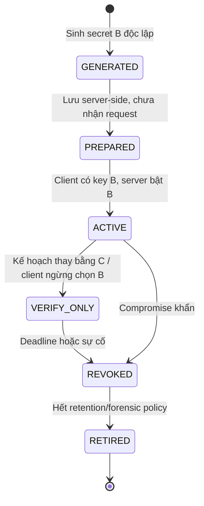

# Vì sao cần rotation

## 1. Key rotation giải quyết vấn đề gì trong xác thực HTTP bằng HMAC?

Trong hệ thống xác thực HTTP request bằng **HMAC với shared secret**, một client ký canonical request chứa method, URI, selected headers và body hoặc body digest. Server lấy secret đúng của client để tính lại HMAC, kiểm tra timestamp/nonce, sau đó mới xác định principal và thực hiện authorization. Cả hai phía đều biết **cùng một secret**; vì vậy ai chiếm được secret cũng có khả năng tạo các request mới với HMAC đúng trong phạm vi credential đó.

**Key rotation** là quy trình thay credential/key material đang sử dụng bằng **một secret mới độc lập**, chuyển dần client và verifier sang khóa mới, rồi ngừng chấp nhận khóa cũ theo chính sách và thời hạn rõ ràng.

```text
Trước rotation:
    client merchant-42 --- HMAC(secret-A) ---> verifier chấp nhận key-A

Trong migration:
    client cũ ----- key-A -------------------> verifier (A còn được cho phép)
    client mới ----- key-B -------------------> verifier (B đã sẵn sàng)

Sau rotation:
    client merchant-42 --- HMAC(secret-B) ---> verifier chấp nhận key-B
    mọi request dùng key-A ------------------> verifier REJECT
```

Mục đích **không phải** làm cho khóa A trở nên “an toàn” sau khi đã lộ, cũng **không** tự cải thiện độ mạnh của HMAC-SHA256. Rotation chủ yếu giúp **giới hạn thời gian một secret tiếp tục có giá trị**, giảm hậu quả từ quyền truy cập tồn tại quá lâu, giảm rủi ro vận hành của credential bất biến và tạo đường đáp ứng khi phát hiện compromise.

Bài **Vì sao cần rotation** thuộc chương *Key rotation* trong module `SECURITY_AUTHENTICATION_HMAC_REQUEST_AUTHENTICATION`. Phạm vi module là ký/xác minh HTTP request bằng HMAC và canonical method/URI/header/body, chống replay bằng timestamp/nonce, quản lý secret/key lifecycle, kiểm thử gateway/proxy và phân biệt **authentication** với **authorization**. Vì thế câu hỏi “vì sao?” không thể chỉ trả lời “để tăng bảo mật”: cần giải thích **rủi ro nào giảm, rủi ro nào vẫn tồn tại, điều kiện nào khiến rotation thực sự có tác dụng và cách chứng minh bằng test**.

Sau bài học, bạn có thể:

- Phân tích hậu quả khi một HMAC secret sống quá lâu trong SDK, service, CI, cấu hình, memory dumps hoặc bản backup.
- Phân biệt **rotation định kỳ**, **rotation khẩn cấp do compromise**, **revocation**, **expiration**, **reprovisioning** và **thay thuật toán**.
- Giải thích vì sao cần credential có **key ID, owner, thời hạn, status** và version độc lập với protocol version.
- Thiết kế khoảng **overlap** để không cắt dịch vụ đột ngột nhưng không kéo dài rủi ro của secret cũ vô hạn.
- Chứng minh verifier chọn secret theo **key ID được ký**, không thử mọi secret và không tạo principal từ identifier chưa xác thực.
- Giữ replay nonce, idempotency và authorization **đúng xuyên rotation**, kể cả khi key ID thay đổi.
- Xây Java 17 lab và kiểm thử golden HMAC vector cho hai key versions, key revocation và cross-key replay.
- Lập luận các trade-off giữa thời gian migration, số client, sự phụ thuộc gateway/secret manager và incident recovery.

**Luận điểm chính:** một chính sách rotation có ý nghĩa khi khóa mới độc lập, được phân phối an toàn, khóa cũ ngừng được chấp nhận đúng thời hạn và cả hệ thống vẫn giữ nguyên ranh giới xác thực/phân quyền. **Chỉ tạo một secret B nhưng vẫn chấp nhận secret A mãi mãi không làm giảm đáng kể rủi ro từ A.**

## 2. Rủi ro của một shared secret không bao giờ thay đổi

### 2.1. Lộ secret có nghĩa gì với HMAC?

HMAC-SHA256 là **message authentication code đối xứng**. Nếu attacker biết shared secret, họ có thể tự dựng canonical request:

```http
POST /v1/transfers?currency=VND HTTP/1.1
Host: api.example.test
Content-Type: application/json
X-Client-Id: merchant-42
X-Key-Id: key-2026-a
X-Timestamp: 1790000015
X-Nonce: QEFCQ0RFRkdISUpLTE1OTw
X-Idempotency-Key: transfer-009
X-Signature: <base64url-hmac-tag>

{"transferId":"tr-009","amount":250000,"toAccount":"acct-7"}
```

Nếu key A còn `ACTIVE` hoặc còn được xác minh trong giai đoạn migration, attacker có key A có thể **ký request mới với timestamp mới, nonce mới và HMAC hợp lệ**. Timestamp/nonce chỉ chặn **replay của request cũ**, không chặn khả năng tạo request mới khi attacker đã biết secret.

Điều này cũng giải thích vì sao HMAC **không cung cấp tính không thể chối bỏ giống chữ ký số bất đối xứng**: cả client và server nắm cùng secret. Dữ liệu audit vẫn quan trọng, nhưng bản thân HMAC không xác định duy nhất bên nào đã tạo tag.

### 2.2. Những nơi secret có thể bị phơi lộ

| Nguồn rủi ro | Ví dụ | Hậu quả nếu key không rotate |
| --- | --- | --- |
| **CI/CD và build artifacts** | Biến môi trường, pipeline logs, cấu hình sai | Secret cũ dùng được lâu sau khi build kết thúc |
| **Source/config repositories** | Secret bị commit trong `.env`/YAML, pull request | Bản sao nằm trong history/clone |
| **Runtime memory/diagnostics** | Heap dump, crash report, debug endpoint | Có thể lấy credential đang dùng |
| **Backups/snapshots** | Raw secret trong DB snapshot hoặc backup decrypt được | Key bị lộ từ bản lưu trữ lâu năm |
| **Client infrastructure** | Máy chủ merchant bị xâm nhập | Kẻ tấn công ký giả thay client |
| **Internal access** | Nhân viên/vendor có quyền đọc secret quá rộng | Truy cập vẫn hữu ích sau khi công việc kết thúc |
| **Credential provisioning** | Secret được gửi lại bằng kênh không an toàn | Không thể khôi phục bí mật bằng đổi tên key ID |
| **Thay đổi nhân sự/hệ thống** | SDK, nhà cung cấp, gateway cũ | Key cũ vẫn mở một trust path không còn quản lý |
| **Thiếu inventory** | Một secret dùng cho nhiều environments/clients | Không biết cần thu hồi ở đâu |

**Rotation không thay thế secret management.** Nếu secret B tiếp tục được ghi vào logs như secret A, hệ thống chỉ thay một secret đang lộ bằng secret khác cũng sẽ lộ. Cần song hành: least privilege, secret manager, encrypted storage/backup, redaction, provisioning an toàn và access review.

### 2.3. Key sống càng lâu, lịch sử phơi lộ càng lớn

Nếu một shared secret tồn tại nhiều năm:

- Một incident cũ có thể đã làm lộ secret nhưng không được phát hiện.
- Nhân viên/hệ thống từng được cấp quyền có thể còn bản sao.
- Bản backup cũ có thể chứa key vẫn hợp lệ vào thời điểm hiện tại.
- Khó biết rõ hệ thống nào vẫn đang sử dụng khóa.
- Khi cần thu hồi khẩn, không có quy trình client rollover đã được thử nghiệm.

Rotation định kỳ **không chứng minh** mọi secret cũ đã bị xóa khỏi mọi nơi, nhưng làm các bản sao **hết khả năng xác thực sau khi key cũ thực sự bị revoke**. Đó là lợi ích quan trọng của một vòng đời có điểm kết thúc.

## 3. Rotation giảm những rủi ro nào, và không giảm những gì?

### 3.1. Bốn lợi ích bảo mật/vận hành chính

**Lợi ích 1 — Giới hạn thời hạn hữu dụng của credential bị lộ.**

Giả sử attacker lấy được key A ở ngày thứ 20. Nếu hệ thống chấp nhận key A mãi mãi, attacker có thể ký request mới vô hạn cho tới khi key bị phát hiện/thu hồi. Nếu key A được thu hồi vào ngày 30 theo một rotation thực sự hoàn tất, phạm vi lợi dụng key A kết thúc ở điểm đó (trừ các side effects/tokens/trust paths khác). **Điều giảm là thời gian có thể sử dụng key**, không phải xác suất key đã bị lộ.

**Lợi ích 2 — Chuyển đổi có kế hoạch thay vì “big bang” trong incident.**

Một hệ thống đã có hai key IDs, key provisioning, policy cửa sổ overlap và test failover có thể phát key B, chuyển client và thu hồi A theo một quy trình quen thuộc. Khi có compromise, thao tác có thể thực hiện nhanh hơn và ít lỗi hơn so với lần đầu thiết kế rotation trong khủng hoảng.

**Lợi ích 3 — Thu hẹp quyền và vòng đời credential.**

Rotation tạo thời điểm kiểm kê owner, môi trường, các scopes đã cấp, trạng thái client, thời điểm hết hạn và bản sao lưu. Nếu kết hợp với **credential per client/per environment/per purpose**, tác động khi một key lộ bị giới hạn trong principal và quyền tương ứng. **Chỉ rotate một shared key chung cho mọi client vẫn có blast radius rất lớn**.

**Lợi ích 4 — Di chuyển khỏi cơ chế lưu trữ hoặc quy trình cũ.**

Khi chuyển secret manager/KMS, thay provisioning flow, loại bỏ key trong cấu hình cũ, hoặc thay nhóm vận hành, rotation cho phép phát một key mới qua trust path hiện hành và cắt đường cũ. Điều này hỗ trợ hygiene và kiểm toán, nhưng không tự động chứng minh mọi bản copy cũ đã được xóa.

### 3.2. Những điều rotation KHÔNG tự giải quyết

| Vấn đề | Vì sao rotation chưa đủ? | Kiểm soát bổ sung |
| --- | --- | --- |
| Secret B cũng bị leak | Lỗi logging/provisioning cũ vẫn tồn tại | Redaction, secrets manager, IAM, client hardening |
| Attacker đã charge trước khi key A revoked | Side effect đã commit không tự đảo ngược | Incident response, ledger/reconciliation |
| Nonce store bị mất | Replay request đã ký vẫn có thể lọt nếu key đó còn hợp lệ | Durable atomic nonce store/fail-closed |
| Signature canonicalization bỏ sót resource | Request có thể thay field không được ký | Signed component contract, security tests |
| Client có HMAC hợp lệ nhưng thiếu quyền | Key chỉ chứng minh credential possession | Authorization theo principal/action/resource |
| Một client vô tình dùng cùng idempotency key cho ý định khác | HMAC không tự phân biệt business intent | Stable operation fingerprint, idempotency policy |
| Key A vẫn được chấp nhận trong overlap vô hạn | Secret cũ không thực sự vô hiệu | Deadline + verified retirement/revocation |
| Shared secret dùng chung hàng trăm clients | Key leak ảnh hưởng mọi client | Per-client keys, tenant isolation, limited scopes |
| KMS/credential store outage | Không thể lookup secret hoặc decrypt | HA, cache policy, tested DR/reprovision |
| Attacker có quyền dùng runtime verifier hợp lệ | Rotation secret không tự loại bỏ quyền ở runtime | Workload identity, authorization, access review |

**Thất bại phổ biến:** team đo “số lần tạo secret mới” rồi kết luận rotation hiệu quả, trong khi verifier vẫn giữ A ở chế độ `accept=true`, SDK vẫn gửi A và server không monitor traffic theo key ID.

### 3.3. Rotation và revocation: không đồng nghĩa

- **Rotation:** tạo secret mới, chuyển usage và lập kế hoạch chấm dứt key cũ.
- **Revocation:** ngay lập tức hoặc theo chính sách từ chối key không còn được phép; có thể diễn ra **không có** key thay thế nếu credential bị compromise.
- **Expiration:** key tự hết hạn sau mốc thời gian `expiresAt`; cần verifier thực thi ở mọi node.
- **Reprovisioning:** phân phối credential mới đến client qua kênh được xác thực/ủy quyền.
- **Cryptographic algorithm migration:** thay HMAC-SHA256 bằng một primitive hoặc protocol mới; cần contract/version và đánh giá riêng, không chỉ đổi raw key.

Một vụ lộ key A **không nên** giữ A hoạt động nhiều ngày chỉ để client chuyển êm nếu risk từ attacker cao. Với compromise đã xác nhận, thường phải **ưu tiên revoke A nhanh**, chấp nhận gián đoạn có kiểm soát và reprovision khách hàng. Overlap phù hợp với **rotation định kỳ không có dấu hiệu lộ secret**, không phải ngoại lệ an toàn cho key compromised.

## 4. Khi nào cần rotation?

### 4.1. Rotation định kỳ và rotation theo sự kiện

| Trigger | Ví dụ | Mục tiêu/hành động |
| --- | --- | --- |
| **Định kỳ theo policy** | Mỗi khoảng thời gian tổ chức quyết định | Giới hạn credential lifetime; rehearsal migration |
| **Secret bị lộ hoặc nghi bị lộ** | Logs/artifact/endpoint compromise | Revoke affected keys, cấp mới, điều tra abuse |
| **Thay người/quyền truy cập** | Vendor/người quản trị rời dự án | Review và thay credential đã có exposure |
| **Hệ thống bị xâm nhập** | Client host hoặc secret manager compromise | Rotate affected scope sau khi xử lý nguồn leak |
| **Đổi trust infrastructure** | Chuyển KMS/secret manager/gateway | Cắt đường phân phối cũ và xác thực đường mới |
| **Credential đã quá hạn** | `expiresAt` đến gần | Provision key mới để tránh outage |
| **Giảm blast radius** | Từ shared global secret sang per-client keys | Phân vùng credentials và policy |
| **Security incident/policy update** | HMAC contract cũ không còn đủ signed fields | Thường cần **protocol migration**, rotation riêng không đủ |

Không có một con số “cứ 30 ngày là bảo mật” áp dụng cho mọi hệ thống. Chọn chu kỳ theo **exposure**, môi trường giữ secret, cách phân phối, tốc độ client cập nhật, số lượng credentials, yêu cầu tuân thủ và khả năng thu hồi khẩn.

Với key HMAC lưu trong client backend ít thay đổi, vòng đời có thể dài hơn token ngắn hạn nhưng vẫn nên có **expiration/revocation và rotation runbook**. Với key có nguy cơ phơi lộ lớn, cần cân nhắc key lifetime ngắn hơn, workload identity hoặc cách xác thực khác.

### 4.2. Rotation sau compromise phải xem là incident

Khi key A bị lộ:

1. **Đánh giá scope**: môi trường, owner, key ID, IP/caller, API/action và thời gian exposure.
2. **Chặn nguồn leak** (ví dụ lỗi logging, CI artifacts, compromised host). Chỉ cấp B khi nguồn leak còn đó có thể làm B lộ tiếp.
3. **Revoke hoặc ngừng tin A** nhanh theo severity, kể cả nếu client chưa nâng cấp.
4. **Cấp B độc lập ngẫu nhiên** qua trusted provisioning, không derive B từ A bằng phép biến đổi tùy tiện.
5. **Invalidate caches** và kiểm chứng mọi gateway/region từ chối A.
6. **Giám sát/reconcile** các request/transactions có thể đã bị ký bằng A.
7. **Đặt điều kiện khôi phục** cho client bị gián đoạn, không cho fallback sang A.
8. **Lưu evidence** và audit theo policy, nhưng không xuất lại secret cũ vào incident ticket.

Đổi key ID nhưng vẫn dùng **cùng raw secret** không phải rotation của key material. Tương tự, tăng `protocolVersion` từ 1 lên 2 mà vẫn dùng secret A có thể không giới hạn khả năng giả mạo của attacker đã lấy A, trừ khi giao thức/key policy thực sự thu hồi A và thay trust boundary.

## 5. Các giai đoạn key lifecycle và lý do cần overlap

### 5.1. Vòng đời minh họa



Các state này là **mô hình của bài học**, không phải chuẩn bắt buộc. Đặc biệt, `VERIFY_ONLY` nghĩa là **server tiếp tục chấp nhận request HMAC đúng dùng key cũ trong giai đoạn quá độ**, nhưng client SDK được hướng dẫn **không chọn key này để ký request mới**. Server không thể biết client đã cố tình ký request mới bằng một key còn được verify; muốn chặn hoàn toàn phải chuyển key sang `REVOKED` hoặc expiry.

| State | Cho client ký? | Server cho phép xác minh? | Ý nghĩa |
| --- | --- | --- | --- |
| `GENERATED` | Chưa | Không | Sinh key mới trong trusted secret store |
| `PREPARED` | Chưa (hoặc provisioning có kiểm soát) | Không | Key được phân phối/chuẩn bị rollout |
| `ACTIVE` | Có | Có | Key được phép sử dụng bình thường |
| `VERIFY_ONLY` | SDK nên dừng chọn | Có, tới deadline | Khoảng overlap có kiểm soát |
| `REVOKED` | Không | **Không** | Không cấp principal dù MAC có đúng |
| `RETIRED` | Không | **Không** | Material được xử lý theo retention/deletion policy |

Có thể thiết kế đơn giản hơn với `ACTIVE/REVOKED` cộng `notBefore/expiresAt` và metadata `preferredForSigning`. Điều quan trọng là **hành vi được định nghĩa rõ và kiểm thử**, không phải tên state nào.

### 5.2. Tại sao không tắt A ngay khi bật B?

Nếu hệ thống có nhiều merchant clients, mỗi client có rollout cadence khác nhau. Tắt A ngay lập tức có thể làm request HMAC của client chưa được reprovision bị từ chối, gây outage.

Một khoảng overlap cho phép:

```text
t0:    key A ACTIVE, key B GENERATED/PREPARED
t1:    key B ACTIVE, key A VERIFY_ONLY (server vẫn verify A)
t2:    client SDK chủ yếu ký bằng B
t3:    xác nhận không còn traffic A hợp lệ; revoke A
t4:    clear old server key caches/backups theo retention
```

Nhưng overlap càng dài, **key A còn bị attacker sử dụng càng lâu** nếu A đã lộ. Trade-off:

\[
\text{risk reduction} \propto \text{thực sự ngừng chấp nhận key cũ}
\]

Đây là quan hệ khái niệm, **không phải** một xác suất định lượng. Định lượng risk yêu cầu threat model và dữ liệu incident riêng. Người thiết kế cần chọn deadline dựa trên **client upgrade capacity và risk tolerance**, có rollback plan nhưng **không fallback sang compromised key**.

### 5.3. Tại sao phải giữ hai key ID thay vì thay secret cùng một ID?

Nếu một `KeyId=merchant-42-key` có raw secret A hôm qua nhưng B hôm nay:

- Request đang trên đường có thể được ký bằng A nhưng verifier đọc B.
- Cache ở gateway A giữ A, gateway B đã B, dẫn tới lỗi không ổn định.
- Audit khó biết request dùng version nào.
- Client và server có thể không đồng bộ, không có overlap theo credential rõ ràng.
- Khi revoke A, rất khó phân biệt một signature của A với B qua metadata.

Sử dụng **key IDs bất biến cho từng material version**:

```text
merchant-42:
  key-2026-a -> secret-A (status VERIFY_ONLY, retirement deadline)
  key-2026-b -> secret-B (status ACTIVE)

Client gửi KeyId cụ thể trong signed request.
Verifier lookup đúng (environment, claimedClientId, keyId) rồi verify.
```

**Không** dùng cùng key ID cho hai raw secrets và “thử A trước, rồi B” khi HMAC mismatch. Đường thử mọi secret làm tăng chi phí, tạo timing differences và che lỗi provisioning/version.

## 6. Key rotation tốt phải gắn với quyền sở hữu và phạm vi

### 6.1. Một secret chung cho mọi client: điểm yếu cấu trúc

Giả sử mọi merchant đều dùng cùng secret `GLOBAL_HMAC_SECRET`. Khi bất kỳ merchant nào làm lộ secret, attacker có thể có khả năng ký request thay **nhiều** merchant nếu server tin client ID tự khai. Rotation toàn bộ secret chỉ tạo outage diện rộng và không sửa sai thiết kế scope.

Lựa chọn tốt hơn:

```text
credential identity = (environment, clientId, keyId)

prod / merchant-42 / key-2026-a -> secret-A42
prod / merchant-42 / key-2026-b -> secret-B42
prod / merchant-73 / key-2026-b -> secret-B73 (khác, độc lập)
staging / merchant-42 / key-2026-b -> secret-S42 (khác, độc lập)
```

Một key mới nên được sinh bằng **CSPRNG** (ví dụ 32 random bytes cho HMAC-SHA256 trong lab), không dựa trên timestamp, user password hoặc `newKey = SHA256(oldKey)` như một rotation protocol tùy tiện. Khi key A bị compromise, dùng key B **độc lập** tránh để attacker có A suy ra B.

### 6.2. Verified principal không phải ClientId do caller tự khai

Client có thể gửi:

```http
X-Client-Id: merchant-42
X-Key-Id: key-2026-b
X-Signature: <tag>
```

Tại thời điểm parse, đây chỉ là **lookup selectors chưa đáng tin**. Server phải truy xuất credential record từ trusted store, kiểm tra record.owner = claimed client ID, đúng environment, key active/valid, algorithm allowed rồi mới so MAC. **Chỉ sau khi HMAC khớp và policy freshness/replay đạt**, verifier mới cấp `VerifiedPrincipal("merchant-42")`.

Không được coi `X-Key-Id` là role; không dùng key ID hoặc client ID làm bằng chứng đã được authorization cho endpoint. Credential thuộc đúng client nhưng vẫn có thể không được phép chuyển tiền từ account của client khác.

### 6.3. Tại sao cần ký cả KeyId và ClientId?

Nếu key IDs chỉ được truyền trong header nhưng **không nằm trong canonical signed input**, attacker có thể thử đổi selector để gây **key confusion**, làm routing/identity không nhất quán giữa gateway và backend hoặc tận dụng lỗi reuse raw secret giữa hai records.

Hợp đồng của bài ký:

```text
x-client-id:merchant-42
x-key-id:key-2026-b
```

HMAC của key B được tính trên **chính string chứa key ID B**. Đổi `KeyId` sau khi ký khiến MAC mismatch (hoặc credential lookup fail), không tạo verified principal.

**Không chỉ ký KeyId để bỏ qua owner check.** Nếu cùng raw key bị copy vào credential của hai tenants, HMAC có thể khớp với cả hai khi client ID cũng bị ký lại bởi bên nắm raw key. Phải bảo vệ **secret uniqueness/scope và owner mapping** ngay từ provisioning.

## 7. Lập luận trade-off và các ví dụ định lượng

### 7.1. Lifetime vs overlap

Một ví dụ **chỉ để minh họa**:

```text
Ngày 01: cấp key A
Ngày 20: attacker lấy được A nhưng chưa bị phát hiện
Ngày 28: client bắt đầu nhận B, A vẫn VERIFY_ONLY
Ngày 30: A bị REVOKED ở mọi verifier

Attacker có A:
  Từ ngày 20 đến trước thời điểm A thực sự bị từ chối: nguy cơ ký giả.
  Sau khi A bị từ chối hoàn toàn: không còn ký request mới bằng A hợp lệ.

Nếu A không bao giờ bị revoke:
  Không có điểm chấm dứt hiệu lực của A bằng policy rotation.
```

Đây không phải bảo đảm attacker chỉ gây thiệt hại trong mười ngày: hậu quả giao dịch, credential forwarding, quyền truy cập bị cấp sai hoặc secondary tokens có thể tồn tại lâu hơn. Rotation cắt **khả năng sử dụng secret A** theo policy, không tự undo side effects.

### 7.2. Các quyết định thiết kế cần thương lượng

| Câu hỏi | Nếu quá lỏng | Nếu quá chặt | Cách cân nhắc |
| --- | --- | --- | --- |
| Chu kỳ rotation | Secret sống quá lâu, unknown exposure kéo dài | Client update liên tục, tăng lỗi phối hợp | Threat model, blast radius, automation |
| Overlap duration | Old key vẫn hữu hiệu quá lâu | Client chậm nâng bị outage | Telemetry, grace deadline, incident severity |
| Cache TTL credential state | Revoked key vẫn được nhận ở gateway | Store lookup latency/availability tăng | Push invalidation, revocation SLA, bounded cache |
| Số key versions active | Khó biết candidate, mở rộng exposure | Client rollout thiếu độ linh hoạt | 1 preferred + 1 legacy có expiry rõ |
| Backup retention | Revoked secret còn mở được nếu backup leak | Mất DR/forensic capability | Encrypted backup + current revocation authority |
| Logging | Không biết client nào còn dùng A | Có thể leak tenant/secret/signature | Key ID/status metrics đã lọc, không log secret |
| Client retry | Reuse old nonce/old key không đúng policy | Retry bị cấm dù harmless network failure | New nonce/time/HMAC; stable idempotency key |
| Emergency revoke | Chậm cắt attacker khỏi hệ thống | Outage clients chưa reprovision | Incident playbook, prioritized revoke + recovery |

### 7.3. Những chỉ số chứng minh rotation thực sự hoàn tất

Không chỉ đo “đã phát key B”. Hãy theo dõi:

- Tỷ lệ **request HMAC đã xác thực** theo key ID `A` vs `B`, được giới hạn cardinality và quyền xem.
- Số client còn dùng A và thời điểm request cuối được **xác minh thành công bằng A**.
- Số verifier/regions có trạng thái A là `REVOKED` và key-state cache đã được invalidated.
- HMAC mismatch/freshness/replay rejects sau rollout để phát hiện SDK/client config lỗi.
- Thời gian từ khi **phát hiện compromise đến khi mọi verifier từ chối** affected key.
- Tỷ lệ restore/DR drills thành công không kích hoạt lại key cũ.
- Không có business side effects trùng do retry/nonce/idempotency khi đổi key.

Một việc rotation chỉ xem là hoàn thành khi **A bị từ chối ở mọi đường xác thực** và telemetry/negative tests xác minh điều đó, không phải khi B đã tồn tại ở database.

## 8. Hợp đồng HTTP-HMAC-ROTATION-V1 và hai golden vectors

Bài định nghĩa giao thức **`HTTP-HMAC-ROTATION-V1`** để minh họa key rotation ở cấp byte. Đây là **hợp đồng lab**, không phải chuẩn HMAC HTTP mặc định của mọi sản phẩm.

### 8.1. Request và signed components

```http
POST /v1/transfers?currency=VND HTTP/1.1
Host: api.example.test
Content-Type: application/json
X-Client-Id: merchant-42
X-Key-Id: key-2026-b
X-Timestamp: 1790000015
X-Nonce: QEFCQ0RFRkdISUpLTE1OTw
X-Idempotency-Key: transfer-009
X-Signature: o1cOFqHXA64uf35LeT511owiW9CpttShIPzU6w3CQAU

{"transferId":"tr-009","amount":250000,"toAccount":"acct-7"}
```

Quy tắc hợp đồng:

1. Method `POST`, raw path `/v1/transfers`, raw query `currency=VND` và external authority đáng tin `api.example.test` là những thành phần được ký.
2. Các header `Content-Type`, `X-Client-Id`, `X-Key-Id`, `X-Timestamp`, `X-Nonce`, `X-Idempotency-Key` và `X-Signature` có đúng một occurrence. HTTP adapter **reject duplicate case-insensitive trước khi coalesce**.
3. Tên signed headers canonical lowercase ASCII; **giá trị** client ID, key ID và nonce giữ nguyên case. Không tự `trim()` CR/LF hoặc Unicode lookalikes để “sửa” input.
4. `Content-Type` đúng `application/json`, timestamp là canonical Unix epoch seconds, nonce 16 raw bytes Base64url no-padding 22 ký tự; idempotency key có grammar riêng của API.
5. Body digest là SHA-256 **exact body bytes** lowercase hex; không parse/serialize lại JSON sau điểm ký.
6. HMAC-SHA256 tạo **32 raw bytes**, encode Base64url no-padding thành **43 ký tự**. `X-Signature` là output, **không nằm trong canonical input**.
7. Canonical request gồm **12 dòng** nối bằng LF byte `0x0A`, UTF-8, **không LF cuối**; domain prefix `HTTP-HMAC-ROTATION-V1`.
8. `X-Client-Id` và `X-Key-Id` **được ký**. Chúng chỉ là lookup selectors, không trở thành principal trước khi MAC, freshness và nonce claim hợp lệ.
9. Credential policy có owner/environment/key ID/state/algorithm/not-before/expiry. Nếu MAC sai, **không thử secret khác**.
10. Xác thực không tự cấp quyền resource: business authorization và idempotency xử lý sau verified principal.

### 8.2. Canonical request đúng 12 dòng cho key B

```text
HTTP-HMAC-ROTATION-V1
POST
/v1/transfers
currency=VND
authority:api.example.test
content-type:application/json
x-client-id:merchant-42
x-key-id:key-2026-b
x-timestamp:1790000015
x-nonce:QEFCQ0RFRkdISUpLTE1OTw
x-idempotency-key:transfer-009
3904289662ef7c7991a3463e7e771d6b16941fb047c15385befdc3d77d316971
```

Chuỗi có **304 byte UTF-8**, không trailing LF. Dòng cuối là SHA-256 hex của JSON body 60 byte:

```json
{"transferId":"tr-009","amount":250000,"toAccount":"acct-7"}
```

Khi test key A, chỉ đổi dòng `x-key-id:key-2026-a`, giữ các dòng khác. Việc cùng nonce xuất hiện trong hai **golden cryptographic fixtures** nhằm so input; **không** có nghĩa client thật được dùng một nonce hai lần.

### 8.3. Golden vectors độc lập cho secret A và secret B

```text
Key A ID: key-2026-a
Key A raw bytes hex (00..1f):
000102030405060708090a0b0c0d0e0f101112131415161718191a1b1c1d1e1f

Key B ID: key-2026-b
Key B raw bytes hex (20..3f):
202122232425262728292a2b2c2d2e2f303132333435363738393a3b3c3d3e3f

Nonce raw bytes hex (40..4f):
404142434445464748494a4b4c4d4e4f
Nonce Base64url no padding:
QEFCQ0RFRkdISUpLTE1OTw

Body SHA-256 hex:
3904289662ef7c7991a3463e7e771d6b16941fb047c15385befdc3d77d316971

Both canonical requests: 12 lines, 304 bytes UTF-8, LF, no final LF

A, HMAC raw hex:
1f357be84b31bb23efab1e1dc15c471af22b0a5d2658f110e51a3b123ac8fb94
A, Base64url tag:
HzV76EsxuyPvqx4dwVxHGvIrCl0mWPEQ5Ro7EjrI-5Q

B, HMAC raw hex:
a3570e16a1d703ae2e7f7e4b793e75d68c225bd0a9b6d4a120fcd4eb0dc24005
B, Base64url tag:
o1cOFqHXA64uf35LeT511owiW9CpttShIPzU6w3CQAU
```

Các tag được tính **độc lập** bằng SHA-256/HMAC-SHA256 trên exact canonical input, không chỉ so roundtrip `sign()` → `verify()` trong một implementation. Golden vectors giúp phát hiện signer/verifier quên ký `KeyId` hoặc chọn nhầm raw key.

**Chỉ dùng fixture public này trong test.** Production sinh mỗi key mới bằng CSPRNG và mỗi HTTP nonce mới cho mỗi attempt. Nếu chạy hai request A/B trên **cùng replay store** với cùng nonce và principal, request thứ hai **phải bị reject**, dù cả hai HMAC toán học hợp lệ. Khi test riêng golden tag không gọi nonce claim.

### 8.4. Phân biệt KeyId được ký với verified principal

```text
ClientId = merchant-42             (lookup selector chưa xác thực)
KeyId    = key-2026-b               (lookup selector chưa xác thực)

Trusted server credential lookup:
  (environment, merchant-42, key-2026-b)
  -> owner merchant-42, algorithm HmacSHA256, status ACTIVE, secret B

HMAC + signed timestamp + atomic nonce claim hợp lệ:
  -> VerifiedPrincipal("merchant-42")

Business authorization:
  -> Merchant-42 có quyền chuyển tiền từ account X không?
```

Ký `KeyId` đảm bảo attacker không thể đổi selector trên wire mà giữ nguyên tag cũ. Nhưng **không** thay thế kiểm tra owner, environment, allowed algorithm, key status hoặc resource authorization.

## 9. Java 17: signer/verifier dùng đúng một key theo ID

Class `RotationHmacV1` dưới đây trình bày thứ tự **exact credential lookup → key policy → HMAC → timestamp → atomic nonce claim → verified principal**, không có đường “try-all keys”.

### 9.1. Class RotationHmacV1

```java
import java.nio.charset.StandardCharsets;
import java.security.GeneralSecurityException;
import java.security.MessageDigest;
import java.time.Clock;
import java.util.Base64;
import java.util.HexFormat;
import java.util.Optional;
import javax.crypto.Mac;
import javax.crypto.spec.SecretKeySpec;

public final class RotationHmacV1 {
    private static final String CONTEXT = "HTTP-HMAC-ROTATION-V1";
    private static final String HMAC_ALGORITHM = "HmacSHA256";
    private static final long PAST_SECONDS = 300L;
    private static final long FUTURE_SECONDS = 30L;
    private static final long NONCE_MARGIN_SECONDS = 60L;

    public enum KeyState {
        PREPARED, ACTIVE, VERIFY_ONLY, REVOKED
    }

    public record Request(
        String method, String rawPath, String rawQuery,
        String trustedAuthority, String contentType,
        String clientId, String keyId,
        String timestamp, String nonce, String idempotencyKey,
        byte[] exactBody
    ) {
        public Request {
            if (exactBody == null) {
                throw new IllegalArgumentException("Body required");
            }
            exactBody = exactBody.clone();
        }

        @Override
        public byte[] exactBody() {
            return exactBody.clone();
        }
    }

    public record Credential(
        String ownerClientId, String keyId,
        KeyState state, String algorithm,
        long notBefore, long expiresAt, byte[] sharedSecret
    ) {
        public Credential {
            if (sharedSecret == null) {
                throw new IllegalArgumentException("Secret missing");
            }
            sharedSecret = sharedSecret.clone();
        }

        @Override
        public byte[] sharedSecret() {
            return sharedSecret.clone();
        }

        @Override
        public String toString() {
            return "Credential[redacted]";
        }
    }

    public record VerifiedPrincipal(
        String clientId, String verifiedKeyId
    ) {}

    public interface CredentialStore {
        // Caller-provided IDs are only selectors until MAC verifies.
        Optional<Credential> find(
            String environment, String claimedClientId,
            String claimedKeyId);
    }

    public interface NonceStore {
        // Shared, atomic insert-if-absent with expiry.
        // Failure or unknown result MUST fail closed.
        boolean claim(
            String environment, String verifiedClientId,
            byte[] rawNonce, long expiresAtEpochSeconds);
    }

    private RotationHmacV1() {}

    private static void validate(Request r) {
        if (r == null
                || !"POST".equals(r.method())
                || !"/v1/transfers".equals(r.rawPath())
                || !"currency=VND".equals(r.rawQuery())
                || !"api.example.test".equals(r.trustedAuthority())
                || !"application/json".equals(r.contentType())
                || r.exactBody().length > 1_048_576
                || r.clientId() == null
                || !r.clientId().matches("[A-Za-z0-9._-]{1,64}")
                || r.keyId() == null
                || !r.keyId().matches("[A-Za-z0-9._-]{1,64}")
                || r.idempotencyKey() == null
                || !r.idempotencyKey().matches("[A-Za-z0-9._-]{8,64}")
                || r.timestamp() == null
                || !r.timestamp().matches("[1-9][0-9]{0,18}")) {
            throw new IllegalArgumentException(
                "Malformed or unsupported signed components");
        }

        try {
            Long.parseLong(r.timestamp());
        } catch (NumberFormatException invalid) {
            throw new IllegalArgumentException(
                "Timestamp overflow", invalid);
        }
        strictDecode(r.nonce(), 22, 16, "nonce");
    }

    public static byte[] strictDecode(
            String encoded, int encodedLength,
            int rawLength, String field) {
        if (encoded == null || encoded.length() != encodedLength
                || !encoded.matches("[A-Za-z0-9_-]+")) {
            throw new IllegalArgumentException(
                "Invalid " + field + " encoding");
        }
        final byte[] raw;
        try {
            raw = Base64.getUrlDecoder().decode(encoded);
        } catch (IllegalArgumentException invalid) {
            throw new IllegalArgumentException(
                "Malformed " + field, invalid);
        }

        String recoded = Base64.getUrlEncoder().withoutPadding()
            .encodeToString(raw);
        if (raw.length != rawLength || !recoded.equals(encoded)) {
            throw new IllegalArgumentException(
                "Noncanonical " + field);
        }
        return raw;
    }

    private static String bodySha256(Request r)
            throws GeneralSecurityException {
        byte[] digest = MessageDigest.getInstance("SHA-256")
            .digest(r.exactBody());
        return HexFormat.of().formatHex(digest);
    }

    public static byte[] canonicalBytes(Request r)
            throws GeneralSecurityException {
        validate(r);
        String canonical = String.join("\n",
            CONTEXT,
            r.method(),
            r.rawPath(),
            r.rawQuery(),
            "authority:" + r.trustedAuthority(),
            "content-type:" + r.contentType(),
            "x-client-id:" + r.clientId(),
            "x-key-id:" + r.keyId(),
            "x-timestamp:" + r.timestamp(),
            "x-nonce:" + r.nonce(),
            "x-idempotency-key:" + r.idempotencyKey(),
            bodySha256(r)
        );
        return canonical.getBytes(StandardCharsets.UTF_8);
    }

    private static byte[] computeMac(byte[] secret, byte[] canonical)
            throws GeneralSecurityException {
        if (secret == null || secret.length < 32) {
            throw new IllegalStateException(
                "HMAC credential secret weak or missing");
        }
        Mac mac = Mac.getInstance(HMAC_ALGORITHM);
        mac.init(new SecretKeySpec(secret, HMAC_ALGORITHM));
        return mac.doFinal(canonical);
    }

    // Lab only: production SDK chooses current ACTIVE credential
    // and fetches secret from protected provisioning/config.
    public static String signForTest(
            Request request, byte[] rawSecret)
            throws GeneralSecurityException {
        byte[] tag = computeMac(
            rawSecret, canonicalBytes(request));
        return Base64.getUrlEncoder().withoutPadding()
            .encodeToString(tag);
    }

    public static Optional<VerifiedPrincipal> verify(
            Request request, String signature,
            String environment, CredentialStore credentials,
            NonceStore nonceStore, Clock trustedClock
    ) throws GeneralSecurityException {
        byte[] canonical = canonicalBytes(request);
        byte[] supplied = strictDecode(
            signature, 43, 32, "signature");

        Optional<Credential> found = credentials.find(
            environment, request.clientId(), request.keyId());
        if (found.isEmpty()) return Optional.empty();

        Credential c = found.get();
        long now = trustedClock.instant().getEpochSecond();

        // VERIFY_ONLY is still accepted during planned overlap.
        // PREPARED and REVOKED never grant authentication.
        boolean mayVerify =
            c.state() == KeyState.ACTIVE
            || c.state() == KeyState.VERIFY_ONLY;

        if (!mayVerify
                || !request.clientId().equals(c.ownerClientId())
                || !request.keyId().equals(c.keyId())
                || !HMAC_ALGORITHM.equals(c.algorithm())
                || now < c.notBefore()
                || now >= c.expiresAt()) {
            return Optional.empty();
        }

        byte[] expected = computeMac(
            c.sharedSecret(), canonical);
        if (!MessageDigest.isEqual(expected, supplied)) {
            return Optional.empty();
        }

        long signedTs = Long.parseLong(request.timestamp());
        final long oldest, newest, nonceExpiresAt;
        try {
            oldest = Math.subtractExact(now, PAST_SECONDS);
            newest = Math.addExact(now, FUTURE_SECONDS);
            nonceExpiresAt = Math.addExact(
                signedTs, PAST_SECONDS + NONCE_MARGIN_SECONDS);
        } catch (ArithmeticException overflow) {
            throw new IllegalStateException(
                "Unsafe server time arithmetic", overflow);
        }
        if (signedTs < oldest || signedTs > newest) {
            return Optional.empty();
        }

        byte[] nonceBytes = strictDecode(
            request.nonce(), 22, 16, "nonce");

        // Anti-replay namespace excludes keyId: client
        // rotation must not reset the used-nonce history.
        if (!nonceStore.claim(
                environment, c.ownerClientId(),
                nonceBytes, nonceExpiresAt)) {
            return Optional.empty();
        }

        // Authentication only. Resource authorization is separate.
        return Optional.of(new VerifiedPrincipal(
            c.ownerClientId(), c.keyId()));
    }
}
```

### 9.2. Điểm nào là giả định của lab?

`Request` là tập hợp semantic fields sau khi HTTP adapter đã validate. Vì vậy code **không** phát hiện duplicate headers nếu gateway/framework đã coalesce trước. Production cần reject duplicate signed headers, CRLF/obs-fold, invalid whitespace, oversized request và signer/verifier URI/body disagreement.

Adapter phải bảo vệ external authority/raw path/query và tránh tin `X-Forwarded-Host`, `X-Original-URI` hoặc `X-Verified-Client` do caller ngoài gửi. Nếu gateway đã verify, principal phải được forward qua trusted internal channel; không cho direct-backend bypass. HTTP/1.1, HTTP/2 và HTTP/3 phải cùng thống nhất canonical components theo contract.

CredentialStore thực tế cần authoritative state + cache invalidation/propagation khi revoke. NonceStore thực tế cần atomicity trên **shared** storage và TTL đầy đủ; không thay bằng cache per process. Không catch lỗi từ JCA/KMS/store để cho request qua.

`Mac` được tạo riêng cho mỗi phép xác minh; không dùng singleton mutable `Mac` đa luồng. Raw tag so bằng `MessageDigest.isEqual`, nhưng **không** có nghĩa toàn bộ HTTP authn pipeline constant-time.

### 9.3. Vì sao không “thử A rồi B” khi signature không khớp?

Pseudocode sai:

```text
for each secret in allServerSecrets:
    if HMAC(secret, canonicalRequest) == submittedTag:
        return verified
```

Cách này tăng cost theo số keys, mở bề mặt DoS, có thể dùng nhầm revoked key, che lỗi provisioning và tạo **owner/key confusion** nếu một secret bị duplicate giữa records.

**Đúng:** tra một credential theo `(environment, claimedClientId, claimedKeyId)` từ trusted store, kiểm tra owner/status/algorithm/time rồi verify đúng secret. Nếu MAC sai, **reject**; không fallback để cứu client cấu hình sai. Key IDs nên bất biến theo raw material version.

## 10. Java 17: golden vectors, overlap, revocation và cross-key replay

### 10.1. Nonce store nguyên tử trong một process

Để test rotation mà không cần Redis/DB thật, lab dùng `ConcurrentHashMap.compute`. Đây chỉ là **test double trong một JVM**, không đảm bảo at-most-one khi hai gateway giữ hai maps riêng hoặc khi restart/failover làm mất state.

```java
import java.time.Clock;
import java.util.Base64;
import java.util.concurrent.ConcurrentHashMap;

public final class RotationInMemoryNonceStoreV1
        implements RotationHmacV1.NonceStore {
    private record ReplayKey(
        String environment,
        String verifiedClientId,
        String canonicalNonce) {}

    private final Clock clock;
    private final ConcurrentHashMap<ReplayKey, Long> expires =
        new ConcurrentHashMap<>();

    public RotationInMemoryNonceStoreV1(Clock clock) {
        this.clock = clock;
    }

    @Override
    public boolean claim(
            String environment, String verifiedClientId,
            byte[] rawNonce, long expiresAtEpochSeconds) {
        long now = clock.instant().getEpochSecond();
        if (environment == null || environment.isEmpty()
                || verifiedClientId == null
                || verifiedClientId.isEmpty()
                || rawNonce == null || rawNonce.length != 16
                || expiresAtEpochSeconds <= now) {
            throw new IllegalStateException(
                "Invalid nonce claim/expiry");
        }

        ReplayKey key = new ReplayKey(
            environment,
            verifiedClientId,
            Base64.getUrlEncoder().withoutPadding()
                .encodeToString(rawNonce));

        final boolean[] claimed = {false};
        expires.compute(key, (k, currentExpiry) -> {
            if (currentExpiry == null || currentExpiry <= now) {
                claimed[0] = true;
                return expiresAtEpochSeconds;
            }
            return currentExpiry;
        });
        return claimed[0];
    }
}
```

Vì `ReplayKey` **không chứa key ID**, request dùng A đã claim nonce N sẽ khiến request ký lại bằng B nhưng dùng N bị từ chối. Phần này khác với `CredentialStore`: credential lookup **có** key ID để chọn một raw secret cụ thể, còn replay protection scope theo verified principal.

Nếu dùng Redis production, triển khai atomic conditional write với TTL đi cùng một operation, ví dụ `SET key value NX PX ttlMs`, và nêu rõ consistency/failover policy. Không dùng `EXISTS` rồi `SET` riêng, không fail-open khi storage timeout hoặc outcome unknown.

### 10.2. Class RotationChecksV1

Bộ test deterministic dùng `Clock.fixed`, keys/nonce công khai từ golden vector, và kiểm tra **key A được chấp nhận khi VERIFY_ONLY nhưng bị từ chối ngay khi REVOKED**. Production cần thêm test qua HTTP gateway và distributed replay store thực tế.

```java
import java.nio.charset.StandardCharsets;
import java.time.Clock;
import java.time.Instant;
import java.time.ZoneOffset;
import java.util.HexFormat;
import java.util.Optional;
import java.util.concurrent.atomic.AtomicInteger;

public final class RotationChecksV1 {
    private static final Clock NOW = Clock.fixed(
        Instant.ofEpochSecond(1790000000L), ZoneOffset.UTC);

    private static final String TAG_A =
        "HzV76EsxuyPvqx4dwVxHGvIrCl0mWPEQ5Ro7EjrI-5Q";
    private static final String TAG_B =
        "o1cOFqHXA64uf35LeT511owiW9CpttShIPzU6w3CQAU";

    private static byte[] secretA() {
        return HexFormat.of().parseHex(
            "000102030405060708090a0b0c0d0e0f"
          + "101112131415161718191a1b1c1d1e1f");
    }

    private static byte[] secretB() {
        return HexFormat.of().parseHex(
            "202122232425262728292a2b2c2d2e2f"
          + "303132333435363738393a3b3c3d3e3f");
    }

    private static RotationHmacV1.Request request(
            String keyId) {
        return new RotationHmacV1.Request(
            "POST", "/v1/transfers", "currency=VND",
            "api.example.test", "application/json",
            "merchant-42", keyId, "1790000015",
            "QEFCQ0RFRkdISUpLTE1OTw", "transfer-009",
            "{\"transferId\":\"tr-009\",\"amount\":250000,"
          + "\"toAccount\":\"acct-7\"}"
                .getBytes(StandardCharsets.UTF_8)
        );
    }

    private static RotationHmacV1.Credential credential(
            String keyId, RotationHmacV1.KeyState state) {
        return new RotationHmacV1.Credential(
            "merchant-42", keyId, state,
            "HmacSHA256", 1789990000L, 1790100000L,
            keyId.endsWith("-a") ? secretA() : secretB()
        );
    }

    private static RotationHmacV1.CredentialStore credentials(
            RotationHmacV1.KeyState oldState) {
        return (env, clientId, keyId) -> {
            if (!"test".equals(env)
                    || !"merchant-42".equals(clientId)) {
                return Optional.empty();
            }
            if ("key-2026-a".equals(keyId)) {
                return Optional.of(
                    credential(keyId, oldState));
            }
            if ("key-2026-b".equals(keyId)) {
                return Optional.of(credential(
                    keyId, RotationHmacV1.KeyState.ACTIVE));
            }
            return Optional.empty();
        };
    }

    private static void check(boolean condition, String message) {
        if (!condition) throw new AssertionError(message);
    }

    public static void main(String[] args) throws Exception {
        var reqA = request("key-2026-a");
        var reqB = request("key-2026-b");

        // Independently computed golden vectors; no replay claim yet.
        check(RotationHmacV1.canonicalBytes(reqA).length == 304,
            "A canonical bytes");
        check(RotationHmacV1.canonicalBytes(reqB).length == 304,
            "B canonical bytes");
        check(TAG_A.equals(
            RotationHmacV1.signForTest(reqA, secretA())),
            "A golden tag mismatch");
        check(TAG_B.equals(
            RotationHmacV1.signForTest(reqB, secretB())),
            "B golden tag mismatch");

        var duringRotation = credentials(
            RotationHmacV1.KeyState.VERIFY_ONLY);

        // Hai isolated stores CHỈ để test từng key toán học hợp lệ.
        check(RotationHmacV1.verify(
            reqA, TAG_A, "test", duringRotation,
            new RotationInMemoryNonceStoreV1(NOW), NOW).isPresent(),
            "A verify-only should verify during overlap");
        check(RotationHmacV1.verify(
            reqB, TAG_B, "test", duringRotation,
            new RotationInMemoryNonceStoreV1(NOW), NOW).isPresent(),
            "B active should verify");

        // Shared store + same nonce: cross-key replay must fail.
        var shared = new RotationInMemoryNonceStoreV1(NOW);
        check(RotationHmacV1.verify(
            reqA, TAG_A, "test", duringRotation,
            shared, NOW).isPresent(), "First nonce claim");
        check(RotationHmacV1.verify(
            reqB, TAG_B, "test", duringRotation,
            shared, NOW).isEmpty(), "Cross-key nonce reuse");

        // Math HMAC for A remains valid but credential A revoked.
        var afterRevoke = credentials(
            RotationHmacV1.KeyState.REVOKED);
        check(RotationHmacV1.verify(
            reqA, TAG_A, "test", afterRevoke,
            new RotationInMemoryNonceStoreV1(NOW), NOW).isEmpty(),
            "A revoked must fail");
        check(RotationHmacV1.verify(
            reqB, TAG_B, "test", afterRevoke,
            new RotationInMemoryNonceStoreV1(NOW), NOW).isPresent(),
            "B remains accepted after A revocation");

        // Key ID tampering: present B but retain A signature.
        check(RotationHmacV1.verify(
            reqB, TAG_A, "test", afterRevoke,
            new RotationInMemoryNonceStoreV1(NOW), NOW).isEmpty(),
            "KeyId must be part of signed input");

        // Bad MAC must not claim/poison nonce.
        AtomicInteger claimCalls = new AtomicInteger();
        RotationHmacV1.NonceStore spy =
            (env, client, nonce, expiry) -> {
                claimCalls.incrementAndGet();
                return true;
            };
        String tamperedSignature = "A" + TAG_B.substring(1);
        check(RotationHmacV1.verify(
            reqB, tamperedSignature, "test",
            afterRevoke, spy, NOW).isEmpty(),
            "Bad MAC rejected");
        check(claimCalls.get() == 0,
            "Bad MAC must not claim nonce");

        System.out.println(
            "Golden, overlap, revocation, replay checks OK");
    }
}
```

**Giới hạn test:** hai isolated nonce stores chỉ chứng minh trạng thái verify của hai key trong lab; **không** được dùng isolation đó ở production. Test cross-key dùng **chính một shared store** để chứng minh nonce không reset khi key ID thay đổi. `RotationInMemoryNonceStoreV1` chỉ atomic trong JVM, không test network partition, multi-region, eviction, revoked-key propagation hoặc transaction business.

### 10.3. Những bài test cần thêm khi có hệ thống thật

- Dùng **hai gateway/replica** và shared production-like replay store; gửi requests concurrent với cùng nonce sau khi thay KeyId.
- Inject lỗi Redis/KMS/credential store; request không được pass khi không rõ trạng thái key hoặc nonce claim.
- Kiểm tra cache invalidation: revoke A ở authoritative store, mọi replica phải reject A trong mục tiêu propagation SLA; gateway stale **không được chấp nhận A**.
- Reprovision B rồi thay server secret A→B từng replica; test không có fallback “thử A nếu B không khớp”.
- Đổi header `X-Key-Id`/`X-Client-Id` trong raw HTTP sau ký, giữ tag; MAC reject và business side effect count=0.
- Kiểm tra timestamp window biên, nonce TTL và idempotency khi client retry với **key B mới**.

## 11. Key rotation phải giữ nguyên replay, idempotency và authorization

### 11.1. Replay namespace theo principal, không theo key ID

Nếu client đã sử dụng `nonce=N` với key A, việc ký lại một request bằng B với **cùng N** không được coi là nonce mới trong chính sách lab:

```text
Attempt 1:
  client = merchant-42, key = A, nonce = N
  HMAC_A valid -> claim SUCCESS

Attempt 2:
  client = merchant-42, key = B, nonce = N
  HMAC_B valid -> claim DUPLICATE
```

Replay key minh họa:

```text
(environment, verifiedClientId, rawNonceBytes)
```

**Không đưa `keyId` vào replay-key tuple** nếu mục tiêu là một nonce chỉ được sử dụng một lần **trên toàn client**. Ngược lại, credential lookup **phải** có key ID. Hai cấu trúc dữ liệu phục vụ hai invariant khác nhau.

### 11.2. Nonce TTL phải bảo vệ toàn cửa sổ timestamp

Ví dụ lab:

```text
pastTolerance = 300 seconds
futureTolerance = 30 seconds
safetyMargin = 60 seconds

serverNow - 300 <= signedTimestamp <= serverNow + 30

nonceExpiresAt = signedTimestamp + 300 + 60
```

Nếu request được nhận ở rìa sớm nhất `now = signedTimestamp−30`, nonce đã claim cần được giữ qua `signedTimestamp+300`. Với margin 60s thì TTL tính từ rìa ấy là **390s**, không chỉ 300s.

Điều này quan trọng khi rotation trùng failover: mất nonce history trong lúc key cũ vẫn verify có thể cho phép replay request A dù đã phát key B. Secret rotation không thay một durable/shared replay store hoặc chính sách fail-closed tới khi cửa sổ cũ hết hạn.

### 11.3. Idempotency key giữ nguyên qua retry bằng key mới

Một transfer đã commit dưới key A nhưng response mất trên mạng. Client retry cùng nghiệp vụ bằng key B:

```text
Attempt 1:
  KeyId = A, Timestamp = T1, Nonce = N1
  Idempotency-Key = transfer-009
  Body = business intent P
  Signature = HMAC(secretA, canonical(A,T1,N1,P))

Retry:
  KeyId = B, Timestamp = T2, Nonce = N2
  Idempotency-Key = transfer-009       (GIỮ NGUYÊN)
  Body = cùng business intent P         (GIỮ NGUYÊN)
  Signature = HMAC(secretB, canonical(B,T2,N2,P))
```

HMAC mới hợp lệ, nonce mới được claim. Sau đó idempotency store lookup theo **(environment, verifiedPrincipal, operation, idempotencyKey)**, không theo `keyId`. Stable intent fingerprint (method/resource/amount/destination/body semantics) trùng → trả stored result, **không thực hiện lại transfer**.

Nếu idempotency namespace đưa `keyId` vào một cách vô ý, request A/B có thể tạo hai records và làm side effect hai lần. Ngược lại, retry nguyên nonce N1 là replay và bị reject dù idempotency key giống.

### 11.4. Rotation không được tự tăng quyền

HMAC được xác minh chứng minh caller có **secret hợp lệ của verified principal** trong policy hiện tại, nhưng không tự cấp quyền với resource:

- `merchant-42` có key B hợp lệ **vẫn không được** chuyển tiền từ account của `merchant-73` nếu business authorization không cho phép.
- Key B mới không mặc định có quyền admin cao hơn key A.
- Scopes bị thu hồi phải giữ nguyên hiệu lực sau rotation; không copy blindly quyền cũ đã bị revoke.
- Một key dành riêng cho purpose đọc statements không tự trở thành key tạo payout.
- Khi account bị khóa hoặc credential disabled, phát secret mới không tự gỡ khóa business account.

**Rotation quản lý khả năng sử dụng credential; authorization quản lý những hành động principal được phép làm.**

### 11.5. Authentication protocol Version khác KeyId

Một API có thể truyền:

```http
Authorization: HMAC Version=1,ClientId=merchant-42,KeyId=key-2026-b,Signature=...
```

`Version=1` là hợp đồng canonicalization/algorithm, còn `KeyId=key-2026-b` là **secret version**. Thay A→B vẫn có thể giữ Version=1 nếu protocol chưa đổi.

Nếu protocol V1 có lỗ hổng do không ký body hay thiếu nonce, **chỉ rotate raw secret không sửa lỗ hổng**. Cần protocol migration có signed version, domain separation, minimum accepted version và golden tests riêng. Không auto fallback về phiên bản yếu khi chữ ký mới không khớp.

## 12. Rotation qua gateway, proxy, secret manager và nhiều vùng

### 12.1. Quy trình rollout có kiểm soát

Một runbook dành cho **rotation định kỳ không có dấu hiệu compromise**:

1. **Inventory key A**: owner/tenant/environment/purpose, algorithm, status/expiry, SDK versions, gateway regions, active client traffic. Không tạo key B nếu không biết A đang được dùng ở đâu.
2. **Định nghĩa policy**: thời hạn overlap, deadline revoke A, thay đổi scopes được phê duyệt, expected RPO/RTO, cách canary và rollback **không mở lại key compromised**.
3. **Generate key B độc lập**: tạo 32 bytes (hoặc độ dài theo policy) bằng CSPRNG/secret manager, gắn **key ID bất biến mới**. Không in raw secret ra log, không đưa vào Git/CI artifacts.
4. **Provision ở server**: ghi B ở trạng thái `PREPARED`, kiểm tra owner, algorithm, validity, allowed protocol versions và storage permissions. Không “ghi đè secret trong record A”.
5. **Phân phối B tới đúng client** qua kênh quản lý credential được xác thực, kiểm soát ai có thể xem secret và số lần hiển thị. Với client không thể nhận secret tự động, có quy trình rollout và deadline.
6. **Bật B / bắt đầu overlap**: B `ACTIVE`, A `VERIFY_ONLY` nếu risk cho phép. Các verifier vẫn dùng **exact key ID lookup**.
7. **Canary và giám sát**: thử signed requests B qua gateway/regions; kiểm tra HMAC, nonce, idempotency, authorization và HMAC failure metrics. Nếu B có lỗi, sửa provisioning/canonicalization; **không vô hạn kéo dài A**.
8. **Chuyển client signer preference** sang B. Retry nghiệp vụ dùng nonce/timestamp/HMAC mới, giữ idempotency key. Không thay body/business intent khi retry.
9. **Xác nhận adoption**: đo các request đã xác thực bằng A/B, đối chiếu client inventory, xử lý client còn dùng A trước deadline. Không chỉ dựa vào số keys được tạo.
10. **Revoke A có kiểm chứng**: authoritative status `REVOKED`, invalidate caches, kiểm tra các gateway/regions/backend đều reject A kể cả tag còn đúng.
11. **Retire và xóa theo policy**: không phục hồi A từ encrypted backup thành ACTIVE; zeroize secret A ở runtime cache khi có thể, bảo vệ forensic evidence nếu cần.
12. **Tổng kết và rehearsal**: lưu audit, metrics, thời gian propagation, lỗi của client, security exceptions và cải tiến automation. Lặp quy trình theo rotation calendar.

**Rotation khẩn vì compromise** khác runbook trên ở bước overlap: rủi ro tiếp tục chấp nhận A có thể cao hơn outage. Ưu tiên **revoke A và điều tra**, phát B sau khi xử lý nguồn leak, không cho SDK fallback bằng A. Độ ưu tiên phụ thuộc severity/threat model và phạm vi hệ thống.

### 12.2. “Preferred for signing” và “accepted for verification” là hai chính sách khác nhau

Trong giai đoạn A/B cùng có thể verify:

```text
Client signer preference:
  B được chọn để ký request MỚI

Server verifier acceptance:
  B: ACTIVE
  A: VERIFY_ONLY, tối đa đến legacy deadline
```

Verifier không thể dựa trên `KeyId=A` mà biết client có đang “ký lại request mới” hay chỉ gửi request đang trên đường; mọi request HMAC đúng theo A vẫn là request hợp lệ **trong overlap**. Vì vậy `VERIFY_ONLY` là một **quyết định chấp nhận rủi ro có deadline**, không phải rào cản ngăn attacker nắm A ký mới.

Không nên làm SDK random chọn A/B để “cân bằng tải”. Định nghĩa preferred key/activation epoch và chỉ fallback khi có **quy trình sản phẩm rõ ràng**, không tự hạ từ B sang A do một lỗi authentication bất kỳ.

### 12.3. Credential cache và revocation propagation

Một verifier có thể cache record A với status `ACTIVE`. Nếu authoritative store đổi A sang `REVOKED` nhưng cache TTL còn một giờ, gateway đó vẫn có thể nhận request signed bằng A. Từ góc độ bảo mật, **A chưa thực sự bị thu hồi ở toàn hệ thống**.

Kiểm soát:

- Policy cache TTL có giới hạn nhỏ tương ứng revocation SLA, hoặc event-driven invalidation/versioned push.
- Mỗi credential record có generation/updatedAt và cache có cơ chế nhận trạng thái mới.
- Key revoke là thao tác **monotonic theo policy**: snapshot/cache cũ không làm A sống lại; nếu need unrevoke phải có workflow riêng thường thay bằng key mới.
- Khi revocation authority unavailable, chọn **fail-closed cho operations nhạy cảm**, hoặc một chính sách availability vs risk đã được phê duyệt; không tự cho A qua chỉ vì cache từng active.
- Tích hợp canary negative tests từ nhiều gateways, zones và regions ngay sau revoke.
- Đo thời gian từ `revoke event` đến `last accepted HMAC by A`; không chỉ đo “DB row đã đổi”.

### 12.4. Gateway và proxy làm thay đổi request được ký

| Vấn đề gateway/proxy | Hệ quả với rotation | Kiểm tra |
| --- | --- | --- |
| HTTP/2 lowercases **header names** | `X-Key-Id` thành `x-key-id` là bình thường | Canonical header name nhất quán |
| Proxy lowercases **KeyId value** | Có thể chọn sai credential | HMAC mismatch hoặc lookup reject |
| Duplicate `X-Key-Id` (khác case) | Gateway A chọn A, backend B chọn B | Reject trước coalescing |
| Proxy thay `Host`/authority | Signer/verifier hash khác | Trusted external authority thống nhất |
| URI/path/query rewrite | MAC tính cho request khác | Verify ở ingress hoặc bảo vệ original trusted representation |
| Middleware đổi JSON serialization | Body SHA-256 khác | Tính digest trên exact bytes trước transform |
| Gateway strip key ID | Service thử all keys hoặc default A | Reject, không đoán |
| CDN/shared cache giữ auth result | Old credential có thể tiếp tục được tin | Không cache principal trên key ID đơn thuần |
| Backend được gọi trực tiếp | Bypass HMAC/revocation | Chặn network hoặc verify tương đương |
| Forwarded `X-Verified-Client` giả | Principal spoof sau rotation | Xóa header ngoài; trusted security context |
| Gateway và backend double nonce claim | Retry nội bộ bị reject sai | Xác định **một replay owner** |
| Multi-region có secret state khác nhau | B được nhận ở region này, A vẫn active ở region kia | Consistency/canary và revocation SLA |

### 12.5. Key backup và disaster recovery sau rotation

Một encrypted backup từ tháng trước có thể chứa A `ACTIVE`. Hôm nay A đã `REVOKED`. Khi disaster recovery:

- Decrypt backup thành công **không cho phép** chuyển A lại `ACTIVE`.
- Reconcile với **authoritative revocation/rotation state** độc lập với snapshot.
- Xác định B có được cấp, client đã chuyển B, key IDs/version/owner và các KMS references còn phù hợp không.
- Nếu mất B mà client vẫn dùng B, cần restore B **qua verified workflow** hoặc reprovision/rotate C, không mặc định dùng lại A.
- Nếu mất nonce store trong lúc A còn được verify, có thể replay requests đã ký: cần khôi phục replay state hoặc giữ fail-closed/đợi window drain theo trusted clock và margin.
- Nếu mất idempotency/payment journal, retry bằng B với nonce mới có thể làm giao dịch trùng; cần transaction reconciliation.

**Rotation là một phần của DR readiness**, không chỉ của security hygiene. Một kế hoạch backup chỉ biết “khôi phục secret cuối cùng từng có” nhưng không biết **key nào được phép dùng hiện nay** có thể tạo lỗi xác thực nghiêm trọng.

## 13. Ma trận kiểm thử “Vì sao cần rotation”

Mỗi ca test nên xác định: `clientId/keyId`, trạng thái/validity trong credential store, nguồn secret, raw request/canonical bytes, HMAC result, nonce claim count, verified principal và business side effect count.

### 13.1. Nguyên nhân và vòng đời credential

| Test | Bối cảnh | Kết quả cần chứng minh |
| --- | --- | --- |
| L01 | Cấp key B độc lập với A | Không reuse/derive B từ A theo cách đoán được |
| L02 | `KeyId=A` với secret A, state `ACTIVE` | Có thể verify khi policy cho phép |
| L03 | `KeyId=B` với secret B, state `PREPARED` | Server chưa cho verify |
| L04 | B `ACTIVE` sau activation | B verify được bằng đúng secret |
| L05 | A `VERIFY_ONLY` trong overlap có deadline | A vẫn có thể verify cho tới khi revoke/expire |
| L06 | A đổi sang `REVOKED` | A bị reject dù tag A đúng |
| L07 | A hết `expiresAt` | Reject sau expiry; không autoextend |
| L08 | B trước `notBefore` | Reject; không tự sửa server clock |
| L09 | Client dùng đúng B nhưng KeyId còn A | Reject, không thử B nếu lookup A mismatch |
| L10 | Đổi raw secret A→B nhưng giữ nguyên KeyId | Test phát hiện rollout/identity ambiguity |
| L11 | Secret cũ bị lộ đã biết | Emergency revoke, không overlap kéo dài để tránh outage |
| L12 | Secret B xuất hiện trong logs sau rotate | Security regression test phải phát hiện |
| L13 | Global shared secret dùng cho nhiều clients | Blast-radius review fail; đề xuất per-client keys |
| L14 | Key B được cấp với scope rộng hơn A ngoài chính sách | Authorization/policy review reject |
| L15 | Key rotation chỉ phát B, A không bị revoke | Completion check phải fail |
| L16 | Revoke A ở một region, region khác vẫn ACTIVE | Propagation test phải fail |
| L17 | Credential store unavailable lúc verify | Fail-closed; không dùng arbitrary cached A |
| L18 | Key đã revoked nhưng old backup ghi ACTIVE | Restore gate không revive A |

### 13.2. Canonicalization, signed key ID và HMAC

| Test | Dữ liệu | Kết quả cần chứng minh |
| --- | --- | --- |
| H01 | Canonical fixture `KeyId=B` | 12 dòng, **304 UTF-8 bytes** |
| H02 | Body JSON exact bytes | SHA-256 `39042896...316971` |
| H03 | Raw nonce 16 byte `40..4f` | Base64url `QEFCQ0RFRkdISUpLTE1OTw` |
| H04 | `key-2026-a` + test secret A | HMAC `HzV76EsxuyPvqx4dwVxHGvIrCl0mWPEQ5Ro7EjrI-5Q` |
| H05 | `key-2026-b` + test secret B | HMAC `o1cOFqHXA64uf35LeT511owiW9CpttShIPzU6w3CQAU` |
| H06 | Bỏ dòng `x-key-id` khỏi canonical input | Golden MAC mismatch |
| H07 | Thay KeyId A→B, giữ tag A | Reject |
| H08 | Thay ClientId, giữ tag | Credential owner reject hoặc HMAC fail |
| H09 | Thay amount/body sau ký | HMAC fail |
| H10 | Thay method/URI/query/authority | HMAC fail hoặc route reject |
| H11 | HMAC-SHA1/MD5 thay HMAC-SHA256 | Reject algorithm mismatch |
| H12 | Tag Base64url có padding `=` | Reject theo V1 encoding |
| H13 | Tag truncated/length khác 32 raw bytes | Reject |
| H14 | Nonce không canonical/dài khác 16 bytes | Reject trước nonce claim |
| H15 | Timestamp quá cũ/quá tương lai | Reject, không claim nonce |
| H16 | `X-Key-Id` duplicate khác case | Ingress reject, không dùng first/last |
| H17 | Proxy đổi case của tên signed header | Canonical semantics không đổi |
| H18 | Proxy đổi case của **KeyId value** | Lookup/MAC mismatch |
| H19 | Revoked key có HMAC toán học đúng | Authentication reject vì key state |
| H20 | Bad HMAC, nonce chưa dùng | Claim count = 0, không chiếm nonce |

### 13.3. Replay, idempotency, concurrency và rotation

| Test | Tình huống | Kết quả cần chứng minh |
| --- | --- | --- |
| R01 | A dùng nonce N đầu tiên | Một atomic claim success |
| R02 | Replay nguyên request A | Reject duplicate nonce |
| R03 | Request B ký lại đúng HMAC nhưng reuse N | Reject vì replay key không chứa KeyId |
| R04 | Key A→B, nonce mới N2, timestamp mới | Authentication có thể pass |
| R05 | B retry cùng business intent, same idempotency key | Trả persisted result, không side effect thứ hai |
| R06 | Idempotency scope chứa KeyId A/B | Negative test phát hiện double execution |
| R07 | Same nonce với client khác được xác thực | Namespace tách biệt theo policy |
| R08 | Same nonce staging/prod | Namespace tách theo environment |
| R09 | 32 concurrent signed requests cùng nonce/principal | Tối đa một nonce claim success |
| R10 | Hai replicas dùng local nonce stores độc lập | Integration test phát hiện replay hole |
| R11 | Redis `SET NX` rồi `EXPIRE` riêng | Negative test phát hiện non-atomic TTL |
| R12 | Replay store timeout sau HMAC đúng | Fail-closed, business count=0 |
| R13 | Nonce expires quá sớm trong future skew window | Test bắt replay gap |
| R14 | Nonce TTL dùng `signedTs+past+margin` | Bảo vệ hết accepted time interval |
| R15 | Key A bị revoked giữa hai attempts | Attempt sau với A reject dù nonce mới |
| R16 | Key B mới và same idempotency key nhưng body khác | Conflict business fingerprint |
| R17 | Lost payment response, retry bằng key B | Không charge lần hai |
| R18 | Rotation xảy ra giữa hai queue consumers | Chỉ verified principal/authorized side effect được xử lý |
| R19 | Credential cache stale trên một node | HMAC A không được pass sau enforced revoke |
| R20 | Key rotation có cả A/B but key IDs alias một raw secret | Credential isolation test phát hiện bad provisioning |

### 13.4. Gateway, DR và authorization

| Test | Môi trường/sự cố | Kết quả cần chứng minh |
| --- | --- | --- |
| I01 | HTTP/1.1 → HTTP/2, tên header lowercase | Canonical field names nhất quán |
| I02 | Gateway coalesce duplicate `X-Key-Id` | Reject tại ingress |
| I03 | Gateway strip KeyId | Reject; không default A |
| I04 | Gateway rewrite URI/authority/body | Verify đúng signed execution boundary |
| I05 | Gateway A cache A ACTIVE sau revocation | Negative test fail nếu vẫn nhận A |
| I06 | Revoke A ở 3 regions | Cả 3 reject, đo propagation SLA |
| I07 | Direct backend route bỏ qua gateway | Chặn hoặc verify cùng credential state |
| I08 | Caller gửi `X-Verified-Client: admin` | Không spoof principal |
| I09 | Client có key B nhưng không có quyền trên resource | Authorization reject |
| I10 | Key B mới nhưng role cũ đã revoked | Không tự phục hồi scope |
| I11 | Backup cũ khôi phục A `ACTIVE` | Anti-rollback state check chặn |
| I12 | DR restore B secret nhưng không restore nonce history | Fail-closed/replay recovery trước traffic |
| I13 | DR restore secret, thiếu idempotency journal | Reconcile business side effects trước retry |
| I14 | Gateway chấp nhận secret B nhưng route dùng canonical v0 | Golden integration test fail |
| I15 | SDK tự fallback từ B sang A sau 401 | Test chặn downgrade bất định |
| I16 | Key B secret được đưa vào staging | Policy phát hiện cross-environment exposure |
| I17 | Secret manager/KMS unavailable | Không bypass HMAC/revocation |
| I18 | Logs chứa raw secret/tag/Authorization | Redaction/security test phát hiện |
| I19 | Key A hết hạn khi clock verifier lệch | Clock-health và boundary tests |
| I20 | Incident drill revoke A + reprovision B | Đo time-to-revoke và restored safe operations |

**Tổng cộng 78 ca kiểm thử được đánh số**: 18 trường hợp L, 20 trường hợp H, 20 trường hợp R và 20 trường hợp I.

### 13.5. Property-based tests và giới hạn chứng minh

Có thể kiểm thử các bất biến ở mức property:

- Với mọi request có `KeyId=A`, verifier **không tự dùng secret B** nếu MAC sai dưới A.
- Với mọi credential state `REVOKED`, dù HMAC toán học đúng, **không** trả verified principal.
- Với mọi thay đổi `X-Key-Id` sau khi ký mà giữ tag, signature phải bị từ chối (ngoại trừ xác suất MAC collision cực nhỏ).
- Với mọi request ký bằng key A hoặc B cùng verified principal và cùng nonce chưa hết hạn, **at most one atomic claim** được thành công.
- Với mọi retry cùng business intent, nonce/time/signature/key ID có thể thay, nhưng **stable idempotency scope + fingerprint** không thay.
- Với mọi authorization failure, business effect không được thực thi dù HMAC/key rotation đã đúng.
- Với mọi key metadata copy/restore từ backup cũ, authoritative revoked state không được bị reset.
- Với mọi region/gateway, sau khi policy revoke được enforce, key A không còn được verify.

Không thể từ một test 10.000 requests suy ra **tính ngẫu nhiên tuyệt đối** của CSPRNG hoặc chứng minh không bao giờ có HMAC collision. Cần kết hợp primitive đúng, byte-level test vectors, threat model, storage consistency và failure injection.

## 14. Tình huống thực tế: nguyên nhân, hậu quả và cách sửa

### A. “HMAC-SHA256 đã mạnh nên không cần rotate”

Một team dùng secret 32 bytes nhiều năm và lập luận rằng brute force HMAC-SHA256 là không thực tế.

**Phân tích:** Độ mạnh mật mã chống đoán key không bảo vệ khi key **bị copy từ CI logs, memory dump hoặc máy client**. Rotation làm **giới hạn thời gian một secret bị lộ còn được chấp nhận**, không nhằm bù cho brute-force weakness.

### B. “Đã phát key B, rotation hoàn tất”

Server sinh B và client mới ký bằng B, nhưng gateway vẫn chấp nhận A mãi mãi để tương thích.

**Phân tích:** Nếu attacker có A, họ vẫn có thể ký request mới bằng A. Cần deadline, telemetry usage A và **revoke/invalidate A trên mọi verifier**. Không coi issuance B là hoàn thành.

### C. “Đổi KeyId nhưng giữ nguyên raw secret”

Team muốn tiết kiệm provisioning: tạo `key-2026-b`, nhưng gán lại cùng secret của A.

**Phân tích:** Đó không phải thay secret material, nên attacker có A vẫn biết B. B phải **độc lập ngẫu nhiên**; không derive từ A theo công thức tùy tiện, không dùng key ID làm secret.

### D. “Xoay khóa lúc client đang gửi request”

Client ký request bằng A trong lúc region 1 đã chuyển verifier sang B, region 2 vẫn A. Một số request fail ngẫu nhiên.

**Phân tích:** Dùng **hai immutable key IDs** có state rõ trong overlap, exact lookup theo KeyId, đồng bộ credential rollout và kiểm tra canary đa region. Không ghi đè raw secret dưới cùng ID và để cache tự đoán.

### E. “Compromised key vẫn VERIFY_ONLY cho khách hàng có thời gian”

Secret A bị công khai trong repository. Team định giữ A verify thêm bảy ngày để tránh downtime.

**Phân tích:** `VERIFY_ONLY` vẫn chấp nhận mọi HMAC mới được tạo bằng A trong khoảng đó, kể cả attacker. Với compromise đã xác nhận cần **ưu tiên revoke và reprovision**, không tự coi kế hoạch overlap định kỳ là an toàn.

### F. “Signature sai key B thì thử key A”

Client gửi `X-Key-Id: B` nhưng dùng secret A, do SDK chưa cập nhật. Server thử secret A nếu HMAC B mismatch.

**Phân tích:** Đây là fallback che provisioning lỗi, tạo confusion và có thể dùng nhầm revoked secret. Verifier phải lookup theo đúng key ID và MAC với **một** secret; sai thì reject, client phải sửa signer.

### G. “Rotation làm nonce cũ trở lại mới”

Client dùng nonce N dưới A, sau đó ký lại cùng request bằng B, nonce N không đổi. Replay store scope theo `(clientId,keyId,nonce)`.

**Phân tích:** Same principal + nonce có hai replay keys. Nếu policy nonce một lần trên toàn client, scope theo `(environment,verifiedPrincipal,nonce)` không chứa key ID; second request phải bị reject.

### H. “Sau rotation, payment retry bị trừ tiền hai lần”

Attempt đầu qua key A commit transfer nhưng response bị mất. Attempt thứ hai dùng key B, timestamp/nonce mới nhưng server lưu idempotency record theo `(clientId,keyId,idempotencyKey)`.

**Phân tích:** Key ID khác tạo hai namespaces và có thể thực thi lại. Idempotency scope nên theo verified principal/operation/key, giữ **cùng business intent fingerprint** xuyên rotation. Nonce mới để authentication pass nhưng business effect chỉ một lần.

### I. “Xoay secret xong thì user được quyền admin?”

Team gắn key B mới với role admin mặc định do “key mạnh hơn”. Client đã xác thực có thể dùng API nhạy cảm.

**Phân tích:** Key strength/newness không phải quyền. Authorization theo principal, scope, account và resource phải độc lập. Key mới không nên tăng quyền ngoài policy đã phê duyệt.

### J. “Revoked A vẫn xác thực do cache gateway”

Authoritative store đã đánh dấu A `REVOKED` nhưng một edge gateway giữ cached status `ACTIVE` thêm vài giờ.

**Phân tích:** Revocation chưa được enforce toàn hệ thống. Cần invalidate/versioned cache, bounded staleness, negative canary tests ở mọi regions và cơ chế fail-closed phù hợp severity.

### K. “Phục hồi disaster recovery đã làm A sống lại”

Backup tuần trước có A `ACTIVE`; hôm nay A đã `REVOKED`. Restore job import metadata và bật verifier ngay.

**Phân tích:** Đó là rollback. Encrypted backup có tag hợp lệ vẫn có thể **cũ hơn revocation policy**. Restore vào quarantine, reconcile với authoritative current state và không bật compromised key lại.

### L. “Protocol V1 bỏ qua body; chỉ thay key là đủ”

Một service ký method/path nhưng không ký amount trong body. Team xoay A→B và nghĩ request không thể bị sửa.

**Phân tích:** Rotation chỉ thay secret, **không thay canonical request contract**. Nếu body quyết định chuyển tiền nhưng không được ký/trust-protect, lỗi toàn vẹn vẫn tồn tại. Cần sửa signed components/protocol version cùng golden tests.

## 15. Checklist thiết kế và nghiệm thu Key rotation

- [ ] Phân biệt rõ **rotation, revocation, expiry, provisioning** và migration của HMAC protocol/algorithm.
- [ ] Có inventory per environment/client/purpose, owner và current key IDs; không dùng global secret chung nếu có thể tách scope.
- [ ] Secret mới được sinh **độc lập bằng CSPRNG**, đủ entropy theo policy; không copy/derive tùy tiện từ secret cũ.
- [ ] Mỗi raw secret material version có **key ID bất biến**, owner, algorithm, status, not-before và expires-at riêng.
- [ ] Key ID và client ID được đưa vào **canonical HMAC input**; signer/verifier có golden byte-level vectors cho key A/B.
- [ ] Verifier dùng **exact credential lookup** theo environment/client/key ID, không thử mọi secret khi MAC fail.
- [ ] Credential `PREPARED` và `REVOKED` không được verify; `VERIFY_ONLY` chỉ được phép đến deadline có kiểm soát.
- [ ] Key revocation là quyết định authoritative, được enforce ở tất cả gateways/regions, có cache invalidation và propagation SLA.
- [ ] Rotation định kỳ có overlap phù hợp rollout; **compromised key không tự động có quyền overlap**.
- [ ] SDK/client có cách chọn preferred ACTIVE key, update secret và rollback theo quy trình đã phê duyệt, không fallback bất định.
- [ ] HTTP/1.1/2/3 và proxy/gateway không làm mất duplicate signed headers, KeyId value hoặc thay request semantics sau ký.
- [ ] Signer/verifier thống nhất method/URI/query, authority, selected headers và body digest **đúng request thực thi**.
- [ ] Nonce vẫn 16-byte CSPRNG trong lab, timestamp được ký và verify theo freshness policy; claim nonce **sau MAC hợp lệ**.
- [ ] Replay namespace theo verified principal, không vô tình reset khi đổi key ID; shared store atomic, TTL qua toàn window.
- [ ] Retry cùng nghiệp vụ dùng **nonce/timestamp/HMAC mới**, nhưng giữ same idempotency key và business fingerprint qua key rotation.
- [ ] Key B mới không cấp quyền vượt scope; authorization theo verified principal/action/resource vẫn tách biệt.
- [ ] Trạng thái credential trong backup/DR không làm key đã revoked trở lại active; kiểm thử current authoritative revocation.
- [ ] KMS/secret manager và key backups được mã hóa, truy cập least privilege, không log raw secret, tags hoặc request nhạy cảm.
- [ ] Theo dõi traffic verified A/B, số clients còn trên A, HMAC failures, revoked-key rejects và last accepted time by old key.
- [ ] Test golden vectors A/B (12 dòng, 304 byte), đổi KeyId giữ tag, revoked A, B active, cross-key replay và key rotation idempotency.
- [ ] Test concurrent/multi-replica nonce claim, failover, network partition, stale credential cache và direct-backend bypass.
- [ ] Disaster recovery phải phục hồi/reconcile credential, nonce, idempotency, trusted clock và gateway policy trước traffic.
- [ ] Có emergency key compromise runbook; revoke/cut exposure và reprovision trước khi tối ưu availability nếu severity yêu cầu.
- [ ] Phân biệt “đã cấp key mới” với **rotation hoàn thành**: old key bị từ chối ở mọi verifier, không còn đường fallback.
- [ ] Thực hiện restore/incident drills và lưu bằng chứng key rollout/revocation/negative tests trong hệ thống audit có quyền kiểm soát.

**Kết luận:** *Vì sao cần rotation?* Vì HMAC shared secret có thể bị lộ từ nhiều nơi ngoài thuật toán mật mã, và **một secret sống quá lâu làm kéo dài khả năng attacker tạo request mới có chữ ký hợp lệ**. Rotation đúng cách giới hạn hiệu lực của secret cũ, tạo khả năng ứng phó sự cố và cải thiện kiểm soát vòng đời credential. Tuy nhiên nó chỉ phát huy tác dụng khi **secret mới độc lập, KeyId được ký, overlap có deadline, key cũ thực sự bị revoke ở mọi verifier**, còn anti-replay, idempotency, gateway integrity, backup/DR và **authorization độc lập** tiếp tục được bảo đảm. Đây là những điều phải được chứng minh bằng kiểm thử, không chỉ bằng việc phát sinh một chuỗi khóa mới.


