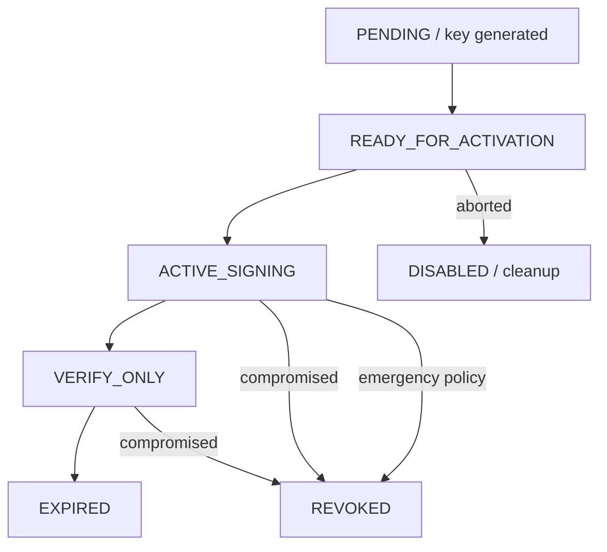

# Active key

## 1. Active key là gì và vì sao không chỉ là một cờ `enabled=true`?

Trong hệ thống **HMAC request authentication**, một client và server cùng biết một **shared secret**. Client dùng secret của một phiên bản khóa để ký **canonical HTTP request**; server dựa vào `clientId` và `keyId` để tìm key tương ứng, tự tính HMAC rồi kiểm tra signature. Khi **key rotation** diễn ra, hệ thống có thể có nhiều key versions tồn tại cùng lúc.

Câu hỏi “Key nào đang active?” thường có **hai ý nghĩa khác nhau**:

1. **Current signing key**: key mà client **nên chọn để tạo chữ ký cho request mới**.
2. **Verify-eligible key**: key mà server **vẫn chấp nhận dùng để xác minh request** trong khoảng thời gian chính sách cho phép.

Trong một giai đoạn chuyển đổi không gián đoạn, hai tập này **không nhất thiết trùng nhau**. Client nên ký bằng key B mới, nhưng verifier có thể tạm thời xác minh cả key B và key A cũ:

```text
Client client-42:
  k-old-01     -> VERIFY_ONLY          (còn verify được trong grace)
  k-active-02  -> ACTIVE_SIGNING       (key được chọn cho ký mới)

Current signing key:    k-active-02
Verify-eligible keys:   k-active-02, k-old-01
```

Nếu chỉ có cột `active=true` không nêu **active để ký hay active để verify**, lập trình viên dễ tạo một trong hai lỗi: từ chối mọi request cũ ngay khi chuyển key (gây gián đoạn), hoặc tiếp tục ký bằng key cũ mãi vì server vẫn chấp nhận nó (grace period không kết thúc).

Bài **“Active key”** thuộc chương **Key rotation** của mô-đun **`SECURITY_AUTHENTICATION_HMAC_REQUEST_AUTHENTICATION`**. Mô-đun tập trung vào xác thực HTTP request bằng HMAC với shared secret và canonical request chứa phương thức HTTP, URI, header hoặc body theo hợp đồng ký; xác minh chữ ký, chống replay bằng timestamp/nonce, quản lý key rotation, kiểm thử proxy/gateway và phân biệt authentication với authorization.

**Mục tiêu của bài:**

- Phân biệt **key active để ký**, **key được phép verify**, **key chờ kích hoạt** và **key đã thu hồi**.
- Định nghĩa state machine, hiệu lực thời gian và chính sách “một current signer mỗi client/mục đích”.
- Thực hiện activation/rotation bằng **atomic update hoặc compare-and-set**, tránh hai key cùng được công bố current do race.
- Tránh lỗi lấy secret tùy ý, dùng key ID không đúng tenant, hoặc fallback sang khóa cũ sau khi key đã bị revoke.
- Thiết kế chuyển đổi **A → B** không gián đoạn, có grace period, cache invalidation và cách khôi phục.
- Viết mã Java 17 cho key policy, lựa chọn active signer, HMAC verification và golden vectors.
- Kiểm thử timestamp/nonce, proxy, nhiều node, phân quyền và các lỗi vận hành liên quan active key.

**Điểm mấu chốt:** *active* là một **quyết định vòng đời có ngữ nghĩa cụ thể**, không phải phép đồng nhất “secret này đang tồn tại trong database”.

## 2. Một request HMAC sử dụng active key thế nào?

Request minh họa:

```http
POST /v1/payments?merchantId=m-42 HTTP/1.1
Host: api.example.test
Content-Type: application/json
X-Client-Id: client-42
X-Key-Id: k-active-02
X-Timestamp: 1795856400
X-Nonce: AAAAAAAAAAAAAAAAAAAAAA
X-Signature: <base64-hmac-sha256>

{"orderId":"O-42","amount":250000,"currency":"VND"}
```

`X-Key-Id` là **key version identifier**, không phải secret. Request không mang raw shared secret. Server:

1. Parse header, từ chối field trùng/thiếu/sai format.
2. Dùng tuple `(clientId,keyId)` chưa xác thực làm **gợi ý lookup**.
3. Đọc metadata của đúng key version và kiểm nó **verify-eligible tại thời điểm server xác minh**.
4. Lấy shared secret tương ứng từ secret store hoặc dùng API HMAC của HSM/KMS.
5. Dựng canonical bytes từ request **thực nhận** và kiểm full HMAC-SHA-256 tag.
6. Kiểm timestamp đã ký, reserve nonce nguyên tử để chống replay.
7. Chỉ khi xác thực thành công mới thiết lập authenticated principal.
8. Kiểm **authorization** trên merchant/resource và thực hiện business operation.

Trong mẫu trên, timestamp cố định và nonce toàn ký tự `A` là **test fixtures**. Production phải tạo timestamp gần thời điểm gửi và nonce mới, có entropy phù hợp, cho mỗi HTTP attempt.

### 2.1. Tại sao active key không được gửi nguyên secret?

```text
HTTP request:
  clientId   = client-42
  keyId      = k-active-02
  signature  = HMAC(secret, canonicalRequest)

Secret manager:
  (client-42, k-active-02) -> secret bytes
```

Nếu ứng dụng chấp nhận một header `X-Shared-Secret` rồi dùng giá trị do caller tự gửi làm key xác minh, attacker có thể tự chọn secret và MAC hợp lệ; bước kiểm tra đó **không xác thực caller theo credential đã đăng ký**.

### 2.2. Active key không chứng minh quyền truy cập nghiệp vụ

Một partner biết secret hợp lệ của `client-42` vẫn có thể cố gọi `merchantId=m-99`. HMAC xác thực bên có khóa; **authorization** kiểm liệu principal đó có quyền tạo payment cho `m-99` hay không.

Key state `ACTIVE_SIGNING` **không bao hàm quyền admin** hoặc quyền truy cập bất kỳ tenant nào.

## 3. Các trạng thái cần phân biệt

Không có một bộ tên trạng thái HMAC chuẩn áp dụng cho mọi ứng dụng. Bài dùng profile minh họa:

| State | Client được chọn để ký request mới? | Server được verify request nghiệp vụ? | Ý nghĩa |
| --- | --- | --- | --- |
| `PENDING` | Không | Không | Key mới sinh/provision nhưng chưa được kích hoạt |
| `READY_FOR_ACTIVATION` | Không | Không | Secret đã phân phối, enrollment/approval đủ điều kiện |
| `ACTIVE_SIGNING` | **Có** | **Có** | Key hiện hành cho signing và verification |
| `VERIFY_ONLY` | **Không theo policy** | **Có**, trong grace window | Key cũ trong giai đoạn chuyển tiếp |
| `REVOKED` | Không | Không | Bị thu hồi; không fallback để verify |
| `EXPIRED` | Không | Không | Hết thời gian hiệu lực theo policy |

**Lưu ý:** client vẫn **có thể tính HMAC** nếu còn giữ raw secret của key `VERIFY_ONLY`. Server không thể chứng minh đó là chữ ký vừa được tạo hay được tạo trước lúc chuyển trạng thái, chỉ từ một MAC hợp lệ. `VERIFY_ONLY` là **quy tắc client nên ngừng chọn key đó để ký**, trong khi server chấp nhận MAC dưới key đó cho đến hết grace period.

### 3.1. Vì sao active không đồng nghĩa tồn tại?

```text
Key material có mặt trong Vault:             yes
Key metadata state:                           REVOKED
Verifier được phép dùng secret để chấp nhận:  no
```

Một key có thể còn tồn tại trong backup hoặc retention store nhưng không được phép verify. Ngược lại, metadata catalog nói `ACTIVE_SIGNING` nhưng secret material chưa được provision hợp lệ là **lỗi workflow**, không phải lý do bỏ qua HMAC.

### 3.2. Trạng thái và thời gian là hai điều kiện độc lập

Một key có state `ACTIVE_SIGNING` nhưng `verifyUntil` đã qua **không còn verify-eligible**. Có thể định nghĩa:

```text
canVerify(key, now) =
    (key.state == ACTIVE_SIGNING || key.state == VERIFY_ONLY)
    && verifyFrom <= now < verifyUntil
    && key not revoked/disabled

canSign(key, now) =
    key.state == ACTIVE_SIGNING
    && signFrom <= now < signUntil
    && canVerify(key, now)
```

Cả `signFrom/signUntil` và `verifyFrom/verifyUntil` đều là **thời gian policy được đánh giá bằng clock tin cậy tại nơi đưa ra quyết định**, không phải tin một timestamp do client tự khai.

## 4. Active signing key là quyết định theo phạm vi nào?

Câu “chỉ có một active key” chỉ đúng khi **scope được xác định**. Một đối tác có thể sở hữu nhiều môi trường và nhiều mục đích ký:

```text
principal = partner-42
  environment = production
    purpose = PAYMENT_REQUEST
      current signer: k-active-02
  environment = staging
    purpose = PAYMENT_REQUEST
      current signer: k-stage-05
  environment = production
    purpose = WEBHOOK_CALLBACK
      current signer: k-hook-07
```

Một policy có thể yêu cầu **tối đa một current signing key cho mỗi tuple**:

\[
(\text{principal},\text{environment},\text{purpose})
\]

Trong khi đó, verifier có thể có **nhiều verify-eligible versions** cùng scope do rotation.

### 4.1. Đừng lẫn current key với mọi active credentials của một account

Một client có thể có nhiều key đang được phép verify, hoặc có hai credentials dùng cho **hai ứng dụng độc lập**. Nếu áp dụng unique constraint trên `clientId` mà không xét purpose/environment, hệ thống có thể vô tình từ chối một credential hợp lệ khác.

Ngược lại, nếu scope là “một active signing key cho HTTP PAYMENT request production”, phải ngăn hai provisioning workers cùng công bố hai key là current trong cùng scope.

### 4.2. Client ID và key ID chỉ là gợi ý trước HMAC

Nếu attacker gửi:

```http
X-Client-Id: client-42
X-Key-Id: k-active-02
```

thì điều đó **chưa chứng minh** attacker là client-42. Resolver chỉ được chọn **secret ứng viên thuộc đúng tuple và policy**; authenticated principal phải đến từ metadata đã được bảo vệ **sau khi full MAC khớp**.

## 5. Vòng đời từ PENDING đến active signing key

Sơ đồ chuyển trạng thái có thể là:



Những điều kiện bắt buộc trước `READY_FOR_ACTIVATION → ACTIVE_SIGNING` thường gồm:

- Secret material đã được ghi **đúng version** trong Vault/KMS/secret store.
- Client đã nhận/có khả năng dùng secret, hoặc đã vượt qua một bước enrollment proof-of-possession theo policy.
- Key metadata gắn với đúng `clientId`, principal, environment, purpose và algorithm.
- Không có revocation/disable flags.
- Quyền operator/provisioning service được kiểm tra.
- Catalog và runtime verifier có thể nhận diện key version mà không nhìn thấy state cũ quá lâu.
- Việc đổi current signing selection được cập nhật **nguyên tử**.

### 5.1. Không tự tạo active key mỗi khi server restart

Key material phải **ổn định** theo key version ở sender và verifier. Nếu một API pod restart rồi tự sinh secret mới cho cùng `keyId`, các request client ký bằng key cũ sẽ hỏng.

Quy trình đúng:

```text
Provision:
  generate secret -> store securely -> register metadata -> activate

At request time:
  resolve existing key version -> use secret -> verify MAC
```

### 5.2. Key B đã được provision nhưng client chưa sẵn sàng

Nếu server chuyển B sang current quá sớm trong khi client chưa nhận B, sender có thể tiếp tục ký bằng A. Server cần **grace verify A** và delivery/activation handshake; nếu policy đòi B ngay lập tức, downtime là hậu quả phải dự liệu.

## 6. Phân biệt switching của sender với eligibility của verifier

Trong rotation có hai **control planes**:

**Sender signing selection:**

```text
Đối với client-42:
  currentKeyId = k-active-02
  signer lấy secret của key đó
  tạo timestamp mới + nonce mới
  ký canonical request đúng byte
```

**Server verification eligibility:**

```text
Request mang X-Key-Id = k-old-01
  -> lookup key A
  -> nếu A VERIFY_ONLY và chưa hết grace: có thể verify
  -> nếu A REVOKED/EXPIRED: reject
  -> KHÔNG tự lấy key B để kiểm thay A
```

Hệ thống có thể chấp nhận **A và B** trong quá trình chuyển đổi, nhưng **client không nên ký mới bằng A** sau cutover theo quy tắc.

### 6.1. Không “thử mọi secret cho tới khi khớp”

Đây là antipattern:

```java
// SAI: bỏ qua keyId, thử mọi secret của account và mọi version.
for (byte[] secret : allKnownSecrets) {
    if (verify(secret, request)) {
        return authenticated();
    }
}
```

Nó làm mất ý nghĩa của key ID, gây chi phí/DoS, khó áp dụng revocation và dễ vô tình nhận một key ngoài policy. Resolver đúng phải chọn **key theo scope và keyId cụ thể**, kiểm status, rồi dùng đúng secret ứng viên.

### 6.2. Khóa đã revoke không được “fallback”

Nếu `k-old-01` bị thu hồi, một request mang `keyId=k-old-01` phải **bị từ chối**, kể cả khi HMAC sẽ khớp với secret cũ. Không được do key cũ không còn hiệu lực mà tự tính lại bằng key mới, thử legacy algorithm hoặc chấp nhận tag ngắn hơn.

## 7. Quy trình đổi active key A → B không gián đoạn

Giả sử `client-42` hiện ký bằng key A; cần chuyển sang B.

```mermaid
sequenceDiagram
    autonumber
    participant P as Credential operator
    participant S as Secret manager/catalog
    participant C as Client signer
    participant V as API verifier fleet
    P->>S: Provision B (PENDING), không ghi đè A
    P->>C: Deliver B qua kênh bảo vệ
    C->>P: Enrollment/ack B
    P->>S: Activate B + set A VERIFY_ONLY atomically
    S-->>V: Metadata/cache invalidation
    P-->>C: Công bố cutover sang B
    Note over C,V: B là current signer; A verify-only trong grace
    C->>V: Request mới có keyId=B, HMAC(B,...)
    V->>V: Verify bằng B
    C->>V: Một request/worker cũ còn dùng A
    V->>V: Verify bằng A nếu grace còn hiệu lực
    P->>S: Hết grace: expire/revoke A
    S-->>V: Invalidate A trên toàn verifier fleet
```

Các bước thực hành:

1. **Provision B**: sinh secret **mới** (32 byte CSPRNG theo profile), gắn key ID **mới**.
2. **Lưu B** trong secret store, metadata còn ở `PENDING` hoặc `READY_FOR_ACTIVATION`.
3. **Deliver B** qua kênh bảo vệ đến client signer, xác nhận client có key đúng.
4. **Chuẩn bị verifier fleet**: verifier có thể lookup B khi activation có hiệu lực, cache/replica không mâu thuẫn.
5. **Atomic switch**: một commit chuyển B thành current signer và A thành `VERIFY_ONLY` trong đúng scope; hoặc một authoritative current pointer đi kèm state transitions có consistency tương đương.
6. **Client cutover**: signer chọn B; mọi request mới dùng `keyId=B`, secret B và signature mới.
7. **Quan sát grace**: theo dõi số request còn dùng A, client versions/regions chưa update.
8. **Expire/revoke A** đúng thời hạn; xóa quyền verify và invalidate caches.
9. **Audit và cleanup**: cập nhật inventory, backup/retention policy và runbook.

**Quan trọng:** step 5 và 6 không thể giả định là một transaction nguyên tử giữa **server và hệ thống client**. Vì vậy server phải có giai đoạn **overlap verification** có kiểm soát để sender đổi dần sang B.

### 7.1. Grace period phải có hạn

Grace quá ngắn gây lỗi cho các request/network queue cũ. Grace quá dài giữ lại một secret cũ có thể bị lộ trong phạm vi sử dụng và kéo dài bề mặt tấn công.

Cần chọn dựa trên:

- Thời gian phân phối key và client rollout.
- Timestamp acceptance window, network latency, queue delay.
- Số dịch vụ/instances ký request.
- Rủi ro business endpoint, ví dụ thanh toán.
- Khả năng quan sát old-key usage và thu hồi khẩn cấp.

**Không** giữ grace period vô hạn chỉ vì “không biết client nào đang dùng A”.

### 7.2. Planned rotation khác compromised key

Nếu **key A đã bị lộ**, chấp nhận A thêm nhiều ngày để tránh downtime có thể tạo cơ hội giả mạo request mới. **Emergency revoke** phải ưu tiên ngăn giả mạo và có kế hoạch khôi phục cho client bị ảnh hưởng.

Grace là cơ chế migration **khi key chưa bị xác nhận compromise**, không phải mặc định cho sự cố lộ secret.

## 8. Mô hình dữ liệu catalog cho active key

Một catalog có thể chứa thông tin:

| Cột | Ý nghĩa |
| --- | --- |
| `principal_id` | Principal đã đăng ký được liên kết với key |
| `client_id` | ID caller dùng trong giao thức |
| `environment` | Production/staging hoặc namespace được quản lý |
| `purpose` | `HTTP_REQUEST_AUTH`, webhook, … |
| `key_id` | Key version, được bảo vệ bởi unique constraint |
| `algorithm` | Ví dụ `HmacSHA256`, không cho downgrade tùy ý |
| `state` | `PENDING, ACTIVE_SIGNING, VERIFY_ONLY, REVOKED` |
| `sign_from/sign_until` | Thời gian policy cho client lựa chọn ký |
| `verify_from/verify_until` | Thời gian policy cho verifier chấp nhận |
| `secret_locator` | Reference trusted, không phải raw key |
| `version` | Dùng trong compare-and-set/optimistic locking |
| `created_at, activated_at, revoked_at` | Audit |
| `rotation_group_id` | Liên kết A/B theo một rotation operation |

Ví dụ pseudo-SQL:

```sql
CREATE TABLE hmac_key_version (
    principal_id        VARCHAR(100) NOT NULL,
    client_id           VARCHAR(100) NOT NULL,
    environment         VARCHAR(40) NOT NULL,
    purpose             VARCHAR(80) NOT NULL,
    key_id              VARCHAR(100) NOT NULL,
    state               VARCHAR(40) NOT NULL,
    algorithm           VARCHAR(40) NOT NULL,
    secret_locator      VARCHAR(500) NOT NULL,
    sign_from           TIMESTAMP NOT NULL,
    sign_until          TIMESTAMP NOT NULL,
    verify_from         TIMESTAMP NOT NULL,
    verify_until        TIMESTAMP NOT NULL,
    version             BIGINT NOT NULL,
    PRIMARY KEY (client_id, environment, purpose, key_id)
);
```

Đây là **schema khái niệm**, chưa giải quyết SQL dialect, timezone data type, isolation, indexes và multi-region consistency. Secret bytes không nên nằm plaintext trong catalog.

### 8.1. Unique partial index cho current signing key

Nếu database có hỗ trợ partial index, có thể áp dụng một quy tắc kiểu:

```sql
-- Pseudo-SQL: cú pháp thực tế tùy database.
CREATE UNIQUE INDEX one_current_signer_per_scope
ON hmac_key_version(client_id, environment, purpose)
WHERE state = 'ACTIVE_SIGNING';
```

Tuy nhiên **chỉ index này** không giải quyết đầy đủ việc **activation nhiều dòng** hay lịch thời gian chồng lấn. Nếu các key được lên lịch sẽ active trong tương lai, phải có thêm kiểm overlap hoặc một **current signing pointer** được chuyển nguyên tử.

**Quan trọng:** nếu dựa vào unique index và đổi A/B trong một transaction, thứ tự update, locking và constraint checking của database cần được kiểm thử. Một số database kiểm unique ngay giữa các statement; cách an toàn hơn có thể là lock scope record, cập nhật state theo thứ tự có kiểm soát, hoặc chỉ cập nhật một dòng `current_key_id` authoritative.

### 8.2. Một current-key pointer dễ kiểm soát hơn trong một số hệ thống

```text
credential_scope:
  principal = partner-42
  client = client-42
  environment = production
  purpose = HTTP_REQUEST_AUTH
  currentSigningKeyId = k-active-02
  version = 13

key_versions:
  k-old-01     VERIFY_ONLY
  k-active-02  ACTIVE_SIGNING
```

Current pointer và key version state vẫn phải **nhất quán trong transaction**; pointer trỏ vào key revoked hoặc chưa provision là lỗi nghiêm trọng. Verifier không nên chỉ tin pointer: request có key ID nào thì phải kiểm **status của version đó**.

## 9. Concurrency: hai operator cùng kích hoạt hai key

Giả sử operator P muốn đổi A→B, còn operator Q muốn đổi A→C. Nếu cả hai đọc cùng current A rồi ghi vô điều kiện:

```text
P: reads current = A
Q: reads current = A
P: writes current = B
Q: writes current = C
Result: B đã công bố cho client nhưng server ghi C
```

Một chiến lược dùng **compare-and-set với version**:

```text
P: compareAndSet(expectedVersion=12, expectedCurrent=A, newCurrent=B)
   -> success, version=13

Q: compareAndSet(expectedVersion=12, expectedCurrent=A, newCurrent=C)
   -> conflict, phải đọc lại và quyết định
```

Không dùng cách “last write wins” ngầm định với credential state. Các thay đổi trạng thái nên có **audit, reason, operator identity và rotation operation ID**.

### 9.1. Một transaction không bao trùm được client và secret manager

Kể cả catalog switch là atomic trong một DB, client sender có thể vẫn đang rollout key B. Secret manager có thể chậm hơn catalog, hoặc key B chưa sẵn sàng ở một region. Vì vậy phải:

- Không activate B trước khi secret material **đã được provision và kiểm sẵn sàng**.
- Gắn activation với **version/etag** và proof-of-readiness.
- Định nghĩa cache propagation/reconciliation khi có lỗi.
- Để overlap verification A/B trong planned rotation cho tới khi client switch ổn định.
- Nếu không thể bảo đảm verify B, không âm thầm chuyển sang bỏ kiểm MAC.

## 10. Time window: active key còn hiệu lực từ lúc nào?

Trong HMAC request authentication có **hai khung thời gian**:

1. **Key validity**: `verifyFrom <= serverNow < verifyUntil` và state verify-eligible.
2. **Request freshness**: `serverNow - maxPast <= signedTimestamp <= serverNow + maxFuture`.

Chúng cần được kiểm **riêng rẽ**.

### 10.1. Ví dụ key A sắp hết grace

Giả sử key A có:

```text
state = VERIFY_ONLY
verifyFrom = 2026-11-20T00:00:00Z
verifyUntil = 2026-11-28T03:00:00Z
```

Request mang timestamp do client khai `2026-11-28T02:59:59Z` nhưng được server nhận lúc `03:00:01Z`.

Nếu policy đánh giá **key validity tại server receive/verification time**, A **đã hết hạn**, request phải bị từ chối dù signed timestamp có thể vẫn còn trong cửa sổ freshness.

Không sử dụng signed timestamp chưa xác thực để “kéo dài quyền dùng key” sau verifyUntil. Ngay cả timestamp được HMAC bảo vệ cũng không tự chứng minh key còn được phép dùng ở thời điểm server đang ra quyết định.

### 10.2. Cận thời gian phải có hợp đồng

Ví dụ:

```text
verifyFrom = inclusive
verifyUntil = exclusive

now == verifyFrom  -> key có thể verify
now == verifyUntil -> key không verify
```

Dùng `java.time.Instant` và `Clock` để tránh local timezone và cho phép unit tests deterministic. Đồng bộ wall clock của server fleet; nếu node có clock skew, key activation và expiry có thể bị đánh giá khác nhau.

### 10.3. Có nên để grace bằng đúng 300 giây?

**Không mặc nhiên.** Một request ký bằng A có thể mất thời gian trên queue hoặc network. Nếu client rollout chậm hàng giờ, grace 300 giây là quá ngắn. Ngược lại, key A đã compromise thì không nên chấp nhận A chỉ vì chưa hết 300 giây.

**Key grace duration là chính sách rotation**; **request freshness window** là chính sách chống replay. Hai thứ liên quan vận hành nhưng không phải một tham số.

## 11. Cache và propagation: active của catalog chưa chắc active ở mọi pod

Hệ thống thường cache key metadata và secret material để tránh gọi Vault/KMS trên mỗi request. Khi chuyển A→B, cache có thể gây khác biệt:

```text
Catalog authoritative: B ACTIVE_SIGNING, A VERIFY_ONLY
Node 1 cache:          B ACTIVE_SIGNING, A VERIFY_ONLY
Node 2 cache (stale):  A ACTIVE_SIGNING, B PENDING
```

Node 2 có thể từ chối request hợp lệ ký bằng B vì metadata chưa update, hoặc tiếp tục chấp nhận A sau khi đã revoked. Nếu cache state và material không versioned, node còn có thể dùng sai key bytes dưới đúng key ID.

### 11.1. Thiết kế cache an toàn hơn

- Cache theo `(clientId, environment, purpose, keyId, keyVersion)`.
- Key material phiên bản cũ **không bị overwrite** dưới cùng key ID.
- Metadata state và revoke policy phải có **TTL ngắn hoặc invalidation hiệu quả**.
- Đọc lại authoritative metadata khi có policy nhạy cảm hoặc khi nhận signal revoke.
- Có metrics về cache age, hit/miss, invalidation lag và unexpected key state.
- Giới hạn memory và thời gian giữ raw secret bytes.
- Không dùng lỗi secret store làm lý do **accept** request mà chưa kiểm MAC.

### 11.2. Fail closed khi cache/store không chắc chắn

Nếu node không có secret B hoặc secret store unavailable, nó không thể tự tính HMAC kỳ vọng. **Không được**:

```java
// SAI: không tìm được secret thì coi như hợp lệ.
if (keyStoreUnavailable) {
    return authenticatedPrincipal;
}
```

Một số hệ thống có chính sách tiếp tục dùng một **cached key vẫn còn verify-eligible theo bằng chứng metadata đủ mới** trong outage ngắn. Đây là quyết định availability/revocation trade-off cần tài liệu và kiểm thử, không phải quy tắc “cache gì cũng chấp nhận”.

### 11.3. Multi-region đòi consistency rõ ràng

Nếu hai region chuyển current signing pointer trên hai replicas có độ trễ và cho phép ghi độc lập, có thể xuất hiện **hai current keys trong hai region**. Cần authoritative writer/strong conditional update/quorum/fencing theo threat model, hoặc công bố rõ mức consistency đạt được.

Không tuyên bố “đổi active tức thì trên toàn thế giới” nếu dựa vào eventual consistency không có SLA cập nhật.

## 12. Golden vector HMAC để thấy keyId và key material đều ảnh hưởng chữ ký

Phần này dùng hai **secret test công khai**, khác nhau giữa key A và B. **Không dùng các keys/timestamp/nonce trong production**.

Body đúng **51 byte UTF-8**, không có LF cuối:

```json
{"orderId":"O-42","amount":250000,"currency":"VND"}
```

SHA-256 lowercase hex:

```text
ea646bb8b1903a83256034142a633e90ffad35b3a40bb4c5f0e8f1eb4f4f27f9
```

### 12.1. Key A — old verify-only key

```text
clientId: client-42
keyId:    k-old-01

Secret A, 32 raw bytes (HEX):
00112233445566778899aabbccddeeff00112233445566778899aabbccddeeff
```

Canonical request **10 dòng LF-delimited, không có LF cuối**:

```text
HMAC-ROTATION-V1
POST
/v1/payments
merchantId=m-42
content-type:application/json
client-id:client-42
key-id:k-old-01
x-timestamp:1795856400
x-nonce:AAAAAAAAAAAAAAAAAAAAAA
ea646bb8b1903a83256034142a633e90ffad35b3a40bb4c5f0e8f1eb4f4f27f9
```

Kết quả tính độc lập:

```text
Canonical length: 235 bytes
HMAC-SHA-256 raw tag hex:
585a09c3551a0dff72ee89146b0c9d7b9caf355ecccbe3b09e6a76f0bc022608

Base64 Basic padded (44 chars):
WFoJw1UaDf9y7okUawyde5yvNV7My+Ownmp28LwCJgg=
```

### 12.2. Key B — current active signing key

```text
clientId: client-42
keyId:    k-active-02

Secret B, 32 raw bytes (HEX):
ffeeddccbbaa99887766554433221100ffeeddccbbaa99887766554433221100
```

Canonical request chỉ đổi dòng key ID:

```text
HMAC-ROTATION-V1
POST
/v1/payments
merchantId=m-42
content-type:application/json
client-id:client-42
key-id:k-active-02
x-timestamp:1795856400
x-nonce:AAAAAAAAAAAAAAAAAAAAAA
ea646bb8b1903a83256034142a633e90ffad35b3a40bb4c5f0e8f1eb4f4f27f9
```

Kết quả:

```text
Canonical length: 238 bytes
HMAC-SHA-256 raw tag hex:
a127810da942df26b77cafc63e32320108090cc950c9c9676e9a2e400badea57

Base64 Basic padded (44 chars):
oSeBDalC3ya3fK/GPjIyAQgJDMlQyclnbpouQAut6lc=
```

**Lưu ý:** hai tags khác nhau vì **cả secret và key ID** đều đổi. Để cô lập tác động của key ID, có thể cố tình dùng **Secret A + canonical keyId=B** trong **test-only**:

```text
Secret = A
Canonical key ID = k-active-02
Expected tag Base64:
xEU62LOgBjtLLlk/n/XGSdfaIc2XxcqBllivRkELtJA=
```

Giá trị thứ ba cũng khác tag A cũ. Điều này xác nhận **key ID được ràng buộc vào canonical data**. Trong sản phẩm thật không alias hai key IDs cùng raw secret; mỗi rotation key version nên có material mới.

### 12.3. Golden vector không tự chứng minh active state

Một MAC hợp lệ về toán học dưới Secret A **vẫn có thể tính được sau khi key A bị revoke**. Server phải **kiểm state/validity** trước khi chấp nhận request; golden vector chỉ chứng minh canonical bytes, secret bytes, thuật toán và encoding nhất quán.

## 13. Java 17: biểu diễn KeyRecord và quy tắc active/verify-eligible

Ví dụ sau dùng `Clock` để tách chính sách key khỏi đồng hồ hệ thống thực. Nó không phải một framework Spring hoàn chỉnh.

```java
import java.time.Clock;
import java.time.Instant;
import java.util.Objects;

public final class ActiveKeyPolicyV1 {
    private ActiveKeyPolicyV1() {}

    public enum State {
        PENDING,
        READY_FOR_ACTIVATION,
        ACTIVE_SIGNING,
        VERIFY_ONLY,
        REVOKED
    }

    public record KeyRecord(
            String principalId,
            String clientId,
            String keyId,
            String environment,
            String purpose,
            String secretLocator,
            String algorithm,
            State state,
            Instant signFrom,
            Instant signUntil,
            Instant verifyFrom,
            Instant verifyUntil,
            long version) {

        public KeyRecord {
            Objects.requireNonNull(principalId, "principalId");
            Objects.requireNonNull(clientId, "clientId");
            Objects.requireNonNull(keyId, "keyId");
            Objects.requireNonNull(environment, "environment");
            Objects.requireNonNull(purpose, "purpose");
            Objects.requireNonNull(secretLocator, "secretLocator");
            Objects.requireNonNull(algorithm, "algorithm");
            Objects.requireNonNull(state, "state");
            Objects.requireNonNull(signFrom, "signFrom");
            Objects.requireNonNull(signUntil, "signUntil");
            Objects.requireNonNull(verifyFrom, "verifyFrom");
            Objects.requireNonNull(verifyUntil, "verifyUntil");

            if (principalId.isBlank()
                    || !clientId.matches("[A-Za-z0-9._-]{1,80}")
                    || !keyId.matches("[A-Za-z0-9._-]{1,100}")
                    || environment.isBlank() || purpose.isBlank()
                    || secretLocator.isBlank()
                    || !"HmacSHA256".equals(algorithm)
                    || !signFrom.isBefore(signUntil)
                    || !verifyFrom.isBefore(verifyUntil)
                    || version < 0) {
                throw new IllegalArgumentException(
                        "Invalid key metadata");
            }
        }
    }

    public static boolean canVerifyAt(
            KeyRecord record, Instant now) {
        Objects.requireNonNull(record);
        Objects.requireNonNull(now);

        boolean allowedState =
                record.state() == State.ACTIVE_SIGNING
                || record.state() == State.VERIFY_ONLY;

        return allowedState
                && !now.isBefore(record.verifyFrom())
                && now.isBefore(record.verifyUntil());
    }

    public static boolean canSignAt(
            KeyRecord record, Instant now) {
        Objects.requireNonNull(record);
        Objects.requireNonNull(now);

        return record.state() == State.ACTIVE_SIGNING
                && !now.isBefore(record.signFrom())
                && now.isBefore(record.signUntil())
                && canVerifyAt(record, now);
    }

    public static boolean canVerifyNow(
            KeyRecord record, Clock clock) {
        return canVerifyAt(record, Instant.now(clock));
    }
}
```

**Điểm cần chú ý:**

- `State.ACTIVE_SIGNING` đại diện **current key theo policy**, còn `VERIFY_ONLY` vẫn có thể verify.
- `canVerifyAt` không cho `PENDING` hoặc `REVOKED` qua, kể cả khi time interval còn hạn.
- `verifyFrom` bao gồm cận bắt đầu; `verifyUntil` không bao gồm cận kết thúc.
- `canSignAt` yêu cầu **đồng thời** trạng thái signing, signing window và verify window.
- KeyRecord chứa `secretLocator` của catalog tin cậy, **không chứa raw secret**.
- Code này chưa kiểm **một current signer mỗi scope**; đó là việc của catalog/selection và transaction layer.

### 13.1. Vì sao không dùng `X-Timestamp` làm `now` ở canVerify?

Timestamp trong request là một phần dữ liệu client ký; nó **không đại diện đồng hồ policy** của server. Nếu client dùng một key đã hết hạn rồi ký lại với timestamp cũ, việc kiểm key validity theo client timestamp có thể cho key lẽ ra đã expired hoạt động lại.

Server phải dùng **server receive/verification time** theo hợp đồng key lifecycle. Request freshness được kiểm riêng và cả hai điều kiện đều phải đạt.

## 14. Java 17: chỉ chọn một current signing key

Đây là lớp lựa chọn key **ở phía sender/backend tin cậy**; client app không nên tùy tiện lấy key `VERIFY_ONLY` để ký request mới.

```java
import java.time.Clock;
import java.time.Instant;
import java.util.List;
import java.util.Objects;

public final class ActiveSigningKeySelectorV1 {
    private ActiveSigningKeySelectorV1() {}

    public static ActiveKeyPolicyV1.KeyRecord select(
            List<ActiveKeyPolicyV1.KeyRecord> candidates,
            String clientId,
            String environment,
            String purpose,
            Clock clock) {

        Objects.requireNonNull(candidates, "candidates");
        Objects.requireNonNull(clientId, "clientId");
        Objects.requireNonNull(environment, "environment");
        Objects.requireNonNull(purpose, "purpose");
        Objects.requireNonNull(clock, "clock");

        Instant now = Instant.now(clock);
        ActiveKeyPolicyV1.KeyRecord selected = null;

        for (var record : candidates) {
            if (record == null) {
                throw new IllegalStateException(
                        "Invalid catalog record");
            }

            // Không cho key khác client/tenant/purpose lọt vào.
            if (!clientId.equals(record.clientId())
                    || !environment.equals(record.environment())
                    || !purpose.equals(record.purpose())) {
                continue;
            }

            if (!ActiveKeyPolicyV1.canSignAt(record, now)) {
                continue;
            }

            if (selected != null) {
                // Không đoán dựa vào keyId alphabet/time sort.
                throw new IllegalStateException(
                        "Multiple active signing keys");
            }

            selected = record;
        }

        if (selected == null) {
            throw new IllegalStateException(
                    "No current signing key");
        }

        return selected;
    }
}
```

**Lưu ý:** việc filter client/environment/purpose ở đây chỉ là defense-in-depth. Catalog phải áp dụng **authorized scope** và policy sở hữu; caller của selector không được biến string từ HTTP client chưa xác thực thành quyền xem secret của tenant khác.

### 14.1. Không chọn theo “key ID lớn nhất”

Sai:

```java
// SAI: key ID order không phải state/activation policy.
String chosen = allKeyIds.stream()
        .sorted()
        .reduce((a, b) -> b)
        .orElseThrow();
```

Key ID có thể random, rotation có thể rollback, key mới nhất có thể PENDING hoặc REVOKED. Chỉ chọn theo **authoritative state/current pointer và hiệu lực thời gian**.

### 14.2. Two ACTIVE keys là cấu hình lỗi, không phải chia tải tự động

Nếu policy quy định đúng **một current signer**, selector phải báo lỗi khi tìm hai `ACTIVE_SIGNING` cùng scope. Không “chọn đại key đầu” khiến các request của cùng client luân phiên signature theo những key không được đồng thuận.

## 15. Java 17: canonical request ràng buộc key ID và HMAC

Để kiểm các golden vectors, tạo một utility chỉ dành cho endpoint minh họa `POST /v1/payments?merchantId=m-42`.

```java
import java.nio.charset.StandardCharsets;
import java.security.GeneralSecurityException;
import java.security.MessageDigest;
import java.util.Arrays;
import java.util.Base64;
import java.util.HexFormat;
import java.util.Objects;
import javax.crypto.Mac;
import javax.crypto.spec.SecretKeySpec;

public final class RotationHmacV1 {
    private RotationHmacV1() {}

    public record SignedInput(
            String method,
            String publicRawPath,
            String rawQuery,
            String contentType,
            String clientId,
            String keyId,
            String timestampSeconds,
            String nonce,
            byte[] body) {

        public SignedInput {
            Objects.requireNonNull(body, "body");
            body = body.clone();
        }

        @Override
        public byte[] body() {
            return body.clone();
        }
    }

    public static byte[] canonical(SignedInput request)
            throws GeneralSecurityException {

        Objects.requireNonNull(request);
        if (!"POST".equals(request.method())
                || !"/v1/payments".equals(request.publicRawPath())
                || !"merchantId=m-42".equals(request.rawQuery())
                || !"application/json".equals(request.contentType())
                || request.clientId() == null
                || !request.clientId().matches(
                        "[A-Za-z0-9._-]{1,80}")
                || request.keyId() == null
                || !request.keyId().matches(
                        "[A-Za-z0-9._-]{1,100}")
                || request.timestampSeconds() == null
                || !request.timestampSeconds().matches(
                        "0|[1-9][0-9]{0,11}")
                || request.nonce() == null
                || !request.nonce().matches(
                        "[A-Za-z0-9_-]{22}")) {
            throw new IllegalArgumentException(
                    "Invalid HMAC-ROTATION-V1 signed fields");
        }

        byte[] rawNonce;
        try {
            rawNonce = Base64.getUrlDecoder()
                    .decode(request.nonce());
        } catch (IllegalArgumentException malformed) {
            throw new IllegalArgumentException(
                    "Invalid nonce", malformed);
        }
        if (rawNonce.length != 16
                || !Base64.getUrlEncoder().withoutPadding()
                    .encodeToString(rawNonce)
                    .equals(request.nonce())) {
            throw new IllegalArgumentException(
                    "Noncanonical nonce");
        }

        String bodyHash = HexFormat.of().formatHex(
                MessageDigest.getInstance("SHA-256")
                        .digest(request.body()));

        String value = String.join("\n",
                "HMAC-ROTATION-V1",
                request.method(),
                request.publicRawPath(),
                request.rawQuery(),
                "content-type:" + request.contentType(),
                "client-id:" + request.clientId(),
                "key-id:" + request.keyId(),
                "x-timestamp:" + request.timestampSeconds(),
                "x-nonce:" + request.nonce(),
                bodyHash);

        return value.getBytes(StandardCharsets.UTF_8);
    }

    public static byte[] mac(
            byte[] ownedSecret, byte[] canonicalBytes)
            throws GeneralSecurityException {

        Objects.requireNonNull(ownedSecret);
        Objects.requireNonNull(canonicalBytes);
        if (ownedSecret.length != 32) {
            throw new IllegalArgumentException(
                    "V1 expects 32-byte key material");
        }

        Mac hmac = Mac.getInstance("HmacSHA256");
        hmac.init(new SecretKeySpec(
                ownedSecret, "HmacSHA256"));
        return hmac.doFinal(canonicalBytes);
    }

    public static String sign(
            byte[] ownedSecret, SignedInput request)
            throws GeneralSecurityException {

        return Base64.getEncoder().encodeToString(
                mac(ownedSecret, canonical(request)));
    }

    public static boolean validFullTag(
            String signatureB64, byte[] expectedTag) {

        if (signatureB64 == null
                || signatureB64.length() != 44
                || expectedTag == null
                || expectedTag.length != 32) {
            return false;
        }

        byte[] supplied;
        try {
            supplied = Base64.getDecoder()
                    .decode(signatureB64);
        } catch (IllegalArgumentException malformed) {
            return false;
        }

        // 32-byte HMAC-SHA-256 -> 44 Base64 Basic chars,
        // padded, canonical representation.
        boolean canonical = supplied.length == 32
                && Base64.getEncoder()
                    .encodeToString(supplied)
                    .equals(signatureB64);

        return canonical && MessageDigest.isEqual(
                expectedTag, supplied);
    }
}
```

**Giới hạn phạm vi:** đây là class minh họa, không phải generic signer cho mọi URI. Trong ứng dụng thật, canonical method/path/query/header/body phải được dựng từ **request thực nhận** theo contract của API và chính sách gateway; không hardcode `merchantId=m-42` cho tất cả clients. `Arrays` import có thể bỏ nếu không dùng; mảng raw secret nên được zeroize best effort khi hết cần theo ownership contract.

### 15.1. Vì sao key ID phải có trong canonical bytes?

Nếu request đổi `X-Key-Id` sau khi ký, HMAC expected phải thay đổi khi key ID được bảo vệ. Ngoài ra, server sẽ lookup key material khác theo key ID, nên MAC có thể không khớp vì secret khác.

Ký key ID ngăn ambiguity trong diễn giải metadata chọn key. Nhưng **vẫn** phải kiểm key ownership/status: một HMAC đúng toán học không có nghĩa key đó còn hợp lệ về vòng đời.

### 15.2. Vì sao không so Base64 String bằng `equals`?

Verification nên decode raw tag 32 byte rồi so với expected bằng `MessageDigest.isEqual`. Bước re-encode equality chỉ dùng để xác nhận format Base64 chính tắc; nó không thay thế phép so MAC theo byte.

## 16. Java 17: verifier kiểm key state trước khi chấp nhận request

Pseudo-production flow cần ba dependency rõ ràng: metadata catalog, secret store/HSM và replay store.

```java
import java.time.Instant;
import java.util.Optional;

public final class ActiveVerifierContractsV1 {
    private ActiveVerifierContractsV1() {}

    @FunctionalInterface
    public interface KeyCatalog {
        // Bắt buộc lookup đúng tuple và scope.
        Optional<ActiveKeyPolicyV1.KeyRecord> find(
                String clientId, String keyId);
    }

    @FunctionalInterface
    public interface SecretStore {
        // Return owned 32-byte raw key theo trusted locator,
        // hoặc throw khi backend lỗi. Không dùng default key.
        byte[] readOwned(String trustedLocator);
    }

    @FunctionalInterface
    public interface ReplayStore {
        // Insert-if-absent atomic theo authenticated principal.
        boolean reserveOnce(
                String principalId, String nonce, long ttlSeconds);
    }
}
```

Ví dụ verifier sau dùng một clock cố định cho **key policy và timestamp freshness**:

```java
import java.security.GeneralSecurityException;
import java.time.Clock;
import java.time.Instant;
import java.util.Arrays;
import java.util.Optional;

public final class ActiveRequestVerifierV1 {
    private static final long MAX_PAST = 300;
    private static final long MAX_FUTURE = 60;
    private static final long REPLAY_MARGIN = 60;

    private ActiveRequestVerifierV1() {}

    public static Optional<String> verifyAndReserve(
            RotationHmacV1.SignedInput req,
            String signatureB64,
            Clock clock,
            ActiveVerifierContractsV1.KeyCatalog catalog,
            ActiveVerifierContractsV1.SecretStore secrets,
            ActiveVerifierContractsV1.ReplayStore replay)
            throws GeneralSecurityException {

        if (req == null || clock == null
                || catalog == null || secrets == null
                || replay == null) {
            throw new IllegalArgumentException(
                    "Missing verifier dependency");
        }

        // Một nguồn clock cho key eligibility và freshness.
        Instant now = Instant.now(clock);

        // Parse/validate input; canonical() không tin
        // digest do caller tự khai.
        final byte[] canonical;
        try {
            canonical = RotationHmacV1.canonical(req);
        } catch (IllegalArgumentException malformed) {
            return Optional.empty();
        }

        var maybeKey = catalog.find(
                req.clientId(), req.keyId());
        if (maybeKey.isEmpty()) return Optional.empty();

        var record = maybeKey.get();
        if (!req.clientId().equals(record.clientId())
                || !req.keyId().equals(record.keyId())
                || !"production".equals(record.environment())
                || !"HTTP_REQUEST_AUTH".equals(record.purpose())
                || !"HmacSHA256".equals(record.algorithm())
                || !ActiveKeyPolicyV1.canVerifyAt(record, now)) {
            return Optional.empty();
        }

        // Chỉ giải mã key theo trusted catalog locator.
        byte[] secret = secrets.readOwned(
                record.secretLocator());
        if (secret == null) {
            throw new IllegalStateException(
                    "Secret backend returned no key");
        }

        final byte[] expected;
        try {
            expected = RotationHmacV1.mac(
                    secret, canonical);
        } finally {
            // Best-effort zeroization of owned buffer.
            Arrays.fill(secret, (byte) 0);
        }

        if (!RotationHmacV1.validFullTag(
                signatureB64, expected)) {
            return Optional.empty();
        }

        // MAC đã đúng: timestamp chính tắc được bảo vệ.
        long signed = Long.parseLong(
                req.timestampSeconds());
        long serverSeconds = now.getEpochSecond();

        final long min;
        final long max;
        final long ttl;
        try {
            min = Math.subtractExact(serverSeconds, MAX_PAST);
            max = Math.addExact(serverSeconds, MAX_FUTURE);
            if (signed < min || signed > max) {
                return Optional.empty();
            }

            long expiry = Math.addExact(signed, MAX_PAST);
            ttl = Math.max(1L, Math.addExact(
                    Math.subtractExact(expiry, serverSeconds),
                    REPLAY_MARGIN));
        } catch (ArithmeticException overflow) {
            return Optional.empty();
        }

        if (!replay.reserveOnce(
                record.principalId(), req.nonce(), ttl)) {
            return Optional.empty();
        }

        // Authenticated principal: authorization nằm ở tầng sau.
        return Optional.of(record.principalId());
    }
}
```

### 16.1. Những giới hạn của ví dụ

1. Ví dụ cố định scope `production` và `HTTP_REQUEST_AUTH`, đồng thời kiểm lại metadata; `catalog.find` trong triển khai thật phải được **scope theo environment/purpose/tenant** của endpoint trước khi đọc secret. Không cho request tự chọn environment khác để lấy secret.
2. Không bỏ qua MAC vì lookup, Vault hoặc replay store lỗi: **fail closed**.
3. `verifyAndReserve` cho phép **VERIFY_ONLY** trong grace, còn `ActiveSigningKeySelectorV1` không chọn VERIFY_ONLY để ký mới.
4. Kiểm full HMAC-SHA-256 **32 byte** với Base64 padded chính tắc; không cho client tự chọn tag length/algorithm.
5. Key state và validity là **phần của authorization để sử dụng credential**, tách biệt với authorization nghiệp vụ.
6. TTL nonce tính đến khi signed timestamp không còn hợp lệ, cộng margin. Margin 60 giây chỉ là **giả định bài học**, không đủ cho mọi cluster.
7. Replay store phải **atomic và shared giữa nodes**; không dùng local `HashSet` khi có nhiều pods.
8. Header adapter phải từ chối **duplicate signed headers** và quản lý canonical public URI đúng trước khi gọi verifier.
9. Đường gọi `Optional.of(principalId)` nghĩa là authenticated, **chưa được phép payment** nếu tenant/scope không hợp lệ.
10. Server không dùng `active signing pointer` để **thay đổi keyId do request đã ký gửi lên**; nó verify đúng version được chỉ định nếu version đó verify-eligible.

### 16.2. Ordering của HMAC, freshness và key lookup

Code minh họa kiểm key state và HMAC trước freshness để mạch giải thích rõ. Một hệ thống thật có thể **kiểm cú pháp và window sớm** để giảm chi phí lookup, nhưng không được **reserve nonce, gán principal hoặc làm business side effect** trước MAC khớp.

Không cho attacker phân biệt chi tiết key nào tồn tại qua public error response hoặc timing dễ khai thác; có thể dùng error contract thống nhất, rate limiting và metrics nội bộ.

## 17. JUnit 5: kiểm đúng active signer và verify-only

Các ví dụ dùng `Clock.fixed` để không phụ thuộc ngày chạy CI.

### 17.1. Test policy với key A verify-only và B active

```java
import static org.junit.jupiter.api.Assertions.*;
import java.time.Clock;
import java.time.Instant;
import java.time.ZoneOffset;
import java.util.List;
import org.junit.jupiter.api.Test;

class ActiveKeyPolicyV1Test {
    private static final Instant NOW =
            Instant.parse("2026-11-28T00:00:00Z");

    private static final Clock FIXED =
            Clock.fixed(NOW, ZoneOffset.UTC);

    static ActiveKeyPolicyV1.KeyRecord record(
            String keyId, ActiveKeyPolicyV1.State state) {

        return new ActiveKeyPolicyV1.KeyRecord(
                "partner-42", "client-42", keyId,
                "production", "HTTP_REQUEST_AUTH",
                "vault://test-only/client-42/" + keyId,
                "HmacSHA256", state,
                Instant.parse("2026-11-20T00:00:00Z"),
                Instant.parse("2026-12-01T00:00:00Z"),
                Instant.parse("2026-11-20T00:00:00Z"),
                Instant.parse("2026-12-05T00:00:00Z"),
                1L);
    }

    @Test
    void selectsOnlyBForNewSignatures() {
        var a = record("k-old-01",
                ActiveKeyPolicyV1.State.VERIFY_ONLY);
        var b = record("k-active-02",
                ActiveKeyPolicyV1.State.ACTIVE_SIGNING);

        assertTrue(ActiveKeyPolicyV1.canVerifyNow(a, FIXED));
        assertTrue(ActiveKeyPolicyV1.canVerifyNow(b, FIXED));

        assertFalse(ActiveKeyPolicyV1.canSignAt(a, NOW));
        assertTrue(ActiveKeyPolicyV1.canSignAt(b, NOW));

        var chosen = ActiveSigningKeySelectorV1.select(
                List.of(a, b), "client-42",
                "production", "HTTP_REQUEST_AUTH", FIXED);

        assertEquals("k-active-02", chosen.keyId());
    }

    @Test
    void failsOnTwoCurrentSigningKeys() {
        var a = record("k-old-01",
                ActiveKeyPolicyV1.State.ACTIVE_SIGNING);
        var b = record("k-active-02",
                ActiveKeyPolicyV1.State.ACTIVE_SIGNING);

        assertThrows(IllegalStateException.class,
                () -> ActiveSigningKeySelectorV1.select(
                        List.of(a, b),
                        "client-42", "production",
                        "HTTP_REQUEST_AUTH", FIXED));
    }

    @Test
    void revokedKeyIsNeverVerifyEligible() {
        var revoked = record("k-old-01",
                ActiveKeyPolicyV1.State.REVOKED);
        assertFalse(
                ActiveKeyPolicyV1.canVerifyAt(revoked, NOW));
    }

    @Test
    void excludesVerifyUntilBoundary() {
        var a = record("k-old-01",
                ActiveKeyPolicyV1.State.VERIFY_ONLY);

        Instant end = Instant.parse(
                "2026-12-05T00:00:00Z");

        assertTrue(ActiveKeyPolicyV1.canVerifyAt(
                a, end.minusNanos(1)));

        assertFalse(ActiveKeyPolicyV1.canVerifyAt(
                a, end));
    }
}
```

### 17.2. Các lựa chọn cần kiểm khi không có current key

Ngoài hai current keys, phải test **zero current key** (chỉ còn PENDING hoặc VERIFY_ONLY) dẫn tới từ chối signing mới. Không được tự chọn verify-only key làm signer chỉ vì không còn active one.

Test với `clientId/environment/purpose` khác nhau để bảo đảm scope không bị trộn.

## 18. JUnit 5: kiểm golden vectors khi đổi active key

Test dùng raw secret fixture, không phải production credential.

```java
import static org.junit.jupiter.api.Assertions.*;
import java.nio.charset.StandardCharsets;
import java.util.Base64;
import java.util.HexFormat;
import org.junit.jupiter.api.Test;

class RotationHmacGoldenVectorTest {
    private static RotationHmacV1.SignedInput input(
            String keyId) {

        return new RotationHmacV1.SignedInput(
                "POST", "/v1/payments", "merchantId=m-42",
                "application/json", "client-42", keyId,
                "1795856400", "AAAAAAAAAAAAAAAAAAAAAA",
                ("{\"orderId\":\"O-42\",\"amount\":250000,"
                 + "\"currency\":\"VND\"}")
                .getBytes(StandardCharsets.UTF_8));
    }

    @Test
    void keyAAndBMatchIndependentHmacVectors()
            throws Exception {

        byte[] keyA = HexFormat.of().parseHex(
                "00112233445566778899aabbccddeeff"
              + "00112233445566778899aabbccddeeff");

        byte[] keyB = HexFormat.of().parseHex(
                "ffeeddccbbaa99887766554433221100"
              + "ffeeddccbbaa99887766554433221100");

        var requestA = input("k-old-01");
        var requestB = input("k-active-02");

        assertEquals(235,
                RotationHmacV1.canonical(requestA).length);
        assertEquals(238,
                RotationHmacV1.canonical(requestB).length);

        assertEquals(
                "WFoJw1UaDf9y7okUawyde5yvNV7My+Ownmp28LwCJgg=",
                RotationHmacV1.sign(keyA, requestA));

        assertEquals(
                "oSeBDalC3ya3fK/GPjIyAQgJDMlQyclnbpouQAut6lc=",
                RotationHmacV1.sign(keyB, requestB));

        // Cô lập effect của signed key ID với cùng test key A.
        assertEquals(
                "xEU62LOgBjtLLlk/n/XGSdfaIc2XxcqBllivRkELtJA=",
                RotationHmacV1.sign(keyA, requestB));
    }

    @Test
    void rejectsTamperedSignatureAndTruncatedTag()
            throws Exception {

        byte[] keyB = HexFormat.of().parseHex(
                "ffeeddccbbaa99887766554433221100"
              + "ffeeddccbbaa99887766554433221100");

        byte[] canonicalB =
                RotationHmacV1.canonical(input("k-active-02"));
        byte[] expected = RotationHmacV1.mac(
                keyB, canonicalB);

        assertTrue(RotationHmacV1.validFullTag(
                "oSeBDalC3ya3fK/GPjIyAQgJDMlQyclnbpouQAut6lc=",
                expected));

        assertFalse(RotationHmacV1.validFullTag(
                "WFoJw1UaDf9y7okUawyde5yvNV7My+Ownmp28LwCJgg=",
                expected));

        // Truncated MAC không được chấp nhận theo profile V1.
        String shortTag = Base64.getEncoder()
                .encodeToString(
                    java.util.Arrays.copyOf(expected, 16));

        assertFalse(RotationHmacV1.validFullTag(
                shortTag, expected));
    }
}
```

Test này kiểm canonical bytes và HMAC **độc lập với state machine**. Một signature tính đúng với key A sau khi A đã `REVOKED` **vẫn phải bị từ chối bởi policy**. Test integration cần xác nhận thứ tự verifier và key resolver không cho phép bypass.

## 19. Key rotation, timestamp/nonce và idempotency

Ba cơ chế này có đối tượng bảo vệ khác nhau:

| Cơ chế | Định danh chính | Thay khi key rotation? |
| --- | --- | --- |
| Shared secret/key ID | Key version A → B | **Có**, material và key ID mới |
| Timestamp + nonce | Một signed HTTP attempt | **Mới mỗi attempt**, bất kể rotation |
| Idempotency-Key | Một business operation/intent | **Giữ nguyên** cho cùng intent khi retry |
| Authenticated principal | Identity của client/đối tác | Thường **ổn định** qua rotation |
| Authorization scope | Quyền trên merchant/resource | Theo policy nghiệp vụ, không tự mở rộng khi rotation |

### 19.1. Replay store không nên mặc định scope theo key ID

Nếu policy yêu cầu **nonce chỉ dùng một lần cho mỗi authenticated principal**, replay key nên dạng:

```text
replayKey =
    "hmac:v1:" + authenticatedPrincipal + ":" + nonce
```

Nếu scope theo `(principal, keyId, nonce)`, cùng nonce có thể được chấp nhận lại sau khi client đổi key A→B. Điều đó có thể trái chính sách anti-replay single-use của hệ thống.

Tuy nhiên không được đơn giản hóa bằng cách gộp mọi principal/tenant vào cùng một namespace khiến nonce của client này vô tình chặn client khác.

### 19.2. Key A verify-only không cứu một nonce đã dùng

```mermaid
sequenceDiagram
    autonumber
    participant C as Client
    participant V as Verifier
    participant R as Replay store
    C->>V: POST key A, timestamp T1, nonce N1, HMAC A
    V->>V: A VERIFY_ONLY và còn grace; MAC đúng
    V->>R: reserve(principal,N1)
    R-->>V: accepted
    Note over C,V: Client retry có ý định nghiệp vụ cũ
    C->>C: Chuyển B, tạo T2,N2, ký HMAC B
    C->>V: POST key B, T2,N2,HMAC B, cùng Idempotency-Key
    V->>V: B ACTIVE_SIGNING; MAC đúng
    V->>R: reserve(principal,N2)
    R-->>V: accepted
    V->>V: Business idempotency nhận diện cùng intent
```

Retry hợp lệ phải tạo **nonce và chữ ký mới**; Idempotency-Key của cùng intent nên được giữ nếu endpoint yêu cầu idempotent POST. **Anti-replay** kiểm lần gửi HTTP; **idempotency** kiểm tác dụng phụ nghiệp vụ.

### 19.3. Không giải quyết lộ secret bằng nonce

Nếu attacker biết secret A khi A còn `VERIFY_ONLY`, họ có thể tạo **một request mới** dưới A với nonce chưa dùng. Replay store không biết nonce mới đó đến từ client thật hay attacker.

Vì vậy việc phát hiện compromise phải dẫn đến **revoke A**, không chỉ giảm TTL nonce.

## 20. Proxy/gateway: key active phải khớp tại đúng điểm xác minh

Một hệ thống có thể có:

```text
Client signer
    |
    v
CDN / WAF
    |
    v
API Gateway  ----> Secret manager / key catalog
    |
    v
Backend service
    |
    v
Payment provider
```

Các câu hỏi phải quyết định:

- Gateway hay backend chịu trách nhiệm **verify HMAC**?
- Current key metadata có được cache ở nhiều lớp không?
- Proxy có rewrite URI, query, Content-Type hoặc body bytes **sau khi client ký** không?
- Gateway có chuyển authenticated principal qua **kênh nội bộ tin cậy** không?
- Gateway đã reserve nonce thì backend có vô tình reserve lại cùng nonce không?
- HTTP/2 header names lowercase có được xử lý đúng không?
- Khi rotation A→B, một tầng nhận B còn tầng kia chỉ nhận A có gây lỗi không?

### 20.1. Không tin header identity do client tự gửi

Nếu gateway đã verify rồi thêm `X-Authenticated-Principal`, phải **xóa mọi header cùng tên từ Internet** và bảo vệ đoạn gateway → backend (mTLS, service identity, signed internal assertion hoặc cơ chế nội bộ tương đương).

Không được cho client tự khai `X-Verified-Key-State: ACTIVE` rồi backend bỏ qua key resolver.

### 20.2. Mỗi tầng chỉ dùng một canonical contract rõ ràng

Key B active và secret B đúng **không cứu được** một request bị gateway rewrite body/path khi HMAC client ký trên bytes khác. Cần xác minh ở đúng trust boundary hoặc có cơ chế bảo toàn public canonical request target đáng tin cậy.

Đặc biệt đừng lấy `X-Original-URI` từ Internet rồi dùng nguyên xi để thay request target trong canonicalization nếu gateway chưa xác thực/bảo vệ header đó.

## 21. Các failure mode của active key và cách kiểm soát

| Failure | Tác động | Biện pháp |
| --- | --- | --- |
| Kích hoạt B trước khi lưu secret B | API không verify được request mới | Readiness check + PENDING workflow |
| Kích hoạt B khi client chưa nhận key | Client còn ký A, dễ downtime | Delivery/ack + overlap verify |
| Ghi đè secret A dưới cùng key ID | Client/server HMAC mismatch | Immutable version, key ID mới |
| Có hai current signing pointers do race | Clients chọn key không thống nhất | CAS/transaction + unique scope |
| Resolver tự chọn latest key, bỏ key ID | Có thể chọn key sai hoặc policy sai | Exact tuple lookup |
| Fallback sang revoked A | Key bị lộ tiếp tục xác thực | Fail closed |
| Cache metadata B=ACTIVE chỉ một phần fleet | Một số nodes từ chối B | Cache invalidation/prewarming + rollout |
| A đã revoke nhưng node còn cache A | Node vẫn chấp nhận MAC cũ | Revocation SLA, fencing, urgent invalidation |
| Signing client dùng VERIFY_ONLY A mãi | Grace không bao giờ kết thúc | Client rollout controls + telemetry |
| Clock lệch giữa regions | VerifyFrom/Until không thống nhất | NTP health, bounded skew, reliable clock |
| HMAC đúng nhưng body đã đổi | Có thể accept sai request nếu body không ký | Canonical raw-body hash |
| Không ký key ID/client ID | Metadata chọn key có thể bị sửa | Bind identity/key selection vào canonical input |
| Secret store lỗi thì cho qua request | Bypass xác thực | Fail closed |
| HMAC tag rút gọn không theo contract | MAC validation yếu | Fixed 32-byte full tag |
| Nonce lưu theo key ID tách biệt khi policy muốn toàn client | Nonce dùng lại qua rotation | Replay key theo authenticated principal |
| Business retry tạo idempotency key mới | Có thể double payment | Stable business intent key |
| Không kiểm authorization sau HMAC | Client vượt tenant/resource | Authz độc lập |
| Multi-region eventual writes hai active | Trạng thái không nhất quán | Single authority/strong conditional update |
| Revoke A nhưng giữ old-key fallback flag | Revocation mất tác dụng | Remove legacy fallback, test revoked path |
| Rollback từ B sang A đã compromise | Mở lại credential bị lộ | Cấp key mới C, không phục hồi compromised A |

## 22. Monitoring, runbook và kiểm thử chuyển active key

Trong production, active key là trạng thái **vận hành động**, không chỉ là một dòng config. Cần đo:

- Tỷ lệ request xác minh bằng từng **key ID/version** (tránh log secret/signature).
- Mốc cutover, old-key traffic và grace expiry dự kiến.
- Key state distribution trên các verifier nodes/regions.
- Cache age/invalidation lag, secret lookup errors.
- `bad_mac`, `key_revoked`, `key_expired`, `unknown_key`, `nonce_replayed`.
- Clock drift và verify window boundary failures.
- Số failed retries, provider business anomalies sau rotation.
- Audit của operator/service thực hiện state transitions.

Một runbook rotation có thể có các bước:

1. Kiểm catalog current state và client ownership, quota, IAM.
2. Tạo và provision **new key B**; chắc chắn không in secret ra logs.
3. Kiểm server tất cả relevant nodes có thể verify B **đúng timing**.
4. Xác nhận client đã nhận/kiểm thử B qua enrollment hoặc sandbox.
5. Thực hiện **atomic switch** current signer A→B.
6. Theo dõi MAC errors và old-key usage.
7. Giữ overlap verification A trong grace có hạn.
8. Kết thúc grace bằng expire/revoke A và invalidate cache.
9. Chạy security tests: request ký bằng A bị từ chối, B hợp lệ được nhận.
10. Đóng rotation operation với audit, compliance và backup review.

### 22.1. Rollback ra sao?

Nếu B mới bị cấu hình sai nhưng A **chưa compromised** và policy vẫn cho phép, có thể dùng một transition rollback có kiểm soát với approval/audit. Tuy nhiên cần xác định **current pointer, sender rollout, state và cache** cùng được cập nhật an toàn.

Nếu A đã compromised hoặc đã bị revoke do security incident, **không rollback về A**. Provision key C và giải quyết khả năng truy cập qua runbook sự cố.

### 22.2. Đừng log raw secret hoặc expected HMAC

Khi debug “key B không verify được”, chỉ log metadata đã được phép:

```text
client=client-42
keyId=k-active-02
keyState=ACTIVE_SIGNING
lookupResult=FOUND
macResult=MISMATCH
region=region-a
canonicalContract=HMAC-ROTATION-V1
```

Không log raw secret, Base64 secret, full expected MAC hoặc full signed requests còn giá trị phát lại. Với CI/test, dùng **public fixture** để dump canonical bytes nếu cần.

## 23. Ma trận kiểm thử cho active key

Cần test cả **policy state** và **HMAC protocol**, không chỉ unit test so enum.

### 23.1. Unit tests — trạng thái và key selection

| ID | Tình huống | Kỳ vọng |
| --- | --- | --- |
| U01 | Một B ACTIVE_SIGNING | Sender chọn B |
| U02 | A VERIFY_ONLY, B ACTIVE_SIGNING | Sender chọn B; verifier có thể verify A+B |
| U03 | Hai ACTIVE_SIGNING cùng scope | Báo lỗi config, không chọn bừa |
| U04 | Không key ACTIVE_SIGNING | Không ký mới, fail closed |
| U05 | B PENDING nhưng verifyFrom đã tới | Không được chọn ký hoặc verify |
| U06 | A REVOKED nhưng validity chưa hết | Không verify |
| U07 | A VERIFY_ONLY tại verifyFrom | Chấp nhận theo inclusive start |
| U08 | A VERIFY_ONLY tại verifyUntil | Từ chối theo exclusive end |
| U09 | B ACTIVE_SIGNING nhưng signUntil qua | Không chọn ký |
| U10 | B ACTIVE_SIGNING nhưng verifyUntil qua | Không chọn ký/verify |
| U11 | Key khác environment/purpose | Không nằm trong selection scope |
| U12 | Client ID khác nhưng cùng key ID | Resolver không dùng nhầm key |
| U13 | Catalog record algorithm không thuộc V1 | Reject |
| U14 | Key B missing material | Không dùng default secret |
| U15 | Key ID thay trong canonical, secret giữ | Signature thay đổi theo golden vector |
| U16 | Secret A và B khác, same signed message | Signatures khác |
| U17 | Full SHA256 tag 32 bytes | Chấp nhận format nếu HMAC khớp |
| U18 | Tag 16 bytes hoặc Base64 unpadded | Từ chối theo V1 |
| U19 | Signed request body bị đổi | HMAC khác |
| U20 | Timestamp hoặc nonce sửa không ký lại | HMAC khác |

### 23.2. Integration/concurrency tests — rotation và hạ tầng

| ID | Tình huống | Kỳ vọng |
| --- | --- | --- |
| I01 | Hai operators cùng activate B/C trên current A version 12 | Chỉ một CAS thành công |
| I02 | Concurrent signing trong cutover | Key lựa chọn theo snapshot nhất quán |
| I03 | B active trong catalog, một pod chưa có material | Fail closed/rollout xử lý, không bypass |
| I04 | Client chuyển ký B, server cho A verify-only | Overlap đúng |
| I05 | A verify-only hết grace | Không xác minh A sau cutoff |
| I06 | A revoked khẩn cấp | Tất cả nodes ngừng verify A theo SLA |
| I07 | Region khác chậm nhận rotation | Alert/mitigate propagation lag |
| I08 | Cache giữ A ACTIVE sau revoke | Test phát hiện cache stale |
| I09 | Secret store timeout khi verify B | Không được accept |
| I10 | Redis replay store timeout | Không được xử lý business |
| I11 | Replay cùng nonce bằng A rồi B | Bị từ chối nếu scope principal single-use |
| I12 | Retry payment bằng B với nonce mới, idem key cũ | Một business intent |
| I13 | HMAC B hợp lệ nhưng principal thiếu quyền merchant | Authorization từ chối |
| I14 | Gateway rewrite signed target | MAC mismatch |
| I15 | Gateway verify rồi backend reserve lại cùng nonce | Test phát hiện double reservation |
| I16 | Client ký B nhưng gửi key ID A | Server không thử mọi key để sửa |
| I17 | Key A/B secrets bị swap nhầm trong store | MAC mismatch; alert |
| I18 | Two clients dùng cùng key ID | Tenant isolation |
| I19 | Rollback B→A khi A chưa compromise | Chuyển trạng thái theo policy/audit |
| I20 | Cố rollback về A đã compromised | Bị chặn theo incident policy |
| I21 | Key verifyUntil ở mốc giây/nanosecond biên | Quy tắc inclusive/exclusive đúng |
| I22 | Clock skew giữa API nodes | Theo policy, không bypass key expiry |
| I23 | Restore backup key A đã revoke | Không tái kích hoạt A |
| I24 | CI source/secret scan | Không có production secret trong source/logs |

### 23.3. Fault injection theo từng bước

```text
F1: Crash sau khi provision B, trước khi ghi metadata
F2: Crash sau metadata READY, trước khi client ack
F3: Crash sau client ack, trước khi current pointer CAS
F4: DB commit pointer CAS nhưng response tới operator mất
F5: Cache invalidation cho region B bị chậm
F6: Key A revoke nhưng một verifier còn giữ raw material
F7: KMS/HSM unavailable lúc B được active
F8: Clock của một node nhảy lùi đúng mốc verifyUntil
```

Mỗi trường hợp phải hỏi: **current signer authoritative là ai**, **version nào còn verify-eligible**, **request có bị fail open không**, **có tác dụng phụ nghiệp vụ trùng không**, và **quy trình reconcile** sẽ làm gì.

## 24. Bài tập thực hành: chuyển active key cho API thanh toán

Bạn vận hành API thanh toán HMAC của 500 đối tác. Mỗi client có keyset trong secret manager, metadata trong database, replay store chung và hai API regions. Client `client-42` đang dùng A, sắp chuyển sang B.

**Câu hỏi:**

1. Phân biệt `ACTIVE_SIGNING` và `VERIFY_ONLY`. Key nào client nên dùng để ký request mới?
2. Vì sao server có thể tạm chấp nhận cả A và B khi rotation nhưng sender chỉ nên chọn B?
3. Key A còn material trong Vault có nghĩa A còn verify-eligible không?
4. `X-Key-Id` có phải là secret hoặc bằng chứng danh tính không?
5. Nếu catalog cho hai ACTIVE_SIGNING cùng `(client,environment,purpose)`, selector nên làm gì?
6. Vì sao không chọn key ID mới nhất theo alphabetical order?
7. Trạng thái `PENDING` có được dùng để verify request production không?
8. Thứ tự provisioning B, delivery, activation và client cutover nên như thế nào?
9. Vì sao một transaction database không tự đảm bảo client đã chuyển sang ký bằng B?
10. Hai operators cùng activate B/C bằng version 12; CAS giải quyết race như thế nào?
11. Nếu key A đang VERIFY_ONLY nhưng verifyUntil đã tới, server có nên nhận một request timestamp còn mới không?
12. Nếu key A bị lộ, có nên giữ grace một tuần để tránh downtime không?
13. Nếu cache metadata của region B vẫn thấy A active/B pending, có thể có những lỗi nào?
14. Vì sao không thử mọi secret khi key ID trong request không tìm thấy?
15. HMAC signature có thể đổi khi chỉ đổi key ID trong canonical string mà dùng cùng secret không?
16. Với body 51 bytes và key B fixture, expected Base64 full HMAC của `HMAC-ROTATION-V1` là gì?
17. Nếu signed timestamp hợp lệ nhưng nonce cũ được gửi lại, tầng nào từ chối?
18. Key ID có nên nằm trong replay key khi policy là nonce single-use theo authenticated principal không?
19. Retry payment sau timeout và sau key rotation: trường nào phải đổi, trường nào nên giữ cho cùng intent?
20. Key B HMAC đúng nhưng client-42 không có quyền với merchant m-99; điều gì phải xảy ra?
21. Gateway đổi path sau khi client ký, active key đúng có đủ để tiếp tục không?
22. Vì sao key grace period khác timestamp replay window?
23. Nếu secret manager outage khi không có cached secret hợp lệ, verifier có được accept request không?
24. Key A đã REVOKED nhưng backup restore metadata A ACTIVE. Làm sao phát hiện/ngăn?
25. Thiết kế test đa node xác nhận key A bị revoke và key B active được áp dụng trong revocation SLA.

### Gợi ý đáp án

1. ACTIVE_SIGNING là current signer + verify; VERIFY_ONLY chỉ verify trong grace.
2. Để client rollout dần mà không gián đoạn; policy signing có một key hiện hành.
3. Không, state/validity quyết định.
4. Không; chỉ là lookup hint trước MAC.
5. Fail closed, báo lỗi cấu hình; cần CAS/unique current pointer.
6. ID không biểu diễn policy và có thể random/PENDING/REVOKED.
7. Không.
8. Provision B, lưu secret/metadata, delivery/ack, chuẩn bị verifier, switch current, client cutover, grace A, revoke A.
9. Client là hệ thống phân tán khác không thuộc transaction DB.
10. Một CAS thắng; CAS còn lại nhận conflict và phải reconcile.
11. Không; key validity đánh giá bằng server clock tại thời điểm verify.
12. Không nếu A đã compromise; emergency revoke.
13. Có thể reject B, accept A quá hạn hoặc sai material; cần invalidation/rollout.
14. Mất key scoping, có thể bypass revocation/DoS.
15. Có, key ID nằm trong canonical data.
16. `oSeBDalC3ya3fK/GPjIyAQgJDMlQyclnbpouQAut6lc=`.
17. Atomic replay nonce store.
18. Không mặc định; scope theo principal nếu policy đã quy định như vậy.
19. Key ID/secret sang B, timestamp/nonce/signature mới; giữ Idempotency-Key của business intent.
20. Authorization từ chối.
21. Không; canonical target phải khớp hợp đồng ký.
22. Key grace phục vụ migration, timestamp window giới hạn tuổi request.
23. Không, fail closed.
24. Revocation state có authoritative ledger/audit; restore policy và tests không hồi sinh compromised key.
25. Integration test theo trạng thái authoritative, cross-node cache invalidation, boundary time và signature acceptance/rejection.

## 25. Tổng kết

**Active key** trong Key rotation phải được hiểu đúng: đó có thể là **current signing key** hoặc một **verify-eligible key** trong cửa sổ chuyển tiếp. Khi key B được chọn ký request mới, server vẫn có thể cho phép key A ở trạng thái **VERIFY_ONLY** để tránh gián đoạn rollout. Trạng thái này có hạn và **không áp dụng như một ngoại lệ** cho key đã lộ hoặc đã revoked.

Để quản lý active key an toàn, cần **catalog có scope/owner/key ID rõ**, key material riêng theo version, state machine, validity intervals, unique current pointer hoặc compare-and-set transaction, secret delivery/readiness, cache invalidation và monitoring giữa các region. Server phải verify **đúng key version được request chỉ định** nếu verify-eligible, không thử mọi secret hoặc fallback sang key cũ sau revoke.

Active state **không thay thế HMAC authentication**: server vẫn phải dựng canonical method/URI/signed headers/body đúng bytes, ràng buộc key ID trong dữ liệu ký, so full HMAC-SHA-256, kiểm timestamp/nonce chống replay, sau đó **authorization** trên principal/resource. Khi retry, timestamp/nonce/signature mới nhưng Idempotency-Key của cùng business intent vẫn ổn định.

Một rotation đáng tin cậy không phải một thao tác “đổi config”, mà là **chuyển trạng thái và năng lực xác minh có kiểm soát** với các phép thử về concurrency, clock, cache, secret store, gateway, replay và thu hồi khẩn cấp.

